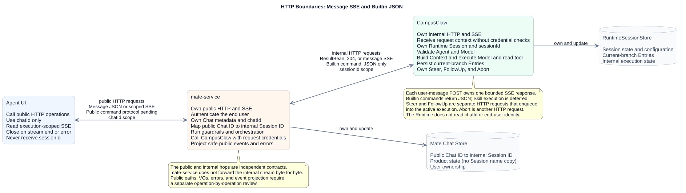
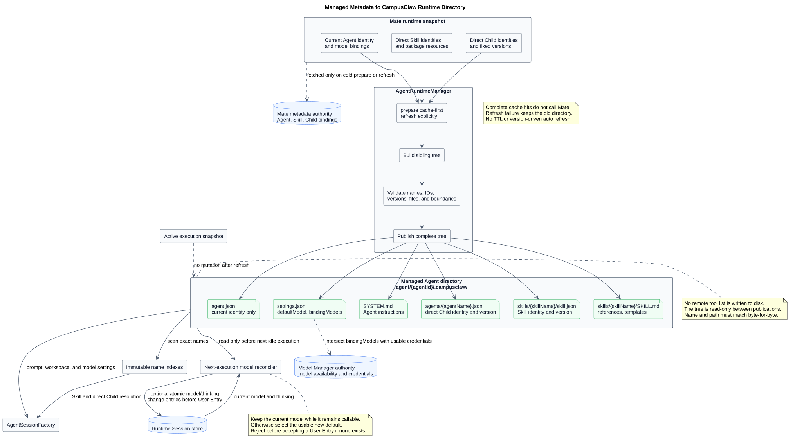

# CampusClaw 多 Agent Runtime 设计

| 属性 | 值 |
|---|---|
| 文档版本 | 3.37.0 |
| 更新日期 | 2026-10-18 |
| 职责 | M01：Agent 执行装配、入口协作与父子执行生命周期 |
| 设计状态 | 当前目标；实现状态按专项源码证据分别判断 |
| 源码证据 | [固定提交、路径、符号与差距](source-evidence.md) |

Session 与完整事件的时间采用[统一秒级目标](time-contract.md)：UTC、无小数秒，写入和回显一致；此精度调整待实现，其他功能状态仍按各节证据。

[统一执行历史](unified-event-persistence.md)维护交互、Cron、Subagent 的独立持久 Session、逐工具提交、父子关联与 Skill 同事务投影；新增能力待实现，最新源码范围见[专项证据](unified-event-persistence-evidence.md)。

[Claw 数据库设计](../../03-数据与存储/Claw数据库设计.md#t_session_executions)统一维护Runtime所用表、字段、约束和索引；本文继续维护行为与契约。

## 1. 当前结论

CampusClaw 提供服务端 Agent Runtime。mate-service 接收浏览器的 Chat 请求，解析到内部 Session，再调用 Runtime。Runtime 负责模型与工具循环、Session 上下文和执行生命周期；公共身份、公司认证与业务授权由 mate-service 维护。

一个 Session 同时只处理一条普通用户消息。消息接受与 `idle → running` 在同一数据库事务提交，执行发生在事务之外；等待工具确认或 HTTP 断开都不释放普通消息准入。中断与确认继续作用于已接受的执行，完整结束状态提交后才允许下一条消息。具体事务、顺序与跨实例控制由 [Session Events](chat-events-design.md)维护。

Runtime 采用同一 POST 提交用户事件并接收该请求的 SSE，GET 读取权威历史。Mate 的公共提交、Chat 级实时流和历史各自独立，由 [Mate Chat Events](../../02-服务与接口/07-mate-service通用对话API/README.md)维护。两层流的生命周期不同，桥接需要解析与投影。

| 本模块负责 | 所属模块维护的协作边界 |
|---|---|
| Runtime、Cron、Subagent 的执行对象装配与关闭 | [工具系统](../02-CampusClaw工具系统/README.md)维护 profile、工具实例、受管目录与缓存；[M10 定时任务](../08-CampusClaw定时任务/README.md)维护待实现的后台受理与 Run 关联 |
| 模型与工具循环的入口协作 | [Model](../../02-服务与接口/03-Model/README.md)维护业务 Agent 设置的模型选择与流适配 |
| 父子执行的独立上下文与生命周期 | [工具系统 Agent 工具](../02-CampusClaw工具系统/built-in-tool-contracts.md)维护调用参数与结果 |
| Session 运行对象与持久化恢复的衔接 | [会话记忆](../../03-数据与存储/01-会话记忆GaussDB/README.md)维护上下文与存储 |
| 模式与执行快照的衔接 | [计划模式](../06-CampusClaw计划模式/README.md)维护 plan/build 提示词、审核与续跑 |

## 2. 契约权威顺序

精确操作、字段、错误与确认状态由 [catalog.json](接口契约/catalog.json) 指定的 JSON 源维护，[统一接口页](chat-api-review.html)由这些源生成。Markdown 维护设计机制和理由；生成、校验与格式权威见 [接口维护](chat-api-index.md)。

### 2.1 源驱动契约校验

修改后运行 `python3 render_chat_api.py` 与 `python3 validate-chat-api.py --full`；Help 派生页、Mate 独立契约和图纸的维护命令见 [接口维护流程](chat-api-index.md#3-生成与校验)。

## 3. 两跳服务责任

### 3.1 mate-service 公共边界

mate-service 维护用户可见 Chat、公司认证、Chat 授权和 `chatId → sessionId` 私有映射，消费 Runtime 事件并投影为公共内容。它不保存 Session 名称的第二份权威状态，不向浏览器暴露内部 Session 标识、凭据或 Provider 配置。

公共 Events 三个 operation 的设计状态由 [Mate 主设计](../../02-服务与接口/07-mate-service通用对话API/README.md)维护；公共 Command 的投影和待决边界由 [Mate Command](../../02-服务与接口/06-mate-service聊天命令API/README.md)维护。内部协议不能自动决定公共协议。

### 3.2 CampusClaw 内部 Runtime 边界

Runtime 通过 `sessionId` 定位持久化配置、单条追加时间线和执行状态，不读取 `chatId` 或建立最终用户身份。上游携带的凭据只进入执行范围，实际 Mate Tool 调用才使用；[HTTP 安全边界](chat-http-v1-design.md#7-安全与附件边界)维护其生命周期。

[原尺寸 SVG](设计图/服务边界/mate_agent_service_responsibility_boundary.svg) · [PlantUML 源码](设计图/服务边界/diagram.puml#L1)

## 4. 当前目标 HTTP 接口清单

[统一接口页](chat-api-review.html)提供完整清单，按 Session 资源、Events、模型目录与 Command 阅读。Session 的名称、模型、思考和模式共用部分更新入口，在最新行锁内合并本次字段、校验完整组合并原子提交；内部 resourceVersion 不外露。所有接口不声明或消费 If-Match/Idempotency-Key，额外传入按未知 Header 忽略，也不返回配套 ETag，不增加 body/query 替代字段。准入、能力归一、同值无变化及结果不确定时的对账见 [HTTP 设计](chat-http-v1-design.md#24-模型目录与统一-session-更新)。

| 序号 | 方法 | 路径 | 职责 |
|---|---|---|---|
| 1 | `POST` | `/agents/{agentId}/sessions` | 创建会话 |
| 2 | `GET` | `/sessions/{sessionId}` | 查询会话 |
| 3 | `DELETE` | `/sessions/{sessionId}` | 删除会话 |
| 4 | `POST` | `/sessions/{sessionId}/events` | 提交事件并接收对应推送 |
| 5 | `GET` | `/sessions/{sessionId}/events` | 查看对话历史 |
| 6 | `GET` | `/sessions/{sessionId}/commands/{commandName}/values` | 查询选项型命令（model、thinking、mode）的当前值与可选值 |
| 7 | `POST` | `/sessions/{sessionId}` | 更新会话 |
| 8 | `GET` | `/agents/{agentId}/commands` | 查看 Agent 命令清单 |
| 9 | `POST` | `/sessions/{sessionId}/command` | 执行会话命令 |
| 10 | `POST` | `/internal/skills/load-statistics/query` | 按 skillIds 批量查询累计/精确范围激活统计；排名、趋势暂缓 |
| 11 | `GET` | `/agents/{agentId}/events` | 按 Agent 与时间范围跨会话列出用户请求（user.message），供 Mate Trace 使用 |
| 12 | `GET` | `/sessions/{sessionId}/events/{eventId}/turn` | 由任意一条事件读取所在轮次的全部事件 |

统计查询由 [M05 使用统计 §6](../04-CampusClaw命令系统/03-Skill加载统计/README.md#6-查询接口)维护：F19 采用按指定 skillIds 的累计或精确时间范围查询，返回 activationCount/lastLoadedAt；排名和日趋势暂缓。接口不返回 scope；采集入口、去重和存储目标的其他差异仍由 F20 及专题证据单独对齐，不表示整项验收。

第 11、12 项供 Mate Trace 只读调用，设计见 [Agent 用户事件与轮次查询](agent-user-events-design.md)。

## 5. 执行主线与恢复

1. **创建 Session。** 校验已发布 Agent 目录、默认模型和创建所需配置，保存初始 Session 资源；此时不调用模型，也不创建活动 Agent。创建与惰性装配的边界见 [Session 生命周期](chat-http-v1-design.md#21-session-生命周期)。
2. **接受输入。** 固定请求快照，在所属事务中检查资源与状态，接受用户事件并登记执行。完整回执先排入该响应，再启动运行对象。
3. **执行循环。** 工厂按入口创建独立 `ManagedAgentSession`、Agent 和工具实例；模型流先转换成领域事件，工具结果进入后续模型上下文。
4. **追加与展示。** 用户输入和 Runtime 输出共用有序追加边界；完整事件提交后发布，临时 delta 只用于预览。[流设计](chat-events-stream-design.md)维护响应绑定、背压和关闭。
5. **等待与结束。** 需要工具确认时保存等待目标并结束本段响应，确认 POST 继续原执行；真实结束后提交终态并释放资源。断线仅解除该响应订阅。
6. **恢复读取。** 调用方通过 [事件历史](chat-events-history-design.md)对账。Agent 上下文按单条追加时间线重建；公共历史与模型输入是不同投影。

计划审核复用上述确认续跑基础；TODO 通过成功工具结果保存实施进度。精确规则与 待实现 差距见 [计划模式](../06-CampusClaw计划模式/README.md)。

## 6. Runtime 内部设计不变量

| 边界 | 当前约束与理由 |
|---|---|
| Session 身份 | 一个 Session 绑定不可变 Agent；模型、thinking、mode 是可变配置，不能成为 Session 身份 |
| 执行快照 | 活动执行使用固定的配置与目录快照；刷新 Agent 不修改运行中的对象，下一次消息接受重新验证可变权威状态 |
| 状态与连接 | `state=idle/running` 表示资源忙闲；SSE 结束、等待确认、中断回执不等于执行实际结束 |
| 领域与传输 | Runtime 内核不依赖 Controller、SSE 或公共 Chat 类型；Application 组织领域事件到传输的投影 |
| 对象生命周期 | Manager、应用服务、Registry 为 Spring 单例；Catalog 为请求快照；Session、工具与 Projector 按执行隔离 |
| 持久化 | 完整消息与已确认领域记录用于恢复；有序追加采用短事务，模型调用、工具执行和网络发送不占用行锁 |
| 父子执行 | 父子使用相同核心类型，但独立持有消息、工作区、工具和上下文；父执行负责 Subagent 的等待与取消传播 |

## 7. Manager 与多 Agent Runtime 核心

### 7.1 Agent 发布目录

`AgentRuntimeManager.prepare(agentId)` 读取完整缓存，缺失时准备并发布受管目录；显式 refresh 通过临时目录校验后原子替换，失败保留旧目录。Runtime、Cron 与 Subagent 共用准备入口。目录文件、名称/版本校验和缓存语义由 [工具系统](../02-CampusClaw工具系统/README.md)维护；Agent 默认 mode 由 [元数据设计](../../03-数据与存储/02-Agent元数据GaussDB/README.md#44-agent-mode)维护。

[原尺寸 SVG](设计图/元数据/metadata_runtime_directory_mapping.svg) · [PlantUML 源码](设计图/元数据/diagram.puml#L1)

### 7.2 工具装配与 Mate 调用

固定入口 profile 决定内置工具清单，每次执行创建工具实例。Mate 工具发现与执行分开，发现缓存按 Session 隔离；实际有副作用的 execute 不自动重试。精确工具定义与目标全局结构由 [工具主设计](../02-CampusClaw工具系统/README.md)维护。

### 7.3 Command 与公共 Session 能力

Command 通过 HTTP 进入应用服务。Builtin 调用窄职责服务并返回 JSON，Skill 经过共享消息准入与执行服务返回 SSE；列表和执行各自解析快照，写操作在所属锁内复核。全局目标类图和命令语义见 [Slash Command](../04-CampusClaw命令系统/README.md)。

压缩属于公共 Session 能力，手工命令只是入口。算法、上下文恢复与 Usage 累计见 [HTTP 中的压缩入口](chat-http-v1-design.md#221-公共-session-压缩能力内部算法与已确认公共映射)及其所属存储专题。

### 7.4 Model

业务 Agent 的 `.campusclaw/settings.json` 提供默认模型和允许列表，Runtime 从同一次准备的快照选择模型。Provider 把外部增量转换为统一模型事件，再由 Runtime 形成领域消息。生命周期与目标类图见 [Model 主设计](../../02-服务与接口/03-Model/README.md)。

### 7.5 数据与附件边界

Session 存储维护配置、单条追加时间线和内部执行状态；[会话记忆设计](../../03-数据与存储/01-会话记忆GaussDB/README.md)维护数据模型。Runtime 从输入内容块提取有序文件 ID，并形成模型提示块；上传、扫描、正文和对象删除归 [附件服务](../../02-服务与接口/01-CampusMate附件服务/README.md)。

## 8. 源码证据与目标差异

[源码证据表](source-evidence.md)保存已分析的 commit、相对路径和符号。Java `a5e7775407fe5c0638b12e7a2131717ae9191bb6` 已取消 Session 更新的 If-Match/ETag，并发写入由数据库行锁加按字段合并控制，见 [HTTP §8.4](chat-http-v1-design.md#session-header-free-verified)。其他模块保留各自证据范围，这些静态观察不能证明全部目标已经实现。

Runtime 以内核语义参考 pi，以 HTTP 准入、企业凭据和持久化边界适配服务端产品。具体差异分类、收益与代价集中在 [Agent 架构对比](../07-Agent架构对比/README.md)。

## 9. 实施校准与范围外能力

按依赖顺序验收：受管目录与工厂 → 独立执行对象 → 事务准入与有序追加 → 流投影与关闭 → 父子取消、确认与恢复。每一步分别验证对象生命周期、事务回滚、并发与资源释放；具体用例由各模块验收章节维护。

数据库索引、轮询周期、批次、超时与 SSE 容量需要真实执行计划和压测。Pod 失联后的自动接管、运行中 FollowUp 队列不属于当前已确认能力。已接受写入或工具副作用遇到网络不确定时先对账，不能自动重放。

## 10. 版本历史

| 版本 | 日期 | 变更 |
|---|---|---|
| 3.37.0 | 2026-10-18 | 查询可用模型、查询深度思考可选值与查询工作模式可选值合并为一个查询选项型命令可选值的接口，model、thinking、mode 共用，同步 HTTP 1.74.0。 |
| 3.36.0 | 2026-10-17 | 接口清单新增查询深度思考可选值与查询工作模式可选值，供 /thinking、/mode 的选择列表使用；命令清单用 argumentType 说明参数形态，同步 HTTP 1.73.0。 |
| 3.35.0 | 2026-10-17 | 同步 HTTP 1.72.0：Session 更新取消 ETag 已实现，并发写入由数据库行锁加按字段合并控制。 |
| 3.34.0 | 2026-10-16 | 命令清单改为 `GET /agents/{agentId}/commands`（ListAgentCommands），同步 HTTP 1.68.0。 |
| 3.33.0 | 2026-10-15 | ListAgentEvents 响应增加 total，ListTurnEvents 不变。 |
| 3.32.0 | 2026-10-13 | 接口清单加入 ListAgentEvents 与 ListTurnEvents；ListAgentEvents 只列出 user.message。 |
| 3.31.1 | 2026-10-12 | 用户事件与轮次查询的说明改为面向 Mate Trace。 |
| 3.31.0 | 2026-10-12 | 关联 Mate 按 Agent 查询用户事件与按事件读取轮次的待评审设计。 |
| 3.30.0 | 2026-10-10 | 关联 Claw 全库数据库设计，集中维护物理表与实现状态。 |
| 3.29.0 | 2026-10-10 | 统一三入口的持久化执行与完整历史，关联逐工具提交和 Skill 结果投影。 |
| 3.28.0 | 2026-10-04 | Runtime 接口取消条件与请求去重 Header 及配套 ETag，Session 更新采用最新行合并并明确实现迁移差距。 |
| 3.27.0 | 2026-10-02 | Session 与完整事件采用秒级 UTC 时间，明确写入、回显和存储一致性边界。 |
| 3.26.0 | 2026-09-22 | Session 恢复与历史读取引用只追加的单条时间线设计。 |
| 3.25.0 | 2026-09-19 | Claw 只透传已提供凭据 Header，凭据完整性与失败结果由 Mate execute 决定。 |
| 3.24.0 | 2026-09-19 | Runtime 入口不再校验凭据 Header 完整性，缺失凭据在实际 Mate 工具调用时失败。 |
| 3.23.2 | 2026-09-18 | F19 查询清单对齐批量 POST，排名和趋势暂缓。 |
| 3.23.1 | 2026-09-17 | 模型协作说明引用业务 Agent 设置快照和简化后的 Provider 文档。 |
| 3.23.0 | 2026-09-16 | 统计清单采用 usage-statistics 并明确根去重与失败隔离。 |
| 3.22.0 | 2026-09-15 | Runtime 接口清单改用成功调用统计并关联来源事务设计。 |
| 3.21.1 | 2026-09-15 | 明确统计接口的候选口径与设计仓调用观测依据。 |
| 3.21.0 | 2026-09-15 | 接口清单登记 Skill 加载排名与日趋势推荐方案。 |
| 3.20.0 | 2026-09-14 | 按 Runtime 职责重组正文，集中源码证据并统一模块引用与图形阅读入口。 |
| 3.19.0 | 2026-09-14 | Agent 默认 mode 随目录发布，新建 Session 复制后独立维护。 |
| 3.18.1 | 2026-09-14 | 明确 Session POST 支持部分更新，前端每次单项提交。 |
| 3.18.0 | 2026-09-14 | 统一 Session POST 更新四类属性，保留名称与执行配置的准入差异。 |
| 3.17.2 | 2026-09-14 | 同步 Session 资源更新承载 plan/build 的计划模式边界。 |
| 3.17.1 | 2026-09-14 | 关联保持元数据稳定的计划模式目标增量与统一架构对比。 |
| 3.17.0 | 2026-09-10 | 新增独立 Session 重命名目标接口，与 `/name` 共用服务并以 `If-Match` 保护直接写入。 |
| 3.16.0 | 2026-09-09 | 统一 Session Events 设计入口与职责命名。 |
| 3.15.0 | 2026-09-09 | 明确 Thinking 展示模型返回的原始推理。 |
| 3.14.0 | 2026-09-08 | 统一 Events/Skill 契约、恢复边界与实施校准要求。 |
| 3.13.0 | 2026-09-07 | Command 复用既有业务响应并移除内部回执字段。 |
| 3.12.1 | 2026-09-07 | Mate 命令保留 GET 投影，Help 使用 Runtime 派生数据。 |
| 3.12.0 | 2026-09-07 | 共享 GET 命令清单采用轻量字段。 |
| 3.11.1 | 2026-09-07 | 移除四个废弃评审页及其迁移占位逻辑。 |
| 3.11.0 | 2026-09-07 | 当前 API 使用统一清单、页面与生成校验入口。 |
| 3.10.0 | 2026-09-07 | 独立控制接口退役，FollowUp 单独记录为未来能力。 |
| 3.9.4 | 2026-09-07 | 统一历史查询、Help 指南与命令实施验收的模块入口。 |
| 3.9.3 | 2026-09-07 | 合法的超范围历史页返回 200 和空结果。 |
| 3.9.2 | 2026-09-06 | 历史分页默认 50、上限 200，不返回 total。 |
| 3.9.1 | 2026-09-06 | 历史查询采用普通整数分页。 |
| 3.9.0 | 2026-09-06 | 增加完整历史事件查询的专题与目标图。 |
| 3.8.2 | 2026-09-05 | 数据库轮询补充提交后通知、等待目标去重与投递门控。 |
| 3.8.1 | 2026-09-05 | 数据库准入保持单消息执行，等待确认时 Session 仍为 running。 |
| 3.8.0 | 2026-09-04 | 跨实例中断使用数据库请求、实例批量检查和共享结束记录。 |
| 3.7.3 | 2026-09-04 | Help 使用无参元数据指南并明确缓存演进。 |
| 3.7.2 | 2026-09-04 | 原消息响应保留执行输出，中断响应等待同一停止结果。 |
| 3.7.1 | 2026-09-04 | 匹配的 idle 关闭本次响应，确认续跑通过新 POST 返回。 |
| 3.7.0 | 2026-09-04 | POST 同时提交并接收 SSE，首帧返回完整本次用户事件。 |
| 3.6.8 | 2026-09-04 | 明确初始 GET stream 的观察边界。 |
| 3.6.7 | 2026-09-04 | 统一消息、思考、工具调用、工具结果与 idle 的事件类型名。 |
| 3.6.6 | 2026-09-04 | 对齐 Events 与 Builtin/Skill 设计的发布边界。 |
| 3.6.5 | 2026-09-04 | 分别维护事件提交和观察流的评审状态。 |
| 3.6.4 | 2026-09-04 | 事件按依赖顺序通过短事务追加，时间戳不参与重排。 |
| 3.6.3 | 2026-09-04 | 三种用户事件在 JWT/APPKEY 模式下均必填 access-token。 |
| 3.6.2 | 2026-09-04 | 对外事件身份统一为 eventId。 |
| 3.6.1 | 2026-09-03 | 明确凭据 Header 的含义、内存期限与下游使用范围。 |
| 3.6.0 | 2026-09-03 | 建立 Session Events 资源模型的初始提交、观察与历史边界。 |
| 3.5.5 | 2026-09-01 | 增加 Mate 公共 Chat Events 路径与评审入口。 |
| 3.5.4 | 2026-09-01 | 同步 HTTP 1.43.4：Slash Command 统一使用“命令清单”，Skill 文件位置统一表述为“文件夹”。 |
| 3.5.3 | 2026-09-01 | 同步 HTTP 1.43.3：补齐 Skill 名称规范，并明确参数复用普通消息的 UTF-16 输入上限。 |
| 3.5.2 | 2026-08-31 | 同步 HTTP 1.43.2，以规则表和动作式短句统一 Slash Command 说明；不改变已确认行为。 |
| 3.5.1 | 2026-08-31 | 同步 HTTP 1.43.1，将面向用户和 HTTP 的相关表述统一为“命令清单”，避免被理解为文件路径。 |
| 3.5.0 | 2026-08-31 | 增加命令清单、结构化执行与 Session 显示名入口。 |
| 3.4.0 | 2026-08-27 | 事件凭据只在内存保留到执行结束，实际 Mate 调用时传递。 |
| 3.3.0 | 2026-08-24 | 同步工具系统 2.3 和 HTTP 1.41：LENGTH 判定使用实际请求输出上限，压缩重试候选按内部 Entry ID 持久化并在重载时精确排除。 |
| 3.2.0 | 2026-08-24 | 固定 pi 压缩边界、失败恢复和路径继承规则。 |
| 3.1.0 | 2026-08-24 | 保留公共压缩能力，刷新后在下一次执行前校准配置。 |
| 3.0.0 | 2026-08-23 | 工具统一为 Runtime、Cron、Child 三入口，子 Agent 使用独立 Session。 |
| 2.9.0 | 2026-08-22 | 建立工具系统与受管目录的初始集成设计。 |
| 2.8.0 | 2026-08-21 | HTTP 业务字段统一为 lowerCamelCase，保留协议固定名称。 |
| 2.7.0 | 2026-08-20 | 统一 Session ID、调用上下文与 Thinking 持久化展示。 |
| 2.6.0 | 2026-08-20 | JSON 成为接口编辑源，HTML 与 PlantUML 使用生成同步校验。 |
| 2.5.0 | 2026-08-20 | Agent、Tool、Skill 统一类型前缀 UUID，Session 默认开启 Thinking。 |
| 2.4.0 | 2026-08-19 | 受控 Agent 目录采用 `agent/{agent_id}/.campusclaw/`。 |
| 2.3.0 | 2026-08-18 | 对齐 8691e880 的运行中删除冲突、认证和附件输入边界。 |
| 2.2.0 | 2026-08-18 | 统一 Session 执行、元数据版本与附件服务的架构边界。 |
| 2.1.0 | 2026-08-18 | 移除滞后 OpenAPI，建立当时的 HTML-first 契约校验入口。 |
| 2.0.0 | 2026-08-18 | Mate 公共和 Claw 内部两跳统一为 HTTP+SSE。 |
| 1.20.0 | 2026-08-17 | 历史版本开始将内部 Runtime 交互从显式 Run 调整为 Session Event 直连 SSE |
| 1.19.0 及更早 | 2026-08-17 及更早 | 历史 WebSocket/Run 方案；仅可从 Git 历史查看，不再是当前设计依据 |
