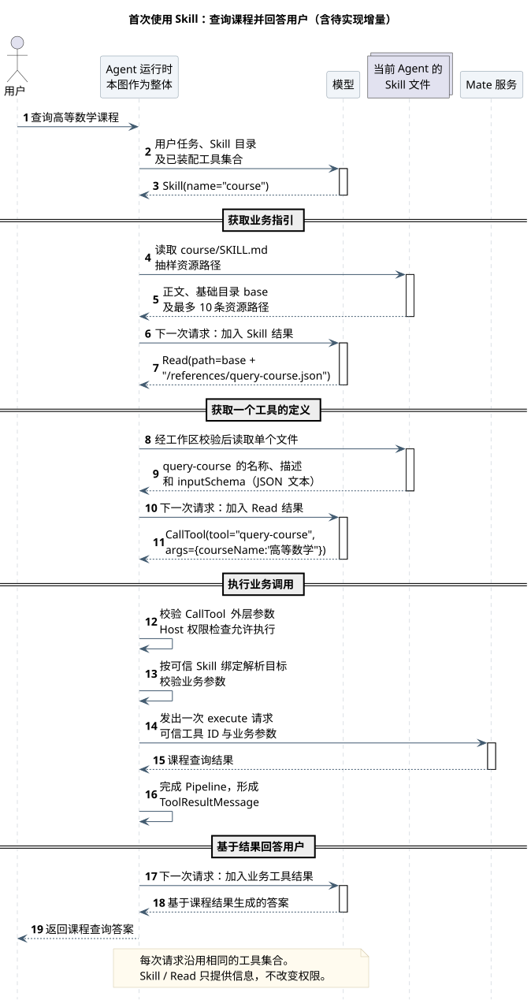
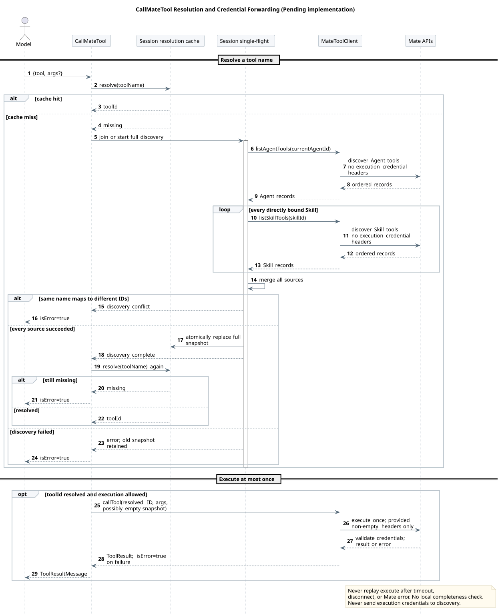
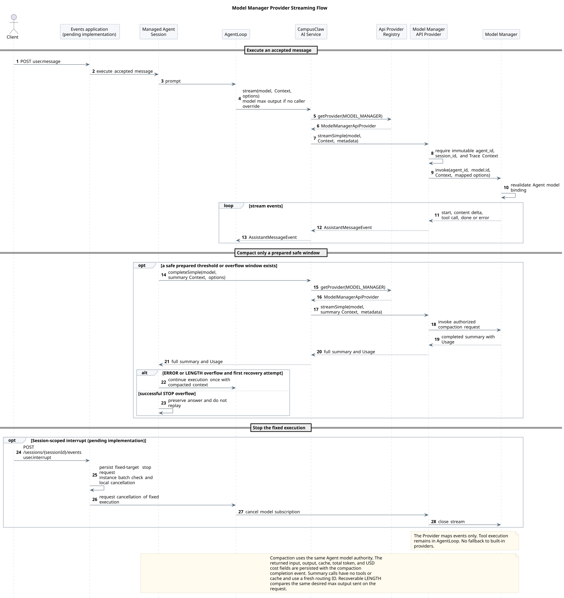

# CampusAgent Manager 驱动的多 Agent Runtime 设计

| 属性 | 值 |
|---|---|
| 文档版本 | 3.9.4 |
| 状态 | 当前评审 Events v2 ListEvents；POST 合并、首帧、关闭、中断分工、数据库机制、单消息准入及查询优化决定保留，两个操作均未整体确认；HTTP 1.45.1 保留已确认 Help 元数据指南，Builtin 与 Skill Command 由用户统一实现 |
| 当前传输结论 | v2 同一 POST 提交与接收对应 SSE，另保留 GET 普通页码历史；执行仍是内部状态，无 `executionId/runId` |
| 设计仓分析基线 | `0eaa70ff365bf4d4e328b3473809341ca4cfc58d` |
| CampusClaw Slash 行为基线 | `c1311f69f504e7e799fa2467fd6a9d95b3f91b99` |
| CampusClaw 当前核对头 | `c9d858bc8261bf07f5585f545b53495bf2226a56` |
| v2 合并传输核对 | `918005ee8ccc88d179fc31a0de17a92b4a01383b`；对比原 `a8192e0` 的七个 HTTP/事件文件无变化，目标变化见 v2 §4.2 |
| v2 中断优化补充核对 | `dfb90cac4e233e09a0b8f047f7e9f4682f5ad238`；五个并发、流与配置文件相对 `918005e` 无变化，见 v2 §4.4；本次设计变更前为 `e370d2d49e6cd20b7dd910944e583d7f67115cf4` |
| v2 历史查询补充核对 | 同一 `dfb90ca`；查询、编码、游标与 Mapper 四文件相对 `918005e` 不变，见 [历史设计](chat-events-v2-history-design.md)；本次变更前设计 `c16ed3f904a85d01d69deb1a3575e2c52cdaa958` |
| v2 事件顺序补充核对 | `a8192e047f4061bd385297d3dc6c4358362d0d49`；证据与原基线对比见 v2 设计 §4.1 |
| pi-mono Slash 对比基线 | `4af9d21d3b4d664e4a29fcabfec85171077248e3` |
| CampusClaw PR 167 基线 | `f60cc3e78bb8b700527ac082c7c8e10524ede095` |
| CampusClaw merge base | `d649866a6cae967ace18ceaeb9597edd47e5721e` |
| CampusClaw 压缩修订前基线 | `a7f78fed345a289833970cd7b78399f0e8e51d32` |
| CampusClaw PR 167 审查头 | `bf28e72f94f29acd316eb872a250893ed54e3632` |
| CampusClaw PR 167 对齐实现 | `bd26e7f81bac8f68be0c3523efe23b51f96c52e4` |
| pi-mono-java 字段命名核对基线 | `304eda06ff603fc9b6bbcaad0c296cc151a7defb`（`codex/runtime-http-contract-v137`） |
| pi-mono-java 凭据透传核对基线 | `320d790726a70aada6100052952d5494d2a378ac` |
| OpenCode 对照基线 | `849c2598abc7d2b40261e74b5826bc74ffc78308` |
| DeepSeek Harness 对照基线 | `141eb6fef83422698aef7a981029e843e8161534` |
| Codex Harness 对照基线 | `be33f80bc65159c094ecd06bf155afa3061ce23d` |
| Builtin 实现分析基线 | `d84dd3d6a306b7587c70b29e0100e741dacef989`；PR #210 最终实现 `9d0d76f4a571b559dc77ae52736caebbcc8fad88` 已通过 `a8192e047f4061bd385297d3dc6c4358362d0d49` 合并 |
| 更新日期 | 2026-09-07 |

## 1. 当前结论

用户最新决定取代此前独立提交与实时订阅的方案：Claw 采用一次 POST 发送事件并
接收对应推送，另保留 GET 权威历史。

```text
POST /sessions/{sessionId}/events
  -> 接受并持久化一条 user.*，同一 SSE 响应首帧返回完整回执，再推送对应事件

GET /sessions/{sessionId}/events
  -> 普通整数分页的权威历史与断线对账
```

原独立 Claw GET stream 从目标中撤销，不能继续指导客户端“先 GET 再 POST”。
Mate 的公共 Events API 不在本轮修改范围；其路径和连接策略仍由 Mate 契约独立管理。

执行继续是内部状态，不引入 executionId/runId；user.interrupt、user.tool_confirmation
仍进入同一 POST 联合类型。event 包装、content[]、eventId、不公开 entryId/entrySeq、
Header 示例和用户凭据 ID 语义均保留；三种 POST 用户事件仍统一必填 access-token，
凭据仅在内存保留到执行结束，只随实际 Mate tool execute 发送。

已确认内部因果顺序与短事务追加，ListEvents 保持已提交数组顺序，不按 createdAt 重排；
不设 Idempotency-Key，断线不取消执行、不自动重发 POST。S1 data-only、S2 type + phase
以及五个输出类型名保留；用户明确调整 S3：完整本次 user.* 作为首个业务帧返回，
仅一次，不广播其他用户输入。原只读流的 S4 不再适用合并 POST。

结束规则已确认：收到本次对应 idle 后关闭响应，等待工具确认时也关闭；之后通过新确认
POST 接收续跑结果。等待确认只结束本次 HTTP 交互，不代表任务成功。中断分工也已确认：
原消息响应保留执行输出，中断响应只回执并等待同一停止 idle，两条响应复用终态 eventId。
本期采用数据库保存停止请求、各实例批量检查本机活动执行、接收方读取同一权威结束记录；
不依赖粘性路由或实例转发，不引入 Redis，后续按需要再评估通知加速。
单消息准入已确认：M1 未完成前拒绝 M2，按 Session 对全部调用方及服务实例生效；
消息接受与资源 idle→running 同事务，等待确认、停止未完成或响应断开均不释放准入。
M1 真实结束并提交可靠状态后才恢复 idle；中断与工具确认按各自控制条件接受。
中断查询优化已确认：同实例提交停止请求后立即通知对应执行，数据库批量检查继续兜底；
本机按固定执行身份合并等待目标，响应回执与缓冲仍各自独立；登记后补读已提交终态，
本地通知与补读共用每响应终态去重。最后一个等待者退出只清理本机登记。
索引按实际 GaussDB 执行计划和 100 并发压测选择，不冻结 500 毫秒周期、批次上限或超时。
固定内部执行身份不穿透 HTTP；数据库结构、检查周期、其余并发竞争、reason 与故障细节
仍待评审，不是整体确认。
用户明确要求开始修改 ListEvents，当前入口为 [历史查询评审页](chat-events-v2-review.html)；
完整事件与 POST 同形，从旧到新、普通整数页码和取消固定快照已确认，见 [历史设计](chat-events-v2-history-design.md)。
分页默认 50/最多 200、result 只返回 events/nextPage、合法超范围页返回 200 空列表均已确认，不返回 total。
POST 的决定与未决项仍见 [合并 POST 保留评审页](chat-events-v2-submit-review.html)、
[Events v2 设计](chat-events-v2-design.md) 和 [请求级 SSE 设计](chat-events-v2-stream-design.md)。
[旧确认页](chat-events-v2-confirmed.html) 改为变更提示，旧 JSON POST 仅在 Git 历史保留。
当前没有整体确认的新 v2 operation；既有字段决定不因此被重新开放。

### 1.1 现行 v1 基线（迁移完成前保留）

HTTP 1.45.1 的普通消息仍采用两跳 HTTP+SSE；Runtime Builtin Command 返回普通 JSON：

```text
Browser / Agent UI
  -> mate-service public HTTP API
  -> mate-service public execution-scoped SSE
     -> CampusClaw internal HTTP API
     -> CampusClaw internal execution-scoped SSE
```

每次提交用户消息都会新建一个 HTTP 请求。该请求的响应在本次执行期间持续输出
SSE；Runtime Command 不建立请求级 SSE，Builtin 与 Skill 执行由用户统一实现。普通消息正常收到
`stream.end`、流内错误或网络中断后连接结束。下一次用户消息、Command、Steer、
FollowUp 或 Abort 都是新的 HTTP 请求，不复用旧连接。公共 Command 协议待独立评审。

以下段落只描述迁移前 v1，不再代表 v2 目标。v1 的 SSE 不是永久在线的 Session
订阅，也不是单独的第二条事件接口。它是一次
有界执行的流式 HTTP 响应。Steer 和 FollowUp 被接受后进入当前 Session 的内部队列，
其后续 Assistant、Tool 和状态事件继续由当前仍然打开的执行 SSE 输出；Abort 终止
当前执行并使该流收敛。


[PlantUML 源码：`mate_agent_service_responsibility_boundary`](设计图/服务边界/diagram.puml#L1)

## 2. 契约权威顺序

迁移前 v1 逐接口契约的维护顺序为：

1. [`接口契约/common.json`](接口契约/common.json) 与 [`接口契约/操作/`](接口契约/操作)：唯一可编辑的精确契约源；共享 ID、认证和公共响应只定义一次；
2. [`chat-http-v1-review.html`](chat-http-v1-review.html)：由结构化契约生成的主要人类评审界面，不允许手工修改；
3. [`chat-http-v1-design.md`](chat-http-v1-design.md)：只维护源码证据、目标差异和设计原因，不承担逐字段契约复制。

[`render_chat_http_v1.py`](render_chat_http_v1.py) 将共享定义和十三份 operation model
展开为一个 standalone HTML。生成页只包含一份共享 CSS、一份共享 JavaScript 和一份
聚合 JSON model，同时保留十三份无脚本可读的静态 operation；校验会重新生成并做
字节级比较，防止静态内容、交互模型和源文件漂移。

OpenAPI 已经明确废弃并从仓库删除。仓库内 JSON 是 HTML 的规范化生成源，不是对外
发布的 OpenAPI，也不允许实现根据历史 OpenAPI 恢复旧 Run、History 或事件字段。
若未来重新需要标准机器契约，应从这些已确认 JSON model 生成新的投影并建立同步
门禁，不能恢复已删除文件继续增量修改。

旧 WebSocket/AsyncAPI 文档已从当前仓库删除，历史内容只能从 Git 历史读取，不再是
目标契约或新实现输入。

Session Events v2 在重设计完成前使用独立的
[`接口契约-v2`](接口契约-v2) 和
[`chat-events-v2-review.html`](chat-events-v2-review.html)，不会覆盖已确认的 v1
契约。每次只展示并评审一个 operation；确认后的决定记录到
[`chat-events-v2-design.md`](chat-events-v2-design.md)，两个 operation 全部确认后再统一
替换 v1 事件接口及校验门禁。

当前 CampusClaw HTTP 契约中的路径参数、查询参数、请求体、普通响应和 SSE `data`
字段统一使用 lowerCamelCase。HTTP Header 保持标准或公司既有原名，例如
`X-HW-ID`、`Authorization`、`X-HW-APPKEY`、`If-Match`、`Accept-Language`；事件类型值、
错误码和类型化 ID 值不因字段命名调整而改变，也不提供 snake_case 字段别名。

### 2.1 源驱动契约校验

修改契约源后先重新生成 HTML，再运行快速校验：

```bash
python3 render_chat_http_v1.py
python3 validate-chat-http-v1.py
```

修改 PlantUML 时只生成发生变化的设计主题；需要强制重建全部主题时增加 `--full`：

```bash
python3 render_diagrams.py
python3 render_diagrams.py --full
```

提交前或 CI 使用完整校验：

```bash
python3 validate-chat-http-v1.py --full
```

快速模式校验契约源、HTML 字节同步、单份 JavaScript、无脚本内容、响应式规则、
Markdown 链接和受影响的 PlantUML 主题。完整模式再校验所有主题 SVG。两种模式都会
阻止已废弃 OpenAPI 文件或其当前引用重新进入仓库，并执行 `git diff --check`。

## 3. 两跳服务责任

### 3.1 mate-service 公共边界

mate-service 面向浏览器和业务客户端，负责：

- 用户认证、产品权限、配额、护栏、意图和业务编排；
- 用户可见的 Chat 资源及其到 Runtime Session 的产品关系；
- 保存 `chatId -> sessionId` 的稳定一对一私有映射，但不保存 Session 名称副本；
- 将公共 HTTP 请求映射为 CampusClaw 内部 HTTP 请求；
- 消费内部 SSE，过滤内部字段和错误，再投影为公共 SSE；
- 保证 `sessionId`、内部凭据、Provider 配置和工具私有数据不泄露给浏览器。

[mate-service 聊天命令 API](../../02-服务与接口/06-mate-service聊天命令API/README.md)
中的旧 SSE 提案已废止，仅保留历史依据。Runtime 的 Builtin JSON 决策不自动确认公共
路径、VO、错误码或传输协议；公共命令需独立重审，不能直接暴露内部 Session 标识。

普通消息已开始按单 operation 评审，用户确认路径为
`POST /mate-service/v1/chats/{chatId}/events`。请求、认证、公共事件和错误建议见
[mate-service 通用对话 Events API](../../02-服务与接口/07-mate-service通用对话API/README.md)；
在该评审明确结束前，除路径与既有两跳边界外均不得标为已确认。

### 3.2 CampusClaw 内部 Runtime 边界

CampusClaw 面向 mate-service Runtime client 和明确获授权的内部服务端 SDK，负责：

- Runtime Session 生命周期、`sessionId` 和可空 `displayName`；
- Agent、Model、thinking 配置和受控目录解析；
- MessageEntry 当前分支、模型执行、Tool 执行和持久化；
- Session 内单 active execution、Steer/FollowUp 队列和 Abort；
- 内部 HTTP 鉴权、ResultBean、SSE 事件和错误国际化。

CampusClaw 不读取 `chatId` 或最终用户身份。它按内部 `sessionId` 定位 Session，
并作为当前 `displayName` 与资源版本的唯一权威；Name 不生成历史 Entry。

## 4. CampusClaw v1 已确认接口（迁移基线）

基础路径统一为 `/campusclaw-service/v1`。

| # | Method | Path | 响应形态 | 作用 |
|---:|---|---|---|---|
| 1 | `POST` | `/agents/{agentId}/sessions` | `201` ResultBean | 创建并初始化 Session；默认模型由 Agent 配置选择，`thinking=true` |
| 2 | `GET` | `/sessions/{sessionId}` | `200` ResultBean | 读取当前模型、是否深度思考和 `idle/running` 状态 |
| 3 | `DELETE` | `/sessions/{sessionId}` | `204` | 逻辑删除并安排 Runtime 数据清理，只保留最小 tombstone |
| 4 | `POST` | `/sessions/{sessionId}/events` | `200 text/event-stream` | 提交 `user.message` 并直接流式执行 |
| 5 | `GET` | `/sessions/{sessionId}/events` | `200` ResultBean | 使用不透明 `page/nextPage` 分页读取当前分支的持久化对话 Entry |
| 6 | `GET` | `/sessions/{sessionId}/models` | `200` ResultBean | 返回可用 `modelId` 字符串数组 |
| 7 | `PUT` | `/sessions/{sessionId}/model` | `200` ResultBean | 修改后续用户消息使用的 Session 默认模型 |
| 8 | `PUT` | `/sessions/{sessionId}/thinking` | `200` ResultBean | 开关后续用户消息是否启用深度思考 |
| 9 | `POST` | `/sessions/{sessionId}/steers` | `202` ResultBean | 向 running Session 的当前执行追加优先指导 |
| 10 | `POST` | `/sessions/{sessionId}/follow-ups` | `202` ResultBean | 在 Agent 原本将停止时追加后续消息 |
| 11 | `POST` | `/sessions/{sessionId}/abort` | `204` | 中止当前执行并清空尚未投递的控制消息 |
| 12 | `GET` | `/sessions/{sessionId}/commands` | `200` ResultBean | 返回按名称字典序排列的七个 Builtin，不解析 Skill Source |
| 13 | `POST` | `/sessions/{sessionId}/command` | `200` ResultBean JSON | 执行七个 Builtin，Handler 完成后返回 |

本表第 4、5、11 项是迁移前 v1 行为；v2 将其重构为第 1 节的两个 Session Events
operation。其他接口是否受影响按 operation 继续评审，不由资源模型 A 自动推断。

公共资源没有 `Run`。一次用户输入会触发内部 active execution，但调用方使用
Session、Entry 和 SSE 恢复，不获得 `runId`，也不存在 GetRun 或 Run Events。

## 5. 迁移前 v1 HTTP 与 SSE 行为

### 5.1 普通 HTTP

普通 JSON 成功响应统一使用：

```json
{
  "resCode": "0",
  "resMsg": "success",
  "result": {}
}
```

异常响应只有 `resCode` 和国际化 `resMsg`，没有 `result`。当前 Java 实现统一调用
`ResultBeanAdapter.normal(result)`；独立仓提供默认实现，公司环境以 Bean 替换并在
适配器内部调用真实 `ResultBeanFactory.getFactory().normal(result)`。

全部十三项操作都携带调用上下文 Header。JWT 示例固定为
`X-HW-ID: credential-jwt` 与 `Authorization: Bearer opaque-token`；APPKEY 示例固定为
`X-HW-ID: credential-appkey` 与 `X-HW-APPKEY: opaque-appkey`。这些都是当前源码测试使用的
非生产示例值。`X-HW-ID` 表示用户凭据 ID，不是公司、服务或应用标识。CampusClaw
不在进入 Controller 前或 Controller 内部解析或校验这些凭据，也不因此返回
`UNAUTHENTICATED/AUTH_CREDENTIAL_CONFLICT`；真实性与动作授权由上游负责。

`POST /sessions/{sessionId}/events` 和 `POST /sessions/{sessionId}/command` 在上述共享 Header 之外必填
`access-token`，示例值为 `opaque-access-token`。Claw 从请求读取
`X-HW-ID`、`Authorization`、`X-HW-APPKEY` 与 `access-token`，只在内存中保留到本次
Agent 执行或命令处理结束；Compact 由本次 Active Holder 保留到压缩与排队续跑结束。
只有实际
`POST /mate-service/v1/runtime/tools/{toolId}/execute` 会原名发送已提供的值。
工具发现、Model Manager、受管目录、配置加载和其他 HTTP 请求均不携带这些值；
这些值不写日志、ResultBean、Prompt、Event 或持久化存储。

### 5.2 执行 SSE

`POST /sessions/{sessionId}/events` 直接返回一次执行的 SSE。确认的正常顺序是：

```text
user.message
assistant.message.started
assistant.message.delta
assistant.message.completed      finishReason=tool_call
tool.execution.started
tool.execution.completed
tool.result
assistant.message.started
assistant.message.delta
assistant.message.completed      finishReason=stop
session.status.idle
stream.end
```

仅 `user.message`、`assistant.message.completed` 和 `tool.result` 是可通过 GET Events
恢复的持久化 Entry。started、delta、工具执行状态、Session 状态和流控制事件只是
实时事件。

目标 Runtime 根据 Session `thinking` 开关投影 thinking 事件。执行快照为 `true` 时，
POST SSE 返回 `assistant.thinking.started/delta/completed`，其中 completed 持久化；为
`false` 时不发送。GET Events 根据查询时 Session 当前 `thinking` 决定是否返回
`assistant.thinking.completed`；开关改变会使旧 page 失效并要求从第一页重读。

POST 已接受用户 Entry 后，客户端断开不取消执行，也不得自动重放该 POST。客户端
重新分页读取 GET Events，以 `entryId/entrySeq` 去重；尚未持久化的临时 delta
不补拉。

### 5.3 mate-service 的 SSE 桥接约束

mate-service 不得字节透明转发内部流。它至少要保证：

- 公共和内部两跳分别认证、限流和记录审计；
- 内部 `sessionId` 和内部错误细节不进入公共事件；
- 每一跳都正确处理下游取消和上游执行继续之间的关系；
- 仅在公共投影已经完成后发送公共终态；
- 背压、超时和代理缓冲配置适用于 `text/event-stream`。

公共事件名和字段不与内部事件机械绑定。旧聊天命令 SSE 提案已经废止，新的公共
Command 协议待独立评审；普通消息 Events 已确认公共路径并进入逐项评审，当前
推荐方案与待决项见其独立评审页，其他公共交互仍需在各自契约中逐项确认。

### 5.4 Built-in Command

Builtin 与 Skill Command 由用户统一负责设计、实现和集成。Builtin 来源视图、参数规则和验收仅适用于 Builtin；共享 GET/POST 的最终命名、请求联合类型和清单合并，由同一负责人在 HTTP 发布前统一对齐。Skill 执行纳入整体实施与验收计划，具体未确认契约继续逐项评审。

| 规则 | v1 结论 |
|---|---|
| HTTP 请求 | 只提交 name、arguments；name 不含 /，省略或 null 参数由 Service 归一 |
| 可发现范围 | compact、help、model、name、skills、status、thinking 七个 Builtin |
| 统一实施范围 | 用户负责七个 Builtin、Skill 执行及共享 HTTP 集成；Skill 具体契约待统一评审 |
| 未纳入命令目标 | Extension、Prompt 执行；Builtin 附件 |
| 响应 | 普通 ResultBean JSON，不建立请求级 SSE |
| 普通消息接口 | 不解析 Slash 文本，现有 SSE 行为不变 |

一次请求只解析一个不可变 Catalog，列表与执行分派复用 Definition 身份，按来源类型过滤而不调用
SkillCommandSource，也不刷新 Agent。列表字段非 null、acceptsFiles=false；
running 时 Help/Status 可用、Name 可查改、Model/Thinking 只可查、Compact 不可执行。
Skills 查询最新完整绑定快照；没有快照返回 AGENT_NOT_AVAILABLE，完整空快照返回 []。

Help 无参读取当前 Agent 的 displayName/name、description、userCases，成功仅返回
command/displayName/description/userCases；介绍或场景缺失返回 []，非空参数拒绝。
Help 内容不来自 Catalog，而是同一完整 PreparedAgentRuntime；无缓存返回 422 AGENT_NOT_AVAILABLE。
元数据仅读不刷新、不调用模型/Tool、不写历史；userCases 必须完成缓存保存/重载往返，旧缓存显式刷新补齐。
源码基线 `d8e22562` 与全局目标结构见
[Help 专项设计](../../04-命令与技能/01-内置命令/Help-Agent使用指南/README.md)。

不生成 commandId、不持久化通用命令生命周期或 Name 边车。Name 只更新当前状态；
Model/Thinking/Compact 复用既有领域 Entry，sourceEventSeq 指向本次最后一条 Entry，
查询、同值更新与空历史压缩省略。Compact 接受后不因 HTTP 断线取消；
成功或无变化即返回 JSON，不等待同一 Holder 中排队的 Steer/FollowUp，客户端不得自动重放。


[PlantUML 源码：`command_http_flow`](设计图/Command/diagram.puml#L1)

分层、行为与串行 PR 验收见
[Slash Command 通用模块](../../04-命令与技能/00-Slash-Command通用模块/README.md)、
[内置命令](../../04-命令与技能/01-内置命令/README.md)。

## 6. Runtime 内部设计不变量

本节 HTTP 字段描述保留为 v1 迁移基线；v2 请求与输出字段以独立评审模型为准。

- 一个 Session 绑定一个不可变 `agentId`，允许切换 `modelId`；模型不是 Session 身份的一部分。
- 公共标识字段固定命名为 `agentId`、`toolId`、`skillId` 和 `sessionId`；对应值共用类型化资源 ID 规则，精确正则只在 [`接口契约/common.json`](接口契约/common.json) 定义。
- Session 名称属于 CampusClaw Session 领域，持久化为可空 `displayName`；mate-service 不维护副本。
- Session 粗粒度状态只有 `idle/running`；模型、工具或消息阶段通过实时事件表达。
- `thinking` 是“是否启用深度思考”的 boolean，不是原始推理披露等级。
- 持久化 Session Entry 使用 `id + parentId` 形成树；公共 GET Events 首版只返回当前分支。
- Runtime POST Events 对附件只接收有序 `fileIds`，不解析或下载文件正文；ID 按固定 `[File IDs]` 提示块传给模型。
- Model Manager 是模型 descriptor、可用性和凭据的最终权威；Mate 是远端工具绑定、授权
  与执行的最终权威；`AgentRuntimeManager` 发布的受管目录是 Session 使用的 Agent、Skill
  和直接 Child 身份快照。内存中不再规划独立的动态 `ToolCatalog` 或 Tool Manager 摘要缓存。

## 7. Manager 与多 Agent Runtime 核心

传输统一为 HTTP+SSE 不改变以下 Runtime 核心设计。

### 7.1 Agent 发布目录

目标工具系统统一 Runtime、Cron 和 Child 使用的受管目录。精确资源 ID 格式仍由
[`接口契约/common.json`](接口契约/common.json) 与
[`01-create-session.json`](接口契约/操作/01-create-session.json) 维护；工具专题只定义
目录内容、缓存和刷新语义：

```text
agent/{agentId}/.campusclaw/
├── agent.json
├── settings.json
├── SYSTEM.md
├── agents/{agentName}.json
└── skills/{skillName}/
    ├── skill.json
    ├── SKILL.md
    ├── references/
    └── templates/
```

`agent.json` 只保存当前 Agent 身份；`settings.json` 保存 default model 与
`bindingModels`；`agents/{agentName}.json` 保存一个可直接调用 Child 的身份和固定版本；
`skill.json` 保存 `schemaVersion=1`、ID、名称和版本。名称必须与路径逐字符一致并在所属
索引内唯一。目录不保存远端工具列表，Skill references 只包含真实参考资料。

`AgentRuntimeManager.prepare(agentId)` 是纯缓存优先：完整目录直接使用，缺失或不完整时
访问 Mate，并用同级临时树完成校验后发布。显式 `refresh(agentId)` 只由受管管理流程
调用；失败保留旧目录和活动 Session 的不可变快照。Runtime active execution、Cron
execution 和 Child execution 创建轻量 Session 前都调用 `prepare`；Runtime 不再维护
独立 `FileAgentDirectoryResolver` 文件契约。这些均是 target-only 架构改造；当前 Java
仍使用两套文件名并原地物化。

refresh 成功不修改活动 execution。空闲数据库 Session 在下一次接受用户 Entry 前读取新目录；
当前模型失效时切换到具备凭据的新 default，原子持久化 `session.model.changed` 及必要的
`session.thinking.changed`，并在 `user.message` 前投影。没有有效 default 时拒绝本次执行且
不接受用户 Entry。


[PlantUML 源码：`metadata_runtime_directory_mapping`](设计图/元数据/diagram.puml#L1)

### 7.2 关闭的内置工具与 Mate 实时发现

工具系统的唯一主设计是
[CampusClaw 工具系统设计](../02-CampusClaw工具系统/README.md)，精确模型契约见
[8 个活动内置工具契约](../02-CampusClaw工具系统/built-in-tool-contracts.md)。首版只支持
`Read`、`Find`、`Grep`、`Ls`、`Cron`、`ListMateTools`、`CallMateTool`、`Agent`，
由 Runtime、Cron、Child Agent 三个启动期严格 profile 装配；不再规划旧三工具抽象、动态
`ToolCatalog`、Java Extension 工具或 Skill 工具激活。

`ListMateTools({skillName?})` 无参数查询当前 Agent，有名称时通过本地 `skill.json` 索引
解析 Skill ID。每次调用实时查询 Mate，输出稳定 JSON，只包含 scope 与每项
name、description、inputSchema，并刷新 Session 缓存中的对应来源。
`CallMateTool({tool,args?})` 先以工具名查询 Session 名称到 ID 缓存；未命中时以
single-flight 自动发现当前 Agent 与全部直接绑定 Skill 的完整工具集合，原子替换缓存后
再次解析。只有发现可以重试；实际 Mate execute 最多发送一次。Mate 负责最终绑定校验、
凭据、授权和执行。



[PlantUML 源码：`list_mate_tools_sequence`](../02-CampusClaw工具系统/diagram.puml#L236)



[PlantUML 源码：`call_mate_tool_sequence`](../02-CampusClaw工具系统/diagram.puml#L291)

### 7.3 HTTP-only Slash Command 与公共 Session 能力

CampusClaw 不再提供 CLI、TUI、OneShot、RPC 或 ACP 产品入口。Slash v1 只通过 HTTP
开放。命令模块遵循以下边界：

- 不可变 Definition、Handler、Composite Registry、Contributor 和 Admission Policy
  替换当前可变 Registry 与宽泛 `SlashCommandSession`；
- Builtin 各自使用 Contributor/Handler；现有 Skill 发现定义不装配伪 Handler；用户统一实现 Skill 执行定义，共享 HTTP 清单在发布前对齐；
- 新增命令不修改中央 `switch`；Builtin 重名直接启动失败；
- 清单命中后才调用 Command API；清单失败不降级；API 未知名称返回 `COMMAND_NOT_FOUND`；
- `/name` 只调用 `SessionNamingService`，不经过 mate-service 名称副本；
- 阈值压缩和溢出恢复迁入公共 `ManagedAgentSession`。成功 `STOP` 静默越界只压缩、不重放；
  `ERROR/LENGTH` 才排除失败 Assistant 并最多重试一次，第二次溢出显式失败；
- 压缩使用最后有效 Usage 和尾部估算、压缩边界时间戳、安全 User/Assistant 切点；超大末条
  Assistant 仍保留，split-turn 和重复摘要继承 Read 路径，失败或取消保留旧上下文且不删除
  历史 Entry；默认 `enabled=true`、`reserveTokens=16384`、`keepRecentTokens=20000`；
- 公共 Agent 在没有调用方覆盖时把 `model.maxTokens` 传给实际请求；重试压缩在内部 payload
  保存被丢弃 Assistant 的 Entry ID，重载精确排除且不向历史或 SSE 公共字段暴露；
- `FileOperationTracker` 只跟踪 `Read`；PackageManager、本地 Skill 安装/导入、剪贴板及其他
  终端专属能力删除。

Runtime 持久化 `assistant.message.completed` 和 `session.compaction.completed` 的完整 Usage，
并在 `t_session_materialized` 原子累计 `lifetimeUsage`。模型/思考变更和压缩完成是领域历史；
工具 delta、压缩 started/failed 是瞬态 SSE；failed 额外声明 `aborted` 以区分取消与失败。
公共历史查询与 Agent 模型上下文恢复使用不同
投影，后者不把模型/思考变更事件转换为模型消息。

### 7.4 Model Manager 流式适配

Agent 目录决定默认模型候选，Model Manager 仍是模型 descriptor、可用性、凭据和
调用的最终权威。Session 可以在 idle 时切换 `modelId`；每次用户事件接受时读取
当前 `modelId/thinking` 形成内部执行快照。Provider 的结构化增量由 Runtime
转换为已确认的 Assistant/Tool SSE 事件，不把 Provider model ID、API Key、
base URL 或成本字段公开给 mate-service。



[PlantUML 源码：`model_manager_streaming_flow`](设计图/模型管理/diagram.puml#L1)

### 7.5 数据与附件边界

RuntimeSessionStore 保存 Session 配置、当前分支 Entry 和内部执行状态，不保存
文件正文或文件元数据快照。Session Entry 的 `id/parentId` 树与当前分支重建详见
[`pi Session Context 分析`](../../05-研究资料/03-pi会话上下文/README.md)；数据库通用
模式详见 [`Agent 数据库模式`](../../03-数据与存储/03-Agent数据库模式/README.md)。

文件上传、扫描、正文、元数据和删除生命周期不属于 CampusClaw Runtime。
CampusClaw POST Events 对附件只消费有序 `fileIds`，把它们编码为固定文本块；它不调用 resolve/content、
不直连 OBS，也不接受文件名、URL、MIME、Base64 或 Object Key。

## 8. 源码证据与目标差异

| 分类 | 证据或决策 |
|---|---|
| 观察到的 pi 行为 | `packages/coding-agent/src/core/session-manager.ts` 的 Session Entry 以 `id/parentId` 构成 append-only tree；`getBranch()` 重建当前分支 |
| 观察到的 pi 行为 | `packages/coding-agent/src/core/agent-session.ts` 的 `prompt`、`steer`、`followUp` 和 `abort` 驱动一次进程内 active execution，但不要求公共 Run 资源 |
| 观察到的 pi 行为 | `packages/agent/src/types.ts` 与 `packages/agent/src/agent-loop.ts` 区分 Message 与 Tool execution 生命周期 |
| 迁移前 Java 行为 | 旧 `ServerMode`、`ChatHandler` 和 `ChatWebSocketHandler` 曾同时提供 HTTP/SSE 与 WebSocket；已在实现提交中删除 |
| 已实现 Java 行为 | `RuntimeSessionController`、`RuntimeEventController`、`RuntimeSessionConfigurationController` 与 `RuntimeSessionControlController` 实现 11 个 Spring MVC HTTP+SSE 接口 |
| 已实现 Java 行为 | `RuntimeEventStream`、`RuntimeSseDispatcher` 和 `RuntimeSseEmitterSubscriber` 提供有界请求级 SSE；断线不 abort |
| 已实现 Java 行为 | `MyBatisRuntimeSessionRepository` 使用 openGauss 保存 Session、当前分支 Entry、严格序号、tombstone 和清理任务 |
| 当前 Java 差异 | `RuntimeApiConstants.AGENT_ID_PATTERN` 仍为旧下划线格式，`SESSION_ID_PATTERN` 仍为通用字符串；`RandomSessionIdGenerator` 仍生成无前缀的 26 位 Crockford Base32；`RuntimeSessionService.newSession` 仍写入 `thinking=false`，`session_schema.sql` 的 `agent_id` 仍为 `VARCHAR(30)` |
| 当前 Java 差异 | `RuntimeWebMvcConfiguration` 当前把认证拦截器应用到全部 Runtime 路径；`UserEventRequestVO` 当前仍要求 `type=user.message` |
| 已实现 Java 行为 | 当前核对头 `c9d858bc` 的 `RuntimeRequestContext.mateCredentials` 45-50 行从 POST 请求读取 `X-HW-ID`、`X-HW-APPKEY`、`Authorization` 与 `access-token`；`MateCredentials` 21-90 行保存四个不透明字符串，仅在 Mate tool execute 前检查最低完整性，不解析用户凭据 ID 或 Bearer 内容 |
| 已实现 Java 行为 | 同基线 `HttpMateToolClient.queryToolIdsByAgentId/queryToolIdsBySkillId/queryToolMetaByIds` 134-193 行调用工具发现时不附带凭据；`invokeTool/toHeaderInfo` 298-370 行只在实际 Mate tool execute 时发送本次执行持有的四项 Header |
| 当前 Java 差异 | 字段命名核对基线 `304eda06` 的四个 Runtime Controller 仍使用 `{agent_id}` / `{session_id}` 路径变量；请求/响应 VO 的 `@JsonProperty`、`@JsonSetter` 以及 `RuntimeEntryCodec` / `RuntimeEventProjector` 仍输出 snake_case。1.38 lowerCamelCase 是相对该实现的契约变更 |
| 已实现 Java 行为 | AI 层 `AssistantMessageEvent` 存在 thinking start/delta/end；Runtime 对外 `RuntimeEventType` 无 thinking 类型，`RuntimeEventProjector` 与 `RuntimeEntryCodec` 会过滤原始思考内容 |
| 当前 Java 差异 | CLI `AgentSession` 仍聚合 ToolCatalog、Skill 激活、reload 和委派；HTTP 仍以独立 resolver 与硬编码 Read 装配；AgentRuntimeManager 仍写旧文件名和 Skill 工具快照 |
| 架构变更 | 消息两跳目标传输使用 HTTP+SSE，Runtime Command 使用普通 JSON，删除连接首帧、Frame RPC、连接 generation、WebSocket close code 和 AsyncAPI |
| 架构变更 | CampusClaw 目标契约改为 `agent-` / `tool-` / `skill-` / `session-` 加 32 位十六进制 UUID；Session 创建成功时固定 `thinking=true`，实现需同步放宽 `t_sessions.agent_id` 并替换 Session ID 生成器 |
| 当前 Java 差异 | `c1311f69` 的 `SlashCommandRegistry` 仍使用可变索引并解析整段 Slash 文本，`SlashCommandSession` 是宽泛可变门面；生产 Runtime 尚未注册命令 Controller，`t_sessions` 尚无 `display_name`；新契约无需 sidecar 查询 |
| 架构变更 | 十三个目标 operation 全部保留调用上下文 Header，但移除 Runtime 应用内的凭据组合与格式校验及对应 401；`X-HW-ID` 明确表示用户凭据 ID，不是公司、服务或应用标识 |
| 架构变更 | `thinking=true` 时将内部 thinking 生命周期投影为公共 SSE，并持久化 completed 供 GET 恢复；GET 根据 Session 当前 thinking 状态过滤，状态变化使旧 page 失效 |
| 架构变更 | CampusClaw HTTP 的 path/query/JSON/SSE 字段统一为 lowerCamelCase；Header 原名、事件类型值、错误码和 ID 值保持不变，不接受 snake_case 字段别名 |
| 架构变更 | Runtime、Cron、Child 共用轻量 AgentSession 和工厂；8 个活动内置工具由启动期 profile 装配，工具实例按 Session 新建 |
| 架构变更 | 受管目录统一身份文件、缓存优先 prepare 与显式原子 refresh；Skill 和 Child 通过目录名称索引解析，不保存远端工具列表 |
| 架构变更 | Mate 发现改为 `ListMateTools({skillName?})` 稳定 JSON 与实时查询；Call 通过 Session 名称到 ID 缓存解析，miss 时 single-flight 自动刷新完整有效集合，实际执行不重试 |
| 架构变更 | `Agent({agentName,task})` 只解析直接绑定 Child；公共 `AgentSessionFactory` 创建独立 Child Session 实例，父子使用相同类型和执行语义但隔离消息、工作区、工具与上下文 |
| 架构变更 | HTTP-only Slash 模块使用不可变 Definition、Strategy Handler、Composite Registry、Contributor 和 Admission Policy；增加命令不修改中央分派；Builtin 与 Skill 由用户统一实现；Builtin 来源过滤不是全局命名空间限制 |
| 架构变更 | 当前 `displayName` 与资源版本由 CampusClaw Session 持有；不保存 Name Entry 或通用命令生命周期；只有 Model/Thinking/Compact 复用既有领域历史 |
| 架构变更 | Assistant/Compaction Usage 持久化并累计 lifetimeUsage；模型、thinking、compaction 领域事件历史可见，工具 delta 与压缩 started/failed 保持瞬态 |
| 架构变更 | refresh 只影响下一次空闲 Session 执行；模型懒校准事件先于 user.message，无有效 default 时不接受消息 |
| 产品约束 | 浏览器命令接口只识别 `chatId`，CampusClaw 内部契约只识别 `sessionId`；ChatSessionResolver 维护稳定映射，公共接口不泄露 Runtime 标识 |
| 产品约束 | 不提供 CLI、Bash/Edit/Write、Loop、旧工具名、旧 Cron payload、Java Extension SDK、ACP/HTTP/A2A Child 或兼容执行器 |
| 安全边界 | 调用上下文 Header 的真实性与动作授权由上游负责；Claw 从 POST Events/Command 请求读取四项凭据，只在内存中保留到本次 Agent 执行或命令处理结束，仅随实际 Mate tool execute 发送，不记录、不持久化、不发往工具发现或模型请求；thinking 内容仅在开关为 true 时按事件契约返回 |
| 安全加固 | 工具参数先做 JSON Schema 校验；目录完整发布、名称/版本/ancestry 校验和模型 bindingModels 白名单阻止不完整或越界执行 |

源码证据的完整 commit、符号、行号和逐项设计理由见
[`chat-http-v1-design.md`](chat-http-v1-design.md) 的“源码证据与差异分类”。

## 9. 待继续评审

以下内容尚未确认，不应由实现自行猜测：

1. Claw v2 数据库控制字段与约束、实测索引选型、检查周期和超时响应，以及跨完成边界的迟到中断、确认续跑/控制请求竞争；单消息数据库准入、数据库停止请求与实例批量检查及中断查询优化已确认，本期不引入 Redis；此前合并、首帧、关闭与中断分工决定继续有效；
2. Claw v2 SSE 具体字段、thinking 内容、idle reason、heartbeat、容量、错误细节及整体确认；类型名、data-only、type + phase 已确认；
3. Claw v2 历史过滤及具体事件投影、其他错误和保留期；L1～L4 普通分页、默认 50/最多 200、无 total 与超范围空成功已确认；
4. Steer、FollowUp 与 Slash Command 是否并入新的 Events 边界；
5. Pod 重启时 active execution 的中断或恢复策略；
6. 公司 `ResultBeanFactory` 真实制品坐标和 `ResultBeanAdapter` 公司 Bean 的落地方式；
7. 若未来需要标准机器契约，其格式、生成源和同步门禁需要重新评审。

## 10. 版本历史

| 版本 | 日期 | 变更 |
|---|---|---|
| 3.9.4 | 2026-09-07 | 合并设计主线 `2d0dba26`，保留 Events v2 历史查询最新决定，同时同步 HTTP 1.45.1 的 Help 元数据指南、全局目标类图与用户统一实施责任；仅整合设计，不修改实现或公共 Mate 契约。 |
| 3.9.3 | 2026-09-07 | 同步 Events v2 0.5.3、请求级 SSE 0.3.6 与历史查询 0.2.2：确认 L4 合法超范围页 200 空成功；保持实现、Mate 及 v1 不变。 |
| 3.9.2 | 2026-09-06 | 同步 Events v2 0.5.2、请求级 SSE 0.3.5 与历史查询 0.2.1：确认默认 50/上限 200 与无 total，继续 L4 空页评审；保持实现、Mate 及 v1 不变。 |
| 3.9.1 | 2026-09-06 | 同步 Events v2 0.5.1、请求级 SSE 0.3.4 与历史查询 0.2.0：确认普通整数分页和取消固定快照，评审数量与 total；保持实现、Mate 及 v1 不变。 |
| 3.9.0 | 2026-09-06 | 同步 Events v2 0.5.0、请求级 SSE 0.3.3 与历史查询 0.1.0：按用户要求切换 ListEvents，补齐完整事件及固定快照分页候选和目标图；POST 未决项保留，不改实现、Mate 或 v1 迁移基线。 |
| 3.8.2 | 2026-09-05 | 同步 Events v2 0.4.2 与请求级 SSE 0.3.2：确认同实例提交后通知、等待目标去重及实测索引选型；补齐终态登记竞态和每响应投递门控，保持数值参数、完整操作及 Mate 契约边界不变。 |
| 3.8.1 | 2026-09-05 | 同步 Events v2 0.4.1 与请求级 SSE 0.3.1：确认单消息数据库准入，M1 未完成前拒绝 M2；明确等待确认时 SSE 结束但资源仍 running，补齐源码证据与目标图。并行修订：同步 HTTP 1.45.1 的统一实施责任；用户负责 Builtin、Skill 及共享集成验收，保留 Help 与 Events v2 已确认设计。 |
| 3.8.0 | 2026-09-04 | 同步 Events v2 0.4.0 与请求级 SSE 0.3.0：确认数据库中断交接、实例批量检查及共享结束记录，本期不引入 Redis；补齐目标类图、时序、源码差距和验收，未修改实现或整体确认接口。 |
| 3.7.3 | 2026-09-04 | 同步 HTTP 1.45.0 已确认 Help 四字段元数据指南、无参与缓存演进；保持其他 Builtin、Events v2 评审和 Mate 公共接口不变。 |
| 3.7.2 | 2026-09-04 | 同步 Events v2 0.3.2 与请求级 SSE 0.2.2：确认原消息保留输出、中断只回执与等待同一停止 idle；补充实例定位的源码证据和解释，尚未选择路由方案。不整体确认操作，不修改实现或 Mate 契约。 |
| 3.7.1 | 2026-09-04 | 同步 Events v2 0.3.1 与请求级 SSE 0.2.1：确认对应 idle 后关闭，含等待工具确认分段，新确认 POST 接收续跑；不整体确认操作，不改变输出字段、实现或 Mate 公共契约。 |
| 3.7.0 | 2026-09-04 | 同步 Events v2 0.3.0：合并 POST 提交与 SSE 推送、确认完整本次 user.* 首帧，撤销内部独立 GET stream，保留 ListEvents；更新评审状态、源码证据与图，结束细节仍候选，不修改 Mate 公共契约或 v1 基线。 |
| 3.6.8 | 2026-09-04 | 同步 Events v2 0.2.2：确认 GET stream S1～S4 的四项 A 选择，移除对应待选题；保留其他具体字段、连接细节和接口整体评审状态，不影响已确认 POST 与 v1 迁移基线。 |
| 3.6.7 | 2026-09-04 | 同步 Events v2 0.2.1：确认 agent.message、agent.thinking、agent.tool_call、agent.tool_result、session.status_idle 五个基础类型名；增量结构、字段和 GET 整体仍在评审，不改 v1 迁移基线。 |
| 3.6.6 | 2026-09-04 | 合并并行文档修订，保留 Events v2 POST 已确认及 GET stream 评审状态，同时保留 HTTP 1.44.1 的 Builtin JSON 与 Skill 并行开发决定。 |
| 3.6.5 | 2026-09-04 | 同步 Session Events v2 0.2.0：第一个 POST 已整体确认，移除旧待选题；当前页切换到第二个 GET stream，保留独立已确认页面并开始流契约评审。 并行修订：同步 HTTP 1.44.1：Skill Command 由其他同事并行开发，七个 Builtin 是本会话交付范围，不是全产品禁用规则。 |
| 3.6.4 | 2026-09-04 | 同步 Session Events v2 0.1.7：确认依赖顺序、短事务有序追加与 ListEvents 展示规则；时间戳不参与重排，内部序号仍不公开；补充源码核对，其他字段保持待评审。 并行修订：同步 HTTP 1.44.0：七个 Builtin 使用普通 JSON，Skill 执行延期，取消 Name 边车与通用生命周期；合并设计主线 `332e7faba9f35b657b17013287507449a68359c3`，保留 Events v2 的 `access-token` 必填决定与独立评审，不推导公共 Command 协议。 |
| 3.6.3 | 2026-09-04 | 同步 Session Events v2 0.1.6：三种用户事件统一携带 `access-token`，JWT/APPKEY 模式均必填；从待评审项中移除此项，其他字段继续评审。 |
| 3.6.2 | 2026-09-04 | 同步 Session Events v2 0.1.5：公共事件身份统一使用 `eventId`，POST、live SSE 和权威历史不公开内部 `entryId/entrySeq`；其余 POST 字段继续评审。 |
| 3.6.1 | 2026-09-03 | 同步 HTTP 1.43.5：十三个接口统一采用源码测试中的具体 Header 示例；明确 `X-HW-ID` 是用户凭据 ID；仅在 POST Events/Command 说明凭据的内存保留期限、Mate tool execute 发送范围和禁止落盘范围。 |
| 3.6.0 | 2026-09-03 | 用户确认 Session Events 资源模型 A：Claw 拆分 POST、Session live SSE 与固定快照历史，执行保持内部状态；保留 HTTP 1.43.4 为迁移前基线，并启动第一个 POST operation 字段评审。 |
| 3.5.5 | 2026-09-01 | 记录 mate-service 普通消息 Events 公共路径已确认并链接单 operation 评审稿；事件命名、事件身份、Thinking/Tool 投影和 GET 恢复契约保持待确认。 |
| 3.5.4 | 2026-09-01 | 同步 HTTP 1.43.4：Slash Command 统一使用“命令清单”，Skill 文件位置统一表述为“文件夹”。 |
| 3.5.3 | 2026-09-01 | 同步 HTTP 1.43.3：补齐 Skill 名称规范，并明确参数复用普通消息的 UTF-16 输入上限。 |
| 3.5.2 | 2026-08-31 | 同步 HTTP 1.43.2，以规则表和动作式短句统一 Slash Command 说明；不改变已确认行为。 |
| 3.5.1 | 2026-08-31 | 同步 HTTP 1.43.1，将面向用户和 HTTP 的相关表述统一为“命令清单”，避免被理解为文件路径。 |
| 3.5.0 | 2026-08-31 | 同步 HTTP 1.43：增加命令清单与结构化执行；明确 Builtin/Skill、`displayName` 所有权、sidecar Entry、Skill 快照和 mate-service 公共命令投影。 |
| 3.4.0 | 2026-08-27 | 同步 HTTP 1.42：POST Events 必填 `access-token`；Claw 从请求读取四项 Header，只在内存中保留到本次执行结束；工具发现无凭据，只在实际 Mate execute 时原名发送已提供值。 |
| 3.3.0 | 2026-08-24 | 同步工具系统 2.3 和 HTTP 1.41：LENGTH 判定使用实际请求输出上限，压缩重试候选按内部 Entry ID 持久化并在重载时精确排除。 |
| 3.2.0 | 2026-08-24 | 固定 pi 压缩细节及 HTTP 1.40：成功 STOP 不重试、ERROR/LENGTH 单次恢复、Usage/边界/安全切点、split-turn/重复摘要、Read 路径继承和 failed.aborted。 |
| 3.1.0 | 2026-08-24 | 修订 PR 167 TUI 删除边界，保留未注册 Slash 核心并迁移公共压缩；HTTP 升级 1.39 Usage/领域事件/工具 delta，明确 refresh 后下一次执行懒校准。 |
| 3.0.0 | 2026-08-23 | 工具系统升级到 2.0：收敛为 Runtime/Cron/Child 三入口和 8 个活动工具；删除 CLI/Loop 目标语义，硬禁用 Bash/Edit/Write；Mate Call 改为 Session 缓存 miss 自动发现且实际执行不重试；Child 统一经公共 AgentSessionFactory 创建独立 Session |
| 2.9.0 | 2026-08-22 | 旧方案：工具与受管目录引用工具系统 1.0，采用四入口、12 个内置工具、CLI refresh 和旧 Child 执行表述；已由 3.0.0 取代 |
| 2.8.0 | 2026-08-21 | 将 CampusClaw HTTP 的路径参数、查询参数、请求体、普通响应和 SSE data 字段统一为 lowerCamelCase；保留全部 HTTP Header 原名以及事件类型值、错误码和 ID 值；新增源模型命名门禁并记录当前 Java snake_case 实现差异 |
| 2.7.0 | 2026-08-20 | 将 Session ID 统一为 `session-` 加去连字符的 32 位十六进制 UUID；全部十一项接口携带调用上下文 Header，但 Runtime 不做凭据组合、互斥、格式或真实性检查；提交消息请求删除冗余 `type`；thinking=true 时开放并持久化 thinking completed，GET 按当前开关过滤 |
| 2.6.0 | 2026-08-20 | 建立共享契约与十一份 operation JSON 单一编辑源；HTML 改为单份 CSS/JavaScript/聚合 model 的严格生成物；PlantUML 按九个设计主题拆分；校验增加 fast/full 两级并按生成结果做字节同步检查 |
| 2.5.0 | 2026-08-20 | 将 Agent、Tool、Skill ID 统一为类型前缀加去连字符的 32 位十六进制 UUID；Create Runtime Session 初始化 `thinking=true`；记录当前 Java 正则、默认值和列长度差异 |
| 2.4.0 | 2026-08-19 | HTTP V1 受控 Agent 目录调整为 `agent/{agent_id}/.campusclaw/`；本次仅统一目录位置，保留已确认的 HTTP 文件契约 |
| 2.3.0 | 2026-08-18 | 对齐实现提交 `8691e880`：内部 11 个接口标记已实现；删除改为 running 时 409；鉴权明确为上游真实性验证；文件 ID 改为固定提示块；移除 Agent Runtime Template 依赖 |
| 2.2.0 | 2026-08-18 | 全仓清理 WebSocket、公开 Run 和重复历史专题；Runtime HTTP 契约同步到 1.29.0；并发治理统一为内部 ActiveExecution，模板专题统一为 exact revision；文件服务统一使用 file_id、ResultBean、lowerCamelCase 和公司双鉴权边界 |
| 2.1.0 | 2026-08-18 | 用户明确批准废弃并删除过渡期 OpenAPI；契约权威收敛为 HTML 主维护文档与 Markdown 设计依据，禁止从历史 OpenAPI 恢复旧 Run 模型；增加仓库内 HTML-first 契约校验入口 |
| 2.0.0 | 2026-08-18 | 用户确认 mate-service 公共和 CampusClaw 内部两跳均统一为 HTTP+SSE；删除旧 WebSocket/AsyncAPI 规范，重写当前架构入口并明确公共 mate-service HTTP 字段仍待逐项评审 |
| 1.20.0 | 2026-08-17 | 历史版本开始将内部 Runtime 交互从显式 Run 调整为 Session Event 直连 SSE |
| 1.19.0 及更早 | 2026-08-17 及更早 | 历史 WebSocket/Run 方案；仅可从 Git 历史查看，不再是当前设计依据 |
