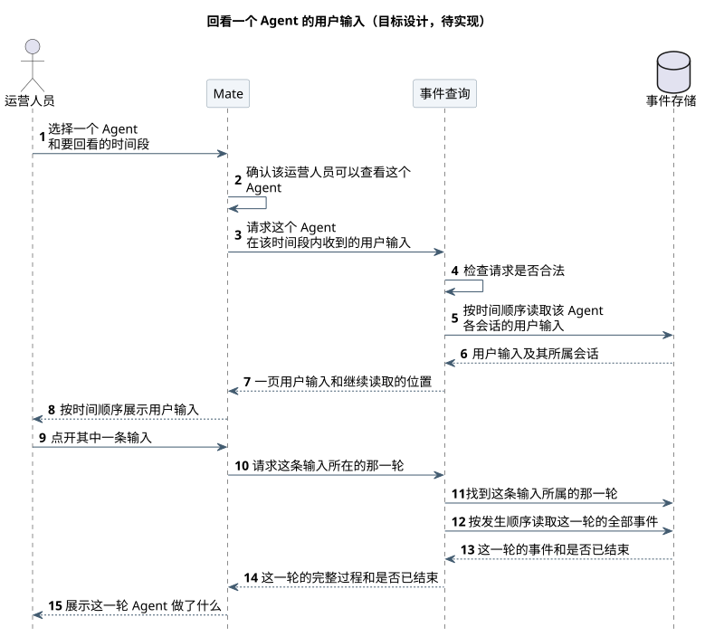
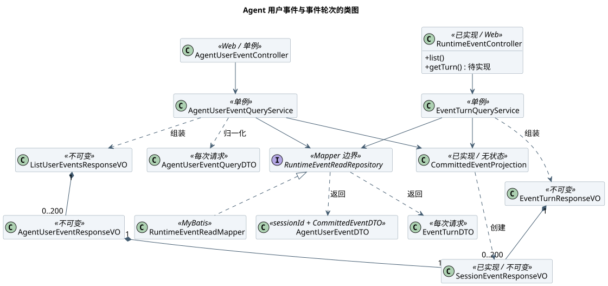
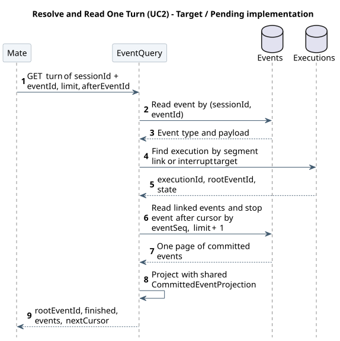

# Agent 用户事件与轮次查询设计

| 属性 | 值 |
|---|---|
| 文档版本 | 0.4.0 |
| 更新日期 | 2026-10-12 |
| 模块 | M01 CampusClaw 多 Agent Runtime：事件读取 |
| 设计状态 | 两个读取接口、事件表 agent_id 列与索引均为待实现；复用的事件表、根执行、结果段关联与公共投影为已实现（见 §8.2） |
| 源码基线 | pi-mono-java `main@769e86592285f4a25b0febaf551eddea6bc7212c`，2026-10-12 隔离 fetch 确认仍为 main HEAD；设计仓 `main@7b7b0f9b41ecd71044115edf0436250ab369d954` |
| 主基线 | Claude Managed Agents 公开文档（Beta，`managed-agents-2026-04-01`），2026-10-12 重新核对，只证明公开行为；轮次辅助基线 Codex `main@4270522473e677ddba7b093caa0064a3df51d459`，2026-10-12 |

## 评审记录

### 评审结论

2026-10-12，Lotus 确认四项方向：返回全部五种用户事件；权限由 Mate 判断；分页使用透明游标；定时任务与子 Agent 会话按同一规则返回。精确契约尚未生成，整体评审结论待契约评审后补充。

### 评审 Todo

| # | 事项 | 负责人 | 来源 |
|---|---|---|---|
| T2 | Mate 侧哪些角色可读整个 Agent 的用户输入，以及用户审计方式 | Mate | [D2](#d2) |
| T4 | 校准时间范围上限 31 天、页大小 200 与游标完整性安全间隔 | 实施 | [§5.2.2](#capacity) |
| T6 | 生成两个操作的 operation JSON 与 HTML 评审页 | 实施 | [§4](#api) |

### 需求信息

| 编号 | 来源 | 优先级 | 目标版本 |
|---|---|---|---|
| Q1 | Lotus 在项目讨论串提出：Mate 需要 Claw 提供两个接口，一个按 Agent 和时间范围按时间顺序给出用户类型事件，一个按事件标识给出对应轮次的全部事件；两个接口面向 Trace，属于小需求（2026-10-12） | 【缺口】 | 【缺口】 |

## 1. 概述

### 1.1 术语解释

| 术语 | 含义 |
|---|---|
| 用户事件 | 类型以 `user.` 开头的已提交公共事件：user.message、user.tool_confirmation、user.plan_confirmation、user.question_answer、user.interrupt（`CommittedEventType`） |
| 轮次 | 一条 user.message 被受理后形成的一次根执行，从该消息开始，包含确认/审核/回答续跑段、Agent 输出、停止请求，到实际终态 session.status_idle 为止；身份为根消息 eventId（`t_session_executions.root_event_id`） |
| 结果段 | 根执行中的初始段或一次续跑段，已提交事件经 `t_session_execution_segment_events` 关联到段 |
| 完整事件 | GET 历史与 POST SSE 共用的安全投影（`CommittedEventProjection`），字段由[共享事件源](事件契约/common.json)维护 |

### 1.2 需求整理

| 编号 | 需求 | 类型 | 来源 |
|---|---|---|---|
| R1 | 指定 Agent 与时间范围，按时间顺序返回该 Agent 所有会话中的用户事件 | 功能 | Q1 |
| R2 | 给定事件标识，返回该事件所在轮次的全部完整事件 | 功能 | Q1 |
| R3 | 返回的事件与 ListEvents/POST SSE 的同一事件逐字段相同，不另造事件格式 | 约束 | 推导自 [历史查询 §2](chat-events-history-design.md)，需确认 |
| R4 | 用户、归属与权限由 Mate 维护，Claw 不保存身份副本、不推导用户可见范围 | 安全 | [Claw 数据库设计 §3.1](../../03-数据与存储/Claw数据库设计.md#mate-ownership) |
| R5 | 已删除的会话不再出现在任一接口结果中 | 安全 | 推导自 [Session 删除](../../03-数据与存储/01-会话记忆GaussDB/README.md#delete-session)，需确认 |
| R6 | 查询有界：时间范围与页大小有上限，读取不阻塞执行 | 稳定性 | 推导自 [历史查询 §3](chat-events-history-design.md#integer-pagination)，需确认 |
| R7 | 分页使用透明游标：游标由上一条事件的公开字段组成，调用方可读、可自行构造 | 约束 | Lotus 2026-10-12 评审 |

## 2. 整体方案

### 2.1 业务用例

排查 Agent 的行为时，要先找到它在一段时间内收到过哪些用户请求，再沿其中一条看到那一轮完整的执行轨迹：思考、调用了哪些工具、结果如何、是否被确认或停止、最后是否完成。现在事件只能按单个会话读取，跨会话找请求只能逐个打开会话。本模块为 Trace 提供两个读取能力：按 Agent 和时间段列出用户请求，按其中一条取出所在那一轮的全部事件。

| 编号 | 参与者 | 业务目标 | 业务结果 |
|---|---|---|---|
| BU1 | 开发运维人员 | 在 Trace 中查看某个 Agent 在一段时间内收到的用户请求 | 按时间先后看到该 Agent 各会话中的用户消息、确认、审核、回答和停止请求 |
| BU2 | 开发运维人员 | 在 Trace 中展开某条用户请求所在那一轮的执行轨迹 | 看到这一轮的用户输入、思考、工具调用与结果、计划与提问、停止请求和结束状态，并知道这一轮是否已经结束 |

### 2.2 整体时序

场景：Mate 为 Trace 先查询设备告警 Agent 最近 7 天的用户请求，再读取其中一条所在的那一轮。起点是 Mate 发起请求，终点是 Claw 返回结果。Mate 的认证、权限判断和展示不在本图范围。状态：目标设计，待实现。

| 参与者 | 职责 | 映射 |
|---|---|---|
| Mate | 调用方，按 Trace 需要发起两次读取 | mate-service |
| Claw | 校验参数、按 Agent 和时间段查询、解析事件所在轮次、投影为公共事件 | coding-agent-cli 的 Runtime 事件接口；内部分层见 [§3.2 类图](#data-model) 与 §3.3、§3.4 |
| GaussDB | 保存已提交的事件、会话与根执行 | `t_session_events`、`t_sessions`、`t_session_executions`、`t_session_execution_segment_events` |



[原尺寸 SVG](设计图/Agent用户事件查询/agent_user_events_overview.svg) · [PlantUML 源码](设计图/Agent用户事件查询/diagram.puml#L1)

| 阶段 | 详细时序 |
|---|---|
| 步骤 1～6：查询用户请求 | [§3.3](#uc1-detail) |
| 步骤 7～14：读取轮次 | [§3.4](#uc2-detail) |

<a id="decisions"></a>

### 2.3 关键设计决策

| # | 要解决的问题 | 基线怎么做 | 业务约束 | 我们的选择 | 代价 |
|---|---|---|---|---|---|
| <a id="d1"></a>D1 | 轮次如何界定 | Codex 有显式 turn id 和状态；OpenCode、Claude Managed Agents 以 idle 标记切分；pi 的 turn 只是一次模型回复加工具结果 | Claw 已有根执行：一条 user.message 受理生成一次执行，续跑段和终态都挂在它下面 | 复用根执行作为轮次，根消息 eventId 为轮次身份；不新增轮次表，不按“到下一条 user.message 为止”推导 | 用户主动配置变更与手动压缩不属于任何轮次；停止请求需按 targetEventId 特殊定位；自动压缩关联差距需先修复 |
| <a id="d2"></a>D2 | Agent 级读取的权限边界 | Claude Managed Agents 按 API Key 所属工作区授权，可按 agent_id 列会话；其他基线为单用户本地工具，无可对照实现 | 用户与权限由 Mate 维护，Claw 不推导用户可见范围；Agent 下会话数可能很大 | Mate 完成该 Agent 的鉴权后再调用；Claw 返回该 Agent 全部未删除会话的用户事件，不按用户过滤 | 一次调用可读到多个用户的输入，Mate 必须限制角色并做用户审计；放弃让 Mate 传入获准会话 ID 集合（集合可能很大） |
| <a id="d3"></a>D3 | 如何高效按 Agent 和时间读取 | OpenCode 在消息表上有全局 time_created 索引但无 API 使用；其他无可对照实现 | agent_id 在会话上不可变；删除时会话行立即删除、事件行稍后清理 | 在 t_session_events 冗余写入 agent_id，建 `(agent_id, created_at, session_id, event_seq)` 部分索引，查询时连接 t_sessions 排除已删除会话 | 多一列冗余数据和一个索引的写入开销；需要同步安装 DDL；部分索引在 GaussDB 的支持待核验 |

## 3. 详细设计

### 3.1 系统用例

| 用例 | 对应业务用例 | 触发者 | 前置条件 | 主成功结果 | 关键约束 |
|---|---|---|---|---|---|
| UC1 ListAgentUserEvents | BU1 | Mate | Mate 已完成该 Agent 的鉴权 | 返回 `[from, to)` 内该 Agent 未删除会话的用户事件，按 createdAt、sessionId、eventSeq 升序，附 nextCursor | from/to 必填、UTC 整秒、跨度不超过 31 天；未知 Agent 返回空列表 |
| UC2 GetEventTurn | BU2 | Mate | Mate 已完成该会话的鉴权 | 返回事件所在轮次的 rootEventId、finished、按 eventSeq 升序的完整事件页与 nextCursor | 事件身份为 sessionId + eventId；会话级配置变更与手动压缩不属于任何轮次 |

<a id="data-model"></a>

### 3.2 数据模型

不新增表。复用已实现的四张表，并给 `t_session_events` 增加一个随写入固定的 agent_id 列和部分索引（待实现，归属登记见 [Claw 数据库设计 §6.4](../../03-数据与存储/Claw数据库设计.md#agent-user-events)）。

| 表 | 关键字段 | 本设计中的用途与约束 |
|---|---|---|
| `t_sessions` | id、agent_id（不可变） | 会话存在即未删除：删除事务直接删除此行（`RuntimeSessionMapper.xml#deleteSession`），事件行稍后由清理任务删除，所以 UC1 必须与本表连接 |
| `t_session_events` | session_id、event_id、event_seq、type、created_at、payload；**新增 agent_id** | UC1 按 agent_id + created_at 读取用户事件；UC2 按主键读取起点事件和整轮事件 |
| `t_session_executions` | session_id、execution_id、root_event_id、state、stop_event_id | 根执行即轮次；`state='TERMINAL'` 映射 finished=true；唯一索引 `(session_id, root_event_id)` 用于停止请求定位 |
| `t_session_execution_segment_events` | session_id、execution_id、segment_id、event_id、event_seq | 主键 `(session_id, event_id)` 用于事件找到所属执行 |

新增索引（待实现，DDL 未冻结）：

```sql
ALTER TABLE t_session_events ADD COLUMN agent_id VARCHAR(64) NOT NULL;
COMMENT ON COLUMN t_session_events.agent_id IS '事件所属会话创建时固定的 Agent 标识；随事件写入一次，与 t_sessions.agent_id 相同';
CREATE INDEX idx_t_session_events_agent_user_time
    ON t_session_events (agent_id, created_at, session_id, event_seq)
    WHERE type IN ('user.message', 'user.interrupt', 'user.tool_confirmation',
                   'user.plan_confirmation', 'user.question_answer');
```

追加事务已经持有会话行锁（`lockSessionForUpdate`），agent_id 从同一行取得，不额外查询。面向新建环境交付，不写存量迁移；如已有部署数据，需另定回填方案。GaussDB 对部分索引的支持与执行计划未核验，不支持时退化为不带 WHERE 的同列索引。

全局目标类图：Controller 只接收标量参数和返回 VO；Service 归一默认值并组装 VO；Repository 只传 DTO；投影复用已有无状态单例。



[原尺寸 SVG](设计图/Agent用户事件查询/agent_user_events_classes.svg) · [PlantUML 源码](设计图/Agent用户事件查询/diagram.puml#L103)

<a id="uc1-detail"></a>

### 3.3 查询用户请求的详细时序（UC1）

展开整体时序步骤 1～6。查询只读一个 SQL，权限过滤先于排序分页（R4）：

```sql
SELECT e.session_id, e.event_id, e.event_seq, e.anchor_entry_id,
       e.type, e.created_at, e.payload::text AS payload
FROM t_session_events e
JOIN t_sessions s ON s.id = e.session_id
WHERE e.agent_id = #{agentId}
  AND e.type IN (五种 user.* 类型)
  AND e.created_at >= #{from} AND e.created_at < #{to}
  -- 带游标时追加：
  AND (e.created_at, e.session_id, e.event_seq) > (#{afterCreatedAt}, #{afterSessionId}, #{afterEventSeq})
ORDER BY e.created_at, e.session_id, e.event_seq
LIMIT #{limit + 1}
```

步骤为：校验 agentId（`ClawConstants.Agent.ID_REGEX`）、from/to、limit 与游标；Service 归一 limit 默认 50；有游标时按 `(sessionId, eventId)` 主键取该事件的 event_seq，再执行上述读取；多取一条判断是否还有下一页，有则以本页最后一条生成 nextCursor；逐条用 `CommittedEventProjection` 投影并包上 sessionId。事件只读一次，不另查总数。

游标解析规则：

| 情况 | 处理 |
|---|---|
| 游标事件存在，且 createdAt 与该事件一致、类型为 user.*、属于本 Agent、位于 `[from, to)` | 用 `(createdAt, sessionId, eventSeq)` 作为起点 |
| 游标事件所在会话已删除 | 该会话的事件都不会再返回，用 `(createdAt, sessionId, +∞)` 作为起点，不报错 |
| 会话存在但没有该事件，或字段与该事件不一致、不在本次范围内 | 400 `INVALID_AGENT_USER_EVENT_QUERY` |

eventSeq 只在服务端用于比较，不进入游标或响应。

排序说明：createdAt 是形成记录时保存一次的 UTC 整秒时间，同一秒内按 sessionId、eventSeq 稳定排序。不同会话之间没有因果顺序，这个顺序只是时间顺序。同一会话内，跨实例时钟偏差可能让 createdAt 与提交顺序不一致；需要会话内因果顺序时用 UC2 或 ListEvents（按 eventSeq）。

<a id="uc2-detail"></a>

### 3.4 读取轮次的详细时序（UC2）

展开整体时序步骤 7～14。



[原尺寸 SVG](设计图/Agent用户事件查询/event_turn_resolution.svg) · [PlantUML 源码](设计图/Agent用户事件查询/diagram.puml#L54)

| 参与者 | 映射 |
|---|---|
| 事件接口 | `RuntimeEventController#getTurn`（待实现） |
| 轮次查询 | `EventTurnQueryService`，经 `RuntimeEventReadRepository` 读库，用 `CommittedEventProjection` 投影 |
| GaussDB | `t_session_events`、`t_session_executions`、`t_session_execution_segment_events` |

事件到轮次的解析规则：

| 起点事件 | 定位所属根执行 | 依据 |
|---|---|---|
| user.message、user.tool_confirmation、user.plan_confirmation、user.question_answer、agent.*、session.status_idle、计划批准产生的 session.mode_changed | `t_session_execution_segment_events` 主键 `(session_id, event_id)` 得到 execution_id | `acceptMessage`、`appendToSegment`、`markTerminal` 及确认/审核/回答续跑均调用 `linkCommittedEvent` |
| user.interrupt | payload.targetEventId 即根消息 eventId，经唯一索引 `(session_id, root_event_id)` 得到执行 | `acceptInterrupt` 只追加事件、不关联结果段；B09 保证 targetEventId 指向原 user.message |
| 用户主动改模型/思考/模式、手动压缩 | 不属于任何轮次，返回 `EVENT_TURN_NOT_FOUND` | 这些事件在执行之外提交 |

整轮事件 = 该执行所有结果段关联的事件 ∪ `stop_event_id` 指向的停止事件，按 eventSeq 升序分页。游标是上一页最后一条的 eventId，服务端取其 event_seq 后读取更大的事件；游标事件必须属于同一轮次，否则返回 400 `INVALID_EVENT_TURN_QUERY`。finished 取 `state='TERMINAL'`；未结束的轮次返回目前已提交的事件，之后还会追加。

已观察差距：执行中自动压缩经 `RuntimeCompactionEventProjector#persistCompaction` 直接追加，未调用 `linkCommittedEvent`，因此当前 session.compacted 不在结果段中。本设计目标是把执行内压缩也关联到当前段（待实现），在此之前 UC2 返回的轮次不含自动压缩事件，且该事件作为起点会返回 `EVENT_TURN_NOT_FOUND`。

<a id="api"></a>

## 4. 接口协议

基础路径 `/campusclaw-service/v1`。两个接口都是只读 GET，返回 `ResultBean {resCode,resMsg,result}`，`Cache-Control: no-store`，请求只声明可选 Accept 与 Accept-Language，与 [ListEvents](chat-events-history-design.md) 相同。精确 operation JSON 与 HTML 评审页待生成（T6），在此之前以本节为准。

| 操作 | 方法与路径 | 成功结果 | 详细契约 |
|---|---|---|---|
| ListAgentUserEvents | `GET /agents/{agentId}/user-events?from=&to=&limit=&afterCreatedAt=&afterSessionId=&afterEventId=` | `{events:[{sessionId, event}], nextCursor}` | 本节，待生成 |
| GetEventTurn | `GET /sessions/{sessionId}/events/{eventId}/turn?limit=&afterEventId=` | `{rootEventId, finished, events, nextCursor}` | 本节，待生成 |

**参数。** agentId 匹配 `^agent-[0-9a-fA-F]{32}$`；sessionId 匹配 `^session-[0-9a-fA-F]{32}$`；eventId 非空且不超过 128 字符。from、to 必填，格式 `YYYY-MM-DDTHH:mm:ssZ`（[时间契约](time-contract.md)），from < to，跨度不超过 31 天，半开区间 `[from, to)`；to 可以晚于当前时间。limit 默认 50、范围 1～200，与 ListEvents 相同。带小数秒、非 Z 偏移或其他字段格式错误都返回 400，不截断或猜测。

<a id="interface-conventions"></a>

**接口约定。** 以下约定只影响接口形状，不涉及架构选型，各基线做法见 [§8.1](#baseline-comparison)。

- 用户事件范围：返回全部五种 user.*，不提供类型过滤，与 Claude Managed Agents 的 user.* 范围一致；定时任务与子 Agent 会话中保存为 user.* 的事件同样返回。只看消息时由 Mate 自行过滤，页内条数会少于 limit。
- 事件标识：用 sessionId + eventId。eventId 只在会话内由主键保证唯一，Mate 必须保存 UC1 返回的 sessionId。
- 跨会话顺序：按 createdAt 升序，同秒以 sessionId、eventSeq 稳定排序，不引入全局序号。不同会话之间没有因果顺序，会话内的因果顺序以 UC2 或 ListEvents 为准。
- 时间参数：沿用 Claw 的 UTC 整秒契约，Mate 需把毫秒时间转换后传入；超过 31 天要分段查询。

<a id="transparent-cursor"></a>

**透明游标。** 游标是上一页最后一条事件的位置，用公开字段表达，调用方可以读取，也可以用已知事件自行构造。省略游标表示从头读取。

| 接口 | 请求参数 | 响应 `nextCursor` | 规则 |
|---|---|---|---|
| UC1 | `afterCreatedAt`、`afterSessionId`、`afterEventId` | `{createdAt, sessionId, eventId}` 或 null | 三个参数同时出现或同时省略；格式同 createdAt、sessionId、eventId；解析规则见 [§3.3](#uc1-detail) |
| UC2 | `afterEventId` | `{eventId}` 或 null | 必须是同一轮次中的事件 |

游标字段因此成为公开契约，排序键不能随意更换，服务端要校验调用方构造的游标。不用整数页码，是因为跨会话深页 OFFSET 成本高，且删除会移动后续位置。

nextCursor 为 null 只表示本次读取已无下一条，不表示以后不会追加；轮次未结束或 `to` 晚于当前时间时，之后可用最后一条构造游标继续读取。

**响应示例。** UC1 的 `event` 与 UC2 的 `events[i]` 都是共享的完整事件，字段不变；UC1 只在外层加 sessionId，Mate 用它映射公共 Chat 并调用 UC2。

```json
{
  "resCode": "0",
  "resMsg": "success",
  "result": {
    "events": [
      {
        "sessionId": "session-0123456789abcdef0123456789abcdef",
        "event": {
          "eventId": "entry_7K3M9Q2W8E4R6T1Y5U0P3A2S7D",
          "type": "user.message",
          "createdAt": "2026-10-11T01:20:05Z",
          "content": [{"type": "text", "text": "3 号楼冷机告警，帮我建一张巡检工单"}]
        }
      }
    ],
    "nextCursor": {
      "createdAt": "2026-10-11T01:20:05Z",
      "sessionId": "session-0123456789abcdef0123456789abcdef",
      "eventId": "entry_7K3M9Q2W8E4R6T1Y5U0P3A2S7D"
    }
  }
}
```

示例按 `limit=1` 请求，所以只返回一条并给出 nextCursor。下一页请求为 `GET /agents/{agentId}/user-events?from=…&to=…&limit=1&afterCreatedAt=2026-10-11T01:20:05Z&afterSessionId=session-0123…&afterEventId=entry_7K3M…`。

```json
{
  "resCode": "0",
  "resMsg": "success",
  "result": {
    "rootEventId": "entry_7K3M9Q2W8E4R6T1Y5U0P3A2S7D",
    "finished": true,
    "events": ["user.message、agent.thinking、agent.tool_call、agent.tool_result、agent.message、session.status_idle 等完整事件，按 eventSeq"],
    "nextCursor": null
  }
}
```

**错误。** 失败只返回 resCode 与 resMsg。

| HTTP | resCode | 适用 | 说明 |
|---|---|---|---|
| 400 | `INVALID_AGENT_ID` | UC1 | 复用已有码 |
| 400 | `INVALID_AGENT_USER_EVENT_QUERY` | UC1 | 新增；from/to 缺失、格式、顺序、跨度，limit 或游标不合法 |
| 400 | `INVALID_SESSION_ID` | UC2 | 复用已有码 |
| 400 | `INVALID_EVENT_TURN_QUERY` | UC2 | 新增；eventId、limit 或游标不合法，包括游标不属于同一轮次 |
| 404 | `SESSION_NOT_FOUND` | UC2 | 复用；会话不存在或已删除 |
| 404 | `EVENT_NOT_FOUND` | UC2 | 新增；会话中没有该事件 |
| 404 | `EVENT_TURN_NOT_FOUND` | UC2 | 新增；事件存在但不属于任何轮次 |
| 500 | `EVENT_LIST_FAILED` | 两者 | 复用；读取或投影失败，包括未知持久化类型 |
| 503 | `EVENT_SERVICE_UNAVAILABLE` | 两者 | 复用；数据库暂不可用 |

UC1 中 Agent 不存在或已下线不报错：Claw 不维护 Agent 目录，只回答“该 Agent 名下有哪些已保存事件”，结果为空列表。游标之后没有事件时返回 200、`events=[]`、`nextCursor=null`。

## 5. 架构指标

### 5.1 安全性

- 两个接口沿用 Runtime 现有内部接口的信任边界：只接受 Mate 经内部通道调用，不解析 JWT/APPKEY，不读取或记录凭据。
- 用户与权限判定在 Mate：UC1 读取整个 Agent 的用户输入，涉及多个用户的内容，Mate 必须只向有该 Agent 管理或审计权限的角色开放，并在 Mate 记录用户审计（T2）。Claw 不保存用户归属，也不按用户过滤。
- 返回内容是已有安全投影，不含执行 ID、内部 Schema、凭据、Skill 私有正文；UC2 的轮次解析用到的 execution_id 只在服务内部使用。
- sessionId 是内部标识，Mate 不得直接透传给浏览器，需映射为公共 chatId。

### 5.2 稳定性

<a id="failure-recovery"></a>

#### 5.2.1 失败处理与恢复

**不变量**：

1. 只读：两个接口不创建、修改或锁定会话与执行，不占用执行名额。
2. 已删除会话的事件在删除事务提交后不再返回，即使事件行尚未被清理。
3. 返回的每条事件与 ListEvents/POST SSE 中同一事件逐字段相同。
4. 不把读取失败或不存在伪装成空成功。

| # | 失败 | 发生阶段 | 副作用状态 | 处理方 | 系统处置 | 用户可见结果与下一步 | 不保证项 |
|---|---|---|---|---|---|---|---|
| F1 | 参数不合法 | 参数校验 | 未发生 | Claw | 400 对应码，不查库 | Mate 修正参数 | — |
| F2 | 会话或事件不存在、已删除 | 读取 | 未发生 | Claw | 404 对应码 | Mate 提示记录不存在，刷新 UC1 | 删除与读取并发时，删除先提交才 404 |
| F3 | 事件不属于轮次 | 轮次解析 | 未发生 | Claw | 404 `EVENT_TURN_NOT_FOUND` | Mate 不展示“展开轮次”，或改用 ListEvents | 执行内自动压缩在 §3.4 差距修复前也落入此类 |
| F4 | 未知事件类型或投影缺失 | 投影 | 未发生 | Claw | 500 `EVENT_LIST_FAILED`，记录技术日志 | Mate 提示读取失败，稍后重试 | 不跳过异常事件返回部分结果 |
| F5 | 数据库不可用或超时 | 读取 | 未发生 | Claw | 503 或 500 | Mate 可退避重试，GET 可安全重试 | — |
| F6 | 翻页期间有新事件或会话被删除 | 跨页 | 未发生 | Mate | 每页独立读取，不冻结快照；游标按排序键定位，删除不会移动后续位置，游标所在会话被删除时继续读下一位置 | 不会重复；需要完整结果时让 `to` 早于当前时间一个安全间隔（T4） | `to` 接近当前时间时，跨实例时钟偏差或晚提交的事件若 createdAt 早于游标会被漏读 |
| F7 | 轮次未结束 | 读取 | 未发生 | Mate | finished=false，返回已提交部分 | 稍后再查或跟随 SSE | 不承诺该轮最终结束 |

<a id="capacity"></a>

#### 5.2.2 容量与限流

- 配额：时间跨度不超过 31 天，每页不超过 200 条（T4）。这两个值是有界查询的初始值，不是容量承诺。
- 瓶颈：UC1 每页从游标位置在 `idx_t_session_events_agent_user_time` 上范围扫描 limit+1 条，成本不随页深增长；需验证 GaussDB 对行值比较能否走该索引。UC2 一轮的事件数通常为几十到几百条，读取走主键与唯一索引。
- 压测计划：【缺口】需要按真实 GaussDB 和代表性 Agent（会话数、每日用户事件数）验证 `idx_t_session_events_agent_user_time` 的执行计划、游标翻页耗时和写入开销。

#### 5.2.3 监控告警

| 指标 | 为什么需要 | 告警条件 |
|---|---|---|
| UC1 请求耗时与游标解析失败次数 | [透明游标](#transparent-cursor)让调用方可以自行构造游标，需要发现错误用法 | 【缺口】阈值待压测后确定 |
| UC2 `EVENT_TURN_NOT_FOUND` 次数 | 发现应属轮次却未关联的事件（如自动压缩差距） | 持续出现 agent.* 起点的此错误 |
| `EVENT_LIST_FAILED` 次数 | 投影缺失或未知类型 | 任意出现 |

#### 5.2.4 应急预案

【缺口】可考虑在 Mate 侧关闭入口；Claw 接口只读，关闭不影响执行。

### 5.3 兼容性

两个接口均为新增，不修改已有接口、事件 Schema 或错误码含义。事件表新增非空列需要同步完整安装 DDL、追加写入和测试数据；面向新建环境交付。

## 6. 质量保证

### 6.1 灰度能力

【缺口】

### 6.2 回滚能力

接口只读，回滚即下线接口；新增列和索引可保留，不影响原有读写。

### 6.3 自动化测试

- UC1：参数边界（缺失、小数秒、非 Z、from=to、31 天、31 天加 1 秒、limit 边界）；游标三参数只给部分、事件不存在、字段不一致、越出范围返回 400，游标会话已删除时继续读取，同秒多会话翻页不重不漏；五种用户事件都返回，agent.*/session.* 不返回；同秒多事件排序稳定；已删除会话立即消失；其他 Agent 不混入；空 Agent 返回 200 空列表。
- UC2：以 user.message、确认、审核、回答、停止、agent.tool_result、终态 idle 为起点返回同一轮；确认续跑后的多段按 eventSeq 合并；配置事件返回 `EVENT_TURN_NOT_FOUND`；未结束轮次 finished=false；同 Session 两轮互不混入；以其他轮次事件作游标返回 400。
- 两者：返回事件与 ListEvents 同一事件逐字段相等；未知持久化类型返回 `EVENT_LIST_FAILED`；GaussDB 执行计划使用新增索引。

### 6.4 QA 流程

【缺口】

## 7. 基建规范

不新增 Maven 依赖，复用 Spring MVC、Jakarta Validation、MyBatis Spring Boot Starter 3.0.4、Jackson 与现有 JDK 时间类型。新增 Java 类遵循仓库版权头、中文 Javadoc 与 DTO/VO 约定。

## 8. 其他补充

<a id="baseline-comparison"></a>

### 8.1 基线对照

| 基线 | 版本与核对 | 轮次 | 跨会话 / 按时间查询 | 用户事件与确认 |
|---|---|---|---|---|
| Claude Managed Agents | 公开文档，Beta `managed-agents-2026-04-01`，2026-10-12；[List Events](https://platform.claude.com/docs/en/api/beta/sessions/events/list)、[Events and streaming](https://platform.claude.com/docs/en/managed-agents/events-and-streaming) | 无轮次 ID，以 session.status_idle 结束一轮 | `GET /v1/sessions/{id}/events` 支持 `created_at[gte/lt…]`、order、`types[]`、不透明 page；跨会话只有 `GET /v1/sessions?agent_id=` 列会话 | user.message、user.interrupt、user.tool_confirmation 等 user.* |
| Codex | `openai/codex main@4270522473e677ddba7b093caa0064a3df51d459`；`codex-rs/app-server-protocol/src/protocol/v2/thread_data.rs` · `Turn`；`v2/thread.rs` · `ThreadItemsListParams`、`ThreadListParams` | 显式 turn id（UUIDv7）与状态 Completed/Interrupted/Failed/InProgress | `thread/items/list` 需 thread_id + turn_id；`thread/list` 不透明游标，无时间范围过滤，无跨线程条目查询 | 审批请求不写入 rollout（`codex-rs/rollout/src/policy.rs`） |
| OpenCode | `sst/opencode dev@4d9678a79d6367ad1257c258049075e7a2d0c6c8`；`packages/schema/src/session-message.ts` · `Idle`；`packages/protocol/src/groups/message.ts` | 无 ID，两个 idle 标记之间为一轮 | 消息只能按会话列出，不透明游标、无时间过滤；接口标注 Experimental | 权限确认是临时总线事件，不入消息表 |
| pi | `badlogic/pi-mono main@a9b0815167c27ab13719dd12d13b63e02b70d221`；`packages/agent/src/agent-loop.ts` · `turn_start/turn_end`；`packages/coding-agent/src/core/session-manager.ts` · `list/getBranch` | turn 只表示一次模型回复加工具结果，无 ID；用户一次输入对应 agent_start…agent_end | 本地文件扫描，无时间范围与分页 | 无内置确认事件 |
| DeepSeek Harness | `deepseek-ai/DeepSeek-Harness master@d743267388641bc76f17c45ce8b4c231aed1d32c`，开发者预览；`packages/core/session/src/types.ts` · `turn/start`、`turn/end` | 显式整数 turn | 内部 `searchEvents` 为全文检索，支持时间与类型过滤、不透明游标，无 Agent 过滤 | approval/asked、approval/decided |

结论：没有基线提供“按 Agent 跨会话列用户事件”或“由任意事件取整轮”的现成接口。UC1 的类型集合和时间过滤参考 Claude Managed Agents，跨会话合并是 CampusClaw 的产品约束；UC2 参考 Codex 的显式轮次分组，用 Claw 已有根执行承担轮次身份，属于架构复用而非新增概念。

<a id="source-evidence"></a>

### 8.2 源码证据

pi-mono-java `main@769e86592285f4a25b0febaf551eddea6bc7212c`，2026-10-12 隔离 fetch 确认。前缀 R 为 `modules/coding-agent-cli/src/main/java/com/campusclaw/codingagent/runtimeapi/`。

| 路径与符号 | 已观察行为 | 本设计的用法 |
|---|---|---|
| R/web/RuntimeEventController.java · `list` | GET 历史，标量参数校验、no-store、ResultBean | UC2 加在同一 Controller，沿用校验与响应方式 |
| R/event/CommittedEventQueryService.java · `list/pageOf/normalizeLimit/calculateOffset` | 默认 50、上限 200、多取一条、整数页码 | 两个 Service 复用 limit 归一与多取一条；不使用页码偏移 |
| R/event/CommittedEventProjection.java · `project` | 已提交 DTO 到类型化公共 VO 的唯一投影 | 两个接口复用，保证与 ListEvents 一致 |
| R/event/CommittedEventType.java | 五种 user.* 与其他 12 种公共类型 | 用户事件的范围 |
| R/persistence/RuntimeExecutionPersistenceService.java · `acceptMessage/acceptInterrupt/appendEntry` | 消息受理关联初始段；停止请求只追加事件；执行内追加经结果段 | 轮次解析规则 |
| R/persistence/MyBatisRuntimeExecutionControlRepository.java · `linkCommittedEvent/appendToSegment/markTerminal` | 确认、审核、回答续跑与终态都关联到段 | 轮次范围 |
| R/event/RuntimeCompactionEventProjector.java · `persistCompaction` | 执行内自动压缩直接追加，未关联段 | §3.4 差距 |
| R/event/RandomRuntimeEntryIdGenerator.java · `nextId` | eventId 为 `entry_` 加 26 位随机字符 | 实际全局不重复，但数据库只保证会话内唯一，见 [§4 接口约定](#interface-conventions) |
| `modules/coding-agent-cli/src/main/resources/mapper/session/RuntimeSessionMapper.xml` · `listCommittedEvents/deleteSession/insertTombstone` | 按会话 event_seq 读取；删除时立即删除会话行，事件稍后清理 | UC1 必须连接 t_sessions |
| `modules/common/src/main/java/com/campusclaw/common/constant/ClawConstants.java` · `Agent.ID_REGEX/Session.ID_REGEX/DEFAULT_EVENT_PAGE_LIMIT/MAX_EVENT_PAGE_LIMIT` | 标识格式与页大小 | 参数校验 |

<a id="open-scope"></a>

### 8.3 范围说明

- 定时任务（[M10](../08-CampusClaw定时任务/README.md)）每次 Run 新建会话，首条消息由任务配置生成；Child（[统一历史](unified-event-persistence.md)）为子任务新建会话，首条消息由父 Agent 生成。按已确认规则，它们与普通会话一样按事件类型返回，不区分来源，也不新增来源标记。两项持久化当前均待实现，实现后自动纳入。
- 不提供 `types` 过滤；只看 user.message 时由 Mate 自行过滤。若后续页内过滤导致体验问题，再作为兼容的可选参数增加。
- ListEvents 仍使用已确认的整数页码，本设计不修改它。

### 8.4 版本历史

| 版本 | 日期 | 变更 |
|---|---|---|
| 0.4.0 | 2026-10-12 | 业务用例改为面向 Trace；整体时序改为服务级（Mate、Claw、GaussDB），UC2 详细时序改为组件级；关键设计决策收敛为轮次、权限边界和存储三条，接口形状的约定移到 §4。 |
| 0.3.0 | 2026-10-12 | 按最新设计文档模板去掉标题中的必选标记，整体时序和关键设计决策顺延为 2.2、2.3，设计图改用中文，跨文档链接改用显式锚点。 |
| 0.2.0 | 2026-10-12 | 两个接口改用透明 keyset 游标，并按评审确认用户事件范围、权限归属及定时与子会话处理。 |
| 0.1.0 | 2026-10-12 | 新增按 Agent 时间范围查询用户事件与按事件读取所在轮次的目标设计。 |
