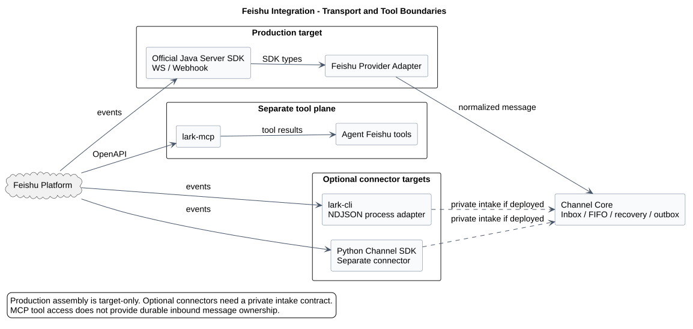
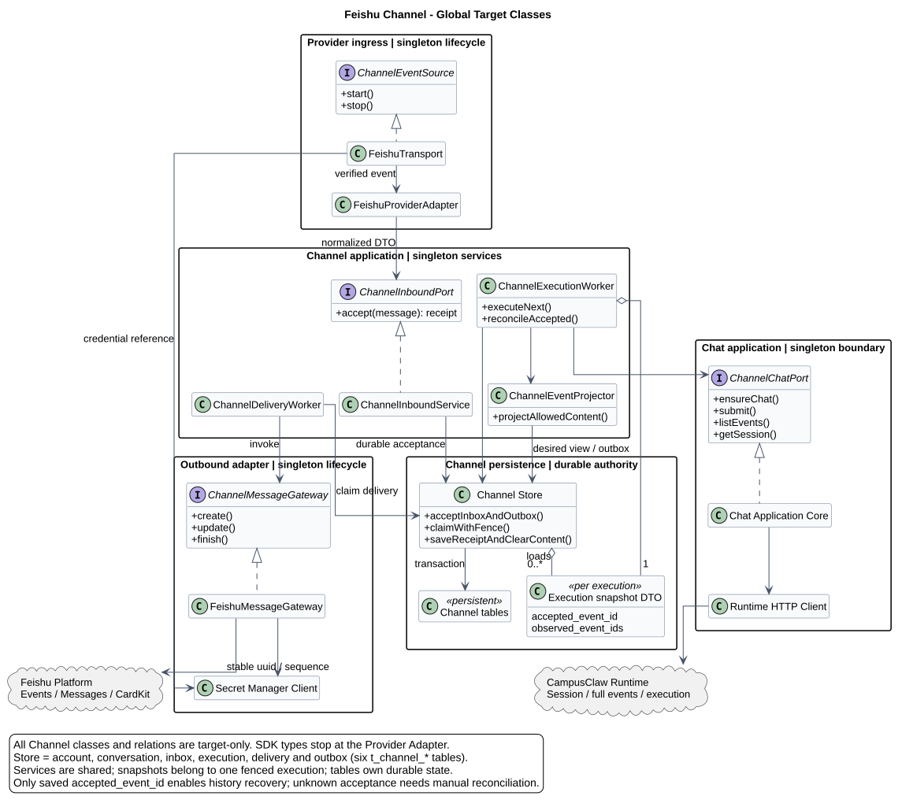
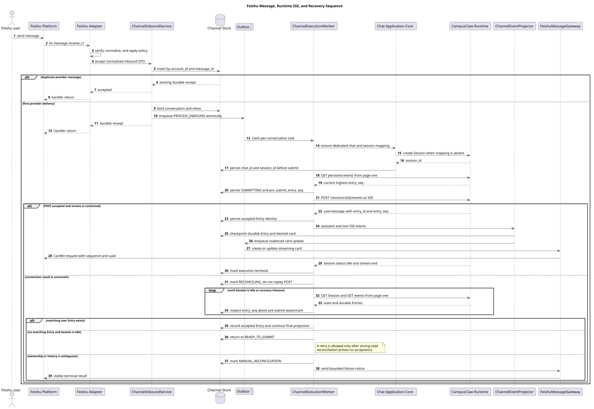
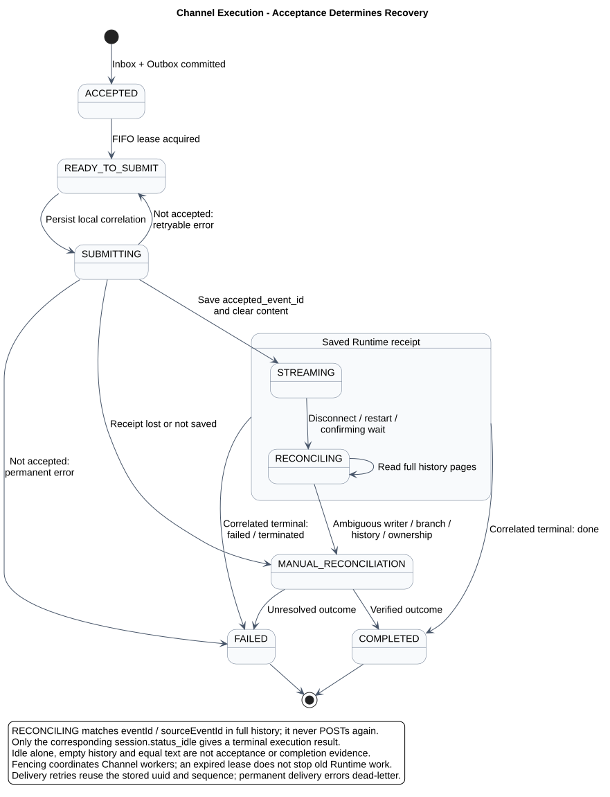

# CampusAgent Channel 与飞书接入设计

| 属性 | 值 |
|---|---|
| 文档版本 | 2.1.0 |
| 状态 | 目标设计；飞书接入尚未在 `mate-service` 实现 |
| 更新日期 | 2026-09-07 |
| 设计仓分析基线 | `246cfd035103a1720fd6446554559f0247cc5c84` |
| Runtime HTTP 契约 | 当前工作树 [`接口契约/common.json`](接口契约/common.json) 1.37.0、[`04-submit-user-message.json`](接口契约/操作/04-submit-user-message.json) 与 [`05-list-session-events.json`](接口契约/操作/05-list-session-events.json)；最后已提交契约基线为 `3c88fb7e`，1.37.0 差异尚未提交 |
| pi-mono-java 实现基线 | `1f801dbb82bdda30478e3354e685e3153b179a0c` |
| mate-service 源码核对基线 | `6d5e6f3714e1cf8744d187a4796ca06300ad7e33`；未发现 Channel/飞书实现 |
| 飞书官方 CLI 基线 | `larksuite/cli@755daa4de3ea12785c43a15244ffb8f012122c13` |
| 飞书官方 Channel SDK 基线 | `larksuite/channel-sdk-python@731d459cca55ac76e85911bba2b1666508145e03` |
| OpenClaw 参考基线 | `openclaw/openclaw@b015925bc30f6a8363f290b07d5f8588e21422b8` |
| 外部资料核对日期 | 2026-08-20 |

2026-09-07 仅同步 Runtime 控制接口退役：运维停止改走 Events user.interrupt。
本专题其他旧 Runtime 字段及事件投影仍属 1.37 迁移基线，接入前需对齐
[Events v2](chat-events-v2-design.md)，不能恢复独立控制入口或依据旧 Entry 水位推断新请求已接受。
[FollowUp 未来设计](chat-follow-up-future-design.md) 本期不启用；未重新核验飞书外部资料或改变公共 Channel 契约。

## 1. 结论

飞书确实有官方 CLI，而且当前 `lark-cli` 已经支持通过
`lark-cli event consume im.message.receive_v1 --as bot` 消费实时消息事件，输出为
NDJSON；它也能通过 `lark-cli im ...` 或 Raw API 发送和回复消息。因此“CLI 作为
Channel Adapter”是一个真实可行的实现方式，不应再把飞书接入只理解为 Java SDK。

但 CLI、MCP 和 Channel SDK 的职责不同：

- `lark-cli` 是面向人和 Agent 的命令行宿主；实时事件采用“一个 EventKey 一个
  子进程”，多个消费者共享本机事件总线；
- `lark-openapi-mcp` 把飞书 OpenAPI 暴露为 MCP Tools，适合 Agent 主动操作飞书，
  不是可靠接收 `im.message.receive_v1` 的 Channel 入站队列；
- 官方 Python `lark-channel-sdk` 才是完整 Channel 抽象，已经覆盖 WS/Webhook、
  规范化、策略、去重、媒体、出站和 CardKit 流式卡片；
- 官方 Server SDK 是各语言直接集成飞书事件与 OpenAPI 的基础能力。

本设计选择如下：

1. 生产目标在 Java `mate-service` 内使用飞书官方 Java Server SDK，实现
   `FeishuProviderAdapter`；企业自建应用默认使用长连接，Webhook 作为部署可选项。
2. `lark-cli` 保留为本地开发、PoC、单机 Agent 和事件 Schema 探查方案，不作为
   多实例 `mate-service` 的默认生产数据面。
3. Python `lark-channel-sdk` 作为行为基线；只有需要独立 Python Connector 时才部署，
   不能把 Python 库直接嵌入 Java 进程。
4. `lark-openapi-mcp` 属于 Tool 平面，可供 Agent 操作文档、日历或消息；它不替代
   Channel 入站、持久化去重或出站 Outbox。
5. Channel 层位于 `mate-service`，通过本地 `ChannelChatPort` 进入 Chat 应用核心，
   再由既有 Runtime Client 调用 CampusClaw；飞书 Adapter 不绕过 Chat 直接调用
   CampusClaw。
6. 不恢复旧公共 Run、独立 Run SSE、`run_seq` 或 `Last-Event-ID`。Channel 使用现有
   `POST /sessions/{session_id}/events` 请求级 SSE，并以 GET Events 的持久化 Entry
   做断线和结果不确定恢复。

飞书长连接是“飞书开放平台到 Provider Adapter”的外部入站协议；它不改变浏览器到
`mate-service`、`mate-service` 到 CampusClaw 已确认的 HTTP+SSE 边界，也不意味着
重新引入浏览器 WebSocket。

## 2. 实现方式调研



[PlantUML 源码：`channel_feishu_option_decision`](飞书渠道/diagram.puml#L1)

### 2.1 方案对比

| 方案 | 入站 | 出站 | 进程模型 | 生产适配性 | 本设计定位 |
|---|---|---|---|---|---|
| 官方 Java Server SDK | 长连接或 Webhook | SDK/OpenAPI | `mate-service` 进程内 | 与 Java 生命周期、监控、Secret、数据库事务边界最贴合 | **生产首选** |
| 官方 `lark-cli` | `event consume` 实时事件 | `im` 命令或 Raw API | 每个 EventKey 一个子进程，共享本机事件总线 | 需要自行补进程监管、数据库 Inbox/Outbox、集群租约和稳定凭据托管 | PoC、开发和单机 Agent |
| 官方 Python Channel SDK | 长连接或 Webhook | 消息、媒体、卡片和 CardKit streaming | Python 进程或独立服务 | Channel 能力完整；Java 系统采用时会新增跨语言部署和私有接入 API | 行为基线或独立 Connector |
| 官方 OpenAPI MCP | 不负责可靠事件入站 | MCP Tool 调用 OpenAPI | MCP Server/CLI | 适合模型主动调用，不提供 Channel durable admission | Tool 平面 |
| Raw Webhook + Raw OpenAPI | Webhook | HTTP OpenAPI | 自行实现 | 鉴权、解密、重试、Schema、限频和兼容成本最高 | SDK 无法满足时的最后选择 |

### 2.2 官方 `lark-cli` 的实际能力

官方 [`larksuite/cli`](https://github.com/larksuite/cli) 当前不是单纯的“发消息命令”。
其事件命令具备以下宿主协议：

| 契约点 | 已观察行为 | Channel 影响 |
|---|---|---|
| 消费命令 | `event consume <EventKey>`；一次只能监听一个 EventKey | 首版消息和卡片回调至少需要两个受监管子进程 |
| 正常输出 | stdout 每行一个 JSON，即 NDJSON | Adapter 可以逐行反序列化为入站 DTO |
| 就绪信号 | stderr 固定输出 `[event] ready event_key=<key>` | 父进程必须等待信号，不能用固定 sleep 猜测启动完成 |
| 生命周期 | 无界非 TTY 消费者把 stdin EOF 视为优雅停止；支持 SIGTERM | systemd/Kubernetes/Java ProcessBuilder 必须保持 stdin 或使用有界重启策略 |
| 退出语义 | 0 表示 limit/timeout/signal；非 0 使用结构化错误 envelope | 监管器按退出码和 `error.type/subtype` 分类，不匹配错误文案 |
| 多事件 | N 个 EventKey 对应 N 个子进程；共享一个本机 UDS bus daemon | 本机故障域清晰，但不是跨 Pod 消费组 |
| 消息输出 | `im.message.receive_v1` 被扁平化；`content` 对多数类型已是可读文本 | 不能再按 Raw OpenAPI 的嵌套 JSON 盲目 `fromjson` |
| 推荐去重键 | 输出 Schema 明确推荐 `message_id`，`event_id` 只是投递 ID | 数据库唯一键以账号和 `message_id` 为主 |
| CLI 内部去重 | `event_id` 内存 TTL 默认 5 分钟、环容量 10000 | 不能替代多实例数据库唯一约束和永久业务幂等 |

源码证据：

- [`skills/lark-event/SKILL.md`](https://github.com/larksuite/cli/blob/755daa4de3ea12785c43a15244ffb8f012122c13/skills/lark-event/SKILL.md#L15-L110)
  定义命令、ready marker、stdin/SIGTERM、退出码与“一 EventKey 一进程”；
- [`cmd/event/consume.go`](https://github.com/larksuite/cli/blob/755daa4de3ea12785c43a15244ffb8f012122c13/cmd/event/consume.go#L46-L84)
  声明 NDJSON 消费命令和参数；
- [`events/im/message_receive.go`](https://github.com/larksuite/cli/blob/755daa4de3ea12785c43a15244ffb8f012122c13/events/im/message_receive.go#L15-L108)
  定义消息扁平字段、`message_id` 去重建议和内容预渲染；
- [`internal/event/dedup.go`](https://github.com/larksuite/cli/blob/755daa4de3ea12785c43a15244ffb8f012122c13/internal/event/dedup.go#L11-L70)
  显示 CLI 自带去重是单进程内存结构。

若采用 CLI Adapter，最小启动形态是：

```bash
lark-cli event consume im.message.receive_v1 --as bot
```

需要卡片按钮时再启动：

```bash
lark-cli event consume card.action.trigger --as bot
```

这些命令只替换 `FeishuTransport` 和部分 `FeishuMessageGateway`，不会替换
`ChannelInboundService`、数据库、Outbox、会话串行化、Runtime 恢复或卡片投影。

### 2.3 官方 OpenAPI MCP 的边界

官方 [OpenAPI MCP 概览](https://open.feishu.cn/document/mcp_open_tools/mcp-overview)
和 [`larksuite/lark-openapi-mcp`](https://github.com/larksuite/lark-openapi-mcp)
表明 MCP Server 的目标是把飞书 OpenAPI 变为可被 Agent 调用的 Tools。官方
[MCP 智能助手机器人示例](https://open.feishu.cn/document/uAjLw4CM/ukTMukTMukTM/mcp_integration/develop-mcp-intelligent-assistant-bot)
同时使用长连接接收消息和 MCP 调用能力，恰好说明两者是两条责任链：

```text
Channel data plane: Feishu event -> durable inbox -> Chat -> Runtime -> reply
Tool plane:         Agent tool call -> lark-mcp -> Feishu OpenAPI
```

因此不能用“已经接入 lark-mcp”推导“机器人消息 Channel 已经具备可靠入站”。

### 2.4 官方 Python Channel SDK 的可复用结论

官方 [`channel-sdk-python`](https://github.com/larksuite/channel-sdk-python) 的
`FeishuChannel` 已观察到：

- transport 支持 `ws` 与 `webhook`，默认 WS；
- 入站先做事件/消息双键去重、消息规范化与 mention 解析，再进入安全策略；
- 安全层包含 stale、重复、自发消息、mention/allowlist、处理锁、按 Chat 排队；
- 出站支持消息、媒体、卡片和 CardKit streaming；
- Markdown streaming 预创建卡片，以严格递增 `sequence` 更新，并在终态关闭
  streaming mode；
- 默认去重存储是内存；自定义共享缓存协议没有原子 SETNX 语义，多 Worker 场景仍需
  数据库唯一约束和幂等业务处理。

源码证据包括
[`channel.py`](https://github.com/larksuite/channel-sdk-python/blob/731d459cca55ac76e85911bba2b1666508145e03/lark_channel/channel/channel.py#L289-L400)、
[`normalize/dedup.py`](https://github.com/larksuite/channel-sdk-python/blob/731d459cca55ac76e85911bba2b1666508145e03/lark_channel/channel/normalize/dedup.py#L1-L125)、
[`safety/pipeline.py`](https://github.com/larksuite/channel-sdk-python/blob/731d459cca55ac76e85911bba2b1666508145e03/lark_channel/channel/safety/pipeline.py#L43-L317)
和
[`markdown_stream.py`](https://github.com/larksuite/channel-sdk-python/blob/731d459cca55ac76e85911bba2b1666508145e03/lark_channel/channel/outbound/streaming/markdown_stream.py#L34-L213)。

### 2.5 成熟实现参考：OpenClaw

OpenClaw 的飞书插件不是本项目依赖，但提供了已运行过的工程参考：

- `extensions/feishu/src/monitor.transport.ts` 同时支持 WS 与 Webhook，Webhook 在解析
  JSON 前校验签名并限制请求体、Content-Type 和速率；
- `extensions/feishu/src/feishu-ingress.ts` 将识别出的消息事件先交给持久化 ingress
  queue，再由 drain 处理，并以 Chat 作为顺序 lane；
- `extensions/feishu/src/dedupe-key.ts` 不只依赖 `message_id`，还处理重连时同一逻辑
  文本获得新 ID 的实际问题；
- `extensions/feishu/src/sequential-queue.ts` 同 Chat FIFO、跨 Chat 并行；
- `extensions/feishu/src/streaming-card.ts` 使用 CardKit card ID、递增 sequence、稳定
  uuid、限频合并与明确 finish。

这些行为说明生产 Channel 不是“接上 SDK 回调后直接调用模型”，而是 transport、
durable admission、逻辑去重、策略、顺序、执行和 delivery 七个边界的组合。

## 3. 范围与非目标

### 3.1 本版范围

- 飞书企业自建应用的长连接入站；
- 可选 Webhook 入站，复用相同应用端口；
- 单聊、群聊 @ 机器人和群话题的 Conversation 绑定；
- 文本与 `post` 可见文本规范化；
- 数据库 Inbox、Conversation mapping、执行状态、Delivery 与 Outbox；
- 通过当前 Runtime POST SSE 执行，并通过 GET Events 做持久化恢复；
- CardKit 流式卡片的创建、合并更新、终态和错误投影；
- CLI Adapter 的开发/PoC 运行边界。

### 3.2 非目标

- 不把飞书消息事件暴露为浏览器公共 HTTP API；
- 不恢复公共 `Run`、`run_id`、独立 Run Events 或 `run_seq`；
- 不把 `lark-mcp` 当成消息接收队列；
- 不在 v1 下载图片、文件、音视频并导入 Attachment Service；
- 不开放用户从飞书消息指定 `agent_id`、`model_id`、`thinking` 或 Runtime
  `session_id`；
- 不允许多个入口同时写同一个 Channel 专属 Runtime Session；
- 不在首版实现卡片按钮到 Steer/FollowUp/Abort 的映射。

## 4. 目标架构与责任边界



[PlantUML 源码：`channel_feishu_target_architecture`](飞书渠道/diagram.puml#L72)

### 4.1 服务责任

| 组件 | 责任 | 不承担的责任 |
|---|---|---|
| `FeishuTransport` | SDK 长连接或 Webhook 生命周期、协议验真与原始事件接收 | 数据库业务幂等和 Agent 执行 |
| `FeishuProviderAdapter` | SDK 类型解析、内容规范化、mention/发送者策略、Provider ID 封装 | 直接调用 CampusClaw |
| `ChannelInboundService` | 事务去重、Conversation 解析、Inbox 与 Outbox 原子提交 | 同步等待模型结果 |
| `ChannelExecutionWorker` | 同 Conversation 串行、Chat/Session 绑定、Runtime SSE 消费与恢复 | 解析飞书原始 JSON |
| `ChannelChatPort` | 进入 `mate-service` Chat 应用核心的内部端口 | 暴露新的公共 HTTP 契约 |
| `Chat Application Core` | 创建 Channel 专属 Chat，维护 `chat_id -> session_id`，调用 Runtime Client | 感知飞书 SDK 类型和凭据 |
| `ChannelEventProjector` | 把允许展示的 Runtime 事件转换为 Channel desired view | 公开 thinking、工具参数或内部错误 |
| `FeishuMessageGateway` | token、CardKit、消息回复、限频与 Provider 错误分类 | 决定 Chat/Session 身份 |
| CampusClaw | Session、Entry、active execution 和请求级 SSE 权威 | 读取飞书 tenant/user/chat/message ID |

### 4.2 应用端口

以下是目标 Java 类型边界，不表示当前仓库已有实现：

| 端口 | 主要方法语义 | 数据对象 |
|---|---|---|
| `ChannelEventSource` | `start`、`stop`；只管理 Provider transport | SDK 类型只存在于 Adapter 内 |
| `ChannelInboundPort` | `accept` 返回 durable receipt，不返回 Agent 结果 | `ChannelInboundMessageDTO` / `ChannelAcceptResultDTO` |
| `ChannelChatPort` | 确保 Channel Chat/Session，提交消息，查询持久化事件和 Session 状态 | `ChannelChatSubmissionDTO` / `ChannelChatEventDTO` |
| `ChannelMessageGateway` | 创建卡片、按 sequence 更新、finish、发送终态错误 | `ChannelDeliveryCommandDTO` / `ChannelDeliveryResultDTO` |

Controller/API 边界若未来出现，必须使用独立 `*RequestVO` 与 `*ResponseVO`；Mapper 和
数据库交互使用 DTO。Service 负责 VO/DTO 转换、默认值、跨记录校验和状态迁移。
Java 数据层默认使用 MyBatis Spring Boot Starter `3.0.4`，除非工程兼容性评审确认
需要其他版本。

若将 Python SDK 或 CLI Adapter 独立部署，Connector 到 `mate-service` 的私有 intake
HTTP 必须另行逐接口评审；本设计没有授权直接复用浏览器公共 Chat API，也没有定义
一个接收任意 Provider 原始 JSON 的通用端点。

## 5. 飞书入站设计

### 5.1 长连接与 Webhook

飞书官方 Echo Bot 指引展示了自建应用通过长连接订阅
`im.message.receive_v1`；官方事件订阅安全文档同时区分了长连接与开发者服务器
Webhook。参考：

- [Echo Bot 应用配置与长连接](https://open.feishu.cn/document/develop-an-echo-bot/faq)；
- [事件订阅加密配置与两种接收方式](https://open.feishu.cn/document/server-docs/event-subscription-guide/event-subscription-configure-/encrypt-key-encryption-configuration-case?lang=en-US)；
- [Server SDK 能力说明](https://open.feishu.cn/document/ukTMukTMukTM/uETO1YjLxkTN24SM5UjN?lang=zh-CN)。

选择规则：

- 企业自建应用、无公网回调依赖时默认 `WS` 长连接；
- 已有统一公网 Gateway、需要平台级 WAF/流量治理或应用类型要求回调时使用 Webhook；
- 两种 transport 只在 `FeishuTransport` 内不同，向下必须生成相同
  `ChannelInboundMessageDTO`；
- Webhook 的 TLS、Body 上限、时间戳/签名、challenge、解密、限流和错误脱敏由
  Gateway 与 Adapter 共同承担；
- 长连接的 SDK 鉴权不能替代业务层 tenant、sender、mention 和 dedupe 校验。

### 5.2 事件与权限

首版只要求：

- `im.message.receive_v1`；
- 单聊消息；
- 群聊仅接受明确 @ 当前机器人；
- 发送机器人消息与 CardKit 创建/更新权限。

权限名和可申请范围必须在应用发布时以飞书开放平台当前界面为准，不把调研日期的
权限字符串永久固化为代码常量。默认不申请群全量消息、通讯录全量读取或用户身份
写操作权限。

### 5.3 规范化与策略顺序

固定处理顺序：

1. transport 完成连接鉴权，或 Webhook 完成签名/解密；
2. 校验 event type、当前 App/账号和允许 tenant；
3. 读取 `message_id`、`event_id`、`chat_id`、`root_id/thread_id`、sender 与
   `message_type`；
4. 过滤当前机器人自发消息和其他 bot，避免循环；
5. 群聊确认 mention 当前机器人并删除机器人自身占位；
6. 按消息类型解析内层 content，执行字节、JSON 深度、字符数和资源数量上限；
7. 生成不含凭据和原始 Header 的 `ChannelInboundMessageDTO`；
8. 数据库事务成功提交 Inbox 与 Outbox 后，回调才返回成功。

`message_id` 是首要 Provider 幂等键，`event_id` 用于投递审计。考虑到成熟实现观察到
重连可能为同一逻辑文本产生新 ID，文本再计算以下逻辑摘要作为第二层告警/去重候选：

```text
sha256(account_id || sender_id || chat_id || create_time || normalized_content)
```

数据库硬唯一约束仍以 `channel_account_id + provider_message_id` 为主。逻辑摘要自动
抑制必须有短时间窗，并记录原因，避免用户主动重复发送相同文本被永久误判。

### 5.4 消息类型

| 飞书类型 | v1 行为 | 原因 |
|---|---|---|
| `text` | 支持；解析文本并移除机器人自身 mention | 最小对话能力 |
| `post` | 支持有界可见文本、链接文字和 mention 显示内容 | 不把富文本 JSON 直接交给模型 |
| `interactive` | 普通消息入站不转 Prompt；卡片 action 另行设计 | 结构化操作不能无损降级成自由文本 |
| `image/file/audio/media/video` | 返回明确“不支持附件”提示 | 下载、扫描、文件 ID 与保留期尚未评审 |
| `sticker/share_chat/share_user/system` | 忽略或返回有界提示 | 不产生不可解释 Prompt |

规范化消息最长 262144 个字符，与 Runtime `message` 上限一致；Adapter 可采用更小的
产品上限。空白内容不创建 Chat 消息或 Runtime Entry。

## 6. Conversation、Chat 与 Session

当前责任链固定为：

```text
Feishu provider conversation
  -> channel_conversation_id
  -> mate-service chat_id
  -> CampusClaw session_id
```

Channel 不直接把 Provider conversation 当 Runtime Session。每个 Channel Conversation
创建一个 `mate-service` 管理的专属 Chat，并持久化私有 `chat_id -> session_id` 映射。
CampusClaw 只接收 `session_id` 与规范化消息。

| 飞书场景 | Conversation 唯一元组 | 上下文隔离 |
|---|---|---|
| 单聊 | `account + tenant + chat_id + empty_thread` | 同一用户与机器人的持久 Chat |
| 群聊新的顶层 @ | `account + tenant + chat_id + root_message_id` | 每个根消息独立 Chat |
| 群聊话题/回复 | `account + tenant + chat_id + root_id` | 继续根消息对应 Chat |

空 thread 使用固定非空哨兵值参与唯一约束，不能依赖 SQL `NULL` 的唯一性行为。
Channel Chat 固定账号配置中的 `agent_id`；`model_id` 由 Agent 默认值和 Chat 配置
决定。已有 Conversation 不随账号默认 Agent 变更而静默迁移。

为保证无幂等键 Runtime POST 的可恢复性，每个 Channel Chat/Session 必须满足：

- 只有 Channel Worker 能提交初始 `user.message`；
- 不与浏览器 UI、其他 Channel 或后台任务共享写入口；
- 同一 Conversation 的 Inbox 严格 FIFO，一次只允许一个执行进入 `SUBMITTING`；
- v1 不向该 Session 发送 Steer/FollowUp；
- 若检测到非 Channel 写入或分支变化，停止自动重试并进入人工对账。

这是产品约束和恢复正确性的前提，不只是性能优化。

## 7. Runtime HTTP+SSE 映射与恢复

### 7.1 当前映射

| Channel 动作 | 现有 Runtime operation | 规则 |
|---|---|---|
| 创建专属 Session | `POST /agents/{agent_id}/sessions` | 先获得 `session_id` 并持久化 Chat mapping，再提交消息；响应丢失产生的孤立 Session 由清理任务回收 |
| 读取状态 | `GET /sessions/{session_id}` | 判断 `idle/running`，不推导公开 Run |
| 提交消息并执行 | `POST /sessions/{session_id}/events` | 路径已表达 user message 语义，请求只发送 `message`，不再发送冗余 `type`；同一响应消费 SSE |
| 恢复持久化事实 | `GET /sessions/{session_id}/events` | 从第一页分页，按 `entry_id/entry_seq` 去重与对账 |
| 中止 | `POST /sessions/{sessionId}/events`，`user.interrupt` | 仅运维恢复流程使用；回执后等待目标实际停止，不映射普通飞书消息 |

Channel 不向 Runtime 发送 tenant、open_id、chat_id、thread_id、message_id、event_id、
卡片 ID 或业务 metadata。Provider 标识只保存在 Channel Store。

### 7.2 正常主流程



[PlantUML 源码：`channel_feishu_message_sequence`](飞书渠道/diagram.puml#L148)

正常流中，Worker 在看到第一个持久化 `user.message` SSE 后，记录
`accepted_entry_id + accepted_entry_seq`。实时 `assistant.message.delta` 只驱动临时
卡片；`assistant.message.completed` 与 `tool.result` 使用完整持久化 Entry 覆盖本地
预览。`session.status.idle + stream.end` 结束本次执行。

Projector 只展示允许公开的 Assistant 文本：

- 不展示原始 thinking；
- Tool lifecycle 最多投影为通用“正在处理”；
- 不展示工具参数、Tool Result 原文、内部 `tool_id`、Provider 错误和凭据；
- `assistant.message.completed(finish_reason=tool_call)` 不是本轮终态；
- 最后一个 `finish_reason=stop` 的 Assistant completed 是终态正文候选。

### 7.3 无 `Idempotency-Key` 的不确定结果恢复

当前 Runtime 契约明确禁止 `Idempotency-Key`，也禁止网络失败后盲目重放 POST。
Channel 不能假装远程副作用和本地数据库能原子提交。本设计使用“提交前 Entry 水位 +
专属写入所有权 + 持久化 Entry 对账”：

1. Worker 持有 Conversation lease，确认 Session 没有其他 Writer；
2. 从 GET Events 第一页开始完整分页，记录当前最高 `entry_seq`；空历史记为 0；
3. 在本地事务中把执行置为 `SUBMITTING`，持久化
   `pre_submit_entry_seq + request_digest`；
4. 调用 POST Events；收到 `user.message` 后立即保存其 `entry_id/entry_seq`；
5. 若 HTTP/SSE 在此边界前后中断，将执行置为 `RECONCILING`，禁止直接 POST；
6. 轮询 GetSession 与 GET Events，查找水位之后的 `user.message`；
7. 若找到且消息/文件字段与本地请求精确一致，证明请求已接受，继续从持久化 Entry
   做最终投影；
8. 若 Session 已 idle、强一致读取仍确认水位后没有 User Entry，才允许回到
   `READY_TO_SUBMIT`；
9. 若发现其他 Writer、多个候选、分支变化或历史不可完整读取，进入
   `MANUAL_RECONCILIATION`，不得自动重放。



[PlantUML 源码：`channel_feishu_recovery_state`](飞书渠道/diagram.puml#L239)

该协议基于当前 Java 已观察行为：`RuntimeEventService.acceptUserEntry()` 先调用
`repository.acceptUserEvent()` 持久化 User Entry，再启动执行；Controller 断开只调用
`RuntimeEventStream.detach()`，不会中止 Agent；`RuntimeExecutionCoordinator` 最终持久化
Session idle。它不依赖恢复临时 delta，也不恢复独立 SSE。

代价是断线后只能恢复完整持久化 Entry，不能恢复逐字预览；GET Events 只有 page
分页，长历史对账成本较高。若未来需要降低扫描成本，可单独评审增加只读
`after_entry_seq` 查询；不能为优化恢复而重新引入公共 Run。

## 8. 飞书出站与流式卡片

### 8.1 CardKit 选择

首版优先使用 CardKit streaming card，而不是反复 PATCH 普通消息：

1. 先创建 CardKit card entity，获得 `card_id`；
2. 在本地持久化 `card_id` 后，以稳定 `uuid` 回复原消息并引用该 card；
3. 对同一 `card_id` 使用严格递增 `sequence` 更新 markdown element；
4. Projector 合并高频 delta，按账号、会话和 card 三级限频；
5. 终态写入完整文本并关闭 streaming mode；
6. 失败终态也必须关闭卡片或发送可见错误，不能让用户永久看到“生成中”。

Card entity 创建成功但发送前崩溃，只产生不可见孤儿 card，可由保留期清理。发送请求
使用稳定 `uuid`；更新任务在外部调用前持久化 `sequence + uuid + projection_version`，
超时后重试原值，不能分配新 sequence 猜测结果。

正式上线前必须在飞书 Sandbox 验证：

- 回复相同 `uuid` 的重复请求是否返回可用于对账的稳定结果；
- CardKit 相同 `sequence + uuid` 的重试语义；
- 话题回复、CardKit 引用和 `reply_in_thread` 的真实路由；
- 当前租户的限频、卡片大小、可更新期限和权限错误码。

这些外部行为未完成 live test 前，文档只承诺本地不更换幂等标识，不宣称飞书 API
与 Channel Store 存在分布式原子提交。

### 8.2 投影和限频

- desired view 以完整当前文本保存，不以 delta 作为数据库真相；
- 每次任务带单调 `projection_version`，迟到低版本任务直接完成不发送；
- 非终态更新合并为最新版本，避免每个 token 调一次飞书；
- 终态允许越过普通 debounce，但仍进入同一 per-card 串行队列；
- 模型输出只能进入固定 markdown 文本 element，不得被解释为 card JSON、按钮、URL
  或人员 ID；
- 卡片序列化使用低于飞书硬限制的内部安全上限，超限时显示有界预览并用确定性
  分段消息补齐；
- Provider 永久错误、撤回、机器人离群和权限不足进入 `DEAD_LETTER` 并产生告警。

## 9. 持久化设计

本节定义逻辑表，不提供 DDL。后续 SQL 的表和列 `COMMENT ON ... IS` 必须使用中文。
所有新表使用小写 snake_case 和 `t_` 前缀。

### 9.1 `t_channel_account`

| 字段 | 语义 |
|---|---|
| `channel_account_id` | 内部 Channel 账号 ID |
| `channel_type` | 固定枚举，飞书为 `FEISHU` |
| `provider_app_id` / `provider_tenant_key` | App 与允许租户 |
| `credential_ref` | Secret Manager 引用，不保存 App Secret |
| `transport_type` | `WS` 或 `WEBHOOK` |
| `default_agent_id` | 新 Conversation 的 Agent 绑定 |
| `status` / `config_version` | 启停和乐观并发版本 |

### 9.2 `t_channel_conversation`

| 字段 | 语义 |
|---|---|
| `channel_conversation_id` | Channel Conversation ID |
| `channel_account_id` | 所属账号 |
| `provider_tenant_key` / `provider_chat_id` / `provider_thread_key` | Provider 定位元组 |
| `chat_id` | `mate-service` Channel 专属 Chat ID |
| `session_id` | CampusClaw Session ID，只在内部存在 |
| `agent_id` | 创建时冻结的 Agent |
| `state` / `row_version` | `CREATING/ACTIVE/FAILED/DELETED` 与并发版本 |

唯一约束为账号、tenant、chat 和 thread 元组；`chat_id`、`session_id` 各自唯一。

### 9.3 `t_channel_inbound_message`

| 字段 | 语义 |
|---|---|
| `inbound_message_id` | 内部 Inbox ID |
| `channel_account_id` / `provider_message_id` | Provider 主去重唯一键 |
| `provider_event_id` | 投递审计 ID，不作为主业务幂等键 |
| `channel_conversation_id` | 解析后的 Conversation |
| `provider_actor_ref` | 最小化加密/脱敏的发送者引用 |
| `normalized_content_ciphertext` / `content_key_version` | Runtime 接受前短期加密保存的规范化内容 |
| `content_digest` / `logical_retry_digest` | 对账和短窗重复检测 |
| `state` / `error_code` | Inbox 状态和稳定错误码 |

Runtime 接受 User Entry 后，在保存 `accepted_entry_id/seq` 的同一事务中清空内容密文
和 key version；最终失败记录按保留策略清空，不无限期保存 Prompt。

### 9.4 `t_channel_execution`

| 字段 | 语义 |
|---|---|
| `channel_execution_id` | 一条 Inbox 的执行投影 ID，不是公共 Run |
| `inbound_message_id` / `session_id` | 因果关联 |
| `pre_submit_entry_seq` | POST 前持久化 Entry 水位 |
| `request_digest` | 对账时匹配 User Entry |
| `accepted_entry_id` / `accepted_entry_seq` | 已证明 Runtime 接受的 User Entry |
| `last_observed_entry_seq` | 已处理的持久化 Entry 水位 |
| `state` | 图中执行恢复状态 |
| `lease_owner` / `lease_until` / `attempt_count` / `next_attempt_at` | 多实例接管与退避 |

`channel_execution_id` 只是 Channel 内部工作记录，不暴露为 API 资源，也不恢复旧
`run_id` 语义。

### 9.5 `t_channel_delivery`

| 字段 | 语义 |
|---|---|
| `delivery_id` / `inbound_message_id` | 出站投影身份与因果关联 |
| `provider_card_id` / `provider_reply_message_id` | CardKit 和消息定位；回复 ID 可在成功返回后补齐 |
| `card_sequence` | 下一个/已确认 CardKit sequence |
| `projection_version` / `visible_digest` | 本地 desired view 版本和去重 |
| `state` | `PENDING/STREAMING/FINALIZED/RETRY_WAIT/DEAD_LETTER` |
| `lease_owner` / `lease_until` / `attempt_count` / `next_attempt_at` | 多实例投递控制 |

### 9.6 `t_channel_outbox`

Outbox 任务至少包括：

- `PROCESS_INBOUND`；
- `RECONCILE_EXECUTION`；
- `CREATE_STREAMING_CARD`；
- `UPDATE_STREAMING_CARD`；
- `FINALIZE_STREAMING_CARD`；
- `SEND_TERMINAL_NOTICE`。

任务只保存内部 aggregate ID、目标版本和安全引用，不保存 token、App Secret、原始
Webhook Header、未脱敏事件或完整模型 thinking。

## 10. 并发、故障与可观测性

### 10.1 并发不变量

- 同一 `channel_conversation_id` 的 `PROCESS_INBOUND` FIFO 串行；不同 Conversation
  可并行；
- 一个 Conversation 同时最多一个 `SUBMITTING/STREAMING/RECONCILING`；
- worker lease 过期允许新 Pod 接管，但旧 Pod 每次写入都校验 lease/fencing token；
- Delivery 按 `delivery_id` 串行，低投影版本不覆盖高版本；
- 飞书 SDK/CLI 内存去重只做第一道减载，数据库唯一约束是最终事实。

### 10.2 故障分类

| 故障 | 处理 |
|---|---|
| Runtime POST 流建立前明确 `4xx` | 按错误码终态或退避；没有接受 User Entry时可安全处理 |
| Runtime POST 超时/断连 | 进入 `RECONCILING`，禁止盲重放 |
| SSE 中途断开 | Runtime 继续执行；GET Events 恢复完整 Entry，丢弃临时 delta |
| `409 SESSION_BUSY` | 先对账同 Conversation 旧执行；不把新消息隐式转 Steer |
| `503` 容量/归属错误 | 保持同一 Inbox 与水位退避；是否重试取决于是否已接受 |
| Worker/Pod 重启 | 由 Inbox、execution state、Outbox 和 lease 恢复 |
| 飞书限频/网络错误 | 原 uuid/sequence 退避，不创建新逻辑 delivery |
| 飞书永久权限或目标错误 | Dead letter、可见终态和告警 |

### 10.3 指标与日志

至少提供：

- transport connected、reconnect count、last event time；
- inbox accepted/duplicate/rejected、按原因统计；
- per-conversation queue depth 与 oldest age；
- `SUBMITTING/RECONCILING/MANUAL_RECONCILIATION` 数量和持续时间；
- Runtime POST 首事件、首文本、终态延迟；
- CardKit 请求、限频、重试、dead letter；
- outbox backlog、lease steal、投影覆盖次数。

日志只记录内部 ID、稳定错误码和脱敏 Provider reference；禁止记录 App Secret、token、
完整 Header、原始事件、Prompt 明文、thinking 或工具私有结果。

## 11. 安全与隐私

1. App Secret、verification token、encrypt key 和 access token 由 Secret Manager 托管；
   数据库只保存 `credential_ref`。
2. Webhook 必须在 JSON 解析和业务处理前完成签名校验；长连接只使用官方 SDK，禁止
   自行简化握手、鉴权和解密。
3. Channel 先校验账号、tenant、sender、chat、mention 和消息类型；Runtime 仍按每个
   HTTP 请求验证服务凭据和 Session。
4. Provider ID 不进入 CampusClaw、Prompt、Tool Manager 或 Model Manager；需要用户
   可见身份时只注入受控显示文本，不注入可调用的 Provider 标识。
5. 飞书消息不能指定 Agent/Model/thinking、工具权限、系统提示、Session 或文件 URL。
6. 模型文本进入固定卡片模板并转义；不能产生卡片动作、回调 URL、人员 ID 或 OpenAPI
   参数。
7. 原始事件默认不持久化；规范化内容只在 Runtime 接受前加密短期保存。
8. 使用 MCP/CLI Tool 平面时采用与机器人最小入站权限分离的身份和 allowlist，避免
   Channel 用户通过 Prompt 间接获得高权限 Feishu Tools。

## 12. 实现组件建议

| 组件 | 所属层 | 说明 |
|---|---|---|
| `FeishuLongConnectionEventSource` | provider adapter | 官方 Java SDK，账号级生命周期和健康检查 |
| `FeishuWebhookController` | provider adapter | 可选；严格签名、Body 上限、challenge 和限流 |
| `FeishuInboundMapper` | provider adapter | SDK 类型到 DTO，解析 text/post/mention/thread |
| `ChannelInboundService` | application | Inbox、Conversation 与 Outbox 原子提交 |
| `ChannelConversationWorker` | application | per-conversation lease、FIFO、Runtime 提交和恢复 |
| `ChannelRuntimeReconciler` | application | pre-submit watermark、GET Events 扫描和状态判定 |
| `ChannelEventProjector` | application | Runtime 事件到安全 desired view |
| `ChannelDeliveryWorker` | application | CardKit outbox、sequence、uuid、限频与 dead letter |
| `FeishuMessageGateway` | infrastructure | 官方 SDK/OpenAPI 与 token provider |
| `LarkCliEventSource` | development adapter | NDJSON、stderr ready marker、SIGTERM 与进程重启；默认不装入生产 profile |

## 13. 测试与验收

### 13.1 Adapter 与契约测试

- 官方 SDK 事件到 `ChannelInboundMessageDTO` 的 text/post/mention/thread 映射；
- Webhook 签名失败、挑战、加密、Body 超限和非法 JSON；
- CLI NDJSON、ready marker、结构化 stderr、stdin EOF、SIGTERM、子进程重启；
- Runtime 第 4/5 operation 的请求、SSE、分页和错误消费者合约；
- 未知飞书错误码走安全默认分支，不匹配 `msg` 文案。

### 13.2 幂等、排序与崩溃测试

- 同一 Provider `message_id` 并发投递 100 次，只有一个 Inbox 和一个
  `PROCESS_INBOUND`；
- 同 Conversation 100 条消息保持 FIFO，不同 Conversation 可并发；
- Session 创建成功、mapping 保存前崩溃只产生可清理孤儿 Session，不提交消息；
- POST 接受前、本地 `SUBMITTING` 已提交后崩溃，可证明无 Entry 后重试；
- Runtime 接受 User Entry、本地保存 `accepted_entry_id` 前崩溃，通过水位后 Entry
  对账，不产生第二条 User Entry；
- SSE 在任意 delta、tool 或 completed 处断开，最终卡片由 GET Events 收敛；
- 人为注入第二 Writer 时进入 `MANUAL_RECONCILIATION`，不自动重放；
- CardKit create/send/update/finish 每个外部调用点前后崩溃，保持原 uuid/sequence；
- lease 过期接管不允许旧 Worker 覆盖新 projection。

### 13.3 安全与容量测试

- 非允许 tenant、bot sender、非 @ 群消息、超长/深层 JSON、恶意 mention；
- Prompt/card injection、链接转义、日志和指标敏感数据扫描；
- SDK/CLI 断线重连、事件重复、乱序、数据库不可用和 outbox backlog；
- 飞书 Sandbox 实测回复 uuid、CardKit sequence、话题路由、限频和权限；
- 多 Pod 连接数量、租约竞争、滚动升级和 Secret 轮换。

## 14. 源码证据与差异分类

### 14.1 观察到的源码行为

| 来源 | 路径/符号 | 观察结果 |
|---|---|---|
| pi-mono-java `1f801dbb` | `modules/coding-agent-cli/src/main/java/com/campusclaw/codingagent/runtimeapi/web/RuntimeEventController.java`，`submit()` 58-73 | POST 直接返回 `SseEmitter`；completion/timeout/error 只 detach |
| pi-mono-java `1f801dbb` | `.../runtimeapi/event/RuntimeEventService.java`，`prepareAndSubmit()` / `acceptUserEntry()` 66-102 | 锁定 Session、确认 idle、持久化 User Entry、启动执行并返回请求级 EventStream |
| pi-mono-java `1f801dbb` | `.../runtimeapi/event/RuntimeEventStream.java`，`emit()` / `attach()` / `detachInternal()` 48-79、107-138 | 单订阅者、有界缓冲；断线清空本地流但不调用 Agent abort |
| pi-mono-java `1f801dbb` | `.../runtimeapi/event/RuntimeExecutionCoordinator.java`，`start()` / `completeExecution()` 68-82、150-164 | Agent 异步执行，终态持久化 Session、释放 active execution 并发终态事件 |
| mate-service `6d5e6f37` | 全仓检索 Channel、Feishu/Lark、`im.message.receive_v1` | 未发现现有飞书 Channel 实现；本文 Java 组件均是目标设计 |
| lark-cli `755daa4d` | `skills/lark-event/SKILL.md`、`cmd/event/consume.go`、`events/im/message_receive.go` | CLI 可消费实时事件，使用 NDJSON/子进程协议，并对 IM 消息做扁平化 |
| Channel SDK `731d459c` | `lark_channel/channel/**` | 完整 WS/Webhook、规范化、安全、出站和 streaming 参考；默认内存去重不足以承担集群业务幂等 |
| OpenClaw `b015925b` | `extensions/feishu/src/monitor.transport.ts`、`feishu-ingress.ts`、`dedupe-key.ts`、`streaming-card.ts` | 成熟实现把 transport、durable ingress、逻辑去重、串行队列和 CardKit 明确分层 |

### 14.2 目标设计与原因

| 分类 | 决策 | 原因 |
|---|---|---|
| 产品约束 | Channel Conversation 使用专属 Chat/Session 和单 Writer | 使无幂等键 POST 能以 Entry 水位无歧义对账 |
| 产品约束 | v1 只处理 text/post，群聊必须 @，不把普通消息映射为 Steer | 控制首版能力和上下文泄露风险 |
| 架构改造 | 在 `mate-service` 新增 Provider Adapter、Inbox/Outbox、Worker、Projector 与 Gateway | 当前源码没有 Channel 实现，且 Provider 回调不能同步等待 Agent |
| 架构改造 | Channel 通过 `ChannelChatPort` 进入 Chat core | 保持 `chat_id -> session_id` 所有权，不绕过公共业务层 |
| 架构改造 | 以 `pre_submit_entry_seq` 和 GET Events 恢复不确定 POST | 对齐当前无 Run、无 Idempotency-Key、请求级 SSE 契约 |
| 飞书适配 | Java SDK 长连接默认，Webhook 可选；CLI 仅 PoC | 在 Java 生产服务中保留统一生命周期、事务、Secret 和可观测性 |
| 安全加固 | Provider ID/凭据不进入 Runtime；模型输出固定卡片渲染 | 防止跨边界身份泄露、Prompt 注入和权限扩大 |
| 安全加固 | MCP Tool 身份与 Channel Bot 身份分离 | 入站聊天权限不应自动获得高权限飞书 OpenAPI 操作能力 |

## 15. 待确认与后续专题

1. 飞书 Java SDK 的准确 Maven 坐标、锁定版本和公司制品仓可用性；
2. `mate-service` Chat 应用核心的实际端口、事务库和 Channel 专属 Chat 类型；
3. GET Events 长历史全量扫描的容量上限，是否需要只读 `after_entry_seq` 优化；
4. 飞书 Sandbox 对回复 uuid 与 CardKit sequence 重试的实测结果；
5. 附件导入 Attachment Service 的下载、扫描、file_id 和失败提示专题；
6. 卡片停止 action 到 user.interrupt 的授权与对账专题；FollowUp 暂不启用，不恢复三个独立控制接口；
7. 独立 CLI/Python Connector 若确有部署需求，其私有 intake HTTP API 逐接口评审。

## 16. 版本历史

| 版本 | 日期 | 变更 |
|---|---|---|
| 2.1.0 | 2026-09-07 | 同步独立控制接口退役，运维通过 user.interrupt 停止执行；其他旧 Runtime 映射明确为待迁移基线。 |
| 2.0.0 | 2026-08-20 | 调研官方 `lark-cli`、OpenAPI MCP、Python Channel SDK、Java Server SDK 路线与 OpenClaw 实现；生产方案选择 Java SDK 长连接/Webhook Adapter，CLI 限定为 PoC；按当前无 Run、请求级 SSE 重写架构、Conversation/Chat/Session 映射、Entry 水位恢复、CardKit、表结构和验收规则 |
| 1.3.0 | 2026-08-18 | 历史版本冻结旧 Run/独立 SSE 方案并删除过渡期 OpenAPI 引用 |
| 1.2.0 | 2026-08-18 | 历史版本记录两跳 HTTP+SSE 结论，但图表仍依赖旧 Run |
| 1.1.0 | 2026-08-17 | Runtime 改为 Session Event 直连 SSE 后，标记原 Channel 映射失效 |
| 1.0.0 | 2026-08-11 | 初版 Run-based 飞书 Channel 设计；已被 2.0.0 完整替代 |
