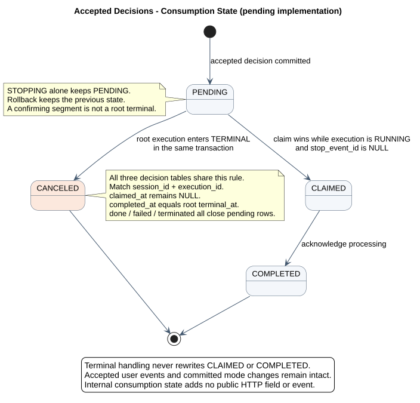

# CampusClaw Session Events 设计

| 属性 | 值 |
|---|---|
| 文档版本 | 0.21.1 |
| 状态 | 五输入联合契约与 B01～B15 已确认；跨实例实现按分项源码证据判断，Redis 恢复增量待实现 |
| 源码范围 | Java c9d858bc、a8192e04、918005ee、dfb90cac 分项核验；pi 固定 5cd93f68，完整提交和符号见 [源码证据](source-evidence.md#5-session-events-固定源码核验) |
| 更新日期 | 2026-09-22 |

结构化提问新增 agent.question / user.question_answer，复用 confirming 与原执行续跑；两事件、Schema、错误和恢复由 [AskUserQuestion](../06-CampusClaw计划模式/ask-user-question.md) 及共享事件源维护。该增量已在 Runtime 主线实现（`8c5fda1d`，见[源码证据 §12](../06-CampusClaw计划模式/source-evidence.md#12-主线实现状态核验2026-09-18)）；Session/元数据不增字段，Mate 公共投影待实现。本文其他历史源码范围不因此升级。

## 1. 资源模型与职责

POST `/sessions/{sessionId}/events` 在同一响应中返回本次用户事件回执与对应 SSE；GET 同一路径分页读取权威历史。响应连接不代表独立执行资源，完整事件持久化，临时 delta 只作实时预览。

请求与观察共用响应是 CampusClaw 的架构选择，便于内部调用方关联输入和输出。[Mate 公共 API](../../02-服务与接口/07-mate-service通用对话API/README.md) 独立采用提交与读取分离，由 bridge 消费 Runtime POST 后安全投影。

本文唯一维护接受、有序追加、单消息准入及跨实例控制；[流设计](chat-events-stream-design.md) 维护回执、响应绑定和关闭；[历史设计](chat-events-history-design.md) 维护完整事件投影、分页和对账。

浏览器重开及跨副本连续预览采用[Redis 流式恢复推荐设计](redis-stream-recovery.md)：在 Projector 到可丢弃 HTTP 队列之间建立共享快照与短期 Stream，新增独立只读观察；数据库继续管理准入、控制与完整历史。新增读取操作/快照事件为 proposed，待整合精确契约，能力待实现；下文既有请求级 SSE 不被静默改变。新目标的完整类图、源码专项、依赖及验收由该专题维护。

[原尺寸 SVG](设计图/事件接口重设计/target_session_events_resource_model.svg) · [PlantUML 源码](设计图/事件接口重设计/diagram.puml#L1)

## 2. 当前目标契约

每次 POST 只提交 user.message、user.interrupt、user.tool_confirmation、user.plan_confirmation 或 user.question_answer 中的一条事件。精确字段、Header、错误和机器评审状态分别由 [POST 模型](事件契约/操作/01-submit-session-event.json)、[GET 模型](事件契约/操作/02-list-session-events.json) 维护，[统一接口页](chat-api-review.html) 为阅读入口。

### 2.1 传输与执行规则

| 规则 | 当前设计与理由 |
|---|---|
| 接受回执 | 完整本次 user.* 持久化后作为首个 SSE 业务帧，不套 ResultBean；表示已接受，不表示执行结束 |
| 流格式 | data-only，type 表示语义，正文/思考用 phase 区分 delta/completed；不使用 Last-Event-ID 重发 POST |
| 响应归属 | 固定到本次执行段或中断目标；对应 idle 后关闭，等待确认的 idle 只结束本段交互 |
| 中断分工 | 原响应保留执行输出；中断响应只有自己的回执和同一权威 idle，两条响应复用终态 eventId |
| 单消息准入 | M1 真正结束前不接受 M2，拒绝消息不入库；确认、中断分别检查控制条件 |
| 跨实例控制 | 数据库保存固定目标与决定，各实例批量检查本机执行或本机等待响应；本地提交后通知缩短延迟，轮询兜底 |
| 身份与恢复 | eventId 对外去重；内部执行身份与序号不公开，网络结果不确定先查历史，不无条件重试 POST |

完整事件在 SSE 与历史同形。以上概要不取代完整事件目录；配置、压缩、用量及子 Agent 的投影由历史专题维护。Claw/Mate 的 eventId 是否共值仍需 bridge 对齐，字段同名不代表值相同。

### 2.2 相邻模块边界

凭据的读取、执行期间保留和仅 Mate tool execute 使用见 [HTTP 安全边界](chat-http-v1-design.md#7-安全与附件边界)。仅 user.message 声明可选执行凭据；中断、工具确认、计划审核和问题回答无需重传凭据，仍属于原执行且不能覆盖原快照。GET 历史不声明执行凭据。Claw 不检查凭据最低完整性，缺失或不完整的 Header 仍按已提供值透传给 Mate，由 Mate execute 返回工具失败结果。

Skill 复用消息执行语义，Builtin 保持 JSON，具体由 [Slash 模块](../../04-命令与技能/00-Slash-Command通用模块/README.md) 维护。当前无运行中消息队列，[FollowUp](chat-follow-up-future-design.md) 仅为未来扩展。

[计划审核](../06-CampusClaw计划模式/README.md)沿用根消息、固定续跑段与对应 SSE，在批准事务更新 Session.mode；精确输入和事件已进入共享契约，具体运行时实现仍须验收。计划子域的审核状态和工具边界由该模块唯一维护。

计划正文由 Runtime 解析 proposed_plan 标记后发布 agent.plan delta/completed；不新增 started 或连接模型，第一条非空 delta 建卡。完整响应解析与原 Entry/唯一退出调用绑定，审核事务成功后才发 completed。该增量待实现，来源、兼容和恢复统一见[计划流式输出](../06-CampusClaw计划模式/plan-streaming.md)，精确字段由共享 JSON 维护；预览可见不放宽确认锁边界。

### 2.3 工具调用名称快照

`agent.tool_call` 增加可选 `displayName`，精确字段约束由[共享事件源](事件契约/common.json)维护。普通框架 label 与 Mate 业务展示名按 [M03 映射规则](../02-CampusClaw工具系统/README.md#tool-display-name)归一；`toolName`、`arguments`、确认请求和调用关联不变，`agent.tool_result` 不重复名称。公共 Chat 的字段与授权投影见[Mate §5.4](../../02-服务与接口/07-mate-service通用对话API/README.md#54-工具调用)。

Application/Host 在第一次提交调用事件前，从本次装配的工具定义或 `PreparedAgentRuntime` 已加载的 Agent/Skill 绑定元数据取得名称；需要确认的调用也在确认卡出现前固定。该值随调用的已保存事件 JSON 数据一次写入，和调用 Entry 共用现有追加事务；提交后 SSE 及 ListEvents 使用同一个 `CommittedEventProjection`。确认续跑、执行开始通知、结果到达和历史重读不得重复生成调用或重新取名。取展示名不发起网络请求，不触发工具发现、工具执行或执行 ID 解析。

复用现有 committed event 的 JSON payload 存储此快照，无需为名称另建表、增加数据库列或改写模型消息；内部调用 Entry 可通过已有事件关联取得展示信息，不维护第二份可变名称来源。框架 `AgentTool.label()` 保持原接口；本增量不要求更改 Agent 内核 `ToolExecutionStartEvent` 或 Provider 原始事件。Host 仅保存执行内、按调用隔离的名称，不增加执行 ID 绑定或解析失败缓存；Spring 单例不保存某个用户的当前名称。执行时的工具解析、启停、权限和错误处理遵循原工具链路。

服务端去除展示名首尾空白，有效时写入非空字符串；缺失、null、非字符串或仅空白视为无展示名并省略字段。无值不把技术名填进 displayName；客户端自行回退。GET 的语言设置不翻译已保存名称；后续工具或 label 改名不改变已保存的调用快照。UI 对异常展示值也应降级而非拒绝整条合法调用。

这是产品可读性约束与外部事件投影扩展。收益是客户端无需另查目录即可统一展示实时、确认与历史标题；代价是服务端保存可选名称，并同步各消费端的事件字段。前端严格校验字段白名单，因此服务端、bridge、事件类型和解码器须同步更新；HTTP 路径版本不变。本增量只定义新产生调用的展示字段，不设计存量记录的迁移、回填或兼容。

实施验收：普通工具 label 映射、Mate 覆盖外层 label、名称缺失与错误类型、同名元数据冲突、首次确认前取名不发起发现请求、目录刷新不改已保存名称、SSE 与 GET 名称逐字段一致、仅收到结果后的调用补齐、模型伪造 displayName 不生效，以及事件类型与解码器白名单同步。Runtime/前端的分支实现、主线状态、验证范围及公共桥接缺口见[M03 专项证据](../02-CampusClaw工具系统/source-evidence.md#tool-display-binding-evidence)。

## 3. 目标分层与生命周期

以下总览保留 POST 与执行主干；GET 的共享完整事件投影、请求范围分页参数和普通分页
细化为 [历史查询目标类图与时序](chat-events-history-design.md#6-推荐目标类图与查询时序)。

[PlantUML 源码：`target_session_events_classes`](设计图/事件接口重设计/diagram.puml#L51)

图中重复实现按组展示，精确职责如下；组框不代表一个集中分支类。

| 图中分组 | 具体协作者 | 职责 |
|---|---|---|
| typed user event handlers | UserMessageEventHandler / UserInterruptEventHandler / UserToolConfirmationEventHandler / UserPlanConfirmationEventHandler | 分别接受消息、停止请求、确认决定；消息提交后启动，控制提交后只作本地提示 |
| polling services | ExecutionControlPollingService | 读取本机活动目标的停止/确认决定，复核身份并触发本地动作 |
| polling services | InterruptResultPollingService | 读取本机等待响应对应的权威终态，独立投递 |
| polling services | ConfirmationResultPollingService | 读取固定续跑段的完整事件，经共享投影投递到对应响应 |

推荐骨架保留 Web、Application、Runtime、流式输出、持久化边界，不保留长期 Session
订阅 Hub：

- Controller 验证 Request VO，交给 Service，使用只读 Response VO 编码 SSE；
  DTO/Mapper 不越过 Service 暴露到 HTTP。
- Service 固定解析结构、对象身份和 locale，使用 Handler Registry 分派四类用户事件。
  可变 Session/Tool 状态、容量与执行目标在所属事务或 Session 协调边界内复核。
- 每个 POST 有独立有界 `RequestEventStream`；目标 `RequestEventRouter` 只按内部绑定
  的执行段或中断目标投递，不按“当前 Session 最新执行”动态猜测归属。
  Controller 不持有或遍历全局 Session 订阅。
- 接受前预留响应队列，在同一协调边界绑定目标；用户事件提交后先排入完整回执，再允许
  执行/续跑/中断产生可投递输出。网络写出不占数据库锁。目标提前结束时在接受前拒绝，
  不能接受后空等一个已经错过的 idle。
- Application 层按执行管理 Projector 订阅，不让 Runtime 内核拥有 HTTP 投影器。
  Projector 与用户 Handler 共用有序追加边界；完整事件提交后有序发布，
  preview 只 best-effort 发布。HTTP 关闭只解绑该响应，不取消已接受执行。
- 中断可与原消息响应同时存在，但不新增公共订阅接口；两条响应投递同一条停止 idle、
  复用 eventId 已确认，中断响应不复制 Agent 输出。中断绑定的是持久化的内部执行身份，
  不要求接收实例持有远端 RuntimeActiveExecution；本机 Router 不跨进程访问执行对象。
  两个 Application 检查服务经数据库交接停止请求与结束结果，详见 §4.4。
  Spring 单例 Router 与检查服务不持有请求原始凭据。

历史读取边界与分页规则见[历史查询设计 §3](chat-events-history-design.md#3-已确认普通数字页码)。
请求级 SSE 不重放。断线、队列溢出或接收结果不确定都回到 ListEvents 对账；时间不能作
增量游标，不把重新 POST 当作重连。

### 3.1 事件处理、写入与展示顺序

本节是已确认的 Session Events 目标要求，属于架构变更，不表示当前实现已完整支持多来源事件的
依赖检查。“顺序正确”指保持业务因果关系，不是按机器时钟还原所有事件的物理发生顺序。
例如：用户消息先于由它触发的模型工具调用，工具调用记录先于对应工具结果，工具结果
先于依赖该结果的模型最终回答。这里没有新增公共事件类型或字段。

1. 同一 Session 的权威事件先经过统一的接受边界，检查来源顺序和前置事件依赖，再确定
   写入顺序。不能让不同工作线程各自抢数据库锁，把抢锁先后当作业务先后。
2. 按已确定的顺序，在同一个短事务内完成可变状态与依赖复核、内部序号分配及记录追加。
   同一 Session 的追加锁保持到提交；前置事件未提交或写入失败时，依赖它的事件不得先
   进入权威历史。不能先独立领号、再交给异步线程任意提交。串行范围不包括模型生成、
   工具执行或等待缺失的前置事件，这些耗时操作不占用数据库事务。
3. 无依赖的并发事件不存在唯一的业务先后，以该 Session 统一接受顺序为准。上游已发生
   乱序时，按来源顺序或显式依赖等待、校验；缺少足够信息就不能宣称恢复了因果顺序，
   更不能用时间戳或随机 `eventId` 猜测。缓冲上限、超时和失败处置属于后续实施细节。
4. ListEvents 只读取已提交的权威记录，按内部顺序返回；过滤后的结果保留相对顺序，
   客户端按响应数组顺序展示，不按 `createdAt` 或 `eventId` 重新排序。`createdAt`
   只用于时间展示，允许相同或不递增；B04 已统一其 UTC 毫秒格式和一次保存的时间语义，不新增
   数据库插入时间字段。对外继续使用 `eventId`，不公开 `entryId/entrySeq`。
5. 历史按每次查询可见的已提交完整事件集合进行普通分页。分支和过滤不变且仅尾部
   追加时，已有记录的位置不移动，新记录可进入后续页；发生分支或可见范围变化时
   从第一页重载，不承诺跨页固定结果。数量已确认为默认 50/上限 200，过滤与保留策略按 B05/B15 确认，具体部署期限按配置；这一变更
   不放宽前置依赖与有序提交要求，不改变已确认 SSE 语义。

推荐目标类图用 `SessionEventAppender` 表示共享的接受与有序追加职责：四个用户事件
Handler 和 Runtime Projector 都经过该边界，再由 Repository 执行短事务。该类名及具体
调度机制是 待实现 落地建议；确认的是共同顺序约束，而不是必须增加某种队列。
它是 Spring 单例协作者，但协调状态按 Session 隔离；多实例场景仍须在持久化事务中
复核依赖和状态，不能只依赖某个 JVM 内的互斥锁。查询不经过该写入边界，不等待模型
或工具执行完成。

### 3.2 一个 Session 同时只处理一条用户消息

M1 未执行完之前不接受 M2；消息接受时将数据库中的 Session 资源状态改为 running。此规则按 Session 生效，覆盖同一用户、不同用户及不同
服务实例。调用方仍可能同时发出 HTTP 请求，但不能同时成功接受两条尚未完成的消息。
不把 M2 排队，也不将拒绝的 M2 写入已接受事件历史。

推荐复用现有数据库接受事务：锁定 `t_sessions` 中对应 Session 行，在锁内复核
`state=idle`，追加 M1 并登记固定内部执行身份，更新 `state=running` 后一起提交。
状态不满足时拒绝；事务回滚时，消息与 running 状态一并回滚。只有提交成功后才允许
开始模型或工具执行、向本次响应投递完整回执。回执先于其他业务帧的规则继续有效。
同一行锁使另一实例的准入检查读到前一事务提交后的状态；不依赖前端禁用按钮、
先读后无条件更新或仅当前 JVM 的互斥锁。锁不保持到模型、工具或 HTTP 响应结束。

| 场景 | 数据库 Session 资源状态 | 新 user.message |
|---|---|---|
| 尚无未完成消息，允许新任务 | idle | 在事务内接受并改为 running |
| M1 模型/工具执行中 | running | 拒绝，不排队 |
| M1 等待工具确认，或已请求停止但尚未实际结束 | running | 拒绝，不排队 |
| M1 真正完成或实际停止，且可靠结束状态已提交 | idle | 可接受下一条消息 |

`session.status_idle` 是当前已确认的 SSE 事件名，不能仅凭它推断数据库已变成 idle。
等待工具确认时，这个事件仍关闭当前 HTTP 交互，但 M1 尚未完成，资源保持 running；
后续 `user.tool_confirmation` 继续 M1。`user.interrupt` 与确认事件各按自己的控制
条件接受，不复用新 user.message 的 idle 前置条件，也不新建第二条普通消息执行。
单纯 HTTP 断开、中断回执或等待超时均不释放 M1；实际结束时按 M5 固定执行身份
复核并提交终态，再开放下一条消息。失败、断线和恢复边界按 B07～B11 确认语义实施。

对调用方，忙时拒绝采用已确认的 `409 / SESSION_BUSY` 表达，SSE 首帧之前
返回普通错误 JSON；精确错误目录以操作模型为准。

本次沿用 `pi-mono-java@918005ee8ccc88d179fc31a0de17a92b4a01383b` 的源码基线。
以下 Java 路径相对 `campusclaw/src/main/java/com/huawei/hicampus/claw/codingagent/runtimeapi/`。

| 分类 | 仓库路径 / 符号 | 证据与差距 |
|---|---|---|
| 已观察实现 | `persistence/MyBatisRuntimeSessionRepository.java` · acceptUserEvent | @Transactional 内 lockSessionForUpdate，非 idle 返回 BUSY，追加消息并 markSessionRunning；已有数据库准入保护 |
| 已观察实现 | `campusclaw/src/main/resources/mapper/session/RuntimeSessionMapper.xml`（完整仓库相对路径）· lockSessionForUpdate/markSessionRunning | `SELECT ... FOR UPDATE` 锁定 t_sessions 行；更新另带 state='idle' 条件 |
| 已观察实现 | `event/RuntimeEventService.java` · requireIdleSession/acceptUserEntry/requireAccepted/prepareAndSubmitLocked | 事务前预检查不是最终准入；接受时再次由 Repository 复核，BUSY 映射 SESSION_BUSY，接受后才 start |
| 已确认目标产品约束 | 本节及 M6 | 保留单消息数据库准入，并落实到 Session Events 等待确认、中断和实际收尾；三输入生命周期并非当前源码已完整实现 |

此约束排除了 M1 尚未结束就接受 M2 的场景。若 M1 已经结束、M2 随后合法开始，
旧中断才到达服务端，则属于跨完成边界的迟到请求；B09 已明确该请求必须引用原始 user.message.eventId。
B09 现已确认必填 targetEventId，锁内只匹配指定原消息；新一轮已开始则返回 INTERRUPT_TARGET_MISMATCH，不能误停新一轮。

## 4. 源码证据与跨实例控制

### 4.1 事件顺序源码核验

Java a8192e04 的 Agent.emit 依次回调，Projector 同步处理，Repository 持 Session 行锁追加；它们保存到达写入边界的顺序，不能据此证明多来源的前置依赖已统一校验。完整路径与固定提交见 [排序证据](source-evidence.md#51-事件顺序)。

### 4.2 POST 与流生命周期源码核验

Java 918005ee 已有 POST SSE、单 subscriber 和断线不 abort；该基线只接受消息，仍输出旧 named SSE 和旧终态，并使用内部序号游标。三输入、独立响应绑定、data-only、确认分段、普通整数分页均为目标差距，见 [入口证据](source-evidence.md#52-post-与流生命周期)。

### 4.3 多实例问题与选择

该基线活跃执行保存在每实例 registry 的内存 Map。消息在 A 执行，中断请求可能到 B；数据库中的 running 状态不能让 B 获得 A 的 Java 对象。此结论来自 [固定源码](source-evidence.md#53-进程内执行定位)，不是已验证部署性能。

控制决定仍用数据库交接，执行由持有原对象的实例完成；该控制路径不增加实例转发或 Redis 锁，不改变 Agent 内核取消语义，也不承诺撤销远端工具副作用。新增 Redis 只负责[输出观察恢复](redis-stream-recovery.md)，不接管执行、不取代控制事务。

### 4.4 数据库停止请求与实例批量检查

共享记录必须关联 Session、不可复用的内部执行身份、原消息与中断事件、停止决定以及唯一权威终态；具体表列、索引与保留期由实施设计确定，新增表使用 t_ 前缀，禁止写入原始凭据。

#### 接受与执行交接

1. 消息接受时在数据库登记固定执行身份，再启动模型或工具。中断接收方预留有界响应，在短事务中复核 targetEventId 对应的原消息和状态，原子追加回执与停止决定。不能保存 `sessionId + stop=true` 后再查“最新执行”。
2. 提交成功后先将本次完整回执入队，再允许结果投递；网络写出不占数据库锁。同实例可立即尝试取消固定对象，通知失败仍由已提交记录和轮询兜底；回滚或提交不确定时不走本地快路径。
3. 每实例的 ExecutionControlPollingService 分批查询本机活动目标。快照仅缩小范围，实际取消在本地生命周期协调边界内原子复核对象身份和状态；不能检查旧对象后取消新 holder。重复检查不重启任务，取消回调不阻塞整批查询，不扫描无活动目标的全库。
4. 原执行实际退出后，在有序追加事务中复核固定身份，保存唯一 idle、执行关联与 Session 状态，提交后才能通知。停止请求不能在可靠结果产生前删除；自然完成竞争保留真实结束原因。
5. 原响应保留 Agent 输出；中断接收方按固定身份读取同一终态，仅投递其回执和该 idle。B 不访问 A 的运行对象或正文流，不创建第二个 idle。

#### 等待响应与竞态

InterruptWaitRegistry 每实例维护“固定目标 → 独立响应集合”，按目标去重查询，但每条响应保留自己的回执、locale、队列和连接状态。目标数与实际响应数分别限额，100 个业务执行名额不等于中断响应容量。

接受前预留容量；提交后按“回执入队 → 登记等待组 → 补读已提交终态”执行。终态早于登记由补读取回，晚于补读由提交后通知或下一轮查询取回。补读失败保留登记作有界重试，不把未读到解释为没有终态。

通知与补读共用逐响应投递入口，原子检查固定目标、回执顺序和连接状态；每个终态每条响应最多入队一次。队列无法接收只结束该响应，不能阻塞同组其他连接，也不承诺网络必达。移除最后等待者与新登记使用同一协调边界，避免误删新组；断线只解绑观察者，不删除数据库决定和结果。

#### 容量与失效边界

两类查询分别覆盖本机活动执行的停止决定，以及本机中断响应等待的远端终态。查询短小字段、不取大 payload，任务有界且不重叠积压；轮询线程与取消不竞争业务执行名额，但各自受资源限制。虚拟线程不增加数据库连接容量。

周期、批次、数据库超时、退避和等待期限配置化。索引须按实际 GaussDB 能力、执行计划、写入成本以及 100 并发背景下的查询/连接等待实测选择；尚无已验证的延迟或吞吐保证。空查询不能导致无界延长中断发现时间。

首帧后数据库故障、实例失联或超时不能合成停止成功。没有权威终态时断开观察并对账；心跳/租约到期不证明旧执行已停止，不自动接管或重放副作用。接受前目标失效返回冲突，接受后仍绑定原 sourceEventId 返回真实终态。控制和终态关联的保留期须覆盖必要对账窗口。

#### 源码差距与目标类职责

本节仍以 `918005ee8ccc88d179fc31a0de17a92b4a01383b` 为分析基线，
不是已实现能力。Java 路径均相对 `campusclaw/src/main/java/com/huawei/hicampus/claw/codingagent/runtimeapi/`。

| 源码证据 / 符号 | 已观察行为与目标差距 |
|---|---|
| `runtime/RuntimeActiveExecution.java` · beginRun/requestAbort/complete | 执行 ID、取消标记和 completion 为进程内状态；不能供其他实例读取 |
| `runtime/RuntimeSessionHolder.java` · activeExecution/abort | 在当前实例持有并取消 Agent；跨实例接收方不能直接调用此对象 |
| `persistence/MyBatisRuntimeSessionRepository.java` · acceptUserEvent/finishExecution | 已有事务化用户消息接受与 Session 状态更新；尚无中断事件、控制请求与终态关联的共同事务 |
| `event/RuntimeExecutionCoordinator.java` · completeExecution/finishPersistence | 当前先更新 Session、释放执行、发旧终态；不等于已实现唯一持久化 Session Events idle 和跨实例结果读取 |
| `campusclaw/src/main/resources/mapper/session/RuntimeSessionMapper.xml` · markSessionRunning/markSessionIdle（完整仓库相对路径） | 当前状态更新依赖 sessionId 与 state，目标需补固定执行身份条件，不能让旧执行收尾覆盖下一轮 |

目标类图中的 `ExecutionTargetDTO` 只保存不可变内部身份，不携带运行中的 Java 对象。
`ExecutionControlPollingService` 属于 Application 层，每实例一个，查询本机活动目标并
协调本地取消；`InterruptResultPollingService` 每实例一个，查询本机中断响应的匹配终态，
完成 DTO 到只读 Response VO 的转换。它们复用 Repository 与有序追加边界，
不把数据库轮询放进 Controller、DTO 或 Agent Loop。
具体类名是实施骨架，不是新增已实现类或冻结的公司库接口。

M7 补充核对 `pi-mono-java@dfb90cac4e233e09a0b8f047f7e9f4682f5ad238`，
下表五个文件相对
`918005ee8ccc88d179fc31a0de17a92b4a01383b` 均无变化；只补充本主题证据，不漂移
其他主题基线，不以 pi 内核或托管产品公开契约证明本地数据库调度。

| 源码路径 / 符号 | 已观察行为与 M7 差距 |
|---|---|
| `runtime/RuntimeExecutionProperties.java` · maxActive；`runtime/RuntimeSessionEngineRegistry.java` · capacity/register/find/complete | 默认 100，经实例内 Semaphore 准入，活动对象在本机 Map 中；可作为目标快路径的本地定位基础，尚无固定持久化目标的查询快照 |
| `event/RuntimeEventStream.java` · emit/attach/detach | 每条流有界且仅一个 subscriber；等待目标去重不能把多个响应直接 attach 到此流，需独立绑定和缓冲 |
| `event/RuntimeExecutionCoordinator.java` · completeExecution/finishPersistence | 现有 completion 和终态发送不是 M7 的已提交 Session Events 终态通知，不能直接据此唤醒为“可靠停止” |
| `campusclaw/src/main/resources/application.properties`（完整仓库相对路径）· spring.threads.virtual.enabled / campusclaw.runtime.execution.max-active / spring.datasource.hikari.maximum-pool-size | 启用虚拟线程、业务执行默认 100、连接池默认 10；这些是可覆盖的配置默认值，不是本次部署实测 |

局部目标类图以 `InterruptWaitRegistry` / `InterruptWaitGroup` 表达实例单例登记与
每个目标的等待组，组只聚合独立 `RequestOutputBinding`，不拥有 Agent 或原始凭据。
`InterruptResultPollingService` 从登记取去重目标，并统一处理补读与提交后本地通知；
`SessionEventAppender` 只在成功提交后发布权威终态。`UserInterruptEventHandler` 负责
回执先行、登记后补读及提交后的本地取消尝试。清理和逐响应投递由同一协调边界管理。

[PlantUML 源码：`target_database_interrupt_classes`](设计图/事件接口重设计/diagram.puml#L326)

[PlantUML 源码：`target_database_interrupt_delivery`](设计图/事件接口重设计/diagram.puml#L245)

### 4.5 确认续跑的跨实例交接（待实现 实施骨架）

B08/B09 已确认控制竞争和根消息关联，以下是落实语义所需的架构细化；不新增产品资源或
远端凭据传递。原执行的凭据保留在所属实例直至 M1 实际结束，包含工具确认等待；确认请求
只提交决定，不覆盖原执行凭据。执行实例丢失或凭据已无法恢复时，不自动接管、重跑或猜测成功。

1. 接收实例在原消息对应执行的事务内检查唯一 pending toolCallId、停止请求与版本；停止先
   提交返回 EXECUTION_STOPPING，重复/过期确认返回 TOOL_CONFIRMATION_NOT_PENDING。决定与
   user.tool_confirmation 回执、固定续跑段一起提交，不能只用 JVM 锁挡住跨实例重复执行。
2. 执行实例的 ExecutionControlPollingService 批量读取本机目标的停止/确认决定；本机提交后
   可立即通知，但只有已提交决定可触发续跑。消费确认时再次检查停止状态，保证工具至多调度一次；
   确认先提交、停止后提交时允许取消续跑，不能把此前确认当成不可中断授权。
3. 接收实例由 ConfirmationResultPollingService 按固定内部续跑段读取提交后的完整事件，
   使用共享 CommittedEventProjection 转只读 VO；回执先入队，遇到该段第一条 idle 后关闭。
   先登记再补读覆盖快速完成，内部读游标不进入 HTTP，不能用“最新执行”或公开页码作内部总线。
4. 既有请求级响应的临时 delta 不进入数据库历史；本机响应可接收 preview，跨实例请求响应仅保证完整事件。新增可恢复观察另由 [Redis 专题](redis-stream-recovery.md)提供，不把现有结果轮询声明为 token 恢复，也不降低完整事件的历史可恢复要求。
5. 确认等待只有一个 pending toolCallId；进入 confirming 前完成该段权威记录，后续工具调度
   由下一次确认推进。中断同样可作用于等待确认的原消息，实际停止才释放 running。

目标全局类图保留 Handler、应用轮询、Runtime Coordinator、共享投影与 Repository 的完整
依赖链。轮询/响应对象有界、无原始凭据；具体表字段/唯一约束和批次周期由实施设计校准。
不新增 Maven 依赖；使用现有数据库、JDK 并发与 Jackson 投影能力。

### 4.6 已接受决定的消费终态

本节统一维护工具确认、计划审核和问题答案的内部消费状态，适用于 `t_session_tool_confirmations`、`t_session_plan_confirmations`、`t_session_question_answers`。用户回执保存“决定已接受”的事实；消费状态表示原执行是否领取、处理或放弃该决定，两者分别维护。此项为已确认的架构变更，相对下述源码基线仍为 待实现，不新增公共 HTTP 字段、事件或 Session 状态。

| 消费状态 | 含义 | claimed_at | completed_at |
|---|---|---|---|
| `PENDING` | 决定已接受，原执行尚未领取 | NULL | NULL |
| `CLAIMED` | 原执行已取得决定 | 非空 | NULL |
| `COMPLETED` | 已领取决定的处理已确认完成 | 非空 | 非空 |
| `CANCELED` | 原执行已真正结束，此前未领取的决定不再消费 | NULL | 与根执行 `terminal_at` 相同 |

[原尺寸 SVG](设计图/事件接口重设计/target_decision_consumption_state.svg) · [PlantUML 源码：`target_decision_consumption_state`](设计图/事件接口重设计/diagram.puml#L409)

1. 成功接受决定时写入 `PENDING`；原执行按既有固定 Session、根执行、旧段、目标和停止条件领取，正常路径为 `PENDING → CLAIMED → COMPLETED`。领取与终态提交共用 Session、执行行锁顺序，竞争结果取决于先成功提交的一方。
2. 根执行成功进入 `TERMINAL` 的同一事务内，将该 `session_id + execution_id` 下三类表的全部 `PENDING` 行改为 `CANCELED`。不依赖已被清空的等待指针，也不只处理当前段。`done/failed/terminated` 均执行收尾；确认等待的段结束不是真实根执行终态。
3. `CANCELED` 保持 `claimed_at=NULL`，`completed_at` 使用与根执行 `terminal_at` 一致的归一化时间。`CLAIMED/COMPLETED` 保持原状态与时间，不把已经领取的处理伪装成未消费；后续正常 acknowledge 仍按既有规则完成已领取记录。
4. 只接受停止请求或进入 `STOPPING` 时仍保持 `PENDING`；领取条件已阻止停止后的新消费。可靠终态落库失败时，决定收尾、执行终态和相关历史一起回滚；重复终态或旧目标冲突不能再次改写决定的完成时间。进程失联且未取得可靠退出事实时也不提前取消消费。
5. `CANCELED` 不删除或改写用户确认、批准、反馈和答案事件，不撤销已提交的 Session mode 变更，不伪造工具结果；前端“已回答/已批准”仍根据已接受事件恢复。物理删除继续由 Session 删除后的清理任务处理，执行结束本身不删除历史；Session 未删除时保留带明确消费终态的记录。

理由是“已接受但尚未领取”可能被根执行结束永久截断。单独保留 `PENDING` 虽不会突破领取条件，却要求每次查看记录都联查执行才能区分待处理和永不消费；增加 `CANCELED` 可直接表达该区别。代价是三表枚举、时间约束和终态事务增加更新，不需要新表、定时清扫或 Maven 依赖。首版继续交付完整安装 SQL；不在本项中新增历史升级、旧终态记录回填或自动接管能力。

源码核验基线：`pi-mono-java@74f1b8314c9a5eb3d1659dfed2ab90b787dd647f`，核对日期 2026-09-18；仅更新消费状态专项，不把本页旧基线差距延伸到当前实现。以下路径相对实现仓根目录，R 为 `modules/coding-agent-cli/src/main/java/com/campusclaw/codingagent/runtimeapi/`，S 为 `modules/coding-agent-cli/src/main/resources/`。

| 源码 / 符号 | 已观察行为与本项目标差距 |
|---|---|
| R `session/ToolConfirmationState.java` | 仅 `PENDING/CLAIMED/COMPLETED`；目标增加 `CANCELED`，供三类决定共用 |
| R `persistence/MyBatisRuntimeExecutionControlRepository.java` · `markTerminal` | 持有 Session/执行锁，追加终态、关联段并更新执行；目标在同一事务收尾三类未领取决定 |
| S `mapper/session/RuntimeExecutionControlMapper.xml` · `claimConfirmation/claimPlanConfirmation/claimQuestionAnswer/markTerminal` | 领取要求决定为 PENDING、执行 RUNNING 且无 stop_event_id；终态只清执行指针，未更新决定行 |
| S `db/gaussdb/install/session_schema.sql` · 三张决定表的 state/claim CHECK | 只允许现有三态；目标允许 CANCELED 且未领取时间为空、完成时间非空 |

## 5. 实施切片与验收

| 切片 | 验收要求 |
|---|---|
| 请求与响应 | 五输入严格 VO 与 Handler Registry；每响应有界绑定；完整回执先于输出；Header 前 JSON 错误与 Header 后断开分开验证，EOF 不作为成功 |
| 消息准入 | 两实例竞争 idle 只接受一条消息；拒绝方无记录/模型调用；事务回滚消息和 running 一起回滚；确认、停止中或断线仍拒绝 M2，真正终态提交后才开放 |
| 因果追加 | 延迟或失败的前置事件不被依赖项超越；同时间/回退时间不影响顺序；锁、序号、追加与提交同短事务，模型/工具不占锁 |
| 数据库中断 | 消息 A、中断 B；回执前极快结束、重复检查、旧代次信号、数据库故障、A 失联及自然完成竞争均保持固定目标和真实终态；两响应终态 eventId 相同，中断不复制输出 |
| 等待登记 | 终态早于/并发/晚于登记补读均不漏；快路径仅提交后发生，通知丢失可轮询恢复；同目标只查一次，各回执和缓冲独立，慢连接及清理竞态不影响其他响应 |
| 确认续跑 | 决定一次消费；固定段关联、重复/过期确认、停止竞争和跨实例完整事件读取；等待期间保留原凭据，实例丢失不自动重跑 |
| 决定收尾 | 三类决定均验证接受后未领取与停止/超时竞争；STOPPING 仍 PENDING，真实 done/failed/terminated 同事务取消全部未领取记录；CLAIMED/COMPLETED 不变；时间与 terminal_at 一致；回滚、重复终态及旧目标不误改；用户事实保留，CANCELED 不再领取 |
| 投影与恢复 | data-only 和完整历史同形；preview 丢弃由完整内容覆盖；断线不取消、不重发；分页、配置/压缩/Usage、存量历史及 Skill 按各所属专题验收 |
| 容量与安全 | 100 业务名额满载仍可控制；按实际响应数与字节限额；慢取消不堵批次，轮询不挤满连接池；在真实 GaussDB 报告索引计划、成本与延迟，凭据不入记录/队列/响应 |

### 5.1 设计与实现验证边界

[统一维护规则](chat-api-index.md) 定义契约、生成页面和图源的一致性检查。以上运行时、数据库、容量和迁移验收属于实施工作；设计检查通过不能表示这些能力已经实现或部署。

## 6. 契约命名与实施依据

当前契约统一称为 Session Events；设计文件、事件字段源、校验器与实现类按职责命名。
HTTP 路径使用 `/campusclaw-service/v1`。内部开发阶段编号不作为另一个 HTTP 版本，
也不要求维持两套事件实现。源码名称与行为差距见[接口边界核对](chat-events-history-design.md#event-consumer-boundaries)。

## 7. 版本历史

| 版本 | 日期 | 变更 |
|---|---|---|
| 0.21.1 | 2026-09-22 | 新消息保留可选执行凭据，控制事件复用原快照，历史查询移除凭据示例。 |
| 0.21.0 | 2026-09-22 | 增加事件源侧 Redis 观察恢复目标，保留数据库控制事务和原请求级响应边界。 |
| 0.20.0 | 2026-09-19 | 计划正文通过专用 delta/completed 事件流展示并复用原审核事务。 |
| 0.19.0 | 2026-09-19 | 计划正文复用文本流，完整审核事件以来源消息引用绑定正文。 |
| 0.18.0 | 2026-09-19 | 调用事件从已加载元数据保存展示名称，取名不触发发现或绑定执行 ID。 |
| 0.17.0 | 2026-09-19 | 取消 Claw 对凭据最低完整性的本地校验，由 Mate execute 判断并返回工具结果。 |
| 0.16.0 | 2026-09-19 | 取消事件入口的凭据必填校验，将缺失凭据的失败推迟到实际 Mate 工具调用。 |
| 0.15.0 | 2026-09-18 | 调用事件保存可选 displayName 快照，统一映射、持久化与前端投影边界。 |
| 0.13.0 | 2026-09-18 | 根执行真实终态同事务将三类未领取决定标记为 CANCELED，并保留已接受用户事实。 |
| 0.12.0 | 2026-09-15 | 增加结构化提问与回答的契约、原根续跑及历史恢复入口。 |
| 0.11.0 | 2026-09-15 | 计划审核纳入五输入分派，复用固定续跑段与有序追加边界。 |
| 0.10.0 | 2026-09-14 | 按接受、有序追加与跨实例控制收敛主文，分离源码证据并合并重复验收。 |
| 0.9.2 | 2026-09-14 | 同步 Session 资源更新承载 plan/build 的计划模式边界。 |
| 0.9.1 | 2026-09-14 | 关联保持元数据稳定的计划模式目标增量与统一架构对比。 |
| 0.9.0 | 2026-09-09 | 统一 Session Events 命名，明确事件消费与实现边界。 |
| 0.8.0 | 2026-09-09 | 明确 Thinking 展示模型返回的原始推理。 |
| 0.7.0 | 2026-09-08 | 统一完整事件字段与错误码。 |
| 0.6.6 | 2026-09-08 | 记录 L10 isError 决定。 |
| 0.6.5 | 2026-09-08 | 记录 L9 Runtime 包装决定。 |
| 0.6.4 | 2026-09-08 | 记录 L7 内容块数组与 L8 本期仅文本决定。 |
| 0.6.3 | 2026-09-07 | 记录 L6 JSON 对象决定。 |
| 0.6.2 | 2026-09-07 | 记录 L5 字符串决定。 |
| 0.6.1 | 2026-09-07 | 收敛专题职责。 |
| 0.6.0 | 2026-09-07 | 退役三个独立控制接口，FollowUp 仅记录未来数据库接续方案。 |
| 0.5.3 | 2026-09-07 | 同步 L4 超范围空成功决定。 |
| 0.5.2 | 2026-09-06 | 同步 L2 默认 50/上限 200、L3 无 total，保留 POST 决定。 |
| 0.5.1 | 2026-09-06 | 同步 ListEvents 普通整数分页决定，移除目标快照/游标设计，保留内部因果顺序与完整事件同形。 |
| 0.5.0 | 2026-09-06 | 开始 ListEvents 评审：新增独立模型、历史设计和目标图，完整事件示例与 POST 同形，固定分支/上界和分页方向候选。 |
| 0.4.2 | 2026-09-05 | 增加提交后通知、固定目标去重等待及登记后补读。 |
| 0.4.1 | 2026-09-05 | 明确单消息数据库准入。 |
| 0.4.0 | 2026-09-04 | 使用数据库交接中断请求。 |
| 0.3.2 | 2026-09-04 | 明确原消息与中断响应的输出分工。 |
| 0.3.1 | 2026-09-04 | 对应 idle 后关闭响应，工具确认按段续接。 |
| 0.3.0 | 2026-09-04 | 合并 POST 提交与实时 SSE、确认完整 user.* 首帧回执。 |
| 0.2.2 | 2026-09-04 | 固化 GET stream S1～S4 的四项 A 选择，同步实时订阅 0.1.2、评审页、图与回归校验。 |
| 0.2.1 | 2026-09-04 | 统一消息、思考、工具与终态事件名称。 |
| 0.2.0 | 2026-09-04 | 定义 POST 用户事件与完整回执。 |
| 0.1.7 | 2026-09-04 | 统一事件处理、事务写入与历史展示顺序。 |
| 0.1.6 | 2026-09-04 | 三种用户事件统一携带 `access-token`，两种 Header 模式均必填。 |
| 0.1.5 | 2026-09-04 | 冻结 Session Events 公共事件身份：三种 POST 成功响应统一使用 `eventId`，删除 `entryId/entrySeq`。 |
| 0.1.4 | 2026-09-03 | 冻结用户认可的 Header 具体非生产示例值与凭据处理说明。 |
| 0.1.3 | 2026-09-03 | 将凭据处理改写为“请求读取—内存保留到执行结束—仅 Tool execute 发送”的具体过程。 |
| 0.1.2 | 2026-09-03 | 修正并冻结 `X-HW-ID` 的身份语义：它是用户凭据 ID，不是公司、服务或应用调用方标识。 |
| 0.1.1 | 2026-09-03 | 明确并冻结 POST 支持三种用户事件。 |
| 0.1.0 | 2026-09-03 | 固化资源模型 A，记录当前 Java 源码差距，增加目标资源图与类图，并启动第一个 POST operation 的四项字段评审。 |
