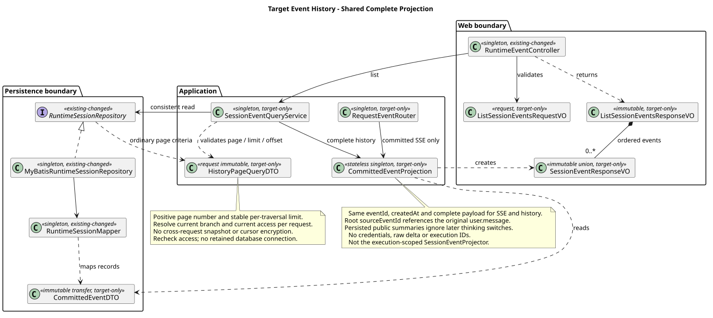
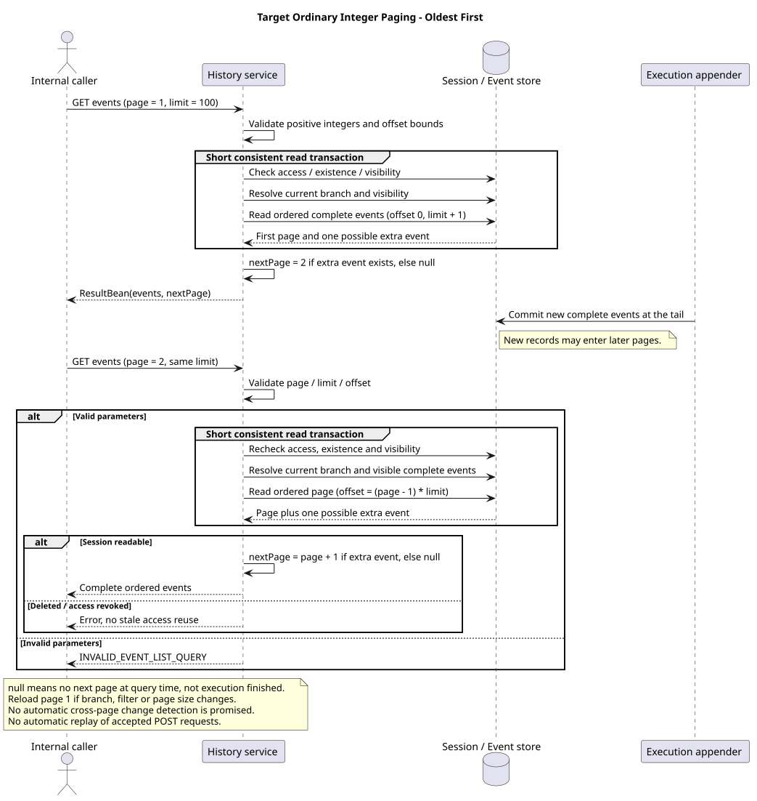

# ListEvents 历史查询设计

| 属性 | 值 |
|---|---|
| 文档版本 | 0.14.1 |
| 状态 | 数字分页与公共事件读取已实现；单条时间线的非递归读取待实现，其他增量按各节核验范围记录 |
| 更新日期 | 2026-09-22 |
| 原文展示与消费修复 | 实现提交 `cad6847d901155cc6388989b984d19e302a4fbe3`，见 [Draft PR #287](https://github.com/superheromeZzh/pi-mono-java/pull/287)；合入前不作为实现仓主线行为 |
| 线性读取专项基线 | `pi-mono-java@fb842b1ac6cb4818f6b146f79dd184a5cd88bf12`，2026-09-22；范围见 §5.1 |
| 历史实现核对基线 | `pi-mono-java@dfb90cac4e233e09a0b8f047f7e9f4682f5ad238` |
| 原 HTTP 核对基线 | `918005ee8ccc88d179fc31a0de17a92b4a01383b`；下述查询、编码、游标和 Mapper 四个文件无变化 |
| 官方公共契约核对 | Claude Managed Agents，2026-09-06，Beta；只证明公开行为 |

结构化提问新增 agent.question / user.question_answer，复用 confirming 与原执行续跑；两事件、Schema、错误和恢复由 [AskUserQuestion](../06-CampusClaw计划模式/ask-user-question.md) 及共享事件源维护。该增量已在 Runtime 主线实现（`8c5fda1d`，见[源码证据 §12](../06-CampusClaw计划模式/source-evidence.md#12-主线实现状态核验2026-09-18)）；Session/元数据不增字段，Mate 公共投影待实现。本文其他历史源码范围不因此升级。

## 1. 查询范围与契约入口

ListEvents 按已提交顺序从旧到新返回该 Session 单条追加时间线的完整事件，使用普通整数 `page/nextPage`。
每页默认 50 条、上限 200 条，合法超范围页返回空成功响应。完整事件与 POST SSE 共用字段定义。

- 当前 [ListEvents 评审页](chat-api-review.html#listSessionEvents)，唯一精确源为
  [02-list-session-events.json](事件契约/操作/02-list-session-events.json)。
- [POST 保留评审页](chat-api-review.html#submitSessionEvent) 与
  [请求级 SSE 设计](chat-events-stream-design.md) 继续有效。
- 当前内部接口由统一清单管理。Thinking 展示规则由 Runtime、Mate 公共 API 与前端
  共用；内部 `sessionId` 不直接暴露给浏览器。

```http
GET /campusclaw-service/v1/sessions/{sessionId}/events?page=1&limit=2
Accept: application/json
Accept-Language: zh-CN
```

GET 返回普通 JSON。结果使用
`ResultBean {resCode,resMsg,result:{events,nextPage}}`；失败不带 `result`。
请求只声明可选 JSON Accept 和 Accept-Language，不声明四项执行凭据。
不创建执行凭据、不调用 Mate 工具，不把任何凭据写进事件或日志；Header 源码核验见 [HTTP §8.2](chat-http-v1-design.md#82-十项接口请求-header-核验)。
上游认证、授权和隔离边界仍有效，Claw 不新增 JWT/APPKEY 解析或互斥校验。

任务更新已实现并登记到共享事件源：`agent.todo_updated` 直接返回完整 `todos`，无需前端识别工具名或解析工具结果。它与成功 ToolResult 的公共事件同源同事务保存，提交后发出；失败不更新清单。具体结构、源码基线与验收由 [TodoUpdate 主设计](../06-CampusClaw计划模式/todo-update.md) 唯一维护；Java `8c5fda1d` 已具备 TodoUpdate、RuntimeTodoEventMapper 与显式任务事件分支；本次静态核验不等于测试通过。Mate 公共桥接需单独同步后开放。

[Skill 使用统计](../../04-命令与技能/03-Skill加载统计/README.md)是已确认的 待实现 增量：复用真实根消息与规范工具调用身份，按根/Skill 统一去重。显式受理提交后或 Read 最终成功信号触发独立统计事务，失败不回滚受理与工具结果；因此使用统计不与权威历史条数恒等。统计不新增公共事件、不进入模型上下文，SSE/历史字段及分页保持；计量与保留由 M05 唯一维护。

## 2. 历史返回什么

精确字段、条件必填、枚举、错误码和语言文案由
[公共字段源](事件契约/common.json) 的 `eventContract` / `contractSections` 维护，
渲染到 GET/POST 的统一 HTML；两个操作引用同一份定义，不各写一套。

历史读取五类已接受 user.*、完整 agent.message/thinking/tool_call/tool_result/plan/todo_updated、
session.status_idle，以及模型、thinking、mode 配置和压缩完整记录。delta、心跳、连接标记不入历史。
每条完整记录有服务端 eventId 与保存一次的 UTC 毫秒 createdAt；按内部已提交顺序展示，
不按时间戳排序。agent.* 和 idle 的 sourceEventId 始终引用原始 user.message.eventId，
确认续跑不换根消息；中断用 targetEventId 指向它。共享终态只保留一条。

Agent 正文是字符串，工具 arguments 是对象，工具结果是至少一个纯文本块；允许空 text
和多个块，禁止 JSON/image 块。真实 Assistant 没有正文可保存 content=""（例如只有工具调用），
客户端不必画空气泡；不能凭空合成一条回答或把工具文本当成模型回答。
已知 Usage 随对应完整 Agent 消息保存，不在 delta、thinking 或各个工具事件重复计数。
无可验证用量时省略而非伪造零；lifetimeUsage 还包括压缩、失败尝试等可计费用量，不能以
公开消息 usage 简单求和代替 Session 的累计权威统计。

Thinking 展示按 §2.3 的原文规则执行：开关控制后续执行，已有思考原文
不会因关闭而隐藏；读取仍受当前授权和保留策略约束。凭据、内部序号、执行 ID、
Skill 私有正文及路径不进入公开投影。GET 的 Accept-Language 只决定本次错误 resMsg，
不重译已保存工具 text 或失败 message；同一事件在 GET 与 POST 必须逐字段相同。

工具失败由 isError=true 和稳定 errorCode 表达，成功必须省略 errorCode；错误文本经过
安全投影后保存。未知 Mate 错误映射通用 TOOL_EXECUTION_FAILED，不能分析原始错误文字猜码。
工具超时只表示调用期限已到，不保证远端副作用停止；整轮失败只有在本地执行确已退出并
可靠保存后，才发送 reason=failed 的权威 idle。HTTP 断流本身不是失败终态。

配置事件保留真实变更的 previous/current 值及既有原因；模型自动回退的 agentRefresh 和
模型能力关闭 thinking 的 modelCapability 不因 Session Events 改名丢失。配置事件不进入模型上下文，
主动配置更新只在历史展示，计划批准的模式变化另进入其固定续跑段；自动压缩可在对应执行 SSE 展示，手动 compact 保持 JSON。
压缩摘要和 firstKeptEntryId 等恢复数据留在内部，不把提示词、私有摘要和内部关联直接返回。
全部持久化类型必须逐类映射或明确不公开理由；未知持久化类型报 EVENT_LIST_FAILED，
不能静默跳过后声称完整。

统一 Session POST 的模式真实变化追加 `session.mode_changed(reason=requested)`，与模型、思考变更同事务保存，顺序固定为模型 → 思考 → 模式；同值或仅改名不产生额外历史。该事件仅用于历史，不创建执行或 SSE。mode 取值、previous/current 及精确字段由共享事件源维护；名称、内部字段和凭据不进入配置历史。计划审核批准产生的 `reason=planApproved` 同样由共享事件源维护，sourceEventId 与 confirmationEventId 绑定原消息和批准回执，完整记录进入确认续跑段 SSE 与历史。

模式事件是新增 待实现 架构变更；Java `09b32d8ea4a4b43b34be302d8b2745bdc417c9a2` 的 `modules/coding-agent-cli/src/main/java/com/campusclaw/codingagent/runtimeapi/event/RuntimeEntryCodec.java` 尚无模式 Entry 工厂。统一写入的事务、源码路径与验收由 [Session 更新设计](chat-http-v1-design.md#24-模型目录与统一-session-更新)维护，历史查询沿用共享投影与分页骨架。

历史读取调用事件中已保存的可选 displayName，不重新查询工具目录或按当前 label 取名。普通工具和 CallMateTool 的显示回退与首次快照统一见[调用名称快照](chat-events-design.md#tool-display-snapshot)；同一调用在 SSE、确认卡与历史中使用同一值。

### 2.0 内部事件的完整投影清单

源码基线为 `dfb90cac4e233e09a0b8f047f7e9f4682f5ad238`，以下旧名称来自
`modules/coding-agent-cli/src/main/java/com/campusclaw/codingagent/runtimeapi/event/RuntimeEventType.java`
与同目录 `RuntimeEntryCodec.java` 的各 Entry 工厂及恢复投影。此表保留历史类型与目标投影的对应关系，当前实现状态按专项核验记录：
内部原始事件先归一，再经共享完整事件投影供历史与 SSE 使用；旧名称不是兼容 wire 别名。

| 既有内部类型或记录 | 公共目标投影 / 不公开理由 |
|---|---|
| user.message | 完整 user.message；提交时生成一次稳定 eventId，保留有序正文与 file 块；内部执行与根消息关联持久化，不能每次查询重新生成 ID |
| assistant.message.started | 不公开；客户端由第一段 delta 或 completed 建立消息 |
| assistant.message.delta / completed | agent.message + delta/completed；只有 completed 入历史，完整正文和已知 Usage 保存一次 |
| assistant.thinking.started | 不公开；不需要额外开始记录 |
| assistant.thinking.delta / completed | 执行 thinking=true 时将可读推理原文映射 agent.thinking；delta 用于预览、completed 保存并供历史读取；不透明签名保留内部 |
| tool.execution.started | 参数收集完成后投影完整 agent.tool_call，保存 toolCallId、参数对象和确认标记 |
| tool.execution.delta / completed | 不单独公开；内部工具进度不构成新的业务历史或通用命令生命周期 |
| tool.result | 完整 agent.tool_result；至少一个 text 块、必填 isError，失败映射稳定安全码；成功内置 TodoUpdate 额外同事务投影 agent.todo_updated，一 Entry 两事件，分别计入分页 |
| session.model.changed / session.thinking.changed | session.model_changed / session.thinking_changed；保留真实 previous/current 与原有 reason，只进入历史 |
| session.compaction.started / failed | 不单独公开；内部压缩过程与恢复判断保留，最终整轮确实失败时才产生 failed idle；手工 Compact 失败仍按其 JSON 错误契约 |
| session.compaction.completed | 完整 session.compacted；内部摘要、恢复边界和独立 Usage 仍保留供恢复与累计，不进入公共 payload |
| session.status.idle | 对应 session.status_idle；持久化真实 reason/原消息 sourceEventId，确认等待边界与实际执行终态区分 |
| stream.end / stream.error | 连接级信号不入历史；正常 EOF 跟随对应 idle，不能把断线编造成业务失败 |
| 独立 Usage 累计记录、不透明 thinking 签名/Skill 展开上下文、树结构控制记录 | 不作为额外公共事件；分别用于 lifetimeUsage、模型恢复和内部完整性检查，不能重复计费或泄露私有上下文 |

完整事件在提交事务中保存一次稳定身份和公共内容，读取只返回已提交投影。未保存的思考文本或因果关联不能凭空补造；未知类型、投影缺失或数量不匹配仍显式失败。面向新建环境交付，不增加旧类型迁移或兼容读取路径。

### 2.1 Mate 工具的文本返回与源码边界

源码基线为 `pi-mono-java@dfb90cac4e233e09a0b8f047f7e9f4682f5ad238`：
`modules/coding-agent-cli/src/main/java/com/campusclaw/codingagent/runtimeapi/event/RuntimeEntryCodec.java`
的 modelChangedEntry/thinkingChangedEntry/compactionEntry/usageRecord/appendPublicPayload
证明当前已有配置、压缩和独立 Usage 存储；当前 appendToolResultPayload 会按读取 locale 生成
errorMessage，时间还会使用模型 timestamp。目标共享投影将其改为固定完整事件时间、保存安全
错误文本、纯文本块、sourceEventId 和已知 usage 归属。这些行为由共享完整事件投影统一处理。
旧 `campusclaw/.../com/huawei/hicampus/claw/...` 证据继续保留，各路径均相对实现仓。


以下路径相对各自仓库根目录。

| 源码证据 | 已观察行为 |
|---|---|
| `modules/coding-agent-cli/src/main/java/com/campusclaw/codingagent/common/client/HttpMateToolClient.java:340` · `toToolResult` | Claw 客户端读取 `resCode/resMsg/result`；仅 `resCode` 文本值为 `0` 时成功，把非空 result 用 `JsonNode.toString()` 序列化，metadata 为 null。result 缺失或 null 时当前返回空字符串；B03 保留空文本语义，并将字符串 result 改为 asText()，对象/数组仍序列化。 |
| `modules/coding-agent-cli/src/main/java/com/campusclaw/codingagent/common/client/mate/MateToolClient.java` · `ToolResult` | 内部结果是 `String content`、`Map metadata`、`boolean isError`，没有保留原始 JSON 节点或图片块。 |
| `modules/coding-agent-cli/src/main/java/com/campusclaw/codingagent/tool/mate/CallMateTool.java:46` · `name/parameters/execute` | 工具名为 CallMateTool；Schema 的 tool 为业务工具名，args 为对象且可省略，执行时缺省为 Map.of()。L9 固定包装；B03 已确认公共事件中补齐 args={}。 |
| `modules/coding-agent-cli/src/main/java/com/campusclaw/codingagent/tool/mate/CallMateTool.java:101` · `execute` | 成功时包装一个 TextContent；metadata 进入 AgentToolResult.details。错误时抛出 MateToolExecutionException。 |
| `modules/agent-core/src/main/java/com/campusclaw/agent/tool/ToolExecutionPipeline.java` · `invokeTool/failureResult/toToolResultMessage` | 普通执行异常转成文本块和 isError=true，最终 ToolResultMessage 保留工具调用关联、内容块及内部 details；after hook 仍可调整结果。 |
| `modules/coding-agent-cli/src/main/java/com/campusclaw/codingagent/tool/mate/ListMateToolsTool.java` · `stableJson/textResult` | 工具发现的 scope/tools 清单也序列化为一个文本块，只保留 name/description/inputSchema，不返回内部工具 ID 或 outputSchema。 |
| `pi@5cd93f688aaab89dbb6dfa4aca535f21796ae185` · `packages/ai/src/types.ts:449` · `ToolResultMessage`；`packages/agent/src/agent-loop.ts:777` · `createToolResultMessage` | 内核工具结果是 TextContent/ImageContent 数组，details 独立保留。这是内核语义证据，不能据此照搬 pi 的 Base64 图片字段作为企业 HTTP 契约。 |

本地 `mate-service@956b547f5ca12ca89e68f73012f92a4406b0c9fa` 的 `src/main/java`
未检索到对应 `/runtime/tools/{toolId}/execute` 服务端实现；上述信封只证明 Claw 客户端
当前如何消费响应，不声称已核对 Mate 执行服务端的全部返回类型、业务错误或图片能力。

Mate 的结构化成功 result 作为一个 text 块承接，保留文本内容，不将其中的 URL、Base64
或 content 字段解释为其他内容块。details/metadata 用于内部扩展，不进入公共历史或 SSE。
目标适配将字符串 result 直接作为文本，对象和数组序列化为 JSON 文本，null 归一为 ""。
当前客户端对字符串使用 JsonNode.toString()，需改为去掉额外 JSON 引号和转义的读取方式。

Mate 调用的 `toolName=CallMateTool`，arguments 使用 `{tool,args}`：业务工具名位于
arguments.tool，业务参数位于 arguments.args，缺省 args 为 {}。该产品约束与 Runtime
调用及 Schema 一致，调用方可按 arguments.tool 展示具体业务能力。结果通过同一 toolCallId
关联，公共事件保持既有字段及身份映射。

每条完整工具结果必须带布尔 `isError`，成功为 false，失败为 true；调用方无需解析文本
判断成败。该产品约束沿用 Java ToolResultMessage 与固定 pi 的语义。GET 与 POST 复用
同一完整结果投影，文本块、错误码和文案按共享契约输出。

### 2.2 事件消费边界

<a id="event-consumer-boundaries"></a>

工具业务参数与事件协议分别校验。`agent.tool_call.arguments` 必须是 JSON 对象；模型生成的
`tool` 缺失、类型错误或 `args` 不符合工具 Schema 时，调用仍是有效公共事件，执行层拒绝执行并
返回失败工具结果。CallMateTool 缺省 args 归一为 `{}`，不凭空修复其他错误；前端展示原参数和失败结果。

工具结果按 `sourceEventId + toolCallId` 关联。`user.tool_confirmation` 没有 sourceEventId，内部
客户端在同一提交顺序中，只匹配对应调用之后、下一条 user.message 之前的确认回执。
工具行与确认表单用 eventId 标识，不能把 Provider 的 toolCallId 当成整个 Session 的唯一身份。

Runtime 的 denyMessage 上限为 4096 UTF-16 单元，SSE 与历史读取使用相同单位。
产品 Composer 的 2048 Unicode code point 是输入限制，不用于拒绝其他合法调用方留下的历史。

本节 Java 核对基线为 `af858b85ad2a5d2894360ce64accfdbe33d1418c`，补充此前
`4cc8dd86f601417c22cf9306e52152acbb59bb60` 的 Thinking 核对；变动范围为事件读取和前端关联，
不重设其他章节的固定源码基线。以下路径相对实现仓。

| 基线源码 / 符号 | 已观察行为 | 目标与理由 |
|---|---|---|
| `modules/coding-agent-cli/src/main/java/com/campusclaw/codingagent/runtimeapi/event/RuntimeCommittedEventFactory.java#publicToolArguments`；`modules/agent-core/src/main/java/com/campusclaw/agent/tool/ToolExecutionPipeline.java#validate` | 参数在业务校验前进入调用事件，校验失败产生工具结果 | 读取层保留业务失败调用，不能把模型参数错误当协议损坏；属于架构分层 |
| `frontend/src/runtime/protocol.ts#decodeEvent` | 复制 CallMateTool 内层 Schema，并复用 2048 输入上限 | 仅校验事件结构，按 Runtime 4096 UTF-16 上限读取；属于契约修正 |
| `frontend/src/runtime/eventStore.ts#executionState`；`frontend/src/projectors/runtimeEventProjector.ts#projectRuntimeEvents` | 部分查找只按 toolCallId 扫描整个 Session | 按根消息与调用后顺序关联，避免旧确认遮蔽新调用；属于正确性修复 |
| `modules/coding-agent-cli/src/main/java/com/campusclaw/codingagent/runtimeapi/web/RuntimeEventController.java#submit/#list` | `/v1` 已统一接入 RuntimeV2EventService 和公共历史，不存在另一套公共 Events 实现 | 当前服务、协调器、投影器与编码器去掉 V2；压缩专用投影器和内部上下文查询按职责命名 |

验收应覆盖缺失业务 tool、错误 args 类型、同一 Session 两轮复用 toolCallId、合法长拒绝说明和 emoji。
实现由表头 Draft PR 交付；Mate 公共桥接仍按自己的契约与接入边界单独验收。

### 2.3 Thinking 原始推理展示

<a id="thinking-original-text"></a>

**展示模型返回的原始推理。** `agent.thinking.content` 使用模型实际返回的可读推理文本，
保留文字、空格、换行和片段顺序。该产品约束适用于 Provider 事件投影、Runtime Events、
Mate 公共 Chat API 和前端，便于用户直接查看模型本次返回的思考内容。

- 执行快照 `thinking=true` 且 Provider 返回可读文本时，发送 `agent.thinking`。
  `delta.content` 只含新增文本，`completed.content` 是同一思考块的完整原文。
  completed 保存一次并与 delta 复用 eventId；GET 返回相同的完整记录。
- `thinking=false` 不产生新的公开 Thinking；后续关闭开关不隐藏已保存原文。
  历史读取按当前权限和保留策略进行。
- Provider 先将 SSE 转为类型化领域事件，两层 API 分别投影身份和协议。
  没有可读文本时不生成正文；不透明 signature、加密载荷及无文本的 reasoning_details
  保留在模型续传上下文。
- 前端以纯文本展示原文并保留换行。折叠标题使用“正在分析”或“思考过程”，内容标明
  “原始推理”。等待时显示状态，completed 覆盖 preview；未完成 preview 不作为历史记录。

**源码依据与实现差距。** Java Thinking 链路基线为
`4cc8dd86f601417c22cf9306e52152acbb59bb60`，pi 基线为
`5cd93f688aaab89dbb6dfa4aca535f21796ae185`。下列路径相对各自仓库；其他模块按各节标明的
基线读取。Java Thinking 基线从 `dfb90ca` 补充至 `4cc8dd86`，涉及下表四个实现仓文件，
以下表格记录该基线的事件标记过滤和前端文案差距；对应修复见表头实现提交。

| 仓库 / 源码证据 | 已观察行为 | 目标与实现差距 |
|---|---|---|
| Java · `modules/ai/src/main/java/com/campusclaw/ai/provider/mate/MateChatSseParser.java:182` · `parseReasoning/appendReasoningText/finishThinking` | 读取 reasoning_content、reasoning、reasoning_text、reasoning_details，将可读文本累加为 Thinking delta/end，签名单独保存；使用默认事件构造器 | 保留已有原文解析能力；Mate/GLM 无需提供新标记 |
| Java · `modules/ai/src/main/java/com/campusclaw/ai/stream/AssistantMessageEvent.java:103` · `ThinkingStartEvent/ThinkingDeltaEvent/ThinkingEndEvent` | 事件包含 publicSummary；便利构造器默认 false | 按可读推理文本投影；移除 publicSummary 字段并同步生产者、消费者和测试 |
| Java · `modules/coding-agent-cli/src/main/java/com/campusclaw/codingagent/runtimeapi/event/RuntimeV2EventProjector.java:244` · `projectThinking/emitThinkingDelta/persistThinking` | 仅 publicSummary=true 才发送 delta 或保存 completed，因此 Mate 默认事件被过滤；已有按块分配 eventId、先保存再发送完整事件的骨架 | 按可读推理文本投影，复用事件身份和完整记录链路 |
| Java · `frontend/src/components/ThinkingDisclosure.vue` · template | 当前标注公开摘要，等待及空态也使用摘要文案 | 更新为原文展示及对应等待/空态；内容继续纯文本 |
| pi · `packages/ai/src/types.ts:356` · ThinkingContent；`:535` · AssistantMessageEvent | thinking 文本与 thinkingSignature 分离；thinking_start/delta/end 不要求 publicSummary | 支持保留可读文本与不透明恢复数据的区分，不证明企业 HTTP 边界应照搬 pi |
| pi · `packages/agent/src/agent-loop.ts:281` · streamAssistantResponse；`packages/coding-agent/src/core/agent-session.ts:621` · _handleAgentEvent | thinking 作为 message_update 继续传递；完整 Assistant 消息在 message_end 后进入 Session 持久化 | 保持领域生命周期与完整消息恢复；公共原文展示属于 CampusClaw 产品约束 |

**实施与验收。** 先同步 Provider 事件和 Runtime 投影，验证 completed 持久化及 GET，
再同步 Mate bridge 与前端；沿用现有分层及依赖。使用 Mate/GLM reasoning_content 流验证
原文在 delta、completed 和历史中的一致性，并覆盖多思考块、空格换行、完成态覆盖预览、
仅 signature、关闭时不产生新事件、关闭后仍可读取旧原文，以及 HTML 样文本的纯文本展示。

<a id="3-已确认普通数字页码"></a>
## 3. 普通数字页码

`page=1、2、3……`，省略按第一页处理；有后续页时返回整数 `nextPage=page+1`，
没有下一页时返回 `null`。不使用加密游标，不额外增加快照标识、密钥、过期时间或
服务端翻页会话。页码是记录位置，不是 eventId 或内部事件序号。

每页读取该次查询可见的 Session 完整事件，不冻结首次查询的提交上界。Session 只允许尾部追加，不支持最近对话编辑、回退或分支切换。
查询可在 `idle` 或 `running` 时进行，不抢占消息执行名额，也不要求暂停执行。
同一轮翻页保持 `limit` 不变；改变大小时从第一页重新读取。
`limit` 省略时默认 50，显式取值范围为 1～200；默认值由 Service 归一。
用户、正文、思考、工具及状态等每条可见完整事件分别计数，不按消息轮次计数。

目标实现按可见事件集合计算 `offset=(page-1)*limit`，先按权限和事件类型过滤，
再按内部顺序升序分页；多取一条判断是否还有下一页。若一个内部记录映射为多条
公开事件，分页必须作用于映射后的稳定完整事件集合，不能先分页 Entry 再随意拆分。
内部数据类型映射与完整事件身份是先决条件，不能把 delta 算入页大小。
Service 校验页码、数量及偏移计算边界，拒绝溢出或无法支持的数值，不允许绕回负数。
每页的 Session 存在性、可见性和记录读取应来自一致的单次读取边界；这是单请求一致性，不是跨页
固定快照，不跨 HTTP 请求保留数据库事务、连接或锁。

例如第一页查询时有 70 条，按默认大小取前 50 条；其后尾部追加 5 条，第二页可返回第
51～75 条。这不是顺序错误，也不需要把新记录排除。稳定位置的前提是过滤、
保留范围和页大小不变，且新增事件只追加到可见顺序尾部；写侧的依赖检查和有序提交继续有效。

访问权限改变、记录清理或可见权限变化可能使已有位置移动。调用方
获知变化后重新从 `page=1` 加载；每页独立复核当前访问边界，不能返回已撤权内容。
没有跨页身份，本接口不承诺自动发现这些变化，也不承诺跨页完全无重复、无遗漏。
eventId 去重只能消除重复，不能弥补漏项；重新加载用于重新建立完整的当前列表。

`nextPage=null` 仅表示本次查询没有下一页，不表示执行结束或未来不会增加记录。
若读完后又有新增事件，客户端需要再次查询或合并其已收到的完整 SSE 事件；重新补读
可从第一页开始按 eventId 合并，不凭页尾 null 自动重发 POST。

成功 result 只保留 `events/nextPage`，
不返回 `total`，也不为这个响应增加总数统计查询。合法但超出当前记录范围
的页码返回 `200`，`result.events=[]`、`result.nextPage=null`；不返回 `204` 或空正文，
也不因没有记录而报 `INVALID_EVENT_LIST_QUERY`。此产品约束表示查询成功但没有匹配记录，
不表示 Session 执行完成。前提是 Session 存在、访问检查通过且查询成功；不能把不存在、
非法参数或读取失败转成空成功。非法页码或 limit 返回 `400 / INVALID_EVENT_LIST_QUERY`；其他读取错误见精确模型，不存在游标解密/过期错误。

## 4. 断线、确认和中断怎样展示

面向内部调用方的对账建议，Mate 的具体客户端协议仍需独立确认：

- 使用 Session 范围内的 `eventId` 合并，同一完整事件只显示一次；完整内容覆盖预览，
  晚到 delta 不能再追加到已完成事件。多个独立示例场景不能拼成同一 Session 历史。
- 原消息 SSE 与中断 SSE 收到的是同一个停止 idle；历史只返回一份。中断回执不能
  被展示为“已经停止”；实际停止记录才可说明对应目标结束。
- 等待工具确认或计划审核的 idle 只结束对应 HTTP 交互；M1 仍占用 `running`，不可接受 M2。
  历史中的旧 done/terminated 也不是当前状态；提交是否允许仍以数据库原子准入为准。
- 普通分页补读时，不删除尚未读到的实时内容。按 eventId 合并完整事件；尚未出现在
  读取结果中的实时尾部保留独立顺序，后续补读再对账，不凭时间戳猜测跨通道顺序。
- 缺少首帧时不能按“文本相同”唯一识别提交；空历史、超时或本次查询缺少某条事件
  都不证明 POST 未接受。不得自动重发。若需要自动判定某次提交或跨执行终态归属，
  B09 已通过原消息 eventId 明确已知回执后的归属；B10 接受首回执丢失的不确定性，不新增请求 ID、执行 ID 或幂等键。

## 5. 源码证据与差距

Java 文件相对根路径为
`campusclaw/src/main/java/com/huawei/hicampus/claw/codingagent/runtimeapi/`。
下表记录上述 `dfb90ca` 基线，不代表旧设计中的所有基线整体升级。

| 相对路径与符号 | 已观察行为 | 目标差异 / 理由 |
|---|---|---|
| `web/RuntimeEventController.java` · `list` | GET 返回普通 ResultBean，不创建 Mate 执行凭据 | 保留 JSON 读取边界；不是再建实时长连接 |
| `event/RuntimeEventQueryService.java` · `list/pageOf/parseLimit` | 默认 100、上限 200；每页读取 Session，afterSeq 分页 | 目标默认 50、上限仍为 200；普通整数页码与默认值尚未落入实现，不能将当前 100 当作目标值 |
| `event/RuntimeEventCursorCodec.java` · `encode/decode` | AES-GCM page 绑定 Session、afterSeq、thinking 和到期时间；无固定分支/上界；未配置 secret 时用进程随机密钥 | 此编码器退出 Session Events ListEvents 读取链路，不为普通页码增加密钥或签名；差距只针对本表固定基线 |
| `event/RuntimeEntryCodec.java` · `toHistoryEvent/toSseData` | 旧类型、entryId/entrySeq，用户 message/fileIds；工具调用嵌在 Assistant 内容中 | 共用完整事件投影；工具调用身份要持久化或稳定映射，不能每次读取生成新 ID |
| `vo/EventPageResponseVO.java` | events 为 `List<Map<String,Object>>`，另有 nextPage | 目标使用只读类型化事件 Response VO，DTO 不穿透 HTTP |
| `campusclaw/src/main/resources/mapper/session/RuntimeSessionMapper.xml` · `listCurrentBranch` | 每页从当前 active_leaf_id 递归；只按 afterSeq 下界与旧类型白名单查询、按 entry_seq 升序 | 单条追加时间线改造见 §5.1；以可见完整事件为分页单位，按 event_seq 直接查询，不再递归筛选分支 |
| `event/RuntimeEventQueryService.java` · `restoreHistory`；`event/RuntimeEntryCodec.java` · `toAgentMessages` | 模型上下文恢复与公开列表已有不同路径 | 保留职责分离，避免把控制历史回灌模型 |

分类：JSON ResultBean、公司上下文、M1 准入是产品约束；凭据不落盘与每页访问复核是
安全加固；普通数字页码取代不透明游标是用户明确的产品约束，取消跨页固定快照是
架构简化；默认 50/上限 200 与只返回 events/nextPage 是产品约束；共享完整
事件投影在本表历史基线属于待实现差距，当前读取骨架的专项实现状态见 §5.1。

[Claude 官方事件流文档](https://platform.claude.com/docs/en/managed-agents/events-and-streaming)
区分不持久化的 preview 与权威完整事件，并用历史补齐断线期间的记录；
[List Events 官方参考](https://platform.claude.com/docs/en/api/beta/sessions/events/list)
是公开读取契约。上述历史核验只借鉴该边界，本次未重新核验托管服务；Beta 文档不能证明其服务端表结构、ID 算法、
事务、调度或分页实现。Claw 的 POST 合并、type + phase、thinking 策略及普通页码
是本项目目标决定，不声称与 Claude 完全相同。

### 5.1 单条追加时间线：源码与实施差距

存储范围与追加约束唯一由 [Session 主设计 §7～§8](../../03-数据与存储/01-会话记忆GaussDB/README.md#7-顺序读取分页和模型上下文)维护。本节只升级历史读取专项，不覆盖前文其他事件字段的历史证据。2026-09-22 核验 Java `fb842b1ac6cb4818f6b146f79dd184a5cd88bf12`：

| 仓库相对路径 / 符号 | 已观察行为 | 目标与状态 |
|---|---|---|
| `modules/coding-agent-cli/src/main/java/com/campusclaw/codingagent/runtimeapi/event/CommittedEventQueryService.java` · `list/pageOf` | 已用 page 计算 offset、多取一条并返回 events/nextPage | 沿用已实现分页，不变更 HTTP 字段 |
| 同模块 `persistence/MyBatisRuntimeSessionRepository.java` · `findEventPage/appendLocked` | 单请求 REPEATABLE_READ；先检查映射再读事件；锁内尾部追加 | 保留事务和失败语义 |
| `modules/coding-agent-cli/src/main/resources/mapper/session/RuntimeSessionMapper.xml` · `listCurrentBranchEntries/listCommittedEvents/countUnmappedCurrentBranchEntries` | 三处先递归整个父链，外层分页不能避免数据库递归上限 | 待实现：Entry 按 session_id/entry_seq、公共事件按 session_id/event_seq 读取，映射检查改为同 Session 非递归连接/聚合 |
| 同 Java 目录 `event/CommittedEventProjection.java` · `project`；`dto/CommittedEventDTO.java` | 已有存储 DTO 到类型化公共 VO 的投影，DTO 为可变传输对象 | 读取保持安全投影，DTO 不直接返回 HTTP |

移除最近对话编辑属于产品约束；直接按 Session 查询属于架构简化。面向新建环境，由创建和追加事务维持单链，不考虑存量迁移或旧路径兼容。此改造不新增当前路径表、分支字段或 Maven 依赖。

完整性检查保留未知类型、投影缺失和数量不匹配失败语义，不用空列表掩盖异常。它仍可能扫描全部 Session Entry；非递归不等于恒定时间。公共深页 OFFSET 和完整恢复各自做执行计划与容量验证，不以提高 max_recursive_times 作为修复。

## 6. 推荐目标类图与查询时序



[原尺寸 SVG](设计图/事件历史查询/target_event_history_classes.svg) · [PlantUML 源码：target_event_history_classes](设计图/事件历史查询/diagram.puml#L1)

无状态单例 `CommittedEventProjection` 只接收已提交且完成可见性处理所需的 DTO，产出
不可变 Response VO；POST 的完整帧与 GET 复用它。它不接收原始 Provider delta，
也不承担追加事务。`HistoryPageQueryDTO` 只保存单次查询的页码、大小和安全计算后的
偏移等内部参数；没有跨页快照对象或游标编解码器。执行侧的 `SessionEventProjector` 仍是每执行对象，负责归一化
与追加，不能与这个无状态投影器混为同一职责。



[原尺寸 SVG](设计图/事件历史查询/target_event_history_paging.svg) · [PlantUML 源码：target_event_history_paging](设计图/事件历史查询/diagram.puml#L70)

## 7. 实施切片与验收

配置更新验收：组合更新的模型、思考和模式事件全部提交或全部回滚；仅实际变化产生记录，顺序与提交一致；requested 模式事件不进入 SSE 或模型历史。

跨事件验收：原消息归属在普通输出/续跑/失败/中断中不漂移；迟到中断拒绝新执行；
失败缺码/成功带码/非布尔 isError/非文本块被拒绝；GET/POST 与 Skill 完整帧同形；
后续关闭 thinking 不隐藏已有思考原文；配置、压缩与 Usage 投影不泄露内部 ID；
Skill 展开前回执、绑定变更重检、内部上下文恢复与保留策略保持一致。


1. 沿用已实现的完整记录身份和共享投影骨架，补齐各专题待实现增量。POST 与 GET 同一完整事件逐字段相等；
   保留五种用户回执、工具关联及唯一停止记录，不泄露内部 ID 或凭据。
2. 按 §5.1 完成只追加约束与三处非递归 Mapper 改造，保留页码归一与查询边界。尾部追加不移动已有位置；过滤/保留变化后
   重读第一页，不承诺跨页快照。保留写侧已确认的因果依赖与短事务串行规则。
3. 沿用已实现的类型化只读 Response VO；请求 Request VO 用标准 Jakarta 校验，默认值在
   Service 归一，内部 Mapper 仅传 DTO。不得把原 Map/存储对象直接交给 Controller。
4. 验收 page=1/2、默认第一页、limit 省略为 50、显式 1/200 边界、非法整数、limit 越界、偏移溢出、过滤后计数、空页、
   超出范围、页尾、追加后续读和运行中读取；同一数据库可见数据与策略下不同实例结果一致。
   另外覆盖访问策略变化后重载、删除和保留期清理，不测试已取消的游标期限或密钥。
   成功 result 精确包含 events/nextPage，不新增 total，也不触发为 total 服务的 COUNT 查询。
   合法超范围页必须为 200、events=[]、nextPage=null；不得返回 204、null 数组或分页错误，
   也不得把 Session 不存在或存储查询异常当作空页。
5. 场景验收完整事件覆盖预览、迟到 delta、中断双响应去重、等待确认仍 running，
   以及没有回执时不自动重发。工具无结果不伪造，未知持久化类型不静默丢弃。
6. L7/L8 验收工具结果 content 为仅含 text 块的数组、GET 与 POST 同一完整结果逐字段相等；
   JSON 文本仍放在 text 中，不变为 JSON 或图片块，不把内部 details 或 Mate 原始信封顺带暴露。
   按 B02 验收至少一个纯文本块，允许空 text 和多个块。
7. L9 验收 Mate 调用的 toolName 为 CallMateTool、arguments 保留 tool/args 包装；
   GET 与 POST 不发生二次展开，关联 ID 和业务参数值不变，不公开内部 toolId。
8. L10 验收每条完整工具结果均带布尔 isError，成功 false、失败 true；缺失、null、
   数字或字符串不符合该字段契约，不能以 status 或错误文本替代。

新增线性读取验收：在默认递归配置下，超过 200、1000、10000 条 Entry 的分页、投影检查和模型恢复均成功；一 Entry 多事件及序号空洞不影响排序。并发写入始终维持单链，压缩保留原历史，最近消息编辑/回退不作为目标能力。

精确报文与码值由操作模型维护；上述验收项仍需实现测试，部署与数据库数值需按实际环境校准。

## 8. 事件与配置规则

下表汇总 Events、配置和 Skill 的当前规则；编号供精确契约和验收项引用。
B09 的事件关联与 B13 Skill SSE 属于架构变更，B01 错误投影与 B14 信任边界属于安全加固，
其余公开行为属于产品约束。目标类与装配关系见 §6。

| 编号 | 主题 | 当前规则 |
|---|---|---|
| B01 | 失败错误码 | 失败时必有稳定 errorCode，成功时省略；区分用户拒绝、参数错误、工具不存在、超时和执行失败。文案放在 text，使用脱敏可展示信息；不透传 Mate 原始错误码、异常栈或凭据。 |
| B02 | 空文本与大小 | 工具结果至少一个 text 块，允许 text=""，不强制只有一块；没有正文时不伪造 Agent 回答。沿用工具自身的有说明截断；HTTP 不静默截断完整事件。大小上限由实现校准，超限必须明确失败或断流并可查历史。 |
| B03 | Mate 文本归一 | CallMateTool 缺省 args 在公开事件中补 {}；Mate result 为字符串时直接作为文本，对象/数组变为 JSON 文本，null 为 ""。适配差距见 §2.1。 |
| B04 | 时间与增量 | 完整事件 createdAt 使用 Claw 形成该权威记录时的 UTC 毫秒时间，保存一次，GET/POST 复用；delta 使用 content 字符串，只含新增文本，沿用同一 eventId，不带 createdAt。completed 覆盖预览，之后忽略迟到 delta。 |
| B05 | Thinking 展示 | 展示模型返回的原始推理。thinking 控制后续执行，关闭不隐藏已保存原文；读取受当前权限约束，完整规则见 §2.3。 |
| B06 | 工具确认标记 | 每个完整 agent.tool_call 都带 requiresConfirmation 布尔值；本期顺序发出需确认调用，同一执行一次只挂起一个待确认 toolCallId。允许/拒绝后分别续跑，拒绝产生 isError=true 的工具结果。 |
| B07 | 结束原因 | session.status_idle.reason 固定 done、failed、terminated、confirming；confirming 只结束当前 SSE，Session 继续 running。failed 携带稳定 errorCode 和可展示 message；工具失败可由 Agent 继续处理，不自动等同于整轮 failed。 |
| B08 | 控制请求竞争 | 确认与中断在同一执行的事务内重检；停止请求先提交，则拒绝确认；确认先提交，中断仍可停止续跑。重复/过期确认返回 409，不重复执行工具；等待超时不伪造已停止。 |
| B09 | 防止误停下一轮 | 给 user.interrupt 增加必填 targetEventId，引用原 user.message 的 eventId；不匹配当前执行时返回 409。agent.* 和 idle 用 sourceEventId 引用同一原消息，便于历史对账。复用已有事件身份，不新增 runId/executionId；这是产品字段约束。 |
| B10 | 断线与回执丢失 | 保留无自动写重试的方案：没有收到首帧时显示“提交结果不确定”，不靠相同文本猜测成功，不新增幂等键。收到回执后按 eventId 和 B09 的关联补读历史；断流本身不取消执行，也不代表失败。 |
| B11 | HTTP 故障与心跳 | 接受前：非法参数 400、不存在 404、状态冲突 409、容量/依赖暂不可用 503、内部失败 500，统一 ResultBean；接受后不得伪装成未接受。SSE 已开始则不改成 JSON，能保存权威失败则发送 failed，否则断流并对账。采用 : ping 注释心跳；慢客户端可丢 preview，完整帧不能入队则断开。 |
| B12 | 配置、压缩与用量 | 模型/思考/模式配置变更和压缩保留独立完整事件，映射到统一 Session Events；Usage 放在对应完整 Agent 消息，Session 保留累计用量。不新增通用 command 生命周期或子 Agent 公共事件；build 任务进度由 agent.todo_updated 表达；已有内部记录逐类标明公开映射或不公开理由。 |
| B13 | Skill 请求与响应 | 共享 POST /sessions/{sessionId}/command：Skill 用 name="skill:<name>"、arguments 字符串和可选 fileIds；Skill 执行返回与消息一致的 SSE，Builtin 保持普通 JSON。Skill 遵循同一 Session 单消息准入，首帧回执为展开前的 user.message，随后普通 Agent/Tool/idle 事件，不新增 commandId。 |
| B14 | Skill 快照与恢复 | 受理前解析完整 Agent/Skill 快照并重检绑定、权限和容量，受理后本次执行固定快照；Skill 正文按资源内容处理，不提升为系统权限。内部恢复所需内容沿用 Session 持久化与保留策略，公共历史只展示用户调用和执行结果，不另建 Skill 全文审计副本。 |
| B15 | 数据保留 | 沿用部署统一的数据保留策略，不为 Events 或 Skill 另定天数；没有已配置策略时不新增自动清理。保留范围变化后重新从第 1 页加载，不能承诺永久可恢复。 |

B09 的原因是只凭 Session “当前执行”无法区分迟到的旧中断与新一轮；复用原消息 eventId
可以拒绝错误目标，也让 GET 历史中的终态可归属。B10 仍承认首回执丢失的不确定性，
B09 不能代替尚不存在的请求幂等机制。B13 将 Skill 视为触发一次 Agent 执行，复用
普通事件及恢复规则；Builtin 已确认 JSON 行为不因此改变。具体联合 VO、错误码表和完整示例已同步到当前 HTML，作为统一实施契约。

实现阶段需校准：数据库表字段/约束与索引、轮询周期/批次、
心跳周期、工具/停止等待超时、事件与缓冲上限。需要依据实际 GaussDB、网关和容量测试确定；
错误/超时的可观察语义仍需遵循 B02/B07～B11。当前不新增 Maven 依赖，使用现有 JDK/Jackson 完成类型化投影；实际实现若新增依赖仍须按通用规则披露。
数据保留采用部署配置，缺少配置不新增自动删除。

## 9. 版本历史

| 版本 | 日期 | 变更 |
|---|---|---|
| 0.14.1 | 2026-09-22 | 历史查询移除无用途凭据请求头，保留可选响应类型和错误语言。 |
| 0.14.0 | 2026-09-22 | 历史查询采用单条追加时间线，移除分支递归并保留追加约束与投影完整性校验。 |
| 0.13.0 | 2026-09-18 | 工具调用展示名复用已提交快照。 |
| 0.11.0 | 2026-09-16 | Skill 使用统计独立于权威事件事务，失败不影响主执行。 |
| 0.10.0 | 2026-09-15 | Skill 调用统计关联权威来源事务，不增加公共事件类型。 |
| 0.9.0 | 2026-09-15 | 增加结构化提问与回答的契约、原根续跑及历史恢复入口。 |
| 0.8.0 | 2026-09-15 | 历史纳入计划、审核决定与批准模式事件，保持 SSE 同源。 |
| 0.7.0 | 2026-09-15 | 纳入后端显式任务更新事件，SSE 与历史共用完整快照。 |
| 0.6.1 | 2026-09-14 | 精简查询与验收说明，突出共享完整事件投影和单次读取边界。 |
| 0.6.0 | 2026-09-14 | 历史增加统一 Session 更新产生的 requested 模式事件，按模型、思考、模式顺序展示真实变更。 |
| 0.5.1 | 2026-09-10 | 同步 Runtime 十一项当前接口清单，ListEvents 契约不变。 |
| 0.5.0 | 2026-09-09 | 明确原始推理、业务失败事件、工具确认归属和响应长度边界。 |
| 0.4.0 | 2026-09-09 | 明确 Thinking 展示模型返回的原始推理。 |
| 0.3.0 | 2026-09-08 | 定义 B01～B15 的错误、事件归属、恢复与保留规则。 |
| 0.2.7 | 2026-09-08 |  L10：每条工具结果必有布尔 isError，成功 false、失败 true。 |
| 0.2.6 | 2026-09-08 |  L9 Mate 调用保留 CallMateTool/{tool,args}，同步 GET/POST 示例。 |
| 0.2.5 | 2026-09-08 |  L7 内容块数组与 L8 本期仅文本并同步 POST。 |
| 0.2.4 | 2026-09-07 |  L6 工具调用参数 JSON 对象并同步 POST。 |
| 0.2.3 | 2026-09-07 |  L5 Agent 完整正文字符串并同步 POST。 |
| 0.2.2 | 2026-09-07 |  L4 合法超范围页返回 200 空列表和 nextPage=null。 |
| 0.2.1 | 2026-09-06 |  L2 默认 50/上限 200、L3 仅 events/nextPage，不返回 total。 |
| 0.2.0 | 2026-09-06 | 从旧到新、普通整数 page/nextPage，取消跨页固定快照、快照标识及加密游标。 |
| 0.1.0 | 2026-09-06 | 建立完整事件历史与 POST 共享投影的查询设计。 |
