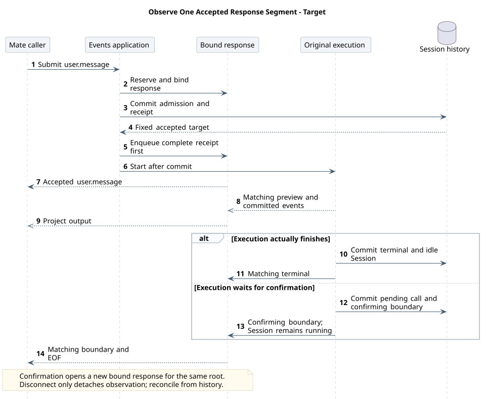

# POST Events 请求级 SSE 设计

| 属性 | 值 |
|---|---|
| 文档版本 | 0.14.0 |
| 状态 | 已确认目标契约；请求输出绑定与跨实例控制待实现 |
| 源码基线 | Java 918005ee、dfb90cac，固定提交与路径见 [模块证据](source-evidence.md#52-post-与流生命周期) |
| 更新日期 | 2026-09-19 |

结构化提问新增 agent.question / user.question_answer，复用 confirming 与原执行续跑；两事件、Schema、错误和恢复由 [AskUserQuestion](../06-CampusClaw计划模式/ask-user-question.md) 及共享事件源维护。该增量已在 Runtime 主线实现（`8c5fda1d`，见[源码证据 §12](../06-CampusClaw计划模式/source-evidence.md#12-主线实现状态核验2026-09-18)）；Session/元数据不增字段，Mate 公共投影待实现。本文其他历史源码范围不因此升级。

## 1. 当前操作与已确认范围

POST `/campusclaw-service/v1/sessions/{sessionId}/events` 提交一条用户事件，在同一响应读取本次 SSE；GET 同路径独立读取完整历史。精确字段、请求头、示例与错误由 [POST 模型](事件契约/操作/01-submit-session-event.json) 维护并生成 [接口页](chat-api-review.html#submitSessionEvent)。

本文维护响应的帧顺序、归属、关闭和失败处理。[Events 主设计](chat-events-design.md) 维护单消息准入、数据库事务与跨实例控制，[历史设计](chat-events-history-design.md) 维护权威记录及分页。

任务更新已实现并登记到共享事件源：`agent.todo_updated` 直接返回完整 `todos`，无需前端识别工具名或解析工具结果。它与成功 ToolResult 的公共事件同源同事务保存，提交后发出；失败不更新清单。具体结构、源码基线与验收由 [TodoUpdate 主设计](../06-CampusClaw计划模式/todo-update.md) 唯一维护；Java `8c5fda1d` 已具备 TodoUpdate、RuntimeTodoEventMapper 与显式任务事件分支；本次静态核验不等于测试通过。Mate 公共桥接需单独同步后开放。

## 2. 请求与凭据边界

使用支持 POST 流式读取的服务端 HTTP 客户端或 fetch；原生 EventSource 不能发送本操作。不提供 Last-Event-ID 恢复，不以 eventId 冒充游标。浏览器仍以 Mate 为公共边界。

凭据只在执行所需内存对象中保留到真实结束；网络关闭不释放尚未完成执行的凭据，确认和中断不覆盖原消息凭据。响应队列与路由索引不保存秘密。完整使用边界见 [HTTP §7](chat-http-v1-design.md#7-安全与附件边界)。

## 3. 帧结构与成功含义

完整用户事件提交成功后，首个业务帧返回该事件，然后才投递该请求对应的执行输出。
允许在无业务数据时有心跳注释，但不能让 Agent delta 或其他事件越过回执。
服务端需在接受前预留流缓冲并固定目标，提交后先排入本次回执，再向这条响应投递后续
输出。跨实例中断不要求执行实例等待接收实例写回执：终态持久化供后者补读，接收方
保持本条响应的回执先行。网络写出在事务外，不为等客户端收完首帧而锁住 Session。

B01～B15 已确认，完整字段、成功/失败、工具确认、中断配对和 Skill 示例集中在
[POST 精确模型](事件契约/操作/01-submit-session-event.json) 与
[共享字段/错误表](事件契约/common.json)，由统一 HTML 展示；本页不维护第二套示例。

每帧是单行 JSON 加空行，JSON 内换行必须转义。没有 SSE event/id 字段，不包装 ResultBean。
200 表示已进入接受后的流式响应，不是任务成功；完整首帧是持久化接收凭据，不是执行终态。

## 4. 已确认关闭、中断分工与绑定

结束规则已确认：收到本次对应 idle 后关闭响应，等待工具确认时也关闭；不等待下一条
用户消息。仅结束本次 HTTP 交互，等待确认不代表任务成功。之后新发确认 POST，
由新响应接收工具结果与续跑；不把新结果发给已经关闭的旧响应。

中断响应只返回本次回执和固定目标的权威 idle；原消息响应保留 Agent 输出，两条连接使用同一终态 eventId。等待确认或停止未完成时数据库资源仍为 running；session.status_idle(reason=confirming) 只结束当前交互段，不能作为接受新消息的依据。

| 本次输入 | 本条响应的绑定范围 | 对应 idle 的触发与 reason |
|---|---|---|
| user.message | M1 未完成前拒绝 M2 已确认；本条流对应 M1 的执行段，包括模型、工具与该段状态 | 对应 done/failed/terminated，或进入 confirming；确认等待仍保留 running |
| user.tool_confirmation | 当前 Session 中指定 toolCallId 的有效待确认操作及由本次确认触发的续跑段 | 对应 done/failed/terminated，或再次进入 confirming |
| user.plan_confirmation | 精确目标 agent.plan 所属原执行的新续跑段；批准先返回回执、planApproved 模式事件和 ExitPlanMode 结果，修订保留 plan | 执行结束的 done/failed/terminated，或新方案再次进入 confirming |
| user.interrupt | 首帧后只等待目标停止结果、不复制 Agent 输出已确认；接受时必须在数据库事务中固定内部执行身份；等待确认同样可被指定原消息的中断停止 | 实际停止后的 terminated；失败或未获知退出时按 B07/B11 处理，不能提前伪造终态 |

设计理由：本次交互结束就关闭其 HTTP 响应，不跨下一次无关执行。等待工具确认需要
用户新动作，以另一次确认 POST 开始下一段交互，避免旧响应无限等待用户操作。
`confirming` 已由 B07 确认，仍不代表 Session 已空闲。

user.interrupt 的必填 targetEventId 只匹配原消息，不能取消随后开始的新执行；重复停止返回冲突，接受后自然完成仍保留真实原因。等待超时只断流并对账。跨实例控制和固定目标竞态由 [总体设计 §4.4](chat-events-design.md#44-数据库停止请求与实例批量检查) 维护，本流只消费已提交结果，遵守回执先行、终态去重与慢连接隔离。

本期每执行最多一个待交互项：工具权限确认与计划审核互斥，不新增通用工具进度或子 Agent 公共事件；build 执行清单使用 agent.todo_updated。停止后才能重新提交普通消息，FollowUp 为 [未来扩展](chat-follow-up-future-design.md)。

### 4.1 完整内容与预览

agent.message、agent.thinking 与 agent.plan 的 delta 是增量，completed 是同 ID 的完整权威内容，客户端以完整内容替换预览。user.* 回执、工具调用、工具结果、任务快照、批准模式变更与 idle 都是完整事件，无 phase；精确字段和类型目录由共享模型维护。Thinking 仅在执行快照开启且模型返回可读原文时投影，持久化后的可见性见 [Thinking 展示](chat-events-history-design.md#thinking-original-text)。

完整事件在 SSE 与 ListEvents 同名同形；落盘范围按 B12 与历史同一投影实现，
不能假定当前 Java 已保存 Tool Call 或 idle。preview 不持久化、不补发；同一 eventId
出现 completed 后不再发送 delta。背压丢弃某个 preview 后，该连接停止此 ID 后续 delta，
等待完整内容覆盖，避免把缺片段的拼接结果显示为完整答案。工具参数、结果不泄露凭据、
堆栈或不允许公开的内部数据，Mate 还需进行公共安全投影。

计划仅第一条非空 delta 建卡，不发 started；审核事务保存计划与 confirming 后发 completed，旧无 phase 完整计划兼容读取。原始模型标记只由后端解析，完整计划内容不在普通消息重复投影；规则见[计划流式专题](../06-CampusClaw计划模式/plan-streaming.md)。

调用事件的可选 displayName 在首次提交前固定，包括 requiresConfirmation=true 的调用；SSE 直接使用已提交快照，确认续跑及结果事件不重取名。字段规则和消费边界见[调用名称快照](chat-events-design.md#tool-display-snapshot)。

## 5. 已确认失败、背压与恢复

| 时点 | 已确认语义，精确错误表见统一 HTML |
|---|---|
| 确认尚未接受、SSE Header 前 | 400/404/409/503 或确认回滚后的 500 JSON，仅 resCode/resMsg |
| 已经接受但启动/续跑失败 | 不再宣称“未接受”；能可靠记录失败终态时推送对应 failed，否则断开并历史对账 |
| SSE Header 后发生编码/网络/队列故障 | 不改 HTTP 状态，不拼接 JSON 错误外壳；关闭本条响应，未收到终态视为结果不确定 |
| 已接受执行发生业务失败 | 发送已提交的 session.status_idle(reason=failed)，再结束响应 |
| 客户端断开 | 仅解绑本次输出，不取消执行、不重发 POST；后台继续持久化 |

客户端只有收到本次绑定的明确结束事件才可判断本次交互结束；单纯 EOF、HTTP 200、
网络错误或超时都不代表成功。不恢复旧 GET 重连机制，不自动重放任何 mutating POST。
主动取消业务仍须发送 user.interrupt，而不是关闭读取器。

每条 POST 响应按事件数和字节数限缓冲，preview 可舍弃；完整事件无法入队或单帧超限
则关闭该响应。网络写出不在 Session 事务内等待，慢连接不阻塞执行或中断接受。
首帧保留顺序和容量需在接受前校验；持久化成功后若网络发送失败属于结果不确定。
心跳采用 `: ping`，空闲间隔由服务端配置（15 秒仅候选）；不再需要 connected 就绪
握手，因为没有独立读流。容量、默认值与超时数值按实施校准，超时语义不再待定。

断线后使用 GET ListEvents 普通整数分页查询完整记录，按 eventId 去重，保持响应数组顺序。
仍在执行时可以后续补读或重新加载；没有可靠终态证据就不能标为完成。未收到首帧时，没有
幂等键或客户端相关 ID，就可能无法唯一判定同文请求是否已接受；保留草稿并提示不确定，
不能凭相同文本猜测后重发。已确认的普通分页边界、完整帧同形和对账细节见
[ListEvents 设计](chat-events-history-design.md)。原消息与中断响应共用的 idle 在历史
仅一条；历史页读完、旧 idle 或确认等待的 idle 都不是当前资源可接受 M2 的凭据。
分页大小、结果元数据与空页规则只在历史专题维护；Claw 执行关联按 sourceEventId 实施；Mate 公共投影仍需独立对齐。
时间允许回退，不用最后 createdAt 作下界，也不自行构造内部序号。

[PlantUML 源码：`target_session_live_stream_lifecycle`](设计图/事件接口重设计/diagram.puml#L158)

## 6. 证据、差距与外部边界

固定 Java 918005ee 已有 POST SSE、单 subscriber、有界流与断线不 abort；完整三输入、data-only 和请求控制绑定不属于该基线已实现行为，见 [模块源码证据](source-evidence.md#52-post-与流生命周期)。

公共 preview 与持久化历史的参考依据统一见 [Agent 架构对比](../07-Agent架构对比/README.md#a04)。[Mate 通用对话 API](../../02-服务与接口/07-mate-service通用对话API/README.md) 是本地目标契约，不是已运行后端证据；Runtime 合并 POST 不改变公共读取流与授权边界。

## 7. 实施验收与校准

精确契约已定稿；数据库控制字段/约束、
实测索引、检查周期、超时和容量数值由实施校准。跨实例确认通过数据库传递已提交决定与
完整事件，具体应用层骨架见[总体设计 §4.5](chat-events-design.md#45-确认续跑的跨实例交接待实现-实施骨架)。

实施验收需覆盖：原响应保留执行输出，中断响应只含回执与同一停止 idle，终态 eventId 一致；
五输入首帧与请求内容一致且只一次；提交前绑定/回执先行；极快完成；
确认续跑和中断目标竞态；同 Session 下一次执行隔离；断线与慢连接不影响执行；
失败/确认等待不能被误判成功；无首帧结果不确定；旧时间晚写与有序历史。
数据库中断、单消息准入与 M7 的完整实施验收统一见[总体设计 §5](chat-events-design.md#5-实施切片与验收)，
本节不重复维护调度与数据库检查清单。
上述运行时验收须在实现阶段执行；文档与图源校验不替代集成测试。

事件与配置规则见[历史专题 §8](chat-events-history-design.md#8-事件与配置规则)，报文示例与共享契约一致。

## 8. 版本历史

| 版本 | 日期 | 变更 |
|---|---|---|
| 0.14.0 | 2026-09-19 | 计划采用 delta/completed，预览不入历史，审核事务成功后完成。 |
| 0.13.0 | 2026-09-18 | 工具调用展示名复用已提交快照。 |
| 0.11.0 | 2026-09-15 | 增加结构化提问与回答的契约、原根续跑及历史恢复入口。 |
| 0.10.0 | 2026-09-15 | 明确计划审核响应绑定、批准事件顺序与修订再等待。 |
| 0.9.0 | 2026-09-15 | 纳入后端显式任务更新事件，SSE 与历史共用完整快照。 |
| 0.8.0 | 2026-09-14 | 聚焦回执、输出绑定和恢复，字段与数据库机制引用所属权威文档。 |
| 0.7.0 | 2026-09-09 | 统一 Session Events 命名并引用共享事件消费规则。 |
| 0.6.0 | 2026-09-09 | 明确 Thinking 展示模型返回的原始推理。 |
| 0.5.0 | 2026-09-08 | 明确 B01～B15，补齐根消息绑定、结束原因、控制竞争、跨实例确认与错误处理。 |
| 0.4.6 | 2026-09-08 | 同步 L10：每条工具结果必有布尔 isError。 |
| 0.4.5 | 2026-09-08 | 同步 L9 Mate 工具名与参数包装，结果仍为文本块数组。 |
| 0.4.4 | 2026-09-08 | 同步 L7/L8：agent.tool_result.content 使用仅含 text 块的数组。 |
| 0.4.3 | 2026-09-07 | 同步 L6：agent.tool_call.arguments 使用 JSON 对象。 |
| 0.4.2 | 2026-09-07 | 同步 L5：agent.message completed 的 content 使用完整正文字符串。 |
| 0.4.1 | 2026-09-07 | 删除数据库中断机制与验收的重复副本，改引总体设计。 |
| 0.4.0 | 2026-09-07 | 同步三个独立控制接口退役与 FollowUp 暂不启用。 |
| 0.3.6 | 2026-09-07 | 历史补读同步 L4 合法超范围空成功。 |
| 0.3.5 | 2026-09-06 | 历史补读同步默认 50/上限 200 与无 total 决定。 |
| 0.3.4 | 2026-09-06 | 历史对账同步普通整数分页、取消固定快照决定。 |
| 0.3.3 | 2026-09-06 | 当前评审切换至 ListEvents。 |
| 0.3.2 | 2026-09-05 | 明确 M7：同实例提交后通知、固定执行目标的等待去重、实测索引选型。 |
| 0.3.1 | 2026-09-05 | 明确 M6：M1 未完成前拒绝 M2，消息与 running 状态同事务提交。 |
| 0.3.0 | 2026-09-04 | 明确 M5 数据库停止请求与实例批量检查。 |
| 0.2.2 | 2026-09-04 | 明确 M4 原消息与中断响应分工、共用同一停止 idle 的 eventId。 |
| 0.2.1 | 2026-09-04 | 记录用户确认 M3：对应 idle 后关闭，等待工具确认时也关闭，新确认 POST 接收续跑。 |
| 0.2.0 | 2026-09-04 | 撤销独立 GET stream，合并到 POST SSE，确认完整本次 user.* 首帧。 |
| 0.1.2 | 2026-09-04 |  S1 data-only、S2 type + phase、S3 用户事件只走回执/历史、S4 GET 不要求 access-token。 |
| 0.1.1 | 2026-09-04 | 按用户指定确认五个基础类型名，同步全部候选示例及流/历史同名约束。 |
| 0.1.0 | 2026-09-04 | 第一个 POST 确认后启动 GET stream。 |
