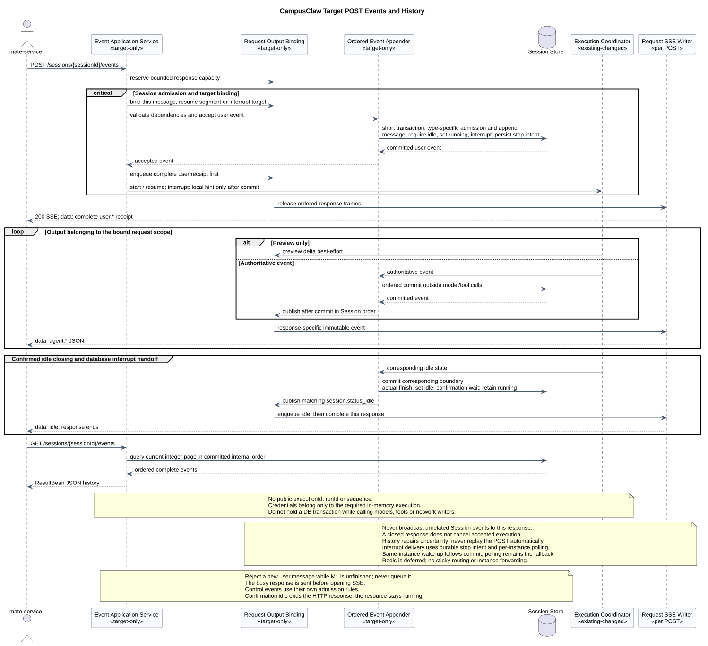
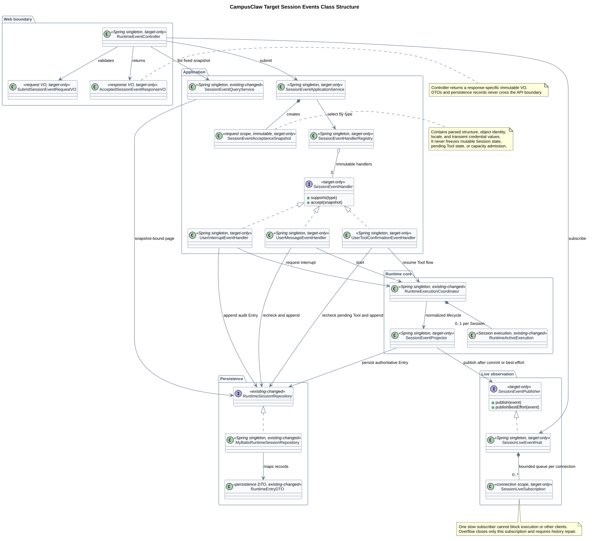

# CampusClaw Session Events v2 重设计

| 属性 | 值 |
|---|---|
| 文档版本 | 0.2.2 |
| 状态 | 第一个 POST 接口已按当前稿整体确认；当前评审第二个 GET stream 接口；均待实现 |
| 设计仓基线 | `c4f1ba2f2b8f4ee7cf9b7d5eaa554c42bd525bed` |
| CampusClaw 实现核对提交 | `c9d858bc8261bf07f5585f545b53495bf2226a56` |
| 事件顺序补充核对提交 | `a8192e047f4061bd385297d3dc6c4358362d0d49`；只补充本文 §4.1 证据，不替换其他主题基线 |
| pi Runtime 固定基线 | `5cd93f688aaab89dbb6dfa4aca535f21796ae185` |
| mate 公共契约基线 | [`mate-service 通用对话 API`](../../02-服务与接口/07-mate-service通用对话API/README.md) 1.4.4 |
| 外部公共契约核对日 | 2026-09-04；实时流核对范围见第二接口设计 |
| 更新日期 | 2026-09-04 |

## 1. 已确认资源模型

CampusClaw 采用 Session Events 三接口，内部执行不成为公共资源，也不增加
`executionId` 或 `runId`：

| Method | Path | 职责 | 当前状态 |
|---|---|---|---|
| `POST` | `/campusclaw-service/v1/sessions/{sessionId}/events` | 每次接受并持久化一条三种联合类型之一的用户事件 | 接口已确认，待实现 |
| `GET` | `/campusclaw-service/v1/sessions/{sessionId}/events/stream` | 订阅跨多次内部执行的 Session live SSE | 五个基础类型名及 S1～S4 已确认；具体字段、连接细节与 GET 整体仍在评审 |
| `GET` | `/campusclaw-service/v1/sessions/{sessionId}/events` | 读取固定快照的权威历史 | 职责与顺序规则已确认，其余字段未开始评审 |

这三个 operation 同构于 mate 公共 API 的“提交、实时观察、权威恢复”职责，但不是
字节透明转发。Claw 保留内部 `sessionId`、Entry 身份和更丰富的 Runtime 事件；mate
继续拥有 `chatId`、公共 `eventId`、终端用户授权和安全字段投影。

`user.interrupt` 进入 POST 的用户事件联合类型，替代独立
`POST /sessions/{sessionId}/abort`。`user.tool_confirmation` 同样进入该联合类型。
Steer、FollowUp 和 Slash Command 是否并入 Events 不在本轮自动决定，继续保留现行
v1 契约，待三个核心 operation 完成后逐项评审。

v2 HTTP 事件对象的身份字段已确认使用 `eventId`，不公开 `entryId` 或 `entrySeq`。
内部持久化仍可保留 Entry 标识和连续序号，用于原子排序、当前分支恢复和固定快照分页；
这些内部字段不得穿透 Response VO、live SSE 或历史响应。当前决定只冻结 Claw v2 的
JSON 字段名称和“不公开序号”，不自动确认 Claw `eventId` 与 mate 公共 `eventId`
是否复用同一个值，该跨服务所有权在 bridge 对账设计中另行确认。

该选择属于架构变更：当前 Java 的 POST 返回一次执行范围的 SSE；目标 POST 只返回
普通 JSON 接受结果。产品约束仍是不公开执行 ID；安全加固仍是 Claw 从 POST 请求读取
凭据后，只在内存中保留到本次 Agent 执行结束。凭据不持久化、不记录、不发往模型或
工具发现；只有实际调用 Mate tool execute 时才发送。



[PlantUML 源码：`target_session_events_resource_model`](设计图/事件接口重设计/diagram.puml#L1)

## 2. 第一项：提交 Session 用户事件（已确认）

2026-09-04 用户确认第一个接口可以，并要求开始下一个接口。本接口按当前稿整体确认：

```http
POST /campusclaw-service/v1/sessions/{sessionId}/events
Content-Type: application/json
Accept: application/json
```

已确认本接口支持 `user.message`、`user.interrupt`、
`user.tool_confirmation`。每次请求只能提交其中一条，表示不支持数组或批量提交，
并不表示接口只接收 `user.message`。

已确认 `X-HW-ID` 是当前请求对应的用户凭据 ID，不是公司、服务或应用调用方标识。
JWT 模式的请求示例使用 `credential-jwt`，APPKEY 模式使用 `credential-appkey`。两者都
是当前实现测试中真实使用的非生产字面值，不是格式占位符，也不是生产用户凭据。当前
Java 只把该 Header 当作不透明字符串读入 `MateCredentials`，并没有实现能够证明其业务
语义的解析或校验，因此“用户凭据 ID”记录为本次确认的产品约束，而不是已观察源码行为。
JWT、APPKEY 和 access-token 分别使用当前实现测试中的 `Bearer opaque-token`、
`opaque-appkey` 和 `opaque-access-token`。这些是可直接阅读的非生产测试字面值，不是
生产凭据，也不为 Token 增加格式约束。

上述两组 Header 示例值及凭据处理说明已经确认。本轮进一步确认：`user.message`、
`user.interrupt`、`user.tool_confirmation` 均必须携带 `access-token`，JWT 与 APPKEY
模式使用同一必填规则。此项属于目标 API 的产品约束，理由是调用方统一组装请求头，
不按事件类型分支；代价是中断请求本身不调用工具也需要携带令牌。携带不代表使用，
Claw 仍只在实际调用 Mate tool execute 时发送，不新增凭据持久化或发送范围。
Q1 已在此前确认，本次 Q2、Q3、Q4 也按当前稿确认，全部移出待选表单。

POST 成功响应中的事件身份也已确认使用 `eventId`，不返回 `entryId` 或 `entrySeq`。
这一决定适用于三种用户事件，并作为后续 live SSE 与权威历史的公共身份约束；成功响应
已确认返回完整用户事件，不采用最窄回执。

已确认字段、请求示例、成功与错误响应见独立只读页面
[`chat-events-v2-confirmed.html`](chat-events-v2-confirmed.html)。可编辑源是
[`接口契约-v2/common.json`](接口契约-v2/common.json) 与
[`01-submit-session-event.json`](接口契约-v2/操作/01-submit-session-event.json)。

原 Q2、Q3、Q4 的已确认结论：

1. Q2：请求体使用 `event` 包装和有序 `content[]`，与 mate 请求结构同构；
2. Q3：`200 ResultBean` 返回完整用户事件，包含 `eventId`、`createdAt` 及规范化业务字段，
   不返回 `entryId` 或 `entrySeq`；
3. Q4：不引入 `Idempotency-Key`。响应丢失时通过权威历史对账，不盲目重放 POST。

同构只减少 mate 到 Claw 的请求转换，不改变所有权。Claw v2 使用 `eventId` 作为 HTTP
事件身份；数据库内部 Entry 标识和序号不进入公共契约。mate 的公共 `eventId` 仍由 mate
契约管理；是否复用同一个值或建立映射，留待 bridge 对账设计确认，本次不预设额外映射，
也不能仅因字段同名就假定值相同。

### 2.1 当前第二项：订阅 Session 实时事件

当前评审 `GET /campusclaw-service/v1/sessions/{sessionId}/events/stream`。
只订阅新事件，不触发执行、不更新 Agent 凭据；连接跨越执行与空闲状态，断线不取消
执行，不承担历史重放。S1～S4 已确认；其他具体字段、连接和错误细节仍是候选。

已确认五个基础类型名为 `agent.message`、`agent.thinking`、`agent.tool_call`、
`agent.tool_result`、`session.status_idle`。这是目标 API 产品约束：前四项与 Mate
同名，状态保留 Session 资源名称；流与历史中的完整事件不使用不同别名。

2026-09-04 进一步确认：S1 业务帧只用 `data: JSON`，不输出 SSE `event:`/`id:`，
不使用 `Last-Event-ID` 恢复；S2 正文和思考使用 `phase=delta/completed`，工具及 idle
为完整事件，不采用独立预览类型；S3 流中不推送 `user.*`，用户事件从 POST 回执和历史
获得；S4 GET 不要求 `access-token`，不更新执行凭据，POST 三种事件仍必填。
四项选择记录在 `review.confirmedChoices`，不再展示为待选题。thinking 内容、其余字段
约束、连接及错误细节和 GET 整体仍待评审，不据此自动推进到第三接口。

- 当前单接口评审面：[`chat-events-v2-review.html`](chat-events-v2-review.html)。
- 候选模型：[`02-stream-session-events.json`](接口契约-v2/操作/02-stream-session-events.json)。
- 设计、源码差距、Mate 映射与验收：[`实时订阅接口设计`](chat-events-v2-stream-design.md)。

`common.json.reviewState` 记录当前项和已确认项。生成器分别输出“当前 GET”与“已确认
POST”两个页面，不把旧 POST 待选题继续展示为本轮任务。第三个 ListEvents 仍未开始
完整字段评审，保留已确认的职责、事件身份和排序规则。

## 3. 目标分层与生命周期



[PlantUML 源码：`target_session_events_classes`](设计图/事件接口重设计/diagram.puml#L128)

目标结构采用五个责任边界：

- Web 边界只接收 Request VO、返回不可变 Response VO，不把 DTO 或持久化记录穿透给
  Controller；
- Application Service 根据 `event.type` 选择独立 Handler，避免新增事件时修改中央
  `switch`；
- Web 边界固定解析后的结构、对象身份和 locale。凭据从请求读入后只保存在内存中，直至
  本次 Agent 执行结束；Session 状态、执行容量、待确认 Tool Call 等可变权威状态必须在
  所属事务或 Session 锁内重新检查；
- Runtime Coordinator 继续拥有一次内部执行，Projector 先持久化权威 Entry，再发布
  completed live event；delta 等 preview 只 best-effort 发布；
- `SessionLiveEventHub` 是 Spring 单例，每条 SSE 连接拥有独立有界 Subscription。
  慢消费者或断线只移除自身，不能阻塞执行、其他订阅者或取消 Session。

历史查询在第一页固定水位、过滤条件和分页方向，后续不透明 page 必须绑定同一快照。
live Hub 不重放、不承担恢复；任何 SSE gap、订阅溢出或 POST 响应不确定都回到历史对账。

### 3.1 已确认的事件处理、写入与展示顺序

本节是已确认的 v2 目标要求，属于架构变更，不表示当前实现已完整支持多来源事件的
依赖检查。“顺序正确”指保持业务因果关系，不是按机器时钟还原所有事件的物理发生顺序。
例如：用户消息先于由它触发的模型工具调用，工具调用记录先于对应工具结果，工具结果
先于依赖该结果的模型最终回答。这里没有新增公共事件类型或字段。

1. 同一 Session 的权威事件先经过统一的接受边界，检查来源顺序和前置事件依赖，再确定
   写入顺序。不能让不同工作线程各自抢数据库锁，把抢锁先后当作业务先后。
2. 按已确定的顺序，在同一个短事务内完成可变状态与依赖复核、内部序号分配及记录追加。
   同一 Session 的追加锁保持到提交；前置事件未提交或写入失败时，依赖它的事件不得先
   进入权威历史。不能先独立领号、再交给异步线程任意提交。串行范围不包括模型生成、
   工具执行或等待缺失的前置事件，这些耗时操作不占用数据库事务。
3. 无依赖的并发事件不存在唯一的业务先后，以该 Session 统一接受顺序为准。上游已发生
   乱序时，按来源顺序或显式依赖等待、校验；缺少足够信息就不能宣称恢复了因果顺序，
   更不能用时间戳或随机 `eventId` 猜测。缓冲上限、超时和失败处置属于后续实施细节。
4. ListEvents 只读取已提交的权威记录，按内部顺序返回；过滤后的结果保留相对顺序，
   客户端按响应数组顺序展示，不按 `createdAt` 或 `eventId` 重新排序。`createdAt`
   只用于时间展示，允许相同或不递增；本次不改其取值语义、示例或精度约定，也不新增
   数据库插入时间字段。对外继续使用 `eventId`，不公开 `entryId/entrySeq`。
5. 已确认的固定快照历史只纳入对应水位内已提交的记录，不让后来提交的事件插入已经
   翻过的页面。此处明确排序和提交约束，不提前确认 ListEvents 的过滤、游标字段、分页
   方向选项或保留期，也不确认 live SSE 的详细事件契约。

推荐目标类图用 `SessionEventAppender` 表示共享的接受与有序追加职责：三个用户事件
Handler 和 Runtime Projector 都经过该边界，再由 Repository 执行短事务。该类名及具体
调度机制是 target-only 落地建议；确认的是共同顺序约束，而不是必须增加某种队列。
它是 Spring 单例协作者，但协调状态按 Session 隔离；多实例场景仍须在持久化事务中
复核依赖和状态，不能只依赖某个 JVM 内的互斥锁。查询不经过该写入边界，不等待模型
或工具执行完成。

## 4. 源码证据与差距

| 分类 | 源码证据 | 结论 |
|---|---|---|
| 已观察实现 | `modules/coding-agent-cli/src/main/java/com/campusclaw/codingagent/runtimeapi/web/RuntimeEventController.java:39-91` · `RuntimeEventController.submit/list` | POST 创建 `SseEmitter` 并返回 `text/event-stream`；GET 只接收 `limit/page` |
| 已观察实现 | `modules/coding-agent-cli/src/main/java/com/campusclaw/codingagent/runtimeapi/web/RuntimeRequestContext.java:45-50` · `mateCredentials`；`campusclaw/src/main/java/com/huawei/hicampus/claw/codingagent/common/client/mate/MateCredentials.java:21-74` | 当前实现把 `X-HW-ID` 作为不透明 Header 值读入执行凭据，只检查非空，不解析其业务身份 |
| 已观察实现 | `campusclaw/src/test/java/com/huawei/hicampus/claw/codingagent/runtimeapi/web/RuntimeSessionRoutesTest.java:69-93` · `createWithJwtReturnsConfirmedResultBean/getWithAppKeyReturnsEtagAndNoStore`；`RuntimeEventRoutesTest.java:88-120,193-197` · `postStreamsNamedEventsWithoutResultBean/authenticated` | 当前测试使用 `credential-jwt`、`credential-appkey`、`Bearer opaque-token`、`opaque-appkey` 和 `opaque-access-token` 等非生产字面值；本设计复用它们作为具体示例，但不据此增加格式约束 |
| 已观察实现 | `modules/coding-agent-cli/src/main/java/com/campusclaw/codingagent/runtimeapi/event/RuntimeEventService.java:76-139` · `submit/prepareAndSubmit/acceptUserEntry` | 只接受 `user.message`，要求 idle，持久化后直接启动内部执行并返回其 EventStream |
| 已观察实现 | `modules/coding-agent-cli/src/main/java/com/campusclaw/codingagent/runtimeapi/event/RuntimeEventStream.java:22-159` · `attach/detachInternal` | EventStream 属于一次执行且最多一个 subscriber；断线会清空该流缓冲 |
| 已观察实现 | `modules/coding-agent-cli/src/main/java/com/campusclaw/codingagent/runtimeapi/event/RuntimeEventQueryService.java:53-99` · `list/pageOf` | page 只携带 afterSeq 与 thinking，没有固定历史快照水位 |
| 已观察实现 | `modules/coding-agent-cli/src/main/java/com/campusclaw/codingagent/runtimeapi/session/RuntimeSessionControlService.java:59-132` · `steer/followUp/abort/prepareAbort` | Abort 是独立接口行为；Steer 与 FollowUp 使用执行内队列 |
| 已观察实现 | `modules/coding-agent-cli/src/main/java/com/campusclaw/codingagent/runtimeapi/persistence/MyBatisRuntimeSessionRepository.java:57-120` · `acceptUserEvent/listCurrentBranch` | `user.message` 在事务内追加并将 Session 标为 running；历史按 afterSeq 开放读取 |
| 目标架构 | 本文三接口及目标图 | 提交、live 与历史解耦；支持跨执行、多订阅者的 Session live Hub |
| 产品约束 | 本文资源模型 | 无公共 Run/Execution；mate 公共边界只暴露 `chatId` 和公共事件身份 |
| 产品约束 | `X-HW-ID` | 标识当前请求对应的用户凭据；不是公司、服务或应用调用方标识 |
| 产品约束（target-only） | POST `access-token` | 三种用户事件在 JWT/APPKEY 模式下均必须携带，统一调用方请求头组装；不把三事件必填表述为现有 Java 已支持的行为 |
| 安全加固 | POST 凭据处理 | 凭据从请求读入后只在内存中保留到本次 Agent 执行结束，只在必要的实际 Mate tool execute 使用，不进入持久化、日志、SSE 或历史 |

### 4.1 事件顺序补充核对

本节核对 `pi-mono-java@a8192e047f4061bd385297d3dc6c4358362d0d49`，下表路径均相对
实现仓。与原基线 `c9d858bc8261bf07f5585f545b53495bf2226a56` 比较，下表五个文件均无
变化；新增的是对这些符号的排序证据分析，不是切换其他主题的实现结论。

| 分类 | 仓库相对路径与符号 | 已观察行为与边界 |
|---|---|---|
| 已观察实现 | `campusclaw/src/main/java/com/huawei/hicampus/claw/agent/Agent.java:294-306` · `emit` | 在当前线程依次通知 listener；这不是多来源的全局因果排序器 |
| 已观察实现 | `campusclaw/src/main/java/com/huawei/hicampus/claw/codingagent/runtimeapi/event/RuntimeEventProjector.java:105-116,238-254,382-385` · `onEvent/persistAssistant/emitPersisted` | 同一 Projector 同步处理回调，持久化完成后发送完整事件；不能由此推断不同 Projector 或其他写入入口已共同检查前置依赖 |
| 已观察实现 | `campusclaw/src/main/java/com/huawei/hicampus/claw/codingagent/runtimeapi/persistence/MyBatisRuntimeSessionRepository.java:55-87,208-218` · `acceptUserEvent/appendEntry/appendLocked` | 事务锁定 Session，再取序号、插入和递增；保存到达该写入边界的顺序，并不自动恢复上游乱序 |
| 已观察实现 | `campusclaw/src/main/resources/mapper/session/RuntimeSessionMapper.xml:47-75,132-164` · `lockSessionForUpdate/lockNextSequence/insertEntry/listCurrentBranch` | 使用行锁；历史 SQL 按 `entry_seq` 排序，不按 `timestamp` 排序 |
| 已观察实现 | `campusclaw/src/main/java/com/huawei/hicampus/claw/codingagent/runtimeapi/event/RuntimeEventQueryService.java:53-60,90-99` · `list/pageOf` | 保留查询结果顺序，以最后一项内部序号生成下一页；当前实现没有 v2 固定快照水位 |
| 架构变更（target-only） | 本文 §3.1 与 `SessionEventAppender` 推荐边界 | 所有来源共同遵守前置依赖和有序提交；ListEvents 读取已提交顺序，时间戳只作展示。需按 §5 实施并测试，不能把数据库行锁当作全部保证 |

pi 固定基线中的 Agent Loop、Message/Tool 生命周期继续作为 Runtime 内核行为参考；
本次不把 pi 的进程内事件、本地 Session 文件或 CLI 传输直接当成 CampusClaw HTTP 契约。

[Anthropic Managed Agents 的 Events and streaming](https://platform.claude.com/docs/en/managed-agents/events-and-streaming)
与 [List Events](https://platform.claude.com/docs/en/api/beta/sessions/events/list) 用于校验
“提交与观察分离、preview 非权威、断线后查询事件历史”的公共边界；这些页面只能证明
公开契约，不能证明其内部存储或调度实现。
[OpenCode 官方 Server 文档](https://opencode.ai/docs/server/) 当前公开的是实例级
`/event` SSE，因此这里只作多客户端通知对照，不把其源码中的 Session durable stream
描述成公开稳定契约。

## 5. 实施切片与验收

资源模型落地时按以下顺序实施：

1. 引入用户事件联合 Request VO、Handler Registry 和三个 Handler；POST 改为普通
   ResultBean。先让 Handler 与 Runtime Projector 汇合到共享的 Session 有序接受边界，
   再以短事务完成依赖与状态复核、内部序号分配和持久化，禁止绕过该顺序约束独立追加；
2. 引入 `SessionEventPublisher` 与多订阅者 `SessionLiveEventHub`，先让现有
   Coordinator 双写到新发布边界，再删除 POST 持有的 `RuntimeEventStream`；
3. 新增独立 GET stream，验证同 Session 多订阅者、跨 idle/execution 保持连接、慢消费者
   隔离、heartbeat 和断线不取消执行；
4. 将历史游标升级为固定快照，按已提交的内部顺序读取并保持响应数组顺序，验证新写入
   不进入已开始翻页的快照；
5. mate bridge 切换到“先保持 live 观察，再独立 POST”；确认 mate 与 Claw 的 `eventId`
   复用或映射规则后用于对账，最后移除独立 Abort 调用路径。

验收必须覆盖：POST 成功但响应丢失、live SSE 中断、订阅队列溢出、两个同时订阅者、
interrupt 接受后延迟退出、错误 Tool 确认、服务重启后仅靠历史恢复，以及 POST 不因
观察流断开而自动重放。

顺序专项验收（目标测试，尚未实施）：

- 前置事件故意延迟、失败或回滚时，依赖事件不能先进入历史；工具结果不能早于对应
  工具调用记录，依赖结果的最终回答不能早于结果。
- 多线程及多个写入入口并发时，依赖检查和序号追加不能被绕过；无依赖事件形成确定的
  接受顺序。同 Session 模型/工具耗时调用不占用追加事务，不阻塞中断请求接受。
- 来源事件乱序时，缺失依赖不被时间戳排序掩盖；具体缓冲、超时与失败策略在实施时明确。
- 时间戳相同或回退时，ListEvents 与客户端仍保持内部顺序；响应不出现内部序号。
- 在两个依赖事件之间分页、同时追加新事件或回滚写入时，固定快照内的匹配记录不漏项、
  不重复、不被后来提交的低位记录插入；过滤仅移除事件，不改变剩余记录的相对顺序。

## 6. 决策记录

| 日期 | 项目 | 结论 |
|---|---|---|
| 2026-09-03 | 资源模型 | 已确认选择 A：Session Events 三接口，执行保持内部状态，无 `executionId/runId` |
| 2026-09-03 | POST 事件范围 | 已确认同一 POST 接受 `user.message`、`user.interrupt`、`user.tool_confirmation`；一次请求提交一条，不支持批量 |
| 2026-09-03 | POST 事件身份 | 已确认成功响应使用 `eventId`，不公开 `entryId` 或 `entrySeq`；内部 Entry 标识和序号可继续用于持久化与排序，Q3 只继续评审响应宽度 |
| 2026-09-03 | `X-HW-ID` 语义 | 已确认为用户凭据 ID；不是公司、服务或应用调用方标识 |
| 2026-09-03 | Header 示例与处理说明 | 已确认使用 `credential-jwt`、`credential-appkey`、`Bearer opaque-token`、`opaque-appkey`、`opaque-access-token`；凭据从请求读取，只在内存中保留到本次 Agent 执行结束，并仅随实际 Mate tool execute 发送。此项不确认 `access-token` 必填策略 |
| 2026-09-04 | POST `access-token` 必填 | 已确认统一携带：三种用户事件在 JWT/APPKEY 模式下都必填；携带不代表使用，只随实际 Mate tool execute 发送，Q1 移出待选项 |
| 2026-09-04 | 事件顺序 | 已确认先按 Session 统一检查依赖并确定顺序，再在同一短事务内分配内部序号和追加；依赖事件不得越过未提交的前置事件。ListEvents 按已提交的内部顺序返回，客户端不按 `createdAt` 重排，仍不公开 `entrySeq`。本次不更改时间字段语义，也不确认其余接口字段 |
| 2026-09-04 | POST 整体确认并推进 | 用户明确表示第一个接口可以、开始下一个接口；按当前稿确认 Q2 `event + content[]`、Q3 完整用户事件、Q4 不设幂等键且历史对账；移除 POST 待选题，转入 GET stream |
| 2026-09-04 | GET 基础类型命名 | 已确认 `agent.message`、`agent.thinking`、`agent.tool_call`、`agent.tool_result`、`session.status_idle`；完整事件在流与历史同名。只确认名称，phase、增量结构、字段及 GET 整体仍待评审 |
| 2026-09-04 | GET S1～S4 | 已确认 A-data-only、A-type-and-phase、A-user-events-receipt-history-only、A-no-read-tool-token；移除四项选择题，保留具体字段、连接细节和 GET 整体评审状态；POST 不变 |

## 7. 版本历史

| 版本 | 日期 | 变更 |
|---|---|---|
| 0.2.2 | 2026-09-04 | 固化 GET stream S1～S4 的四项 A 选择，同步实时订阅 0.1.2、评审页、图与回归校验；不自动确认整个 GET 或切换 ListEvents。 |
| 0.2.1 | 2026-09-04 | 确认第二接口的五个基础类型名，同步评审面、实时订阅 0.1.1、生命周期图和校验；同步 POST 中断说明的 idle 名称引用，不改 POST 字段或已确认状态，S2 仅继续讨论增量结构。 |
| 0.2.0 | 2026-09-04 | 确认第一个 POST 的当前稿，结束 Q2/Q3/Q4；当前页切换到第二个 GET stream，已确认 POST 单独只读保存；增加候选流契约、专门设计、生命周期图和状态切换校验。 |
| 0.1.7 | 2026-09-04 | 确认事件处理、事务写入与 ListEvents 的共同顺序规则；补充 `a8192e0` 源码证据和目标差距，更新共享追加边界、目标图与顺序专项验收；保留时间示例及 Q2/Q3/Q4 待决状态。 |
| 0.1.6 | 2026-09-04 | 确认三种用户事件统一携带 `access-token`，两种 Header 模式均必填；保留示例值、使用范围和生命周期，移除 Q1 待选项并增加回归校验。 |
| 0.1.5 | 2026-09-04 | 按用户修正冻结 v2 公共事件身份：三种 POST 成功响应统一使用 `eventId`，删除 `entryId/entrySeq`；内部 Entry 序号不穿透 HTTP，Q3 收窄为完整事件与最窄回执的响应宽度评审；增加对应校验。 |
| 0.1.4 | 2026-09-03 | 冻结用户认可的 Header 具体非生产示例值与凭据处理说明；明确该确认不包含 `access-token` 必填策略。 |
| 0.1.3 | 2026-09-03 | 将凭据处理改写为“请求读取—内存保留到执行结束—仅 Tool execute 发送”的具体过程；全部凭据 Header 改用当前源码测试中的具体非生产示例值。 |
| 0.1.2 | 2026-09-03 | 修正并冻结 `X-HW-ID` 的身份语义：它是用户凭据 ID，不是公司、服务或应用调用方标识；同步替换请求示例占位符并增加回归校验。 |
| 0.1.1 | 2026-09-03 | 明确并冻结 POST 支持三种用户事件；将“一次一条”解释为请求批量边界，避免误读成只支持 `user.message`。 |
| 0.1.0 | 2026-09-03 | 固化资源模型 A，记录当前 Java 源码差距，增加目标资源图与类图，并启动第一个 POST operation 的四项字段评审。 |
