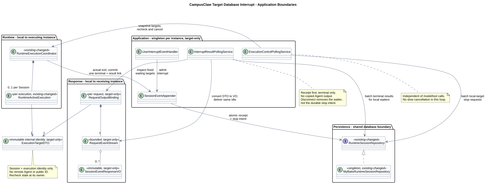
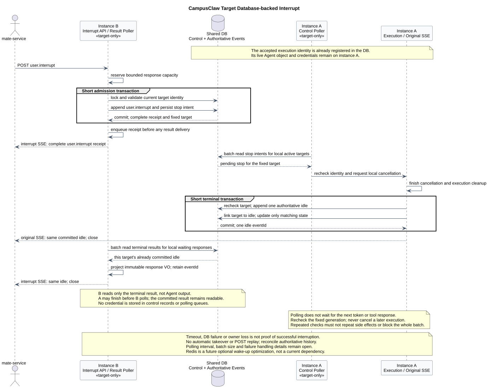

# CampusClaw Session Events v2 重设计

| 属性 | 值 |
|---|---|
| 文档版本 | 0.6.0 |
| 状态 | 当前评审 ListEvents；POST 合并、完整 user.* 首帧、对应 idle 关闭（含等待工具确认）、中断推送分工、数据库中断机制、单消息准入及中断查询优化已确认；两操作的未决细节仍保留，target-only |
| 设计仓基线 | `c4f1ba2f2b8f4ee7cf9b7d5eaa554c42bd525bed` |
| CampusClaw 实现核对提交 | `c9d858bc8261bf07f5585f545b53495bf2226a56` |
| 本次 HTTP 合并核对提交 | `918005ee8ccc88d179fc31a0de17a92b4a01383b`；原 `a8192e0`，变更路径与结论见 §4.2 |
| 中断优化补充核对提交 | `dfb90cac4e233e09a0b8f047f7e9f4682f5ad238`；只补充 §4.4 的容量、注册表及响应生命周期证据，不替换其他主题基线 |
| 历史查询补充核对 | 同一 `dfb90ca`；查询、编码、游标与 Mapper 四个文件相对 `918005e` 不变，见 [ListEvents 设计](chat-events-v2-history-design.md)；本次变更前设计 `c16ed3f904a85d01d69deb1a3575e2c52cdaa958` |
| 事件顺序补充核对提交 | `a8192e047f4061bd385297d3dc6c4358362d0d49`；只补充本文 §4.1 证据，不替换其他主题基线 |
| pi Runtime 固定基线 | `5cd93f688aaab89dbb6dfa4aca535f21796ae185` |
| mate 公共契约基线 | [`mate-service 通用对话 API`](../../02-服务与接口/07-mate-service通用对话API/README.md) 1.4.4 |
| 外部公共契约核对日 | 2026-09-04；仅对照 preview 与权威历史，不照搬独立读取流 |
| 更新日期 | 2026-09-07 |

## 1. 已确认资源模型

2026-09-04 用户明确要求把 POST 提交与 GET 实时推送合并：一次请求发送事件，并在
同一 HTTP 响应中接收对应 SSE。这里合并的是原 GET 实时流，不是 ListEvents 历史查询。

| Method | Path | 职责 | 当前状态 |
|---|---|---|---|
| `POST` | `/campusclaw-service/v1/sessions/{sessionId}/events` | 提交一条用户事件；首帧完整回执，随后推送对应事件 | 合并方向、首帧与对应 idle 关闭已确认；整个操作仍待评审 |
| `GET` | `/campusclaw-service/v1/sessions/{sessionId}/events` | 普通页码查询权威历史及断线对账 | L1～L4 已确认：普通分页、默认 50/上限 200、无 total、超范围 200 空列表；事件字段等细节仍候选 |

原独立 `GET /sessions/{sessionId}/events/stream` 从 v2 目标中撤销；旧 JSON model
移除，旧方案可从 Git 历史恢复。不增加 `executionId/runId`，不把响应连接变成公共执行
资源。请求级推送也不意味着去掉持久化事件或历史恢复。

这项改变是相对旧三接口提案的架构变更，与当前 Java 的 POST SSE 传输方向一致；
不等于直接恢复 v1 的请求字段、类型名或公开序号。Mate 公共 API 不在本次修改范围，
其三接口形态仍独立成立；将来由 Mate bridge 消费一次 Claw POST 响应并做安全投影，
不能机械删除 Mate 的公共读取流。

`user.interrupt` 和 `user.tool_confirmation` 仍走同一 POST 联合类型。三个独立控制
接口已退役，本期不开放运行中追加消息；调整方向采用实际停止后新提交。
Slash Command 与 Events 的衔接继续评审，旧 v1 控制接口只保留历史证据。


[PlantUML 源码：`target_session_events_resource_model`](设计图/事件接口重设计/diagram.puml#L1)

M8 已确认：当前目标十个接口，移除独立 abort、steers、follow-ups。
[FollowUp 未来设计](chat-follow-up-future-design.md) 已记录数据库排队及跨实例接续方向，
本期不启用；M6 仍拒绝未完成 M1 时的 M2，不新增输入类型、字段或排队回执。
这不代表两个 Events operation 整体通过，也不代表已修改实现。

## 2. 当前评审安排与 POST 已确认边界

2026-09-06 用户明确要求开始修改历史接口，当前切换到
`GET /sessions/{sessionId}/events`，见 [ListEvents 评审页](chat-api-review.html#listSessionEvents)
和 [历史查询设计](chat-events-v2-history-design.md)。GET 返回普通 JSON 的完整事件分页，
不是独立 SSE；已确认的身份、同形和顺序继续有效，从旧到新及普通整数页码已确认，
不再固定跨页快照；默认 50/上限 200 与 result 仅含 events/nextPage 已确认。
合法超范围页返回 200、events=[]、nextPage=null 已确认；事件字段及其他错误细节仍候选。
下面保留 POST 已确认边界，切换评审不等于整体确认 POST。

```http
POST /campusclaw-service/v1/sessions/{sessionId}/events
Content-Type: application/json
Accept: text/event-stream
X-HW-ID: credential-jwt
Authorization: Bearer opaque-token
access-token: opaque-access-token
```

已确认继续有效：

- 每次一条 `user.message`、`user.interrupt` 或 `user.tool_confirmation`；
  使用 `event` 包装、有序 `content[]`，不接受批量。
- `X-HW-ID` 是用户凭据 ID，不是公司、服务或应用标识。两种 Header 示例及说明不回退：
  `credential-jwt`、`credential-appkey`、`Bearer opaque-token`、
  `opaque-appkey`、`opaque-access-token` 都是实现测试中的非生产字面值。
- 三种用户事件在 JWT/APPKEY 模式下均必须携带 `access-token`。Claw 不自行解析或校验
  JWT/APPKEY；真实性和授权由上游负责，允许已有两种凭据同时出现，不新增互斥规则。
- 凭据从 POST 读取，只在内存中保留到本次 Agent 执行结束，只随实际 Mate tool execute
  发送；不发给模型、工具发现，不进入日志、Session 持久化、事件或回执。HTTP 断开不是
  执行结束，也不能因此提前清除仍需执行的凭据。
- 对外使用 `eventId`，不暴露 `entryId/entrySeq/runId/executionId`。
  Claw 与 Mate 的 eventId 是否共值仍待 bridge 评审，字段同名不等于值相同。
- 不接受 `Idempotency-Key`；已提交但响应丢失时通过历史对账，不盲目重放 POST。

### 2.1 本次明确替代与保留的决定

| 原决定 | 合并后的状态 | 原因 / 分类 |
|---|---|---|
| Q3：普通 JSON ResultBean 返回完整用户事件 | JSON 外壳被替代；完整用户事件作为首个 SSE 业务帧返回，已确认 | 架构变更：一次响应承载接收回执与输出 |
| S1：data-only | 保留；不使用 SSE `event:`、`id:` 或 Last-Event-ID 恢复 | 已确认格式不因 HTTP method 改变 |
| S2：type + phase | 保留；正文/思考为 delta/completed，工具与 idle 不带 phase | 已确认投影 |
| S3：流不推送 user.*，仅回执/历史可见 | 用户明确调整：首帧返回本次完整 user.*，仅一次，不广播其他用户输入 | 产品约束：同一请求内确认接收，不重复业务输出 |
| S4：只读 GET 不需要 access-token | 原只读流已撤销，此项不再适用该入口；POST 三类仍必填 | 适用范围改变，不是放宽写入凭据 |
| M3：响应结束规则 | 已确认收到本次对应 idle 后关闭；等待工具确认时也关闭，之后通过新确认 POST 接收续跑结果 | 产品约束：结束本次 HTTP 交互，不把等待确认当作任务成功；具体 reason 与目标绑定竞态仍待评审 |
| M4：中断推送分工 | 原消息响应保留原执行输出；中断响应只回执本次 user.interrupt 并等待同一 idle；两条响应复用该 idle 的 eventId 后各自关闭 | 产品约束：接收回执不等于实际停止，停止结果通知两条响应，不复制 Agent 输出；执行机制见 M5 |
| M5：跨实例中断机制 | 数据库持久化停止请求；各实例独立批量检查本机活动执行，接收实例读取同一权威结束记录；本期不引入 Redis | 架构变更：不依赖粘性路由或实例转发，保留固定目标与结果对账；具体周期和故障参数待评审 |
| M6：单消息准入 | 同一 Session 的 M1 未完成前拒绝 M2；接受消息与 idle→running 在同一数据库事务完成 | 产品约束：按 Session 在不同调用方和实例间互斥；沿用现有数据库准入机制，v2 控制与结束边界见 §3.2 |
| M7：中断查询优化 | 同实例提交后立即通知、等待目标去重、终态提交后本地投递与补读去重、索引按实际数据库与压测选择；批量轮询兜底保留 | 架构优化：降低本地中断延迟和重复查询，不改变数据库权威、回执先行、固定目标与独立响应；数值和索引结构未冻结 |
| 原 POST 整体已确认 | 仅被本次替代的响应部分重新评审，其余已确认字段保留 | 不把旧整体确认标签误用于新合并接口 |

完整首帧包括服务端 `eventId`、原事件 `type`、`createdAt` 和规范化业务字段。
它是已经持久化并接受的用户事件，不代表 Agent 已完成或中断已停止；不额外套 ResultBean，
不增加 `phase`。首帧只能来自当前 POST，后续推送必须晚于该回执入队。

五个基础输出类型保留：`agent.message`、`agent.thinking`、`agent.tool_call`、
`agent.tool_result`、`session.status_idle`。完整事件在 SSE 与历史使用相同名称和字段。
这不是全部 Runtime 事件清单，不据此删除配置、压缩、进度或子 Agent 能力。

### 2.2 精确评审入口与未确认范围

- [当前 ListEvents 评审页](chat-api-review.html#listSessionEvents)：
  [历史 operation model](接口契约-v2/操作/02-list-session-events.json)。
- [合并 POST 保留评审页](chat-api-review.html#submitSessionEvent)：
  [POST operation model](接口契约-v2/操作/01-submit-session-event.json)，未决项不变。
- [响应生命周期与源码差距](chat-events-v2-stream-design.md)：三种输入各自的输出范围、
  已确认结束规则，以及背压和恢复候选。
- 旧确认页已删除，不保留变更提示或占位文件；已失效的普通 JSON POST 仅从 Git 历史追溯，
  不作为当前已确认接口。当前入口统一见上方两个操作锚点。
- `common.json.reviewState` 当前为 `listSessionEvents`，
  `confirmedOperations=[]`；这不撤销已确认字段，也不推定任一新操作整体通过。

结束规则已确认：收到本次对应的 `session.status_idle` 后关闭本条响应；等待工具确认
时也关闭，之后通过新的 `user.tool_confirmation` POST 接收续跑结果。关闭的是本次
HTTP 交互，不代表任务成功；不相关的 Session idle 不能结束本次响应。
中断推送分工已确认：原消息响应保留原执行输出；中断响应首帧后只等待目标实际停止的
idle，不复制正文、思考或工具输出。仍连接的两条响应接收同一条 idle，复用 eventId
后各自关闭；回执表示中断已接受，idle 才表示目标实际停止。
数据库中断机制已确认：持久化停止请求、执行实例批量检查、接收实例读取同一结束记录；
本期不引入 Redis，不依赖粘性路由，固定内部目标且不公开执行标识。
单消息准入已确认：M1 未完成前拒绝 M2，接受消息和 idle→running 在同一数据库事务完成。
中断查询优化已确认：同实例提交后立即通知，等待结果按固定内部目标去重，终态提交后的
本地通知与数据库补读共用逐响应去重；索引以实际 GaussDB 执行计划及压测选择。
数据库结构与周期、跨完成边界的迟到中断、确认续跑与中断竞争、`reason` 具体值及错误细节仍为候选；
不整体确认合并接口。机制与安全边界见 §4.4。

## 3. 目标分层与生命周期

以下总览保留 POST 与执行主干；GET 的共享完整事件投影、请求范围分页参数和普通分页
细化为 [历史查询目标类图与时序](chat-events-v2-history-design.md#6-推荐目标类图与查询时序)。


[PlantUML 源码：`target_session_events_classes`](设计图/事件接口重设计/diagram.puml#L93)

推荐骨架保留 Web、Application、Runtime、流式输出、持久化边界，不保留长期 Session
订阅 Hub：

- Controller 验证 Request VO，交给 Service，使用只读 Response VO 编码 SSE；
  DTO/Mapper 不越过 Service 暴露到 HTTP。
- Service 固定解析结构、对象身份和 locale，使用 Handler Registry 分派三类用户事件。
  可变 Session/Tool 状态、容量与执行目标在所属事务或 Session 协调边界内复核。
- 每个 POST 有独立有界 `RequestEventStream`；候选 `RequestEventRouter` 只按内部绑定
  的执行段或中断目标投递，不按“当前 Session 最新执行”动态猜测归属。
  Controller 不持有或遍历全局 Session 订阅。
- 接受前预留响应队列，在同一协调边界绑定目标；用户事件提交后先排入完整回执，再允许
  执行/续跑/中断产生可投递输出。网络写出不占数据库锁。目标提前结束时在接受前拒绝，
  不能接受后空等一个已经错过的 idle。
- Application 层按执行管理 Projector 订阅，不让 Runtime 内核拥有 HTTP 投影器。
  Projector 与用户 Handler 共用有序追加边界；完整事件提交后有序发布，
  preview 只 best-effort 发布。HTTP 关闭只解绑该响应，不取消已接受执行。
- 中断可与原消息响应同时存在，但不新增公共订阅接口；两条响应投递同一条停止 idle、
  复用 eventId 已确认，中断响应不复制 Agent 输出。中断绑定的是持久化的内部执行身份，
  不要求接收实例持有远端 RuntimeActiveExecution；本机 Router 不跨进程访问执行对象。
  两个 Application 检查服务经数据库交接停止请求与结束结果，详见 §4.4。
  Spring 单例 Router 与检查服务不持有请求原始凭据。

历史使用从 1 开始的普通整数页码；不保留跨页水位、快照或加密游标。同一轮保持
limit 不变，每页按该次查询的当前分支与可见性读取；分支或过滤变化后从第一页重载。
请求级 SSE 不重放。断线、队列溢出或接收结果不确定都回到 ListEvents 对账；时间不能作
增量游标，不把重新 POST 当作重连。

### 3.1 已确认的事件处理、写入与展示顺序

本节是已确认的 v2 目标要求，属于架构变更，不表示当前实现已完整支持多来源事件的
依赖检查。“顺序正确”指保持业务因果关系，不是按机器时钟还原所有事件的物理发生顺序。
例如：用户消息先于由它触发的模型工具调用，工具调用记录先于对应工具结果，工具结果
先于依赖该结果的模型最终回答。这里没有新增公共事件类型或字段。

1. 同一 Session 的权威事件先经过统一的接受边界，检查来源顺序和前置事件依赖，再确定
   写入顺序。不能让不同工作线程各自抢数据库锁，把抢锁先后当作业务先后。
2. 按已确定的顺序，在同一个短事务内完成可变状态与依赖复核、内部序号分配及记录追加。
   同一 Session 的追加锁保持到提交；前置事件未提交或写入失败时，依赖它的事件不得先
   进入权威历史。不能先独立领号、再交给异步线程任意提交。串行范围不包括模型生成、
   工具执行或等待缺失的前置事件，这些耗时操作不占用数据库事务。
3. 无依赖的并发事件不存在唯一的业务先后，以该 Session 统一接受顺序为准。上游已发生
   乱序时，按来源顺序或显式依赖等待、校验；缺少足够信息就不能宣称恢复了因果顺序，
   更不能用时间戳或随机 `eventId` 猜测。缓冲上限、超时和失败处置属于后续实施细节。
4. ListEvents 只读取已提交的权威记录，按内部顺序返回；过滤后的结果保留相对顺序，
   客户端按响应数组顺序展示，不按 `createdAt` 或 `eventId` 重新排序。`createdAt`
   只用于时间展示，允许相同或不递增；本次不改其取值语义、示例或精度约定，也不新增
   数据库插入时间字段。对外继续使用 `eventId`，不公开 `entryId/entrySeq`。
5. 历史按每次查询可见的已提交完整事件集合进行普通分页。分支和过滤不变且仅尾部
   追加时，已有记录的位置不移动，新记录可进入后续页；发生分支或可见范围变化时
   从第一页重载，不承诺跨页固定结果。数量已确认为默认 50/上限 200，过滤细节和保留期仍待确认；这一变更
   不放宽前置依赖与有序提交要求，也不确认 SSE 的未决字段。

推荐目标类图用 `SessionEventAppender` 表示共享的接受与有序追加职责：三个用户事件
Handler 和 Runtime Projector 都经过该边界，再由 Repository 执行短事务。该类名及具体
调度机制是 target-only 落地建议；确认的是共同顺序约束，而不是必须增加某种队列。
它是 Spring 单例协作者，但协调状态按 Session 隔离；多实例场景仍须在持久化事务中
复核依赖和状态，不能只依赖某个 JVM 内的互斥锁。查询不经过该写入边界，不等待模型
或工具执行完成。

### 3.2 已确认：一个 Session 同时只处理一条用户消息

2026-09-05 用户明确约束：M1 未执行完之前，不允许接受 M2；消息接受时将数据库中的
Session 资源状态改为 running。此规则按 Session 生效，覆盖同一用户、不同用户及不同
服务实例。调用方仍可能同时发出 HTTP 请求，但不能同时成功接受两条尚未完成的消息。
不把 M2 排队，也不将拒绝的 M2 写入已接受事件历史。

推荐复用现有数据库接受事务：锁定 `t_sessions` 中对应 Session 行，在锁内复核
`state=idle`，追加 M1 并登记固定内部执行身份，更新 `state=running` 后一起提交。
状态不满足时拒绝；事务回滚时，消息与 running 状态一并回滚。只有提交成功后才允许
开始模型或工具执行、向本次响应投递完整回执。回执先于其他业务帧的规则继续有效。
同一行锁使另一实例的准入检查读到前一事务提交后的状态；不依赖前端禁用按钮、
先读后无条件更新或仅当前 JVM 的互斥锁。锁不保持到模型、工具或 HTTP 响应结束。

| 场景 | 数据库 Session 资源状态 | 新 user.message |
|---|---|---|
| 尚无未完成消息，允许新任务 | idle | 在事务内接受并改为 running |
| M1 模型/工具执行中 | running | 拒绝，不排队 |
| M1 等待工具确认，或已请求停止但尚未实际结束 | running | 拒绝，不排队 |
| M1 真正完成或实际停止，且可靠结束状态已提交 | idle | 可接受下一条消息 |

`session.status_idle` 是当前已确认的 SSE 事件名，不能仅凭它推断数据库已变成 idle。
等待工具确认时，这个事件仍关闭当前 HTTP 交互，但 M1 尚未完成，资源保持 running；
后续 `user.tool_confirmation` 继续 M1。`user.interrupt` 与确认事件各按自己的控制
条件接受，不复用新 user.message 的 idle 前置条件，也不新建第二条普通消息执行。
单纯 HTTP 断开、中断回执或等待超时均不释放 M1；实际结束时按 M5 固定执行身份
复核并提交终态，再开放下一条消息。失败恢复的具体流程仍待评审。

对调用方，忙时拒绝采用评审页既有的候选 `409 / SESSION_BUSY` 表达，SSE 首帧之前
返回普通错误 JSON；本次确认拒绝语义，不整体确认错误目录或其余接口字段。

本次沿用 `pi-mono-java@918005ee8ccc88d179fc31a0de17a92b4a01383b` 的源码基线。
以下 Java 路径相对 §4.2 的 runtimeapi 前缀；变更前设计为 `ab9e360fce4d873ab12d570248417fbaa89ceac0`。

| 分类 | 仓库路径 / 符号 | 证据与差距 |
|---|---|---|
| 已观察实现 | `persistence/MyBatisRuntimeSessionRepository.java` · acceptUserEvent | @Transactional 内 lockSessionForUpdate，非 idle 返回 BUSY，追加消息并 markSessionRunning；已有数据库准入保护 |
| 已观察实现 | `campusclaw/src/main/resources/mapper/session/RuntimeSessionMapper.xml`（完整仓库相对路径）· lockSessionForUpdate/markSessionRunning | `SELECT ... FOR UPDATE` 锁定 t_sessions 行；更新另带 state='idle' 条件 |
| 已观察实现 | `event/RuntimeEventService.java` · requireIdleSession/acceptUserEntry/requireAccepted/prepareAndSubmitLocked | 事务前预检查不是最终准入；接受时再次由 Repository 复核，BUSY 映射 SESSION_BUSY，接受后才 start |
| 已确认目标产品约束 | 本节及 M6 | 保留单消息数据库准入，并落实到 v2 等待确认、中断和实际收尾；三输入生命周期并非当前源码已完整实现 |

此约束排除了 M1 尚未结束就接受 M2 的场景。若 M1 已经结束、M2 随后合法开始，
旧中断才到达服务端，则属于跨完成边界的迟到请求；本次并未确认该请求的目标语义。
此前对话中的 targetEventId 仅为建议，未加入请求。单消息互斥也不替代中断等待超时策略。

## 4. 源码证据与差距

| 分类 | 源码证据 | 结论 |
|---|---|---|
| 已观察实现 | `modules/coding-agent-cli/src/main/java/com/campusclaw/codingagent/runtimeapi/web/RuntimeEventController.java:39-91` · `RuntimeEventController.submit/list` | POST 创建 `SseEmitter` 并返回 `text/event-stream`；GET 只接收 `limit/page` |
| 已观察实现 | `modules/coding-agent-cli/src/main/java/com/campusclaw/codingagent/runtimeapi/web/RuntimeRequestContext.java:45-50` · `mateCredentials`；`campusclaw/src/main/java/com/huawei/hicampus/claw/codingagent/common/client/mate/MateCredentials.java:21-74` | 当前实现把 `X-HW-ID` 作为不透明 Header 值读入执行凭据，只检查非空，不解析其业务身份 |
| 已观察实现 | `campusclaw/src/test/java/com/huawei/hicampus/claw/codingagent/runtimeapi/web/RuntimeSessionRoutesTest.java:69-93` · `createWithJwtReturnsConfirmedResultBean/getWithAppKeyReturnsEtagAndNoStore`；`RuntimeEventRoutesTest.java:88-120,193-197` · `postStreamsNamedEventsWithoutResultBean/authenticated` | 当前测试使用 `credential-jwt`、`credential-appkey`、`Bearer opaque-token`、`opaque-appkey` 和 `opaque-access-token` 等非生产字面值；本设计复用它们作为具体示例，但不据此增加格式约束 |
| 已观察实现 | `modules/coding-agent-cli/src/main/java/com/campusclaw/codingagent/runtimeapi/event/RuntimeEventService.java:76-139` · `submit/prepareAndSubmit/acceptUserEntry` | 只接受 `user.message`，要求 idle，持久化后直接启动内部执行并返回其 EventStream |
| 已观察实现 | `modules/coding-agent-cli/src/main/java/com/campusclaw/codingagent/runtimeapi/event/RuntimeEventStream.java:22-159` · `attach/detachInternal` | EventStream 属于一次执行且最多一个 subscriber；断线会清空该流缓冲 |
| 已观察实现 | `modules/coding-agent-cli/src/main/java/com/campusclaw/codingagent/runtimeapi/event/RuntimeEventQueryService.java:53-99` · `list/pageOf` | page 只携带 afterSeq 与 thinking，没有固定历史快照水位 |
| 已观察实现 | `modules/coding-agent-cli/src/main/java/com/campusclaw/codingagent/runtimeapi/session/RuntimeSessionControlService.java:59-132` · `steer/followUp/abort/prepareAbort` | Abort 是独立接口行为；Steer 与 FollowUp 使用执行内队列 |
| 已观察实现 | `modules/coding-agent-cli/src/main/java/com/campusclaw/codingagent/runtimeapi/persistence/MyBatisRuntimeSessionRepository.java:57-120` · `acceptUserEvent/listCurrentBranch` | `user.message` 在事务内追加并将 Session 标为 running；历史按 afterSeq 开放读取 |
| 目标架构 | 本文两接口及目标图 | 提交和对应 SSE 合并到 POST，GET 历史保留；多类型输入与请求输出绑定为 target-only |
| 产品约束 | 本文资源模型 | 无公共 Run/Execution；mate 公共边界只暴露 `chatId` 和公共事件身份 |
| 产品约束 | `X-HW-ID` | 标识当前请求对应的用户凭据；不是公司、服务或应用调用方标识 |
| 产品约束（target-only） | POST `access-token` | 三种用户事件在 JWT/APPKEY 模式下均必须携带，统一调用方请求头组装；不把三事件必填表述为现有 Java 已支持的行为 |
| 安全加固 | POST 凭据处理 | 凭据从请求读入后只在内存中保留到本次 Agent 执行结束，只在必要的实际 Mate tool execute 使用，不进入持久化、日志、SSE 或历史 |

### 4.1 事件顺序补充核对

本节核对 `pi-mono-java@a8192e047f4061bd385297d3dc6c4358362d0d49`，下表路径均相对
实现仓。与原基线 `c9d858bc8261bf07f5585f545b53495bf2226a56` 比较，下表五个文件均无
变化；新增的是对这些符号的排序证据分析，不是切换其他主题的实现结论。

| 分类 | 仓库相对路径与符号 | 已观察行为与边界 |
|---|---|---|
| 已观察实现 | `campusclaw/src/main/java/com/huawei/hicampus/claw/agent/Agent.java:294-306` · `emit` | 在当前线程依次通知 listener；这不是多来源的全局因果排序器 |
| 已观察实现 | `campusclaw/src/main/java/com/huawei/hicampus/claw/codingagent/runtimeapi/event/RuntimeEventProjector.java:105-116,238-254,382-385` · `onEvent/persistAssistant/emitPersisted` | 同一 Projector 同步处理回调，持久化完成后发送完整事件；不能由此推断不同 Projector 或其他写入入口已共同检查前置依赖 |
| 已观察实现 | `campusclaw/src/main/java/com/huawei/hicampus/claw/codingagent/runtimeapi/persistence/MyBatisRuntimeSessionRepository.java:55-87,208-218` · `acceptUserEvent/appendEntry/appendLocked` | 事务锁定 Session，再取序号、插入和递增；保存到达该写入边界的顺序，并不自动恢复上游乱序 |
| 已观察实现 | `campusclaw/src/main/resources/mapper/session/RuntimeSessionMapper.xml:47-75,132-164` · `lockSessionForUpdate/lockNextSequence/insertEntry/listCurrentBranch` | 使用行锁；历史 SQL 按 `entry_seq` 排序，不按 `timestamp` 排序 |
| 已观察实现 | `campusclaw/src/main/java/com/huawei/hicampus/claw/codingagent/runtimeapi/event/RuntimeEventQueryService.java:53-60,90-99` · `list/pageOf` | 保留查询结果顺序，以最后一项内部序号生成不透明下一页游标；尚非 v2 的整数页码 |
| 架构变更（target-only） | 本文 §3.1 与 `SessionEventAppender` 推荐边界 | 所有来源共同遵守前置依赖和有序提交；ListEvents 读取已提交顺序，时间戳只作展示。需按 §5 实施并测试，不能把数据库行锁当作全部保证 |

pi 固定基线中的 Agent Loop、Message/Tool 生命周期继续作为 Runtime 内核行为参考；
本次不把 pi 的进程内事件、本地 Session 文件或 CLI 传输直接当成 CampusClaw HTTP 契约。

[Anthropic Managed Agents 的 Events and streaming](https://platform.claude.com/docs/en/managed-agents/events-and-streaming)
与 [List Events](https://platform.claude.com/docs/en/api/beta/sessions/events/list) 用于校验
“提交与观察分离、preview 非权威、断线后查询事件历史”的公共边界；这些页面只能证明
公开契约，不能证明其内部存储或调度实现。
[OpenCode 官方 Server 文档](https://opencode.ai/docs/server/) 当前公开的是实例级
`/event` SSE，因此这里只作多客户端通知对照，不把其源码中的 Session durable stream
描述成公开稳定契约。

### 4.2 本次合并方案源码复核

本次实际读取 `pi-mono-java@918005ee8ccc88d179fc31a0de17a92b4a01383b`。
以下路径前缀均为
`campusclaw/src/main/java/com/huawei/hicampus/claw/codingagent/runtimeapi/`。
这七个文件相对旧 `a8192e047f4061bd385297d3dc6c4358362d0d49` 均无 diff；
变化的是目标设计，不是把本次方案误说成已实现。

| 相对上述前缀的路径 / 符号 | 已观察行为与新目标差距 |
|---|---|
| `web/RuntimeEventController.java:61-91` · submit/list | 当前 POST 返回 SSE、GET 返回历史，无独立 GET stream；新方案复用传输方向 |
| `event/RuntimeEventService.java:101-141` · prepareAndSubmitLocked/acceptUserEntry | 当前只接收消息，保存后发送 user.message 并启动；三类输入和完整 v2 回执仍需改造 |
| `event/RuntimeEventStream.java:84-159` · complete/attach/detachInternal | 单 subscriber、有界缓冲、断线清缓冲，不自行 abort；尚无控制 POST 的独立绑定 |
| `web/RuntimeSseEmitterSubscriber.java:33-49` · onEvent/onComplete | 当前 named SSE 和可选 id，完成后 emitter.complete；目标 data-only 不等于当前格式 |
| `event/RuntimeExecutionCoordinator.java:154-168` · completeExecution | 当前收尾持久化、发送终态、complete 流；已确认目标中的等待确认分段关闭不能据此宣称已有 |
| `event/RuntimeTerminalEventFactory.java:34-57` · emit | 当前成功/中断发 session.status.idle + stream.end，失败发 stream.error；目标已确认收到对应 idle 后关闭，具体 reason 与失败处理仍待评审，尚未实现 |
| `event/RuntimeEventQueryService.java:53-99` · list/pageOf | 当前按内部序号生成下一页游标；v2 目标改为普通整数页码 |

本次不修改 pi Agent Loop、Tool Loop 或 Session 内核语义，也不以 pi 的进程内事件
证明 HTTP 合并设计。原 pi 固定基线仅保留为其他 Runtime 设计的证据范围。

### 4.3 为什么需要找到执行所在的实例

本节继续核对 `pi-mono-java@918005ee8ccc88d179fc31a0de17a92b4a01383b`；
下表路径相对 §4.2 的 runtimeapi 前缀。这里观察的是当前独立 Abort 实现，
不是声称目标 `user.interrupt` POST SSE 已实现。

| 已观察源码 / 符号 | 事实 |
|---|---|
| `runtime/RuntimeSessionEngineRegistry.java` · sessions/register/find/complete | 活跃 RuntimeSessionHolder 保存在当前进程的 ConcurrentHashMap 中；find 只查询本实例内存，完成后移除 |
| `session/RuntimeSessionControlService.java` · prepareAbortLocked/requireRunningHolder | 读取持久化 Session 状态，再从本地 registry 查执行对象；running 状态下本地缺少对象时抛出 SESSION_EXECUTION_UNAVAILABLE |

由此推导的多实例情形（不是已验证的部署拓扑）：同一个服务部署实例 A、B，
消息 POST 被交给 A，Agent 执行对象和原 SSE 在 A；后来的中断是另一个 HTTP 请求，
可能被分给 B。即使 B 从共享数据库读到 Session 正在运行，也没有 A 内存中的执行对象，
不能仅凭 sessionId 在本地停止它。共享数据库记录不等于共享正在执行的 Java 对象。

“路由问题”是让第二次请求或其控制指令到达执行所在实例，不是 SSE 的每一帧会重新
分配实例。单实例没有此跨实例问题。概念上可把请求送到 A，或让 B 把控制指令交给 A；
此前只确认响应分工；用户现已选择 §4.4 的数据库交接方案，本期不依赖上述两类直接路由。
该决定不意味着当前 Java 已有分布式中断，也不提前确定故障接管或工具确认续跑方案。

### 4.4 已确认：数据库停止请求与实例批量检查

M5 为已确认的 target-only 架构变更：本期使用现有数据库保存停止请求，由执行实例
主动批量检查；不依赖粘性路由，不增加实例间 HTTP 转发，不引入 Redis。
后续确有低延迟需求时再评估 Redis 通知加速；数据库记录和检查兜底仍保留。
本次不改变 Agent 内核取消语义，不声称远端工具副作用能被撤销。

#### 逻辑记录与执行绑定

共享记录至少需要表达：Session、不可复用的内部执行标识或代次、对应中断事件、
停止请求是否存在、对应权威结束事件。这是逻辑要求，具体表结构、列名、索引、
保留期与故障状态枚举尚未冻结；新增表仍须遵守 `t_` 命名规则。
原始凭据不写入这些记录，也不从中断请求覆盖原执行凭据。

执行被接受时就必须将其内部身份登记到数据库，再开始模型或工具调用。
中断在短事务中复核当前状态并固定这个身份，与用户事件、停止请求一起提交。
不能只保存 `sessionId + stop=true`，不能在每次检查时重新选择“当前最新执行”。
内部身份不穿透 HTTP，不新增公共 runId/executionId。上述保证防止已接受的旧中断
误伤后续执行。M6 禁止 M1 未结束就接受 M2；若 M1 已结束且中断到达之前已开始下一轮，如何表达调用方原本要停止的目标，
仍属于后续并发契约评审，不能由服务器凭空推断。

#### 接收、执行与结果交接

1. 接收实例 B 预留有界响应及固定目标绑定；在同一短事务中保存完整 user.interrupt
   和对应停止请求。事务失败不出现一边成功一边缺失，提交不确定则按既有规则对账。
2. B 提交后先排入本次完整回执，再放行本条响应的结果投递。A 可能很快发现请求并
   结束，B 仍能从数据库补读终态；不要求 A 等待 B 的网络写出，不跨实例持锁等回执。
3. 同实例接收中断时可在提交后立即触发匹配的本地取消，不等待下一轮检查；
   未命中本地执行或通知失败不撤销已接受事件。各实例仍用独立于模型/工具调用的
   检查任务，分批查询本机活动执行对应的停止记录；
   无活动执行时不扫描全库，不为每个执行各自创建高频查询任务。
   本机快照仅用于缩小查询范围；在本地生命周期协调边界内原子复核身份与状态，
   并取消这个固定对象，不能先检查旧对象再转而取消 holder 中已经替换的新对象。
4. A 对匹配的本地执行请求取消。重复读到同一停止请求只作用于同一执行，
   不重复启动任务，也不提前删除尚未产生可靠结果的停止请求。
   数据库检查线程不阻塞等待某一个模型或工具完全退出，避免拖住其他中断。
5. A 实际退出后，通过共享有序追加边界在一个短事务内复核目标身份、保存唯一权威
   idle、关联执行结果并更新对应状态。提交后才投递；B 不自行创建第二条 idle。
6. A 的原消息响应保留原执行输出并发送该 idle。接收实例按固定内部执行身份去重等待
   目标，批量读取对应结束记录；若执行也在本机，可在终态提交后立即通知。
   两条路径经应用层转换为 Response VO，共用逐响应终态去重，发出同一 eventId 后关闭。
   B 不订阅 A 的正文、思考或工具流，也不需要访问 A 的内存或知道 A 的地址。

跨实例结果读取是服务内部数据库查询，不新增公共 GET stream，
不要求客户端轮询，也不把公共 ListEvents 分页查询当作内部信号总线。
本方案只解决中断的跨实例交接，不自动决定工具确认如何跨实例续跑。

#### M7：已确认的优化与一致性边界

2026-09-05 用户在三项优化建议后回复“可以呀”，确认以下 target-only 架构优化。
这不确认更多中断可以被接受；去重只作用于按既有准入规则已经接受的等待响应。

1. **同实例提交后立即通知。** 停止请求确定提交成功后，接收方尝试找到固定身份的
   本地执行，复用批量检查所调用的本地取消入口。入口必须原子复核对象身份与状态；
   不因通知是本机调用就跳过数据库接受事务，也不取消“当前最新执行”。提交失败或
   提交结果不确定时不得使用快路径；通知未执行、丢失或失败时，由持久化记录和轮询
   兜底。本地通知不等待后续终态补读或客户端收完回执；取消回调不得阻塞检查批次、
   数据库事务或 HTTP 网络写出。
2. **按目标去重等待，不合并响应。** 接收实例维护内部执行身份到本机等待响应集合的
   有界登记。每批查询前取不同目标，同一目标只查询一次，再分别通知各响应；不同
   实例仍维护自己的登记，不尝试共享 Java 对象。每条响应保留自己的完整中断回执、
   locale、队列和连接状态，不能只因目标相同就复用第一个调用方的回执或可变缓冲。
   登记不保存原始凭据；等待响应数量及字节容量另行受限，不能用去重后的目标数代替
   真实响应数量限制，也不能把 100 个业务执行名额当作中断响应容量。
3. **先登记，再补读已提交终态。** 接受前预留有界响应及固定绑定；提交成功后先把
   完整回执排入本条响应，再将其加入目标等待组，随后补读数据库的已提交结束记录。
   若终态早于登记，补读可取回；若终态晚于补读，本地提交后通知或下一轮检查可取回；
   补读失败时保留登记供有界重试，不把“未读到”解释为“没有终态”。
   通知与补读使用同一逐响应投递入口：原子检查固定目标、回执已入队以及连接状态，
   同一终态每条响应最多入队一次，随后完成该响应。队列无法接收时只结束该响应并
   保留不确定结果，不阻塞同组其他响应，不宣称网络必达或端到端 exactly-once。
4. **本地终态通知只发生在提交之后。** 执行退出、唯一结束事件、目标关联和状态
   变更提交成功后，才能用该权威事件唤醒本机等待组；本地 completion 或取消标记
   不足以充当终态。补读和通知复用同一事件身份，不创建第二条 idle。
   最后一条响应离开时，在与登记协调的边界内移除空组，避免并发新登记被误删；
   仅清理本机登记，不删除数据库停止请求或终态，迟到回调也不能影响下一轮执行。
5. **查询索引按实测选型。** 只查询固定目标的停止请求/权威结束小字段，不读取大段
   事件 payload，也不扩大为全库扫描。对普通执行标识索引、复合索引、仅覆盖待处理
   记录的索引等候选，先核对实际 GaussDB 版本能力，再比较执行计划、查询耗时、写入
   成本和 100 并发下的连接等待。确认的是优化方法，不是提前指定索引 DDL 或表字段。

500 毫秒检查周期、每批 100 个目标、每轮一个虚拟线程均为此前讨论的实施候选，
不是本次确认的配置值。用户给定的 100 并发是容量背景；在一批且每秒两轮的假设下，
停止检查约 2 次 SQL/秒，结果检查另计，不能把估算当成实际负载或延迟保证。
检查和中断处理不竞争业务执行名额，但仍需独立的有界资源保护；虚拟线程不增加
数据库连接池容量。健康状态下的周期调整要评估中断发现延迟，不能仅因连续空结果
无限延长检查间隔。本轮不冻结工具调用期限或中断响应等待期限。

#### 参数与失效边界

- 检查周期、单批上限、数据库超时、失败退避和结果等待期限都应配置化；
  “几百毫秒”只是评估量级，不是已确认默认值或停止时间承诺。
- 两类检查分别覆盖本机活动执行的停止请求，以及本机仍连接的中断响应所等待的结果；
  后者不要求目标执行也在本机。检查应有界、不重叠积压，凭据不进入检查队列。
- 首帧后数据库不可用、实例失联或等待超时均不能合成“已停止”的 idle。
  没有权威终态时保留结果不确定；具体断流、错误字段和运维恢复流程另行评审。
- 心跳或租约过期只能作为故障核对线索，不证明旧实例已停止；本期不授权自动接管
  重跑。未排除旧执行仍存活前，不能启动可能与其并行的新执行或重复调用有副作用工具。
- 自然完成与中断竞争时保留真实结束原因，不因存在停止请求就伪造中断成功；
  接受前后各类竞争对应的响应细节待评审。
- HTTP 断开只移除本机观察响应，不删除已接受的停止请求，不撤销已提交用户事件；
  后续通过已有历史对账。终态和控制关联的保留期不能短于必要的读取/对账窗口。

#### 源码差距与目标类职责

本节仍以 `918005ee8ccc88d179fc31a0de17a92b4a01383b` 为分析基线，
不是已实现能力。Java 路径均相对 §4.2 的 runtimeapi 前缀。

| 源码证据 / 符号 | 已观察行为与目标差距 |
|---|---|
| `runtime/RuntimeActiveExecution.java` · beginRun/requestAbort/complete | 执行 ID、取消标记和 completion 为进程内状态；不能供其他实例读取 |
| `runtime/RuntimeSessionHolder.java` · activeExecution/abort | 在当前实例持有并取消 Agent；跨实例接收方不能直接调用此对象 |
| `persistence/MyBatisRuntimeSessionRepository.java` · acceptUserEvent/finishExecution | 已有事务化用户消息接受与 Session 状态更新；尚无中断事件、控制请求与终态关联的共同事务 |
| `event/RuntimeExecutionCoordinator.java` · completeExecution/finishPersistence | 当前先更新 Session、释放执行、发旧终态；不等于已实现唯一持久化 v2 idle 和跨实例结果读取 |
| `campusclaw/src/main/resources/mapper/session/RuntimeSessionMapper.xml` · markSessionRunning/markSessionIdle（完整仓库相对路径） | 当前状态更新依赖 sessionId 与 state，目标需补固定执行身份条件，不能让旧执行收尾覆盖下一轮 |

目标类图中的 `ExecutionTargetDTO` 只保存不可变内部身份，不携带运行中的 Java 对象。
`ExecutionControlPollingService` 属于 Application 层，每实例一个，查询本机活动目标并
协调本地取消；`InterruptResultPollingService` 每实例一个，查询本机中断响应的匹配终态，
完成 DTO 到只读 Response VO 的转换。它们复用 Repository 与有序追加边界，
不把数据库轮询放进 Controller、DTO 或 Agent Loop。
具体类名是实施骨架，不是新增已实现类或冻结的公司库接口。

M7 补充核对 `pi-mono-java@dfb90cac4e233e09a0b8f047f7e9f4682f5ad238`，
变更前设计为 `e370d2d49e6cd20b7dd910944e583d7f67115cf4`。下表五个文件相对
`918005ee8ccc88d179fc31a0de17a92b4a01383b` 均无变化；只补充本主题证据，不漂移
其他主题基线，不以 pi 内核或托管产品公开契约证明本地数据库调度。

| 源码路径 / 符号 | 已观察行为与 M7 差距 |
|---|---|
| `runtime/RuntimeExecutionProperties.java` · maxActive；`runtime/RuntimeSessionEngineRegistry.java` · capacity/register/find/complete | 默认 100，经实例内 Semaphore 准入，活动对象在本机 Map 中；可作为目标快路径的本地定位基础，尚无固定持久化目标的查询快照 |
| `event/RuntimeEventStream.java` · emit/attach/detach | 每条流有界且仅一个 subscriber；等待目标去重不能把多个响应直接 attach 到此流，需独立绑定和缓冲 |
| `event/RuntimeExecutionCoordinator.java` · completeExecution/finishPersistence | 现有 completion 和终态发送不是 M7 的已提交 v2 终态通知，不能直接据此唤醒为“可靠停止” |
| `campusclaw/src/main/resources/application.properties`（完整仓库相对路径）· spring.threads.virtual.enabled / campusclaw.runtime.execution.max-active / spring.datasource.hikari.maximum-pool-size | 启用虚拟线程、业务执行默认 100、连接池默认 10；这些是可覆盖的配置默认值，不是本次部署实测 |

局部目标类图以 `InterruptWaitRegistry` / `InterruptWaitGroup` 表达实例单例登记与
每个目标的等待组，组只聚合独立 `RequestOutputBinding`，不拥有 Agent 或原始凭据。
`InterruptResultPollingService` 从登记取去重目标，并统一处理补读与提交后本地通知；
`SessionEventAppender` 只在成功提交后发布权威终态。`UserInterruptEventHandler` 负责
回执先行、登记后补读及提交后的本地取消尝试。清理和逐响应投递由同一协调边界管理。



[PlantUML 源码：`target_database_interrupt_classes`](设计图/事件接口重设计/diagram.puml#L408)



[PlantUML 源码：`target_database_interrupt_delivery`](设计图/事件接口重设计/diagram.puml#L314)

## 5. 实施切片与验收

以下是 target-only 实施建议，不是本轮实现完成报告：

1. 保留 POST SSE Controller 方向，新增三类联合 Request VO 与 Handler Registry；
   首个业务帧改为 v2 完整用户事件，保留统一凭据边界。
2. 建立每请求有界流与内部目标绑定；接受前预留容量，在所属锁内复核目标，提交回执
   后再放行输出，避免快执行漏回执或终态、以及控制请求跨到下一轮执行。复用数据库
   单消息准入事务，消息与 idle→running 一起提交；M1 未完成前拒绝 M2，控制事件单独准入。
3. 在 API 投影层映射 data-only、type + phase、eventId；完整事件与历史同形，
   不把 v1 started/delta/completed 类型直接重命名就宣称实现完成。
4. 结束规则已确认：对应 idle 后关闭，等待确认时关闭并由新确认 POST 接收续跑；
   待输出绑定与错误细节确认后实施。Header 前 JSON 失败、Header 后传输断开和业务失败
   必须区分，不把单纯 EOF 当作成功。
5. 增加固定内部目标的数据库控制记录及两个 Application 批量检查服务；中断事件与停止
   请求同事务，终态与关联同事务；用已提交的同一 idle 支撑两条响应，不引入 Redis。
   同步实现 M7 的提交后本地快路径、按目标分组的等待登记、登记后补读，以及通知和
   补读共用的逐响应终态去重；数据库批量检查兜底不移除。
6. 历史改为普通页码与内部有序读取，复用完整事件投影。Mate bridge 将来消费 Claw POST SSE，公共
   路径和连接策略不因内部改动自动改变；当前不修改 Mate 实现或契约。

验收包括：中断响应只含本次回执及同一停止 idle，原响应保留输出且终态 eventId 一致；
首帧只返回本次用户事件且先于输出；极快完成和写后响应丢失；原消息与中断
并发、控制目标提前结束、不捕获下一轮事件；工具确认分段与重复确认；preview 丢弃后
完整内容覆盖；慢流溢出不阻塞执行；断线不取消、不重发；重启后历史对账；
前置依赖延迟/失败、相同或回退时间、并发提交与普通分页保持数组顺序，以及分支或
过滤改变后从第一页重载的边界。
数据库中断专项验收：消息在 A、中断在 B；A 极快结束而 B 回执尚未写出；重复检查
不重复取消副作用；旧代次信号不取消新执行；数据库短暂不可用后恢复；原流或中断流断开；
A 失联不伪造成功；自然完成竞争保留真实原因；单个取消慢操作不堵塞批量检查；
两个实例输出完全相同的终态 eventId，且无凭据进入数据库、检查队列和响应。
单消息准入验收：两个实例竞争同一 idle Session 且首条尚未结束时只接受一条消息；
拒绝方不追加消息或启动模型；接受事务回滚后状态与消息一致；等待确认、停止中或
响应断开期间仍拒绝 M2；对应终态提交后才开放新消息；中断与工具确认不被消息忙检查拦截。
M7 专项验收：同实例请求只在提交成功后取消，回滚/提交不确定不走快路径；本地通知
丢失后轮询仍能发现；终态分别早于、并发于和晚于登记/补读均不漏发；通知和查询并发
到达时每条响应仍先回执、后一次同 eventId 终态；同目标只查一次但回执和队列互不混用；
一个慢连接不拖住其他等待者；最后等待者退出与新登记并发不误删，停止记录始终保留；
100 个业务执行名额满载时仍能检查和中断；按真实等待响应数限容量，连接池不被轮询
挤满。索引方案需在实际 GaussDB 上报告执行计划、写入成本、查询/连接等待及中断发现
延迟，覆盖无中断和集中中断负载；未压测前不声称延迟或吞吐已验证。
这些 v2 运行时验收尚未实施；本轮验证的是设计源、生成 HTML、PlantUML 与 SVG。

## 6. 决策记录

以下按发生顺序保留历史；当前约束以 §1–§2 的最新决定为准。

| 日期 | 项目 | 结论 |
|---|---|---|
| 2026-09-03 | 资源模型（历史，已被 2026-09-04 合并决定替代） | 当时确认选择 A：Session Events 三接口，执行保持内部状态，无 `executionId/runId` |
| 2026-09-03 | POST 事件范围 | 已确认同一 POST 接受 `user.message`、`user.interrupt`、`user.tool_confirmation`；一次请求提交一条，不支持批量 |
| 2026-09-03 | POST 事件身份 | 已确认成功响应使用 `eventId`，不公开 `entryId` 或 `entrySeq`；内部 Entry 标识和序号可继续用于持久化与排序，Q3 只继续评审响应宽度 |
| 2026-09-03 | `X-HW-ID` 语义 | 已确认为用户凭据 ID；不是公司、服务或应用调用方标识 |
| 2026-09-03 | Header 示例与处理说明 | 已确认使用 `credential-jwt`、`credential-appkey`、`Bearer opaque-token`、`opaque-appkey`、`opaque-access-token`；凭据从请求读取，只在内存中保留到本次 Agent 执行结束，并仅随实际 Mate tool execute 发送。此项不确认 `access-token` 必填策略 |
| 2026-09-04 | POST `access-token` 必填 | 已确认统一携带：三种用户事件在 JWT/APPKEY 模式下都必填；携带不代表使用，只随实际 Mate tool execute 发送，Q1 移出待选项 |
| 2026-09-04 | 事件顺序 | 已确认先按 Session 统一检查依赖并确定顺序，再在同一短事务内分配内部序号和追加；依赖事件不得越过未提交的前置事件。ListEvents 按已提交的内部顺序返回，客户端不按 `createdAt` 重排，仍不公开 `entrySeq`。本次不更改时间字段语义，也不确认其余接口字段 |
| 2026-09-04 | POST 整体确认并推进 | 用户明确表示第一个接口可以、开始下一个接口；按当前稿确认 Q2 `event + content[]`、Q3 完整用户事件、Q4 不设幂等键且历史对账；移除 POST 待选题，转入 GET stream |
| 2026-09-04 | GET 基础类型命名 | 已确认 `agent.message`、`agent.thinking`、`agent.tool_call`、`agent.tool_result`、`session.status_idle`；完整事件在流与历史同名。只确认名称，phase、增量结构、字段及 GET 整体仍待评审 |
| 2026-09-04 | GET S1～S4 | 已确认 A-data-only、A-type-and-phase、A-user-events-receipt-history-only、A-no-read-tool-token；移除四项选择题，保留具体字段、连接细节和 GET 整体评审状态；POST 不变 |
| 2026-09-04 | 合并提交与实时推送 | 用户明确改为一次 POST SSE，撤销独立 Claw GET stream，保留 ListEvents；既有请求、Header、eventId、排序、S1/S2 继续有效，关闭细节待评审 |
| 2026-09-04 | 完整首帧回执 | 用户明确允许首帧返回本次完整 user.*（含 eventId）；调整 S3，后续不广播其他用户事件；不是自动确认整个合并接口 |
| 2026-09-04 | M3 结束规则 | 用户明确回复“结束规则我认可的”：收到本次对应 idle 后关闭响应，等待工具确认时也关闭，之后通过新确认 POST 接收续跑结果。仅确认关闭策略；reason 具体取值、并发输出归属、错误细节和整体操作仍待评审 |
| 2026-09-04 | M4 中断推送分工 | 用户明确认可分工：原消息响应保留执行输出，中断响应只回执并等待同一停止 idle，复用 eventId；实际停止前不得把回执当作成功停止。实例定位、目标绑定竞态、reason 与失败细节待定，不整体确认操作。 |
| 2026-09-04 | M5 数据库中断机制 | 用户明确选择本期数据库停止请求与实例批量检查；后续有必要再用 Redis。固定内部执行目标、共享同一权威终态、不依赖粘性路由；数据库细节、数值参数、并发与故障流程仍待评审，不整体确认操作。 |
| 2026-09-05 | M6 单消息准入 | 用户明确 M1 未完成前不接受 M2，数据库 Session 在消息接受时改为 running；按 Session 对不同调用方和实例互斥，接受与状态变更同事务。等待确认和停止未完成不释放新消息准入；迟到中断、超时策略和其余错误仍待评审。 |
| 2026-09-05 | M7 中断查询优化 | 用户在同实例提交后立即通知、等待目标去重及索引按执行计划与压测选择的建议后回复“可以呀”；保留数据库权威和轮询兜底，补齐登记/补读与逐响应去重边界。未确认具体周期、批次、工具超时、等待期限、索引 DDL、重复中断准入或整个操作。 |
| 2026-09-06 | 开始修改 ListEvents | 用户要求历史查询随新事件接口调整，并明确开始修改；当前 operation 切至 GET 历史，补齐完整事件、固定分支与上界候选及对账示例。未整体确认 GET 或 POST。 |
| 2026-09-06 | 普通分页已确认 | 用户确认从旧到新、page/nextPage 使用普通整数页码，并取消跨页固定快照；保留同形与有序提交，不增加快照标识、密钥或过期时间。当前仅询问数量和 total，其他未决项不视为通过。 |
| 2026-09-06 | L2/L3 已确认 | 用户选择默认 50/上限 200，以及 result 只返回 events/nextPage，不返回 total；移除对应问题，仅继续 L4 空页响应评审，不批准其他未决项或整个接口。 |
| 2026-09-07 | L4 已确认 | 用户选择合法超范围页返回 200 空列表、nextPage=null；不把 Session 不存在、非法参数或读取失败当作空页。分页选择移除，其他字段、错误和整体未确认。 |
| 2026-09-07 | M8 控制接口退役与未来 FollowUp | 用户确认移除三个独立控制接口；停止经 user.interrupt、调整方向在实际停止后新提交，本期不支持排队；未来方向已记录但启用另行评审。 |

## 7. 版本历史

| 版本 | 日期 | 变更 |
|---|---|---|
| 0.6.0 | 2026-09-07 | 确认退役三个独立控制接口，FollowUp 仅记录未来数据库接续方案；不放宽 M6 或增加字段，保留部分确认状态。 |
| 0.5.3 | 2026-09-07 | 同步 L4 超范围空成功决定；不重开分页选择，保留 POST 及其余未决边界，源码基线 dfb90ca 不变。 |
| 0.5.2 | 2026-09-06 | 同步 L2 默认 50/上限 200、L3 无 total，保留 POST 决定；空页与其余错误、字段继续评审，源码基线 dfb90ca 不变。 |
| 0.5.1 | 2026-09-06 | 同步 ListEvents 普通整数分页决定，移除目标快照/游标设计，保留内部因果顺序与完整事件同形；分页数量和 total 待确认。源码基线 dfb90ca 不变，仅改设计。 |
| 0.5.0 | 2026-09-06 | 开始 ListEvents 评审：新增独立模型、历史设计和目标图，完整事件示例与 POST 同形，固定分支/上界和分页方向候选；保留 POST 独立评审页及未决项。实现基线 dfb90ca，仅改设计。 |
| 0.4.2 | 2026-09-05 | 确认 M7：提交后同实例通知、按固定目标去重等待、登记后补读与逐响应终态去重、索引按实测选型；同步评审模型/HTML、目标类图/时序和验收。变更前设计 e370d2d；补充核对 dfb90cac，所查五个文件相对 918005ee 不变，仅改设计。 |
| 0.4.1 | 2026-09-05 | 确认 M6 单消息数据库准入；补齐源码行锁与事务证据、SSE 关闭和资源 running 的区别、目标图与实施验收。变更前设计 ab9e360，实现基线 918005ee 不变；本轮仅改设计。 |
| 0.4.0 | 2026-09-04 | 确认 M5 数据库中断交接，本期不引入 Redis；同步评审模型、HTML、目标类图及数据库时序、源码差距和验收。变更前设计 4b1577a，实现基线 918005ee 不变；未修改实现或 Mate 契约。 |
| 0.3.2 | 2026-09-04 | 确认 M4 中断响应分工，补充成对停止示例、当前实例内存与 Abort 源码证据及跨实例定位解释；未选路由实现。同步生命周期图和回归；变更前设计 372fb2c，实现基线 918005ee 不变。 |
| 0.3.1 | 2026-09-04 | 确认 M3 对应 idle 关闭，含等待工具确认分段；同步评审模型、HTML、生命周期说明及图和回归校验。不更改请求、Header 或响应示例字段，不整体确认合并接口；变更前设计提交 c315ad8，实现基线 918005ee 不变。 |
| 0.3.0 | 2026-09-04 | 合并 POST 提交与实时 SSE、确认完整 user.* 首帧回执；撤销独立 GET stream，保留历史；同步评审状态、三图和校验，补充 918005ee 与 a8192e0 的源码对比；结束规则仍候选。 |
| 0.2.2 | 2026-09-04 | 固化 GET stream S1～S4 的四项 A 选择，同步实时订阅 0.1.2、评审页、图与回归校验；不自动确认整个 GET 或切换 ListEvents。 |
| 0.2.1 | 2026-09-04 | 确认第二接口的五个基础类型名，同步评审面、实时订阅 0.1.1、生命周期图和校验；同步 POST 中断说明的 idle 名称引用，不改 POST 字段或已确认状态，S2 仅继续讨论增量结构。 |
| 0.2.0 | 2026-09-04 | 确认第一个 POST 的当前稿，结束 Q2/Q3/Q4；当前页切换到第二个 GET stream，已确认 POST 单独只读保存；增加候选流契约、专门设计、生命周期图和状态切换校验。 |
| 0.1.7 | 2026-09-04 | 确认事件处理、事务写入与 ListEvents 的共同顺序规则；补充 `a8192e0` 源码证据和目标差距，更新共享追加边界、目标图与顺序专项验收；保留时间示例及 Q2/Q3/Q4 待决状态。 |
| 0.1.6 | 2026-09-04 | 确认三种用户事件统一携带 `access-token`，两种 Header 模式均必填；保留示例值、使用范围和生命周期，移除 Q1 待选项并增加回归校验。 |
| 0.1.5 | 2026-09-04 | 按用户修正冻结 v2 公共事件身份：三种 POST 成功响应统一使用 `eventId`，删除 `entryId/entrySeq`；内部 Entry 序号不穿透 HTTP，Q3 收窄为完整事件与最窄回执的响应宽度评审；增加对应校验。 |
| 0.1.4 | 2026-09-03 | 冻结用户认可的 Header 具体非生产示例值与凭据处理说明；明确该确认不包含 `access-token` 必填策略。 |
| 0.1.3 | 2026-09-03 | 将凭据处理改写为“请求读取—内存保留到执行结束—仅 Tool execute 发送”的具体过程；全部凭据 Header 改用当前源码测试中的具体非生产示例值。 |
| 0.1.2 | 2026-09-03 | 修正并冻结 `X-HW-ID` 的身份语义：它是用户凭据 ID，不是公司、服务或应用调用方标识；同步替换请求示例占位符并增加回归校验。 |
| 0.1.1 | 2026-09-03 | 明确并冻结 POST 支持三种用户事件；将“一次一条”解释为请求批量边界，避免误读成只支持 `user.message`。 |
| 0.1.0 | 2026-09-03 | 固化资源模型 A，记录当前 Java 源码差距，增加目标资源图与类图，并启动第一个 POST operation 的四项字段评审。 |
