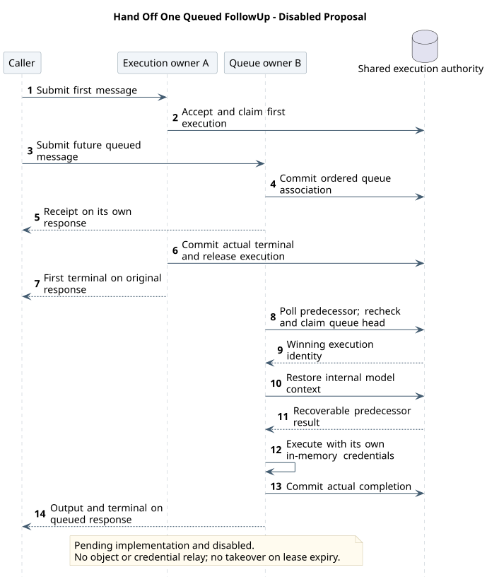
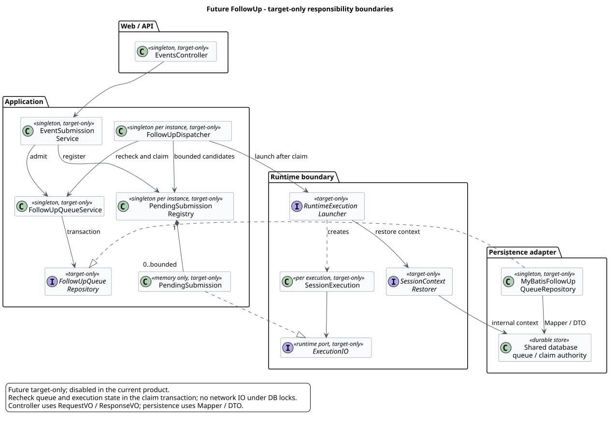
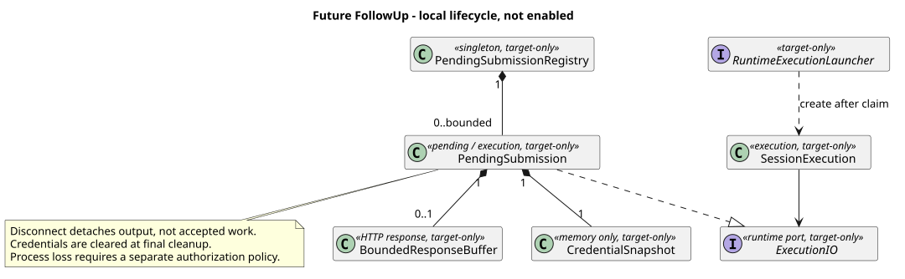

# FollowUp 后续消息扩展设计（暂不启用）

| 属性 | 值 |
|---|---|
| 文档版本 | 0.1.1 |
| 状态 | 方向已确认；本期不支持，启用另行评审；target-only |
| 更新日期 | 2026-09-10 |
| 设计仓变更前基线 | `fd8604956632c880264434791465d1f59917038d`；本轮保留已合入的 Help 与命令归属设计 |
| CampusClaw 源码基线 | `dfb90cac4e233e09a0b8f047f7e9f4682f5ad238` |
| pi Runtime 固定基线 | `5cd93f688aaab89dbb6dfa4aca535f21796ae185`；通过该 commit 读取，不采用工作区较新的 HEAD |

## 1. 本次决定与当前产品边界

本次只修改设计契约，不修改 CampusClaw 实现。当前目标从 13 个接口收敛为
11 个，完整清单见 [Runtime 总览 §4](README.md#4-当前目标-http-接口清单)。

| 退役的独立接口 | 当前替代或限制 |
|---|---|
| `POST /sessions/{sessionId}/abort` | `POST /sessions/{sessionId}/events` 提交 `user.interrupt`；回执不等于实际停止 |
| `POST /sessions/{sessionId}/steers` | 产品采用“中断、确认实际停止、再提交 user.message”调整方向；不提供运行中注入 |
| `POST /sessions/{sessionId}/follow-ups` | 本期不支持后续消息排队；只记录本文的未来扩展方向 |

三个 operation model 与活动评审入口删除，不保留兼容别名或新独立路径。
原有实现证据、版本历史和针对旧实现的回归资料保留并标明范围，不能作为当前目标契约。
实现尚有旧 Controller；删除实现路由属于后续迁移切片，不在本次完成声明之内。

当前 POST Events 仍仅接受 `user.message`、`user.interrupt`、`user.tool_confirmation`。
M1 未完成前拒绝所有调用方的 M2，不排队、不写入已接受历史；确认等待、中断未完成或
观察响应断开都不释放 Session 的 running 状态。没有 FollowUp 参数、新事件类型或
排队回执上线。本文不改变已有 Header、eventId、普通分页以及 Events 部分确认状态。

“中断后重新提问”不等价于 pi 原生 Steer：原生 Steer 在执行边界注入消息，不先取消
当前执行。移除这个能力是已确认的产品约束，不应向前端承诺等价的无损转向。

## 2. 已观察源码与设计理由

下表 Java 路径相对 `pi-mono-java`；前缀 `C` 表示
`campusclaw/src/main/java/com/huawei/hicampus/claw/`。
pi 路径相对 `pi-mono`。行号针对上表固定 commit，不代表未来实现位置。

| 类型 | 路径与符号 | 观察与结论 |
|---|---|---|
| 已观察 Java | `C/codingagent/runtimeapi/web/RuntimeSessionControlController.java`，steer/followUp/abort，45–66 行 | 三个独立控制入口当前仍存在，Steer/FollowUp 返回 202，Abort 返回 204 |
| 已观察 Java | `C/codingagent/runtimeapi/session/RuntimeSessionControlService.java`，acceptLocked、requireRunningHolder、queueControl，93–175 行 | 先校验持久化状态，再寻找本机 Holder；本机无对象则执行不可用，入队操作最终作用于本机 Agent |
| 已观察 Java | `C/codingagent/runtimeapi/runtime/RuntimeSessionEngineRegistry.java`，register/find/createHolder | registry、容量许可与 Holder 均为实例内对象；createHolder 可以装入传入的恢复消息，但没有跨实例队列接力协议 |
| 已观察 Java | `C/codingagent/runtimeapi/event/RuntimeExecutionCoordinator.java`，continueQueuedExecution、canContinue、completeExecution，120 行起 | 已有队列续跑复用同一 Holder；结束持久化、释放对象及终态投递不构成本文的原子交接 |
| 已观察 Java | `C/agent/Agent.java`，steer/followUp/abort；`C/agent/loop/AgentLoop.java`，runInternal、drainNextControl | 本机 Steer/FollowUp 队列与取消；Steer 优先，FollowUp 在本轮工具和更优先控制结束后继续 |
| 已观察 pi | `packages/agent/src/agent-loop.ts`，runLoop，155–275 行；`packages/agent/src/types.ts`，getSteeringMessages/getFollowUpMessages，230–257 行 | 没有更多工具或 Steering 时才取 FollowUp；同一 Agent Loop 继续执行，最终才发 agent_end，不是分布式持久化调度 |
| 产品约束 | 本期拒绝执行中的下一条消息 | 保持 M6 单消息准入，不为未来扩展增加本期排队与恢复成本 |
| 架构变更，target-only | 应用层持久化队列，前序完成后由接收 M2 的实例启动新执行 | 不要求 M2 请求命中 A，不向 A 的内存队列远程注入；与 pi 同一 Loop 内续跑刻意不同 |
| 安全约束 | 凭据仅在所属请求/执行的内存对象中保留 | 不能为容灾把 JWT、AppKey 或 access-token 写入队列、事件、日志或复用 M1 凭据 |

这里没有引入新的托管产品契约或推断其服务端调度；选择依据是本地实现差距与产品边界。

## 3. 未来正常流程：数据库交接，不需要粘性路由

假设未来明确启用了排队模式，M1 在实例 A 执行，M2 的新 POST 到达实例 B：

1. B 沿用上游授权边界，在短事务中检查 Session 与队列容量，记录 M2、前序关联及服务端
   确定的排队次序。重复接受防护必须在未来启用前定义；不能按相同文本去重。
2. B 提交后首先返回 M2 的接受回执，保持 M2 自己的 POST SSE。B 只持有 M2 本次请求的
   内存凭据和有界响应缓冲。排队回执的具体字段、历史投影与当前完整 user.* 回执的
   关系仍须评审；不能把“已排队”误报为“已经进入模型上下文”。
3. A 完成 M1，将可恢复的权威上下文、真实终态与执行归属释放在一致的提交边界发布。
   A 向 M1 的流发送对应终态并关闭。确认等待不是 M1 完成，不能启动 M2。
4. B 的实例级批量等待检查发现前序完成后，在 Session 短事务中复核队首、前序终态、
   自身资格及无活动执行，原子领取 M2 并占有新的内部执行身份。恢复与模型/工具调用
   均在事务外；领取后启动失败必须走已接受失败处理，不能假装没接收过。
5. B 从持久化的内部模型上下文投影恢复 M1 的完整结果，再启动 M2。不能把公共
   ListEvents 当作模型恢复接口：它的安全过滤、分页与展示数据不保证上下文完整。
6. M2 的 Agent 输出仅写入 M2 的 POST 响应，真实结束后关闭。M1 的终态不能结束 M2
   的响应，也不把 M2 输出塞回 M1 已关闭的连接。

因此正常路径不需要 A→B 转发 token，也不需要让负载均衡把两次请求分配到同一实例。
数据库共享的是消息和执行交接状态，不是 Java 对象。接收实例失败后的重新授权、
执行接管及观察恢复是另外的故障协议，不能由正常流程推导为已自动支持。

[PlantUML 源码：`target_follow_up_handoff`](设计图/后续消息扩展/diagram.puml#L1)

## 4. 推荐目标类图与职责

以下所有新增类及关系都是 target-only。命名用于职责讨论，不冻结 Java 包或公共 VO 字段。

[PlantUML 源码：`target_follow_up_classes`](设计图/后续消息扩展/diagram.puml#L48)

请求凭据、等待登记与执行对象的局部组合关系单独展开，避免挤在全局图中：

[PlantUML 源码：`target_follow_up_local_lifecycle`](设计图/后续消息扩展/diagram.puml#L96)

| 目标职责 | 生命周期与边界 |
|---|---|
| Events Controller / EventSubmissionService | Spring 单例；Controller 只调用应用服务、使用 RequestVO/ResponseVO；服务负责 VO/DTO 转换与业务准入 |
| FollowUpQueueService / FollowUpQueueRepository | 单例；共享数据库是队首、状态及领取资格的权威。Repository 经 Mapper/DTO 读写，不向 Controller 暴露 DTO 或可变数据库对象 |
| PendingSubmissionRegistry / PendingSubmission | registry 是实例单例；每条 pending 对象保存内部消息关联及自身请求/执行范围凭据、缓冲，均不持久化，不给其他请求暴露可变引用 |
| FollowUpDispatcher | 实例单例，有界批量查询本机等待目标；不为每个 Session 建立独立高频定时任务，不直接从 Controller 启动 Loop |
| RuntimeExecutionLauncher / SessionContextRestorer | 应用层调用的运行时边界；原子领取后恢复内部权威上下文，再创建 Session 执行对象；不调用 HTTP ListEvents |

共享权威状态不在内存 registry 中复制为另一套准入结论。预检查得到的队首或空闲状态，
仍须在领取事务重新校验。凭据与网络写出不进入数据库事务。没有 Controller 越层访问
Mapper、跨层传 DTO、公共执行 ID 或以不同服务各自缓存状态替代权威记录的设计。
SessionExecution 只依赖运行时拥有的 ExecutionIO 端口；应用层 PendingSubmission 适配
该端口提供本次凭据与输出，不让 Runtime 反向依赖应用层 registry 或 HTTP 对象。

## 5. 一致性、容量与故障边界

- **接受与完成竞争**：M2 入队和 A 完成必须通过同一 Session 协调点串行判定；不会落在
  “A 已检查没有队列、B 刚入队但无人唤醒”的缝隙。批量补读兜底，不以通知到达为事实。
- **FIFO 与单执行**：领取必须验证当前队首和内部执行身份；M3 不能因命中空闲实例而
  越过已接受的 M2。多实例竞争只允许一个领取者成功；不按事件时间或物理插入巧合排序。
- **终态隔离**：原子发布前序的权威上下文与真实结束，不在 A 仍可能使用上下文时让 B
  继续。SSE 的确认等待 idle、超时、断连和取消信号均不构成实际结束证明。
- **容量隔离**：100 个业务并发许可只覆盖实际执行，排队不提前占用；队列条数、字节数、
  等待连接数、内存凭据数、数据库检查预算须另设上限，并覆盖多实例总容量。拒绝必须发生
  在接受前，不能先回执后因本地缓冲不足静默丢弃。
- **凭据失效**：B 崩溃会丢失 M2 的内存凭据；排队持久化不等于可无人干预继续执行。
  令牌过期或凭据缺失时不得使用 M1 凭据、猜测身份或悄悄跳过工具授权；重新授权/安全
  凭据取得机制在启用前设计。正常断连不自动取消已接受消息或触发重发。
- **执行者失联**：租约到期或心跳丢失不证明 A 停止。内部 fencing 可以拒绝旧实例写状态，
  不能撤销已发往外部工具的副作用；不得仅因过期便启动 M2 或重跑 M1 的工具。
- **前序失败/中断**：是否继续待处理消息、是否清空队列以及失败如何展示均需显式策略。
  本期 user.interrupt 不自动拥有未来队列的清空语义，不继承旧 Abort 的行为。
- **删除与变更**：存在 pending 时 DeleteSession、模型/思考配置修改、压缩、确认续跑的
  准入与快照规则启用前统一评审。配置不能随实例取到的不同缓存悄悄改变同一排队消息。

若新增表，采用 `t_` 加小写 snake_case，例如候选 `t_session_pending_message`。
本次不冻结表结构、状态字面值、索引、轮询周期、租约、排队 TTL 或错误码；需结合实际
GaussDB 版本、事务能力与压测确定。Redis 只可作为后续通知优化，不能移走数据库的
消息/领取权威，也不能解决内存凭据失效和外部副作用恢复问题。

## 6. 未来启用前的实施切片与验收

本期只落“退役契约、客户端限制、文档与展示同步”切片。下表不代表已批准启动实现。

| 未来切片 | 启用前必须完成 |
|---|---|
| 公共契约与产品策略 | 明确如何显式请求排队、回执/排队状态/历史、幂等与重试、取消队列、超时、前序失败及重新授权；不得默认放宽所有 user.message 的 M6 准入 |
| 持久化准入骨架 | Repository/DTO、权威队首、单执行领取和完成交接；并发提交/结束/领取无丢失、重复或插队 |
| 本机等待与执行骨架 | 有界 registry/dispatcher、先登记再补读、通知丢失由批量检查兜底、上下文恢复与自身流绑定 |
| 故障与安全 | B 崩溃、令牌过期、数据库不可用、A 失联但工具仍在执行、旧执行迟到写、前序中断、删除/配置竞争均有可验收策略 |
| 容量与端到端 | M1 在 A、M2 在 B、M3 在 C；无粘性路由也保证单执行与 FIFO；输出不串流，慢连接不阻塞其他执行，100 并发及等待容量分别压测 |

满足上述门禁并经用户确认启用后，再修改精确 operation model、实现和前端能力。
当前不得增加 FollowUp 入口或把本文作为客户端可以直接调用的契约。

## 7. 版本历史

| 版本 | 日期 | 变更 |
|---|---|---|
| 0.1.1 | 2026-09-10 | 同步独立 Name API 后的十一项当前接口，FollowUp 仍不启用。 |
| 0.1.0 | 2026-09-07 | 记录已同意的未来 FollowUp 方向，明确暂不启用；退役三个独立控制接口，保留现行单消息准入，补齐源码、跨实例交接、目标类图与未来启用门禁。 |
