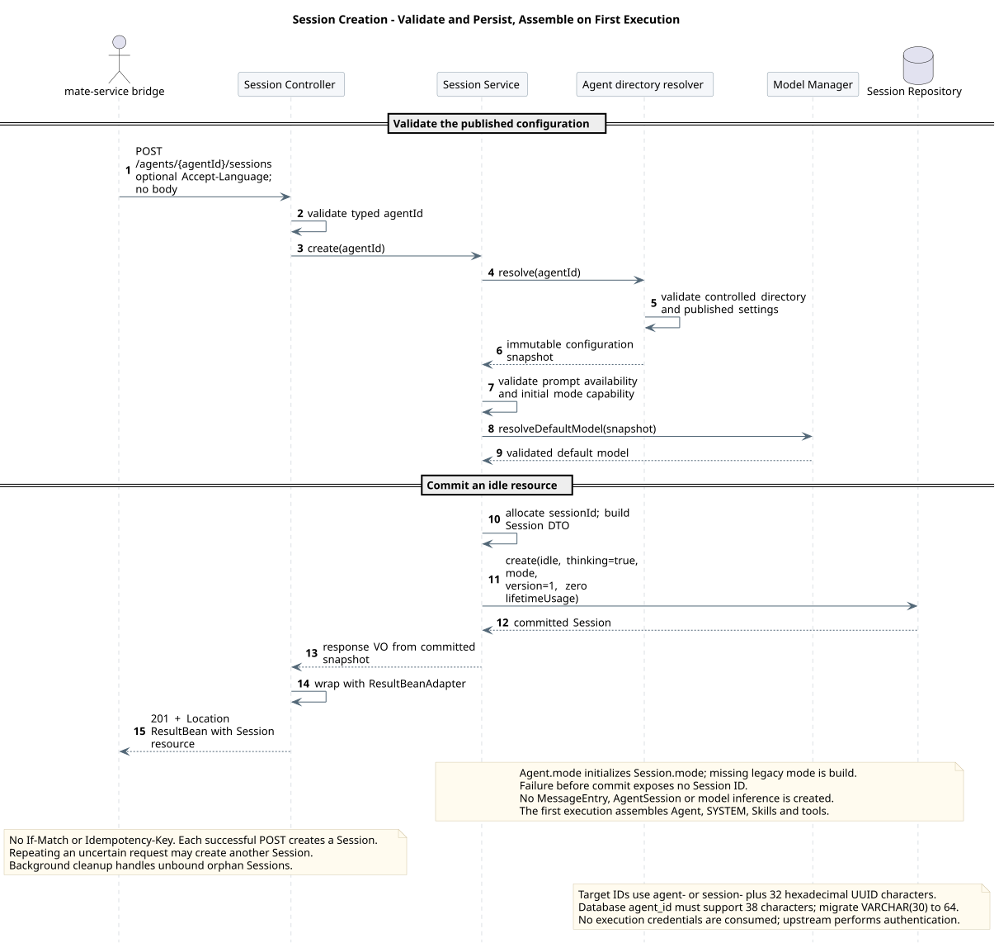
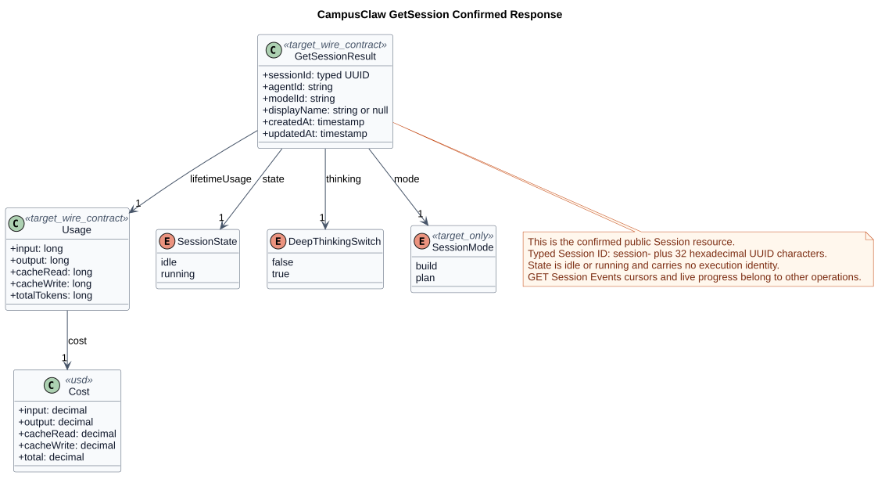
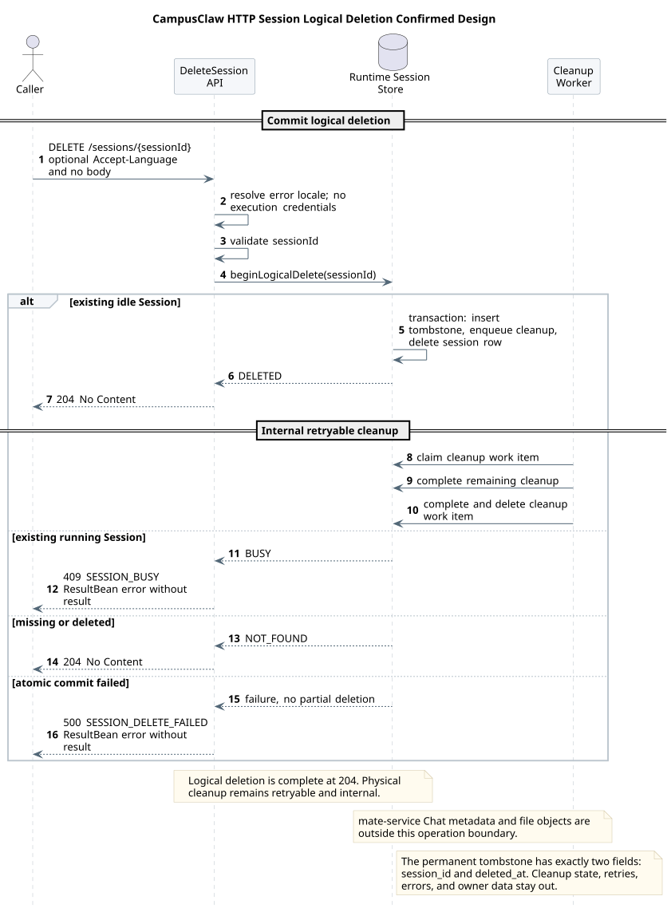
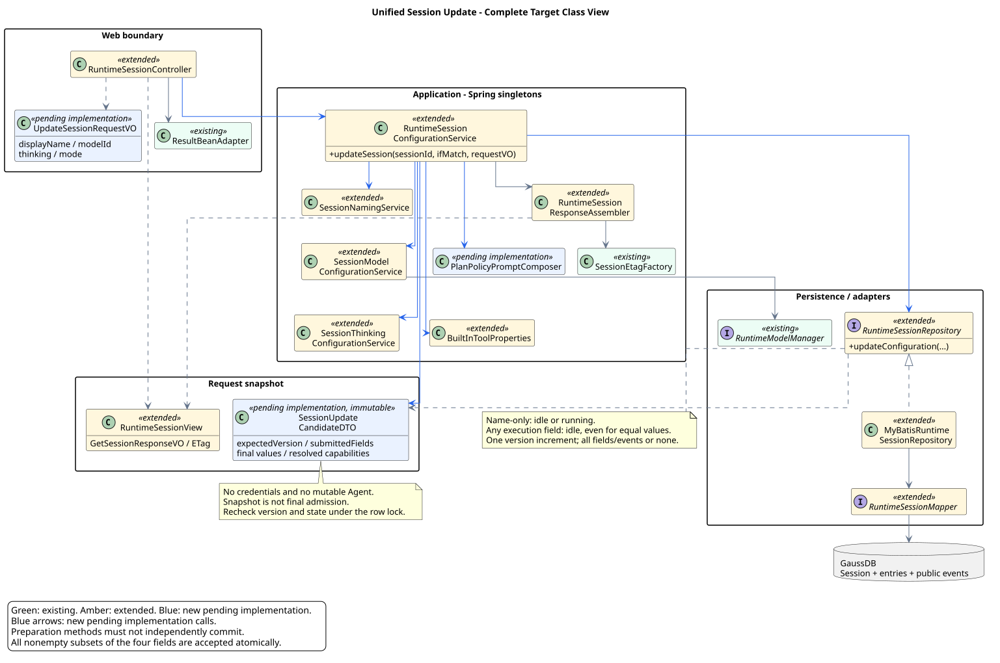
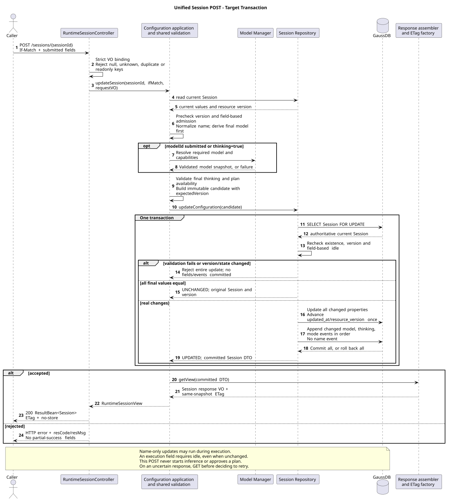
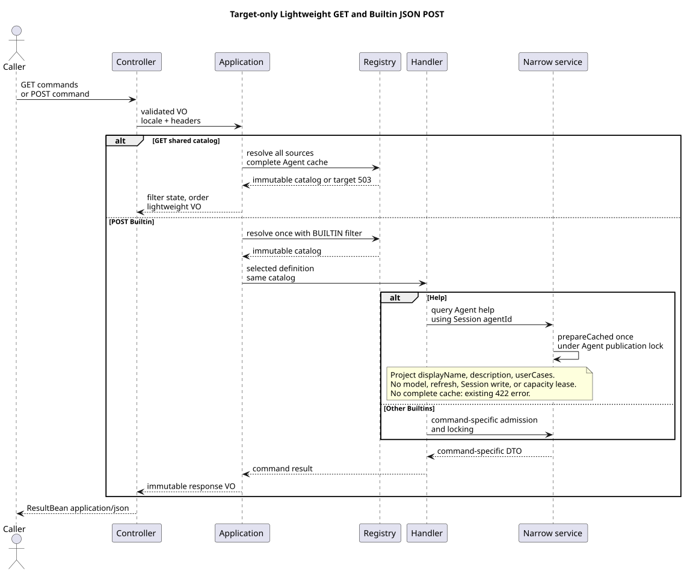
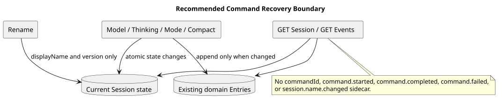
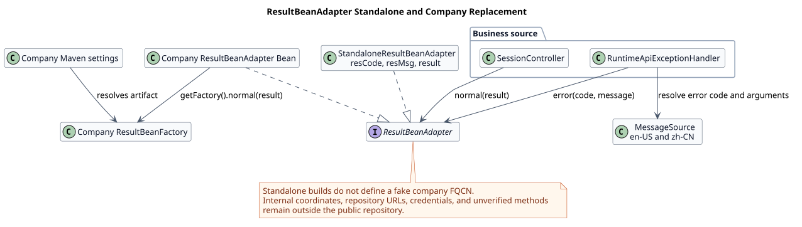
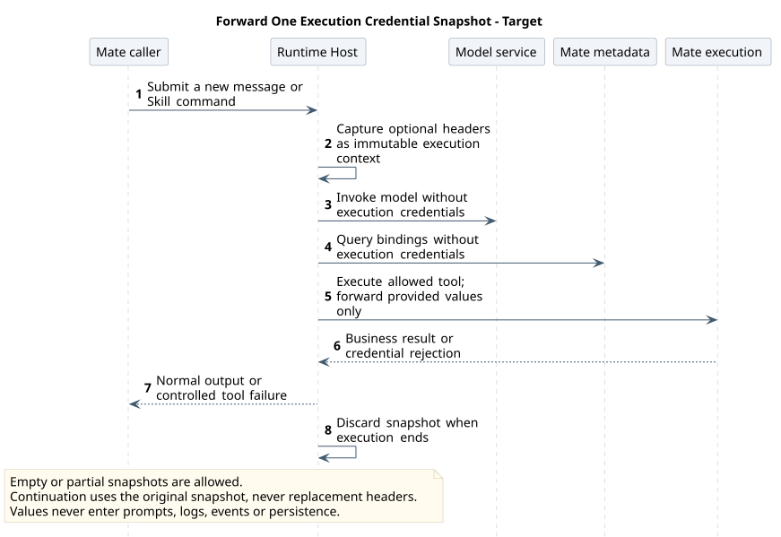

# CampusAgent Runtime HTTP API 设计

| 属性 | 值 |
|---|---|
| 文档版本 | 1.60.1 |
| 状态 | 当前目标；实现状态按源码证据分别记录 |
| 精确契约 | [统一接口页](chat-api-review.html)；[catalog.json](接口契约/catalog.json) 指定唯一模型 |
| 源码范围 | [源码证据](source-evidence.md)；统一更新专项见 §8.1 |
| 更新日期 | 2026-09-22 |

## 1. 设计边界

Runtime HTTP 面向 mate-service bridge 和获授权的内部 SDK，以 Session、Event 和 Model 为资源边界，不公开独立 Run。普通消息通过 POST Events 提交并观察本次 SSE，完整历史通过同一路径 GET 查询。命令通过独立 Command API，普通消息不解析 Slash 文本。

浏览器使用 [mate-service 公共 Chat API](../../02-服务与接口/07-mate-service通用对话API/README.md)。mate-service 持有 Chat→Session 映射、完成公共认证与安全投影；Runtime 处理执行、Session 配置和持久化。两跳各有契约，当前接口清单与评审状态见各自生成页。

本文维护 HTTP 资源设计、更新事务、公司响应适配和安全边界。事件生命周期由 [Session Events](chat-events-design.md) 维护，命令行为由 [Slash 模块](../../04-命令与技能/00-Slash-Command通用模块/README.md) 维护，避免在此复制业务契约。

## 2. 接口分组

基础路径为 `/campusclaw-service/v1`。Host 随部署环境配置；精确字段、Header、响应与错误只维护在 [catalog.json](接口契约/catalog.json) 指定的 JSON 模型，并生成 [统一接口页](chat-api-review.html)。生成与校验规则见 [契约维护](chat-api-index.md)。当前不发布独立 OpenAPI。

Path、Query、JSON 与 SSE data 的字段统一 lowerCamelCase；HTTP Header、固定枚举、错误码和类型化 ID 值保持契约原名。不接收 snake_case 别名，避免双写和未知字段判断不一致。源码与 SQL 保留其原生标识，不作为 wire field。

请求 Header 按各 operation 的实际用途声明；共享调用上下文示例不构成所有接口的凭据要求。Runtime 不在 HTTP 入口校验凭据是否完整，凭据的使用和保留边界见 §7。

### 2.1 Session 生命周期

创建、查询和删除的精确契约分别见 [创建](chat-api-review.html#CreateSession)、[查询](chat-api-review.html#GetSession)、[删除](chat-api-review.html#DeleteSession)。HTTP 请求独立定位 Session；恢复连接不需要 connect/resume。

创建不带请求体。Runtime 根据不可变 agentId 解析受控 `.campusclaw` 目录，验证目录包含关系、已发布模型绑定、默认模型与 Agent 默认 mode；再生成不复用的 sessionId，持久化 idle Session。默认 thinking=true，mode 复制同一次读取的 Agent 配置；plan 的能力检查和旧元数据缺省规则由 [Agent.mode](../../03-数据与存储/02-Agent元数据GaussDB/README.md#44-agent-mode) 维护。

创建不加载执行对象、不调用模型，也不创建 MessageEntry。`AgentSession + Agent`、SYSTEM.md、Skills 与有效 Runtime 工具 profile 在首次执行时装配；工具集合由 [工具系统](../02-CampusClaw工具系统/README.md) 维护。配置校验在记录提交前完成，失败不暴露 sessionId。此时序与本次读取的 Java f61906b9 创建入口一致，核验范围见 [源码证据 §4](source-evidence.md#4-session-创建与-http-入口核对)。

HTTP 目录文件为 `settings.json`、`SYSTEM.md` 和 `skills/`，不把 CLI 异名文件当作别名；发布方须保证完整快照。Model Manager 对有效模型绑定与调用具有最终权威，目录快照不替代实际执行时的可用性检查。

创建不要求 Idempotency-Key 或 If-Match，每次成功 POST 都产生新 Session。响应丢失后无条件重试可能产生孤立 Session；由后台超时清理未绑定记录，不能把网络重试描述为幂等创建。

创建接口的请求头仅声明可选 `Accept-Language`，用于错误消息国际化；不声明或展示用户凭据 Header。创建链路不使用 Mate 执行凭据，也不将语言保存为 Session 或模型回答语言。上游认证授权仍由所属入口负责，Runtime 不因收到额外凭据 Header 而新增拒绝行为；源码与验收范围见 §8.2。

本图只说明创建空闲数据库 Session；Controller 的参数绑定与响应封装归 Session service 的 HTTP 边界，运行时 AgentSession 延迟到首次接纳执行才装配。初始 thinking、mode、版本、Usage、ID 规则及其分项实现状态继续由本节定义。每次成功 POST 都创建新 Session，回执不确定时重复提交可能产生另一资源。



[原尺寸 SVG](设计图/会话生命周期/http_session_creation.svg) · [PlantUML 源码](设计图/会话生命周期/diagram.puml#L1)

#### 2.1.1 读取 Session

查询只读持久化资源，不恢复运行对象、不访问模型服务。Session 返回当前配置、idle/running、名称及 lifetimeUsage；完整历史归 GET Events，实时阶段归提交请求的 SSE。连接相关的 attached、进程内 locked 和内部执行对象均不属于 Session 资源。

Usage 沿用模型返回的 Token 与 USD cost 口径，Assistant 和 Compaction 各保存本次值并原子累计 lifetimeUsage；不得用字符数或估算 Token 替代实际用量。thinking 控制后续执行，关闭后不隐藏已保存的推理原文，规则见 [Thinking 展示](chat-events-history-design.md#thinking-original-text)。pi 的多级 thinkingLevel 在此收窄为 boolean，是产品约束：false 映射 off，true 使用模型与 Agent 配置的受管非 off 强度。

成功返回 ETag 与 `Cache-Control: no-store`；ETag 只用于更新的 If-Match，不增加 If-None-Match/304 分支。不存在与已删除均返回 SESSION_NOT_FOUND，避免泄露历史状态。



[原尺寸 SVG](设计图/会话生命周期/http_get_session_response.svg) · [PlantUML 源码](设计图/会话生命周期/diagram.puml#L67)

#### 2.1.2 删除 Session

删除在 idle 时原子提交 tombstone 和可重试清理任务，返回无响应体的 204。提交后 Session 立即对 API 不可见；物理清理由 Worker 重试，204 不表示介质上的字节全部擦除。active execution 返回 SESSION_BUSY，调用方须提交 user.interrupt 并确认实际结束后再删除。

不存在或已删除统一 204；URI 与持久化 tombstone 提供重试幂等性，不要求 Idempotency-Key 或 If-Match。永久 `t_session_tombstone` 严格只有 `session_id/deleted_at`，用于禁止 ID 复用；租约、次数、错误与清理进度放在短期 `t_session_cleanup_task`，完成后删除任务。两者提交失败必须整体回滚，不能暴露部分删除。

清理范围为 Runtime Entry、执行状态与内存对象；mate-service Chat 业务元数据和文件对象由各自所属服务管理。删除后的 Session 不能因清理失败重新可见。

本图只展示逻辑删除与其后的内部清理。空闲 Session 的墓碑、清理工作项和资源删除同事务提交；不存在或已删除返回 204，运行中返回 409，原子提交失败返回受控错误。204 表示逻辑删除完成，物理清理可重试；永久墓碑只含 session_id 和 deleted_at，不能混入重试状态。



[原尺寸 SVG](设计图/会话生命周期/http_delete_session.svg) · [PlantUML 源码](设计图/会话生命周期/diagram.puml#L173)

### 2.2 消息与 Session Event

POST 接受 user.message、user.interrupt、user.tool_confirmation 三类输入。请求级 SSE 的回执、预览与完成边界由 [流设计](chat-events-stream-design.md) 维护，精确字段由对应模型维护。

#### 2.2.1 公共 Session 压缩能力（内部算法与已确认公共映射）

压缩属于 Session 记忆模块，算法、阈值、失败重试和上下文恢复由 [压缩设计](../../03-数据与存储/01-会话记忆GaussDB/compaction.md) 唯一维护。HTTP 只投影完整 `session.compacted`，不公开摘要、内部边界、started/failed 或 `_discardedEntryId`。

手工压缩通过 `/compact` 的 Command Handler 进入，不增加专用 HTTP operation；[Compact 生命周期](../../04-命令与技能/01-内置命令/README.md#7-compact-生命周期) 维护准入、终态和资源释放。

### 2.3 持久化事件与恢复

[历史查询设计](chat-events-history-design.md) 定义持久化事件集合、普通整数分页及恢复。调用方按返回顺序展示，以 eventId 去重；实时预览不作为恢复记录。公共历史投影与模型上下文恢复是不同职责。

<a id="session-update"></a>

### 2.4 模型目录与统一 Session 更新

Session 的名称、默认模型、深度思考和工作模式统一由 `POST /sessions/{sessionId}` 修改，operationKey 为 `UpdateSession`。采用 Claude Managed Agents 的资源级 POST 与可选属性更新方式；当前前端每次只提交所操作的一个字段，接口同时允许多字段组合，未提交属性保留，不要求提交完整 GET 资源。精确字段、单项/组合示例、错误和 Header 唯一维护在[操作 07](接口契约/操作/07-update-session.json)。

`GET /sessions/{sessionId}/models` 继续提供 Session scope 的可选模型清单。统一操作属于 API 架构变更：四类操作共用资源更新与冲突对账流程，不将当前页面的一次单项操作固化为服务端只能修改一项的限制。多字段请求按同一资源版本和事务校验提交；当前前端无需增加批量编辑或保存流程。保留原有名称与执行配置不同的准入规则；不照搬 Claude 的会话模型不可变约束，也不改变 Agent/Tool/Skill 元数据。

#### 2.4.1 GET Session Models

该接口实时读取 Model Manager，返回 Agent enabledModels 与当前可用模型的交集，保持 Agent 配置顺序、不分页。models 是 modelId 字符串数组，可以为空；已保存的 currentModelId 可能因后续停用而不在候选数组中。清单不是执行预约，更新仍需重新验证。

精确响应由[操作 06](接口契约/操作/06-list-session-models.json)维护。模型展示名与供应商能力仍由 Mate/Model Manager 目录负责；不在本接口公开 baseUrl、凭据、价格、请求 Headers 或供应商参数。Manager 不可用继续返回 MANAGER_UNAVAILABLE。

#### 2.4.2 POST Session 统一更新

四个可写字段为 `displayName/modelId/thinking/mode`，均可省略，至少提交一个，可提交任意非空子集，不设置 `maxProperties: 1` 或字段互斥规则；所有显式 null、未知或只读字段、重复键、类型强转和空对象均拒绝。Boolean false 是有效的明确提交，不能按真假判断字段是否出现。未提交字段保留；仅模型实际切换且未提交 thinking 时，沿用模型能力导致自动关闭的既有规则。

| 输入 | 准入与合并 |
|---|---|
| 仅 displayName | idle/running 均可调用；共用 /name 的名称规范化，不修改 active execution |
| 携带 modelId、thinking 或 mode 的任意组合 | 必须 idle；即使这些字段与当前值相同也检查 busy，不能借改名绕过配置准入 |
| modelId 与 thinking 一起提交 | 先确定目标模型，显式 thinking=true 按目标模型验证；不支持则整笔失败 |
| modelId 实际变化，thinking 省略 | 新模型支持思考时保留；不支持则自动关闭，原因 modelCapability |
| mode=plan | 检查部署计划提示词和固定 Runtime profile 中 ExitPlanMode；不查询工具元数据计划属性 |
| mode=build | 不依赖计划能力；不启动模型、不批准计划、不替代计划确认 |
| 多字段请求 | 全部校验通过才写入；模型/思考/模式失败时名称也不更新 |

名称规则沿用 /name：去除首尾空白、保留内部空白，拒绝空值、CR/LF、C0/C1、Unicode 双向覆盖/隔离字符及超过 80 UTF-8 字节。modelId 沿用 ClawConstants.RuntimeApi.MODEL_ID_REGEX。thinking 仍为 boolean，false 映射 off，true 使用受管非 off 强度；关闭不隐藏既有思考原文。mode 仅为小写 plan/build，与 state=idle/running 分离。

请求不声明执行凭据 Header 或 Idempotency-Key；JSON 请求体使用必填 Content-Type: application/json，并必填单个强 If-Match；If-Match 缺少返回 428，合法但过期返回 412，非法形状按 INVALID_SESSION_UPDATE_REQUEST 拒绝。Accept-Language 可选。上游继续负责凭据真实性与动作授权，Runtime 不增加本地认证。

#### 2.4.3 原子性与内部接口

Controller 的目标方法为 `updateSession(sessionId, ifMatch, UpdateSessionRequestVO)`，调用既有 RuntimeSessionConfigurationService；Service 返回 `RuntimeSessionView<GetSessionResponseVO>`，Controller 才包装 ResultBean。既有 ConfigurationController 保留 GET Models，移除模型/思考写路由。名称不再新增属性专用 Controller。

请求 VO 不设置默认值。沿用 Jackson 的严格字段读取来区分省略与显式 null，拒绝非字符串/非布尔值和未知字段，并开启本请求重复键检测；Java 内部只用 DTO，不引入 PO/DO/Entity。可选标识使用标准 @Pattern 与公共正则常量，已出现的空白值及名称字节/Unicode 规则由共享规范化校验；至少一项和跨字段规则由 Service 检查。

应用服务先读取 Session 和版本，按提交字段做预检查；仅提交 modelId 或显式开启思考需要模型解析。计划能力从既有 BuiltInToolProperties.toolsFor(RUNTIME) 的启动期固定 profile 与计划专题 PlanPolicyPromptComposer 读取；更新只校验能力，不创建活动工具实例。名称规范化、模型选择和思考能力判断复用现有窄服务的纯校验/准备职责，不能串行调用会分别提交事务的 changeModel/changeThinking/execute。

`SessionUpdateCandidateDTO` 是目标新增的请求范围不可变候选，保存 expectedVersion、已提交字段集合、合并后配置和经解析的模型能力。它不包含凭据，不复用为 Controller VO，不发布给其他请求。

Repository 扩展一次性的 `updateConfiguration(sessionId, expectedVersion, candidateDTO)` 事务入口。行锁内重读 t_sessions，按“存在 → 版本 → 按提交字段决定的 busy → 最终状态转换”顺序复核；只有版本相同才能使用之前的合并候选，否则整体返回 VERSION_MISMATCH，禁止重新套用旧候选。目录解析仅固定本次读取的配置/能力，不保证外部 Manager 永不变化；后续消息接受仍执行既有最新模型可用性检查，不把外部 I/O 放进行锁事务。

同事务更新 display_name/model_id/thinking/mode、一次 updated_at/resource_version，并按 model → thinking → mode 顺序追加实际变化的 Entry 与公共事件。名称不写 Entry。复用 SessionConfigurationUpdateDTO 的 UPDATED/UNCHANGED/NOT_FOUND/BUSY/VERSION_MISMATCH；任一步失败全部回滚，不返回部分成功或字段级执行回执。

全部无变化时，完成适用的版本、状态和能力校验后返回原 Session、原 updatedAt 和原 ETag，不写历史。真实变化的响应与 ETag 必须来自同一个提交快照，不在事务后分别重新读取拼装。网络结果不确定时 GET 对账；412 后保留用户草稿，不自动使用新 ETag 重放旧意图。



[原尺寸 SVG](设计图/会话配置/http_session_update_classes.svg) · [PlantUML 源码](设计图/会话配置/diagram.puml#L1)

本图下钻一次组合配置更新，从严格绑定到同快照响应；配置应用与仓储事务分开，Mapper、DTO、响应组装器不单列。仅 modelId 提交或 thinking=true 时需要相应模型查询；其他输入校验失败也在提交前返回。事务内重查版本和状态，无变化保持原版本，真实变化一次推进版本并按模型、thinking、mode 顺序写事件；不确定回执先 GET 对账。



[原尺寸 SVG](设计图/会话配置/http_session_update.svg) · [PlantUML 源码](设计图/会话配置/diagram.puml#L106)

主图以既有配置应用服务为编排边界，保留业务校验与 Repository 的职责分离。候选快照解决组合字段相互依赖，锁内版本与状态复核解决并发；统一入口不意味着把多次独立提交拼成一个 HTTP 响应。计划审核的全局执行结构仍由[计划模式主图](../06-CampusClaw计划模式/README.md#3-推荐全局目标类图)维护。

#### 2.4.4 实施切片与验收

| 切片 | 可验证结果 |
|---|---|
| 请求与入口 | UpdateSessionRequestVO、POST 路由、统一错误映射；每个单字段与四字段组合均可表达；拒绝空/null/重复键/未知/只读字段；false 不被忽略 |
| 业务准备 | 复用名称规则，目标模型先于思考校验；显式 true 不兼容整笔拒绝，省略才允许自动关闭；无关字段不触发 Manager I/O |
| 原子持久化 | 两实例同 ETag 只成功一次；锁内 busy/版本失败时所有字段不变；多字段只升一次版本；领域事件插入失败时全部回滚 |
| 响应与消费者 | GET/Create/Command 的 Session 投影包含 mode；统一更新复用 GET 结构与同源 ETag；前端每个选择器或重命名操作只发送对应一个字段，以返回 Session 同步派生的 thinking，冲突/断网先对账 |
| 路由替换 | 移除属性专用 PUT 及其请求 VO/调用点（确认无其他消费者后删除）；不保留 PATCH 或兼容写别名；/name、/model、/thinking 命令仍保留既有入口 |
| 模式接入 | 按计划专题实现模式持久化、Prompt 与能力检查后再开放 plan；不以接口契约已确认声称计划执行已实现 |

计划审核保持独立的事件交互边界，Session 响应不增加待审核目标字段；客户端恢复与服务端执行内校验见[计划模式 §6.2](../06-CampusClaw计划模式/README.md#62-恢复与结果不确定)。

这是 待实现 增量。沿用 Spring/Jackson/MyBatis 现有依赖，无新增 Maven 依赖。mode 的数据库列与迁移归[计划模式](../06-CampusClaw计划模式/README.md#6-持久化与恢复)；本接口不新增通用 metadata 字段或独立配置表。

管理面 refresh(agentId) 仍只发布新目录，不改 active execution 快照。下一次消息接受时如需模型校准，按既有 model_changed、可选 thinking_changed、user.message 顺序提交；本次 SSE 首帧仍为 user.message。没有有效默认模型时，在 SSE 建立前拒绝且不接受消息。

### 2.5 执行控制

停止执行通过 user.interrupt 完成；调整方向是在实际停止后提交新的 user.message，不等同于 pi Steer。当前不提供 FollowUp 队列，M1 未完成前拒绝 M2。[FollowUp 未来设计](chat-follow-up-future-design.md) 记录可选扩展及启用条件，不属于当前接口。

### 2.6 Built-in Command（已确认，目标实现）

Builtin 与 Skill Command 由用户统一负责设计、实现和集成。
共享 GET 轻量清单、Builtin 普通 JSON，以及 B13/B14 的 Skill 请求、SSE 与恢复规则已确认；Mate 公共命令独立管理。本节只说明 HTTP 边界，不重复维护命令业务规则。

| 接口 | 精确模型 | 设计职责 |
|---|---|---|
| GET /sessions/{sessionId}/commands | [操作 12](接口契约/操作/12-list-session-commands.json) | [Slash 通用模块](../../04-命令与技能/00-Slash-Command通用模块/README.md#31-get-轻量清单已确认)维护描述符、排序、状态过滤、完整缓存与重新准入理由 |
| POST /sessions/{sessionId}/command | [操作 13](接口契约/操作/13-execute-session-command.json) | [Builtin 设计](../../04-命令与技能/01-内置命令/README.md)维护七个命令的业务、窄服务、事务和实施验收 |

Controller 只收发 VO，Application 完成授权、归一化、一次 Catalog 解析、准入、执行及 DTO→VO。
共享 GET 使用完整来源；内部 Builtin 专属解析才过滤来源。GET 不构成执行预约，
POST 重新解析，并在所属锁或事务内检查可变状态；共同结构只在 Slash 全局主图维护。

本图聚焦一次 POST 命令，不再同时展开 GET 清单和每个 Builtin。Command application 保留解析与分发，Selected handler 与 Domain service 分列以明确 handler 不直接承担数据库业务规则；GET 的来源聚合、排序和轻量 VO，Help 缓存锁与失败条件，以及 Skill 公共接入门禁见对应章节。



[PlantUML 源码：`command_http_flow`](设计图/Command/diagram.puml#L1) · [原尺寸 SVG](设计图/Command/command_http_flow.svg)

#### 2.6.1 普通 JSON 与权威领域事件

Builtin Handler 完成后返回普通 ResultBean JSON，不建立命令 SSE。
请求、结果与错误由操作 13 维护；与既有 Session/Models 资源复用的映射及 ETag 规则统一见
[Builtin §8](../../04-命令与技能/01-内置命令/README.md#8-json-与错误)。
不产生通用命令生命周期或 Name 历史；这不改变 POST Events 的独立 SSE 契约。
所有成功结果移除 command、changed、sourceEventSeq；内部领域 Entry 不变。
不以新命令包装或 eventId 替代这些字段，Skill 分支复用 Session Events，详细行为见 [Skill 设计](../../04-命令与技能/02-技能命令/README.md)。

#### 2.6.2 Help：Agent 元数据使用指南

Help 通过普通 POST Command 提供无参 Agent 使用指南，不新增 HTTP 资源。
[Help 专题](../../04-命令与技能/01-内置命令/Help-Agent使用指南/README.md)唯一维护元数据映射、
缓存往返、读取/发布互斥、空内容处理、安全展示和实施验收。
其专项页面直接提取操作 13，不再复制 Header、参数或响应 JSON。
共享 GET 无完整缓存的 503 与 POST Help 的既有 422 属于不同操作，不能统一改写。

#### 2.6.3 Name 与配置更新

Name 的共享业务规则见 [Builtin §5](../../04-命令与技能/01-内置命令/README.md#5-name-当前状态)，
Model/Thinking 的事务和版本规则见 [Builtin §6](../../04-命令与技能/01-内置命令/README.md#6-model--thinking)。
Command 保留原有入口；统一 Session POST 复用其校验规则与底层写入职责，并独立要求 If-Match。



[PlantUML 源码：`command_authoritative_state`](设计图/Command/diagram.puml#L51)

#### 2.6.4 Compact 的执行生命周期

[Compact 生命周期](../../04-命令与技能/01-内置命令/README.md#7-compact-生命周期)维护空历史、
独立终态 Future、容量/Holder 清理和断线不取消规则；压缩算法与恢复边界见 [压缩设计](../../03-数据与存储/01-会话记忆GaussDB/compaction.md)。
user.interrupt 只绑定原 user.message.eventId。手工 Compact 没有该原消息，不伪造目标或扩大中断范围；正在手工压缩时仍按现有忙状态拒绝新消息。当前不新增 Compact 专用取消接口。

POST Command 的凭据只由请求范围对象保留；非 Compact 到 Handler 完成，
Compact 到 Active Holder 的本次压缩执行结束。仅实际 Mate tool execute 可以发送；
Spring 单例不保存原始凭据。共享安全约束见 §7，精确 Header 以操作 13 为准。

## 3. 两跳 HTTP 与消息 SSE 边界

| 边界 | 提交与观察 | 权威状态 |
|---|---|---|
| 浏览器 → mate-service | 公共 POST /events 返回 JSON 回执，GET /events/stream 提供 Chat 读流，GET /events 查询历史；完整路径见公共 Chat API | 公共 Chat 事件日志与安全投影 |
| mate-service → CampusClaw | POST Events 与 Skill Command 返回请求级 SSE；Builtin Command 返回 JSON | Runtime Session 与完整持久化 Entry |

mate-service 解析 Runtime 事件，移除私有数据、映射错误后编码公共事件，不能透明转发内部 SSE。公共 chatId 和内部 sessionId 由映射关联，不能互作凭据。公共命令有独立契约，不能从普通对话路径推导。

## 4. 状态、并发与恢复

每个 Session 只允许一个 active execution；新消息遇忙拒绝，中断和确认按各自条件准入。接受消息与持久化回执是写边界，HTTP 连接关闭不取消执行。断线后读取持久化 Events 对账，不用 EventSource 自动重发 POST，也不接受 Last-Event-ID 重放副作用请求。

Session 只暴露 idle/running，实时阶段在事件层表达。跨实例控制、终态竞争、确认挂起和响应清理由 [Events 目标设计](chat-events-design.md) 维护。Pod 重启后的执行接管仍需独立设计，不能由数据库保存了 Session 推导为已支持自动恢复执行。

## 5. ResultBean、HTTP 状态与国际化

普通 JSON 成功响应使用 `resCode/resMsg/result`，异常只有 `resCode/resMsg`；SSE 与 204 不包装 ResultBean。这是公司集成约束。HTTP status 表达失败类别，业务分支依据稳定 resCode，不解析展示文案 resMsg。

精确状态码、中英文消息和各操作错误集合由契约模型维护。错误枚举名、MessageSource key 与 resCode 必须一致；配置合并不改写 Command 既有错误码。

Locale 由 Accept-Language 解析，支持 zh-CN/en-US；缺失、不支持或 key 缺失回退 en-US，不使用 JVM 系统 Locale。Content-Language 返回实际语言。Service 异常只携带错误码与有界参数，Controller Advice 负责消息格式化、状态和响应包装。

异常不得暴露凭据、内部 Header、私有 claim、Prompt、原始 thinking、OBS 地址、Bucket、预签名 URL 或堆栈。503 的建议重试时间使用 Retry-After，不扩展 ResultBean 字段。

## 6. Java 开发体验与内部制品替换

### 6.1 代码边界

Controller 接收和返回 VO，Service 返回未包装的 Response VO；
ResultBean 不进入 Service、Runtime Store 或 Manager Adapter。
实现基线中的 Controller 代码形状为：

```java
var view = sessionService.create(agentId);
return ResponseEntity.created(location)
        .body(resultBeanAdapter.normal(view.resource()));
```

这是实现提交 `8691e880` 的已观察代码形状。`ResultBeanAdapter` 是稳定的
Controller 边界，独立仓由 `StandaloneResultBeanAdapter` 生成已确认 JSON；
公司工程提供替换 Bean，在 Bean 内调用真实
`ResultBeanFactory.getFactory().normal(result)`。当前没有公司制品 Maven 坐标、
完整包名或方法签名证据，因此不在设计中伪造依赖。

### 6.2 公司 Bean 替换模式

为了同时满足公司外可构建和公司内直接拉取，使用 Spring Bean 替换，而不是
在开源仓伪造与公司类同名的 FQCN：

| 环境 | ResultBean 来源 | 使用场景 |
|---|---|---|
| 独立仓 | `StandaloneResultBeanAdapter` | GitHub、本地和无内网 CI |
| 公司工程 | 公司自定义 `ResultBeanAdapter` Bean | Maven 从内部仓库解析真实制品，适配器内部使用公司 Factory |

公司内部仓库 URL、server ID 和凭据只位于公司管理的 `settings.xml`，不写入
Git。Controller 和 Service 不需要知道公司类的 FQCN；替换发生在依赖注入边界，
因而不存在两个同名兼容制品同时进入 classpath 的风险。



[PlantUML 源码：`http_result_bean_compatibility`](设计图/HTTP契约/diagram.puml#L1)

### 6.3 错误与国际化实现

Java 使用 `RuntimeErrorCode` 枚举保存稳定错误码，
`RuntimeApiException` 只保存 error code 和消息参数。
`RuntimeApiExceptionHandler` 使用 Spring `MessageSource` 和已固定的
Locale 规则解析 `resMsg`，再调用公司制品实际支持的异常包装
API。由于目前只已知成功调用形状 `normal(...)`，设计不猜测
内部 Factory 的异常方法名；获得内部 jar 后再固定该适配。

资源文件包含默认英文 `messages.properties` 和
中文 `messages_zh_CN.properties`。两份资源必须具有完全相同的 key 集合。
启动测试和 CI 对枚举、`en_US`、`zh_CN` 执行集合等值校验；
契约测试分别在 `standalone` 和 `company` profile 下断言：

1. `normal(result)` 的 JSON 精确为 `resCode/resMsg/result`；
2. null、空集合、时间和嵌套 VO 的 Jackson 行为一致；
3. 中英文 Locale、回退语言和 `Content-Language` 一致；
4. 全部已定义错误码的 HTTP status、`resCode`、`resMsg` 一致，
   且响应均不包含 `result` 字段；
5. 公司 profile 的依赖树不包含兼容制品，standalone profile
   的依赖树不包含内部制品。

<a id="credential-forwarding"></a>

## 7. 安全与附件边界

Runtime 接收调用上下文，不检查 JWT/APPKEY 的组合、格式或真实性，也不建立 Session owner；认证与动作授权由上游负责。X-HW-ID 表示用户凭据 ID。每次请求仍校验所属的资源、标识、版本和业务状态，不能把“不认证凭据”解释为跳过业务校验。

### 7.1 凭据读取与透传

仅 `SubmitSessionEvent` 与 `ExecuteSessionCommand` 声明四项可选执行凭据：`X-HW-ID`、`Authorization`、`X-HW-APPKEY` 和 `access-token`。其他八项操作不声明这些 Header，也不展示 JWT/APPKEY 示例；这不表示拒绝收到的额外 Header，更不取消上游鉴权。HTTP 入口、工具装配、`CallMateTool` 和 Mate HTTP 客户端均不检查凭据必填、最低完整性或 JWT/APPKEY 组合。两种认证 Header 同时提供时一并透传，不由 Claw 选择或回退认证模式。

| 操作 | 实际保留的请求 Header 与适用范围 |
|---|---|
| CreateSession、GetSession、DeleteSession、ListSessionModels、ListSessionCommands | 可选 Accept-Language；无请求体，不声明 Content-Type 或执行凭据 |
| ListSessionEvents | 可选 Accept-Language、Accept: application/json；只读历史不创建执行凭据 |
| UpdateSession | Content-Type: application/json、强 If-Match 必填；Accept-Language 与 JSON Accept 可选 |
| QuerySkillLoadStatistics | Content-Type: application/json 必填；Accept-Language 与 JSON Accept 可选；管理调用方授权仍由上游/部署边界保证 |
| SubmitSessionEvent | Content-Type: application/json、Accept: text/event-stream 必填；Accept-Language 可选；仅 user.message 使用本请求可选凭据，其他四类控制事件复用原执行快照 |
| ExecuteSessionCommand | Content-Type: application/json 必填，Accept-Language 可选；Builtin 使用 JSON，无需调用方提供执行凭据；Skill 使用 SSE，可携带执行凭据；Accept 按对应响应类型可选 |

所有操作的 Accept-Language 都只用于接口语言处理，不设置 Session 或模型回答语言，缺失或不支持时回退 en-US。普通 JSON Accept 可省略。If-Match 只适用于 UpdateSession；Command 继续拒绝 If-Match 和 Idempotency-Key。Builtin 的精简示例不移除现有内部快照或 Compact 释放链路。精确值及分支示例由操作 JSON 唯一维护，Help 从 Builtin 示例派生。

新执行只捕获本次请求的四项值，复用不可变 `MateCredentials`；全部缺失时使用空快照，不把空快照等同于缺少 Host 执行上下文。凭据不完整不能使已配置的 `CallMateTool` 被隐藏或返回 unavailable。资源不存在、执行上下文缺失、工具无法解析、取消和权限确认等既有失败仍由所属层处理，不为了让 Mate 判断凭据而跳过这些条件。

实际调用 Mate tool execute 时，仅发送快照中已提供的非空值，使用原 Header 名称和值；null 和空字符串沿用请求构建器的省略行为，不生成默认值、不补 Bearer、不借用其他请求或 Session 的凭据。Header 的 HTTP 语法约束仍由协议组件处理，不属于凭据完整性判断。工具发现、模型调用和其他出站请求不得读取该快照。

### 7.2 生命周期与失败结果

四项值仅保存在本次执行或命令处理的内存对象中。Child 可只读使用同一次父执行快照，不存入 Child Session。中断、工具确认、计划审核和问题回答请求不覆盖原执行凭据；等待期间保留原快照，真正结束后释放。Header 不写日志、ResultBean、Session、Prompt、Event 或工具结果，Spring 单例不保存原值。

Mate 判断凭据是否可用并返回成功或失败。Claw 将 Mate 的执行失败按既有工具结果通道转换为 `isError=true`，不把已经接受的 Events 请求改报为“缺少 Header”的入口错误，也不因空快照在调用前伪造 Mate 认证失败。保留可安全展示的错误信息，不原样转发上游 HTTP 信封或可能含秘密的错误正文；公共错误码与文本投影沿用现有契约，不新增凭据专用码。网络、超时或不可解析响应同样按既有工具失败处理，不能断言是凭据错误。实际 execute 不自动重放。

本规则是产品约束与职责调整：Mate 是凭据判断的权威，Claw 不复制其组合规则；未使用 Mate 工具的对话和命令不会仅因这些 Header 缺失而失败。代价是凭据错误到真正执行工具时才可见，可能在此前已经发生模型调用。上游认证授权与 Claw 业务校验保持不变，不将内部接口变成公开匿名接口。DEV 工作台的[发送前刷新](../../07-前端设计/技术设计/runtime-workbench-alignment.md#61-页面流程)独立维护：刷新失败仍不提交，不能由后端 Header 可选推导为前端继续发送。

### 7.3 实施切片与验收（待实现）

复用现有凭据对象和客户端，无新增依赖。源码路径、符号和三个本地拦截点见[凭据专项证据](source-evidence.md#credential-forwarding-evidence)；实施依次移除事件入口检查、工具执行检查和 HTTP 客户端检查，再验证真实出站请求。工具可用条件与执行时序同步见[M03 §9.2](../02-CampusClaw工具系统/README.md#mate-credential-forwarding)。

| 场景 | 验收要求 |
|---|---|
| 四项全缺失、只有一项、任意部分组合 | 资源/状态等其他条件满足时 Events/Command 不因凭据拒绝；工具已解析且获准执行时，Mate execute 恰好收到一次请求，Header 集合等于本次已提供的非空项 |
| JWT 与 APPKEY 同时出现 | 两项原值均到达 Mate；Claw 不选模式、不补默认值、不验证组合 |
| 无 Mate 工具调用 | 不发 execute，不产生缺少 Mate 凭据错误 |
| Mate 返回凭据失败 | 已实际请求 Mate；模型工具结果及公开结果均为失败，不生成新的入口 400，不泄漏 Header |
| 发现失败、取消、缺 Host 上下文或确认拒绝 | 保持各自错误/取消语义；不得与空凭据混为 unavailable，也不得绕过原有准入 |
| 确认/回答携带新值，或并行两个执行 | 原执行与 Child 继续使用自己的快照，不被控制请求或其他执行覆盖；发现、模型、日志和持久化无四项值 |
| Mate 超时或异常 | 按现有工具失败返回，不自动重复 execute，也不假定失败一定由凭据造成 |

静态契约校验只证明设计源与派生页面一致；以上请求次数、Header 集合、生命周期和失败投影须由实现测试单独证明。

### 7.4 附件与其他边界

标识大小写敏感且不透明，精确格式归共享契约。Runtime 不下载附件；从 `event.content[]` 的 file 块按顺序提取 `fileId`，内部传递 `fileIds` 并编码为固定 `[File IDs]` 提示块；文件的访问与生命周期由 [附件服务](../../02-服务与接口/01-CampusMate附件服务/README.md) 维护。Thinking 的生成与历史可见性由 [历史设计](chat-events-history-design.md#thinking-original-text) 维护。

本图聚焦一份执行凭据的寿命：新消息或 Skill Command 捕获，模型与发现不携带，仅实际工具执行透传，执行结束丢弃。Model service、Mate metadata 和 Mate execution 表示同一服务可能承担的不同操作边界，并非新增部署服务。中断、确认和答案沿用原执行快照，其他操作与 Builtin 的原有上下文规则见本节 Header 表；空凭据不等于缺失 Host 上下文。



[原尺寸 SVG](设计图/HTTP契约/http_dual_authentication.svg) · [PlantUML 源码](设计图/HTTP契约/diagram.puml#L64)

## 8. 源码证据与差异分类

[模块源码证据](source-evidence.md) 集中记录固定提交、相对路径、符号和已观察行为；历史差距只适用于对应提交。本文的统一更新仍为 待实现，专项证据如下。公司响应格式与凭据边界是产品约束，原子配置更新是架构变更，版本冲突保护属于安全加固。

### 8.1 统一 Session 更新源码核对

实际分析 Java `09b32d8ea4a4b43b34be302d8b2745bdc417c9a2`；相对原 Name 基线 `510d882ca45541e0086586dab89c429c5a18cf20`，本次所列配置/名称路径内容相同，基线变更不表示出现新的统一接口。源码前缀 R = `modules/coding-agent-cli/src/main/java/com/campusclaw/codingagent/runtimeapi/`。

| 路径与符号 | 已观察行为 | 目标差距与分类 |
|---|---|---|
| R/web/RuntimeSessionController.java · create/get/delete | Session 资源没有统一修改入口 | API 架构变更：新增 POST UpdateSession |
| R/web/RuntimeSessionConfigurationController.java · changeModel/changeThinking/listModels | 属性 PUT 和模型目录 GET | 移除两条写路由，保留模型目录；不是现有实现行为 |
| R/session/RuntimeSessionConfigurationService.java · requireMutableSession/requireUpdated | ETag、idle、结果状态映射及统一响应组装 | 扩展为按提交字段准入和一次组合提交 |
| R/service/command/SessionNamingService.java · normalizeName/execute | 名称规则与单独 updateName | 提取可复用准备职责，HTTP 不调用会独立提交的 execute |
| R/persistence/RuntimeSessionRepository.java · updateModel/updateThinking/updateName | 不同属性有独立事务 API，名称尚无 expectedVersion | 扩展组合事务并复用已有领域写入，不能顺序调用三个旧更新 |
| R/persistence/MyBatisRuntimeSessionRepository.java · updateModelLocked/updateThinkingLocked/updateName | 行锁、版本/busy、同值判断、Entry 与资源更新 | 候选以锁内版本绑定；统一提交和 mode 为 待实现 |
| modules/common/src/main/java/com/campusclaw/common/constant/ClawConstants.java · MODEL_ID_REGEX | 首字符为字母/数字，后续允许字母/数字及 ._:/-，总长 1～128 | 标识格式不变；不因接口合并扩大输入 |
| pi `5cd93f688aaab89dbb6dfa4aca535f21796ae185` / packages/coding-agent/src/core/agent-session.ts · setModel/setThinkingLevel | 模型变化会按能力收敛推理等级 | 保留省略 thinking 时的归一规则；显式组合校验是 CampusClaw API 设计 |
| Claude Managed Agents 官方 Update Session / Session operations，2026-09-14 核对，Beta | POST 更新 Session；title、metadata、budget、agent 均为可选属性，公开契约未列出单字段互斥限制，主示例只提交 title；已有会话不可修改模型配置 | 参考资源 POST、可选字段部分更新及单字段主示例；CampusClaw 的可写字段、null 规则、If-Match 与原子提交由本设计定义，不能据公开契约推断 Claude 服务端事务 |

Claude 公开证据：[Update Session](https://platform.claude.com/docs/en/api/beta/sessions/update)、[Session operations](https://platform.claude.com/docs/en/managed-agents/session-operations)。各基线 API 组织与本次取舍集中见[架构对比 A04](../07-Agent架构对比/README.md#a04)。未运行 Java 集成测试；设计确认与实现/部署状态分开记录。

### 8.2 十项接口请求 Header 核验

核对日期为 2026-09-22，本地源码快照为 `pi-mono-java@53eff85c7f41de23eb434e027782f5085a8b8e45`，不声明为最新上游或部署版本。以下仅核验请求 Header 的消费范围，不升级其他功能的历史实现结论。相对上次同一提交的创建/语言核验，扩大到普通读取、统一更新、事件分派和命令入口；未更换外部 Agent 基线。源码前缀 R = `modules/coding-agent-cli/src/main/java/com/campusclaw/codingagent/runtimeapi/`。

| 路径与符号 | 已观察行为 |
|---|---|
| R/web/RuntimeSessionController.java · create | 只向 Service 传 agentId；language(request) 用于 Content-Language，不提取 MateCredentials |
| R/session/RuntimeSessionService.java · create/newSession | 读取目录、解析模型并保存 Session，不接收请求凭据或语言 |
| R/web/RuntimeRequestContext.java · locale/language | 从 Accept-Language 选择 zh-CN/en-US，缺失、不支持或解析失败回退 en-US |
| R/web/RuntimeExceptionHandler.java · response | 按请求 Locale 调用 MessageSource，返回本地化 resMsg 和 Content-Language |
| R/result/StandaloneResultBeanAdapter.java · normal | 成功 resMsg 固定为 success，不按请求语言翻译 |
| modules/coding-agent-cli/src/test/java/com/campusclaw/codingagent/runtimeapi/web/RuntimeSessionRoutesTest.java · managerUnavailableAddsRetryAfterAndLocalizesError | 已有测试断言创建失败时 zh-CN 对应中文消息；本次读取测试，未重新运行 Java 测试 |
| R/web/RuntimeSessionController.java · get/update/delete | 读取/删除不提取执行凭据；统一更新消费 If-Match 和请求体，语言用于响应边界 |
| R/web/RuntimeSessionConfigurationController.java · listModels；R/web/RuntimeCommandCatalogController.java · list | 模型和命令清单不传入执行凭据；请求语言用于响应 Header |
| R/web/RuntimeEventController.java · submit/list；R/event/RuntimeEventService.java · submit | POST 边界读取凭据，但分派仅把快照传给 user.message；四类控制事件不消费新快照；GET 历史不提取凭据 |
| R/web/RuntimeCommandController.java；R/service/command/CommandExecutionService.java · executeBuiltin | Builtin 与 Skill 入口均可读取快照；Builtin 保留请求对象与 Compact 生命周期，不据此要求调用方发送凭据 |
| R/service/command/skill/SkillCommandExecutionService.java · executeRequest/execute | Skill 进入消息执行，凭据沿执行链传递给可能发生的 Mate 工具调用 |

统计查询在该本地提交的 `modules` / `campusclaw` Java 源码范围未找到对应入口，Header 实现状态为未核验；目标契约根据已确认的纯统计查询职责不声明执行凭据，管理授权仍保留。本次不修改实现代码，也未运行 Java 测试。

这是既有产品凭据边界的契约表达收敛，不改变认证职责或执行快照生命周期。设计验收要求十项 JSON 与生成页面按 §7.1 分组，事件控制与 Builtin 示例无凭据，Help 只投影 Builtin；负向测试拒绝无用途凭据回流、凭据变必填及 If-Match/SSE 传输规则漂移。Agent 架构对比结论与模块导航无变化，不引入外部基线比较。

## 9. 版本历史

| 版本 | 日期 | 变更 |
|---|---|---|
| 1.60.1 | 2026-09-22 | 接口作用收敛为功能说明，执行约束移至契约表格，命令清单保留标准请求与响应。 |
| 1.60.0 | 2026-09-22 | 命令清单采用 type/hints 描述符，执行请求与业务响应保持原契约。 |
| 1.59.1 | 2026-09-22 | operationKey 使用大驼峰，保留 Session 范围并区分操作标识与源码方法名。 |
| 1.59.0 | 2026-09-22 | 十项接口按消费范围收敛请求头，仅新消息与 Skill 执行示例保留可选凭据。 |
| 1.58.2 | 2026-09-22 | 创建会话移除凭据 Header 示例，保留可选错误消息语言并对齐源码消费范围。 |
| 1.58.1 | 2026-09-22 | 将 Help Agent 使用场景字段统一为 `useCases`，同步 Runtime 精确契约与生成页面。 |
| 1.58.0 | 2026-09-19 | 统一空凭据快照、Mate 失败投影与实现验收，并区分前端刷新门禁。 |
| 1.57.0 | 2026-09-19 | 取消 Claw 对凭据最低完整性的本地校验，将凭据判断交给 Mate execute。 |
| 1.56.0 | 2026-09-19 | 取消 Runtime HTTP 入口的凭据必填校验，将缺失凭据的失败推迟到实际 Mate 工具调用。 |
| 1.55.0 | 2026-09-14 | 按 HTTP 职责收敛正文，统一引用事件、压缩与源码证据，明确创建与执行装配的边界。 |
| 1.54.0 | 2026-09-14 | 新 Session 从已发布 Agent.mode 初始化，既有 Session 保持独立模式。 |
| 1.53.2 | 2026-09-14 | 计划审核通过 Events 恢复，Session 响应不增加待审核目标。 |
| 1.53.1 | 2026-09-14 | 明确前端单项提交与 Session 可选字段部分更新的契约边界。 |
| 1.53.0 | 2026-09-14 | 名称、模型、思考与模式统一通过 Session POST 原子更新。 |
| 1.52.0 | 2026-09-10 | Session 重命名与 `/name` 共用服务，直接写入使用 If-Match。 |
| 1.51.0 | 2026-09-09 | 统一 Session Events 入口，保留 HTTP v1 路径。 |
| 1.50.0 | 2026-09-09 | 明确 Thinking 展示模型返回的原始推理。 |
| 1.49.0 | 2026-09-08 | 统一完整事件、配置、压缩、Usage 与 Skill SSE 映射。 |
| 1.48.0 | 2026-09-07 | Command 成功响应复用 Session/Models 资源与 ETag。 |
| 1.47.1 | 2026-09-07 | Command 业务规则集中到所属专题，Help 从 Runtime 派生。 |
| 1.47.0 | 2026-09-07 | GET Command 使用轻量字段、状态过滤和完整清单。 |
| 1.46.1 | 2026-09-07 | 统一契约清单、生成与校验入口。 |
| 1.46.0 | 2026-09-07 | 三个独立控制接口退役，控制事件归入 Session Events。 |
| 1.45.1 | 2026-09-05 | Builtin、Skill 与共享 HTTP 契约采用统一集成验收。 |
| 1.45.0 | 2026-09-04 | Help 提供无参 Agent 使用指南与缓存语义。 |
| 1.44.1 | 2026-09-04 | Builtin 与 Skill 分别开发并在公共命令发布前整合。 |
| 1.44.0 | 2026-09-04 | 七个 Builtin 使用普通 JSON，状态变更由窄职责服务维护。 |
| 1.43.5 | 2026-09-03 | 明确用户凭据 Header 的含义、内存寿命与实际工具调用范围。 |
| 1.43.4 | 2026-09-01 | 统一使用“命令清单”和 Skill“文件夹”表述。 |
| 1.43.3 | 2026-09-01 | Skill 名称遵守 Agent Skills 规则，参数复用消息输入上限。 |
| 1.43.2 | 2026-08-31 | 用规则表与动作式短句描述 Slash Command。 |
| 1.43.1 | 2026-08-31 | 命令清单按 Session 上下文动态生成。 |
| 1.43.0 | 2026-08-31 | 增加命令清单、结构化命令执行和 Session 显示名。 |
| 1.42.0 | 2026-08-27 | POST Events 必填 access-token，凭据仅供本次执行的 Mate 工具调用。 |
| 1.41.0 | 2026-08-24 | 持久化并精确排除压缩重试丢弃的 Assistant Entry。 |
| 1.40.0 | 2026-08-24 | 固定 pi 压缩边界及 STOP 不重试、ERROR/LENGTH 单次恢复规则。 |
| 1.39.0 | 2026-08-24 | 增加 Usage 与领域事件，分离公共历史和模型恢复投影。 |
| 1.38.0 | 2026-08-21 | HTTP 业务字段统一为 lowerCamelCase，保留 Header 和枚举原名。 |
| 1.37.0 | 2026-08-20 | 统一 Session ID、上游认证边界和 Thinking 持久化投影。 |
| 1.36.0 | 2026-08-20 | JSON 成为接口编辑源，HTML 采用严格生成与字节同步校验。 |
| 1.35.0 | 2026-08-20 | Agent、Tool、Skill 使用类型前缀 UUID，Session 默认开启 Thinking。 |
| 1.34.0 | 2026-08-19 | 对齐 972f98ca 的目录与职责拆分，未命中本机执行时返回 503。 |
| 1.33.0 | 2026-08-19 | 接口卡片同时展示中文名称与 operationKey。 |
| 1.32.0 | 2026-08-19 | 为接口建立统一中文名称和稳定 operationKey。 |
| 1.31.0 | 2026-08-19 | 受控 Agent 根目录采用 `agent/{agent_id}/.campusclaw/`。 |
| 1.30.0 | 2026-08-18 | 对齐 8691e880 的运行中删除冲突、附件提示块与 ResultBean Adapter。 |
| 1.29.0 | 2026-08-18 | 补齐 GetSession 的 attached/locked 边界与执行控制语义。 |
| 1.28.0 | 2026-08-18 | 移除滞后的过渡 OpenAPI，收敛当时的契约权威入口。 |
| 1.27.0 | 2026-08-18 | Mate 公共和 Claw 内部两跳采用 HTTP+SSE，并分开认证和事件投影。 |
| 1.26.0 | 2026-08-17 | 固定 Session 范围的 Steer、FollowUp、Abort 提交与返回语义。 |
| 1.25.0 | 2026-08-17 | 区分 Steer 和 FollowUp 投递时机，Abort 清空未投递队列。 |
| 1.24.0 | 2026-08-17 | 固定候选模型清单及配置写入的 idle、If-Match 与能力约束。 |
| 1.23.1 | 2026-08-17 | 候选模型清单收窄为模型 ID 字符串数组。 |
| 1.23.0 | 2026-08-17 | Thinking 改为推理开关，并按模型能力校验与归一。 |
| 1.22.0 | 2026-08-17 | 增加模型与 Thinking 配置接口的初始设计。 |
| 1.21.0 | 2026-08-17 | 历史查询限定当前分支的完整对话记录，并使用不透明分页。 |
| 1.20.0 | 2026-08-17 | 完整历史与持久化 SSE 事件使用一致名称和字段。 |
| 1.19.0 | 2026-08-17 | 历史查询与提交共用 Session Events 资源路径。 |
| 1.18.0 | 2026-08-17 | Session 使用粗粒度状态，并区分准入失败与流内失败。 |
| 1.17.0 | 2026-08-17 | 区分实时工具生命周期、持久化工具结果和流结束信号。 |
| 1.16.0 | 2026-08-17 | 事件提交改为同一 POST 返回 SSE，断线后执行继续。 |
| 1.15.0 | 2026-08-17 | 初始执行提交设计取消业务幂等键，结果不确定时先对账。 |
| 1.14.0 | 2026-08-17 | 初始 Run 设计明确输入、配置快照与运行资源的边界。 |
| 1.13.0 | 2026-08-17 | 比较显式 Run 与 Session Events 的状态、恢复及审计边界。 |
| 1.12.0 | 2026-08-17 | 初始删除设计采用逻辑删除、异步清理与永久 tombstone。 |
| 1.11.1 | 2026-08-17 | Tombstone 严格只保留 session_id 与 deleted_at。 |
| 1.11.0 | 2026-08-17 | 建立 Session 删除、重复删除和数据清理的初始设计。 |
| 1.10.1 | 2026-08-17 | 配置 ETag 与执行状态分离，不存在和已删除统一返回 404。 |
| 1.10.0 | 2026-08-16 | GetSession 收窄为当前配置与必要状态指针。 |
| 1.9.0 | 2026-08-16 | 区分 Session 查询、历史水位与运行状态职责。 |
| 1.8.0 | 2026-08-15 | 增加可直接打开的 HTML 接口评审页。 |
| 1.7.1 | 2026-08-15 | 固定首个 Session 创建接口的评审状态。 |
| 1.7.0 | 2026-08-15 | 创建失败仅返回 resCode/resMsg，禁止序列化 result。 |
| 1.6.0 | 2026-08-15 | 建立 JWT/APPKEY 双凭据模式的初始认证设计。 |
| 1.5.0 | 2026-08-15 | 创建响应采用 ResultBean，并保留真实 HTTP 状态与双语错误。 |
| 1.4.0 | 2026-08-15 | 创建接口不带请求体，从受管配置解析默认模型。 |
| 1.3.0 | 2026-08-15 | Session 绑定 Agent，并校验初始默认模型。 |
| 1.2.0 | 2026-08-14 | API 基础路径采用 `/campusclaw-service/v1`。 |
| 1.1.0 | 2026-08-06 | 建立 Session、Run、事件历史与模型配置的初始 HTTP 分组。 |
| 1.0.0 | 2026-08-05 | 初版 HTTP 映射草稿 |
