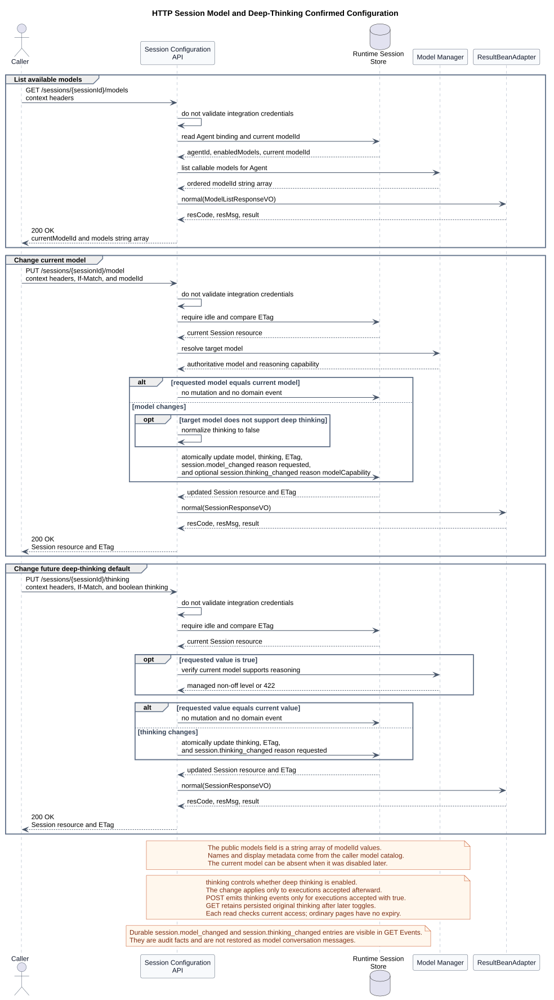

# CampusAgent Runtime HTTP API 设计

| 属性 | 值 |
|---|---|
| 文档版本 | 1.49.0 |
| 状态 | 保留十个目标 operation；Events 以 v2 已确认目标契约为准；原文件编号 12、13 保留已确认的 Builtin JSON 行为；Builtin 与 Skill Command 由用户统一负责设计、实现和集成 |
| 接口评审状态 | 原有 operation 与 Builtin 行为保持确认；共享 GET 轻量清单已确认；Skill POST 已按 B13/B14 对齐；Mate 公共命令独立管理 |
| 精确契约源 | [catalog.json](接口契约/catalog.json) 指定的八项保留契约与两项 Events v2 模型 |
| 人类评审契约 | [统一当前接口页](chat-api-review.html)，由 [唯一清单](接口契约/catalog.json) 生成 |
| 对外机器契约 | 不维护；结构化 JSON 只作为 HTML 生成源，不替代已废弃 OpenAPI |
| 端到端传输结论 | 两跳均为 HTTP；Runtime POST Events 保留请求级 SSE，POST Command 的 Builtin 返回 JSON、Skill 返回 SSE；公共命令待独立评审 |
| 设计仓分析基线 | `0eaa70ff365bf4d4e328b3473809341ca4cfc58d` |
| CampusClaw Slash 行为基线 | `c1311f69f504e7e799fa2467fd6a9d95b3f91b99` |
| CampusClaw 当前核对头 | `c9d858bc8261bf07f5585f545b53495bf2226a56` |
| pi-mono Slash 对比基线 | `4af9d21d3b4d664e4a29fcabfec85171077248e3` |
| pi-mono-java PR 167 基线 | `f60cc3e78bb8b700527ac082c7c8e10524ede095` |
| pi-mono-java PR 167 merge base | `d649866a6cae967ace18ceaeb9597edd47e5721e` |
| pi-mono-java 压缩修订前基线 | `a7f78fed345a289833970cd7b78399f0e8e51d32` |
| pi-mono-java PR 167 审查头 | `bf28e72f94f29acd316eb872a250893ed54e3632` |
| pi-mono-java PR 167 对齐实现 | `bd26e7f81bac8f68be0c3523efe23b51f96c52e4` |
| OpenCode 源码基线 | `849c2598abc7d2b40261e74b5826bc74ffc78308` |
| DeepSeek Harness 源码基线 | `141eb6fef83422698aef7a981029e843e8161534` |
| Codex Harness 源码基线 | `be33f80bc65159c094ecd06bf155afa3061ce23d` |
| pi-mono-java 字段命名核对基线 | `304eda06ff603fc9b6bbcaad0c296cc151a7defb`（`codex/runtime-http-contract-v137`） |
| pi-mono-java 凭据透传核对基线 | `320d790726a70aada6100052952d5494d2a378ac` |
| Anthropic TypeScript SDK 源码基线 | `64a1e8e285bbcc4cef2b15ebcadccd8e5f6987ff` |
| Anthropic Managed Agents 文档核对 | 2026-09-01；Session、Events、Skills 与 Session Operations 官方文档 |
| Agent Skills 规范核对 | 2026-09-01；名称、Skill 文件夹和 `SKILL.md` frontmatter 规则 |
| Builtin 实现分析基线 | `d84dd3d6a306b7587c70b29e0100e741dacef989` |
| Help 元数据专项源码基线 | `d8e22562e22ac41ef4bb5cc6b36b576139417bd9`；无参、空数组与缓存迁移已确认；1.48.0 去除 command 后保留三个业务字段，仍为 target-only |
| Command 响应复用源码基线 | `6f52fddc87a03c20916fc7b6ef1de87f6a7a8cf5`；既有 Session/Models 资源投影；源码路径与差距由 Builtin §8 维护 |
| Registry 初始候选 | `0bb794f222273e12fc24fe98d6ab4e9013ac8599` |
| Registry 最新前置 PR #210 | `9d0d76f4a571b559dc77ae52736caebbcc8fad88`，已通过 a8192e047f4061bd385297d3dc6c4358362d0d49 合并；最新差距见通用模块证据表 |
| GET 候选实现 | `7759481a1722422395d46564129827c6ee6df204`，未发布，不能作为已上线契约 |
| 更新日期 | 2026-09-08 |

本轮退役独立 `/abort`、`/steers`、`/follow-ups`，清单见 [总览 §4](README.md#4-当前目标-http-接口清单)。
[合并 POST](chat-api-review.html#submitSessionEvent) 与 [历史查询](chat-api-review.html#listSessionEvents) 采用 v2，目标契约已定稿、待实现。
旧 POST/GET 字段、类型和分页示例已移除，仅可从 Git 历史追溯。管理规则见 [统一维护规则](chat-api-index.md)。
[FollowUp 未来设计](chat-follow-up-future-design.md) 只记录扩展方向，本期不支持排队。
本次源码基线 dfb90cac4e233e09a0b8f047f7e9f4682f5ad238，路径及差异见该专题；不改实现。

## 1. 结论

当前已实现资源模型以 Session、Entry、Event 和 Model 为边界；一次用户输入触发的
执行不是调用方可见的一等 Run 资源。
调用方通过 Session Event 提交输入，通过同一 POST 的 SSE 观察实时过程，并通过
同一路径的 GET 分页读取持久化 Entry。

当前目标保留十个 operation，其中两个用于 Slash Command：查看命令清单和执行命令。
普通消息接口不解析 Slash 文本。交互层命中命令清单后，才调用 Command API。
用户统一实现七个 Builtin（help、status、name、model、thinking、compact、skills）与 Skill Command。
Extension 和 Prompt 执行不在当前命令目标范围。
Builtin POST 在 Handler 完成后返回普通 ResultBean JSON。
`/name` 归 CampusClaw Session；mate-service 只保存 Chat→Session 映射。

调用方仍是 `mate-service` Runtime bridge 或明确获授权的内部服务端 SDK。
浏览器不直连 Runtime；公共 `chat_id` 仍由 mate-service 映射为内部
`sessionId`。Runtime POST Events 对附件只接受 `fileIds`，当前实现不解析或下载文件内容，
而是把 ID 按固定 `[File IDs]` 提示块附加到用户消息。

普通消息端到端传输采用两跳 HTTP+SSE；Runtime Command 的 Builtin 使用 JSON、Skill 使用 SSE：浏览器先调用 mate-service 公共 HTTP，
mate-service 再调用本文定义的 CampusClaw 内部 HTTP。公共边界独立认证；CampusClaw
全部 operation 携带调用上下文 Header，但 Runtime 不执行凭据认证，并在内部事件进入公共边界前完成安全投影。
mate-service 不得把内部 SSE 字节透明转发给浏览器。公共 mate-service 的路径、VO、
错误码和事件投影尚未逐项评审；本文不能被当作浏览器直连契约。

## 2. 接口分组

基础路径为 `/campusclaw-service/v1`。网关 Host 可按部署环境配置，
不属于业务路径的版本契约。
精确字段、认证、请求、响应和错误按 [catalog.json](接口契约/catalog.json) 指定的唯一模型维护；
[统一接口页](chat-api-review.html) 是唯一当前入口。八项保留契约与两项 Events v2 使用同一清单、
生成和校验门禁，不再生成平行详情页。本文保留设计理由，Events 理由链接所属专题。
过渡期 OpenAPI 1.7.1 因长期滞后且仍包含已经被替代的旧 Run 资源，已经由用户
明确批准废弃并从仓库删除。当前不发布 OpenAPI 等标准机器契约；仓库内 JSON 只是
HTML 的规范化生成源。实现和后续评审依据生成后的 HTML、对应 JSON model 与本文
设计理由。若未来需要重新提供标准机器契约，必须从当前 JSON 源生成并建立同步门禁，
不得从 Git 历史恢复旧 YAML 后继续修改。

CampusClaw 当前目标契约的命名边界为：

| 位置 | 命名规则 |
|---|---|
| Path、Query、JSON 请求、普通 JSON 响应、SSE `data` | 字段统一使用 lowerCamelCase，例如 `sessionId`、`eventId`、`nextPage` |
| HTTP Header | 保持标准或公司既有原名，例如 `X-HW-ID`、`Authorization`、`X-HW-APPKEY`、`access-token`、`If-Match`、`Accept-Language`、`Content-Language` |
| 字段值 | 事件类型值、错误码、`tool_call` 等枚举值和类型化 ID 值保持不变 |
| 内部实现与源码证据 | SQL 列名、既有源码符号和外部参考契约保留其原生拼写，并明确标注为非当前 wire field |

新契约不接收 snake_case 字段别名；否则同一语义会出现双写、未知字段处理和签名输入不一致。

内部十项 operation 全部携带调用上下文 Header：

| Operation | Header 示例 | Claw 处理 | Claw 错误 |
|---|---|---|---|
| 全部十项 operation | JWT：`X-HW-ID: credential-jwt`、`Authorization: Bearer opaque-token`；APPKEY：`X-HW-ID: credential-appkey`、`X-HW-APPKEY: opaque-appkey` | `X-HW-ID` 是用户凭据 ID，不是公司、服务或应用标识；Claw 不解析或校验这些凭据 | 不声明 `UNAUTHENTICATED` / `AUTH_CREDENTIAL_CONFLICT` |
| `POST /sessions/{sessionId}/events` 和 `POST /sessions/{sessionId}/command` | 上述 JWT 或 APPKEY 示例均额外必填 `access-token: opaque-access-token` | 从请求读取四项凭据，只在内存中保留到本次 Agent 执行或命令处理结束；仅随实际 Mate tool execute 发送 | 不新增 Claw 本地凭据校验错误 |

JWT 是默认调用示例，APPKEY 是兼容示例；两类 Header 同时出现不会被 Runtime 拒绝。
示例值来自当前源码测试，均为非生产固定文本，不是真实凭据。
早期 Java 的全路径认证拦截器与此目标契约不同；当前核对头 `c9d858bc` 已移除该拦截器，
也没有把相同校验搬入 Controller。凭据真实性与动作授权由上游完成。

### 2.1 Session 生命周期

| 接口简称 | operationKey | Method | Path | 语义 |
|---|---|---|---|---|
| 创建会话 | `createSession` | `POST` | `/agents/{agentId}/sessions` | 根据 Agent 创建 Session，由 CampusClaw 分配 `sessionId` |
| 查询会话 | `getSession` | `GET` | `/sessions/{sessionId}` | 读取 Session 当前配置和 `idle/running` 粗粒度状态 |
| 删除会话 | `deleteSession` | `DELETE` | `/sessions/{sessionId}` | 逻辑删除 Session，使其对 API 立即不可见，并异步清理 Runtime 数据 |

HTTP 没有 `connect(mode=resume)`。每个请求独立定位 Session并携带上游调用上下文；
Runtime 不重复认证。网络恢复只需
重新读取 Session 或持久化 Session Events。`POST /agents/{agentId}/sessions`
不包含 Request Body，不接受调用方指定的 `sessionId` 或
`modelId`。`agentId` 是创建后不可变的 Agent 绑定；
`sessionId` 由 CampusClaw 生成，`modelId` 由 Agent 目录的
`defaultModel` 决定。创建后的模型切换必须显式调用
`PUT /sessions/{sessionId}/model`；删除后的 `sessionId`
永久禁止复用。

`agentId` 与 mate-service/Java 中的 `agentId` 是同一个逻辑标识；Agent、Tool、
Skill、Session 的精确正则只在 [`接口契约/common.json`](接口契约/common.json) 定义。类型前缀为小写，
前缀与 UUID 之间只有一个 `-`，32 位十六进制 UUID 载荷不保留
内部连字符。调用方和 Runtime 均不得构造下划线前缀的旧 ID 别名。
`sessionId` 固定为 `session-` 加去掉连字符的 32 位十六进制 UUID；本次不改变
`modelId` 或 `fileId` 的现有格式。创建 Session 与其他 operation 一样携带调用上下文
Header，但 Runtime 不校验其组合或格式。

创建成功前，Runtime 必须完成以下初始化：

1. Controller 接收上游调用上下文 Header，不执行凭据组合、互斥、格式或真实性检查；
   Service 按共享契约中的 Agent ID 正则验证 PATH 中的 `agentId`；
2. 在受控根目录中解析 `agent/{agentId}/.campusclaw/`，拒绝路径或符号链接越界；
3. 读取 `agent/{agentId}/.campusclaw/settings.json` 的 `defaultModel` 与 `enabledModels`；
4. 验证 `enabledModels` 非空、无重复且包含 `defaultModel`；
5. 调用 `resolveModel(agentId, defaultModel)` 获得有效模型 descriptor；
6. 在所有外部配置校验通过后生成全局唯一、删除后不复用且匹配
   `^session-[0-9a-fA-F]{32}$` 的 `sessionId`；
7. 保存 Session；首次执行时加载 `SYSTEM.md` 和 Skills，只注册 `read` 工具，
   并创建独立 `AgentSession + Agent`；
8. 由 `ResultBeanAdapter` 包装 SessionResource，返回 `201 Created`、
   `Location` 和 ResultBean。公司工程以 Bean 替换适配器后，在适配器内部调用
   真实 `ResultBeanFactory.getFactory().normal(sessionResponseVO)`。

初始化只组装运行对象，不调用大模型、不消耗 token，也不创建 MessageEntry；
因此创建响应中 `state=idle`。目标契约固定以 `thinking=true` 启用后续
用户消息的深度思考，且不把该默认值写入 Managed `settings.json`。
任一步在 SessionRecord 提交前失败都不
暴露 `sessionId`，并丢弃未持久化的内存 Session。

HTTP V1 对同一目录中的文件契约仍固定为 `settings.json`、`SYSTEM.md` 和
`skills/`。本次只将目录位置统一为 `.campusclaw`，不将 CLI 物化文件
`setting.json` 和 `systemPrompt.md` 当作 HTTP 同义文件。如果部署同时使用两个入口，
Manager 必须确保 HTTP 所需文件完整，不得让 HTTP 读取 CLI 物化过程中的半成品。

`settings.json` 是受控 Agent 目录配置，Model Manager 仍是模型绑定、启用状态和
调用的最终权威。目录缺少有效默认模型时返回 HTTP `422`，
响应体 `resCode=AGENT_MODEL_NOT_CONFIGURED`；Model Manager 暂时不可用时
返回 HTTP `503`，响应体 `resCode=MANAGER_UNAVAILABLE`。

已确认的第一个接口使用 `SessionCreateResponseVO`，其字段不因后续
GetSession 评审而隐式扩张。完整参数、成功响应与错误示例只维护在
[`01-create-session.json`](接口契约/操作/01-create-session.json)，并由
HTML 主契约展示。

`agent_version` 和内部 record revision 只在 CampusClaw 持久化，不进入
创建响应。创建操作不要求 `Idempotency-Key` 或 `If-Match`；
每次成功 `POST` 都创建新 Session。如果持久化已成功但响应在网络中
丢失，无条件重试会再创建一个 Session；未被 mate-service 绑定的
孤立 Session 由后台超时清理。其他副作用接口的幂等或并发规则属于
各自 operation，不由创建 Session 接口继承。

#### 2.1.1 第二个已确认接口：读取 Session

```http
GET /campusclaw-service/v1/sessions/{sessionId}
X-HW-ID: credential-jwt
Authorization: Bearer opaque-token
```

该接口按 `sessionId` 读取已经存在的 Session 当前资源，不创建或恢复
Session，不调用模型、不消耗 token，也不为了查询而实时调用 Model Manager。
它是 Session 控制面的只读入口，用于确认资源存在及访问权、读取当前默认配置和
`idle/running` 粗粒度状态。Session 当前是否正在处理用户事件只由 `state` 表达，
不返回独立执行资源或执行详情。

| 字段 | 类型 | 当前契约 |
|---|---|---|
| `sessionId` | string | `session-` 加去掉连字符的 32 位十六进制 UUID |
| `agentId` | string | 创建后不可变的 Agent 绑定 |
| `modelId` | string | Session 当前默认模型；允许后续切换 |
| `state` | `idle \| running` | 只回答 Session 当前是否存在 active execution |
| `thinking` | boolean | 是否对后续用户消息启用深度思考；既有已公开摘要保持历史可见，不随之后关闭而隐藏 |
| `displayName` | string or null | Session 显示名称；由 `/name` 查看或修改 |
| `lifetimeUsage` | Usage | Session 创建以来持久化 Assistant 与 Compaction Usage 的原子累计值 |
| `createdAt` | RFC 3339 timestamp | Session 创建时间 |
| `updatedAt` | RFC 3339 timestamp | Session 资源最后更新时间 |

精确字段表和响应示例由
[`02-get-session.json`](接口契约/操作/02-get-session.json) 维护；本文只记录
字段的资源边界和设计原因。

`Usage` 完整复用 CampusClaw 既有值对象：Token 字段为
`input/output/cacheRead/cacheWrite/totalTokens`；内嵌 USD `cost` 字段为
`input/output/cacheRead/cacheWrite/total`。`assistant.message.completed` 与
`session.compaction.completed` 各自保存本次 Usage，`lifetimeUsage` 只做同口径累计，
不得用字符数或估算 Token 替代模型返回值。


[PlantUML 源码：`http_get_session_response`](设计图/会话生命周期/diagram.puml#L93)

pi 的 `thinkingLevel` 表示多级推理强度，可取
`off | minimal | low | medium | high | xhigh | max`。CampusClaw 将该能力收窄为
boolean：`false` 映射为 `off`；`true` 使用当前模型和 Agent 配置的受管非 `off`
推理强度，不把具体等级开放给调用方。POST Events 按接受用户事件时的快照决定是否生成可公开的 thinking 摘要；GET Events 返回已保存的公开摘要，不因后续关闭开关而隐藏，也不返回私有推理。每页继续检查当前访问边界。

GetSession 使用 `displayName` 返回名称，但不返回 `name` 别名、`historySeq`、完整 `transcript`、
`queuedSteer`、`phase`、`attached` 或 `locked`。用户可见会话名称属于
mate-service 的 Chat 元数据；完成的 MessageEntry 由 GET Session Events API
分页返回；active Message、open content、工具和执行阶段通过发起请求的 SSE
实时观察；`attached` 是 pi 的连接相对状态，`locked` 是 pi live Runtime 的
进程内互斥状态，两者都不是可恢复的 Session 持久属性，因此不进入本接口。

| 读取需求 | 负责接口 |
|---|---|
| Session 当前默认 `modelId/thinking` 和 `idle/running` | `GET /sessions/{sessionId}` |
| 已提交完整事件、`eventId` 和普通整数分页 | `GET /sessions/{sessionId}/events` |
| 当前请求的实时消息与工具进度 | `POST /sessions/{sessionId}/events` 的 SSE 响应 |

读取成功返回 `ETag` 和 `Cache-Control: no-store`。已确认仅将 `ETag` 用于
后续 Model/Thinking 配置写入的 `If-Match` 并发控制，不给本 GET 增加
`If-None-Match/304` 分支。不存在和已删除的 Session 统一返回
`404 SESSION_NOT_FOUND`，避免泄露历史状态。

本小节和生成的 HTML 评审页中的第二个接口已经用户确认。

#### 2.1.2 第三个已确认接口：删除 Session

```http
DELETE /campusclaw-service/v1/sessions/{sessionId}
X-HW-ID: credential-jwt
Authorization: Bearer opaque-token
```

该接口不只是把 Session 从当前 Pod 的内存池中移除，而是结束
CampusClaw 对该 Runtime Session 的管理。删除本身已确认且已实现的语义是：存在 active
execution 时返回 `409 SESSION_BUSY`，不会隐式 abort。目标调用方先通过 POST Events 提交 user.interrupt 并确认实际停止，
再重试删除。idle 时服务端原子写入 tombstone 和可重试清理任务，然后返回
`204 No Content`。
从持久化成功开始，GetSession、提交用户事件和配置写入都不再能访问
该 Session；后台 Worker 完成物理清理，但不向调用方暴露删除任务
状态。因此 `204` 表示“逻辑删除已完成”，不表示所有存储介质上的
字节已经擦除。

| 契约点 | 已确认契约 | 设计原因 |
|---|---|---|
| Request Body | 无 | 删除目标由 URI 唯一确定 |
| 成功响应 | `204 No Content`，无 ResultBean | HTTP `204` 不允许业务响应体 |
| active execution | 返回 `409 SESSION_BUSY` | 删除不隐式改变执行；避免清理与模型、工具副作用竞态 |
| 不存在或已删除 | 统一返回 `204` | 保证网络重试幂等，不暴露 tombstone 状态 |
| 幂等与并发 Header | 不要求 `Idempotency-Key` 或 `If-Match` | URI 和持久化 tombstone 已提供幂等语义；删除不是配置修改 |
| Runtime 清理范围 | 持久化 Entry、内部执行状态和内存运行对象 | 避免已删除 Session 继续占用 Runtime 资源 |
| 最小保留 | tombstone 严格只包含数据库列 `session_id` 和 `deleted_at` | 禁止 Session ID 复用，并支持删除重试去重 |
| 不属于本接口 | mate-service Chat 名称/业务元数据、文件对象 | 它们不属于 Runtime Session 删除事务 |

逻辑删除与清理任务必须在同一持久化事务中提交。如果该事务失败，
返回 `500 SESSION_DELETE_FAILED`，Session 不得停留在部分删除状态。事务
提交后的内存释放或物理清理失败由持久化任务重试；已删除
Session 对公共 API 仍然不可见。

tombstone 字段集合已对齐：若落地为 `t_session_tombstone`，则该表永久记录
严格只有数据库列 `session_id` 和 `deleted_at`，不增加 `purged_at`、`cleanup_state`、
`owner_scope` 或 Session 业务快照。内部重试次数、租约、错误和清理进度属于
短期 `t_session_cleanup_task`，清理完成后删除任务记录。由于 tombstone 不保留
owner 信息。删除操作仍携带调用上下文 Header，但 Runtime 不执行认证；
对不存在或已删除资源的重复删除只依赖 URI 和持久化 tombstone 的幂等语义。

语法无效的 `sessionId` 返回
`400 INVALID_SESSION_ID`；运行中的 Session 返回 `409 SESSION_BUSY`。
异常响应只有 `resCode/resMsg`，不包含 `result`。


[PlantUML 源码：`http_delete_session`](设计图/会话生命周期/diagram.puml#L187)

本小节和生成的 HTML 评审页中的第三个接口已经用户确认。


[PlantUML 源码：`http_session_creation`](设计图/会话生命周期/diagram.puml#L1)

### 2.2 消息与 Session Event

原 v1 报文已作废，旧请求、SSE 类型及完整示例移除，仅从 Git 历史追溯。

- [POST 提交与推送](chat-api-review.html#submitSessionEvent)：[请求级 SSE 设计](chat-events-v2-stream-design.md)。
- [GET 历史查询](chat-api-review.html#listSessionEvents)：[普通分页与恢复设计](chat-events-v2-history-design.md)。

当前三类输入为 user.message、user.interrupt、user.tool_confirmation；请求级 SSE、
eventId、不公开内部序号、普通分页与 B01～B15 已确认，精确契约可进入实现。
旧 message/fileIds 报文、event/id 帧和错误规则不作为兼容别名保留。

#### 2.2.1 公共 Session 压缩能力（内部算法与已确认公共映射）

本节 `session.compaction.*` 为内部事件和历史实现符号；公共层只输出完整 `session.compacted`，不公开摘要、内部边界或 started/failed。具体映射见历史设计与统一契约。

压缩属于 `ManagedAgentSession`，不属于已删除的 TUI Host。默认配置沿用
`enabled=true`、`reserveTokens=16384`、`keepRecentTokens=20000`；`enabled=false` 同时关闭
阈值和溢出自动压缩。摘要瞬态重试默认开启、最多 3 次、基础退避 2000ms。手工压缩原因
`manual` 供 `/compact` Handler 使用。该命令通过通用 `POST /command` 执行，
不增加专用 Compact operation。

自动判定对齐 pi `agent-session.ts::_checkCompaction/_runAutoCompaction`、
`compaction.ts::estimateContextTokens/prepareCompaction/compact` 和
`overflow.ts::isContextOverflow/isRecoverableLength`：只接受当前 provider/model 且晚于最新
压缩边界的 Assistant。优先使用最后一条有效 Usage；不可用时估算后续消息，文本和 JSON
参数使用 `ceil(chars/4)`，image 按 4800 chars。只有 Token 严格大于
`contextWindow-reserveTokens` 才触发阈值压缩。

正常 `STOP` 但 Usage 已越界表示模型调用成功：压缩完整上下文后保留并返回该答案，绝不
重放。`ERROR`、`LENGTH`、显式 provider overflow 或可恢复 length 才从候选中排除失败
Assistant，压缩成功后重试一次；第二次仍溢出发 `session.compaction.failed`，不再压缩重试。
从数据库恢复出的未处理失败溢出在接受下一条 prompt 前先完成恢复压缩。

公共 Agent 在调用方没有显式覆盖时把当前 `model.maxTokens` 写入实际模型请求；可恢复
`LENGTH` 也使用该期望上限判定。因此目录上限大于 32000 的模型不会被 OpenAI provider
历史缺省值静默截断后误触发无效压缩重试。该约束同时校验 Agent 请求参数和压缩决策。

自动压缩先 prepare；没有安全可压缩窗口时静默跳过，不发送 started/failed。安全切点只允许
User 或 Assistant，ToolResult 不能成为第一条保留消息；单独超过 `keepRecentTokens` 的末条
Assistant 仍必须保留。同轮前缀单独摘要并与历史摘要合并 Usage/Cost；重复压缩更新旧摘要、
继承排序后的 `<read-files>`，并把 `firstKeptEntryId` 映射到当前上下文第一条保留消息。

摘要使用固定结构和 `<conversation>/<previous-summary>` 标签，包含 thinking 与 tool JSON
参数，单个 ToolResult 最多 2000 字符。请求不带工具、cache 为 none、使用新的 routing
session ID；历史和 turn-prefix 输出上限分别为 reserve 的 80% 和 50%，且不超过模型
maxTokens；只对瞬态摘要失败执行有界退避。摘要为空、包含 ToolCall、失败或取消时不发布
新上下文，已经持久化的历史 Entry 一律不删除。`FileOperationTracker` 只跟踪 PascalCase
`Read`；Bash/Edit/Write 均未装配，也不参与追踪。

只有 prepare 成功后才投影 `session.compaction.started`。`session.compaction.failed` 固定为
`reason/willRetry/aborted/message`，其中 `aborted=true` 只表示压缩或父执行被取消；它不持久化。
`session.compaction.completed` 保存完整摘要、边界、压缩前后 Token 和本次 Usage，并原子累计
Session lifetime Usage。`willRetry=true` 时，持久化 payload 还包含不公开的
`_discardedEntryId`：它精确标识已从在线重试上下文移除、但仍留在 append-only 历史中的
`ERROR/LENGTH` Assistant。恢复投影必须排除该 ID，再加入压缩后成功的重试 Assistant，保证
在线上下文与重载上下文一致；GET Events 和 SSE 均不得输出该内部字段。旧 Entry 缺少该字段
时，只允许回退识别压缩完成前最后一条可重试 Assistant。

### 2.3 持久化事件与恢复

以 [ListEvents v2](chat-events-v2-history-design.md) 为唯一依据：完整事件与 POST 同形，
按服务端返回顺序展示，用 eventId 去重；普通整数分页默认 50、最多 200，不返回 total。
旧不透明 page、entryId/entrySeq 和完整旧响应示例已移除。内部模型上下文恢复仍是独立投影。
配置、thinking、压缩与 Usage 已按 B05/B12 对齐；公共投影见统一契约，内部事件不直接透传。

### 2.4 模型与 Session 配置

| 接口简称 | operationKey | Method | Path | 语义 |
|---|---|---|---|---|
| 查询可用模型 | `listSessionModels` | `GET` | `/sessions/{sessionId}/models` | 列出 Agent 目录 allowlist 与 Runtime 当前可用模型交集中的 `modelId` |
| 切换会话模型 | `changeSessionModel` | `PUT` | `/sessions/{sessionId}/model` | 切换 Session 当前模型 |
| 设置深度思考 | `changeSessionThinking` | `PUT` | `/sessions/{sessionId}/thinking` | 开启或关闭 Session 深度思考 |

这三个 operation 已确认。模型列表使用 Session scope，而不是公开
`/agents/{agentId}/models`，避免调用方绕过 Session 绑定查询其他 Agent。两个 PUT
只允许在 Session `idle` 时执行，并要求 `If-Match` 携带最近一次 Session `ETag`：
缺失返回 `428 IF_MATCH_REQUIRED`，版本不一致返回
`412 SESSION_VERSION_MISMATCH`。相同值仍完成权限和可用性校验，随后按无变化成功
返回，`updatedAt` 和 `ETag` 保持不变。
这三项配置 operation 与其他接口一样携带 `X-HW-ID + Authorization` 或 APPKEY
兼容 Header；Runtime 不校验组合、共存、格式或真实性，也不返回本地认证 `401`。

#### 2.4.1 GET Session Models

`GET /sessions/{sessionId}/models` 实时读取 Model Manager，而不是返回创建 Session
时的固定快照。结果是 Agent `enabledModels` 与 Runtime 当前可用模型的交集，保持
Agent 配置中的稳定顺序，不分页。`models` 可以为空；Session 保存的
`currentModelId` 若在创建后被管理员停用，也允许暂时不在 `models` 中。

精确响应示例由
[`06-list-session-models.json`](接口契约/操作/06-list-session-models.json) 维护。

`models` 的类型是 `string[]`，数组元素直接是 `modelId`。只有当候选项需要增加
独立属性时才有理由改为对象数组；当前没有扩展字段，因此不保留无意义的对象层。
模型名称、供应商和能力等展示信息不属于当前 Session Runtime 接口，由 mate-service
自己的模型目录或 Model Manager 元数据接口解析。Model Manager 的 `baseUrl`、
凭据是否存在、价格、上下文窗口、最大输出 token、Headers 和供应商请求配置都不
进入契约。Model Manager 不可用复用第一个接口已经冻结的
`503 MANAGER_UNAVAILABLE`。

#### 2.4.2 PUT Session Model

`PUT /sessions/{sessionId}/model` 的请求只包含 `modelId`；精确请求和响应示例由
[`07-change-session-model.json`](接口契约/操作/07-change-session-model.json) 维护。

Runtime 必须实时确认目标模型仍属于上述可选集合；不存在、未绑定或调用方无权使用
统一返回 `422 MODEL_NOT_AVAILABLE`，不泄露模型目录。成功后只改变后续
`user.message` 使用的 Session 默认模型，不影响已完成消息，但原子追加持久化
`session.model_changed`，原因为 `requested`。响应复用完整 SessionResource，使调用方一次刷新 `modelId`、
`updatedAt` 和新 `ETag`：

若切换前 `thinking=true`，但目标模型不支持深度思考，Runtime 在同一原子配置变更
中将 `thinking` 归一为 `false`，而不是留下不可执行的 Session 配置。目标模型支持
深度思考时保持原值。能力归一化同时追加原因为 `modelCapability` 的
`session.thinking_changed`；两个领域事件与 Session 配置、资源版本在同一事务提交。

#### 2.4.3 PUT Session Thinking

`PUT /sessions/{sessionId}/thinking` 开启或关闭后续用户消息的深度思考，请求只包含
`thinking`；精确请求和响应示例由
[`08-change-session-thinking.json`](接口契约/操作/08-change-session-thinking.json) 维护。

`false` 映射为 pi 的 `off`；`true` 由 Runtime 映射到当前模型和 Agent 配置的受管
非 `off` 推理强度。调用方不选择 `minimal/low/medium/high/xhigh/max` 等具体等级。
当前模型不支持深度思考时，请求 `true` 返回 `422 THINKING_NOT_SUPPORTED`；请求
`false` 始终允许。变更只作用于之后接受的 `user.message` 是否生成 thinking 事件，
不会改变已开始执行的快照；后续关闭不隐藏既有公开摘要。GET 始终按保存值和当前访问边界读取。实际值改变时原子追加原因为
`requested` 的 `session.thinking_changed`；同值请求不追加事件。成功响应复用完整
SessionResource 和新 `ETag`。

两个 PUT 都不接收 `Idempotency-Key`。Session 正在执行时返回
`409 SESSION_BUSY`，不会排队配置变更；成功写入必须将 Session 配置、内部配置记录
和资源版本原子提交。普通成功响应由 `ResultBeanAdapter.normal(...)` 包装；
公司替换 Bean 内部调用 `ResultBeanFactory.getFactory().normal(...)`。所有异常仍只包含
`resCode/resMsg`。

管理面 `refresh(agentId)` 成功只发布新目录，不改动 active execution 的模型、thinking
或工具快照。空闲 DB Session 在下一次 `POST Events` 接受消息前读取新目录；若当前模型
仍具备凭据则保持不变，失效时切换到具备凭据的新 default，并按
`session.model_changed(reason=agentRefresh)`、必要的
`session.thinking_changed(reason=modelCapability)`、`user.message` 顺序原子写入。配置校准记录只进入 GET 历史；本次 SSE 首个业务帧仍是 user.message，不能先发配置事件。
没有有效 default 时本次请求在 SSE 建立前失败，既不改变 Session，也不接受 User Entry。



[PlantUML 源码：`http_session_model_configuration`](设计图/会话配置/diagram.puml#L1)

### 2.5 独立执行控制接口已退役

2026-09-07 用户确认移除三个独立控制接口，精确模型与活动评审入口均删除。
停止执行通过 user.interrupt 完成；调整方向为实际停止后新提交 user.message，不等同于 pi 原生 Steer。
本期不提供 FollowUp 队列，M1 未完成前拒绝 M2。旧 202 入队、Abort 204/no-op
及错误集合不继承到 Events；旧实现仅保留源码证据与版本历史，不再维护调用示例及控制图。

[FollowUp 未来设计](chat-follow-up-future-design.md) 已记录数据库交接方向，
但启用、公共字段、恢复与容量仍需另行评审，不增加当前接口。

### 2.6 Built-in Command（已确认，目标实现）

Builtin 与 Skill Command 由用户统一负责设计、实现和集成。
共享 GET 轻量清单、Builtin 普通 JSON，以及 B13/B14 的 Skill 请求、SSE 与恢复规则已确认；Mate 公共命令独立管理。本节只说明 HTTP 边界，不重复维护命令业务规则。

| 接口 | 精确模型 | 设计职责 |
|---|---|---|
| GET /sessions/{sessionId}/commands | [操作 12](接口契约/操作/12-list-session-commands.json) | [Slash 通用模块](../../04-命令与技能/00-Slash-Command通用模块/README.md#31-get-轻量清单已确认)维护描述符、排序、状态过滤、完整缓存与重新准入理由 |
| POST /sessions/{sessionId}/command | [操作 13](接口契约/操作/13-execute-session-command.json) | [Builtin 设计](../../04-命令与技能/01-内置命令/README.md)维护七个命令的业务、窄服务、事务和实施验收 |

Controller 只收发 VO，Application 完成授权、归一化、一次 Catalog 解析、准入、执行及 DTO→VO。
共享 GET 使用完整来源；内部 Builtin 专属解析才过滤来源。GET 不构成执行预约，
POST 重新解析，并在所属锁或事务内检查可变状态；共同结构只在 Slash 全局主图维护。


[PlantUML 源码：`command_http_flow`](设计图/Command/diagram.puml#L1) · [原尺寸 SVG](设计图/Command/command_http_flow.svg)

#### 2.6.1 普通 JSON 与权威领域事件

Builtin Handler 完成后返回普通 ResultBean JSON，不建立命令 SSE。
请求、结果与错误由操作 13 维护；与既有 Session/Models 资源复用的映射及 ETag 规则统一见
[Builtin §8](../../04-命令与技能/01-内置命令/README.md#8-json-与错误)。
不产生通用命令生命周期或 Name 历史；这不改变 POST Events 的独立 SSE 契约。
所有成功结果移除 command、changed、sourceEventSeq；内部领域 Entry 不变。
不以新命令包装或 eventId 替代这些字段，Skill 分支复用 Events v2，详细行为见 [Skill 设计](../../04-命令与技能/02-技能命令/README.md)。

#### 2.6.2 Help：Agent 元数据使用指南

Help 通过普通 POST Command 提供无参 Agent 使用指南，不新增 HTTP 资源。
[Help 专题](../../04-命令与技能/01-内置命令/Help-Agent使用指南/README.md)唯一维护元数据映射、
缓存往返、读取/发布互斥、空内容处理、安全展示和实施验收。
其专项页面直接提取操作 13，不再复制 Header、参数或响应 JSON。
共享 GET 无完整缓存的 503 与 POST Help 的既有 422 属于不同操作，不能统一改写。

#### 2.6.3 Name 与配置更新

Name 的当前状态归属见 [Builtin §5](../../04-命令与技能/01-内置命令/README.md#5-name-当前状态)，
Model/Thinking 的事务和版本规则见 [Builtin §6](../../04-命令与技能/01-内置命令/README.md#6-model--thinking)。
Command 不削弱本文 §2.4 既有 PUT 的 If-Match/ETag 语义。


[PlantUML 源码：`command_authoritative_state`](设计图/Command/diagram.puml#L54)

#### 2.6.4 Compact 的执行生命周期

[Compact 生命周期](../../04-命令与技能/01-内置命令/README.md#7-compact-生命周期)维护空历史、
独立终态 Future、容量/Holder 清理和断线不取消规则；本文 §2.2.1 保留压缩算法与恢复边界。
user.interrupt 只绑定原 user.message.eventId。手工 Compact 没有该原消息，不伪造目标或扩大中断范围；正在手工压缩时仍按现有忙状态拒绝新消息。当前不新增 Compact 专用取消接口。

POST Command 的凭据只由请求范围对象保留；非 Compact 到 Handler 完成，
Compact 到 Active Holder 的本次压缩执行结束。仅实际 Mate tool execute 可以发送；
Spring 单例不保存原始凭据。共享安全约束见 §7，精确 Header 以操作 13 为准。

## 3. 两跳 HTTP 与消息 SSE 边界

| 边界 | 普通操作 | 实时执行 | 标识范围 | 当前评审状态 |
|---|---|---|---|---|
| 浏览器/UI → mate-service | 独立 HTTP 请求与响应 | 消息 SSE；公共命令协议需独立重审 | 公共 `chatId` | 旧公共命令 SSE 提案已废止，不推导新协议 |
| mate-service → CampusClaw | 本文十个 HTTP operation，Builtin Command 为 JSON | `POST /events` 与 Skill Command 输出请求级 SSE | 内部 `sessionId` | 操作 12 为共享轻量清单；13 的 Builtin JSON 与 Skill SSE 已确认 |

两跳不是同一条物理连接，也不是一份字节透明协议。mate-service 需要终止公共认证、
解析内部事件、移除 Runtime 私有字段、映射安全错误并重新编码公共 SSE。内部
`sessionId`、凭据、Provider 配置和工具私有数据不得越过公共边界。

全部内部调用都携带调用上下文 Header；`Accept-Language`、`If-Match` 等各 operation
已声明的普通 Header 保持各自语义。CampusClaw 不校验凭据组合、共存、格式或真实性。

当前每次 user.message、user.interrupt 或 user.tool_confirmation 使用新的 POST Events，
各响应按 v2 规则接收本次回执与对应输出。原消息与中断响应各自绑定，不复制输出
或借断连取消执行。三个独立控制接口已退役；命令仍按独立契约处理。

## 4. 状态、并发与恢复

本节以 Events v2 的已确认决定为准；旧分页与公共序号规则不再维护。
当前准入和退役决定优先适用：

- 每个 Session 同一时刻只允许一个 active execution。第二个并发初始
  `user.message` 返回 `409 SESSION_BUSY`，不接受队列追加；中断与工具确认按 v2 控制条件接受。
- 用户 MessageEntry 持久化并开始执行后，不依赖发起 HTTP 连接继续存活；连接关闭
  不等于 interrupt。
- 直接流式 POST 不使用浏览器 `EventSource` 自动重连，也不接受
  `Last-Event-ID` 来重放副作用请求。
- 客户端断线后从 GET `/events` 第一页重新读取，并按 `eventId` 去重；只恢复
  持久化 Entry，不恢复 started/delta 等实时预览。
- 本接口不使用 `Idempotency-Key`。响应结果不确定时禁止无条件重试，避免重复
  User MessageEntry。
- `Session.state` 只表达 `idle/running` 粗粒度状态。模型请求、工具执行或消息生成
  阶段通过实时事件表达，不新增公共 Run phase。
- 本期无后续消息队列；user.interrupt 响应断开不撤销已接受的中断。
- 内部顺序只用于持久化与查询，不公开 entryId/entrySeq；GET 使用普通整数 page/nextPage。
- Pod 重启时如何终止或恢复 active execution、是否持久化 partial Assistant Entry，
  不属于当前十个 HTTP operation 已确认范围，留待执行恢复实现设计。

## 5. ResultBean、HTTP 状态与国际化

公司内部普通 JSON 接口的成功响应使用
`resCode/resMsg/result` 三字段 ResultBean，异常响应只包含
`resCode/resMsg`，不使用 RFC 9457 `application/problem+json`。这是相对原 HTTP
草案的公司集成约束。八项保留既有契约，两个 Events 操作采用已确认 v2 目标契约。所有普通 JSON 响应都
遵守同一包装，SSE 事件流和 HTTP
`204` 无响应体不使用 ResultBean。

| 字段 | 成功 | 异常 | 调用方规则 |
|---|---|---|---|
| `resCode` | 固定字符串 `0` | 稳定大写 snake_case 错误码 | 只根据此字段分支，不解析 `resMsg` |
| `resMsg` | 固定 `success` | 按 Locale 解析的人类可读文本 | 只用于展示和日志 |
| `result` | operation 对应 Response VO | 不出现 | 仅成功响应读取 |

ResultBean 只包装响应体，不把所有异常降级为 HTTP `200`。
HTTP status 仍表达传输和粗粒度失败类别，`resCode` 表达稳定业务
语义。例如：

```json
{
  "resCode": "AGENT_MODEL_NOT_CONFIGURED",
  "resMsg": "该 Agent 未配置有效的默认模型。"
}
```

第一个接口冻结的错误码、HTTP status 和中英文消息如下。
错误码枚举名、MessageSource key 和 `resCode` 必须完全一致：

| HTTP | `resCode` | `zh_CN` | `en_US` |
|---|---|---|---|
| `400` | `INVALID_AGENT_ID` | `agentId 格式不正确。` | `The agentId format is invalid.` |
| `404` | `AGENT_NOT_FOUND` | `指定的 Agent 不存在。` | `The specified Agent does not exist.` |
| `422` | `AGENT_NOT_AVAILABLE` | `指定的 Agent 当前不可用。` | `The specified Agent is currently unavailable.` |
| `422` | `AGENT_MODEL_NOT_CONFIGURED` | `该 Agent 未配置有效的默认模型。` | `The Agent has no valid default model configured.` |
| `500` | `SESSION_INITIALIZATION_FAILED` | `Session 初始化失败。` | `Session initialization failed.` |
| `503` | `MANAGER_UNAVAILABLE` | `Model Manager 暂时不可用，请稍后重试。` | `Model Manager is temporarily unavailable. Try again later.` |

第二个 GetSession 接口已确认使用 `INVALID_SESSION_ID` 和 `SESSION_NOT_FOUND`；
仍保持异常体只有
`resCode/resMsg`。这些 operation-specific 错误已随第二个接口确认而冻结。

第三个 DeleteSession 接口已确认：成功返回无响应体的 `204`；失败使用
`INVALID_SESSION_ID`、`SESSION_BUSY` 和 `SESSION_DELETE_FAILED`。
不存在、删除中或已删除按已确认语义统一返回 `204`，因此不新增
`SESSION_NOT_FOUND`。以下错误码和消息已经冻结：

| HTTP | `resCode` | `zh_CN` | `en_US` |
|---|---|---|---|
| `400` | `INVALID_SESSION_ID` | `sessionId 格式不正确。` | `The sessionId format is invalid.` |
| `409` | `SESSION_BUSY` | `该 Session 正在处理另一条用户消息。` | `The Session is processing another user message.` |
| `500` | `SESSION_DELETE_FAILED` | `Session 删除失败。` | `Session deletion failed.` |

Events v2 的成功、错误及确认范围以 [POST](chat-events-v2-stream-design.md) 和
[GET](chat-events-v2-history-design.md) 为准。旧错误表及 stream.error 规则已移除，
不能将旧版“已确认”自动继承为 v2 整体通过。

三个 Session 配置接口复用 Session 标识和不存在错误，并新增以下
operation-specific 错误。`MODEL_NOT_AVAILABLE` 有意合并不存在、未绑定和无权使用，
避免模型目录枚举：

| HTTP | `resCode` | 适用 operation | 语义 |
|---|---|---|---|
| `400` | `INVALID_MODEL_REQUEST` | PUT Model | 请求体缺失、格式错误或含未知字段 |
| `400` | `INVALID_THINKING_REQUEST` | PUT Thinking | 请求体缺失、`thinking` 不是 boolean 或含未知字段 |
| `409` | `SESSION_BUSY` | 两个 PUT | active execution 存在，配置变更不排队 |
| `412` | `SESSION_VERSION_MISMATCH` | 两个 PUT | `If-Match` 与当前 ETag 不一致 |
| `422` | `MODEL_NOT_AVAILABLE` | PUT Model | 目标模型不在实时可选集合中 |
| `422` | `THINKING_NOT_SUPPORTED` | PUT Thinking | 请求开启深度思考，但当前模型不支持 |
| `428` | `IF_MATCH_REQUIRED` | 两个 PUT | 缺少必填 `If-Match` |
| `500` | `SESSION_MODEL_UPDATE_FAILED` | PUT Model | 模型配置和资源版本未能原子更新 |
| `500` | `SESSION_THINKING_UPDATE_FAILED` | PUT Thinking | 深度思考配置和资源版本未能原子更新 |
| `503` | `MANAGER_UNAVAILABLE` | GET Models、PUT Model | Model Manager 暂时不可用；复用第一个接口错误码 |

原三个独立控制接口的错误集合随接口退役；中断错误、超时和竞争结果以 v2 继续评审，
不将原 Abort 的 idle 204 规则复制给 user.interrupt。

Locale 从 `Accept-Language` 解析，第一版只支持 `zh-CN` 和
`en-US`；缺失、不支持或资源 key 缺失时回退 `en-US`，禁止使用
JVM 系统 Locale。响应返回 `Content-Language`，其值为实际使用的
`en-US` 或 `zh-CN`。Service 异常只携带错误码和有界参数；
`@RestControllerAdvice` 负责 Locale 解析、消息格式化、HTTP status
和 ResultBean 异常响应。

异常响应不得包含凭据、内部 Header、私有 claim、Prompt、原始 thinking、
OBS 地址、Bucket、预签名 URL 或内部堆栈。`503` 的重试建议通过
标准 `Retry-After` Header 传递，不向 ResultBean 增加私有字段。

## 6. Java 开发体验与内部制品替换

### 6.1 代码边界

Controller 接收和返回 VO，Service 返回未包装的 Response VO；
ResultBean 不进入 Service、Runtime Store 或 Manager Adapter。
实现基线中的 Controller 代码形状为：

```java
var view = sessionService.create(agentId);
return ResponseEntity.created(location)
        .body(resultBeanAdapter.normal(view.resource()));
```

这是实现提交 `8691e880` 的已观察代码形状。`ResultBeanAdapter` 是稳定的
Controller 边界，独立仓由 `StandaloneResultBeanAdapter` 生成已确认 JSON；
公司工程提供替换 Bean，在 Bean 内调用真实
`ResultBeanFactory.getFactory().normal(result)`。当前没有公司制品 Maven 坐标、
完整包名或方法签名证据，因此不在设计中伪造依赖。

### 6.2 公司 Bean 替换模式

为了同时满足公司外可构建和公司内直接拉取，使用 Spring Bean 替换，而不是
在开源仓伪造与公司类同名的 FQCN：

| 环境 | ResultBean 来源 | 使用场景 |
|---|---|---|
| 独立仓 | `StandaloneResultBeanAdapter` | GitHub、本地和无内网 CI |
| 公司工程 | 公司自定义 `ResultBeanAdapter` Bean | Maven 从内部仓库解析真实制品，适配器内部使用公司 Factory |

公司内部仓库 URL、server ID 和凭据只位于公司管理的 `settings.xml`，不写入
Git。Controller 和 Service 不需要知道公司类的 FQCN；替换发生在依赖注入边界，
因而不存在两个同名兼容制品同时进入 classpath 的风险。


[PlantUML 源码：`http_result_bean_compatibility`](设计图/HTTP契约/diagram.puml#L1)

### 6.3 错误与国际化实现

Java 使用 `RuntimeErrorCode` 枚举保存稳定错误码，
`RuntimeApiException` 只保存 error code 和消息参数。
`RuntimeApiExceptionHandler` 使用 Spring `MessageSource` 和已固定的
Locale 规则解析 `resMsg`，再调用公司制品实际支持的异常包装
API。由于目前只已知成功调用形状 `normal(...)`，设计不猜测
内部 Factory 的异常方法名；获得内部 jar 后再固定该适配。

资源文件包含默认英文 `messages.properties` 和
中文 `messages_zh_CN.properties`。两份资源必须具有完全相同的 key 集合。
启动测试和 CI 对枚举、`en_US`、`zh_CN` 执行集合等值校验；
契约测试分别在 `standalone` 和 `company` profile 下断言：

1. `normal(result)` 的 JSON 精确为 `resCode/resMsg/result`；
2. null、空集合、时间和嵌套 VO 的 Jackson 行为一致；
3. 中英文 Locale、回退语言和 `Content-Language` 一致；
4. 全部已定义错误码的 HTTP status、`resCode`、`resMsg` 一致，
   且响应均不包含 `result` 字段；
5. 公司 profile 的依赖树不包含兼容制品，standalone profile
   的依赖树不包含内部制品。

如果公司合规规则不允许兼容制品使用内部 FQCN，必须改用
CampusClaw 自有 Facade + 内部 Adapter；这时可保持相同 JSON 和开发
体验，但不能同时承诺业务源码 import 与内部类完全相同。

## 7. 安全与附件边界

- 全部十项 operation 均携带共享调用上下文 Header 示例：JWT 使用
  `X-HW-ID: credential-jwt` 与 `Authorization: Bearer opaque-token`；APPKEY 使用
  `X-HW-ID: credential-appkey` 与 `X-HW-APPKEY: opaque-appkey`。这些是非生产示例值。
- `X-HW-ID` 表示用户凭据 ID，不是公司、服务或应用标识。
- `POST /sessions/{sessionId}/events` 和 `POST /sessions/{sessionId}/command` 额外必填
  `access-token`；该 Header 不成为其他八个 operation 的共享 Header。
- 目标实现移除进入 Controller 前的认证拦截，也不在 Controller 内调用
  `RuntimeRequestAuthenticator`。Runtime 不检查 Header 是否齐全、是否同时存在、Bearer
  形状或凭据真实性，不声明 `UNAUTHENTICATED` / `AUTH_CREDENTIAL_CONFLICT`。
- JWT/APPKEY 真实性与动作授权由上游完成。两种凭据 Header 可以同时透传；Runtime 不据此
  分支、拒绝、降级或建立 Session owner。
- POST Events 或 POST Command 从请求读取四项 Header，只在内存中保留到本次 Agent
  执行或命令处理结束；仅实际 Mate tool execute 可以读取并原名发送已提供值，工具发现、
  模型和其他请求不得读取。
- Header 值不记日志、不写 ResultBean、不进入 Session、Prompt 或 Event；`sessionId` 不是凭据。
- Runtime 仍对每个请求校验适用的 Session、Agent、Model、ETag 和业务状态；这些是资源与
  业务契约检查，不是凭据认证。
- `agentId`、`sessionId`、`modelId` 和 `fileId` 均大小写敏感且不透明。
- Agent、Tool、Skill 和 Session 标识必须匹配 [`接口契约/common.json`](接口契约/common.json)
  中各自唯一的类型化资源 ID 正则；不接受无前缀、
  错误类型前缀、带内部连字符的 UUID 或下划线旧格式。
- POST Events 的三输入联合请求、文件引用与禁止字段以 v2 精确模型为准，不再使用原 message/fileIds 报文。
- 该 POST 不接收 `Idempotency-Key`，网络结果不确定时调用方必须先读取
  Session 和持久化 Events，禁止把无条件重试描述为安全行为。
- Runtime 不调用文件服务或 OBS；它只把有序 `fileIds` 编码成固定
  `[File IDs]` 文本块并加入本次用户提示。
- AI Provider 的 thinking 只在执行快照 `thinking=true` 时投影为 started/delta/completed，
  其中 completed 持久化。GET Events 根据查询时 Session 当前 thinking 值决定是否返回；
  v2 可见性与配置事件映射待联动评审；普通整数分页不继承旧 page 失效规则。


[PlantUML 源码：`http_dual_authentication`](设计图/HTTP契约/diagram.puml#L61)

## 8. 历次源码证据与差异分类（非当前接口清单）

本节按各行固定 commit 保留迁移证据，旧类型和字段不是当前调用契约。
入口整理不重新评审运行时语义；主分支边界核对见 [统一维护规则](chat-api-index.md#4-源码边界)。

本设计以 pi-mono 和 pi-mono-java 源码行为为实现证据；共享 JSON 契约、生成的 HTML
评审页与本文是当前 Runtime HTTP 规范来源。已删除的 WebSocket、AsyncAPI
和 OpenAPI 只能作为 Git 历史，不能作为实现输入。本轮 HTTP 认证、事件和 Session
配置设计核对 pi-mono-java PR 167 基线
`f60cc3e78bb8b700527ac082c7c8e10524ede095` 及 merge base
`d649866a6cae967ace18ceaeb9597edd47e5721e`。Slash Command 新契约额外核对 CampusClaw
`c1311f69f504e7e799fa2467fd6a9d95b3f91b99`（命令与 Runtime Session 行为）和当前头
`c9d858bc8261bf07f5585f545b53495bf2226a56`；本轮 Header 示例和处理说明也核对该当前头的
`RuntimeRequestContext`、`MateCredentials`、`HttpMateToolClient` 及 Runtime 路由测试，
并对比 pi、OpenCode、DeepSeek Harness、
Codex Harness、2026-09-01 的 Anthropic Managed Agents 官方文档和 Agent Skills 规范。

| 分类 | 证据或决策 |
|---|---|
| Command / Help / Skill 证据 | 统一引用 [Slash 源码证据](../../04-命令与技能/00-Slash-Command通用模块/README.md#2-源码证据与差距)、[GET 最新核对](../../04-命令与技能/00-Slash-Command通用模块/README.md#32-本次源码核对与实施验收)与 [Help 专项证据](../../04-命令与技能/01-内置命令/Help-Agent使用指南/README.md#5-源码证据与设计理由)，不另复制旧 Registry 和元数据差距。 |
| 观察到的行为 | PR 167 在 `f60cc3e` 删除 `modules/coding-agent-cli/.../command/` 中 Slash Registry、`ModelCommand`、`ThinkingCommand`、`CompactCommand`、`NameCommand`，同时删除 `.../compaction/Compactor`、`FileOperationTracker` 与旧大型 `AgentSession`；该删除按包边界发生，未先迁移入口无关能力 |
| 观察到的行为 | PR 167 新增 `modules/coding-agent-cli/.../session/ManagedAgentSession.java` 和 `AgentSessionFactory.java`，但基线 Session 只持有 Runtime、入口、Agent 和工具，不包含阈值/溢出压缩、Usage 累计或 Host 无关 Slash 操作端口 |
| 观察到的行为 | pi-mono `packages/coding-agent/src/core/agent-session.ts` 基线 `5cd93f6` 中的 `compact()`、`autoCompact()`、`setModel()`、`setThinkingLevel()` 与 Session Entry 写入证明压缩及配置变更是 Agent Session 能力，不依赖终端绘制组件 |
| 观察到的行为 | pi-mono-java `a7f78fed` 已恢复超大末条消息保留，但 `ManagedAgentSession`、`SessionCompactor` 和 `ContextOverflowDetector` 尚未完整实现 pi 的成功 STOP 不重试、Usage/失效边界、recoverable length、split-turn、重复摘要、结构化请求和瞬态摘要重试 |
| 观察到的行为 | pi-mono-java `bf28e72f` 已从在线压缩候选移除可重试 `LENGTH`，但 `RuntimeEntryCodec.effectiveContextEntries` 仅按 `firstKeptEntryId` 恢复，重载会重新注入该响应；`Agent.buildStreamOptions` 也未把模型上限传给公共请求，两个 OpenAI provider 的 32000 缺省值可能与 recoverable length 判定不一致 |
| 已实现架构改造 | pi-mono-java `bd26e7f8` 在 compaction payload 内保存 `_discardedEntryId`，恢复时按 ID 排除且公共投影过滤；公共 Agent 无覆盖时显式请求 `model.maxTokens`，并由 completed → retry → reload 与大输出模型测试锁定 |
| 观察到的行为 | pi-mono `packages/coding-agent/src/core/agent-session.ts::_checkCompaction/_runAutoCompaction`、`core/compaction/compaction.ts::estimateContextTokens/findCutPoint/prepareCompaction/compact` 与 `packages/ai/src/utils/overflow.ts` 基线 `5cd93f6` 明确区分三类自动压缩，并固定安全切点、摘要选项和单次溢出恢复 |
| 观察到的行为 | `modules/coding-agent-cli/src/main/java/com/campusclaw/codingagent/mode/server/ServerMode.java` 基线 285-307：当前使用 WebSocket Upgrade，其余请求交给 RouterFunctions Adapter |
| 观察到的行为 | `modules/coding-agent-cli/src/main/java/com/campusclaw/codingagent/mode/server/ChatWebSocketHandler.java` 基线 115-227、422-459：v1 命令、断线生命周期和累计消息更新 |
| 观察到的行为 | `modules/ai/src/main/java/com/campusclaw/ai/stream/AssistantMessageEvent.java` 基线 44-164：结构化 provider 流事件 |
| 观察到的行为 | `modules/coding-agent-cli/src/main/java/com/campusclaw/codingagent/mode/server/ServerMode.java` 基线 237-307、340-344：当前 HTTP 路由未安装入站认证 Adapter，CORS 仅放行 Authorization Header |
| 观察到的行为 | `modules/agent-core/src/main/java/com/campusclaw/agent/subagent/a2a/A2aAgentBackend.java` 基线 40-62、226-238：出站 A2A 请求已使用 `X-HW-ID + X-HW-APPKEY`，但它不是入站验证实现 |
| 观察到的行为 | pi-mono `packages/protocol/src/schemas.ts` 基线 38-45、241-258：协议 `SessionSnapshot` 顶层包含 `phase`、`thinkingLevel`、完整 `transcript`、连接相对 `attached` 和 live Runtime `locked` |
| 观察到的行为 | pi-mono `packages/protocol/src/schemas.ts` 基线 26-35：`ThinkingLevel` 取 `off/minimal/low/medium/high/xhigh/max`，表达推理强度 |
| 观察到的行为 | pi-mono `packages/coding-agent/src/core/agent-session.ts` 基线 1586-1600、1684-1730：`setModel` 校验模型凭据、持久化模型变更并按新模型能力收敛 `thinkingLevel`；`setThinkingLevel` 将请求推理强度限制到模型支持范围并持久化变更 |
| 观察到的行为 | pi-mono `packages/ai/src/types.ts` 基线 793-809 与 `packages/ai/src/models.ts` 基线 900-910：Model descriptor 包含 provider、reasoning、input、cost、contextWindow、maxTokens 等内部能力；支持的推理强度由 `off/minimal/low/medium/high/xhigh/max` 与模型映射共同决定 |
| 观察到的行为 | pi-mono-java `modules/coding-agent-cli/src/main/java/com/campusclaw/codingagent/mode/server/ChatWebSocketHandler.java` 基线 289-363：现有 WebSocket 命令支持 set model、list models 和 set thinking level；模型列表还暴露 contextWindow、maxTokens、cost 和 hasCredentials，thinking level 取 Java `ThinkingLevel` 推理强度 |
| 观察到的行为 | pi-mono-java `modules/ai/src/main/java/com/campusclaw/ai/types/Model.java` 基线 34-47 与 `ThinkingLevel.java` 基线 16-42：Java Model 同样包含 baseUrl、cost、headers、apiKey 等不适合公共 HTTP 的内部字段；Java 推理强度当前为 `off/minimal/low/medium/high/xhigh` |
| 观察到的行为 | Anthropic TypeScript SDK `src/resources/beta/sessions/sessions.ts` 基线 638-710：Managed Agents 的 Session 是控制面资源，包含 Agent 快照、环境/资源、预算/用量、标题/元数据和状态，但不内嵌 transcript 或 active Run 恢复快照 |
| 观察到的行为 | Anthropic [Session event stream](https://platform.claude.com/docs/en/managed-agents/events-and-streaming)：Managed Agents 的交互是事件驱动；`user.message` 启动或继续工作，事件在更早事件之后排队时 `processed_at=null`，中止通过 `user.interrupt` 表达 |
| 观察到的行为 | Anthropic [Send Events API](https://platform.claude.com/docs/en/api/cli/beta/sessions/events/send)：`POST /v1/sessions/{session_id}/events` 返回服务端已接收的事件及其 `event_id`，普通 Session 交互没有独立的 Session Run ID |
| 观察到的行为 | Anthropic [Start a session](https://platform.claude.com/docs/en/managed-agents/sessions) 与 [Session operations](https://platform.claude.com/docs/en/managed-agents/session-operations)：Session 维护跨多次交互的历史，事件驱动 `idle/running/rescheduling/terminated` 状态；`initial_events` 可让新 Session 直接进入 running |
| 观察到的行为 | Anthropic [Scheduled deployments](https://platform.claude.com/docs/en/managed-agents/scheduled-deployments)：Deployment Run 是 Deployment 触发的追加记录，只跟踪 Session 创建成功或失败；成功后通过 `session_id` 转到 Session Event Stream，不跟踪 Session 执行生命周期 |
| 观察到的行为 | pi-mono `packages/coding-agent/src/core/agent-session.ts` 基线 789-805：`AgentSession.dispose()` 中止重试、压缩、分支、bash 和 Agent 运行，断开扩展并释放内存资源；它未定义 HTTP 逻辑删除或持久化 tombstone |
| 观察到的行为 | pi-mono `packages/coding-agent/src/modes/interactive/components/session-selector.ts` 基线 598-630：交互模式删除直接将 Session JSONL 移入回收站，失败时回退为 unlink；这是本地文件行为，不是服务端删除事务 |
| 观察到的行为 | pi-mono-java `modules/coding-agent-cli/src/main/java/com/campusclaw/codingagent/mode/server/SessionPool.java` 基线 143-157、204-274：`remove()` 只从内存 Map 移除并关闭 `SessionManager`；JSONL 可在后续创建时恢复，闲置淘汰也只释放内存对象 |
| 观察到的行为 | pi-mono-java `modules/coding-agent-cli/src/main/java/com/campusclaw/codingagent/mode/server/ChatWebSocketHandler.java` 基线 168-210 与 `modules/agent-core/src/main/java/com/campusclaw/agent/AgentSession.java` 基线 165-177：断连或 abort 能停止流和子 Agent，但当前没有 DeleteSession HTTP 操作 |
| 观察到的行为 | pi-mono `packages/coding-agent/src/core/agent-session.ts` 基线 609-680、1063-1074、1116-1273：`prompt` 构造文本和可选 inline image 的 UserMessage，等待 Agent 执行，并在 `message_end` 将消息追加到 SessionManager；没有独立 HTTP Run 资源、`run_id` 或持久化幂等结果 |
| 观察到的行为 | pi-mono `packages/agent/src/types.ts` 基线 430-443 与 `packages/agent/src/agent-loop.ts` 基线 767-795：`AgentEvent` 将 `message_start/update/end` 和 `tool_execution_start/update/end` 分层；工具执行结束后再生成并发送 ToolResult Message |
| 观察到的行为 | pi-mono `packages/coding-agent/src/core/agent-session.ts` 基线 781-806：Tool execution start/update/end 继续传给扩展层；CampusClaw 将 update 收窄为不含参数、可丢弃的 `tool.execution.delta`，并以持久化 `tool.result` 承载权威结果 |
| 观察到的行为 | pi-mono `packages/coding-agent/src/core/agent-session.ts` 的 `PromptOptions` 基线 2629-2649：单次 prompt 可带 images；`expandPromptTemplates`、`streamingBehavior`、`source` 和 preflight callback 是 CLI/RPC Runtime 控制，不是通用业务消息字段；`model_id/thinking` 不在该参数中 |
| 观察到的行为 | pi-mono `packages/coding-agent/src/core/agent-session.ts` 基线 1336-1404、1516-1556：`steer` 在当前 Assistant Turn 和工具调用后、下一次模型调用前入队；`followUp` 在 Agent 原本将停止时入队；`clearQueue` 清空两类队列，`abort` 取消运行并等待 idle |
| 观察到的行为 | pi-mono `packages/agent/src/agent.ts` 基线 275-319、350-390、456-492：Steer/FollowUp 使用独立队列，默认 `one-at-a-time`；Steer 在 FollowUp 之前 drain；`abort` 取消当前进程内 active run |
| 观察到的行为 | pi-mono `packages/coding-agent/src/modes/rpc/rpc-mode.ts` 基线 418-430：RPC 已分别暴露 `steer`、`follow_up` 和 `abort` 命令，但没有 CampusClaw HTTP、ResultBean 或 Session scope 契约 |
| 观察到的行为 | pi-mono-java `modules/coding-agent-cli/src/main/java/com/campusclaw/codingagent/mode/server/ChatWebSocketHandler.java` 基线 199-210、275-288 与 `modules/coding-agent-cli/src/main/java/com/campusclaw/codingagent/session/AgentSession.java` 基线 165-177、240-251：WebSocket 已有 text-only `steer` 和 `abort`，Steer 当前立即写 JSONL UserMessage，Abort 级联取消子 Agent；尚无 FollowUp 命令或三个 HTTP operation |
| 观察到的行为 | pi-mono `packages/agent/src/agent.ts` 基线 347-358、486-535：`activeRun` 是进程内执行对象，同一 Agent 已有 activeRun 时拒绝新 prompt，finally 清理；它不是持久化、可查询的 RunRecord |
| 观察到的行为 | pi-mono-java `modules/coding-agent-cli/src/main/java/com/campusclaw/codingagent/mode/server/ChatHandler.java` 基线 140-160：现有 HTTP POST 直接将消息、工具开始/结束和 done 映射为 SSE；现有名称与负载较窄，目标契约重命名并补充分离的持久化 ToolResultEntry |
| 观察到的行为 | pi-mono-java `modules/coding-agent-cli/src/main/java/com/campusclaw/codingagent/mode/server/ChatWebSocketHandler.java` 基线 252-273 与 `modules/coding-agent-cli/src/main/java/com/campusclaw/codingagent/session/AgentSession.java` 基线 153-177：WebSocket prompt 只接受非空文本，先追加 JSONL UserMessage 再调用 prompt，并以 `isStreaming` 拒绝并发；没有附件 ID、Run ID 或幂等存储 |
| 已实现行为 | pi-mono-java 实现提交 `8691e880` 的 `CampusClawApplication` 和 `CampusClawCliLauncher`：默认启动 Spring Boot MVC，显式 `cli` 子命令启动非 Web CLI 上下文 |
| 已实现行为 | 同提交的 `RuntimeSessionController`、`RuntimeEventController`、`RuntimeSessionConfigurationController` 和 `RuntimeSessionControlController`：11 个已确认 HTTP+SSE operation 均已落地 |
| 已实现行为 | 同提交的 `MyBatisRuntimeSessionRepository` 与 `session_schema.sql`：Session、当前分支 Entry、严格 `entry_seq`、tombstone 和清理任务已在 openGauss 实现 |
| 已实现行为 | pi-mono-java `1f801dbb` 的 `RuntimeRequestAuthenticator`：只校验双凭据 Header 形状；真实性和授权由上游 mate-service 完成，凭据 ID 不作为 Session owner |
| 已实现行为 | pi-mono-java 实现提交 `972f98ca`：`FileAgentDirectoryResolver` 直接返回 `agent/{agent_id}/.campusclaw/` 真实运行根目录；`RuntimeEventService`、`RuntimeEventQueryService`、`RuntimeExecutionCoordinator` 分别承担事件提交、历史查询和执行协调 |
| 当前实现差异 | pi-mono-java `1f801dbb` 的 `RuntimeApiConstants` 16-18 行仍定义旧 Agent 格式和通用 `SESSION_ID_PATTERN`；`RandomSessionIdGenerator.nextId` 20-27 行仍生成无前缀的 26 位 Crockford Base32；`RuntimeSessionService.newSession` 仍调用 `setThinking(false)` |
| 当前实现差异 | 同基线 `modules/coding-agent-cli/src/main/resources/db/gaussdb/install/session_schema.sql` 的 `t_sessions.agent_id` 仍为 `VARCHAR(30)`，无法存储 38 字符的新 Agent ID；实现前必须迁移为至少 38 字符，本设计推荐与元数据存储统一为 `VARCHAR(64)` |
| 历史实现差异 | pi-mono-java `1f801dbb` 的 `RuntimeWebMvcConfiguration.addInterceptors` 27-30 行曾在进入 Controller 前把认证拦截器应用到 `/campusclaw-service/v1/**` 全路径；当前核对头 `c9d858bc` 已删除该拦截器和 `RuntimeRequestAuthenticator`，也未把相同校验搬入 Controller |
| 观察到的当前 Java 行为 | CampusClaw `c9d858bc` 的 `modules/coding-agent-cli/src/main/java/com/campusclaw/codingagent/runtimeapi/web/RuntimeRequestContext.java:45-50` 从 POST 请求读取 `X-HW-ID`、`X-HW-APPKEY`、`Authorization` 与 `access-token`；`common/client/mate/MateCredentials.java:21-90` 保存四个不透明字符串，仅在 Mate tool execute 前检查最低完整性，不解析用户凭据 ID 或 Bearer 内容 |
| 观察到的当前 Java 行为 | 同基线 `common/client/HttpMateToolClient.java:134-193` 的三个发现调用不附带凭据；`invokeTool/toHeaderInfo` 298-370 行只在实际 Mate tool execute 时发送本次执行持有的四项 Header |
| 当前实现差异 | 字段命名核对基线 `304eda06`：`RuntimeSessionController`、`RuntimeEventController`、`RuntimeSessionConfigurationController` 和 `RuntimeSessionControlController` 的映射仍使用 `{agent_id}` / `{session_id}`；`CreateSessionResponseVO`、`GetSessionResponseVO`、`AvailableModelsResponseVO`、`EventPageResponseVO`、`ControlMessageAcceptedResponseVO`、`ChangeModelRequestVO`、`UserEventRequestVO` 以及 `RuntimeEntryCodec` / `RuntimeEventProjector` 仍显式读写 snake_case。1.38 lowerCamelCase 是相对该实现的架构变更 |
| 观察到的行为 | 同基线 `modules/ai/.../AssistantMessageEvent.java` 29-56、92-117 行定义内部 `thinking_start/thinking_delta/thinking_end`；`RuntimeEventType` 13-23 行没有公开 thinking 类型，`RuntimeEventProjector.projectMessageUpdate` 128-140 行只投影文本 delta |
| 观察到的行为 | 同基线 `RuntimeEntryCodec` 35-39、211-223 行明确并实际过滤 `ThinkingContent`；当前 Runtime SSE 与 GET Events 均不披露原始思考内容 |
| 观察到的行为 | pi-mono-java `modules/agent-core/src/main/java/com/campusclaw/agent/Agent.java` 基线 183-194、218-268：`startExecution` 通过 executionLock 保证单次 current execution，并在虚拟线程执行结束时清理；没有共享数据库 active-run 唯一约束或执行任务 |
| 观察到的行为 | pi-mono `packages/coding-agent/src/core/session-manager.ts` 基线 46-156、1057-1149、1260-1303：Session Entry 使用 `id/parentId` 组成 append-only tree，`getBranch()` 返回当前 leaf 路径，`getEntries()` 返回全部 Entry；Entry 类型还包含模型、thinking、compaction、branch summary 和扩展状态 |
| 观察到的行为 | pi-mono-java `modules/coding-agent-cli/src/main/java/com/campusclaw/codingagent/session/SessionEntry.java` 基线 18-38 与 `SessionManager.java` 基线 188-296：JSONL Entry 保留 `id/parentId/type/message`，当前恢复主要线性提取 Message；没有 HTTP 分页、`entry_seq` 或不透明 page |
| 观察到的行为 | Anthropic [List Events API](https://platform.claude.com/docs/en/api/beta/sessions/events/list)：`GET /v1/sessions/{session_id}/events` 通过不透明 `page/next_page` 分页，并按 `processed_at` 排序；公开响应没有固定快照水位 |
| 已实现行为 | GET Session Models 以 `string[]` 实时返回 Agent allowlist 与当前可用模型交集中的 `modelId` 值，不分页；目标字段 `currentModelId` 允许因管理面后续停用而不在 `models` 中 |
| 已实现行为 | PR 167 基线的 PUT Model 和 PUT Thinking 只允许 idle Session 并要求强 `If-Match`；成功返回完整 SessionResource 和 ETag，相同值按无变化成功返回 |

以上均是固定提交的历史观察，不等于当前源码状态。本轮以设计仓
`2c10a70ceb105d6ff10ba9bd5a3fbf760c6a10a9` 为整理基线，未重新分析产品源码，
未更新 pi 或其他外部参考；删除的是废止目标规则和重复副本，不是新增产品行为。

现行 Events 请求、流和分页只以 v2 专题及精确模型为准；旧事件名、旧分页和控制接口
不在本节再次列作“已确认设计”。当前实现差距见 [Events 源码复核](chat-events-v2-design.md#42-本次合并方案源码复核)、
[历史查询证据](chat-events-v2-history-design.md#5-源码证据与差距)与 [FollowUp 未来设计](chat-follow-up-future-design.md)。
公司 ResultBean 替换点、HTTP 状态和凭据要求属于产品约束，分别由 §5–§7 维护；
命令的产品约束、架构变更和安全加固由所属专题维护。

## 9. 版本历史

| 版本 | 日期 | 变更 |
|---|---|---|
| 1.49.0 | 2026-09-08 | 同步 B01～B15：完整事件、固定公开摘要、配置/压缩/Usage 映射与 Skill SSE；产品语义已定稿，实施数值按校准。 |
| 1.48.0 | 2026-09-07 | POST Command 成功响应对齐既有 Session/Models 资源与 ETag，移除 command/changed/sourceEventSeq；保留 Help 三业务字段与 Compact/Skills 最小结果，新增跨接口反例校验；GET、请求、错误与 Events v2 不变。 |
| 1.47.1 | 2026-09-07 | 删除 Command 业务重复副本，改引所属专题；Help 从 Runtime 直接派生；清理废止的历史目标规则，现行报文不变。 |
| 1.47.0 | 2026-09-07 | 语义合入 ec5492a 的 GET 字段精简、状态过滤与全量清单完整性；保留后续 Help 无参、POST JSON、统一责任和 Events v2，不恢复旧页面。 |
| 1.46.1 | 2026-09-07 | 统一清单、生成与校验入口；移除旧 Events 报文及分页章节，保留注明版本的源码证据；已确认字段和待决项不变。 |
| 1.46.0 | 2026-09-07 | 退役三个独立控制接口及其示例和错误集合，保留十项；Events 指向 v2，FollowUp 仅记录未来设计，保持单消息准入。 |
| 1.45.1 | 2026-09-05 | Builtin 与 Skill Command 改由用户统一设计、实现和集成；同步操作 12/13 的实施责任说明与校验，保留已确认报文及待评审的 Skill 细节。 |
| 1.45.0 | 2026-09-04 | 用户确认 Help 无参四字段 Agent 使用指南；同步操作 12 描述符、操作 13 非空/空内容结果、参数与缓存语义、全局类图及校验；其他命令、事件和 Mate 公共契约不变。 |
| 1.44.1 | 2026-09-04 | 澄清 Skill Command 由其他同事同步开发；撤销整体延期/拒绝解释，保留 Builtin 行为并将名称和清单限制限定为 Builtin 切片；共享 HTTP 发布前整合双方契约。 |
| 1.44.0 | 2026-09-04 | 按操作 12→13 收敛七个 Builtin 与普通 JSON；延期 Skill 执行，删除通用生命周期和 Name 边车；明确 Compact 终态、队列与凭据寿命；补充分层、串行 PR 与源码证据。 |
| 1.43.5 | 2026-09-03 | 十三个接口统一使用当前源码测试中的具体 Header 示例；明确 `X-HW-ID` 是用户凭据 ID，不是公司、服务或应用标识；仅在 POST Events/Command 说明凭据的内存保留期限、Mate tool execute 发送范围和禁止落盘范围。 |
| 1.43.4 | 2026-09-01 | Slash Command 统一使用“命令清单”；Skill 文件位置统一表述为“文件夹”；同步内部和公共审查文案。 |
| 1.43.3 | 2026-09-01 | Skill 名称对齐 Agent Skills 完整规则；Skill 参数明确复用普通消息的 UTF-16 输入上限；同步内部精确契约、Harness 证据和校验门禁。 |
| 1.43.2 | 2026-08-31 | 以规则表和动作式短句统一 Slash Command 说明与审查文案；补齐 GetSession `displayName` 说明；不改变接口行为。 |
| 1.43.1 | 2026-08-31 | 澄清 Command Catalog 按 Session 上下文动态生成；用户可见契约统一使用“命令清单”。 |
| 1.43.0 | 2026-08-31 | 新增命令清单和结构化命令执行两个 operation；SessionResource 增加 `displayName`；固定 Builtin/Skill、双层可用性、命令生命周期、sidecar Entry、`/name` 所有权和 Skill 调用快照。 |
| 1.42.0 | 2026-08-27 | 十一个路径不变；POST Events 额外必填 `access-token`；Claw 从请求读取四项 Header，只在内存中保留到本次 execution 结束；工具发现、模型与其他请求不携带凭据，仅实际 Mate execute 原名发送已提供值。 |
| 1.41.0 | 2026-08-24 | 十一个路径及公共事件字段不变；压缩重试在内部持久化被丢弃 Assistant Entry ID，重载精确排除且不公开；公共 Agent 实际请求与 recoverable LENGTH 使用相同模型输出上限。 |
| 1.40.0 | 2026-08-24 | 十一个路径不变；固定 pi 压缩的 Usage/边界/安全切点、成功 STOP 不重试、ERROR/LENGTH 单次恢复、split-turn/重复摘要、Read 路径继承及 `session.compaction.failed.aborted`。 |
| 1.39.0 | 2026-08-24 | 保持十一个 HTTP 路径不变；明确不注册或解析 Slash Command；增加 Session `lifetimeUsage`、Assistant/Compaction Usage、模型/思考/压缩持久化领域事件、best-effort 工具 delta 与压缩瞬态事件；拆分公共历史和模型恢复投影，并固定 refresh 在下一次空闲执行前校准模型的事务与事件顺序 |
| 1.38.0 | 2026-08-21 | 将 Path、Query、JSON 请求、普通 JSON 响应和 SSE data 字段统一为 lowerCamelCase；保留 `X-HW-ID`、`Authorization`、`X-HW-APPKEY`、`If-Match` 等 HTTP Header 原名，以及事件类型值、错误码、枚举值和类型化 ID 值；新增契约校验门禁并记录 `304eda06` 的 snake_case 实现差异 |
| 1.37.0 | 2026-08-20 | 将 Session ID 固定为 `session-` 加去连字符的 32 位十六进制 UUID；全部十一项操作携带共享调用上下文 Header，但 Runtime 不在 Controller 前或 Controller 内检查组合、共存、格式、真实性，也不声明本地认证错误；提交消息请求删除冗余 `type`；执行快照 `thinking=true` 时开放 thinking started/delta/completed 并持久化 completed，GET Events 按 Session 当前 thinking 状态过滤，状态切换使旧 page 失效 |
| 1.36.0 | 2026-08-20 | 不改变十一项已确认接口语义；建立共享契约与 operation JSON 单一编辑源，HTML 改为严格生成物并共享一份 CSS/JavaScript/聚合 model；PlantUML 按九个主题拆分以隔离 SVG 和源码行锚点；校验增加 fast/full 两级与生成字节比对 |
| 1.35.0 | 2026-08-20 | 按用户决定将 Agent、Tool、Skill ID 固定为类型前缀加去连字符的 32 位十六进制 UUID；Create Runtime Session 成功时初始化 `thinking=true`；记录当前 Java 旧正则、`thinking=false` 和 `agent_id VARCHAR(30)` 实现差异 |
| 1.34.0 | 2026-08-19 | 对齐实现提交 `972f98ca`：记录 `.campusclaw` 真实运行根目录、事件提交/查询/执行协调职责拆分；Steer、FollowUp、Abort 在 running Session 未命中本机 active execution 时新增 `503 SESSION_EXECUTION_UNAVAILABLE` 和 `Retry-After: 3` |
| 1.33.0 | 2026-08-19 | 按用户确认在主 API 评审页的每个接口卡片中同时展示中文接口简称和可见的 `operationKey` 英文简称；保持机器标识与设计表、测试清单一致 |
| 1.32.0 | 2026-08-19 | 按用户确认在主 API 评审页和设计文档中为 11 个 operation 增加统一中文接口简称；补充稳定的 `operationKey` 对照，并将提交用户消息接口统一命名为 `submitUserMessage` |
| 1.31.0 | 2026-08-19 | 按用户确认将 HTTP V1 受控 Agent 目录改为 `agent/{agent_id}/.campusclaw/`；保留 `settings.json` / `SYSTEM.md` / `skills/` 文件契约，明确不隐式兼容 CLI 的异名文件 |
| 1.30.0 | 2026-08-18 | 对齐实现提交 `8691e880`：状态改为已实现；删除 active execution 返回 409 而非隐式 abort；`file_ids` 改为固定提示块；鉴权明确为形状校验；ResultBean 改为可替换 Adapter；移除服务内 owner/403 契约 |
| 1.29.0 | 2026-08-18 | 全仓清理后补齐 GetSession 对 attached/locked 的完整边界；把 Steer/FollowUp/Abort 从旧“待评审”描述改为十一项已确认契约；明确控制消息不提供业务幂等键；同步 HTML 版本并清除主图中的 RunRecord、History 和 run_id 残留 |
| 1.28.0 | 2026-08-18 | 用户明确批准废弃并删除过渡期 OpenAPI 1.7.1；当前契约权威收敛为 HTML 主维护文档与本文，不再维护第三份机器投影；未来如需机器契约必须从已确认内容重新生成并建立同步门禁，禁止恢复旧 YAML 继续修改 |
| 1.27.0 | 2026-08-18 | 用户确认浏览器/UI 到 mate-service、mate-service 到 CampusClaw 两跳均统一为 HTTP+SSE；新增两跳独立认证和安全事件投影边界，删除旧 WebSocket 语义映射及 AsyncAPI 规范依赖；公共 mate-service 路径、VO、错误和 Event Schema 明确留待后续逐接口评审；过渡期 OpenAPI 内联旧外部 Schema 以保持可解析，但仍是滞后且非权威的 1.7.1 投影 |
| 1.26.0 | 2026-08-17 | 用户确认 POST Steers、POST FollowUps 和 POST Abort 三个 Session 执行控制接口；保持 1.25.0 的 Session scope、原 POST Events SSE 观察、Steer/FollowUp `202` 和 Abort `204` 设计不变；明确 `202` 只返回 `session_id/accepted_at`，不新增控制 ID 或预分配 `entry_id`；十一个 HTTP operation 至此全部确认；OpenAPI 未更新 |
| 1.25.0 | 2026-08-17 | 按用户要求新增三个待确认 Session 执行控制接口：POST Steers、POST FollowUps 和 POST Abort；保持无公共 Run 的 Session scope，区分 Steer“下一次模型调用前”与 FollowUp“原本将结束时”的投递时机，固定 FIFO/one-at-a-time/Steer 优先；控制消息实际投递后复用 `user.message`，Abort 清空未投递队列并等待 idle 后幂等返回 `204`；新增 pi/pi-mono-java 证据、错误码和 PlantUML；OpenAPI 未更新 |
| 1.24.0 | 2026-08-17 | 用户确认剩余三个 Session 配置接口：冻结 GET Session Models 的 `current_model_id + models:string[]`、PUT Session Model 的 idle/If-Match/能力归一规则，以及 PUT Session Thinking 的 boolean 深度思考语义和错误码；至此当前八个 HTTP operation 均已确认；OpenAPI 未更新 |
| 1.23.1 | 2026-08-17 | 按用户修正将 GET Session Models 的 `models` 从仅含 `model_id` 的对象数组进一步收窄为 `string[]`；候选项当前没有独立扩展字段，不保留无意义的对象层；OpenAPI 未更新 |
| 1.23.0 | 2026-08-17 | 按用户意见收窄后三个 Session 配置接口：GET Models 的候选模型只展示 `model_id`；将 Session `thinking` 从 `hidden\|full` 内容披露级别改为是否启用深度思考的 boolean，并同步 CreateSession、GetSession、Event execution snapshot 和两个配置 PUT；`false` 映射为 pi `off`，`true` 使用受管非 `off` 强度且不表示披露原始思考过程；当前模型不支持时开启返回 `422 THINKING_NOT_SUPPORTED`，模型切换到不支持深度思考的目标时自动归一为 `false`；OpenAPI 未更新 |
| 1.22.0 | 2026-08-17 | 一次展示剩余三个 Session 配置接口的待确认目标设计：GET Models 返回实时可选集合及安全最小模型 descriptor；PUT Model 与 PUT Thinking 仅允许 idle、强制 If-Match、成功复用完整 SessionResource 和 ETag；明确 `thinking=hidden|full` 延续已确认的内容披露语义而非 pi 推理强度，full 受披露策略约束且不追溯历史；新增源码证据和 PlantUML，OpenAPI 未更新 |
| 1.21.0 | 2026-08-17 | 用户确认第五个 GET Session Events 接口的最后两项：只返回当前分支，只公开 `user.message`、`assistant.message.completed`、`tool.result` 三类持久化对话 Entry；第五接口整体标记为已确认。澄清 page 的不透明性属于 HTTP 契约，客户端只能原样回传且不得解析、修改或构造，数据库内部仍可按 `entry_seq` 做 Keyset Pagination；OpenAPI 未更新 |
| 1.20.0 | 2026-08-17 | 修正第五接口 cursor 和跨接口事件示例：删除可被 Base64 解码为 `created_at` 的伪不透明 page，改用客户端不可解释的示例 token，并明确示例为 `limit=3`、下一页从 `entry_seq=20` 继续；第五接口持久化类型从 `assistant.message` 对齐为第四接口的 `assistant.message.completed`，建立三类持久化事件的同名同字段映射，临时 SSE 事件仍不进入历史；OpenAPI 未更新 |
| 1.19.0 | 2026-08-17 | 用户选择 Anthropic 风格的第五接口资源和分页边界：GET 与 POST 共用 `/sessions/{session_id}/events`，删除 `/history`、`after_entry_seq`、固定 `snapshot_entry_seq`、`next_cursor` 和 410 cursor 错误；GET 使用开放式 `limit + page/next_page`，断线后从第一页重新读取并按 `entry_id/entry_seq` 去重；事件范围仍在评审，OpenAPI 未更新 |
| 1.18.0 | 2026-08-17 | 用户确认调整后的前四个接口：CreateSession/GetSession 删除 `active_run`，只由 Session `state` 表达粗粒度执行状态；Session Event 冻结 `INVALID_EVENT_REQUEST`、`SESSION_BUSY`、`EVENT_ACCEPTANCE_FAILED` 及流建立后 `stream.error/SESSION_EXECUTION_FAILED` 再关闭连接的失败语义；启动第五个 Session History 评审，提出当前分支、三类公共 Entry、`after_entry_seq + limit` 首页和固定快照 cursor 后续页；OpenAPI 未更新 |
| 1.17.0 | 2026-08-17 | 恢复并冻结第四接口此前已确认的完整成功事件序列：`user.message`、Assistant Message 三阶段、`tool.execution.started/completed`、持久化 `tool.result`、下一条 Assistant Message、`session.status.idle` 和 `stream.end`；区分实时工具生命周期与权威 ToolResultEntry，不公开内部 `tool_execution_update`；流内异常与完整错误码继续评审；更新 pi-mono-java 源码基线，OpenAPI 未更新 |
| 1.16.0 | 2026-08-17 | 后续评审替代 1.15.0 显式 Run 结论：第四接口改为 `POST /sessions/{session_id}/events`，提交 `type=user.message` 与 `message + file_ids`，同一 POST 以 SSE 直接返回且不创建公共 `run_id`；确认 `assistant.message.started/delta/completed` 分别表示消息边界、临时增量和权威持久化 Entry；断线后执行继续并通过 History 恢复，禁止重放 POST；第一、二接口的 `active_run` 因资源依赖冲突标记待回看；OpenAPI 未更新 |
| 1.15.0 | 2026-08-17 | 用户确认第四个 CreateRun 接口：冻结扁平 `message + attachment_ids`、Session 当前 `model_id/thinking` 快照、无业务 metadata、`202` 最窄 ResultBean、单 active Run 和中英文错误；按用户修正删除 `Idempotency-Key` Header、重放结果、冲突错误码及本地幂等存储，明确网络结果不确定时先查 Session/History；OpenAPI 未更新 |
| 1.14.0 | 2026-08-17 | 用户选择候选 A，确认每轮执行是调用方可见的显式 Run 资源；恢复 GetSession `active_run`、GetRun、Run Events、Abort 和 Steer 的既定边界；第四接口进入输入评审，依据 pi `PromptOptions` 区分文本/附件业务输入与模板展开、运行中队列、来源和 callback 等内部控制，提出扁平字段或 `content[]`、Session 配置快照或单 Run 覆盖、是否接受 metadata 三项决策；OpenAPI 未更新 |
| 1.13.0 | 2026-08-17 | 将第四个接口退回架构前置评审：先确认“每轮执行是否成为调用方可见的一等 Run 资源”，再评审字段；增加显式 Run 与 Anthropic 风格 Session Events 的身份、状态、事件、中止、并发、恢复和审计对比，明确选择 Events 会重开已确认 GetSession `active_run`；原 CreateRun 字段契约降级为候选 A 条件式预览；核对 Anthropic `managed-agents-2026-04-01` 官方契约并新增资源模型 PlantUML，OpenAPI 未更新 |
| 1.12.0 | 2026-08-17 | 用户确认第三个 DeleteSession 接口，冻结 `204` 逻辑删除、active Run 自动 abort、重复删除统一 `204`、Runtime 数据清理和仅含 `session_id/deleted_at` 的永久 tombstone；启动第四个 CreateRun 评审，提出持久化异步接受边界、必填幂等键、文本/附件输入、单 active Run、最窄 `202` ResultBean 与错误国际化；增加 pi/pi-mono-java prompt/并发/HTTP SSE 源码证据和 PlantUML，OpenAPI 未更新 |
| 1.11.1 | 2026-08-17 | 对齐第三个接口的永久 tombstone 字段：严格只保留 `session_id`、`deleted_at`；清理状态、重试信息和 owner 不进入 tombstone，由短期清理任务承载；第三个接口整体仍在评审中，OpenAPI 未更新 |
| 1.11.0 | 2026-08-17 | 启动第三个 `DELETE /sessions/{session_id}` operation 评审；提案在持久化逻辑删除和清理任务后返回 `204`、active Run 自动 abort、重复删除统一 `204`、清理 Runtime 数据并仅保留最小 tombstone；增加 pi/pi-mono-java 删除与释放行为证据，前两个已确认接口不变，OpenAPI 未更新 |
| 1.10.1 | 2026-08-17 | 用户确认第二个 `GET /sessions/{session_id}` operation；冻结 `active_run={run_id,state}`、ETag 仅用于配置写并发控制、不存在与已删除统一返回 `404 SESSION_NOT_FOUND`，并将双接口 HTML 更新为均已确认；OpenAPI 未更新 |
| 1.10.0 | 2026-08-16 | 收窄 GetSession：删除 `history_seq` 和 active Run 的 phase/model/thinking，只保留 Session 当前配置、`idle/running` 与 `run_id/state` 指针；明确 History、GetRun、Run Event 的职责边界；主维护 HTML 同时展示已确认的第一个接口与评审中的第二个接口，OpenAPI 未更新 |
| 1.9.0 | 2026-08-16 | 将主维护 HTML 切换为第二个 GetSession 接口评审；增加 `history_seq` 水位、Session state 与 active Run phase 分工、thinking 可见性与 pi 推理强度的语义隔离，以及 transcript/name/attached/locked 的边界；第二个接口仍未确认，OpenAPI 未更新 |
| 1.8.0 | 2026-08-15 | 增加仓库内可直接打开的 HTML 接口评审文档并固定为人类评审主维护契约；OpenAPI YAML 暂作过渡期机器投影，不在本轮废弃 |
| 1.7.1 | 2026-08-15 | 用户明确确认第一个 `POST /agents/{agent_id}/sessions` operation；固定该 operation 的已确认评审状态，其余 12 个 operation 仍待逐个对齐 |
| 1.7.0 | 2026-08-15 | 第一个 Session 创建接口的异常包装收敛为仅 `resCode/resMsg`，明确禁止序列化 `result`；同步 OpenAPI Schema、中英文错误示例和契约测试 |
| 1.6.0 | 2026-08-15 | HTTP 契约删除 traceparent；增加首选 `X-HW-ID + Authorization` JWT 与兼容 `X-HW-ID + X-HW-APPKEY` 两组明示安全要求；固定混合凭据拒绝、验证失败不降级、统一 CallerAuthContext 适配层及 `AUTH_CREDENTIAL_CONFLICT` 中英文错误 |
| 1.5.0 | 2026-08-15 | 第一个创建 Session 接口改为 `resCode/resMsg/result` ResultBean，保留真实 HTTP status；固定八个错误码及中英文消息、Accept-Language/Content-Language 规则；增加 standalone 兼容制品与 company 内部制品的 Maven profile 互斥替换设计 |
| 1.4.0 | 2026-08-15 | 将创建 Session 改为无请求体的 `POST /agents/{agent_id}/sessions`，由 CampusClaw 生成 `session_id` 并从 Managed settings 解析默认模型；固定目录验证、模型校验、SessionContext/AgentSession 组装、持久化和失败清理顺序；创建和查询共用不含内部版本的 SessionResource，创建不使用 `Idempotency-Key` 或 `If-Match` |
| 1.3.0 | 2026-08-15 | Session 创建请求收敛为只必填 `agent_id`；当时从旧受控 Agent 目录读取 `agentVersion/defaultModel/enabledModels`，经 Model Manager 校验后初始化并返回有效模型；明确 Run 原子固化 Session 当前模型 |
| 1.2.0 | 2026-08-14 | 将 Runtime HTTP API 的统一基础路径调整为 `/campusclaw-service/v1`；明确 Session 同一性由 `session_id` 与不可变 `agent_id` 绑定确定，可切换的 `model_id` 不参与绑定冲突判断 |
| 1.1.0 | 2026-08-06 | 将 HTTP 版重构为 Session、Run、事件/历史、模型配置四组共 13 个 operation；删除 connect/resume 与连接级状态，增加 SSE/JSON Event Journal、ETag 和 Session 删除语义 |
| 1.0.0 | 2026-08-05 | 初版 HTTP 映射草稿 |
