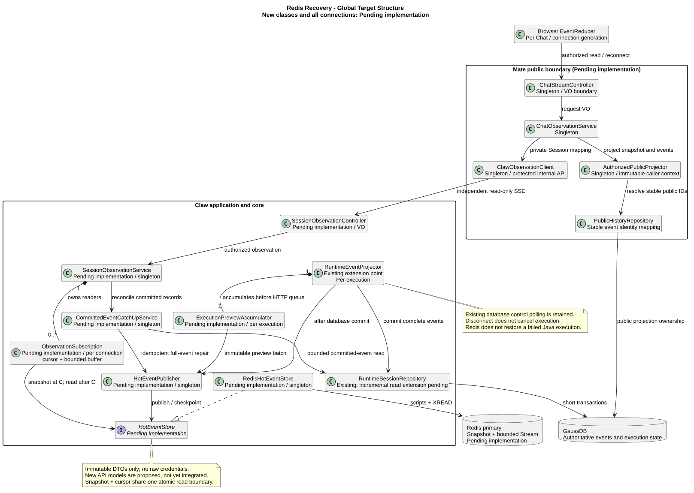
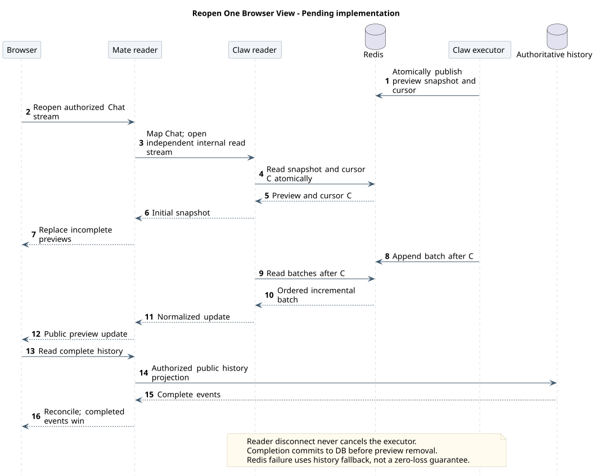

# Redis 流式恢复设计

[Session Events 主设计](chat-events-design.md) · [Mate 公共 Chat](../../02-服务与接口/07-mate-service通用对话API/README.md) · [架构对比 A13](../07-Agent架构对比/README.md#a13)

| 属性 | 值 |
|---|---|
| 版本 / 日期 | 0.1.1 / 2026-10-16 |
| 状态 | Redis 选型下的推荐目标设计；新增能力待实现，HTTP 增量为 proposed，尚未并入精确契约 |
| Java 核验 | 本地 `53eff85c7f41de23eb434e027782f5085a8b8e45`，仅 §10 所列范围，不声明为最新远端 |
| 外部基线 | OpenCode 默认分支 dev，已隔离 fetch `fe3f3a41f79ad292cc3c7c629567385a20ec5130`；experimental v2，不等于稳定发布 |
| 负责范围 | M06 的生成中预览共享、跨副本观察、快照与增量衔接；关联 M01/M04/M07 |

## 1. 先理解要解决的问题

用户看到“今天的巡检结果是……”时关掉浏览器；一分钟后重新打开，请求落到另一台服务实例。目标是立即看到这分钟里已经生成的内容，并继续接收后续输出；如果回答已经结束，则直接展示数据库里的完整回答，不重新调用模型。

需要同时满足三个条件：生成任务不依赖浏览器连接；生成中的内容能被不同实例读取；恢复快照之后的新内容不能漏掉。Redis 解决后两个条件的数据共享部分，执行生命周期仍由 Claw 管理。

| 技术 / 术语 | 可以先这样理解 | 本设计用途 |
|---|---|---|
| GaussDB | 正式档案 | 完整消息、执行状态、确认决定和审计的权威来源 |
| Redis Hash 快照 | “目前已经写到哪里”的共享草稿 | 保存尚未完成的正文、Thinking、内部计划预览及其共同读取位置 |
| Redis Stream | 带顺序编号、可以往后读的短期流水账 | 从快照位置之后接续增量，多个观察者各自读取 |
| cursor（读取位置） | 读书的书签 | 只表示这份热日志读到哪里，不是 eventId、数据库序号或任务身份 |
| TTL（过期时间） | 草稿保留期限 | 自动清理临时数据，不代表任务结束 |
| Lua 脚本 | 在 Redis 内一次执行一小段操作 | 防止快照内容与读取位置被并发更新拆开读到 |

选型结论：**数据库保留权威事务，Redis Hash + Streams 承担短期可恢复观察，SSE 负责传输。** 不采用仅 Pub/Sub、不以 Redis 分布式锁替换 Session 行锁，不引入 Kafka、Redisson 或完整 token 事件溯源。

## 2. 保证什么，不保证什么

| 情况 | 目标行为 |
|---|---|
| 关闭/刷新浏览器，Claw 执行和 Redis 正常 | 任意授权 Mate/Claw 读取副本返回当前完整预览，接着输出；不需要粘性会话 |
| Mate 或仅负责读取的 Claw 实例重启 | 新读连接重新加载快照并对账，不重跑执行；不能把读取实例重启等同于执行实例重启 |
| 断线期间已经生成完成 | 读取完整历史，立即展示最终结果；不会为重现打字效果故意慢放 |
| 慢客户端读落后，日志被裁剪 | 结束旧读连接，重新取得最新快照；不把缺失片段与新片段直接拼接 |
| Redis 超时、丢数据、快照超限或失效 | 明示实时预览暂不可用，完整记录仍通过数据库恢复；不承诺故障期间逐字连续 |
| 承载执行对象的 Claw 实例崩溃 | 可恢复已提交记录和仍保留的预览，但不能保证继续生成；不得自动重跑带副作用的工具 |

“正常流式恢复”的前提是执行仍存活、Redis 服务可用、内容在配置预算内。Redis 主从复制不等于零丢失，缓存丢失也不意味着数据库任务完成。执行接管、持久化凭据、工具幂等与检查点恢复是另一项架构设计，本文不作隐含承诺。

## 3. 全局推荐目标类图

[原尺寸 SVG](设计图/Redis流式恢复/redis_recovery_classes.svg) · [PlantUML 源码](设计图/Redis流式恢复/diagram.puml#L1)

图覆盖浏览器、Mate 公共边界、Claw 应用编排、领域投影、Redis Adapter 与数据库；它是本专题完整目标结构，不是当前实现类图。所有新增类及接线均待实现；已有 Runtime/Repository 的实现只按 §10 证据判断。

关键分层理由：

- Redis 写入口放在 `RuntimeEventProjector` 的领域投影之后、可丢弃的 HTTP 队列之前。不能从旧 POST SSE 收集 delta 后再声称快照完整，因为该队列本来就允许丢 preview。
- `HotEventPublisher` 汇合预览发布与已提交完整事件发布；它不负责模型调用、执行准入或数据库事务。每个执行有独立 `ExecutionPreviewAccumulator`，先累积完整预览，再按小批次发布。
- `SessionObservationService` 只创建读订阅，不访问执行对象，不启动 Agent。每条连接组合一个独立 `ObservationSubscription`，里面只有授权快照、读取位置和有界输出缓冲。
- `HotEventStore` 是存储接口，`RedisHotEventStore` 是 Adapter；Controller 不调用 Redis，内部 DTO 不直接序列化为公共 VO。单例服务不保存“当前用户”或原始凭据。
- Mate 通过 Claw 的受保护读取 API 观察，不直接访问 Claw Redis。公共投影仍负责租户/Chat 权限、稳定身份映射和字段白名单；浏览器不持有 sessionId、Redis key 或 Redis cursor。
- 现有数据库控制轮询保持：停止/确认依然先落库，再由原执行实例处理。热日志是输出观察通道，不是工具调度队列，也不是第二套状态权威。

| 生命周期 | 对象 / 数据 | 清理边界 |
|---|---|---|
| Spring 单例 | Controller、应用服务、Publisher、Repository/Adapter | 仅依赖和有界注册表，不保存单请求可变对象 |
| 一次执行 | Accumulator、不可变 ExecutionTargetDTO、发布批次计数 | 真正终态后释放；等待确认不等于根执行结束 |
| 一条读取连接 | ObservationSubscription、授权上下文、独立 cursor/队列 | 断线只清此连接，不取消执行 |
| Redis 临时对象 | 快照、热日志、发布幂等信息、缓存代次 | 预算/TTL 清理；不是 Java 执行对象序列化 |
| 数据库记录 | 已提交事件、执行/决定状态、公共身份映射 | 沿用所属模块保留与删除规则 |

## 4. 从关闭浏览器到重新看到输出

本图聚焦浏览器重开时的快照与游标衔接；Mate 读边界、Claw 跨副本读取、执行端、短期 Redis 和权威历史分列，不能为减少生命线而合并。执行端完成后先提交数据库，再发布 completed 并移除预览；Redis 故障回退完整历史。断线不取消执行、不自动重放写入，执行端失效恢复属于其他设计。

[原尺寸 SVG](设计图/Redis流式恢复/redis_recovery_sequence.svg) · [PlantUML 源码](设计图/Redis流式恢复/diagram.puml#L76)

1. 消息仍按现有数据库事务接受。Claw 建立执行对象及 Accumulator，产生的投影增量先进入 Accumulator，不受观察者人数影响。
2. Publisher 将一批有序增量和更新后的完整预览一起写入 Redis；成功后才允许该批进入新的可恢复读流。旧 POST 响应保留既有回执/关闭语义，不作为 Redis 数据来源。
3. 浏览器关闭时，释放浏览器→Mate 与 Mate→Claw 的读取订阅。Claw 执行与 Redis Publisher 继续运行；没有观察者也继续更新草稿。
4. 重开后，Mate 重新认证并授权 Chat，解析私有 Session 映射；任意 Claw 读取副本原子读取快照及位置 C。例如快照已经包含第 1～100 批。
5. 先将快照整体投影给页面，再从 C 之后读 Redis Stream。即使读取快照与开始等待之间产生第 101 批，仍会从日志读到，不会因为“订阅晚了一点”漏字。
6. 浏览器收到新连接的快照后开始完整历史对账；同 eventId 的 completed 永远覆盖 preview。快照只替换未完成预览集合，不能清空已确认历史。
7. Redis 读连接跨执行段和 idle 保持；每次重连重新快照，不恢复旧 POST、不重放用户输入。

不在重连时使用 `XREAD ... $` 作为续接位置；它表达从当时的末尾等待，而不是从刚读取的快照位置继续。普通 `XREAD` 的多个读者各持自己的位置，因此适合共同观看；同一 consumer group 是分工消费，不用于把一条回答广播给所有页面。

## 5. Redis 数据结构与一致性

### 5.1 Key 与身份

逻辑 key 为 `claw:hot:{scope}:snapshot`、`claw:hot:{scope}:events`。`scope` 是服务端对可信租户身份和内部 sessionId 的规范编码/摘要，不拼接未经校验的浏览器字符串。花括号使同一 Session 的 key 在 Cluster 中落在同一槽，允许多 key 脚本；这是预留兼容，不代表首版必须上 Cluster。

| 对象 | 主要内容 |
|---|---|
| snapshot Hash | schemaVersion、随机 epoch、headSeq、headToken、dirty、updatedAt；每个未完成 eventId 对应 type、sourceEventId、累计 content 与发布源版本 |
| events Stream | 每条有 seq、随机 token、prevToken、kind、eventId、sourceEventId、payload；ID 使用 `seq-0`，seq 只在同 epoch 内连续 |
| 发布去重元数据（同 Hash） | 固定 executionId/segmentId + publisherToken + batchNo 的最后确认批次及校验值；不包含原始凭据 |

`epoch` 是缓存重建代次，不是执行身份。`seq` 是热观察序号，不改变数据库事件顺序，也不对浏览器公开。重连从快照开始，不要求浏览器将 cursor 存进 localStorage。

正文、Thinking、内部计划各用自己的 eventId；不能只保存一条 `currentText`，否则同一轮多个 Assistant 消息/思考块会互相覆盖。已完成项从 preview 集合移除，仍存在于数据库历史。公开计划/任务/提问必须等待 Mate 自己的契约接入，不因 Redis 支持内部类型就直接外泄。

### 5.2 写入与快照原子边界

每个执行的批次串行发送，只允许一批在途。批次固定 eventId、来源身份、batchNo 和内容摘要；超时重试复用同一身份，不能另编号追加相同文字。批次缓存只在得到成功或确认已写入后释放。

一个短 Lua 脚本完成：校验 key 类型/epoch/来源/batchNo/预算 → 标记 dirty → 分配下一序号 → XADD → 更新完整预览及 head → 写入批次确认 → 清除 dirty。读快照脚本在同一 Redis 主节点读取内容、head 和 epoch；dirty 或不一致时拒绝提供可恢复快照。

这里的“原子”表示执行期间不与别的命令交错，**不是失败自动回滚**。脚本先完成可预检条件；中途异常、写结果不确定或实例故障时按不可用处理。读批次后再次校验有效 head/epoch/dirty，未提交到有效 head 的记录不得输出。不能使用 pipeline 当作原子保证。

修复需要仍存活的 Publisher 用完整 Accumulator 建立新 epoch，关闭旧读订阅并重新快照；不得从剩余 delta 猜测缺失前缀。失去执行对象且无法证明完整前缀时只恢复权威历史，不能将半截缓存标为连续草稿。

缓存重建须复核数据库中的固定执行身份；旧 execution/segment 的迟到写不能激活新执行。Redis 校验 publisherToken 只保护这份预览的写入，不授权接管 Agent，也不能代替数据库执行隔离。多个内部事件来源仍遵守现有因果追加规则，不能把抢到 Redis 顺序当作业务因果关系。

### 5.3 读者、裁剪与故障切换

读取器持有 `(epoch, seq, token)`；用 `XREAD COUNT ... BLOCK ... STREAMS key seq-0` 补读后继续等待。每条数据检查下一 seq 和 prevToken；重复完整事件按 eventId 合并，连续增量只在当前连接内应用一次。

日志已裁剪导致 seq 跳跃、epoch 改变、head 倒退、前驱 token 不匹配或 key 缺失，都结束当前连接重新快照。随机 token 链用于识别故障切换后同一序号被不同写入重新使用的分叉，不把数值“更大”误当作无丢失证明。故障切换/拓扑变化时主动使读连接失效并校验/重建热状态；不能把客户端自动重连等同于业务数据无损。

快照读和后续历史查询不在跨存储事务中：先取快照 C，再开始历史查询，C 之后事件由读流承接；较早完成记录由历史覆盖。同一 eventId 已 completed 后忽略迟到 preview。快照不用于判断新消息能否接受，准入仍回到数据库事务。

## 6. 数据库与 Redis 的分工

完整事件先在现有数据库事务提交，再发布到热日志并移除对应 preview；禁止先标 completed、后保存数据库。Redis 写失败不能撤销已接受消息或已发生工具副作用。

不能假装“写库 + 写 Redis”是一笔事务。采用数据库权威日志补读：新增 `CommittedEventCatchUpService`，对本机观察中的 Session 和活动执行按内部已提交序号有界补读，按 eventId 幂等发布。接收新订阅时也补查权威记录；读取缺口不触发模型/工具重跑。该内部游标需要 Repository 增量方法，不能用 createdAt 或公共数字页码代替。

直接提交后的发布是低延迟快路径，补读是失败兜底；两者走同一个 Publisher 的完整事件去重入口。补读可能晚于较新的 preview，因此客户端不把 Redis 投递顺序替代数据库的完整历史顺序。终态归属按固定根消息检查，旧 idle 不释放新执行。缓存已过期时不要求补齐所有古老热事件，历史接口负责长期数据。

此选择暂不新增 outbox 表：现有已提交事件日志已经能作为补发来源，但实现必须补齐有限范围的增量查询和去重。如果后续要求“无人订阅、执行进程消失时也必须主动投递外部系统”，应另评估事务 outbox；不能给当前补读机制添加它没有的交付承诺。

## 7. HTTP 与前端接入增量（proposed）

这是架构草案的接口要求，不是对现有已确认 operation JSON 的静默覆盖。现有 POST 请求级 SSE 与历史契约保持有效；新读取操作和快照事件须在实施切片 R1 完成精确模型、鉴权、错误目录、OpenAPI、HTML 与解码器同步后启用。

| 边界 | 推荐增量 | 不改变的规则 |
|---|---|---|
| Claw 内部 | 新增只读 `GET /campusclaw-service/v1/sessions/{sessionId}/events/stream`；首个业务帧 `session.preview_snapshot`，之后发送既有领域事件；观察跨执行段，idle 不关连接 | POST 仍返回本次完整回执与请求级 SSE；历史仍只有完整权威事件；新 GET 不能复用“POST 权限即读取权限”的假设 |
| Mate 公共 | 复用 `GET /mate-service/v1/chats/{chatId}/events/stream`，首帧新增 `chat.preview_snapshot`；其余事件继续按公共模型安全投影 | data-only，不增加 Last-Event-ID，不将 Redis 序号或内部 executionId 暴露为公共字段 |
| 浏览器 | 新连接先接收快照，整体替换未完成预览，再读历史并继续追加本连接增量 | 已完成记录优先；不自动重发任何 POST；连接状态与任务状态分开 |

推荐快照逻辑模型：`type`、`availability`（`available` / `unavailable`）、`items`。每项为 `eventId/type/content` 的完整预览；内部项还保留 sourceEventId 供 Mate 固定身份映射。它不是 completed，不能写入权威历史；`items=[]` 只表示无可恢复预览，不表示任务 idle。最终 VO、联合 Schema、字段上限与双语错误属于 R1 的精确契约工作。

Mate 为同一内部事件建立一次稳定公共 eventId 映射，并在输出 preview 前保存；唯一键按租户、Chat、内部事件身份约束。重复读取不能生成新公共 ID。历史投影和实时投影复用映射，不给浏览器发送 Claw 原始事件；现有映射存储实现未核验，新增表如确有需要须使用 `t_` 前缀。

快照在 Claw 已捕获才发送给 Mate；Mate 先投影首帧，再发送后续帧。任一跳重连均关闭旧公共连接，让浏览器开始新 generation，防止新旧 delta 交叉写入。不在同一连接无提示地重复前缀。大快照采用有界单帧；超限返回 unavailable，不能截断后伪装为完整。

Header 前认证/授权/不存在/订阅容量/读取不可用使用普通 JSON 错误；Header 后异常关闭读连接，不拼接 ResultBean 或伪造业务失败终态。Redis 不可用时页面提示“实时内容暂不可用，正在读取已保存结果”，保留已确认内容；历史对账继续运行。权限撤销时则清理敏感展示，不能套用普通故障保留策略。

公共 C-001 数字分页、C-006 精确控制目标等原门禁保持，不借本专题重新设计全部公共 API。Runtime 计划/任务/提问类型尚未完成公共映射时，不计入本方案公共可用能力。

## 8. 保留、背压、安全与依赖

### 8.1 首版运行策略

首版使用公司受管的高可用 Redis 主从服务（或 Sentinel），读写主节点；单机仅用于本地实验。不因为有多个应用副本就立即选择 Redis Cluster。服务端具体发行版、补丁、许可证与公司运维支持清单需部署阶段核定，不将命令最低版本当成生产推荐版本。

以下是压测起点，不是已验证容量：预览最多每 50ms 或累计 4KiB 合并一批；日志按 10 分钟和 10,000 批双重限制；单 Session 快照正文预算 1MiB、单连接缓冲 1MiB。完整消息超出预览预算不截断数据库记录，停止该项 preview 并走最终历史展示。

活动快照 30 分钟 TTL、每 30 秒续期；即使没有新 token 或正在等待确认也续期。终态后停止续期，完整事件提交并完成缓存收尾后采用 10 分钟热保留。续期心跳不被解释为任务租约或接管授权；过期只触发恢复降级。整组 key 保持相同到期边界，任何部分丢失都使快照失效。

日志裁剪与快照续期独立：不能仅靠 EXPIRE 限制长任务增长。写入前校验单批字节数，记录每 Session 的估算占用并限制活跃 Session/读连接总数；近似 MAXLEN 不是严格字节上限。生产优先使用专用实例与 noeviction，避免任意淘汰破坏配套 key；内存满仍会写失败，走明确降级而不是假定永不失败。

容量粗算为“活动 Session 数 ×（平均快照字节 + 窗口内批数 × 平均批字节）× 实测开销系数”，再考虑副本、AOF、重写和缓冲。不以正文净字节数冒充 Redis 实际内存；需监控内存、发布耗时、写失败、读落后、快照重建与降级次数。

每个读取器独立 cursor，首版每连接一个有界阻塞读取；阻塞连接与普通写连接隔离，不能把共享 Lettuce 连接长期占住。慢浏览器只关自己的连接，不背压其他读者。达到连接预算前拒绝新订阅；压测有证据后再考虑按实例/Session 复用读循环，不先引入复杂分发框架。

Redis 故障不无限阻塞 Agent：Accumulator 有界，发布超时后熔断预览通道并断开受影响读流，继续按既有流程生成和提交完整内容；Redis 恢复且完整前缀仍在 Accumulator 时建立新 epoch。预算不足或执行已消失时等待完整历史，不拿残余片段继续拼接。

### 8.2 安全

Redis 不保存 JWT、APPKEY、access-token、Provider 原始帧、不透明续传签名、Java Future 或执行凭据。只保存 Claw 领域层已过滤的展示数据；Mate 再做公共授权与字段投影。Thinking 原文依旧按产品规则处理，其敏感级别与正文一致。

使用内网、TLS、最小 Redis ACL 与密钥托管；禁用浏览器直连。每次订阅重新授权，长连接按公司权限机制处理撤销；读取缓存不绕过 Session 删除/租户检查。删除 Session 后拒绝读取并清理热 key，日志不记录正文和秘密。备份与 AOF 也受同样的数据保留要求约束。

### 8.3 Maven 依赖

| 拟新增直接依赖 | 目的 | 主要传递依赖与代价 |
|---|---|---|
| `org.springframework.boot:spring-boot-starter-data-redis` | 在 Claw Host 层提供 Redis 连接、序列化、脚本及 Stream 访问；版本跟随项目 BOM，不在本项升级 Boot | Spring Data Redis、Lettuce；Lettuce 主要依赖 Netty/Reactor，增加网络线程、连接配置及补丁维护 |

Java 当前根 BOM 为 Boot 3.4.5；`modules/coding-agent-cli/pom.xml` 与 `campusclaw/pom.xml` 所检范围没有 Redis 直接依赖。拟在两个 Host 构建入口同步接入；Agent 内核与 Mate 不新增 Redis 依赖。当前完整传递树与公司依赖覆盖尚未核验，实施前必须用实际构建 `dependency:tree` 确认版本、日志桥及 Netty 冲突；不能套用本机缓存的 Boot 3.2.5 依赖树。

不选 Redisson：本方案只需基础数据结构、脚本和读流，不使用分布式锁/Java 对象代理。可直接使用 Lettuce 减少 Spring 抽象，但当前项目已有 Boot，选择 Starter 统一配置。只用 JDK 自写 Redis 协议会增加连接、认证和重连维护，不采用。不新增该依赖则无法按此方案实现 Redis Adapter，现有数据库恢复只保证完整记录。

[Model 全局许可](../../02-服务与接口/03-Model/README.md#http-transport-global-permits)也接入同一 Redis 服务，两份设计共用一个客户端和 `spring.data.redis.*` 配置。Model 设计建议排除 Lettuce、改用 Jedis，因为 Lettuce 会把 Model 设计刚删掉的 Netty 带回产物（[Model D5](../../02-服务与接口/03-Model/README.md#http-transport-decisions)）；客户端最终选择待用户确认，选定后修订本节，改用 Jedis 时阻塞读取要按读者数配置连接池。

## 9. 实施切片与验收

| 切片 | 交付内容 | 必须验证 |
|---|---|---|
| R1 · 精确契约 | 两跳独立读取及首帧快照、认证/错误/容量、稳定公共身份、联合 Schema、HTML/OpenAPI/解码器同步 | 新旧流明确区分；历史不出现快照；无内部 ID 泄露；公共未接入类型受门禁；契约完成前不开启新能力 |
| R2 · 事件源与 Adapter | Accumulator、Publisher、HotEventStore/RedisHotEventStore、Lua 原子边界和依赖树 | 原 HTTP 队列丢 preview 不影响快照；超时同批重试不重复文字；Lua 中途失败 dirty 不泄露；旧执行迟到写被隔离 |
| R3 · 可恢复读取 | ObservationService/Subscription、主节点一致读取、seq/token/epoch 校验、独立缓冲 | 快照 C 后立即写 C+1；回放转等待；空闲后新执行；两个浏览器都完整收到；慢读/裁剪重新快照 |
| R4 · 完整事件对账 | 先库后缓存、Repository 增量读取、CatchUp 幂等补发 | 库成功 Redis 失败/进程退出；completed 与 snapshot 竞争；重复补读；旧根终态不影响新根；同 ID 只一份完整历史 |
| R5 · 前端与两跳故障 | 快照替换、generation 隔离、历史覆盖、连接重开 | 关浏览器 60 秒后落另一 Mate/Claw 副本；断线期间完成；确认续跑落其他实例；无 POST 重放、无额外模型/工具调用 |
| R6 · 运维与失败边界 | TTL/清理/权限撤销、预算、超时、主从切换和降级 | key 部分丢失、主从回退/分叉、Redis 满/不可用、执行 Pod 被杀、长确认等待；UI 不假报继续生成或成功；实际内存/延迟/连接压测 |

核心验收断言：正常浏览器断线测试中，恢复出的正文逐字符等于同一执行连续观察的正文，后续增量无遗漏/重复；最终文本等于数据库完整记录。失败测试证明的是正确降级，不是“任意故障零丢失”。验证证据仅限设计与文档/图形校验，尚无新增实现、Redis 集成或性能实测。

## 10. 源码证据、基线变化与取舍

Java 路径前缀 R：`modules/coding-agent-cli/src/main/java/com/campusclaw/codingagent/runtimeapi/`。本地固定提交 `53eff85c7f41de23eb434e027782f5085a8b8e45`；以下是静态观察，不替代集成测试。

| 路径 / 关键符号 | 已观察行为 | 目标影响 |
|---|---|---|
| R `web/RuntimeEventController.java` · `submit/list` | 现有 POST SSE 与 GET 完整历史，流结束回调只 detach；所检两套 runtimeapi 路径没有独立 events/stream 或 Redis 热源 | 新 GET 是新增能力，不是改一个重连参数即可使用的现有入口 |
| R `event/RuntimeEventProjector.java` · `emitMessageDelta/emitThinkingDelta/emitPlanDelta/persistThinking/persistAssistant` | preview 走 execution.output().emitBestEffort；完整内容先 persistence 再 emit | 新热发布必须接在可丢弃队列之前；完整提交顺序复用 |
| R `event/RuntimeEventStream.java` · `emitBestEffort/evictBestEffortEvents/detachInternal` | 有界单订阅；preview 可拒绝/被淘汰；detach 清队列 | 不能靠现有 HTTP 字节流重建无缺口草稿；新读流缺口必须重快照 |
| R `event/RuntimeResultBackedEventOutput.java` · `emit/emitBestEffort` | 完整结果通知数据库补读，preview 只发本地 stream | 跨副本 preview 需要共享热事件源，不以结果轮询冒充 token 恢复 |
| R `runtime/ExecutionControlPollingService.java` · `poll/dispatchCommittedStop/dispatchBatches` | 按本机活动目标批量读库，默认检查间隔 500ms，有同实例快路径 | 保留控制正确性机制；该默认值不是容量或延迟保证 |
| R `event/RuntimeExecutionCoordinator.java` · `commitTerminal/commitAndRelease` | 固定目标终态先提交，再输出及释放运行对象 | 缓存不能提前发布任务成功；进程内对象不随 Redis 自动恢复 |
| `pom.xml`、`modules/coding-agent-cli/pom.xml`、`campusclaw/pom.xml` | 根 Boot BOM 3.4.5，所检 Host POM 无 Redis 直接依赖 | Starter、Adapter、运维实例均为新增成本 |

上述范围未发现可恢复 Redis 热事件源与独立 Session 读取流，新增骨架为待实现；Mate 生产实现未核验，公共 bridge 不能标记已经落地。旧主设计中的 `918005ee…/dfb90cac…` 和 Mate 的 `7e54b47f…` 是历史证据，不能据此继续声称当前 Claw 不支持控制事件；本次不升级其他子域结论。

OpenCode 于 2026-09-22 用 `ls-remote --symref ... HEAD` 确认默认分支 dev，并隔离 fetch `fe3f3a41f79ad292cc3c7c629567385a20ec5130`。相对登记点 `849c2598abc7d2b40261e74b5826bc74ffc78308`，只升级下列证据范围，不宣称仓库整体无变化：

- `packages/protocol/src/groups/session.ts` · `SessionHistoryQuery/makeSessionGroup`：`session.history` 按 exclusive after 读 durable 事件，`session.events` 回放 durable 后继续读；源码明确标注 Experimental session routes。
- `packages/schema/src/session-event.ts` · `Text.Delta/Reasoning.Delta/Ended/DurableDefinitions`：文本和推理 delta 属于 live-only，Ended 是完整可回放边界。可回放 durable 不等于所有 token 可回放。
- `packages/opencode/src/server/routes/instance/httpapi/handlers/event.ts` · `eventResponse`：先注册监听，再输出 connected，避免开始输出期间的监听缺口；采用实例事件过滤与内存队列，不是本方案 Redis 实现证据。
- 当日读取[官方 Server 文档](https://opencode.ai/docs/server/)，稳定公开说明与上述实验性 v2 分开表述。

因此采纳“读位置、先建立观察边界、live/durable 分层”的设计思路；Redis 快照、两跳恢复和有限热日志是 CampusClaw 的架构变更，不声称 OpenCode 使用 Redis。长期 token 日志不是本需求必需项；pi Loop、Codex Provider 和其他基线本次不改变、不重新归因。

### 官方技术依据（核对日期 2026-09-22）

- [Redis Pub/Sub](https://redis.io/docs/latest/develop/pubsub/)：离线订阅者不能通过 Pub/Sub 补回丢失数据，所以不单独用于恢复。
- [Redis XREAD](https://redis.io/docs/latest/commands/xread/)：按大于给定 ID 读取并支持阻塞等待；本设计使用基础 COUNT/BLOCK，不依赖新版本扩展参数。
- [Lua 原子执行](https://redis.io/docs/latest/develop/programmability/eval-intro/)与[Lua 错误处理](https://redis.io/docs/latest/develop/programmability/lua-api/)：短脚本用于一致读取/更新，脚本异常不作数据库事务回滚承诺。
- [Cluster hash tags](https://redis.io/docs/latest/operate/oss_and_stack/reference/cluster-spec/)：同槽多 key 约束。
- [Redis replication](https://redis.io/docs/latest/operate/oss_and_stack/management/replication/)与[持久化](https://redis.io/docs/latest/operate/oss_and_stack/management/persistence/)：异步复制及持久化策略影响故障数据丢失窗口；AOF/WAIT 不自动提供强一致零丢失。
- [Spring Data Redis 连接模式](https://docs.spring.io/spring-data/redis/reference/redis/connection-modes.html)：Lettuce、Sentinel/Cluster 连接能力参考；在线文档版本不替代当前 Boot BOM 的 API/依赖验证。

## 11. 版本历史

| 版本 | 日期 | 变更 |
|---|---|---|
| 0.1.1 | 2026-10-16 | 注明 Model 全局许可共用 Redis 客户端与配置，客户端选择待确认。 |
| 0.1.0 | 2026-09-22 | 以事件源侧 Redis 快照和短期 Stream 设计浏览器重开恢复，保留数据库权威与执行故障边界。 |
