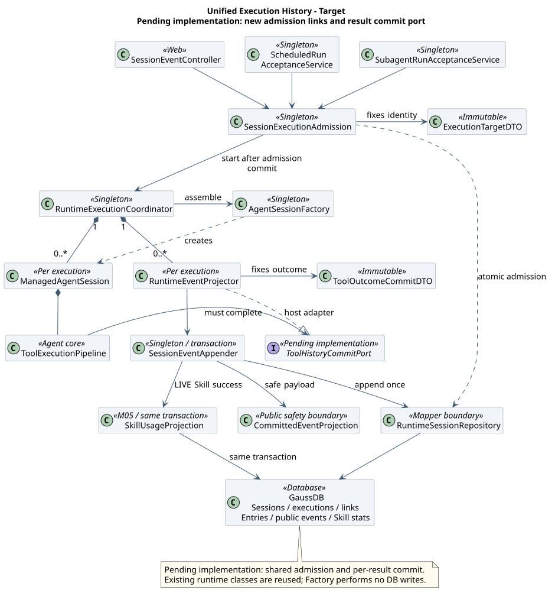
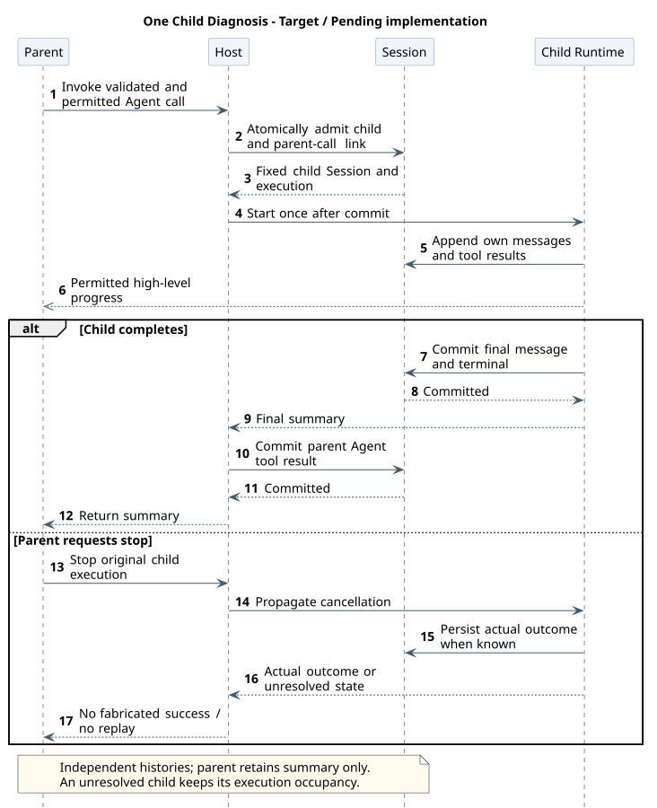
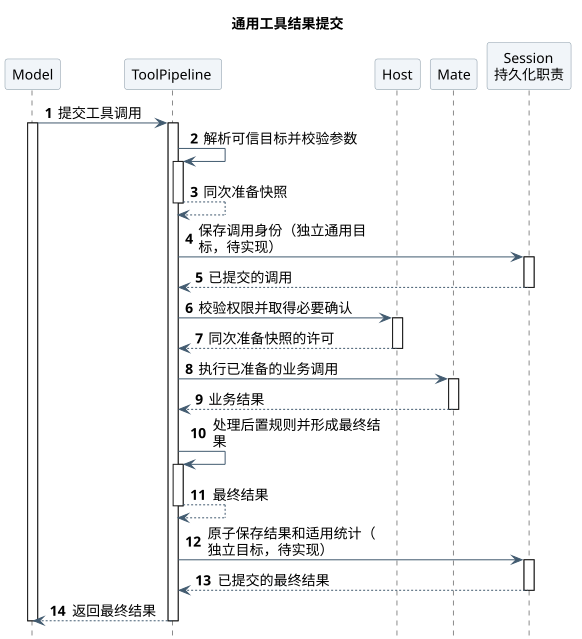

# 统一执行历史与事件持久化

版本：1.4.0 · 2026-10-15 · 状态：统一受理、Subagent 持久化、逐工具提交及统计投影均待实现。

[Runtime 主设计](README.md) · [Claw 数据库设计](../../03-数据与存储/Claw数据库设计.md#pending-changes) · [源码证据](unified-event-persistence-evidence.md) · [定时任务](../08-CampusClaw定时任务/README.md#normal-acceptance) · [Skill 统计](../04-CampusClaw命令系统/03-Skill加载统计/README.md) · [Session 存储](../../03-数据与存储/01-会话记忆GaussDB/README.md)

## 1. 要解决的业务问题

每天 08:00，园区巡检 Agent 汇总设备告警，再调用设备诊断 Subagent。运营人员需要查清子任务收到什么、调用哪些工具、得到什么结果；不能只剩父会话中的一句“诊断完成”。Skill 的成功调用数也应来自这些真实结果，避免另建一套采集、日志和重试链。

正常流程是：Cron 为本次 Run 新建 Session；父 Agent 调用 Subagent 时，再为该次调用新建子 Session。两者都经同一 Runtime 保存消息、工具调用、工具最终结果和终态。子会话提交结果后，父会话保存 Agent 工具的摘要结果。每条真实成功的 Skill 结果在提交时为对应累计数加一。

失败时保留已有历史。参数无效不询问用户、不执行业务；工具真实失败保存错误结果；已发请求但结果未知则保留未知，不伪造成功、失败或自动重跑。数据库提交失败也不能撤销已经发生的业务副作用。恢复先读已提交记录，无法证明的部分继续待对账。

**统一的是受理、执行和持久化机制。每个 Session 仍有自己的历史；父会话不复制子会话的全部内容。** “完整”指已形成的完整消息与最终工具结果，以及恢复和解释它们必需的控制、配置和压缩记录；不等于保存每个 token、原始网络包、凭据或尚未产生的结果。硬崩溃前尚未提交的内存结果仍可能丢失，不能承诺外部业务副作用与本库原子提交。

## 2. 当前事实、参考与目标

| 范围 | 已观察实现 | 目标及理由 |
|---|---|---|
| Runtime | Java main `769e8659` 的 Coordinator 安装 Projector；Entry 与公共事件同事务；工具结果主要在 TurnEnd 保存 | 保留共享追加骨架，增加每个最终工具结果的可靠提交点 |
| Cron | main 仍是进程内调度、JSON/JSONL 和直接 Factory + prompt | 最新 Cron 0.31.2 / execution 0.1.0 已规定每 Run 新建 Session、原子受理后进 Runtime；本设计复用这一方向，不改调度策略 |
| Subagent | main 直接创建内存 ManagedAgentSession，父侧接收进度与最后文本 | 每次真实 Agent 调用关联独立持久化 Session，统一执行与历史，不把内存对象当数据库资源 |
| pi | 普通示例以 --no-session 运行子进程，但返回 details 含子消息；experimental durable 示例另建 conversation | 借鉴完整消息恢复语义；不把普通示例说成独立持久化子 Session，也不照搬 experimental API |
| Codex / OpenCode | 非 ephemeral Codex child thread 有独立 rollout；OpenCode Task 创建/复用带 parentID 的 Session，消息与 parts 有数据库投影 | 借鉴独立子历史与父侧摘要分离；CampusClaw 首版每次新调用新建 Subagent，不照搬跨次 task_id 复用 |

完整 SHA、默认分支、核对日期、路径和符号见[证据](unified-event-persistence-evidence.md)。本方案属于架构变更；独立授权、安全投影、非交互 Cron 和不重放是产品约束及安全边界。源码快照不是稳定发布或新方案验收。

## 3. 三种入口，一套持久化执行链

| 入口 | 特有职责 | 共同路径 |
|---|---|---|
| 用户消息 / Skill Command | 现有 HTTP 校验、授权、会话准入和回执 | 接受首消息与 execution → 提交 → Coordinator → ManagedAgentSession → 统一追加 |
| Cron 自动 / 手动 Run | Schedule 互斥、occurrence、配置代次、Mate 凭据引用、Run 关联 | 同库事务新建 Session、首消息、execution/segment 与 Run 关联；提交后一次启动 |
| Agent 工具启动 Subagent | 可信直接绑定、版本/深度/循环、模型、父取消域；关联父工具调用 | 同库事务新建子 Session、首消息、execution/segment 与父子关联；提交后一次启动 |

`AgentSessionFactory` 只装配运行对象、工具与 hooks，不访问数据库。应用层 `SessionExecutionAdmission` 复用受理原语；`ScheduledSessionStarter`、`SubagentRunAcceptanceService` 在自己的短事务中组合这些原语，不能用嵌套 REQUIRES_NEW 破坏原子关联。事务内重检可变状态，事务外查询 Mate、准备目录和执行模型/工具。

三入口统一由 `RuntimeExecutionCoordinator` 安装历史写入适配器、压缩与终态处理。交互入口有 SSE 输出，后台入口用 `RuntimeEventOutput.persistenceOnly()`；输出类型不决定是否持久化。Runtime 的通用执行边界接收内部 DTO，不反向依赖 Schedule、HTTP Controller 或 Skill 查询服务。根执行终态提交提供事务内终态扩展点（待实现）：调用方模块注册实现，与终态同事务提交、同事务回滚，Runtime 不感知具体业务；定时任务借此结束 Run，见 [M10 D11](../08-CampusClaw定时任务/README.md#key-decisions)。CronTool 只依赖薄管理/受理服务，不能构成 Registry—Dispatcher 构造环。

### 全局目标类图

范围为三入口到内核、公共投影、持久化和统计；它补充现有 Runtime HTTP 全局图，不替代确认、中断、分页等专题结构。图中新增连接标为 Pending implementation，已有类名代表复用职责。



[原尺寸](设计图/统一事件持久化/unified_execution_history_classes.svg) · [PlantUML 源码](设计图/统一事件持久化/diagram.puml#L1)

入口 Service 与 Admission/Coordinator/Repository 保持分层。Factory 为应用单例，ManagedAgentSession、Projector、调用关联表为 execution 范围；DTO 为不可变执行/调用快照。持久记录与这些 Java 对象生命周期独立。无新增 Maven 依赖，复用 JDK、Spring 事务、Jackson、MyBatis Starter 3.0.4 和已有驱动；不引入 MQ、独立统计线程或通用插件事件总线。

## 4. Subagent 的身份、授权与生命周期

每次实际 Agent 调用分配一个服务端 `tool_call_entry_id`，由已提交 Assistant Entry 与内容位置绑定；Provider toolCallId 只用于该消息内模型协议关联，不作为全局幂等键。确认续跑和同次持久化重试复用原身份；模型下一次发出新调用，即使 Provider ID 相同，也获得新身份。

内部父子关系 `t_session_execution_links` 的字段、主键、唯一约束与清理由 [Claw 数据库设计](../../03-数据与存储/Claw数据库设计.md#subagent-links)维护，目标待实现。一条父调用至多受理一个 Subagent；不复用表示历史复制来源的 t_sessions.parent_session_id，也不复制正文、工具结果或运行终态。

受理前，Agent Pipeline 先做可信绑定解析与参数校验，再由 Host 校验权限/必要确认。然后事务内复核父 execution 固定身份、未停止、父调用存在与未完成、子任务容量以及授权快照有效性；受理和父停止争用同一父 execution 权威锁。Subagent 自己保存可信访问范围与非秘密来源，读取时重新授权；不是持有父 ID 就能读 Subagent。业务凭据只传本次内存执行，不进入关系、Session 元数据或消息。

同父调用的重复内部通知只返回原关联和状态，不再创建、prompt 或重放；未知提交先读库对账。必须先取得一次启动权，再执行。进程失联后的接管只做对账，不自动接管业务执行。Parent 与 Subagent 都计入 Runtime 的相应容量，父等待期间不持数据库锁；Subagent 配额需独立预留或直接拒绝，不得让所有父任务占满资源后无限等待子任务槽。

### 一个子诊断任务如何完成

场景从已通过 Agent 工具权限检查的父调用开始，到父收到最终工具摘要结束。目标待实现；准备失败/拒绝发生在受理前，不产生孤立子 Session。



[原尺寸](设计图/统一事件持久化/unified_child_history.svg) · [PlantUML 源码](设计图/统一事件持久化/diagram.puml#L71)

子上下文仍从自己的任务消息开始，不继承父完整对话；保留 M03 的模型、工作区、最大深度 1 和禁止循环规则。父只接收许可的进度和最后非空 Assistant 文本；内部关系用于授权查询和排障，不在现有公共工具 JSON 中增加 executionId/childSessionId。管理端子历史入口及 Mate 映射需后续单独对齐精确 API，未完成前不宣称浏览器已能展开。

父取消定向传播到关系中的原 child_execution_id，不能取消子 Session 后续的新对话。停止请求不等于已终止：只在实际退出并保存终态后释放相应占用；失联保留未知。Cron 的非交互限制继续传入 Subagent，ASK 或问答工具不得通过子任务绕过。子结果/终态先提交，父 Agent ToolResult 后提交；父提交失败不删除或重跑已经完成的 Subagent。

## 5. 保存哪些记录，如何保持一次提交

复用两层权威记录，不再建第三条工具统计事实流：

| 记录 | 内容与用途 | 不承担的职责 |
|---|---|---|
| t_session_entries | 内部完整消息、thinking、调用与结果、必要的配置/压缩记录及恢复元数据；每个 Session 线性追加 | 不直接作为浏览器响应，不保存凭据或任意未经审查 details |
| t_session_events | 与 Entry 同事务生成的安全公共投影，独立 event_seq，用于完整事件输出和历史对账 | 不保存私有 Skill 正文/路径、内部 Schema、关联 execution ID；不能据安全裁剪内容重建模型全部上下文 |
| 既有 execution / 控制记录 | 首消息、启动权、停止决定、固定执行身份及终态 | 不复制聊天正文；租约不是副作用完成证明 |
| t_session_execution_links / t_schedule_run | 父调用或调度来源关联 | 不另存全套消息；Run 仍按 Cron 自己的生命周期管理 |
| t_skill_usage_stats | 从真实成功工具结果同事务更新的累计投影 | 不产生第二份观察事实、不作为执行结果权威 |

新增工具结果提交 DTO 固定 `sessionId/executionId/toolCallEntryId/resultEntryId`、最终 content/isError/errorCode、可信 skillId（仅 Skill）、origin、schemaVersion 和结果形成时间；公共投影继续采用现有字段。内部 `tool.result` 的 payload 保留 `tool_call_id/tool_name/content/is_error` 并增受控恢复元数据；对应结构见[补充 DDL](../../03-数据与存储/01-会话记忆GaussDB/unified-event-persistence.sql)。`content` 是经工具规则处理后给模型的完整结果；公共结果从它安全投影。仅白名单恢复字段可保存，不把全部 `details` 原样序列化。

下面是**目标内部结果**的简化样例，不是公共 API 报文，也不代表现有数据库已具备新增字段：

```json
{
  "session_id": "child-session-01",
  "id": "result-entry-08",
  "type": "tool.result",
  "tool_call_entry_id": "call-entry-07",
  "timestamp": "2026-10-10T00:00:03Z",
  "payload": {
    "schema_version": 1,
    "execution_id": "child-execution-01",
    "origin": "LIVE",
    "tool_call_id": "provider-call-3",
    "tool_name": "Skill",
    "skill_id": "skill-0123456789abcdef0123456789abcdef",
    "content": [{"type": "text", "text": "设备诊断 Skill 的受管指引正文"}],
    "is_error": false
  }
}
```

此样例省略已有 entry_seq/parent_id；它们由追加器维护。公共投影省略 execution_id、origin、skill_id 等内部字段，并按既有 Skill 安全规则隐藏私有正文；统计从内部可信结果读取。

工具结果关联列、唯一索引与受控 payload 增量集中于[数据库目标](../../03-数据与存储/Claw数据库设计.md#tool-result)，当前待实现；事务校验被引用的同 Session 调用存在、属于固定 execution、工具身份与准备绑定一致。同次结果重试沿用固定 resultEntryId、时间和全部载荷；已有结果在执行结束后仍可授权只读对账，新追加才要求固定 owner/代次及可收尾状态。先查既有结果，内容一致返回既有提交，内容不同报一致性冲突，不能覆盖或再次计数。结果去重不依赖已删除的统计流水。

`origin=LIVE` 表示当前真实执行，`COPY` 表示会话复制的既有历史；恢复、重放读取、压缩和复制都不生成新的 LIVE 结果，也不增加统计。复制保留原事件时间与语义；按现有 M04 复制设计保留内部 Entry ID，新 session_id 隔离身份，调用关联只能引用副本内对应调用；复制走独立受控复制事务、不经过 LIVE 结果提交端口；普通持久化重试只查询原记录。调用 Entry 的现有内部名 tool.execution.started 不能作为实际执行成功或已产生副作用的证据，它可能在模型调用定稿时产生。

### 工具结果提交顺序

一次设备工单调用必须依次完成：可信目标解析 → 参数校验/固定准备快照 → Host 权限或确认 → Pipeline 协调业务执行 → 后置处理形成最终结果 → 权威提交 → 回传模型/输出。校验错误保持 isError=true，字段错误和同次可信定义只给模型，不弹确认、不发业务请求、不自动猜参。失败结果也经过同一提交点，成功统计只是其中的条件投影。

场景是单个业务工具从模型请求到最终结果回传；图中 Session 表示应用级历史提交职责，其内部短事务在后文展开，非远程服务。



[原尺寸](设计图/统一事件持久化/unified_tool_commit.svg) · [PlantUML 源码](设计图/统一事件持久化/diagram.puml#L128)

关键改造是**最终结果形成后、进入模型上下文或允许下一步推进前的必达提交端口**。不能只给 Agent.subscribe 增加监听器：当前监听异常被隔离，Projector 还会捕获错误；也不能只消费 End，因为校验/prepare/before 拒绝可以直接返回错误而没有 End。内核定义通用 `ToolHistoryCommitPort`（commitCall / commitResult）。Assistant 完整消息须先提交，调用身份及其安全调用投影也必须在确认展示或业务执行前成功提交；commitCall 失败不得继续业务，不能仅依赖会吞异常的消息监听。Host 还必须等待完整消息和压缩的统一追加结果：纯文本回答也只能在完整消息提交后发布完成或终态，不能绕过检查向用户报告成功。所有正常、前置拒绝与后置处理后的最终结果都汇聚该端口，Host 提供 Runtime 实现；端口接收内核结果及本次调用句柄，由 Host 组装 ToolOutcomeCommitDTO，内核不依赖该企业 DTO、数据库或 Skill 服务。纯内存测试/库宿主可显式使用内存实现，产品三入口必须装持久实现。

提交异常在业务工具异常归一化之外传播，作为持久化故障停止推进，不改写真实 isError，不把它交给模型自动修参。并行工具各自提交自己的最终结果；一个提交失败阻止启动新的调用并请求停止同批未结束调用，已执行的副作用不承诺撤销。TurnEnd 只汇总/核对已提交结果，不再重复写入。取消前已形成最终结果应先尝试提交；尚无可靠最终结果只保存控制/未知状态，不合成 tool success。

STOP_REQUESTED 不拒绝同一原执行已在途调用的真实结果；实际终态提交前仍可按固定身份收尾，旧 owner/代次或终态之后不得写入。

短事务按固定执行身份重检和 Session 锁、共享序号分配器、Entry、公共投影/关联、Skill 累计的顺序提交；单个结果涉及至多一个 skillId。网络输出只在提交后。多结果不是等全批完成后才落一笔事务；配置组合更新等原有多 Entry 原子语义保持。

## 6. Skill 统计能复用到什么程度

直接消费统一提交的 `tool.result`，仅 `origin=LIVE && tool_name=Skill && is_error=false` 且有可信 skillId 时加一。skillId 从同次可信 Skill 绑定保存，不能从正文、路径、hash、模型参数中的 ID 或可改写 details 猜测；后置 hook 最终改成错误则不计，正文变了但最终仍成功仍计。没有可信绑定的成功 Skill 结果属于持久化不变量错误，不能静默丢计或用名字代替 ID。

保留一张累计表，是因为 Session 删除后仍要保留累计次数。若只做 COUNT(entries)，它只能回答“当前保留历史中的次数”。累计表的唯一加一时机是**新 LIVE 成功结果首次插入的同一事务**；重复提交和历史读取不进入更新。去掉专用 Observer、observationId、队列、独立统计事实表及统计所需 JSONL/执行血缘，不删除真正的执行控制与授权关系。

这会把一条累计更新带入工具历史事务：任一写失败则全部回滚并停止推进，增加锁等待和工具延迟；它不再是允许队列丢失的 best-effort 方案。该耦合换来没有第二套投递/重试/对账。热点 Skill 与数据库故障必须压测；如果将来要求统计故障完全隔离，需要另行评估持久增量投影和清理水位，不能悄悄退回易丢内存队列。详细查询、删除和切换规则由 [M05](../04-CampusClaw命令系统/03-Skill加载统计/README.md)维护。

## 7. 保留、删除与失败对账

父/子 Session 是独立授权和保留单元。删除父会话不级联删除 Subagent，也不撤销业务；活跃或结果未知的受影响 execution 先走既有停止/对账约束，禁止通过删除解除未知占用。关系保存至相关两端历史均可清理且执行明确收尾；可保留仅含 ID 的关联占位，不保留被删除正文。Subagent 删除后父摘要仍在，关系可指向已删除资源；查询如实返回不存在，不能重建一个 Subagent。所有后续受理必须先核对父资源和原调用存在，关联清理不使旧调用可再次执行。

删除 Schedule/Run 的规则保持：删配置与 Run，保留已生成 Session；Session 必需授权和根执行信息不依赖被删配置。会话删除和结果提交争用同一 Session/执行权威，删除先完成则拒绝迟到写入，不能复活事件或统计；结果先提交则累计保留。无最终成功记录的未完成或未知调用不计数。

历史删除前，同一删除事务按 skillId 有序更新累计表中的历史缺口范围，保留累计总数、不扣减；范围查询不得把删除后的残余 COUNT 冒充完整统计。需要精确 from/to、日趋势的需求仍待核实，不因本方案批准删除现有接口或日表。全部历史尚在时可对账 COUNT 与累计；发生删除后不能通过剩余事件全量覆盖 lifetime 总数。保留策略、备份和恢复须同时覆盖事件与累计，详见 M05。

## 8. 实施顺序与验收

| 切片 | 实施内容 | 必须证明 |
|---|---|---|
| U1 | 通用受理、执行 DTO 与唯一启动权；Factory 保持装配；新内部关系 | 三入口都使用持久 Coordinator；同父调用不重复创建；事务回滚无孤儿；权限/停止/删除竞争正确 |
| U2 | 每调用服务端身份、最终结果提交端口、Entry/公共事件原子追加 | 校验拒绝、确认拒绝、后置改写及并行结果均覆盖；重复相同结果不新增；冲突载荷拒绝；Provider ID 复用不误去重 |
| U3 | Subagent 独立 Session、授权、取消域与容量；Cron 按现行受理落地 | 父只收摘要、Subagent 历史可恢复；Cron→Subagent 非交互；无数据库锁跨模型/Mate；未知不重放；子终态先于父摘要 |
| U4 | 同事务 Skill 投影与查询适配，移除专用采集链 | 主/Cron/Subagent 各三次成功计九次；后续失败不撤销；回滚两侧皆无；重连/恢复/复制不计；清理不复活或重计 |
| U5 | 故障、保留与实际数据库验证 | 在调用前、返回后、提交前后、首帧前后注入故障；确认副作用不自动重试；保留/删除与追加竞争、重启对账、热点锁与多实例授权 |

顺序先打通历史链和通用提交点，再切换统计；新旧统计不能同时写同一指标。实现前重新核对是否已有部署数据，历史口径不能静默混算。新 DDL 是设计片段，必须合入完整安装脚本并在公司 GaussDB 验证；本任务不执行迁移、产品测试或生产 SQL。制品验证记录见[验证页](unified-event-persistence-validation.md)。

## 版本历史

| 版本 | 日期 | 变更 |
|---|---|---|
| 1.4.0 | 2026-10-15 | 定时受理服务改名为 `ScheduledSessionStarter`。 |
| 1.3.0 | 2026-10-15 | 父 Agent 通过 `Agent` 工具调用的 Agent 统一称为 Subagent。 |
| 1.2.0 | 2026-10-14 | 根执行终态提交增加事务内终态扩展点，供定时任务结束 Run。 |
| 1.1.0 | 2026-10-10 | 父子关联与工具结果结构归入 Claw 数据库设计，执行和提交流程继续独立维护。 |
| 1.0.0 | 2026-10-10 | Runtime、Cron、Child 统一保存独立完整历史，逐工具原子提交并复用成功结果维护 Skill 累计。 |
