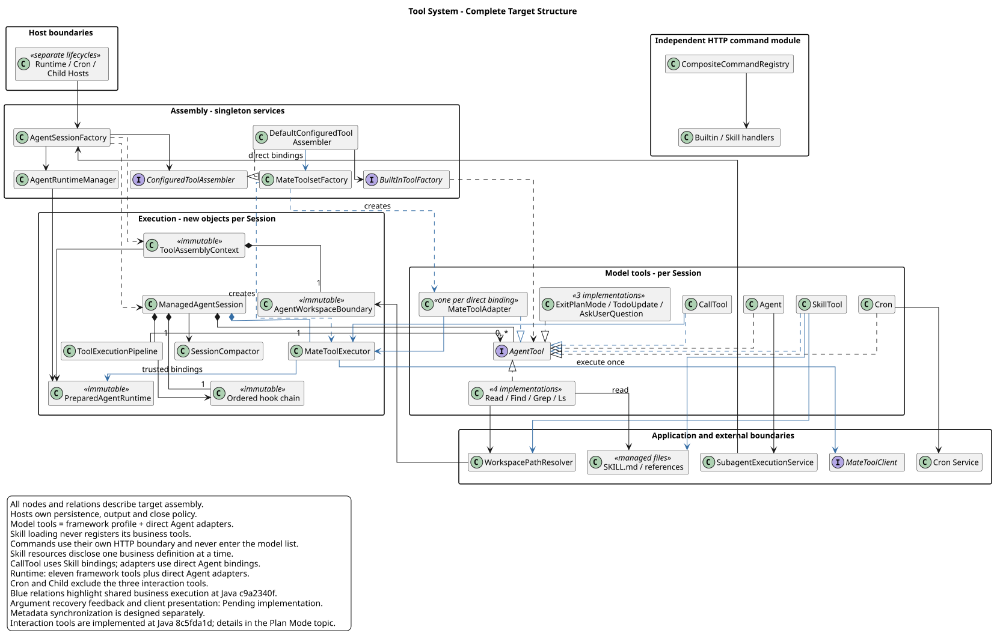
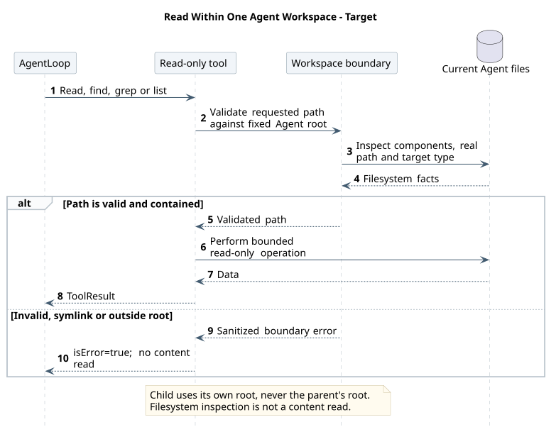
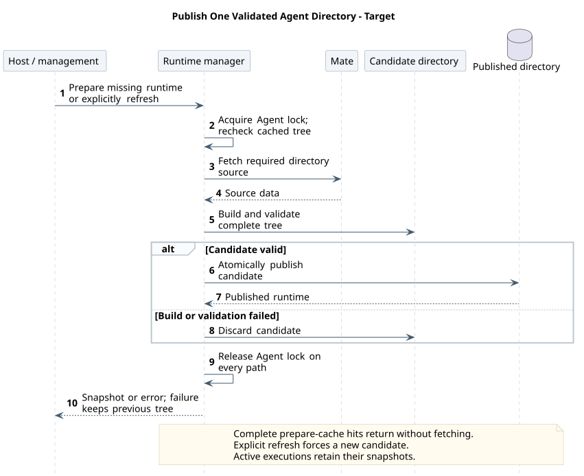
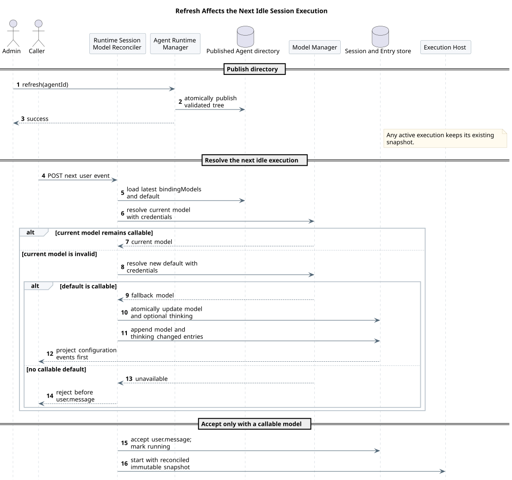
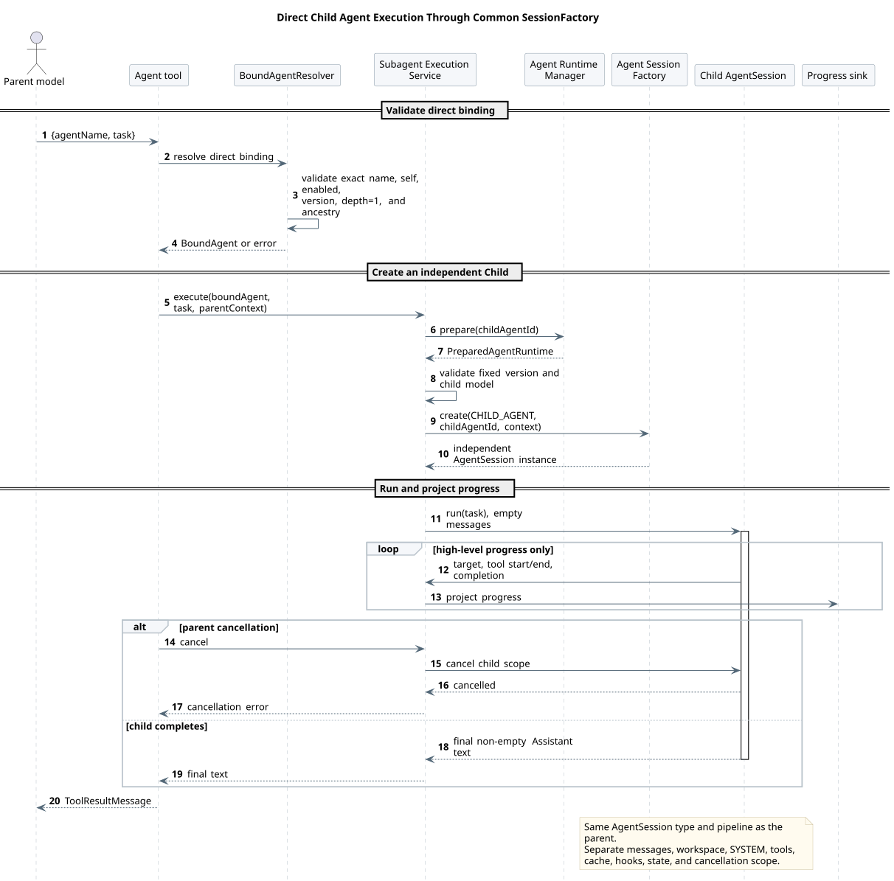
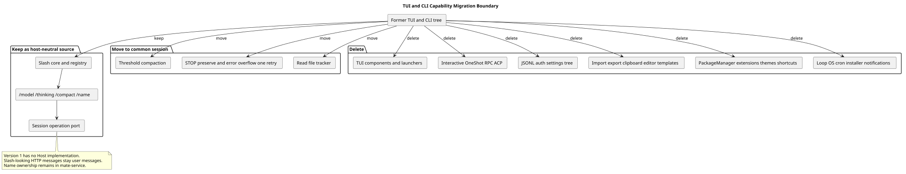
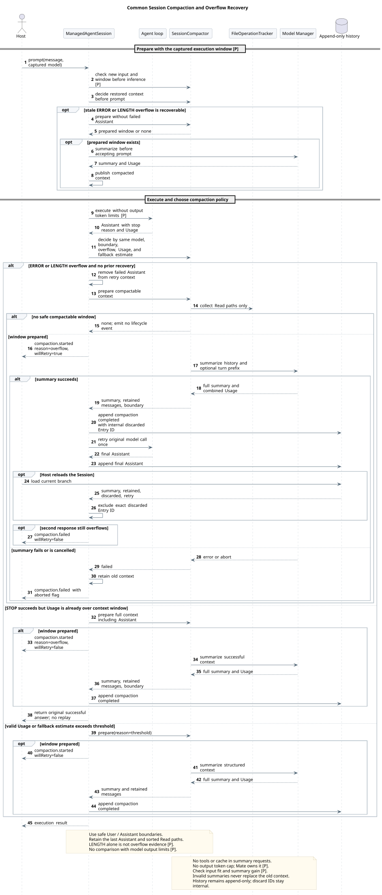

# CampusClaw 工具系统设计

| 属性 | 值 |
|---|---|
| 文档版本 | 2.26.0 |
| 状态 | 当前目标；Skill / CallTool、Agent 代理、确认前可信准备和参数恢复反馈已在 PR #323 开发提交 ae6645ca 实现；SearchTools、发现与校验的一致性接线及前端可恢复展示待实现，其余能力按源码证据分项判断 |
| 更新日期 | 2026-10-14 |
| 源码基线与范围 | [源码证据](source-evidence.md)，按实际分析提交区分装配、压缩与凭据行为 |
| 精确工具契约 | [12 个框架工具与业务代理契约](built-in-tool-contracts.md) |

本设计区分框架工具、Agent 直接关联的业务工具与 Skill 关联的业务工具。“关联”表示 Agent 或 Skill 与业务工具的配置关系，不代表执行授权；实际调用仍须通过权限检查。注册和发现增量见 [§9](#9-工具注册与发现)，当前源码及基线对照见[专项证据](source-evidence.md#skill-tool-discovery-evidence)。定时执行所需的可信接口定义与凭据解析由 [Mate 内部能力](../../02-服务与接口/02-CampusMate共享客户端配置/scheduled-execution.md)提供，待实现；工具定义的同步、缓存刷新与版本一致性继续由所属专题细化，本页固定模型发现契约与单工具定义一致性要求。

`ExitPlanMode`、[TodoUpdate](../06-CampusClaw计划模式/todo-update.md) 和 [AskUserQuestion](../06-CampusClaw计划模式/ask-user-question.md) 已在 Runtime 主线实现，plan/build 共用定义；具体交互及实现范围由[计划专题](../06-CampusClaw计划模式/README.md)维护。Mate 公共桥接状态独立判断。

## 1. 设计结论

CampusClaw 通过 Runtime、Cron 和 Subagent 三个入口运行 Agent。框架工具采用严格启动 profile；宿主另按当前 Agent 直接关联的业务工具创建远端代理。Skill 关联的业务工具由固定入口 `SearchTools` 按需披露定义，再通过固定入口 `CallTool` 执行。12 个区分大小写的框架工具如下，业务代理不计入该数量：

```text
Read
Find
Grep
Ls
Cron
Skill
SearchTools
CallTool
Agent
ExitPlanMode
TodoUpdate
AskUserQuestion
```

Runtime、Cron 和 Subagent 使用同一个轻量 `AgentSession` 类型和同一条
`AgentSessionFactory` 装配链，但每次执行得到不同实例。三个入口一致的是模型约束、
SYSTEM 解析、工具装配、hook、错误、事件与取消语义；消息持久化、active execution、
Cron Job 生命周期、Subagent 进度桥和 Host 关闭策略不进入公共 Session。

所有本地文件工具只能访问当前受管 Agent 的整个 `agent/{agentId}` 目录，包括其中的
`.campusclaw` 子树；它们不能通过相对路径、绝对路径、符号链接或真实路径访问其他 Agent。
`Bash`、`Edit`、`Write` 从产品源码与生成镜像中彻底删除，不保留未装配实现、兼容别名、
隐藏开关或可单独调用的执行器；删除边界与验收见[§12.4](#124-删除禁用与替换)。
本设计不引入 Bash、可执行脚本或 Skill 加载后的工具动态注入。`Agent` 子代理能力保持；`Loop` 完全删除。



[PlantUML 源码：`tool_system_architecture`](diagram.puml#L1) · [原尺寸 SVG](tool_system_architecture.svg)

主图保留 Host、公共 Session、工具接口和外部执行边界。`MateToolAdapter`、`SearchTools` 与 `CallTool` 复用可信工具解析职责：代理直接提供定义，SearchTools 按唯一名称返回定义，调用入口负责可信准备和执行。既有 `MateToolResolver` 承担该解析职责，发现接线待实现；本图不规定其底层加载、缓存或版本同步方式。`SkillTool` 与只读文件工具继续共用工作区边界。

<a id="initial-model-tools"></a>

### 1.1 初始模型工具集合

**入口工具配置显式设为 `[]` 时，完全不向模型提供工具，模型请求的 `tools=[]`。** 配置项缺失时使用默认值；配置非空时，按下表提供工具与 Skill 信息：

| 类型 | 第一次提供给模型的内容 | 模型如何使用 |
|---|---|---|
| 框架工具，如 `Skill`、`SearchTools`、`CallTool` | 按入口配置（profile）把完整工具定义放入 `tools` | 按框架工具名称直接调用 |
| 当前 Agent 直接关联的业务工具 | 把完整业务工具定义放入 `tools` | 按业务工具名称直接调用 |
| 可见 Skill 及其关联的业务工具 | 提示词只列出 Skill 名称、描述和使用规则；仅由 Skill 关联的业务工具定义不放入 `tools` | 通过 `Skill` 加载正文；工作流需要业务能力时用 `SearchTools` 按正文中的工具名取得单个完整定义，再经 `CallTool` 执行 |

**加载 Skill 或搜索业务工具定义只补充模型上下文，不扩充 `tools` 集合。** `SearchTools` 的返回值是数据，不会把匹配的业务工具动态注册到下一次或后续模型请求。完整调用示例见 [§1.2](#skill-call-scenario)。

业务代理受装配开关与绑定约束，名称冲突使装配失败。精确规则见 [§4](#4-工具集合与入口配置)和 [§9](#9-工具注册与发现)，对象调用见[Session 创建与工具装配](execution-details.md#session-creation)。

<a id="skill-call-scenario"></a>

### 1.2 一次完整的 Skill 工具调用

以下说明首次使用一个 Skill 关联工具的成功流程，前提是当前入口已提供 `Skill`、`SearchTools` 和 `CallTool`。`facility-operations` 和 `query-device-alarm` 是园区场景示例。

1. **加载 Skill。** 模型根据提示词中的名称和描述选择 Skill，调用 `Skill({name: "facility-operations"})`。运行时返回 Skill 正文、基础目录和抽样资源路径。
2. **按名称获取工具定义。** 正文明确“使用 `query-device-alarm` 查询设备告警”，模型调用 `SearchTools({tool: "query-device-alarm"})`。运行时在当前 Agent 的可信 Skill 工具绑定范围内精确解析名称，返回该工具的完整定义。
3. **调用关联工具。** 模型调用 `CallTool`，将 `tool` 设为 `query-device-alarm`，并按搜索结果填写 `args`。运行时按可信绑定解析目标，使用与已披露定义一致的业务 Schema，先完成业务参数校验，再进入权限判断和必要确认；放行后调用 Mate，并将结果返回模型。
4. **生成回答。** 运行时把工具结果放入下一次模型请求，模型根据结果回答用户。

每次工具结果都会进入后续模型上下文，所有模型请求沿用同一份已装配 `tools`；搜索多少次都不会累积业务代理。已有完整定义时可复用，定义不足或遗忘时可按相同的准确工具名重新获取。搜索或调用失败时，模型根据错误决定下一步；运行时不会自动继续、猜参或重放业务请求。精确规则见 [§9](#9-工具注册与发现)，内部执行边界见[渐进发现](execution-details.md#skill-tool-discovery)、[单次调用](execution-details.md#tool-invocation)和[业务执行](execution-details.md#business-execution)。

## 2. 范围与权威边界

### 2.1 本设计是工具系统唯一主设计

本专题负责：

- 12 个框架工具的名称、装配、可用条件与并发模式，以及 Agent 业务代理的注册边界；
- Runtime、Cron、Subagent 三入口的配置与 Session 装配；
- 受管 Agent 工作区边界、目录 prepare/refresh 和 Skill/Subagent 名称索引；
- Skill 逐工具发现、`CallTool` 名称解析、共用远端执行和共享 CampusMate origin 边界；
- Subagent Execution、Cron 工具边界与实现迁移。
- TUI/CLI 删除边界和公共 Session 压缩；Slash 只保留与模型工具的隔离边界。

Runtime HTTP 的资源、ResultBean、SSE、Entry 和数据库契约仍由
[Manager 驱动的多 Agent Runtime 设计](../01-CampusClaw多Agent运行时/README.md)
维护。两份文档交叉时，工具名、工具配置、受管目录和 Session 工具装配以本设计为准。

### 2.2 明确不在本专题范围

- CLI、TUI、JSONL、one-shot、RPC、ACP 和 OS 调度安装产品入口；
- Slash Command 的注册、HTTP 路由和命令行为，详见
  [Slash Command 通用模块](../../04-命令与技能/00-Slash-Command通用模块/README.md)；
- 任意自定义工具、运行中工具热注册、公共 Extension SDK 和 Skill 本地工具激活；
- 工具定义的数据同步、Schema 更新与运行时版本切换策略；
- `Bash` 沙箱、`Edit`/`Write` 工作区写入模型和旧工具名兼容；
- 跨节点 Subagent 调度、常驻 Subagent worker、Runtime 租约和分布式取消；
- 版本驱动、TTL、watcher 或 Mate 推送触发的目录自动刷新；
- Cron 持久化、集群调度、misfire、租约和保留策略的具体技术方案；
- 旧 Cron payload、旧 Extension manifest 或旧工具执行器兼容。

Cron 的数据库与集群调度由 [M10 定时任务主设计](../08-CampusClaw定时任务/README.md)维护。本设计只冻结模型工具契约、Agent
隔离和触发时的 Session 装配；当前 JSON/JSONL、进程内 scheduler、`--cron-tick` 和
launchd/crontab 仅作为遗留源码观察，不是 TOB 目标实现。

## 3. 依据与设计理由

源码事实与固定提交集中在[工具系统源码证据](source-evidence.md)。主设计保留目标与理由，工具参数和结果由[精确契约](built-in-tool-contracts.md)维护；两者不重复维护实现状态。

### 3.1 阅读方式

先通过全局目标类图了解职责与依赖，再看 [§1.1](#initial-model-tools) 的初始模型请求和 [§1.2](#skill-call-scenario) 的完整调用步骤。[执行细节](execution-details.md)按需展开 Session 创建、工具装配、单次调用、业务执行和批次调度；本页其余章节维护规则，精确参数见工具契约。

工具集合用表格说明，简单调用流程用文字步骤说明。时序图优先使用职责级参与者，一图聚焦一个场景，图前说明前提和起止；具体对象和字段由正文、源码证据及目标类图承接。实线箭头表示调用或请求，虚线表示返回；批次图的开放箭头表示异步提交。完整交互按场景拆分，失败边界在对应规则与实现图中展开。

该组织方式参考了基线的场景示例、契约示例和实现下钻，证据与适用边界见[文档风格核验](source-evidence.md#documentation-style-evidence)。已有公共装配与 Pipeline、新增待实现入口分别标注；运行时事实仍以[时序源码核验](source-evidence.md#sequence-evidence)为准。

### 3.3 目标差异分类

| 分类 | 目标差异 | 设计原因 |
|---|---|---|
| 产品约束 | 12 个 PascalCase 框架工具，另装配 Agent 直接业务代理 | 固定框架能力面，业务名称和 Schema 来自可信绑定 |
| 产品约束、安全加固 | 删除 Bash/Edit/Write 及无其他消费者的专属代码 | 本产品不提供通用本机命令和文件写入工具，缩小重新接入面并停止维护无产品用途的实现；不宣称整个 Runtime 无副作用 |
| 产品约束 | 删除 CLI/TUI 产品入口、Loop、旧名和兼容 payload | 产品没有交互终端生命周期，不承担首版兼容 |
| 架构改造 | 三入口共用轻量 Session 与工厂 | 防止模型、hook、工具、错误和取消语义漂移 |
| 架构改造 | 压缩与 Read 文件追踪迁入公共 Session | 入口删除不能让 Runtime、Cron、Subagent 丢失上下文治理 |
| 架构改造 | Runtime 使用 append-only 数据库 Entry 保存摘要与边界 | 替代 pi JSONL compaction entry，同时保持历史不可变和模型恢复边界独立 |
| 架构改造 | 用独立 HTTP Command 模块替换旧 Slash 原型 | Slash Command 不是模型工具，也不进入工具目录 |
| 架构变更 | 框架 profile 与受管业务代理分开装配 | 业务工具共用一个适配实现，不恢复任意 Extension 或运行中热注册 |
| 架构变更 | Skill 正文与具体工具定义分层披露 | 借鉴 OpenCode Code Mode 的固定搜索入口，以精确名称返回单个完整定义；不把 Skill 全部 Schema 放入正文或模型工具集合 |
| 架构改造 | 逐工具并发模式与串行 barrier | 只读工具并行且有副作用工具不跨越顺序边界 |
| 安全加固 | 注册 Schema 与动态业务参数均在交互确认前校验；框架外层拒绝未知字段，业务参数遵守业务 Schema | 明显无效的调用不打扰用户，确认通过后执行同一份已校验快照 |
| 安全加固 | 每个 Session 固化 Agent 工作区边界 | 阻止本地工具读取兄弟 Agent 或外部路径 |
| 安全加固 | Find/Grep 不在调用期下载二进制且不回退到 shell | TOB Runtime 的可执行依赖必须在部署和启动期受控 |
| 安全加固 | 受管树在同级临时目录完整校验后发布 | Session 不读取半成品，refresh 失败保留旧树 |
| 安全加固 | Mate Agent/Skill/metadata 发现请求不携带执行凭据 | 凭据只向真正执行并产生副作用的端点暴露 |
| 安全加固 | 普通交互保留请求凭据，定时执行每批工具调用前向 Mate 取统一账号 access-token，业务凭据仅用于实际 execute | 限定凭据来源、寿命与可见面，防止进入模型、日志、事件或持久化 |
| 安全加固 | 拒绝空摘要、摘要 ToolCall、失败或取消摘要 | 不允许无效摘要覆盖可恢复的旧上下文 |
| 架构变更 | Agent 代理与 CallTool 共用 Mate 执行适配 | 两种披露方式使用一致的业务参数校验、权限与凭据规则 |
| 产品约束 | Skill 加载和 SearchTools 不激活工具或授予权限 | 搜索结果只提供模型调用说明，执行身份由宿主可信绑定确定 |
| 架构改造 | Model Manager、受管 Runtime 与 Tool 共用单一 `campusmate` 配置树 | Mate 与 CampusMate 是同一个服务，不保留顶层 `mate` |
| 架构改造 | Runtime 与 Tool 共用 `campusmate.endpoints.skill-info-path-template` | 两个旧键调用完全相同的 Skill HTTP operation |
| 产品约束 | Subagent 只按直接绑定名称调用，首版深度 1 | 避免全局枚举、循环和无边界递归 |

## 4. 工具集合与入口配置

### 4.1 名称与入口枚举

```java
public enum BuiltInToolName {
    READ("Read"),
    FIND("Find"),
    GREP("Grep"),
    LS("Ls"),
    CRON("Cron"),
    SKILL("Skill"),
    SEARCH_TOOLS("SearchTools"),
    CALL_TOOL("CallTool"),
    AGENT("Agent"),
    EXIT_PLAN_MODE("ExitPlanMode"),
    TODO_UPDATE("TodoUpdate"),
    ASK_USER_QUESTION("AskUserQuestion");
}

public enum ToolEntryPoint {
    RUNTIME,
    CRON,
    SUBAGENT
}
```

`BuiltInToolName` 是框架配置、工厂和模型名的唯一映射；业务代理名称来自 Agent 直接绑定，不加入此枚举。不得通过 `Enum.valueOf` 暴露 Java
常量名，也不得做大小写归一化。`Bash`、`Edit`、`Write`、`Glob`、`ListDirectory`、
`Loop`、`ListMateTools`、`CallMateTool` 以及旧小写名都是未知目标配置值，必须阻止启动。旧实现名称只保留于源码证据和历史记录。

### 4.2 工具配置

```yaml
campusclaw:
  tools:
    runtime:
      - Read
      - Find
      - Grep
      - Ls
      - Cron
      - Skill
      - SearchTools
      - CallTool
      - Agent
      - ExitPlanMode
      - TodoUpdate
      - AskUserQuestion
    cron:
      - Read
      - Find
      - Grep
      - Ls
      - Skill
      - SearchTools
      - CallTool
      - Agent
    subagent:
      - Read
      - Find
      - Grep
      - Ls
      - Skill
      - SearchTools
      - CallTool
```

三个键遵循相同严格规则：

1. 键缺失时使用上例缺省值；
2. 显式 `[]` 表示该入口完全不向模型提供工具，模型请求的 `tools=[]`，框架工具和 Agent 直接关联的业务工具均不提供；
3. 非空数组完全替换框架缺省值，不做 merge；宿主另追加当前 Agent 直接业务工具代理；
4. 未知、重复、旧名或大小写错误阻止应用启动；
5. 配置只在启动期绑定和验证，目录 `refresh` 不重新读取配置；
6. 业务绑定不能修改框架 profile；Cron payload、Subagent 文件和模型输入不能增加任意工具；
7. 非空配置下，业务代理受 Mate 工具装配开关、当前 Agent 绑定与权限约束。

<a id="subagent-naming"></a>Subagent 是父 Agent 通过 `Agent` 工具调用的 Agent，中英文都不写作“子 Agent”或 Child；拼写与 Claude Code、pi、OpenCode 及 Codex 对外协议的 subagent 一致。调用方仍称父 Agent，因为它不一定是 Main Agent。代码、配置和模型可见文本按下表对齐，待实现：

| 位置 | 当前实现 | 目标 |
|---|---|---|
| 入口枚举 | `ToolEntryPoint.CHILD_AGENT` | `ToolEntryPoint.SUBAGENT` |
| 工具配置键 | `campusclaw.tools.child-agent` | `campusclaw.tools.subagent`，不保留旧键别名 |
| 运行时字段与方法 | `childAgentsByName`、`childAgentNames`、`ChildManifest`、`MAX_CHILD_DEPTH`、`validateChildRuntime` 等 | 对应改为 `subagents`/`subagent` 词根，如 `subagentsByName`、`subagentNames`、`SubagentManifest`、`MAX_SUBAGENT_DEPTH` |
| 运行方法 | `SubagentExecutionService.runChild` | `runSubagent` |
| 绑定读取注释 | `PreparedAgentRuntime.bindingAgents` 写“直接子 Agent 绑定”“委派时刻” | “返回当前 Agent 直接绑定的 Subagent；仅为候选元数据，权限、调用链与深度在 `Agent` 工具调用时校验” |
| 日志与异常文本 | `Child Agent` | `Subagent` |
| `Agent` 工具 description 与 Schema | `child Agent` | `subagent`，见[内置工具契约 §5](built-in-tool-contracts.md#5-agent) |
| 已有 Subagent 命名 | `SubagentExecutionService`、`SubagentExecutionContext`、角色文本 `Subagent` | 保持不变 |

放弃保留 `child-agent` 旧键别名：目前只有内置 `application.yml` 使用该键，别名会让两套名称长期并存；代价是部署环境若覆盖了旧键会因未知键阻止启动，发布说明须写明迁移。放弃 `SubAgent` 拼写：与上述基线及现有 `SubagentExecutionService` 不一致。验收：主代码与 `campusclaw/` 镜像中不再出现 `CHILD_AGENT`、`child-agent` 和 Child 词根标识符；旧键配置启动失败并提示未知键；三入口缺省 profile 与严格校验测试按新键通过。

`Cron` 只在 Runtime profile 中出现，防止 Cron execution 管理或递归创建 Job。首版最大
Subagent 深度为 1，因此 Subagent profile 不暴露必然不可执行的 `Agent`。定时入口首版不提供人工交互；默认不装配提问或审核工具之外，还须按 [M10 非交互执行约束](../08-CampusClaw定时任务/README.md#noninteractive)处理业务权限 ASK、自定义问题与误配的交互工具。

### 4.3 工具装配接口

```java
public interface ConfiguredToolAssembler {
    List<AgentTool> assemble(ToolEntryPoint entryPoint, ToolAssemblyContext context);
}

public interface BuiltInToolFactory {
    AgentTool create(BuiltInToolName name, ToolAssemblyContext context);
}
```

`ToolAssemblyContext` 是不可变值对象，至少固化入口、`AgentWorkspaceBoundary`、受管 Agent
身份、Skill/Subagent 名称索引、Execution 深度与 ancestry、模型快照、取消域、Mate 调用
上下文，以及可选 Cron 上下文。只读 operations、Mate client、Cron service 和
`SubagentExecutionService` 等应用协作者可以共享，但每个 `AgentTool` 实例必须按 Session
新建。任何工具不得把 agentId、工作区、凭据或绑定写入 Spring 单例。

`ConfiguredToolAssembler` 先装配框架工具，再委托 `MateToolsetFactory` 按 Agent 直接绑定创建 `MateToolAdapter`；每个绑定一个实例，不为每个业务能力编写 Java 类。返回候选列表前检查工具名与框架名冲突、同名不同 ID 冲突，禁止覆盖；失败不向模型提供部分列表。不同入口只使用自己的受管 Agent 绑定。该装配已在开发提交 `c9a2340` 实现，不新增 Maven 依赖。

`assemble` 输入已准备的入口与上下文，输出本 Session 的工具实例列表；失败不返回部分列表。框架工厂可通过上下文中的 Host 工厂回调创建宿主相关工具。完整对象交互见[执行细节：工具装配](execution-details.md#tool-assembly)。

## 5. Agent 工作区边界

本图聚焦本地工具的路径边界校验与内容读取；Workspace boundary 对应固定 AgentWorkspaceBoundary 与 WorkspacePathResolver。词法归一化、逐分量符号链接检查、真实路径及文件类型检查保留在下方顺序表；目录元信息检查与内容读取不同，失败不泄漏其他 Agent 标识或物理路径。



[PlantUML 源码：`read_agent_workspace_isolation`](diagram.puml#L556)

```java
public record AgentWorkspaceBoundary(String agentId, Path root, Path realRoot) {}
```

`root` 与 `realRoot` 只能由 `AgentSessionFactory` 从已验证的
`PreparedAgentRuntime.agentRoot()` 构造，范围是整个 `agent/{agentId}`。模型参数、Agent
配置和 Host 请求都不能覆盖它。

共享 `WorkspacePathResolver` 固定执行：

1. 拒绝空路径、NUL 和无效 Path；
2. 相对路径基于 root 解析，绝对路径不改变边界；
3. 字法归一化后必须仍在 root 下；
4. 遍历已存在路径分量并拒绝任何符号链接；
5. 最终真实路径必须仍在 realRoot 下；
6. Read 只接受可读普通文件，Find/Grep/Ls 只遍历边界内普通文件和目录；
7. 错误统一为脱敏文本和 `isError=true`，不回显其他 Agent ID 或物理路径。

`Read`、`Find`、`Grep`、`Ls` 必须共用该边界。Subagent Session 必须从 Subagent 自己的
`PreparedAgentRuntime.agentRoot()` 构造新边界，不继承父边界或父已验证 Path。

## 6. 公共轻量 AgentSession

`AgentSessionFactory.create` 调用 `AgentRuntimeManager.prepare(agentId)`，校验运行条件与 Agent 启用状态，再用 `bindingModels`、Model Manager 可用性和凭据解析可用模型。Factory 基于受管快照构造工作区边界与不可变工具上下文，装配工具，安装模型、SYSTEM 与有序不可变 hook 链，创建独立的 `ManagedAgentSession`。状态、消息队列和取消域按实例隔离。

入口选择、消息恢复、事件订阅和最终关闭由 Host 负责。具体创建顺序见[执行细节：Session 创建](execution-details.md#session-creation)；工具集合遵守 §4 的 profile 与绑定规则。

通用业务扩展 hook 可为空；Host 权限与确认 hook 按入口安装。已注册模型工具的输入 Schema 先校验；动态入口随后只在当前 Session 的可信绑定范围内解析目标、校验业务参数并形成不可变的 `PreparedToolInvocation`。两类校验都成功后才进入 before hook。确认通过后执行同一份准备结果，不重新解析目标或替换参数。单次调用内按固定列表顺序执行；并行调用可以同时进入同一 handler，因此 handler 必须线程安全。

| Host | 创建时机 | Host 持有 | 关闭时机 |
|---|---|---|---|
| Runtime | 接受一次 active execution 时 | 数据库 Session/Entry、请求级 SSE、确认与中断控制、active execution 注册 | execution 结束或取消后 |
| Cron | Job 触发时 | Job/Run、调度上下文和当前 Agent ID | 本次 Cron execution 结束 |
| Subagent | `Agent` 通过绑定校验后 | `SubagentExecutionContext`、进度投影和父取消桥 | 本次 Subagent execution 结束 |

父与 Subagent 使用不同的 `AgentSession` 实例，但共享同一个 Session 类型、Factory 和执行
语义。执行位置属于 Host/运行时调度实现，不属于 `Agent` 工具契约。

## 7. Pipeline、hook 与批量调度

```java
default ToolExecutionMode executionMode() {
    return ToolExecutionMode.SEQUENTIAL;
}
```

`Read`、`Find`、`Grep`、`Ls`、`Skill`、`SearchTools` 为 `PARALLEL`；`Cron`、
`CallTool`、Agent 业务代理、`Agent`、`ExitPlanMode`、`TodoUpdate`、`AskUserQuestion` 为 `SEQUENTIAL`。业务工具首版保持串行，不因改成代理而提升并发。

Pipeline 管理单次调用的校验、执行、结果与事件，Host hook 承担权限与必要确认。从模型请求到结果回传的顺序、正常返回与提前退出见[执行细节：单次调用](execution-details.md#tool-invocation)；各入口的 hook 接线状态见源码证据。

代理在 Pipeline 校验完整业务 Schema；CallTool 先校验固定外层 `{tool,args?}`，再由 §9.2 的准备阶段按可信业务 Schema 校验内部 `args`。任一参数校验失败都在 before hook 前返回，不触发用户确认；before hook 拒绝或出错在业务执行前返回。普通工具执行错误归一化后仍进入 after hook。

Schema、可用性、hook 和工具异常都转换为文本结果及 `isError=true`，不因单个工具失败
终止完整 Agent loop。取消终止当前 execution，并由 Session/Host 投影统一终态。定时入口遇到人工交互时，由 Host 记录原因并结束本次根执行，不能只抛出会被 Pipeline 转成普通工具结果的异常后继续模型；具体终止与可靠收尾见 [M10](../08-CampusClaw定时任务/README.md#noninteractive)。这一入口约束不改变参数错误先于权限判断、向模型返回同次可信定义及 `isError=true` 的修正规则，也不允许自动猜参、默认批准或重放业务请求。

连续 `PARALLEL` 调用组成并行段，等待整段完成后才能执行下一个串行调用或并行段；每个 `SEQUENTIAL` 调用是 barrier。每个调用仍执行完整 Pipeline，结果按输入顺序汇总。具体并行与等待过程见[执行细节：批次调度](execution-details.md#batch-scheduling)。分段调度已有实现；开发提交 `c9a2340` 的 CallTool 使用同一 Pipeline。

<a id="interactive-tool-batch"></a>

### 7.1 交互工具的批次位置

**要解决的问题。** 值班人员排查设备告警时，Agent 常在同一次响应里先用 `TodoUpdate` 标记进度，再调用用户确认 Tool 询问现场情况。这一组合不依赖用户答案，应当正常完成；而排在提问之后的调用是在拿到答案之前决定的，答案可能使它们失效，不应先于答案执行。

交互工具指执行中会建立用户等待的工具：`AskUserQuestion`、`ExitPlanMode` 和 [§9.2.2](#confirmation-tool-metadata) 的用户确认 Tool。`permission=ask` 的业务 Tool 授权确认属于宿主权限阶段，不是交互工具，仍按本节分段规则同批串行执行。

| 工具 | 同批规则（待实现） |
|---|---|
| `AskUserQuestion`、用户确认 Tool | 每批最多一个交互工具，且必须是该 Assistant 响应的最后一个 ToolCall；排在前面的调用按上文分段规则照常执行 |
| `ExitPlanMode` | 仍须是该响应唯一的 ToolCall；计划专属绑定条件见[计划模式 §5.2](../06-CampusClaw计划模式/README.md#52-并发与取消) |

**正常调用如何完成。** 批次规划先识别每个调用是否为交互工具：内置工具按框架工具名；Agent 业务代理与 `CallTool` 复用 §9.2 的可信目标解析，读取 §9.2.2 的确认标记（标记接入前按现有固定名称）。识别只读，不校验业务参数，不发起业务请求；目标无法解析的调用不算交互工具，在自身 Pipeline 中按原规则失败。位置合法时，前序调用按并行段与屏障执行，最后执行交互工具并等待用户；全部结果按输入顺序回传。

**位置不合法时如何处理。** 在任何调用执行之前整批拒绝：每个 ToolCall 照常保存调用事件，结果统一为 `isError=true`、`errorCode=TOOL_BATCH_INTERACTION_INVALID`，文本说明违规原因与正确做法（交互工具放在最后、每批最多一个、`ExitPlanMode` 单独调用）。整批不准备、不进入 hook、不建立等待、不执行业务，也不自动重排或拆批；模型在下一轮按反馈重新发出。

**模型可见约束。** `AskUserQuestion` 与 `ExitPlanMode` 的固定 description 写明各自位置规则。用户确认 Tool 的 description 来自业务元数据，宿主不改写；位置规则由宿主基础 SYSTEM 统一说明，模式文件 PLAN.md/BUILD.md 不重复。

**理由、放弃的方案与代价。**

- 放弃“交互工具必须唯一”：它拦下 `TodoUpdate` 加用户确认这类无害组合；并且检查位于该调用自身的 before hook，违规时只有提问失败，同批其他调用照常执行，与“明显无效的调用不产生业务请求”相反。
- 放弃 Codex、OpenCode、DeepSeek Harness 的不限制做法：它们把提问当作普通串行调用，排在后面的调用会在没有答案时执行。
- 放弃自动重排或拆批：会改变模型给出的调用顺序语义。
- `ExitPlanMode` 保持唯一：plan 模式中排在前面的只能是调研调用，方案应基于已经看到的调研结果，审核成本也高于一次往返。
- 代价：批次规划要前置一次只读的交互识别；违规时多一次模型往返；前序调用的结果在提问时模型尚未看到，问题可能已被前序结果回答。`AskUserQuestion` description 提醒不要询问同批前序调用将要查明的内容。

**源码与差距。** 2026-10-13 fetch `pi-mono-java` 默认分支 main `2b3bad05416c5ef67c6a6e085b210319d1f1b34a` 静态读取，未运行产品测试。路径前缀 R 为 `modules/coding-agent-cli/src/main/java/com/campusclaw/codingagent/`：

| 源码与符号 | 已观察行为与目标差距 |
|---|---|
| R `runtimeapi/event/RuntimeEventProjector.java#beginPreparedQuestion/#requireUniqueFinalizedCall` | `AskUserQuestion` 与用户确认 Tool 共用该检查，ToolCall 数不为 1 即以 `USER_QUESTION_MULTIPLE_TOOL_CALLS` 失败；检查在该调用自身 before hook，同批其他调用不受影响。改为批次规划阶段的位置检查，待实现 |
| R `runtimeapi/event/PlanProposalBinder.java#requireUniqueOrderedCall` | ExitPlanMode 唯一性在绑定阶段以 `PLAN_REVIEW_UNAVAILABLE` 失败；唯一性判断迁到批次规划，绑定只保留计划来源与身份校验，待实现 |
| `modules/agent-core/src/main/java/com/campusclaw/agent/tool/ToolExecutionPipeline.java#executePlanned` | 按 SEQUENTIAL/PARALLEL 分段执行，没有批次级前置检查；增加交互识别与整批拒绝，待实现 |
| `modules/coding-agent-cli/src/main/resources/prompts/plan/PLAN.md:19`、`BUILD.md:9` | 要求用户确认 Tool 时“本次 Assistant 只发出这一项工具调用”；迁到基础 SYSTEM 的位置规则后删除，待实现 |


## 8. 统一受管目录与刷新

```text
agent/{agentId}/.campusclaw/
├── agent.json
├── settings.json
├── SYSTEM.md
├── agents/{agentName}.json
└── skills/{skillName}/
    ├── skill.json
    ├── SKILL.md
    ├── references/
    └── templates/
```

`agent.json` 只保存当前 Agent 身份；`settings.json` 保存 Agent 默认 `mode`、`defaultModel`、
`bindingModels` 和直接工具绑定 `bindingTools`；`agents/{agentName}.json` 保存一个直接 Subagent 的身份、描述、enabled 和
固定版本；`skill.json` 保存 `schemaVersion=1`、ID、名称、版本和该 Skill 的 `bindingTools`。工具绑定包含技术名、展示名、ID 和权限等可信元数据，供本次执行读取；文件位置不改变 Agent/Skill 归属，也不能代替执行时的启停与权限检查。相关字段已在主线实现，核验范围见[名称来源证据](source-evidence.md#tool-display-binding-evidence)。名称必须与路径逐字符
一致，所属索引内唯一。扫描结果形成不可变的 `skillName -> skillId` 和
`agentName -> BoundAgent` 索引。

`references/` 只保存 Skill 作者提供的普通参考资料，不生成业务工具定义文件。模型通过固定 `SearchTools` 按名称获取完整定义；正文只需在业务步骤中引用唯一工具名，不包含内部 ID、参数 Schema 或平台调用协议。工具定义的加载、缓存、刷新、跨节点同步和版本切换由后续数据同步设计确定，本版不指定全量加载或按需加载。本次不移动 `skill.json`，下述目录刷新流程也不代表已经解决工具定义的数据一致性。

本图聚焦一次需要构建候选目录的发布过程；prepare 的完整缓存命中直接返回，锁内重查发现已发布也直接返回，refresh 则强制构建。锁作为 Runtime manager 的动作，候选目录与已发布目录分列以保留原子切换边界；所有成功或失败路径均释放锁。工具定义的数据同步仍另行设计，不属于本图已解决范围。



[PlantUML 源码：`managed_runtime_refresh`](diagram.puml#L303)

`prepare(agentId)` 先完整验证缓存；命中时不访问 Mate。缺失或不完整时取得 per-agent
锁，再次检查后访问 Mate，在同级临时目录写入完整树，校验名称、ID、版本、模型和路径，
最后原子发布。失败删除候选树并保留旧目录。

`refresh(agentId)` 只由受管管理流程显式调用，强制拉取并构建候选树；成功后原子替换，
失败保留旧树。活动 execution 继续使用自身不可变 runtime 快照。空闲数据库 Session 在
下一次接受用户 Entry 前读取刷新后的目录：当前模型仍在新 `bindingModels` 且具备凭据时
保留；失效时切换到具备凭据的新 default，并原子持久化模型及必要的 thinking 变更事件，
事件先于 `user.message` 投影。没有可用 default 时拒绝本次执行且不接受用户 Entry。
工具配置不参与 refresh。首版不提供 TTL、后台刷新、版本比较或 Subagent 版本不匹配时的隐式自愈。

本图从管理面已完成目录发布开始，只展示下一次空闲执行的模型校准。当前模型仍可调用时保留；失效才尝试新默认模型；无可用模型则不接纳 user.message。模型及必要 thinking 变更原子持久化后先投影，再接纳消息；刷新发布过程由前一张图说明。



[PlantUML 源码：`refresh_next_execution`](diagram.puml#L733)

## 9. 工具注册与发现

### 9.1 两种披露方式，共用远端执行

| 来源 | 模型如何发现 | 模型如何调用 |
|---|---|---|
| 框架工具 | 入口 profile | 按框架名称直接调用 |
| Agent 直接关联的业务工具 | 装配 `MateToolAdapter`，提供完整 name / description / inputSchema | 按业务工具名称直接调用 |
| 直接 Skill 关联的业务工具 | `Skill({name})` 加载正文；需要业务能力时以 `SearchTools({tool})` 按正文中的唯一工具名取得完整定义 | `CallTool({tool,args?})` |

初始模型工具集合是框架工具加 Agent 直接业务代理；仅由 Skill 关联的业务工具 Schema 不提前加入，也不在 Skill 加载或搜索后整组或逐个注入。`SearchTools` 始终是一个固定框架工具，结果只是进入上下文的定义数据，因此多轮搜索不会扩大后续请求的 `tools`。宿主保留工具的关联来源；代理名称和模型可读定义都不能代替执行授权。`ListMateTools` 退出模型工具列表，底层元数据能力由宿主可信解析层复用。

`Skill` 只接收 `name`，按当前 Agent 可见的直接 Skill 精确解析，返回正文、基础目录和除 `SKILL.md` 外最多 10 个资源文件的绝对路径，明确清单为抽样。文件内容不随清单展开，路径遵守 §5 的工作区边界；遗漏文件通过 `Ls/Find/Grep` 定位，具体文件继续由普通 `Read` 读取。不提供 `resource` 参数或在每个业务步骤中强制引用文件；也不强制每次调用前重复读取已在上下文中的完整定义。

完整调用步骤见 [§1.2](#skill-call-scenario)：每次模型返回工具调用后，运行时执行工具并把结果放入下一次模型请求，直至模型生成用户答案。

正文或完整定义已在上下文中时可复用。正文以 `query-device-alarm` 等稳定工具名说明当前步骤使用哪项能力；模型识别该名称，宿主只负责精确匹配，不新增自动解析正文并猜测工具名的程序。定义缺失或已被压缩时按准确名称调用 `SearchTools`。名称不可用时返回错误，模型核对正文或停止，不自动选择相似工具。`Read` 继续读取普通 Skill 资源。

`Skill` 是模型工具，HTTP Skill Command 是用户命令，两者共用可信 Skill 名称与绑定解析，但模型可见性与用户显式调用资格分别判断；`disableModelInvocation` 不因此关闭用户命令入口。两者不互相注册或改变各自协议。宿主提示词列出 Skill 名称、描述和 `Skill` 使用规则；正文已显式加载时按需继续读取资源，避免只为调用形式再次读取正文。

`SearchTools` 只接收一个 `tool`，与 `CallTool.tool` 使用相同的技术名，按原名精确匹配，不做大小写归一化、模糊匹配、排序或分页。工具名称唯一，不需要模型传入 `skillName` 消歧；宿主仍检查可信 Skill 绑定范围和定义可披露性。成功只返回该工具完整的 `name`、`description` 和 `inputSchema`。名称不存在、未绑定、不可披露、定义无效或不可取得时返回 `isError=true`，不枚举其他工具；定义超出结果预算时明确失败，不截断 Schema。精确错误与预算规则见[工具契约 §4.2](built-in-tool-contracts.md#42-searchtools)。

返回定义不包含工具 ID、Skill ID、版本、权限、凭据或快照 ID，也不产生模型工具激活状态。名称唯一解决定位，可信绑定确定范围，Host 决定执行授权；正文提及工具并不新增绑定。当前 Agent 的工具绑定中同名同 ID 可合并来源，同名不同 ID 必须拒绝，不能覆盖或靠模糊匹配消歧。定义只供模型构造参数，不能作为权限凭证。职责级交互见[执行细节：渐进发现](execution-details.md#skill-tool-discovery)。

### 9.2 CallTool 与 Agent 代理

`CallTool` 保留 `{tool,args?}`；`args` 省略时使用空对象。当前只解析当前 Agent 直接绑定 Skill 的业务工具，未知名称或同名不同 ID 明确失败；不接收 agentId、skillId、toolId、任意 URL，也不转发框架工具。直接 Agent 工具由其代理调用；同一工具同时来自两个范围时保留两种来源，不能因入口不同绕过权限。

`MateToolAdapter` 和 `CallTool` 共用 `MateToolExecutor`。执行分成准备和提交两段：准备段通过可信解析层在当前 Agent 的 Skill 或直接工具绑定范围内解析目标及业务 Schema，校验参数并生成不可变的 `PreparedToolInvocation`；提交段只在 Host before hook 放行后，使用固定的处理器、工具 ID、定义版本和参数执行业务；普通业务工具请求 Mate，用户确认工具在本地等待回答。权限与确认仍由 Host 承担，不迁入执行器。代理的完整 Schema 进入模型请求；`CallTool` 的固定外层 Schema 不替代业务参数校验。搜索结果只是模型说明，不作为执行目标或权限的权威来源。

代理传入 Agent 直接关联的业务工具范围，CallTool 传入直接 Skill 关联的业务工具范围；两者经各自的参数转换后委托同一个执行器。目标解析、参数校验、Mate 请求和结果返回见[执行细节：业务执行](execution-details.md#business-execution)。

按名称获取单个定义减少无关内容，但不保证模型永不遗忘。首次本地参数校验失败即按 [§9.6](#tool-argument-recovery)返回修正依据，由模型重新构造参数。加载 Skill 和获取定义都不是授权状态，也不增加模型工具。实际执行请求一经发出，超时、断连和 Mate 错误均不自动重放。

注册与发现的最小结构如下；Skill、CallTool、代理、共用执行适配、确认前准备和参数恢复反馈已在 PR #323 开发提交 `ae6645ca` 实现；SearchTools 和发现与校验的一致性接线待实现：

| 组件 | 职责与生命周期 |
|---|---|
| `MateToolsetFactory` | 共享工厂；为本次执行 Session 装配可信解析协作者、工具入口及代理；SearchTools 接线待实现 |
| `MateToolResolver` | 既有可信解析职责；按名称核对绑定并取得定义，供代理、SearchTools 和执行准备共用；发现与校验的一致性接线待实现，数据加载与同步机制待设计 |
| `MateToolAdapter` | 每个 Agent 直接工具一个 Session 实例；提供业务 Schema，委托执行 |
| `SkillTool` | Session 实例；加载 Skill 内容与抽样资源路径，不注册业务工具 |
| `SearchTools` | Session 实例；在可信 Skill 工具绑定范围内按唯一名称返回单个完整定义，不注册代理；待实现 |
| `CallTool` | Session 实例；受限的名称调用入口，在 hook 前请求准备业务调用，不维护第二套执行逻辑 |
| `PreparedToolInvocation` | 单次调用不可变快照；固定可信目标、实际校验定义和参数；PR #323 已实现 |
| `MateToolExecutor` | 本次执行内共享；准备可信业务调用，并在放行后执行同一快照 |

两类调用都复用原有取消、权限确认、工具结果和凭据规则。Pipeline 在 before hook 前完成注册 Schema 校验和必要的动态业务准备；执行层不重复确认。准备阶段不产生 Mate execute 请求。未知目标、绑定冲突、无效 Schema 或参数错误直接返回；未知权限按拒绝处理。确认等待期间不得重新解析或修改准备快照。

<a id="tool-definition-consistency"></a>

### 9.2.1 定义一致性与数据同步边界

本版固定三项调用约束：同一工具已向模型披露的定义与本次参数校验定义一致；确认与业务执行共用同一份 `PreparedToolInvocation`；参数错误反馈来自同次校验使用的可信定义。Agent 代理的模型 Schema 与其执行校验也遵循这些约束。定义无法可信取得时应明确失败，不以模型提供的 Schema 代替。

这些约束不要求创建执行实例时全量拉取工具定义，也不指定按需加载、缓存或完整 Session 定义快照。本专题中的执行 Session 是 `ManagedAgentSession` 实例，不意味着长期数据库对话的所有工具永久固定同一发布版本。定义来源接入、生成或物化、加载时机、缓存与失效、刷新、跨节点同步、版本切换，以及 Skill 正文与工具改名的发布协调，均为后续数据同步专题的待设计依赖。

本版的契约与执行链可独立实现和测试；元数据变化、进程恢复或发布切换下如何维持上述约束，须待同步设计和联调验收补齐。不能把现有解析缓存或单次准备结果描述为已经实现完整的跨版本一致性。

<a id="confirmation-tool-metadata"></a>

### 9.2.2 用户确认 Tool 的元数据分派

园区告警排查需要值班人员补充现场情况时，Agent 调用已关联的用户确认 Tool。用户确认 Tool 通过 `metadata.is_confirmation_tool=true` 标记，Tool 名仍用于模型调用和可信关联定位；分派器根据标记选择本地适配器，不再根据 `confirm_with_user` 固定名称决定处理方式。字段的类型、默认值与样例由[Tool 元数据设计](../../06-元数据设计/README.md#4-tool-元数据)唯一维护。字段驱动分派待实现。

正常流程保持：可信目标解析 → 参数校验与准备 → 宿主权限和交互准入 → 本地等待用户回答 → 结果回传。Agent 直接代理与 Skill 的 CallTool 共用分派。准备阶段从同一可信定义读取标记、固定处理器及问题快照；宿主放行后执行同一准备结果。用户回答是本次 Tool 结果，不授权后续业务操作。普通业务 Tool 继续交给 Mate 远端处理器。

用户确认 Tool 要求 label 为字符串，context 可省略或为对象，保留原始值与结构；回答以 `{"content":"..."}` 返回。仅 Runtime 根执行支持等待，实际入口权限必须为 allow；ask/deny、Subagent/Cron、端口缺失、取消或本地适配失败均明确失败，不回退远端执行。参数错误保持 isError=true，向模型返回字段错误和同次可信定义，不创建确认、不执行、不自动猜参或重放；公共事件继续隐藏内部 Schema 和敏感参数。同批位置按 [§7.1](#interactive-tool-batch) 的交互工具规则检查。

本地问答与 `permission=ask` 的执行授权确认是两个职责。用户确认 Tool 不是“任意业务 Tool 先弹卡再远调”；不能只改普通 Tool 的标记而保留其任意业务参数和执行含义。标记不得由模型或 Skill 正文提供，也不改变模型 Tool 集合、可信关联或权限规则。

**源码与差距。** 2026-10-08 静态读取本地 `pi-mono-java@553dcd5e2ff682f9684810a043b442b37a02e54a`，不作为最新上游或运行验收声明。以下路径相对 `modules/coding-agent-cli/src/main/java/com/campusclaw/codingagent/`：

| 源码与符号 | 已观察行为与目标差距 |
|---|---|
| `tool/mate/BusinessToolDispatcher#assembled/#select`、仓根 `modules/common/src/main/java/com/campusclaw/common/constant/ClawConstants.java#RuntimeApi.BUSINESS_CONFIRMATION_TOOL_NAME` | 当前按固定名称 confirm_with_user 选择本地处理器；目标改为读取可信标记，待实现 |
| `tool/mate/MateToolExecutor#prepare`、`BusinessToolHandler.InvocationDTO` | 校验后按可信名称分派，返回同次准备结果；标记传递与处理器选择接入待实现 |
| `common/client/mate/MateToolMeta`、`common/client/HttpMateToolClient#toMeta`、`common/dto/ToolInfo` | Tool 元数据接入链当前未承接确认标记；字段解析与严格校验待实现 |
| `tool/question/BusinessConfirmationAdapter#prepare/#toQuestionRequest/#execute` | 已有 label/context 转换、本地回答和失败不回退远端行为；适配输入输出约定保持 |
| `runtimeapi/runtime/RuntimeActiveExecution#beforeToolCall/#authorizePreparedQuestion` | 依据 PreparedQuestionInvocation 执行交互准入；业务确认仅 allow 放行，ask/deny 拒绝，宿主无需识别业务 Tool 名称 |

**设计理由与实施验收。** 字段驱动分派属于架构变更：业务 Tool 改名无需修改分派常量，代价是可信元数据加载链必须传递并验证标记。实施先补齐元数据读取和校验，再按标记选择并固定处理器；发布前为现有用户确认 Tool 补齐 true 标记，再移除名称判断，避免旧定义被送往远端。验收覆盖任意可信名称的 true Tool 本地问答且零远调、普通 Tool 的 false/省略分派、非法字段拒绝、两种入口一致、权限及入口拒绝、本地失败不回退、确认等待期间定义变化不改变已准备处理器。源码内现有测试仅作为已读证据，本次未运行产品测试；HTTP 模型和持久化接入按所属契约实施，本设计不新增接口或数据库表。

<a id="mate-credential-forwarding"></a>

### 9.3 执行凭据

Agent、Skill 与工具元数据查询不读取或复制业务执行凭据。`MateCredentials` 只属于本次 Host execution，不从 Session 或历史记录恢复；Agent 代理和 `CallTool` 使用同一规则。普通交互执行从本次 HTTP 请求捕获快照，定时执行通过 [Mate 内部能力](../../02-服务与接口/02-CampusMate共享客户端配置/scheduled-execution.md)按该 Agent 的绑定决定并解析本次凭据，两种来源均不得借用其他执行的值。Mate 提供定时执行所需的可信接口定义和凭据解析，具体接线待实现；Claw 仍按可信绑定解析工具、校验参数和判断权限。

普通交互的实际 execute 请求只透传快照中已提供的 `X-HW-ID`、`Authorization`、
`X-HW-APPKEY` 与 `access-token`，不改名、不生成缺失值。该快照可随同一次 Runtime
execution 的 Subagent execution 以只读方式传递，但不存入 Subagent Session。
普通 HTTP 的 Host execution 上下文及工具协作者必须存在，但凭据快照可为空或只含部分 Header。
所有本地层均不以凭据完整性决定工具装配或可用性；工具名成功解析且满足确认、取消等原有条件后，
即使四项全缺失，也向 Mate execute 发出请求，由 Mate 校验并返回结果。缺少受管 Agent、
执行上下文或必要协作者时仍按通用可用性规则失败，不能把这类缺失与空凭据混淆。
普通 HTTP 执行未提供 Header 时使用空快照，其余执行条件满足后同样交由 Mate 判断。精确读取、省略、失败投影与跨请求隔离由 [HTTP §7](../01-CampusClaw多Agent运行时/chat-http-v1-design.md#credential-forwarding)唯一维护；对应现有源码检查和待实现切片见[凭据证据](source-evidence.md#credential-forwarding-evidence)。

定时执行的配置不保存凭据引用。2026-10-13 评审确定统一账号：模型一次返回中有需要凭据的工具调用通过可信解析、参数校验和权限判断后，执行 Adapter 无入参向 Mate 取一次统一账号的 `access-token`，本批共用，只透传这一项；值只存在本批内存快照，不进入 Schedule、Run、Session、Prompt、日志或公开结果。该来源为待实现增量，不将当前 Cron 空凭据实现描述为已支持。

Claw 调用 Mate 定义查询或定时 access-token 接口所用的服务间认证，和随后业务 execute 使用的执行凭据分别配置、授权与审计；服务间身份不等于最终业务主体，也不自动授予业务工具权限。发现请求可以使用其受信服务身份，但不得复制执行凭据快照。接口与失败语义由 [Mate 契约](../../02-服务与接口/02-CampusMate共享客户端配置/scheduled-execution.md)维护；定时业务调用仍遵守同一次准备快照和 [非交互执行约束](../08-CampusClaw定时任务/README.md#noninteractive)。

<a id="tool-display-name"></a>

### 9.4 工具展示名称映射

工具执行身份与用户展示名称分开。框架接口继续使用 `AgentTool.name()` / `label()`；Host 向事件层提供统一的可选 `displayName`，不再公开一个同义 `label` 字段。名称映射由本节唯一维护，事件快照及消费规则见 [M06 调用名称快照](../01-CampusClaw多Agent运行时/chat-events-design.md#tool-display-snapshot)，UI 见[前端 §9.7](../../07-前端设计/技术设计/内容渲染.md#mate-tool-display)。

| 调用类型 | displayName 来源 | 缺失时 UI 使用的技术名 |
|---|---|---|
| 普通框架工具 | 本次执行装配的 `AgentTool.label()` | `toolName` |
| Agent 直接业务代理 | 对应可信绑定的 `displayName`，由代理 label 提供 | 代理业务名称 |
| `CallTool` | 按 `arguments.tool` 找到的可信 Skill 工具 `displayName` | `arguments.tool` |

展示名只影响标题，不参与执行身份、权限或工具去重。`CallTool.label()` 只命名外层入口，不覆盖具体业务名称；展示名缺失时回退技术名。读取展示名不得发起远端发现或执行，也不得采用模型参数或结果中的同名展示字段。

Host 在首次发布调用事件（包括待确认调用）前固定展示名，确认续跑和历史读取沿用该值。既有 `CallMateTool` 历史事件保留原名；新入口的投影与前端消费增量待实现，精确外部契约由 M06/M07 跟进，不能把更名视为已完成兼容迁移。对应当前实现见[名称来源证据](source-evidence.md#tool-display-binding-evidence)。

### 9.5 CampusMate 连接地址

Mate Tool 的目标地址由
[CampusMate 统一配置与 Endpoint 目录设计](../../02-服务与接口/02-CampusMate共享客户端配置/README.md)
统一管理。`MateToolAutoConfiguration` 必须直接注入 `campusmate.base-url` 和
`campusmate.endpoints.*`，不得再读取任何顶层 `mate.*` 或 `MATE_*` 应用变量。
`HttpMateToolClient` 的四类请求与 Model Manager、受管 Runtime 共享 scheme、host、port
和服务级 endpoint 目录：

```text
campusmate.base-url + formatted(campusmate.endpoints.agent-info-path-template, agentId)
campusmate.base-url + formatted(campusmate.endpoints.skill-info-path-template, skillId)
campusmate.base-url + campusmate.endpoints.tool-metadata-query-path
campusmate.base-url + formatted(campusmate.endpoints.tool-execute-path-template, toolId)
```

`campusmate.tool.enabled` 只控制工具装配；所有 path 只由 `campusmate.endpoints` 保存。
Skill 发现与 Runtime 的 Skill 加载读取同一个 `skill-info-path-template`，但仍可使用不同 DTO
投影同一响应。Agent、Skill 与 Tool metadata 发现必须不带凭据；只有 Tool execute
读取 POST Events 执行快照并透传其中已提供的四项 Header。执行 POST 不自动重放。

`CallTool` 是后端中立的模型入口名；`MateToolClient` 保留 Mate 适配职责。更名不改变远端 HTTP endpoint 或凭据约定。

<a id="tool-argument-recovery"></a>

### 9.6 参数校验失败的恢复反馈

**状态：后端已在 PR #323 开发提交 `ae6645caaade3b9520220a34af940210850ef36a` 实现，前端可恢复展示待实现。** 当前分支已经在 Host 确认前完成 CallTool 业务参数校验，并把同次可信定义保留在模型结果中；公开投影继续隐藏定义，前端仍把失败调用统一显示为错误。实现路径、pi 与 DeepSeek Harness 的实际顺序及验收边界见[校验链路证据](source-evidence.md#tool-validation-order-evidence)。

以园区告警查询为例：模型选择已经关联的 `query-device-alarm`，但漏传 `deviceId`。系统先在可信 Skill 绑定内找到该工具并校验参数；因为参数无效，直接把字段错误和同次工具定义返回模型，不弹出确认，也不请求 Mate。模型补全 `deviceId` 后发起新调用；参数有效时才按绑定权限放行或询问用户，用户同意后执行刚才准备的同一份调用快照。

首次本地参数校验失败时，模型收到字段错误及本次校验使用的完整输入定义，明确业务操作尚未执行。修正后的参数由模型发起一次新的调用；运行时不自行改参数、补业务值或重放请求。成功结果不重复附带定义，也不要求每次调用前重新发现工具。该恢复机制使用本次校验所依据的可信定义，不依赖之前是否调用过 SearchTools，也不增加模型工具集合或已加载工具状态。

| 校验位置 | 给模型的修正依据 | 业务执行边界 |
|---|---|---|
| Pipeline 校验 `CallTool` 外层参数 | 已注册的 `CallTool` 固定输入定义及字段错误 | 尚未进入 Host hook；不因模型填写的目标名称读取未授权业务定义 |
| 准备阶段校验 `CallTool` 业务 `args` | 同一个可信 `ResolvedTool` 的名称、说明、完整 `inputSchema` 及字段错误 | 尚未进入 Host hook；不触发确认，也不调用 Mate execute |
| Agent 直接代理在 Pipeline 校验参数 | 本次已注册的代理输入定义及字段错误 | 同样保留参数失败分类，不另建远端执行链 |

恢复信息进入模型可见的 `ToolResultMessage.content`，不能只放在 `details`；Pipeline 的异常归一化和 after hook 不能丢失它或将失败改记为成功。内部 `details.errorCode` 保留既有 `TOOL_ARGUMENTS_INVALID`，`isError=true`。具体模型结果格式由[工具契约 §4.3.1](built-in-tool-contracts.md#call-tool-recovery-result)维护。宿主使用既有 JSON/Schema 能力实现，不新增 Maven 依赖。

定义来自本次可信解析或已注册工具，不能回显模型传入的 Schema、凭据、内部 ID、原始异常栈或不可见工具信息。正常大小的定义完整返回，保留字段说明和引用依赖；输出预算不足时明确说明定义未完整提供；仅在 SearchTools 能完整披露该 Skill 工具定义时指引按精确名称重新获取，否则说明定义不可完整提供并停止盲目重试，不能把截断 JSON 当作完整定义。仅参数校验失败适用本规则；名称不可用、权限拒绝、无效工具 Schema、远端业务错误及结果未知各自保留原分类。请求已发出后的超时不标记为未执行。

Runtime 继续保存每次调用与失败结果，并向客户端投影既有 `agent.tool_result`、`isError` 和稳定 `errorCode`；精确公共契约仍由 [M06](../01-CampusClaw多Agent运行时/事件契约/common.json)维护，不向公共错误正文复制模型恢复定义。前端仅对有明确 `TOOL_ARGUMENTS_INVALID` 分类的本地失败采用[可恢复展示](../../07-前端设计/技术设计/内容渲染.md#tool-argument-recovery-display)：同根仍在处理时弱化中间失败，详细记录可展开；根终态不继续显示“正在调整”，也不按后续同名工具成功覆盖旧调用。

该架构变更以 pi 的“准备与校验先于 before hook”为主基线；DeepSeek Harness 当前 alpha 实现把 policy/ask 放在工具包装器参数校验之前，说明这不是所有 Agent 的统一固定顺序。CampusClaw 选择前置业务校验，是减少无效确认的 ToB 产品约束，同时用不可变准备快照避免确认前后目标或参数漂移。代价是 Pipeline 增加准备阶段，失败结果增加定义文本和一次模型修正调用；不能据此承诺首次调用正确、完全无等待感知或量化成功率。

## 10. Subagent Execution

本图只回答父执行如何调用一个直接绑定的 Subagent 并取得结果。绑定解析、Subagent 运行准备和进度投影由 Subagent execution service 编排；公共 Factory 装配运行对象，SubagentRunAcceptanceService 创建独立持久 Session，再由公共 Runtime 执行。身份、版本、深度、ancestry 和可用模型校验在运行前完成，失败不启动 Subagent；具体校验顺序、模型回退条件与隔离对象见本节正文。



[PlantUML 源码：`subagent_execution_sequence`](diagram.puml#L413)

模型只使用：

```json
{
  "agentName": "researcher",
  "task": "Collect source evidence for the tool pipeline."
}
```

`agentName` 只能来自当前父 Agent 的 `agents/{agentName}.json`。执行前按顺序校验精确
直接绑定、自绑定、enabled、固定版本、最大深度、ancestry 循环、Subagent 目录完整性和
模型可用性。版本不匹配是明确错误，不触发隐式 refresh。

| 组件 | 职责 |
|---|---|
| `BoundAgentTool` | 实现模型工具 `Agent`，完成参数、进度和结果投影 |
| `BoundAgentResolver` | 按名称解析直接绑定并校验身份、版本、深度和 ancestry |
| `SubagentExecutionContext` | 固化父子 ID、深度、ancestry、父模型、thinking、取消和进度 sink |
| `SubagentExecutionService` | 准备 Subagent runtime，交由持久受理与 Runtime Coordinator 执行；不直接 prompt 绕过历史 |
| `AgentSessionFactory` | 使用 `SUBAGENT` profile 创建独立 Subagent Session 实例（命名待实现，见 [§4.2](#subagent-naming)） |

Subagent 消息从空集合开始，工作区指向自己的 `agent/{subagentId}`，SYSTEM、Skill 和工具
来自 Subagent runtime。Subagent 有可用 default model 时优先，否则继承父 execution 的 model
和 thinking；最终模型必须位于 Subagent `bindingModels` 且当前具备凭据。

首版最大深度固定为 1，Subagent profile 因而不暴露 `Agent`。仍保留 ancestry 和自绑定检查，
不能只依赖深度。父侧只接收目标、工具开始/结束和完成等高层进度，不接收 reasoning、
Subagent 消息历史或完整事件流。父取消必须传播；成功结果只返回最后一条非空 Assistant
文本。Subagent 内部可以执行多个 LLM/tool turn。

父侧不接收完整历史仅是投影边界：Subagent 自己必须保存完整消息、调用、最终结果和终态。独立授权、父调用唯一关联、逐工具提交、取消与删除规则唯一见[统一执行历史](../01-CampusClaw多Agent运行时/unified-event-persistence.md)，新增链路待实现。Factory 本身不负责创建数据库资源。

## 11. Cron 与模型策略

平台任务、Run、持久受理与恢复由 [M10](../08-CampusClaw定时任务/README.md)维护：每次运行固定新建独立 Session，复用任务绑定的 Agent 定义，不创建新的 Agent 定义资源。当前进程内 Cron 已实现，新后台受理链待实现；[专项证据](../08-CampusClaw定时任务/source-evidence.md)不升级其他工具的核验范围。本节继续维护新会话 Cron 的装配规则，精确模型工具参数保持原契约；新管理入口和旧工具的统一适配按 M10 迁移切片推进。

`Cron` 保留 `create/list/delete/trigger/status/runs`，删除 `model`、`system_prompt` 和
`tools`。Job 自动保存当前受管 `agentId + prompt` 及调度元数据，所有管理动作按当前
Agent 过滤。触发时重新 `prepare(agentId)`，使用该 Agent 当时的 SYSTEM、Skills、
default model 和 `cron` profile，不使用创建时的模型或工具快照。这里的“当时”指 prepare 实际取得的已发布目录；缓存命中不会自动刷新 Mate 数据库最新版本。

模型可用集合统一为：

```text
usableModels = settings.bindingModels
               intersect Model Manager available models
               intersect models with usable credentials
```

- Runtime 创建或修改 Session 只能选择 `usableModels`；
- Cron 每次触发选择 Agent 当时可用的 default；
- Subagent 优先自身 default，否则继承父 model/thinking，并再次校验 Subagent 白名单；
- 无可用模型时本次 Session/Execution 创建失败，不回退到未绑定模型。

## 12. 实现迁移

### 12.1 公共 Session 与 Host

| 当前责任 | 目标归属 |
|---|---|
| Agent loop、消息队列、tool pipeline、hook、取消 | 公共轻量 `AgentSession` |
| 模型、SYSTEM、工具和 hook 统一构造 | `AgentSessionFactory` |
| 框架与业务代理装配 | `ConfiguredToolAssembler` + `BuiltInToolFactory` + `MateToolsetFactory` |
| HTTP 数据库恢复、SSE 和 active execution | Runtime Host |
| Cron Job/Run 与调度入口 | Cron Host |
| Subagent 绑定、进度与父取消 | `SubagentExecutionService` |
| 阈值压缩、溢出压缩和一次重试 | 公共 `ManagedAgentSession` + `SessionCompactor` |
| Read 文件追踪 | 公共压缩核心 `FileOperationTracker` |

产品不再支持 CLI/TUI，但首轮实现不移动 `modules/coding-agent-cli` Maven 模块或
`campusclaw-coding-agent` artifact。删除 launcher/config、交互/one-shot/RPC/ACP、
JSONL/TUI、`--cron-tick` 和 OS scheduler 安装路径；模块继续承载 Runtime Spring Boot、
公共 Session 和 Runtime HTTP Slash Command 模块。

### 12.2 TUI 能力 keep/move/delete



[PlantUML 源码：`tui_capability_migration`](diagram.puml#L608)

| 原责任 | 处理 | 目标边界 |
|---|---|---|
| Slash core、Registry、`/model`、`/thinking`、`/compact`、`/name` | Replace | HTTP-only 通用模块；Builtin 独立 Handler，Skill 动态 Source |
| 阈值压缩、上下文溢出压缩、一次重试 | Move | 公共 `ManagedAgentSession` |
| `FileOperationTracker` | Move | 压缩核心，首版只追踪 `Read` |
| TUI 组件、CLI launcher、Interactive/OneShot/RPC/ACP | Delete | CampusClaw 不再提供这些产品入口 |
| 本机 Auth、旧 SettingsManager、JSONL、tree/navigation | Delete | 由受管目录、数据库 Session 和各 Host 替代 |
| import/export/copy/share、剪贴板、外部编辑器、Prompt Template | Delete | 终端交互专属 |
| PackageManager、本地 Skill 安装/链接/导入、Extension、主题、快捷键 | Delete | Skill 只来自受管目录 |
| Loop、OS Cron installer、`--cron-tick`、TUI Cron 通知 | Delete | Loop 不活动；Cron 由 Runtime Host 管理 |

Runtime 通过 `GET /commands` 提供命令清单，通过 `POST /command` 执行结构化命令。
`POST /events` 不解析 Slash 文本。`/name` 修改 CampusClaw Session 名称；mate-service
只解析 Chat 到 Session 的映射。精确行为以
[Slash Command 通用模块](../../04-命令与技能/00-Slash-Command通用模块/README.md)为准。

### 12.3 公共 Session 压缩

本图只说明“选安全窗口—生成摘要—提交后替换上下文”的主流程。阈值、成功后超窗、失败后溢出及恢复前预处理的触发矩阵仍归 Session 压缩主设计；无安全窗口不发压缩生命周期事件。只有可恢复的失败调用允许一次重试；成功答案不重放。摘要失败或取消保留旧上下文，历史以追加方式保存；Read 路径、被排除 Entry 身份及重载过滤不因省略生命线而取消。



[PlantUML 源码：`managed_session_compaction`](diagram.puml#L664)

压缩由公共 ManagedAgentSession 管理，Runtime、Subagent 与 Cron 共用安全切点、摘要和单次恢复流程。参数、触发、摘要校验、历史一致性及验收唯一维护于[Session 压缩设计](../../03-数据与存储/01-会话记忆GaussDB/compaction.md)。公共事件仍只投影完整 session.compacted，图中的内部生命周期不等于公共事件名。

每个新执行从 Mate 查询当前模型窗口，同一根的 Tool Loop、自动压缩与确认续跑复用结果；独立手工压缩查询一次。普通调用及摘要均由 Mate 控制输出额度，Claw 不传输出上限，也不据此推断 LENGTH 恢复。前置输入检查、窗口变化与失败边界见[Model 专题](../../02-服务与接口/03-Model/model-capabilities.md#4-输出控制与上下文消费)，该增量待实现。成功答案不重放、失败摘要不替换上下文、历史 Entry 不删除。

### 12.4 删除、禁用与替换

| 删除或停止使用 | 目标处理 |
|---|---|
| `Bash`、`Edit`、`Write` 工具及专属实现 | 完全删除源码、专属测试、无消费者配置/资源及生成镜像；拒绝配置，不保留执行器或兼容入口 |
| `LoopTool`、`LoopManager` 和所有 Loop Host 接线 | 完全删除 |
| 任意动态 `ToolCatalog`、`DefaultToolCatalog`、`ToolSelection` | 框架 profile 与受管 Agent 代理装配 |
| Java Extension 工具、manifest tools/commands、PackageManager | 完全删除；Skill 只扫描受管目录 |
| `activate_skill`、`ListMateTools` | `Skill` 加载指引，`SearchTools` 按唯一名称返回单个完整工具定义 |
| `CallMateTool` | `CallTool`，保留 `{tool,args?}` 并限定 Skill 关联的业务工具范围 |
| `EditDiff` | 无；写工具首版硬禁用 |
| `spawn_agent`、`invoke_agent` 和 Session delegation after-hook | `Agent` + `SubagentExecutionService` |
| ACP/HTTP/A2A SubAgent backend、registry、approval placeholder | 不进入首版 Subagent Execution |
| 聚合 `references/tools.json` 和生成的单工具定义文件 | `SearchTools` 按名称取得可信定义；加载与同步另行设计 |
| 顶层 `mate.*` / `MATE_*` 应用变量 | 删除；地址、endpoint 与 Tool 开关分别迁入 `campusmate.base-url`、`campusmate.endpoints`、`campusmate.tool` |
| 重复 Skill path 配置 | 删除；Runtime 与 Tool 共读 `campusmate.endpoints.skill-info-path-template` |
| `FileAgentDirectoryResolver` 独立文件契约 | `AgentRuntimeManager.prepare` |
| HTTP 硬编码 Read | `runtime` profile |
| Cron model/system_prompt/tools payload | 触发时按当前受管 Agent 解析 |

实现只修改 `modules/*` 主源码；`campusclaw/` 通过
`scripts/sync-campusclaw.sh` 生成，不双份手工维护。

删除范围包括 `tool/bash`、`tool/edit`、`tool/write`，专属 `BashOperations`、`EditOperations`、
`WriteOperations` 及对应 Local 实现，以及仅供这两项写工具使用的 `FileMutationQueue`。
`BashExecutor`、`ShellResolver`、`DiffUtils`、`FuzzyMatch` 和相应结果类型随所属工具删除；
实现时复核引用，若发现新的有效消费者，应分离其最小职责，不能仅为保留旧工具而留下整套实现。

保留仍被活动能力使用的 `ReadOperations`、`TruncationUtils`、工作区边界与压缩逻辑；通用路径工具
按实际消费者逐项处理。受管目录发布、日志、数据库、安装脚本和受控搜索进程的正常写入/执行
不是模型工具，不因名称或 API 中出现 write/bash/ProcessBuilder 而删除。历史事件继续可读，
但恢复不能重新装配退役工具；未知工具调用仍沿用既有错误处理。

不新增 Maven 依赖。删除依赖前核对全部模块与公司镜像的其他消费者；JDK、Jackson、SLF4J 等
共享依赖不能随旧工具删除。精确源码、依赖核对和实现状态见[证据 §5](source-evidence.md#5-basheditwrite-源码删除边界2026-09-18)。
此项为产品能力收敛及安全加固：代价是放弃这三项本地能力及其 Java 实现复用；保留未装配代码
不满足目标，也不以删除它们替代 Mate/Cron 等活动工具自身的权限控制。

## 13. 实现验收

### 13.1 配置、Pipeline 与 Session

- 三入口配置项缺失时使用默认值；显式 `[]` 时，即使存在业务绑定且 Mate 工具装配已启用，模型请求仍为 `tools=[]`；非空配置完全替换框架缺省值；
- 框架 profile 拒绝未知名、旧名、重复名和大小写错误；业务名来自绑定且不覆盖框架名；
- Subagent 缺省无 `Agent`，Cron 缺省无 `Cron`；
- 同一入口连续创建两个 Session，工具实例不同且应用协作者可安全共享；
- Schema 在 before hook 前校验，hook 顺序固定；
- CallTool 在 before hook 前完成可信目标准备和业务参数校验；参数错误不创建确认记录，Mate execute 请求数为零；
- before hook 和实际执行使用同一个不可变准备快照；确认等待期间目标、定义和参数不得重新解析或替换；
- `P,P,S,P,P` 形成两个并行段和一个 barrier，结果保持原始顺序；
- `TodoUpdate` 后接 `AskUserQuestion` 或用户确认 Tool 时，前者成功、后者建立等待；交互工具后仍有调用、一批两个交互工具或 `ExitPlanMode` 与其他调用同批时，整批返回 `TOOL_BATCH_INTERACTION_INVALID`，准备、hook、确认与 Mate execute 次数均为零；
- Schema、hook、工具异常成为文本结果和 `isError=true`。

### 13.1.1 退役工具删除验收

- 主源码及公司镜像不存在三项工具类、专属 operations/executor 和无消费者的写入队列；干净构建产物不得残留旧 class；
- 三入口拒绝 `Bash/Edit/Write` 及对应小写旧名；目标框架清单及 Runtime/Cron/Subagent 缺省集合符合 §4；
- 移除旧功能专属测试，补充退役类/包不存在与配置拒绝回归，不能用减少测试数量代替能力删除证明；
- Read/Find/Grep/Ls、共享截断、目录 prepare/refresh、压缩及 Agent 子代理的相关回归通过；
- 当前产品文档不再允许保留源码或指导调用；历史源码证据、拒绝配置负例与历史事件中的名称允许保留；
- 生成镜像与主源码一致；格式、Checkstyle、相关测试及构建分别记录，公司父 POM 不可用时明确公司编译未验证。

### 13.2 目录与本地工具

- 完整缓存命中不访问 Mate，冷目录通过同级候选树原子发布；
- refresh 失败保留旧树，活动 Session 继续使用自身 runtime 快照；
- refresh 后空闲 Session 下一次执行懒校准模型；无可用 default 时不接受用户 Entry；
- 名称/路径不一致、Skill/Subagent 重名、固定版本缺失和符号链接使目录无效；
- Skill 资源路径不越界；普通参考资料继续可读，受管目录不生成工具定义文件；
- Read、Find、Grep、Ls 只能访问本 Agent 根，Subagent 只能访问 Subagent 根；
- 跨 Agent 绝对路径、`..`、符号链接、realpath 越界和非普通文件被脱敏拒绝。

### 13.3 Mate、Subagent 与 Cron

- Agent 直接工具由同一适配类创建独立实例；名称、描述和 Schema 正确进入每步模型请求；
- Skill 初始目录只披露元数据；`Skill` 输出正文、基础目录和最多 10 条抽样资源路径，不展开工具定义或增加工具；
- `SearchTools({tool})` 按原名精确返回单个完整定义；拒绝空白、未知、未绑定、不可披露和冲突名称，不回退到相似名称；不接受 query、skillName 或 limit；超大定义明确失败且不建议重复同一查询；
- 任意次数的 Skill 加载和 SearchTools 搜索都不改变下一次模型请求的工具集合；定义遗忘后可按精确名称重新搜索；
- SearchTools 披露定义与 CallTool 校验定义一致；Agent 代理同样一致；确认后执行同一准备结果；元数据刷新、发布切换和恢复场景由后续同步设计补充验收，不以本版测试宣称完整同步已实现；
- `CallTool` 仅解析 Skill 范围，拒绝未知、冲突和框架工具目标；同名同 ID 去重；
- 两个入口业务 Schema 校验与 ALLOW/ASK/DENY 一致；参数失败不进入 ASK/DENY 交互，也不产生 Mate 执行请求；
- 首次参数校验失败即带可用的字段错误和同次输入定义，经过 Pipeline、持久化恢复及 Provider 映射后仍对模型可见；校验失败的 Mate execute 请求数为零；
- 外层格式错误只返回固定入口定义；越权、未知名称、Schema 无效、远端失败与结果未知不误归为可恢复参数错误；超大定义明确标记不完整；
- 前端按稳定错误码区分纠参过程，保留每个 callId 的真实失败记录；终态、断线与刷新后不残留虚假的“正在调整”，实际执行错误仍可见；
- 用缺必填项、类型、枚举、嵌套结构等错误验证第一次反馈足以修正，记录首次失败后的调用次数、重复错误比例及额外 token；效果尚未经真实模型验证；
- Agent、Skill 和 Tool metadata 发现请求不读取或复制四项业务执行凭据；服务间认证单独核验，不把服务身份当作业务授权；
- MateToolExecutor 与 Model Manager、受管 Runtime 共用 CampusMate scheme/host/port；
- 顶层 `mate`、`mate.endpoints.*`、`mate.tool.enabled` 与 `MATE_*` 应用变量已删除；
- Tool path 只从 `campusmate.endpoints` 读取，Skill path 与 Runtime 共用唯一配置键；
- 代理和 CallTool 不向模型暴露 ID 或凭据；实际执行不自动重放，执行上下文不跨 Session 泄漏；
- POST Events/Skill Command 快照中已提供的四项 Header 只在 Tool execute 中原名透传；模型、日志、事件、持久化和其他出站请求均不包含这些业务凭据；
- 定时执行不持久化凭据引用或秘密，运行时统一使用 Mate 配置的同一个账号，每批工具调用前取 access-token；取不到时不借用请求或历史凭据，secret 只在本次内存和真实 execute 中使用；
- 定时入口覆盖业务权限 ASK、自定义问题及误配交互工具，无默认答案/批准、无等待记录，可靠结束本根；参数失败仍先返回同次可信定义供模型修正，无自动猜参或业务重放；
- 普通 HTTP 执行四项全缺失、任意部分组合与 JWT/APPKEY 同时提供均不触发本地完整性拒绝；解析/确认成功后执行请求恰好一次，Mate 失败映射为 isError=true；
- 空快照不触发 unavailable；缺 Host 上下文、发现失败、取消和确认拒绝仍保持原有处理；完整验收矩阵见 HTTP §7.3；
- Agent 校验直接绑定、固定版本、深度、循环、父取消和模型白名单；
- 父与 Subagent Session 实例隔离但使用相同 Factory/执行语义；
- Cron Job 按 Agent 隔离，触发时使用当前配置，不接受旧 payload 字段。
- Slash Command 与模型工具分开注册和测试，所有命令都不出现在模型工具清单中；
- Usage/估算阈值、失效边界、显式/静默/Xiaomi/可恢复 length 溢出通过测试；
- 成功 STOP 只压缩不重试，ERROR/LENGTH 最多重试一次，第二次溢出显式失败；
- 每个新执行查询窗口，同根续跑复用；调用与摘要无输出额度，窗口缩小及 LENGTH 判断按 Model 专题 C2～C4 验收；
- compaction completed → retry → reload 后不恢复被丢弃的 LENGTH，在线与重载上下文一致；
- 超大末条 Assistant、ToolResult 安全切点、split-turn、重复摘要边界和 Read 路径继承通过测试；
- 固定结构摘要、2000 字符截断、无工具/cache、Token 上限、瞬态重试和 Usage/Cost 合并通过测试；
- 自动 prepare 空结果不发事件，失败回滚、取消 `aborted=true` 和完整摘要恢复通过测试。

## 14. 实施顺序

SearchTools 增量按精确名称契约 → 复用可信解析 → 三入口装配与宿主提示 → 发现和调用一致性验收的顺序实施；生产数据加载与同步另行设计后接入。参数恢复后端已落在 PR #323，前端仍按 Runtime 安全投影 → 分类展示的顺序补齐；模型修正继续走普通工具循环。

1. 更新框架清单、`Skill` / `SearchTools` / `CallTool` 契约及宿主提示词，保留三入口空 profile 语义；
2. 实现工作区边界、只读工具和受管树链接校验；
3. 完成逐工具 batch planner、严格 Schema 和 hook 顺序；
4. 实现工厂、不可变上下文和公共 Session；
5. 迁移 Runtime Host 并删除 CLI 产品入口；
6. 统一目录 prepare/refresh、Skill/Subagent 索引和模型解析；
7. 复用 MateToolResolver 实现 SearchTools 的精确名称披露，并保持代理、发现与 CallTool 的定义一致性及权限边界；数据加载、缓存与同步由后续专题设计后接入；
8. 迁移 Subagent Execution 与 Cron 工具；
9. 删除 Bash/Edit/Write 及专属死代码、任意动态注册、Extension、Loop、旧 delegation 和退役模型入口；
10. 同步生成镜像并完成全量回归。

本页描述推荐目标结构；已实现部分及差距须按[源码证据](source-evidence.md)中的提交逐项判断。实现 PR 应列出实际落地范围，不能把旧差距直接延伸为最新状态。

## 15. 版本历史

| 版本 | 日期 | 变更 |
|---|---|---|
| 2.26.0 | 2026-10-15 | 父 Agent 通过 `Agent` 工具调用的 Agent 统一称为 Subagent，入口枚举、配置键和运行时标识符改用 subagent 词根（待实现）。 |
| 2.25.0 | 2026-10-14 | 合入 main：提问与用户确认 Tool 必须是本批最后一个调用，计划提交仍须单独调用，违规时整批拒绝且不执行任何调用（main 原记为 2.22.0）。 |
| 2.24.0 | 2026-10-13 | 清理定时执行“按 Agent 绑定决定凭据”的旧表述，改为统一账号。 |
| 2.23.0 | 2026-10-13 | 定时执行改为统一账号，每批工具调用前向 Mate 取 access-token。 |
| 2.22.0 | 2026-10-13 | M10 定时任务移除 credentialIds，凭据改由 Mate 按 Agent 绑定在运行时决定。 |
| 2.21.0 | 2026-10-10 | Child 保存独立完整历史并复用持久 Runtime，父侧继续只接收进度与摘要。 |
| 2.20.1 | 2026-10-08 | 用户确认元数据分派说明统一使用 Skill 和 Tool。 |
| 2.20.0 | 2026-10-08 | 用户确认工具按可信元数据标记分派，保留权限、准备快照及本地失败不回退约束。 |
| 2.19.0 | 2026-10-05 | 定时执行由 Mate 解析可信接口与凭据引用，保留普通交互快照并统一非交互入口约束。 |
| 2.18.2 | 2026-10-04 | Cron 平台任务引用对齐 M10，每次运行新建 Session 并复用已绑定的 Agent 定义。 |
| 2.18.1 | 2026-09-29 | 将 Cron 调度权威链接到 M10，并明确触发时已发布快照与后台受理增量。 |
| 2.18.0 | 2026-09-22 | SearchTools 按唯一工具名精确返回定义，定义一致性作为约束，数据加载与同步另行设计。 |
| 2.17.0 | 2026-09-22 | Skill 工具改由固定 SearchTools 有界发现，并与 CallTool 共用不可变 Session 定义快照。 |
| 2.16.1 | 2026-09-22 | 时序图按职责和单一场景表达，细节由正文与专项设计承接。 |
| 2.16.0 | 2026-09-22 | CallTool 在交互确认前准备并校验业务调用，确认后执行同一不可变快照。 |
| 2.15.0 | 2026-09-22 | 首次参数校验失败向模型提供同次工具定义，前端区分可恢复纠参与真实执行失败。 |
| 2.14.6 | 2026-09-21 | Skill 关联工具调用改为中性占位名称的四步说明，删除课程查询时序图。 |
| 2.14.5 | 2026-09-21 | 使用“关联的业务工具”描述配置关系，明确关联不等于执行授权。 |
| 2.14.4 | 2026-09-21 | 明确显式空配置完全不提供模型工具，并区分配置缺失时的默认值。 |
| 2.14.3 | 2026-09-21 | 用分类表说明初始模型工具与 Skill 的披露和调用方式，移除重复时序图。 |
| 2.14.2 | 2026-09-21 | 主文突出初始工具集合与完整 Skill 场景，对象调用和批次时序集中到执行细节。 |
| 2.14.1 | 2026-09-21 | 用中文分场景重绘工具装配、渐进发现、公共调用与批次时序，明确返回、失败出口和对象生命周期。 |
| 2.14.0 | 2026-09-20 | Agent 直接工具采用通用代理，Skill 经专用加载与单工具文件渐进披露后由 CallTool 执行。 |
| 2.13.0 | 2026-09-19 | 公共压缩复用执行级模型窗口，输出额度统一由 Mate 控制。 |
| 2.12.1 | 2026-09-19 | 压缩段落引用 Mate 能力与可选输出上限规则，避免未知上限自动填充和误判。 |
| 2.12.0 | 2026-09-19 | 工具可用条件不依赖凭据完整性，空快照同样交由 Mate execute 判断。 |
| 2.11.0 | 2026-09-19 | 展示名读取已加载的 Agent/Skill 绑定元数据，保留执行时工具解析并取消调用级 ID 与失败绑定。 |
| 2.10.0 | 2026-09-18 | 明确彻底删除 Bash/Edit/Write 源码和专属支撑，保留活动消费者并补充删除验收。 |
| 2.9.0 | 2026-09-18 | 同步主线三项交互工具实现、十一项活动清单及待实现用语。 |
| 2.8.0 | 2026-09-17 | 统一框架 label 与 Mate 元数据到 displayName 的映射，并固定调用解析快照。 |
| 2.7.0 | 2026-09-15 | 工具装配增加 AskUserQuestion 目标入口并保持元数据稳定。 |
| 2.6.7 | 2026-09-15 | 接入 TodoUpdate 后端显式任务事件，前端直接消费完整清单。 |
| 2.6.6 | 2026-09-14 | 集中维护源码证据，收敛工具与 Host 职责并重排架构和执行流程图。 |
| 2.6.5 | 2026-09-14 | Agent 默认 mode 随 settings 发布，工具定义和 Child 模式继承保持稳定。 |
| 2.6.4 | 2026-09-14 | 明确 TodoUpdate 仅记录 build 实施进度，保持跨模式工具定义稳定。 |
| 2.6.3 | 2026-09-14 | 关联 TodoUpdate 目标工具及通用结果事件的进度恢复边界。 |
| 2.6.2 | 2026-09-14 | 关联保持元数据稳定的计划模式目标增量与统一架构对比。 |
| 2.6.1 | 2026-08-31 | 同步 Slash Command 最新设计：命令由独立 HTTP 模块提供，不进入模型工具清单；`/name` 由 CampusClaw 管理 Session 名称。 |
| 2.6.0 | 2026-08-27 | 执行凭据仅供实际 Mate Tool execute 使用，发现链保持无凭据。 |
| 2.5.0 | 2026-08-26 | Runtime 与 Tool 统一读取 campusmate 配置和 Skill endpoint。 |
| 2.4.0 | 2026-08-26 | Mate Tool 统一读取 campusmate.base-url。 |
| 2.3.0 | 2026-08-24 | 按 Entry ID 排除压缩重试候选，保持在线与重载上下文一致。 |
| 2.2.0 | 2026-08-24 | 固定压缩重试、摘要继承、Read 追踪与取消边界。 |
| 2.1.0 | 2026-08-24 | 压缩与 Read 追踪归入公共 Session，刷新后按需解析下一次执行。 |
| 2.0.0 | 2026-08-23 | Runtime、Cron、Child 共用 Session 工厂及八项基础工具。 |
| 1.1.0 | 2026-08-22 | 将本地文件边界固定为整个 `agent/{agentId}`，补充跨 Agent、符号链接、非普通文件和 Child 根隔离。 |
| 1.0.0 | 2026-08-22 | 建立工具入口、CLI 与受管目录的初版边界。 |
