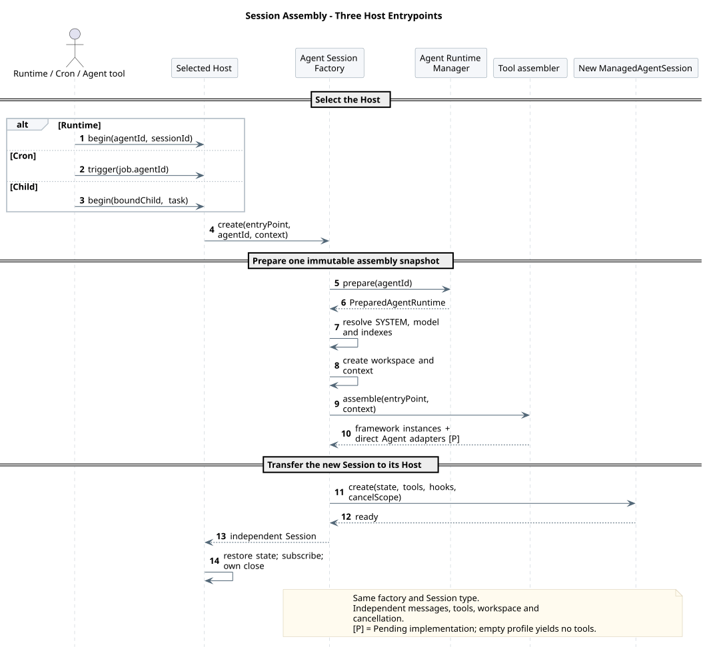
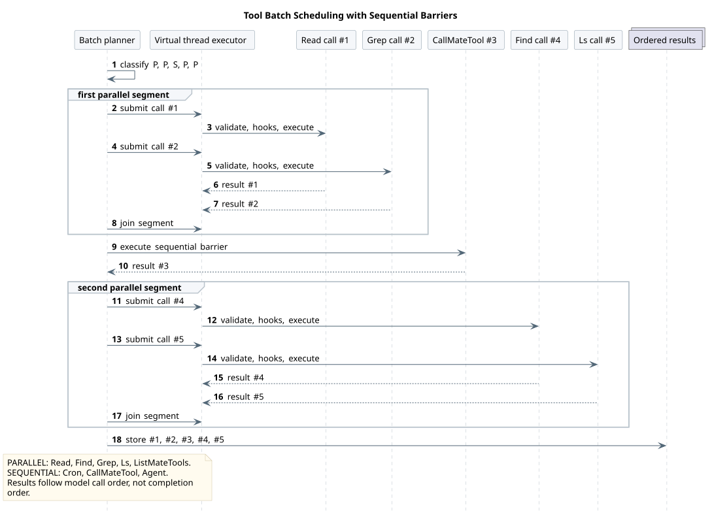

# CampusClaw 工具系统设计

| 属性 | 值 |
|---|---|
| 文档版本 | 2.12.1 |
| 状态 | 当前目标；空或部分凭据只透传、由 Mate 校验的增量待实现，其余能力按源码证据分项判断 |
| 更新日期 | 2026-09-19 |
| 源码基线与范围 | [源码证据](source-evidence.md)，按实际分析提交区分装配、压缩与凭据行为 |
| 精确工具契约 | [11 个活动内置工具与专题契约](built-in-tool-contracts.md) |

Runtime 默认 profile 已包含 ExitPlanMode、[TodoUpdate](../06-CampusClaw计划模式/todo-update.md) 和 [AskUserQuestion](../06-CampusClaw计划模式/ask-user-question.md)，共 11 项。2026-09-18 已取回并核验主线 `8c5fda1dde51675859bc9c07e145dbe253656dea`：三个工具、工厂、配置、审核/问答续跑和 TODO 事件均已有实现；详见[工具源码证据 §4](source-evidence.md#4-活动工具与主线实现状态2026-09-18)。

三个工具在 plan/build 保持同一定义，默认仅 Runtime 根装配；TodoUpdate 由提示词约束只在 build 实施阶段使用，成功结果同事务发布 agent.todo_updated。精确契约与验收由[计划专题](../06-CampusClaw计划模式/README.md)维护；Tool/Skill 元数据不变。Mate 公共桥接仍按所属专题标记待实现，不能据此把 Runtime 工具标记为待实现。对应取舍见 [A03](../07-Agent架构对比/README.md#a03) 和 [A05](../07-Agent架构对比/README.md#a05)。

## 1. 设计结论

CampusClaw 通过 Runtime、Cron 和 Child 三个入口运行 Agent。工具采用固定清单和严格启动配置，每次执行独立装配；不提供 CLI 产品入口、动态注册或 Skill 声明的本地工具。活动清单有以下 11 个区分大小写的名称，其中后三项的精确交互契约由计划专题维护：

```text
Read
Find
Grep
Ls
Cron
ListMateTools
CallMateTool
Agent
ExitPlanMode
TodoUpdate
AskUserQuestion
```

Runtime、Cron 和 Child Agent 使用同一个轻量 `AgentSession` 类型和同一条
`AgentSessionFactory` 装配链，但每次执行得到不同实例。三个入口一致的是模型约束、
SYSTEM 解析、工具装配、hook、错误、事件与取消语义；消息持久化、active execution、
Cron Job 生命周期、Child 进度桥和 Host 关闭策略不进入公共 Session。

所有本地文件工具只能访问当前受管 Agent 的整个 `agent/{agentId}` 目录，包括其中的
`.campusclaw` 子树；它们不能通过相对路径、绝对路径、符号链接或真实路径访问其他 Agent。
`Bash`、`Edit`、`Write` 从产品源码与生成镜像中彻底删除，不保留未装配实现、兼容别名、
隐藏开关或可单独调用的执行器；删除边界与验收见[§12.4](#124-删除禁用与替换)。
11 项活动工具及三入口 profile 保持不变，`Agent` 子代理能力不因删除而调整。`Loop` 完全删除。


[PlantUML 源码：`tool_system_architecture`](diagram.puml#L1)

## 2. 范围与权威边界

### 2.1 本设计是工具系统唯一主设计

本专题负责：

- 11 个活动内置工具的名称、装配、可用条件和并发模式；八项基础工具的 Schema 与输出，及三个交互工具的专题契约入口；
- Runtime、Cron、Child Agent 三入口的配置与 Session 装配；
- 受管 Agent 工作区边界、目录 prepare/refresh 和 Skill/Child 名称索引；
- Mate 工具发现、Session 名称到 ID 缓存、远端调用和共享 CampusMate origin 边界；
- Child Agent Execution、Cron 工具边界与实现迁移。
- TUI/CLI 删除边界和公共 Session 压缩；Slash 只保留与模型工具的隔离边界。

Runtime HTTP 的资源、ResultBean、SSE、Entry 和数据库契约仍由
[Manager 驱动的多 Agent Runtime 设计](../01-CampusClaw多Agent运行时/README.md)
维护。两份文档交叉时，工具名、工具配置、受管目录和 Session 工具装配以本设计为准。

### 2.2 明确不在本专题范围

- CLI、TUI、JSONL、one-shot、RPC、ACP 和 OS 调度安装产品入口；
- Slash Command 的注册、HTTP 路由和命令行为，详见
  [Slash Command 通用模块](../../04-命令与技能/00-Slash-Command通用模块/README.md)；
- 自定义工具、动态注册、公共 Extension SDK 和 Skill 本地工具激活；
- `Bash` 沙箱、`Edit`/`Write` 工作区写入模型和旧工具名兼容；
- 跨节点 Child 调度、常驻 Child worker、Runtime 租约和分布式取消；
- 版本驱动、TTL、watcher 或 Mate 推送触发的目录自动刷新；
- Cron 持久化、集群调度、misfire、租约和保留策略的具体技术方案；
- 旧 Cron payload、旧 Extension manifest 或旧工具执行器兼容。

Cron 的数据库与集群调度属于 Cron Host 的独立专题。本设计只冻结模型工具契约、Agent
隔离和触发时的 Session 装配；当前 JSON/JSONL、进程内 scheduler、`--cron-tick` 和
launchd/crontab 仅作为遗留源码观察，不是 TOB 目标实现。

## 3. 依据与设计理由

源码事实与固定提交集中在[工具系统源码证据](source-evidence.md)。主设计保留目标与理由，工具参数和结果由[精确契约](built-in-tool-contracts.md)维护；两者不重复维护实现状态。

### 3.3 目标差异分类

| 分类 | 目标差异 | 设计原因 |
|---|---|---|
| 产品约束 | 只暴露 11 个活动 PascalCase 工具 | 冻结可测试的 TOB 能力面，禁用本地写入和命令执行 |
| 产品约束、安全加固 | 删除 Bash/Edit/Write 及无其他消费者的专属代码 | 本产品不提供通用本机命令和文件写入工具，缩小重新接入面并停止维护无产品用途的实现；不宣称整个 Runtime 无副作用 |
| 产品约束 | 删除 CLI/TUI 产品入口、Loop、旧名和兼容 payload | 产品没有交互终端生命周期，不承担首版兼容 |
| 架构改造 | 三入口共用轻量 Session 与工厂 | 防止模型、hook、工具、错误和取消语义漂移 |
| 架构改造 | 压缩与 Read 文件追踪迁入公共 Session | 入口删除不能让 Runtime、Cron、Child 丢失上下文治理 |
| 架构改造 | Runtime 使用 append-only 数据库 Entry 保存摘要与边界 | 替代 pi JSONL compaction entry，同时保持历史不可变和模型恢复边界独立 |
| 架构改造 | 用独立 HTTP Command 模块替换旧 Slash 原型 | Slash Command 不是模型工具，也不进入工具目录 |
| 架构改造 | 删除 ToolCatalog、动态注册和 Java Extension 工具 | 启动期严格 profile 是唯一模型工具来源 |
| 架构改造 | 逐工具并发模式与串行 barrier | 只读工具并行且有副作用工具不跨越顺序边界 |
| 安全加固 | Schema 在 hook 前校验且拒绝未知字段 | hook 与执行器只处理已验证结构 |
| 安全加固 | 每个 Session 固化 Agent 工作区边界 | 阻止本地工具读取兄弟 Agent 或外部路径 |
| 安全加固 | Find/Grep 不在调用期下载二进制且不回退到 shell | TOB Runtime 的可执行依赖必须在部署和启动期受控 |
| 安全加固 | 受管树在同级临时目录完整校验后发布 | Session 不读取半成品，refresh 失败保留旧树 |
| 安全加固 | Mate Agent/Skill/metadata 发现请求不携带执行凭据 | 凭据只向真正执行并产生副作用的端点暴露 |
| 安全加固 | 仅 Mate execute 原名透传 POST Events 的四项执行快照 | 限定凭据寿命与可见面，防止进入模型、日志、事件或持久化 |
| 安全加固 | 拒绝空摘要、摘要 ToolCall、失败或取消摘要 | 不允许无效摘要覆盖可恢复的旧上下文 |
| 架构改造 | Mate 名称到 ID 缓存按 Session 和来源维护 | 模型直接按名称调用，同时适配现有 ID 执行接口 |
| 产品约束 | Call 缓存 miss 自动刷新，不强制模型先 List | 缓存是实现细节，不成为模型调用顺序 |
| 架构改造 | Model Manager、受管 Runtime 与 Tool 共用单一 `campusmate` 配置树 | Mate 与 CampusMate 是同一个服务，不保留顶层 `mate` |
| 架构改造 | Runtime 与 Tool 共用 `campusmate.endpoints.skill-info-path-template` | 两个旧键调用完全相同的 Skill HTTP operation |
| 产品约束 | Child 只按直接绑定名称调用，首版深度 1 | 避免全局枚举、循环和无边界递归 |

## 4. 关闭的公共接口与配置

### 4.1 名称与入口枚举

```java
public enum BuiltInToolName {
    READ("Read"),
    FIND("Find"),
    GREP("Grep"),
    LS("Ls"),
    CRON("Cron"),
    LIST_MATE_TOOLS("ListMateTools"),
    CALL_MATE_TOOL("CallMateTool"),
    AGENT("Agent"),
    EXIT_PLAN_MODE("ExitPlanMode"),
    TODO_UPDATE("TodoUpdate"),
    ASK_USER_QUESTION("AskUserQuestion");
}

public enum ToolEntryPoint {
    RUNTIME,
    CRON,
    CHILD_AGENT
}
```

`BuiltInToolName` 是配置、工厂和模型名的唯一映射。不得通过 `Enum.valueOf` 暴露 Java
常量名，也不得做大小写归一化。`Bash`、`Edit`、`Write`、`Glob`、`ListDirectory`、
`Loop` 以及所有旧小写名都是未知配置值，必须阻止启动。

### 4.2 工具配置

```yaml
campusclaw:
  tools:
    runtime:
      - Read
      - Find
      - Grep
      - Ls
      - Cron
      - ListMateTools
      - CallMateTool
      - Agent
      - ExitPlanMode
      - TodoUpdate
      - AskUserQuestion
    cron:
      - Read
      - Find
      - Grep
      - Ls
      - ListMateTools
      - CallMateTool
      - Agent
    child-agent:
      - Read
      - Find
      - Grep
      - Ls
      - ListMateTools
      - CallMateTool
```

三个键遵循相同严格规则：

1. 键缺失时使用上例缺省值；
2. 显式 `[]` 表示该入口不向模型暴露工具；
3. 非空数组完全替换缺省值，不做 merge；
4. 未知、重复、旧名或大小写错误阻止应用启动；
5. 配置只在启动期绑定和验证，目录 `refresh` 不重新读取配置；
6. Agent 文件、Cron payload、Child 文件和模型输入不能扩大或缩小 profile；
7. profile 决定模型可见能力，执行上下文仍在调用时校验。

`Cron` 只在 Runtime profile 中出现，防止 Cron execution 管理或递归创建 Job。首版最大
Child 深度为 1，因此 Child profile 不暴露必然不可执行的 `Agent`。

### 4.3 工具装配接口

```java
public interface ConfiguredToolAssembler {
    List<AgentTool> assemble(ToolEntryPoint entryPoint, ToolAssemblyContext context);
}

public interface BuiltInToolFactory {
    AgentTool create(BuiltInToolName name, ToolAssemblyContext context);
}
```

`ToolAssemblyContext` 是不可变值对象，至少固化入口、`AgentWorkspaceBoundary`、受管 Agent
身份、Skill/Child 名称索引、Execution 深度与 ancestry、模型快照、取消域、Mate 调用
上下文，以及可选 Cron 上下文。只读 operations、Mate client、Cron service 和
`SubagentExecutionService` 等应用协作者可以共享，但每个 `AgentTool` 实例必须按 Session
新建。任何工具不得把 agentId、工作区、凭据或绑定写入 Spring 单例。

## 5. Agent 工作区边界


[PlantUML 源码：`read_agent_workspace_isolation`](diagram.puml#L572)

```java
public record AgentWorkspaceBoundary(String agentId, Path root, Path realRoot) {}
```

`root` 与 `realRoot` 只能由 `AgentSessionFactory` 从已验证的
`PreparedAgentRuntime.agentRoot()` 构造，范围是整个 `agent/{agentId}`。模型参数、Agent
配置和 Host 请求都不能覆盖它。

共享 `WorkspacePathResolver` 固定执行：

1. 拒绝空路径、NUL 和无效 Path；
2. 相对路径基于 root 解析，绝对路径不改变边界；
3. 字法归一化后必须仍在 root 下；
4. 遍历已存在路径分量并拒绝任何符号链接；
5. 最终真实路径必须仍在 realRoot 下；
6. Read 只接受可读普通文件，Find/Grep/Ls 只遍历边界内普通文件和目录；
7. 错误统一为脱敏文本和 `isError=true`，不回显其他 Agent ID 或物理路径。

`Read`、`Find`、`Grep`、`Ls` 必须共用该边界。Child Session 必须从 Child 自己的
`PreparedAgentRuntime.agentRoot()` 构造新边界，不继承父边界或父已验证 Path。

## 6. 公共轻量 AgentSession



[PlantUML 源码：`agent_session_assembly`](diagram.puml#L120)

`AgentSessionFactory.create` 固定执行：

1. 调用 `AgentRuntimeManager.prepare(agentId)`；
2. 构造 Agent 工作区边界并解析 SYSTEM、Skill、Child 名称索引；
3. 用 `bindingModels`、Model Manager 可用性和凭据求可用模型；
4. 构造不可变 `ToolAssemblyContext`；
5. 按入口 profile 顺序创建全新的工具实例；
6. 复制有序不可变 before/after hook 链；
7. 创建新的 `AgentSession`、`AgentState`、消息队列和取消域；
8. 返回给 Host，由 Host 恢复消息、订阅事件并负责关闭。

首版生产 hook 链为空，但接口保留。Schema 校验发生在 before hook 之前；单次调用内按
固定列表顺序执行。并行工具调用可以同时进入同一 handler，因此 handler 必须线程安全。

| Host | 创建时机 | Host 持有 | 关闭时机 |
|---|---|---|---|
| Runtime | 接受一次 active execution 时 | 数据库 Session/Entry、请求级 SSE、确认与中断控制、active execution 注册 | execution 结束或取消后 |
| Cron | Job 触发时 | Job/Run、调度上下文和当前 Agent ID | 本次 Cron execution 结束 |
| Child | `Agent` 通过绑定校验后 | `SubagentExecutionContext`、进度投影和父取消桥 | 本次 Child execution 结束 |

父与 Child 使用不同的 `AgentSession` 实例，但共享同一个 Session 类型、Factory 和执行
语义。执行位置属于 Host/运行时调度实现，不属于 `Agent` 工具契约。

## 7. Pipeline、hook 与批量调度

```java
default ToolExecutionMode executionMode() {
    return ToolExecutionMode.SEQUENTIAL;
}
```

`Read`、`Find`、`Grep`、`Ls`、`ListMateTools` 为 `PARALLEL`；`Cron`、
`CallMateTool`、`Agent`、`ExitPlanMode`、`TodoUpdate`、`AskUserQuestion` 为 `SEQUENTIAL`。



[PlantUML 源码：`tool_batch_scheduling`](diagram.puml#L505)

Batch planner 保持模型调用原始顺序，把连续 `PARALLEL` 调用组成并行段并等待整段完成；
每个 `SEQUENTIAL` 调用是 barrier。结果按原始调用顺序回填，而不是按完成时间排序。

每次调用固定经过：

```text
resolve configured tool
  -> validate JSON Schema
  -> ordered before hooks
  -> emit execution start
  -> execute tool
  -> ordered after hooks
  -> emit execution end
  -> project ToolResultMessage
```

Schema、可用性、hook 和工具异常都转换为文本结果及 `isError=true`，不因单个工具失败
终止完整 Agent loop。取消终止当前 execution，并由 Session/Host 投影统一终态。

## 8. 统一受管目录与刷新

```text
agent/{agentId}/.campusclaw/
├── agent.json
├── settings.json
├── SYSTEM.md
├── agents/{agentName}.json
└── skills/{skillName}/
    ├── skill.json
    ├── SKILL.md
    ├── references/
    └── templates/
```

`agent.json` 只保存当前 Agent 身份；`settings.json` 保存 Agent 默认 `mode`、`defaultModel`、
`bindingModels` 和直接工具绑定 `bindingTools`；`agents/{agentName}.json` 保存一个直接 Child 的身份、描述、enabled 和
固定版本；`skill.json` 保存 `schemaVersion=1`、ID、名称、版本和该 Skill 的 `bindingTools`。工具绑定包含技术名、展示名、ID 和权限等可信元数据，供本次执行读取；文件位置不改变 Agent/Skill 归属，也不能代替执行时的启停与权限检查。相关字段已在主线实现，核验范围见[名称来源证据](source-evidence.md#tool-display-binding-evidence)。名称必须与路径逐字符
一致，所属索引内唯一。扫描结果形成不可变的 `skillName -> skillId` 和
`agentName -> BoundAgent` 索引。

目录不生成或读取 `references/tools.json`。Skill references 只保存真实资料；模型通过
`Read` 按需读取 `SKILL.md`、references 和 templates。删除 `activate_skill`；读取 Skill
不会改变模型工具列表，需要远端能力时调用 `ListMateTools({skillName})`。


[PlantUML 源码：`managed_runtime_refresh`](diagram.puml#L180)

`prepare(agentId)` 先完整验证缓存；命中时不访问 Mate。缺失或不完整时取得 per-agent
锁，再次检查后访问 Mate，在同级临时目录写入完整树，校验名称、ID、版本、模型和路径，
最后原子发布。失败删除候选树并保留旧目录。

`refresh(agentId)` 只由受管管理流程显式调用，强制拉取并构建候选树；成功后原子替换，
失败保留旧树。活动 execution 继续使用自身不可变 runtime 快照。空闲数据库 Session 在
下一次接受用户 Entry 前读取刷新后的目录：当前模型仍在新 `bindingModels` 且具备凭据时
保留；失效时切换到具备凭据的新 default，并原子持久化模型及必要的 thinking 变更事件，
事件先于 `user.message` 投影。没有可用 default 时拒绝本次执行且不接受用户 Entry。
工具配置不参与 refresh。首版不提供 TTL、后台刷新、版本比较或 Child 版本不匹配时的隐式自愈。


[PlantUML 源码：`refresh_next_execution`](diagram.puml#L829)

## 9. Mate 工具发现、缓存与执行

### 9.1 `ListMateTools`


[PlantUML 源码：`list_mate_tools_sequence`](diagram.puml#L268)

模型输入只有可选 `skillName`。无参数时查询当前 Agent；有名称时通过本地 Skill 索引解析
ID。模型不能提交 agentId、skillId 或 toolId。

`MateToolClient` 发现接口拆为：

```java
List<MateToolMeta> listAgentTools(String agentId);
List<MateToolMeta> listSkillTools(String skillId);
ToolResult callTool(String toolId, Map<String, Object> args,
    MateCredentials credentials);
```

`listAgentTools` 与 `listSkillTools` 的 binding/metadata HTTP 请求始终不带
`X-HW-ID`、`Authorization`、`X-HW-APPKEY` 或 `access-token`。
在 Runtime POST Events 路径，`MateCredentials` 只由本次 execution 创建，
以不可变值对象保留收到的四项 Header，不提供日志或持久化转换。
其他 Host 如需凭据必须使用自身已评审的 execution 凭据源，不得从 Session
或历史记录恢复 POST Events Header。

List 先取得有序 binding tool IDs，再批量查询元数据，以 ID 关联并恢复绑定顺序。模型
输出只含 `scope` 和每项 `name`、`description`、`inputSchema`，不含任何资源 ID、
permission、outputSchema、并发属性或 Mate 原始信封。每次 List 都实时访问 Mate；空列表
是成功结果。成功查询同时原子刷新 Session 缓存中对应来源的名称到 ID 映射，不清除其他
来源。

<a id="mate-credential-forwarding"></a>

### 9.2 `CallMateTool`


[PlantUML 源码：`call_mate_tool_sequence`](diagram.puml#L334) · [原尺寸 SVG](call_mate_tool_sequence.svg)

模型只提交 `{tool,args?}`，不提交 Skill、Agent、scope 或 toolId。Call 先按 toolName 查询
Session `MateToolResolutionCache`；命中后使用内部 ID 调用 Mate。未命中时通过 Session 级
single-flight 刷新当前 Agent 的完整有效集合：当前 Agent 直接工具加所有直接 Skill
工具。完整查询、合并和唯一性校验成功后才原子替换缓存，然后再次解析名称。

同名映射到相同 ID 时去重，同名映射到不同 ID 时作为配置冲突失败。刷新失败保留旧缓存，
本次未命中调用返回 `isError=true`。只允许自动重试名称发现；一旦向执行端点提交请求，
网络中断、超时和 Mate 错误都不得自动重放。Mate 对当前 Agent 身份、凭据、实时绑定和
权限做最终校验。

实际 execute 请求只透传快照中已提供的 `X-HW-ID`、`Authorization`、
`X-HW-APPKEY` 与 `access-token`，不改名、不生成缺失值。该快照可随同一次 Runtime
execution 的 Child execution 以只读方式传递，但不存入 Child Session。
当前 Host execution 上下文及工具协作者必须存在，但凭据快照可为空或只含部分 Header。
所有本地层均不以凭据完整性决定工具装配或可用性；工具名成功解析且满足确认、取消等原有条件后，
即使四项全缺失，也向 Mate execute 发出请求，由 Mate 校验并返回结果。缺少受管 Agent、
执行上下文或必要协作者时仍按通用可用性规则失败，不能把这类缺失与空凭据混淆。
Cron 不新增凭据来源，也不从历史恢复或借用其他执行的值；Host 未提供 Header 时使用空快照，
其余执行条件满足后同样交由 Mate 判断。精确读取、省略、失败投影与跨请求隔离由
[HTTP §7](../01-CampusClaw多Agent运行时/chat-http-v1-design.md#credential-forwarding)唯一维护；
对应现有源码检查和待实现切片见[凭据证据](source-evidence.md#credential-forwarding-evidence)。

<a id="tool-display-name"></a>

### 9.2.1 工具展示名称映射

工具执行身份与用户展示名称分开。框架接口继续使用 `AgentTool.name()` / `label()`；Host 向事件层提供统一的可选 `displayName`，不再公开一个同义 `label` 字段。名称映射由本节唯一维护，事件快照及消费规则见 [M06 调用名称快照](../01-CampusClaw多Agent运行时/chat-events-design.md#tool-display-snapshot)，UI 见[前端 §9.7](../../07-前端设计/技术设计/内容渲染.md#mate-tool-display)。

| 调用类型 | displayName 来源 | 缺失时 UI 使用的技术名 |
|---|---|---|
| 普通框架工具 | 本次执行装配的 `AgentTool.label()` | `toolName` |
| `CallMateTool` | 本次 `PreparedAgentRuntime` 中 Agent 及直接 Skill 的 `BoundTool.displayName` | `arguments.tool` |

`CallMateTool.label()` 只命名外层入口，不能覆盖具体业务工具；业务展示名缺失时不回退为 “Call Mate Tool” 或“调用业务工具”。展示名称可以重复，也可以与技术名相同，不参与名称到 ID 解析、权限、确认身份或结果关联。仅接受服务端工具定义/元数据，不采用模型 arguments 或结果文本中的同名字段。

Host 从本次已经准备的 Agent `metadata.bindingTools` 与直接 Skill `bindingTools` 按技术名取得展示名。读取过程只访问本地不可变元数据，不调用 `MateToolDiscovery` 或远程接口，不改变 Session 名称到 ID 缓存。业务展示名由上游 `varchar(256)` 字段约束；缺失、空白或同名记录的身份/展示名冲突时仅省略展示字段，不影响原来的执行判定。普通工具从实际装配实例读取 `label()`，同样不为展示执行工具。

Host 在第一次发布调用事件（包括待确认调用）前取得并保存本次展示名称。确认续跑和历史读取沿用已经保存的名称；展示快照不保存执行目标，也不按 `toolCallId` 缓存工具解析异常。`CallMateTool.execute` 继续在实际执行时按名称解析工具 ID，保留原有发现、single-flight、同名冲突与失败处理。产品中的工具只会启停，不以调用期间同名工具动态改绑作为本展示需求的前提；实际执行仍由原有链路校验当前启停、绑定、凭据与权限，确认前的名称不是可执行证明。

`ListMateTools` 的模型输出仍为 name/description/inputSchema；展示名不进入工具参数、模型 ToolCall/ToolResult 或提示词。`AgentTool` 和内核工具执行事件无需新增展示字段；由 Host 利用本次工具装配与绑定元数据补齐外部调用事件。本增量是产品可读性约束和展示数据传递的架构变更，不新增 Maven/npm 依赖，也不新增工具类型或改变现有主图的分层关系。

实施从 `PreparedAgentRuntime → Host 展示名 → M06 调用事件 → M07 标题` 完成字段传递。验收覆盖普通 label 与 name 不同、空 label、Agent/Skill 业务名有效/缺失/冲突、相同展示名对应不同技术名、ASK/ALLOW/DENY 首次取名不发起发现请求、确认及历史标题一致，以及实际执行时的原解析与失败恢复语义。源码、pi 对照、分支实现和验证范围见[名称来源专项证据](source-evidence.md#tool-display-binding-evidence)；公共 Mate bridge 的实现状态独立记录。

### 9.3 CampusMate 连接地址

Mate Tool 的目标地址由
[CampusMate 统一配置与 Endpoint 目录设计](../../02-服务与接口/02-CampusMate共享客户端配置/README.md)
统一管理。`MateToolAutoConfiguration` 必须直接注入 `campusmate.base-url` 和
`campusmate.endpoints.*`，不得再读取任何顶层 `mate.*` 或 `MATE_*` 应用变量。
`HttpMateToolClient` 的四类请求与 Model Manager、受管 Runtime 共享 scheme、host、port
和服务级 endpoint 目录：

```text
campusmate.base-url + formatted(campusmate.endpoints.agent-info-path-template, agentId)
campusmate.base-url + formatted(campusmate.endpoints.skill-info-path-template, skillId)
campusmate.base-url + campusmate.endpoints.tool-metadata-query-path
campusmate.base-url + formatted(campusmate.endpoints.tool-execute-path-template, toolId)
```

`campusmate.tool.enabled` 只控制工具装配；所有 path 只由 `campusmate.endpoints` 保存。
Skill 发现与 Runtime 的 Skill 加载读取同一个 `skill-info-path-template`，但仍可使用不同 DTO
投影同一响应。Agent、Skill 与 Tool metadata 发现必须不带凭据；只有 Tool execute
读取 POST Events 执行快照并透传其中已提供的四项 Header。Session 缓存和执行
POST 不自动重放等其他契约不变。

`ListMateTools`、`CallMateTool` 与 `MateToolClient` 是既有模型/Java 契约，不因 Spring
配置树统一而改名。若要改模型可见工具名，必须独立评审 Schema、提示词和兼容性。

## 10. Child Agent Execution


[PlantUML 源码：`subagent_execution_sequence`](diagram.puml#L428)

模型只使用：

```json
{
  "agentName": "researcher",
  "task": "Collect source evidence for the tool pipeline."
}
```

`agentName` 只能来自当前父 Agent 的 `agents/{agentName}.json`。执行前按顺序校验精确
直接绑定、自绑定、enabled、固定版本、最大深度、ancestry 循环、Child 目录完整性和
模型可用性。版本不匹配是明确错误，不触发隐式 refresh。

| 组件 | 职责 |
|---|---|
| `BoundAgentTool` | 实现模型工具 `Agent`，完成参数、进度和结果投影 |
| `BoundAgentResolver` | 按名称解析直接绑定并校验身份、版本、深度和 ancestry |
| `SubagentExecutionContext` | 固化父子 ID、深度、ancestry、父模型、thinking、取消和进度 sink |
| `SubagentExecutionService` | 准备 Child runtime，通过公共 Factory 创建并执行 Child Session |
| `AgentSessionFactory` | 使用 `CHILD_AGENT` profile 创建独立 Child Session 实例 |

Child 消息从空集合开始，工作区指向自己的 `agent/{childAgentId}`，SYSTEM、Skill 和工具
来自 Child runtime。Child 有可用 default model 时优先，否则继承父 execution 的 model
和 thinking；最终模型必须位于 Child `bindingModels` 且当前具备凭据。

首版最大深度固定为 1，Child profile 因而不暴露 `Agent`。仍保留 ancestry 和自绑定检查，
不能只依赖深度。父侧只接收目标、工具开始/结束和完成等高层进度，不接收 reasoning、
Child 消息历史或完整事件流。父取消必须传播；成功结果只返回最后一条非空 Assistant
文本。Child 内部可以执行多个 LLM/tool turn。

## 11. Cron 与模型策略

`Cron` 保留 `create/list/delete/trigger/status/runs`，删除 `model`、`system_prompt` 和
`tools`。Job 自动保存当前受管 `agentId + prompt` 及调度元数据，所有管理动作按当前
Agent 过滤。触发时重新 `prepare(agentId)`，使用该 Agent 当时的 SYSTEM、Skills、
default model 和 `cron` profile，不使用创建时的模型或工具快照。

模型可用集合统一为：

```text
usableModels = settings.bindingModels
               intersect Model Manager available models
               intersect models with usable credentials
```

- Runtime 创建或修改 Session 只能选择 `usableModels`；
- Cron 每次触发选择 Agent 当时可用的 default；
- Child 优先自身 default，否则继承父 model/thinking，并再次校验 Child 白名单；
- 无可用模型时本次 Session/Execution 创建失败，不回退到未绑定模型。

## 12. 实现迁移

### 12.1 公共 Session 与 Host

| 当前责任 | 目标归属 |
|---|---|
| Agent loop、消息队列、tool pipeline、hook、取消 | 公共轻量 `AgentSession` |
| 模型、SYSTEM、工具和 hook 统一构造 | `AgentSessionFactory` |
| 工具筛选和实例创建 | `ConfiguredToolAssembler` + `BuiltInToolFactory` |
| HTTP 数据库恢复、SSE 和 active execution | Runtime Host |
| Cron Job/Run 与调度入口 | Cron Host |
| Child 绑定、进度与父取消 | `SubagentExecutionService` |
| 阈值压缩、溢出压缩和一次重试 | 公共 `ManagedAgentSession` + `SessionCompactor` |
| Read 文件追踪 | 公共压缩核心 `FileOperationTracker` |

产品不再支持 CLI/TUI，但首轮实现不移动 `modules/coding-agent-cli` Maven 模块或
`campusclaw-coding-agent` artifact。删除 launcher/config、交互/one-shot/RPC/ACP、
JSONL/TUI、`--cron-tick` 和 OS scheduler 安装路径；模块继续承载 Runtime Spring Boot、
公共 Session 和 Runtime HTTP Slash Command 模块。

### 12.2 TUI 能力 keep/move/delete


[PlantUML 源码：`tui_capability_migration`](diagram.puml#L647)

| 原责任 | 处理 | 目标边界 |
|---|---|---|
| Slash core、Registry、`/model`、`/thinking`、`/compact`、`/name` | Replace | HTTP-only 通用模块；Builtin 独立 Handler，Skill 动态 Source |
| 阈值压缩、上下文溢出压缩、一次重试 | Move | 公共 `ManagedAgentSession` |
| `FileOperationTracker` | Move | 压缩核心，首版只追踪 `Read` |
| TUI 组件、CLI launcher、Interactive/OneShot/RPC/ACP | Delete | CampusClaw 不再提供这些产品入口 |
| 本机 Auth、旧 SettingsManager、JSONL、tree/navigation | Delete | 由受管目录、数据库 Session 和各 Host 替代 |
| import/export/copy/share、剪贴板、外部编辑器、Prompt Template | Delete | 终端交互专属 |
| PackageManager、本地 Skill 安装/链接/导入、Extension、主题、快捷键 | Delete | Skill 只来自受管目录 |
| Loop、OS Cron installer、`--cron-tick`、TUI Cron 通知 | Delete | Loop 不活动；Cron 由 Runtime Host 管理 |

Runtime 通过 `GET /commands` 提供命令清单，通过 `POST /command` 执行结构化命令。
`POST /events` 不解析 Slash 文本。`/name` 修改 CampusClaw Session 名称；mate-service
只解析 Chat 到 Session 的映射。精确行为以
[Slash Command 通用模块](../../04-命令与技能/00-Slash-Command通用模块/README.md)为准。

### 12.3 公共 Session 压缩


[PlantUML 源码：`managed_session_compaction`](diagram.puml#L703)

默认配置为 `enabled=true`、`reserveTokens=16384`、`keepRecentTokens=20000`。执行正常结束后
超过阈值则压缩；摘要瞬态重试默认开启、最多 3 次、基础退避 2000ms。`enabled=false`
同时关闭阈值和溢出自动压缩。判定只接受当前
provider/model 且晚于最新压缩边界的 Assistant。优先使用最后一条有效 Assistant Usage；
Usage 不可用时，从该位置以后估算尾部消息，文本与 JSON 参数使用 `ceil(chars/4)`，image
按 4800 chars。只有 Token 严格大于 `contextWindow-reserveTokens` 才触发阈值压缩。

自动压缩必须区分两类溢出：

1. 正常 `STOP` 且 Usage 已超过窗口是“静默成功溢出”。压缩包含成功 Assistant 的完整
   上下文，向 Host 返回原成功答案，不重放已经成功的模型调用。
2. `ERROR`、`LENGTH`、provider 显式 overflow 或可恢复 length 是“失败溢出”。只在压缩
   候选中排除该失败 Assistant，成功后重试一次；第二次仍溢出时发出明确失败，不再进入
   “压缩—重试”循环。数据库恢复出的未处理失败溢出在接受下一条 prompt 前先压缩恢复。

模型窗口、可选输出上限及 LENGTH 判定由[Model 能力专题](../../02-服务与接口/03-Model/model-capabilities.md#4-可选-maxtokens-的消费规则)统一维护：从 Mate 查询后发布到 Agent 快照，未知上限不自动填普通 Chat 额度，也不触发依赖该值的恢复启发式；该增量待实现。压缩生命周期的权威规则见[Session 压缩设计](../../03-数据与存储/01-会话记忆GaussDB/compaction.md)。

自动流程先执行 `prepare`；如果没有安全可压缩窗口则静默跳过，不投影 started/failed。
切点只允许 User 或 Assistant，ToolResult 不能成为第一条保留消息。最后一条 Assistant
即使独自超过 `keepRecentTokens` 也必须保留；同一轮被切掉的前缀单独摘要，再与历史摘要
合并 Usage/Cost。重复压缩更新上一次摘要并继承已排序的 `<read-files>`，边界始终指向
当前上下文第一条保留消息。

摘要使用固定 Goal/Constraints/Progress/Decisions/Next Steps/Critical Context 结构和
`<conversation>/<previous-summary>` 标签，序列化 thinking、tool name 和 JSON 参数；单个
ToolResult 最多 2000 字符。摘要调用无工具、cache 为 none、使用新的 routing session ID；
历史摘要与轮次前缀预算按 Session 压缩设计执行；模型输出上限未知时仍保留摘要自身预算；
仅瞬态失败按有界退避重试。摘要为空、包含 ToolCall、失败或被取消时不替换旧上下文，
历史 Entry 不删除。

Runtime 只在 prepare 成功后发 `session.compaction.started`。失败事件包含
`reason/willRetry/aborted/message` 且不持久化；成功事件保存完整摘要、保留边界、压缩前后
Token 和本次 Usage。`willRetry=true` 时还在持久化 payload 内保存 `_discardedEntryId`，重载
按该 ID 精确排除已经从在线上下文移除的 `ERROR/LENGTH`；该内部字段不进入历史或 SSE
公共事件。旧 Entry 缺少该字段时只回退识别压缩前最后一条可重试 Assistant。CampusClaw
只追踪 PascalCase `Read`，不恢复 pi 的 Bash/Edit/Write、
JSONL/tree/Extension 或 CLI 提示能力；这些是已明确的产品约束。

### 12.4 删除、禁用与替换

| 删除或停止使用 | 目标处理 |
|---|---|
| `Bash`、`Edit`、`Write` 工具及专属实现 | 完全删除源码、专属测试、无消费者配置/资源及生成镜像；拒绝配置，不保留执行器或兼容入口 |
| `LoopTool`、`LoopManager` 和所有 Loop Host 接线 | 完全删除 |
| `ToolCatalog`、`DefaultToolCatalog`、`ToolSelection` | 启动期严格 profile 和关闭工厂 |
| Java Extension 工具、manifest tools/commands、PackageManager | 完全删除；Skill 只扫描受管目录 |
| `activate_skill` | `Read(SKILL.md)` + `ListMateTools` |
| `EditDiff` | 无；写工具首版硬禁用 |
| `spawn_agent`、`invoke_agent` 和 Session delegation after-hook | `Agent` + `SubagentExecutionService` |
| ACP/HTTP/A2A SubAgent backend、registry、approval placeholder | 不进入首版 Child Agent Execution |
| `references/tools.json` | Skill 身份索引 + Mate 实时发现和 Session 解析缓存 |
| 顶层 `mate.*` / `MATE_*` 应用变量 | 删除；地址、endpoint 与 Tool 开关分别迁入 `campusmate.base-url`、`campusmate.endpoints`、`campusmate.tool` |
| 重复 Skill path 配置 | 删除；Runtime 与 Tool 共读 `campusmate.endpoints.skill-info-path-template` |
| `FileAgentDirectoryResolver` 独立文件契约 | `AgentRuntimeManager.prepare` |
| HTTP 硬编码 Read | `runtime` profile |
| Cron model/system_prompt/tools payload | 触发时按当前受管 Agent 解析 |

实现只修改 `modules/*` 主源码；`campusclaw/` 通过
`scripts/sync-campusclaw.sh` 生成，不双份手工维护。

删除范围包括 `tool/bash`、`tool/edit`、`tool/write`，专属 `BashOperations`、`EditOperations`、
`WriteOperations` 及对应 Local 实现，以及仅供这两项写工具使用的 `FileMutationQueue`。
`BashExecutor`、`ShellResolver`、`DiffUtils`、`FuzzyMatch` 和相应结果类型随所属工具删除；
实现时复核引用，若发现新的有效消费者，应分离其最小职责，不能仅为保留旧工具而留下整套实现。

保留仍被活动能力使用的 `ReadOperations`、`TruncationUtils`、工作区边界与压缩逻辑；通用路径工具
按实际消费者逐项处理。受管目录发布、日志、数据库、安装脚本和受控搜索进程的正常写入/执行
不是模型工具，不因名称或 API 中出现 write/bash/ProcessBuilder 而删除。历史事件继续可读，
但恢复不能重新装配退役工具；未知工具调用仍沿用既有错误处理。

不新增 Maven 依赖。删除依赖前核对全部模块与公司镜像的其他消费者；JDK、Jackson、SLF4J 等
共享依赖不能随旧工具删除。精确源码、依赖核对和实现状态见[证据 §5](source-evidence.md#5-basheditwrite-源码删除边界2026-09-18)。
此项为产品能力收敛及安全加固：代价是放弃这三项本地能力及其 Java 实现复用；保留未装配代码
不满足目标，也不以删除它们替代 Mate/Cron 等活动工具自身的权限控制。

## 13. 实现验收

### 13.1 配置、Pipeline 与 Session

- 三入口缺省、显式空数组和完全替换语义正确；
- 11 个活动名之外的旧名、禁用名、重复名和大小写错误阻止启动；
- Child 缺省无 `Agent`，Cron 缺省无 `Cron`；
- 同一入口连续创建两个 Session，工具实例不同且应用协作者可安全共享；
- Schema 在 before hook 前校验，hook 顺序固定；
- `P,P,S,P,P` 形成两个并行段和一个 barrier，结果保持原始顺序；
- Schema、hook、工具异常成为文本结果和 `isError=true`。

### 13.1.1 退役工具删除验收

- 主源码及公司镜像不存在三项工具类、专属 operations/executor 和无消费者的写入队列；干净构建产物不得残留旧 class；
- 三入口拒绝 `Bash/Edit/Write` 及对应小写旧名；11 项活动枚举、工厂及 Runtime/Cron/Child 缺省集合不变；
- 移除旧功能专属测试，补充退役类/包不存在与配置拒绝回归，不能用减少测试数量代替能力删除证明；
- Read/Find/Grep/Ls、共享截断、目录 prepare/refresh、压缩及 Agent 子代理的相关回归通过；
- 当前产品文档不再允许保留源码或指导调用；历史源码证据、拒绝配置负例与历史事件中的名称允许保留；
- 生成镜像与主源码一致；格式、Checkstyle、相关测试及构建分别记录，公司父 POM 不可用时明确公司编译未验证。

### 13.2 目录与本地工具

- 完整缓存命中不访问 Mate，冷目录通过同级候选树原子发布；
- refresh 失败保留旧树，活动 Session 继续使用自身 runtime 快照；
- refresh 后空闲 Session 下一次执行懒校准模型；无可用 default 时不接受用户 Entry；
- 名称/路径不一致、Skill/Child 重名、固定版本缺失和符号链接使目录无效；
- 任何目录都不生成或读取 `references/tools.json`；
- Read、Find、Grep、Ls 只能访问本 Agent 根，Child 只能访问 Child 根；
- 跨 Agent 绝对路径、`..`、符号链接、realpath 越界和非普通文件被脱敏拒绝。

### 13.3 Mate、Child 与 Cron

- ListMateTools 每次实时查询，输出只含稳定公开字段并恢复绑定顺序；
- Agent、Skill 和 Tool metadata 发现请求精确不含四项执行凭据 Header；
- ListMateTools、CallMateTool 与 Model Manager、受管 Runtime 的所有出站终端使用相同 scheme/host/port；
- 顶层 `mate`、`mate.endpoints.*`、`mate.tool.enabled` 与 `MATE_*` 应用变量已删除；
- Tool path 只从 `campusmate.endpoints` 读取，Skill path 与 Runtime 共用唯一配置键；
- 不同来源刷新互不覆盖，Session 间缓存隔离；
- Call cache miss 只触发一次完整刷新，重名冲突失败，实际执行不自动重放；
- POST Events/Skill Command 快照中已提供的四项 Header 只在 Tool execute 中原名透传；模型、日志、事件、持久化和其他出站请求均不包含；
- 四项全缺失、任意部分组合与 JWT/APPKEY 同时提供均不触发本地完整性拒绝；解析/确认成功后执行请求恰好一次，Mate 失败映射为 isError=true；
- 空快照不触发 unavailable；缺 Host 上下文、发现失败、取消和确认拒绝仍保持原有处理；完整验收矩阵见 HTTP §7.3；
- Agent 校验直接绑定、固定版本、深度、循环、父取消和模型白名单；
- 父与 Child Session 实例隔离但使用相同 Factory/执行语义；
- Cron Job 按 Agent 隔离，触发时使用当前配置，不接受旧 payload 字段。
- Slash Command 与模型工具分开注册和测试，所有命令都不出现在模型工具清单中；
- Usage/估算阈值、失效边界、显式/静默/Xiaomi/可恢复 length 溢出通过测试；
- 成功 STOP 只压缩不重试，ERROR/LENGTH 最多重试一次，第二次溢出显式失败；
- 模型能力来自同一 Mate 快照，已知/未知输出上限、显式小预算、摘要额度与 LENGTH 恢复通过 Model 能力专题 C3 验收；
- compaction completed → retry → reload 后不恢复被丢弃的 LENGTH，在线与重载上下文一致；
- 超大末条 Assistant、ToolResult 安全切点、split-turn、重复摘要边界和 Read 路径继承通过测试；
- 固定结构摘要、2000 字符截断、无工具/cache、Token 上限、瞬态重试和 Usage/Cost 合并通过测试；
- 自动 prepare 空结果不发事件，失败回滚、取消 `aborted=true` 和完整摘要恢复通过测试。

## 14. 实施顺序

1. 维护 11 个名称、三入口配置和精确 Schema，交互工具引用计划专题；
2. 实现工作区边界、只读工具和受管树链接校验；
3. 完成逐工具 batch planner、严格 Schema 和 hook 顺序；
4. 实现工厂、不可变上下文和公共 Session；
5. 迁移 Runtime Host 并删除 CLI 产品入口；
6. 统一目录 prepare/refresh、Skill/Child 索引和模型解析；
7. 先统一 CampusMate 配置树和 endpoint 目录、去重 Skill path，再实现 Mate 发现、Session 缓存和 miss 自动刷新；
8. 迁移 Child Execution 与 Cron 工具；
9. 删除 Bash/Edit/Write 及专属死代码、动态目录、Extension、Loop、旧 delegation 和兼容入口；
10. 同步生成镜像并完成全量回归。

本页描述推荐目标结构；已实现部分及差距须按[源码证据](source-evidence.md)中的提交逐项判断。实现 PR 应列出实际落地范围，不能把旧差距直接延伸为最新状态。

## 15. 版本历史

| 版本 | 日期 | 变更 |
|---|---|---|
| 2.12.1 | 2026-09-19 | 压缩段落引用 Mate 能力与可选输出上限规则，避免未知上限自动填充和误判。 |
| 2.12.0 | 2026-09-19 | 工具可用条件不依赖凭据完整性，空快照同样交由 Mate execute 判断。 |
| 2.11.0 | 2026-09-19 | 展示名读取已加载的 Agent/Skill 绑定元数据，保留执行时工具解析并取消调用级 ID 与失败绑定。 |
| 2.10.0 | 2026-09-18 | 明确彻底删除 Bash/Edit/Write 源码和专属支撑，保留活动消费者并补充删除验收。 |
| 2.9.0 | 2026-09-18 | 同步主线三项交互工具实现、十一项活动清单及待实现用语。 |
| 2.8.0 | 2026-09-17 | 统一框架 label 与 Mate 元数据到 displayName 的映射，并固定调用解析快照。 |
| 2.7.0 | 2026-09-15 | 工具装配增加 AskUserQuestion 目标入口并保持元数据稳定。 |
| 2.6.7 | 2026-09-15 | 接入 TodoUpdate 后端显式任务事件，前端直接消费完整清单。 |
| 2.6.6 | 2026-09-14 | 集中维护源码证据，收敛工具与 Host 职责并重排架构和执行流程图。 |
| 2.6.5 | 2026-09-14 | Agent 默认 mode 随 settings 发布，工具定义和 Child 模式继承保持稳定。 |
| 2.6.4 | 2026-09-14 | 明确 TodoUpdate 仅记录 build 实施进度，保持跨模式工具定义稳定。 |
| 2.6.3 | 2026-09-14 | 关联 TodoUpdate 目标工具及通用结果事件的进度恢复边界。 |
| 2.6.2 | 2026-09-14 | 关联保持元数据稳定的计划模式目标增量与统一架构对比。 |
| 2.6.1 | 2026-08-31 | 同步 Slash Command 最新设计：命令由独立 HTTP 模块提供，不进入模型工具清单；`/name` 由 CampusClaw 管理 Session 名称。 |
| 2.6.0 | 2026-08-27 | 执行凭据仅供实际 Mate Tool execute 使用，发现链保持无凭据。 |
| 2.5.0 | 2026-08-26 | Runtime 与 Tool 统一读取 campusmate 配置和 Skill endpoint。 |
| 2.4.0 | 2026-08-26 | Mate Tool 统一读取 campusmate.base-url。 |
| 2.3.0 | 2026-08-24 | 按 Entry ID 排除压缩重试候选，保持在线与重载上下文一致。 |
| 2.2.0 | 2026-08-24 | 固定压缩重试、摘要继承、Read 追踪与取消边界。 |
| 2.1.0 | 2026-08-24 | 压缩与 Read 追踪归入公共 Session，刷新后按需解析下一次执行。 |
| 2.0.0 | 2026-08-23 | Runtime、Cron、Child 共用 Session 工厂及八项基础工具。 |
| 1.1.0 | 2026-08-22 | 将本地文件边界固定为整个 `agent/{agentId}`，补充跨 Agent、符号链接、非普通文件和 Child 根隔离。 |
| 1.0.0 | 2026-08-22 | 建立工具入口、CLI 与受管目录的初版边界。 |
