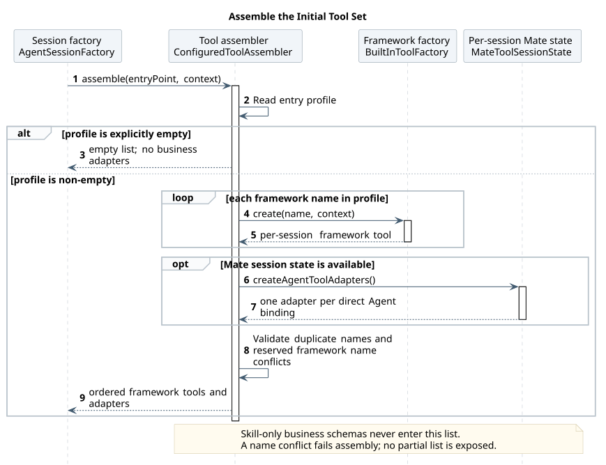
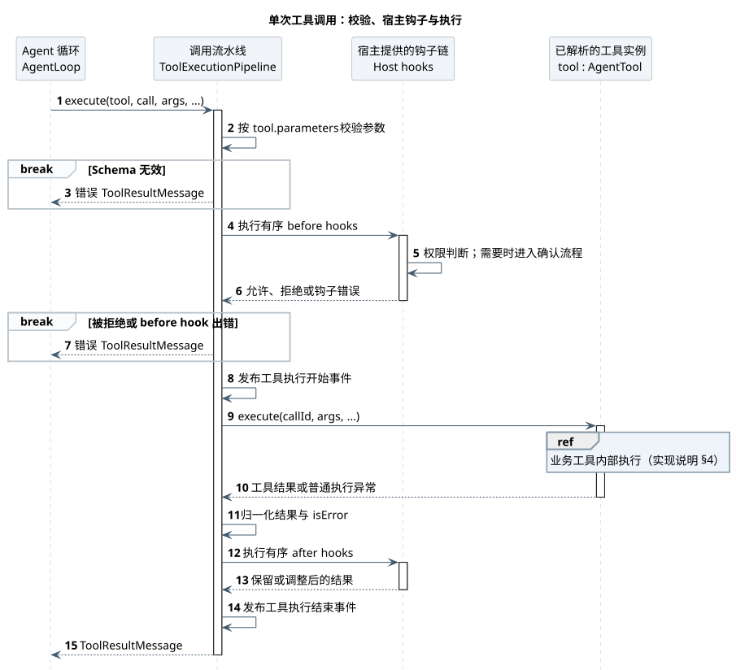

# 工具系统执行细节

| 属性 | 值 |
|---|---|
| 文档版本 | 1.3.0 |
| 更新日期 | 2026-09-22 |
| 主设计 | [CampusClaw 工具系统设计](README.md) |
| 源码基线 | `c9a2340f87bda6dff6bbd352f6995f8551206bb5` 开发提交；本页重核验 Session 创建、工具装配、Pipeline、业务执行及分段调度，具体路径与符号见[源码证据 §9](source-evidence.md#sequence-evidence)和[恢复证据](source-evidence.md#argument-recovery-evidence) |
| 实现状态 | 公共 Session 工厂、工具装配、Skill / CallTool、Agent 业务代理、共用执行及分段调度已在核验开发提交实现；CallTool 业务参数前置准备、首次参数失败的定义反馈与可恢复展示待实现 |

本页展开主设计的执行顺序，依次说明 Session 创建、工具装配、单次调用、业务执行与批次调度。图中待实现部分均有标记；工具配置、权限、凭据、工作区和名称解析规则仍由主设计及[精确契约](built-in-tool-contracts.md)维护。

阅读顺序：[Session 创建](#session-creation) → [工具装配](#tool-assembly) → [单次调用](#tool-invocation)。[业务执行](#business-execution)展开一次业务调用的准备与执行，[批次调度](#batch-scheduling)说明多个调用如何组合；它们不是重复执行的额外阶段。

## 1. Session 创建

场景从 Host 已确定入口和 Agent 后开始，到 `AgentSessionFactory` 返回新的 Session 为止。`prepare` 由 Factory 调用；入口选择、历史恢复和执行关闭由 Host 负责，不在本图展开。图示为创建成功路径。

本图只说明 Host 已确定入口后如何取得独立的执行 Session。Session assembly 对应公共 AgentSessionFactory，运行时准备归 AgentRuntimeManager，工具清单交给装配器；对象构造、上下文字段及共享工厂映射见下文与目标类图。

[PlantUML 源码：`agent_session_assembly`](diagram.puml#L150) · [原尺寸 SVG](agent_session_assembly.svg)

`AgentSessionFactory.create` 先调用 `AgentRuntimeManager.prepare(agentId)`，取得受管运行时快照，再校验运行条件、解析可用模型，准备工作区、可用时的 Session 级 Mate 状态及工具装配上下文。工具列表由下节的装配过程返回；Factory 随后配置 Agent 的模型、工具、SYSTEM 和 hook，创建独立的 `ManagedAgentSession` 并交还 Host。

工具装配或运行条件校验失败时，创建失败并返回 Host，不继续发起模型请求。创建成功后，消息恢复、事件订阅和最终关闭仍由 Host 接续；各入口的职责边界见[主设计 §6](README.md#6-公共轻量-agentsession)。

## 2. 工具装配

本图展开 `ConfiguredToolAssembler.assemble`。输入是已准备的入口和 `ToolAssemblyContext`，输出是本 Session 的工具实例列表；共享工厂和协作者不等于共享带有 Agent 状态的工具实例。

本图从入口 profile 到完整工具集合；框架工具与直接业务绑定保留两个来源边界，具体工厂循环不单列。缺省配置、显式空集合、Mate 状态不可用及名称冲突规则仍由下文维护，Skill 加载不触发重新装配。

[PlantUML 源码：`tool_set_assembly`](diagram.puml#L193) · [原尺寸 SVG](tool_set_assembly.svg)

装配器读取入口 profile。显式 `[]` 直接返回空集合，完全不向模型提供工具；配置项缺失时先采用默认值。有效配置非空时先经 `BuiltInToolFactory` 创建框架工具，再通过上下文中的 `MateToolSessionState` 创建当前 Agent 直接绑定的业务代理；该状态及共享执行器由 `MateToolsetFactory` 在本次 Session 创建时准备。完整列表形成后校验重名和框架保留名冲突；冲突使装配失败，不返回部分列表。框架工厂仍可通过上下文中的 Host 工厂回调创建宿主相关工具。

返回的列表用于配置 Agent 并提供给模型。仅由 Skill 关联的业务工具不在这里展开 Schema 或创建代理；同时与 Agent 直接关联的业务工具按直接关联路径装配。读取 Skill 正文或定义文件不触发本图再次装配。业务代理及 Skill / CallTool 的装配接线已在核验开发提交实现，具体 profile 与冲突规则见[主设计 §4](README.md#4-工具集合与入口配置)。

## 3. 单次调用

总览从模型请求一次业务工具开始，到 `AgentLoop` 将结果加入下一次模型上下文为止。Pipeline 管理调用生命周期，Host hook 处理权限与必要确认；图示包含已安装权限 hook 的路径，各入口的实际支持范围见源码证据。

本图以一次园区业务工具调用为范围，从模型请求到结果进入下一次模型上下文；普通本地工具不经过 Mate。CallTool 是调用方式，Host 负责权限与必要确认，Pipeline 协调执行。参数错误在确认前结束本次调用；同次可信定义只反馈给模型。注册定义校验、动态准备和 hook 的实际实现状态、提前返回及取消规则见下文。

[PlantUML 源码：`tool_invocation_pipeline`](diagram.puml#L405) · [原尺寸 SVG](tool_invocation_pipeline.svg)

Pipeline 先校验已注册工具的输入 Schema，再让工具准备本次调用。普通静态工具只固定已校验参数；`CallTool` 还要在当前 Session 的可信 Skill 绑定内解析业务目标、校验业务参数并形成不可变的 `PreparedToolInvocation`。准备成功后才调用 before hook；允许执行后发出执行开始事件并执行该准备结果。工具返回结果或抛出普通执行异常后，Pipeline 归一化结果，进入 after hook，最后发出结束事件并返回结果。

注册参数校验失败、业务准备失败或输入 Schema 本身无效均在 before hook 前返回，因此不触发权限确认；before hook 拒绝或出错在业务执行前返回。这些提前返回路径均不进入 after hook。普通工具执行错误仍进入 after hook；取消向上终止当前 execution，不作为普通工具失败继续处理。

首次参数校验失败的目标行为是：在模型可见的结果正文中返回字段错误及本次注册定义，明确业务未执行，并保留 `isError=true` 和 `TOOL_ARGUMENTS_INVALID`；这项反馈增量待实现。输入 Schema 本身无效沿用配置错误分类，不混入参数恢复。定义仅用于模型修正，不复制到公共错误正文。

Agent 业务代理的注册 Schema 包含完整业务参数；`CallTool` 先校验固定外层参数，再在准备阶段校验内部业务参数。before hook 和最终执行接收同一个不可变准备快照；确认等待期间不重新解析目标或替换参数。该准备阶段为待实现，规则见[主设计 §7](README.md#7-pipelinehook-与批量调度)。

## 4. 业务执行

本图下钻一次业务工具的可信准备与放行后执行。输入是 Pipeline 已完成外层 Schema 校验的调用，输出是准备失败结果，或经过 Host 放行后的业务结果。业务执行职责由 `MateToolExecutor` 及其客户端适配承担，调用来源可能是 `MateToolAdapter` 或 `CallTool`。

本图下钻单次调用中的业务准备与执行。Business execution 对应 MateToolExecutor 及其 Mate 客户端适配；客户端不是新的权限决策者。Agent 代理使用直接绑定范围，CallTool 使用直接 Skill 范围；准备失败提前返回，参数失败带同次定义，未知目标和无效 Schema 保持原分类。请求发出后的超时可能结果未知，不标记业务未执行，也不自动重放。

[PlantUML 源码：`call_mate_tool_sequence`](diagram.puml#L292) · [原尺寸 SVG](call_mate_tool_sequence.svg)

代理使用已绑定的业务名称和直接参数；`CallTool` 解析外层名称与参数。两者分别携带 Agent 直接关联、直接 Skill 关联的业务工具范围，委托同一个 `MateToolExecutor` 准备可信调用。准备结果固定目标 ID、实际校验定义和参数；解析或校验失败时在 Host hook 前返回错误。准备成功后，Host 按该目标执行权限判断和必要确认；放行后执行器才让 Mate client 发出一次请求。

共用执行适配已在核验开发提交实现；将 `CallTool` 的业务解析和校验前移为 Pipeline 准备阶段、返回恢复反馈仍待实现。首次业务参数校验失败使用同一个可信 `ResolvedTool` 返回字段错误及完整名称、说明和 `inputSchema`，明确没有触发用户确认和业务请求。该结果直接进入模型上下文并保持 `isError=true`；模型自行修正参数并发起新的调用。目标解析失败、无效 Schema 与远端错误保持各自分类；请求发出后不自动重放，也不能宣称业务未执行。精确反馈和截断边界见[主设计 §9.6](README.md#tool-argument-recovery)。

执行器不接管 Host 的权限与确认，也不把模型读到的定义文件作为执行目标或权限依据。准备阶段只产出供 Host 决策和后续执行共用的不可变快照。精确调用范围、参数、失败处理和[凭据](README.md#mate-credential-forwarding)由[主设计 §9.2](README.md#92-calltool-与-agent-代理)及工具契约维护。

## 5. 批次调度

本图从有序的五个工具调用开始，到得到同序的五个结果为止。示例依次为 `Read`、`Grep`、`CallTool`、`Find`、`Ls`；图中每个任务内部都执行上文的完整 Pipeline。

本图只展示 Read、Grep、CallTool、Find、Ls 五次调用形成的并行段与串行屏障。Read-only calls 表示各自独立的并发任务，并非一个串行工具实例；Future 的读取细节放在正文，整段完成后才启动下一段，结果仍按输入顺序返回。

[PlantUML 源码：`tool_batch_scheduling`](diagram.puml#L458) · [原尺寸 SVG](tool_batch_scheduling.svg)

调度器把连续 `PARALLEL` 调用组成并行段，等待整段完成后再执行后续调用；每个 `SEQUENTIAL` 调用构成屏障。因此前两个调用可并行，`CallTool` 等待它们完成后执行，最后两个调用再组成新的并行段。工具模式的权威清单见[主设计 §7](README.md#7-pipelinehook-与批量调度)。

实现中任务 #2 可以先于 #1 完成并保存结果，调度器仍按输入顺序读取 Future；第二段同理。图中按职责合并独立读取任务，开放箭头表示并发提交；任务完成顺序不会改变返回结果顺序。分段调度与 `CallTool` 的串行入口均已在核验开发提交实现。
