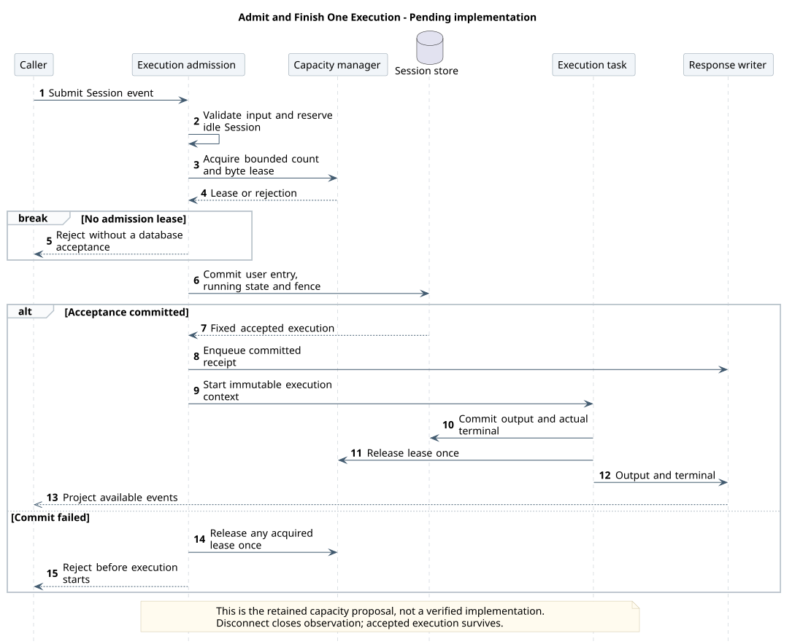
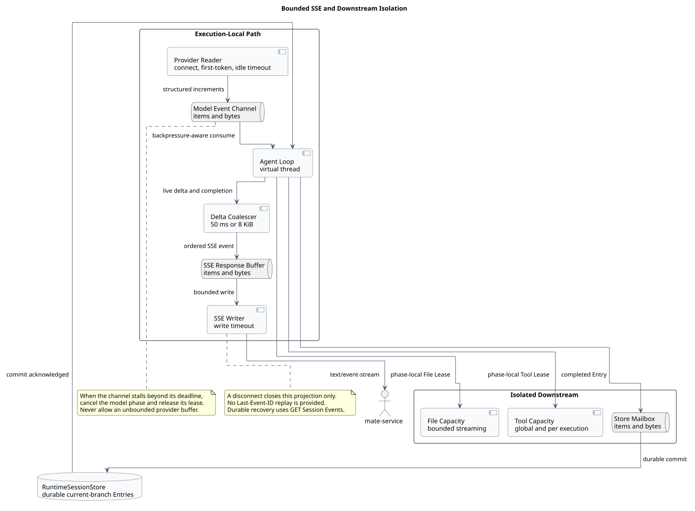

# CampusClaw 虚拟线程并发管理设计

| 属性 | 值 |
|---|---|
| 文档版本 | 2.1.0 |
| 状态 | 目标设计，尚未实施 |
| 产品目标 | HTTP+SSE 下支持约定容量范围内 100 个 active execution |
| Java 基线 | Java 21 虚拟线程 |
| pi-mono-java 源码基线 | `195746614096312d4e93afb029d387837db78e0b` |
| Runtime 接口基线 | [CampusClaw Runtime HTTP API 1.29.0](../01-CampusClaw多Agent运行时/chat-http-v1-design.md) |
| 更新日期 | 2026-10-16 |

> 本文只定义 Runtime 内部执行与容量治理。调用方可见资源仍是 Session、Entry、
> Event 和 Model；`ActiveExecution`、`ExecutionLease` 与准入队列都不是 HTTP 资源，
> 不产生 `run_id`。

## 1. 结论

每个已接受的用户事件由一个新的 Java 21 虚拟线程执行。虚拟线程负责顺序编排
模型、工具、文件和 Store I/O；并行工具与 Subagent 可以创建自己的受控任务。
系统限制的是 active execution 和其占用的下游资源，不池化虚拟线程对象。

`POST /campusclaw-service/v1/sessions/{session_id}/events` 在一个请求内完成准入，
然后以 `200 text/event-stream` 返回执行事件。调用方断开 SSE 不自动 Abort；执行
继续并持久化完整 Entry，调用方之后通过 `GET` 同一路径分页恢复当前分支。

Steer 与 FollowUp 是新的 HTTP 请求，进入当前 Session 的内部队列，后续事件继续
写入仍打开的执行 SSE。Abort 是 Session 范围命令，取消当前内部执行并使原流收敛。


[PlantUML 源码：`virtual_thread_capacity_overview`](diagram.puml#L7)

## 2. 边界与术语

| 术语 | 含义 | 是否公开 |
|---|---|---|
| Session | 持久化会话、当前模型、thinking 和当前分支 | 是 |
| Entry | `user.message`、完成的 Assistant Message 或 Tool Result | 是 |
| ActiveExecution | 一次被接受的用户输入对应的进程内执行状态 | 否 |
| ExecutionLease | active execution 数量和估算内存的联合许可 | 否 |
| ExecutionTask | 在一个虚拟线程上运行的执行任务 | 否 |
| SSE response | POST Events 请求范围内的实时投影 | 是 |

以下不属于本文目标：

- 公开 Run、RunRecord、GetRun、Run Events 或 `run_id`；
- 永久 Session 订阅、WebSocket、连接 generation 或 `Last-Event-ID` 恢复；
- 跨 Pod 透明续跑；
- 以用户 IP 做粘性路由；
- 用“最大虚拟线程数”代替业务容量治理。

## 3. 源码证据

### 3.1 已观察到的行为

| 证据 | 观察 | 与目标的关系 |
|---|---|---|
| [`Agent.java` `VIRTUAL_THREAD_EXECUTOR`、`startExecution`](https://github.com/superheromeZzh/pi-mono-java/blob/195746614096312d4e93afb029d387837db78e0b/modules/agent-core/src/main/java/com/campusclaw/agent/Agent.java#L60) | 同一个 `Agent` 用锁保护当前执行，并通过虚拟线程 Executor 运行 | 证明“一次执行一个虚拟线程”已有基础；没有部署级容量门禁 |
| [`AgentLoop.java` `consumeStream`](https://github.com/superheromeZzh/pi-mono-java/blob/195746614096312d4e93afb029d387837db78e0b/modules/agent-core/src/main/java/com/campusclaw/agent/loop/AgentLoop.java#L246) | 使用 `toIterable()` 阻塞消费模型流 | I/O 等待适合虚拟线程，但仍需读空闲超时和背压 |
| [`ToolExecutionPipeline.java`](https://github.com/superheromeZzh/pi-mono-java/blob/195746614096312d4e93afb029d387837db78e0b/modules/agent-core/src/main/java/com/campusclaw/agent/tool/ToolExecutionPipeline.java#L151) | 并行工具使用 `newVirtualThreadPerTaskExecutor()` | 工具任务需要独立 Tool Lease，不能只靠 execution 计数 |
| [`EventStream.java`](https://github.com/superheromeZzh/pi-mono-java/blob/195746614096312d4e93afb029d387837db78e0b/modules/ai/src/main/java/com/campusclaw/ai/stream/EventStream.java#L45) | 当前 unicast sink 使用 backpressure buffer | 目标实现必须设置有界字节和事件预算 |
| [`AgentSession.java` `prompt/abort/steer`](https://github.com/superheromeZzh/pi-mono-java/blob/195746614096312d4e93afb029d387837db78e0b/modules/coding-agent-cli/src/main/java/com/campusclaw/codingagent/session/AgentSession.java#L153) | 当前会话适配器已有 prompt、abort、steer，没有完整 FollowUp HTTP 契约 | 目标接口需要补齐队列与请求范围 SSE 语义 |

当前生产代码中未发现 `ExecutionLease`、部署级
`AgentRuntimeCapacityManager` 或本文的有界准入队列。它们均为 target-only
架构改造，不得写成 pi-mono-java 已实现行为。

### 3.2 差异分类

| 分类 | 内容 |
|---|---|
| 观察到的源码行为 | Agent、模型消费和并行工具已使用虚拟线程或阻塞式流消费 |
| 产品约束 | 一个 Session 最多一个 active execution；SSE 断开不 Abort；容量目标为 100 active execution |
| 架构改造 | 增加联合容量 Lease、有界准入、内部执行状态、分层超时和请求范围 SSE writer |
| 安全加固 | 租户限额、不可变 ExecutionContext、低基数指标、凭据不放入 ThreadLocal |

## 4. 准入与执行



[PlantUML 源码：`execution_admission_and_lifecycle`](diagram.puml#L83)

顺序如下：

1. HTTP Adapter 完成认证、授权、Session、消息和 `file_ids` 格式校验。
2. Session Coordinator 原子确认 Session 为 `idle`，为其保留唯一执行位置。
3. Capacity Manager 联合申请 execution count 与估算内存，不允许持有一项等待另一项。
4. 容量暂时不足时只保存有界 `PendingExecution` 描述符；它受数量、字节和等待时间限制，不提前创建虚拟线程。
5. 获得 `ExecutionLease` 后，在一个数据库事务中保存 User Entry、把 Session 置为 `running` 并写入最小内部执行栅栏。
6. 事务成功后建立 `200 text/event-stream`，先输出持久化的 `user.message`，再提交 `ExecutionTask`。
7. 执行虚拟线程按需取得 Model、Tool、File 与 Store Lease；完成的 Assistant Message 和 Tool Result 先持久化再输出完成事件。
8. 正常、异常或 Abort 都必须把 Session 收敛到 `idle`、关闭各阶段资源，并且仅一次释放 `ExecutionLease`。
9. 正常流以 `session.status.idle`、`stream.end` 结束；执行异常以 `stream.error` 结束。流建立前的失败使用 Runtime HTTP 契约中的普通错误响应。

不存在 `Idempotency-Key`。如果连接在客户端确认 `user.message` 前断开，客户端不得
重放 POST；应先调用 GET Events，并以 `entry_id/entry_seq` 判断输入是否已接受。

### 4.1 线性化点

接受语义的线性化点是“User Entry、Session running 与内部执行栅栏的事务提交”。
在此之前失败，不留下对话 Entry；在此之后即使 HTTP 断开也必须继续执行或明确
对账为失败，并且可以通过 GET Events 观察已经完成的持久化 Entry。

### 4.2 内部接口草案

```java
public interface AgentRuntimeCapacityManager {
    CompletionStage<ExecutionLease> acquireAsync(
            ExecutionEstimate estimate, Duration maxWait);
}

public interface ExecutionLease extends AutoCloseable {
    long reservedBytes();
    @Override
    void close();
}

public record ExecutionContext(
        String sessionId,
        String agentId,
        String modelId,
        boolean thinking,
        List<String> fileIds,
        Instant acceptedAt,
        CancellationToken cancellation) {}
```

这些类型是实现草案，不是 Controller VO。Java 实现时仍须遵循仓库的 VO/DTO、
中文 Javadoc、方法不超过 50 行等约定。

## 5. 容量 Profile

`http-sse-100-v1` 是压测起点，不是未经验证的 SLA：

| 资源 | 候选上限 | 等待/缓冲 | 目的 |
|---|---:|---:|---|
| active execution | 100 | 无线程池队列 | 核心业务并发上限 |
| execution retained memory | 512 MiB，按 4 MiB/unit 估算 | 与 count 联合申请 | 防止长上下文绕过计数 |
| admission queue | 20 项、32 MiB | 最长 5 秒 | 吸收短突发，拒绝无界等待 |
| request-scoped SSE response | 120 | 每条最多 1 MiB | 容纳执行响应和短时重叠 |
| model request | 每实例 50（两实例共 100）、2/tenant 仍为候选 | 按到达顺序最多等 30 秒；连接/响应头/事件间隔分别超时 | 保护 Mate 与连接；每实例上限、等待与连接复用由 [Model §5](../../02-服务与接口/03-Model/README.md#http-transport) 维护 |
| tool call | 64 global、4/execution | 每工具 deadline | 限制 fan-out |
| file read | 32 global | 1 MiB/execution 流式预算 | 保护文件服务和内存 |
| Store mailbox | 4096 项、64 MiB | 不阻塞持有下游连接 | 保护数据库写入 |
| 单执行模型事件通道 | 256 事件且 256 KiB | 停滞即取消模型阶段 | 防止无界 delta |
| Delta 合并 | 50 ms 或 8 KiB | 先到者触发 | 降低 SSE Frame 频率 |

所有字节上限按 UTF-8 编码后和容器开销保守估算。上线前必须用真实模型增量、工具
结果和文件类型压测校准。

### 5.1 获取顺序

统一顺序为：

```text
Session slot
  -> ExecutionLease(count + bytes)
  -> phase-local Model/File/Tool/Store lease
  -> SSE response byte budget
```

局部 Lease 不得跨不相关阶段持有。Store 提交不得一边占用数据库连接一边等待 SSE
写出；SSE 慢客户端也不得持有 Model 连接无限等待。

### 5.2 虚拟线程不池化

虚拟线程是一次性任务载体。实现可以复用 `Executor`、HTTP client、数据库连接池、
序列化器和模板缓存，但不能保存或归还虚拟线程对象。`ThreadLocal` 只允许短生命周期
诊断上下文，并在任务结束时清理；认证凭据、Session 状态和 mutable Agent 状态通过
显式参数传递。

## 6. SSE、背压与恢复



[PlantUML 源码：`bounded_sse_and_downstream`](diagram.puml#L160)

SSE writer 持有的是响应缓冲预算，不拥有执行生命周期：

- 下游可写时按序发送实时事件；Assistant delta 可以合并，不能重排完成事件。
- 缓冲达到字节或事件上限时，先停止读取 Provider；超过停滞期限后取消当前模型阶段并让执行失败收敛。
- 客户端断开后停止 SSE 投影，但 `ActiveExecution` 继续，完整 Entry 仍写入 Store。
- 不支持 `Last-Event-ID` 或重新订阅同一执行流；恢复路径固定为 GET Session Events。
- GET Events 只返回当前分支三类持久化 Entry，使用不透明 `page/next_page` 游标。

每个持久化完成事件都遵循 `store commit -> publish`。不得先向 SSE 暴露
`assistant.message.completed` 或 `tool.result` 再尝试落库。

## 7. 超时、取消与失败

| 层级 | 起点 | 超时后的动作 |
|---|---|---|
| Admission | 合法请求进入有界队列 | 移除描述符，释放 Session slot，使用普通 HTTP 错误收敛 |
| Model connect | 获得 Model Lease | 关闭请求并释放 Lease |
| First token | Provider 接受请求 | 取消模型阶段，执行进入错误收敛 |
| Model read idle | 最近一次模型事件 | 取消停滞流，不保留半成 Assistant Entry |
| Tool | 工具开始执行 | 级联取消该工具，按工具策略形成结果或执行错误 |
| File | 内容流开始 | 关闭流并释放 File Lease |
| Store | 写任务进入 mailbox | 快速失败，不能永久占用 ExecutionLease |
| SSE write | Frame 进入响应 writer | 断开投影；已接受执行继续 |

Abort 取消 Model、Tool 和 Subagent，清空尚未投递的 Steer/FollowUp，并等待 Session
进入 `idle`。所有 Lease 使用幂等 `close()`，取消、超时、异常和正常路径汇合到同一
清理函数，避免双释放或容量泄漏。

Pod 失效时不承诺继续正在运行的进程内调用。接管节点读取 Session 后清除遗留内部
执行栅栏并恢复为 `idle`；只保留已事务提交的 Entry。具体是否生成内部诊断记录待
存储设计确认，但不得增加公共 Run 状态。

## 8. 可观测性与验收

### 8.1 指标

- `runtime_active_executions`、`runtime_execution_reserved_bytes`
- `runtime_admission_queue_items`、`runtime_admission_wait_seconds`
- `runtime_sse_responses`、`runtime_sse_buffer_bytes`、`runtime_sse_disconnect_total`
- `runtime_model_inflight`、`runtime_tool_inflight`、`runtime_file_inflight`
- `runtime_store_mailbox_items`、`runtime_execution_duration_seconds`
- `runtime_execution_outcome_total{outcome}`

Metric label 不允许使用 `session_id`、`entry_id`、文件名、用户文本或错误原文。
这些高基数字段只进入受控日志/trace，且凭据、Provider 请求和文件正文必须脱敏。

### 8.2 验收清单

- 100 个 active execution 下无平台线程池饥饿、无无界队列、无 OOM；
- 第 101 个执行只进入有界准入或快速失败，不创建等待虚拟线程；
- 同一 Session 的并发 POST 只有一个进入 `running`；
- User Entry 事务提交后断开 SSE，执行继续且 GET Events 可恢复完整 Entry；
- Steer 优先于 FollowUp，均在实际投递时形成 `user.message`；
- Abort、超时、异常和正常完成后所有 Lease 计数回到基线；
- 慢 SSE 客户端不会导致模型、工具或 Store 缓冲无界增长；
- 源码和数据库中不存在公共 `run_id`、RunRecord 或 Run API 依赖；
- JFR 验证没有长时间 pinning、异常线程增长或锁竞争热点。

## 9. 版本历史

| 版本 | 日期 | 变更 |
|---|---|---|
| 2.1.0 | 2026-10-16 | 模型请求上限改为每实例 50、两实例共 100，并引用 Model 主设计维护的许可与连接规则。 |
| 2.0.0 | 2026-08-18 | 全面移除公开 Run、RunRecord、Idempotency-Key、永久 SSE 订阅和 Last-Event-ID；对齐已确认的 Session Event 直连 SSE、GET Events 恢复、Steer/FollowUp/Abort；内部统一为 ActiveExecution 与 ExecutionLease |
| 1.0.0 | 2026-08-06 | 初版虚拟线程、容量 Lease、下游隔离和 DFX 草案；当时仍基于公开 Run 资源 |
