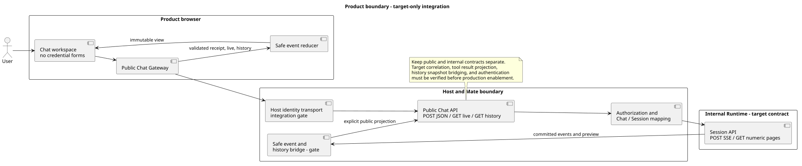
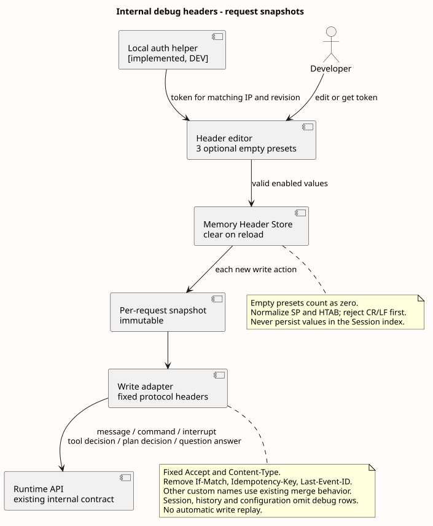
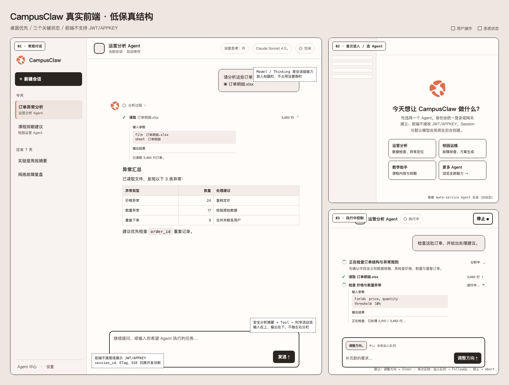
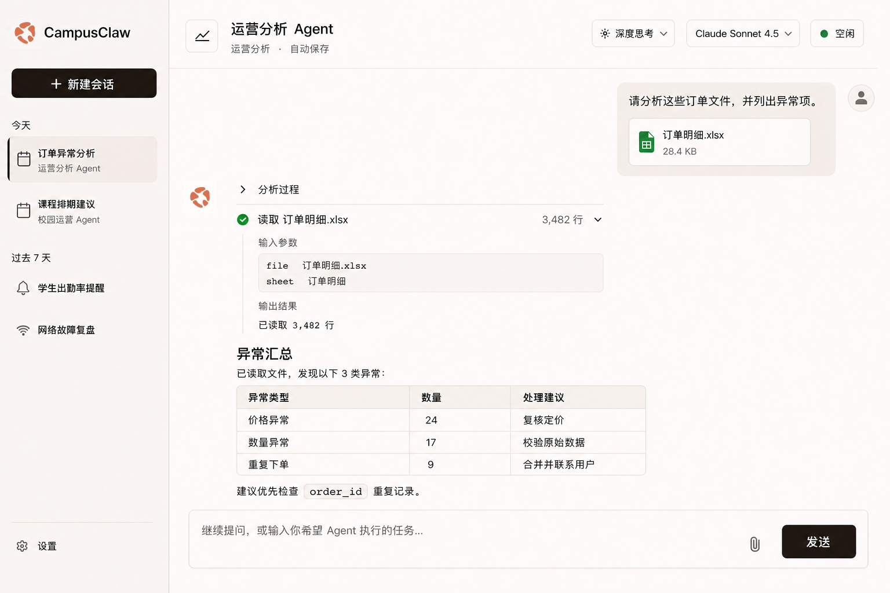
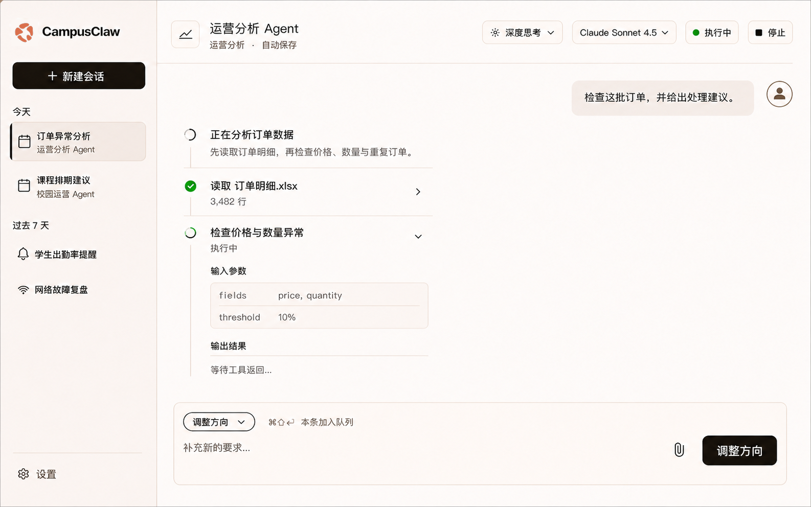
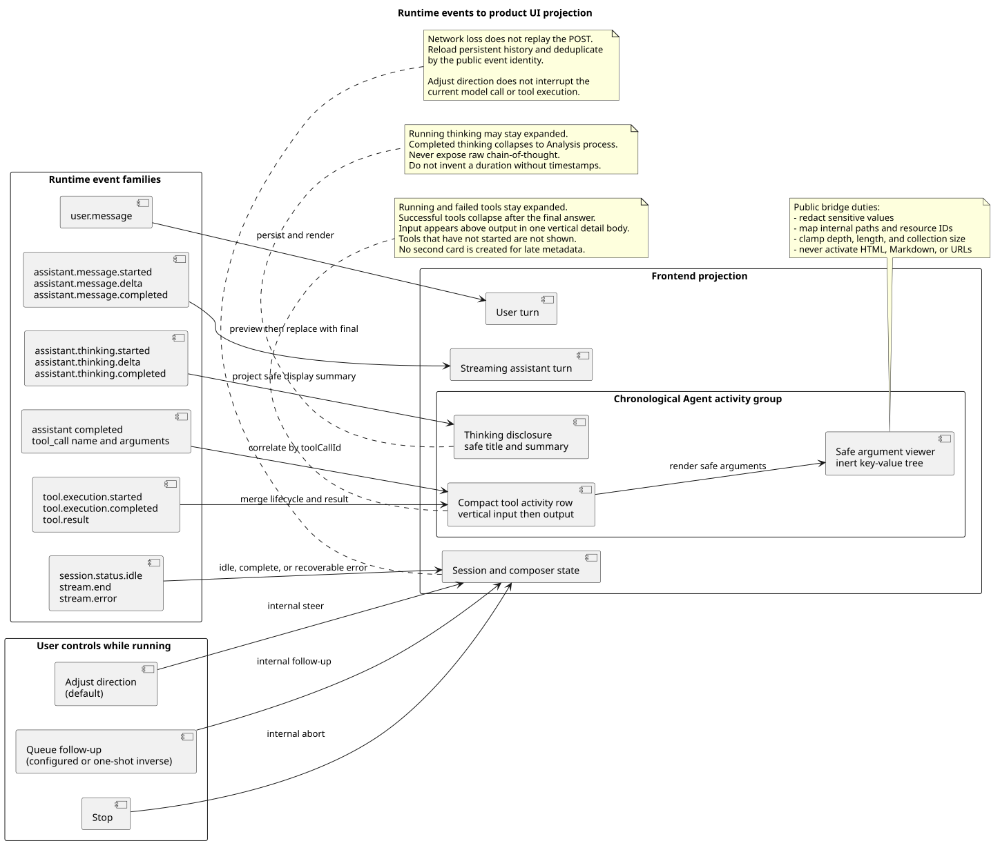
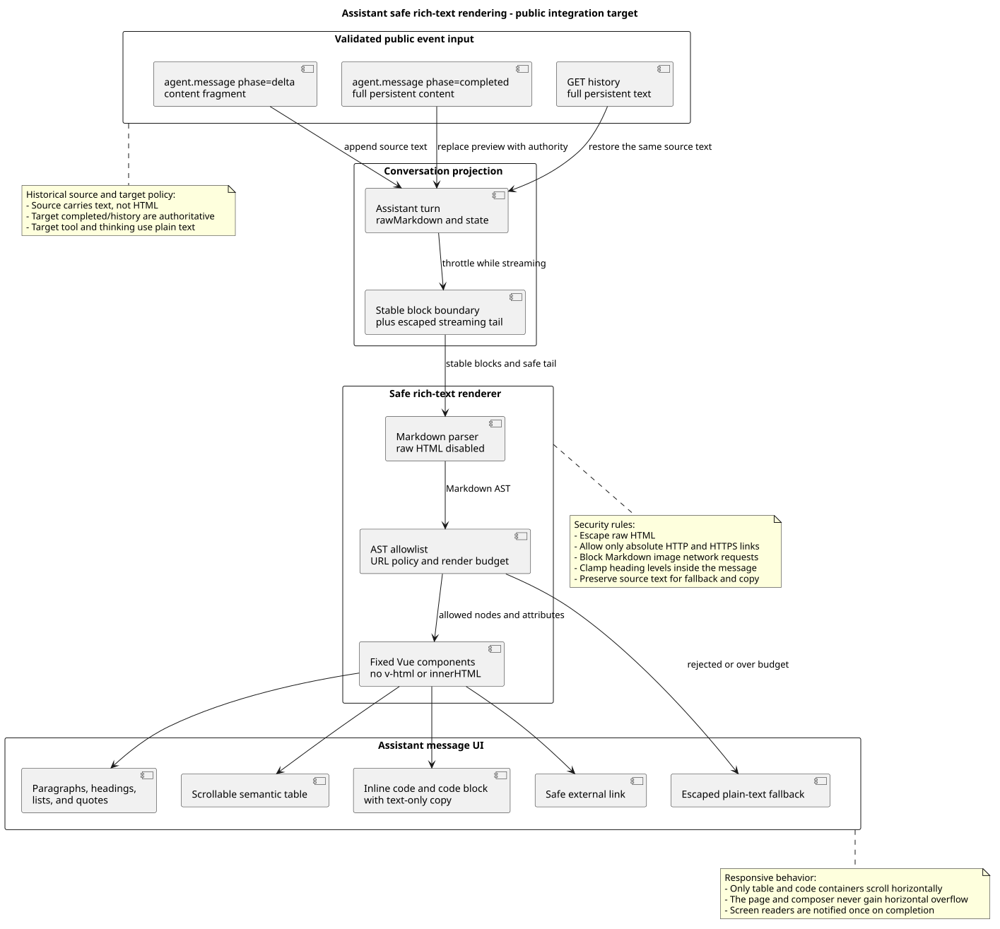

# CampusClaw 产品前端体验设计

| 属性 | 值 |
|---|---|
| 文档版本 | 1.2.0 |
| 状态 | Proposed；产品前端无凭据边界已确认；内部调试 Header 的通用 Key/Value 方向、独立 `Headers` 面板、复用原诊断入口视觉及不展示自动生成 Header 已确认，交互细节进入评审；O1 品牌标识已确认，暖中性配色进入评审 |
| 界面评审状态 | `credentialBoundary` 产品边界已确认；`debugHeaders` 通用表格、独立 `Headers` 命名、原诊断入口视觉与不展示自动生成 Header 已确认，交互细节待确认；`firstUse`、`idleConversation` 待确认；`runningConversation` 跟进交互已确认、界面待确认 |
| 主设计依据 | [`README.md`](README.md)，维护源码证据、目标差异、设计理由、状态与 Design Token |
| 人类评审界面 | [`frontend-review.html`](frontend-review.html)，集中展示低保真、高保真和待确认项 |
| 品牌标识资产 | [`campusclaw-mark-o1.png`](campusclaw-mark-o1.png)，原始透明 PNG；界面直接引用，不通过生成模型重绘，也不缩进深色品牌方块 |
| 图源 | [`diagram.puml`](diagram.puml)，生成四张架构 SVG |
| 本专题修改基线 | 设计仓 `ee2c8e61800d95e609982e3ee354b1ee06f70fe4`；该提交中的原路径为 `campusclaw-frontend-design/`，当前路径为 `01-总体架构/04-CampusClaw前端体验/` |
| 本轮设计仓基线 | `3cc234f068209c90639f812bcb8e1825301fa565` |
| HTTP 设计风格基线 | 当前工作区 `chat-http-v1-design.md` 1.38.0；设计仓 `c250e3f07536871d3d676242e552a5eb4346b0c7` |
| Codex 视觉证据 | 本机 `ChatGPT.app` 26.814.41407（build 6720）中的 light-theme CSS Token；`app.asar` SHA-256 `8fba32f8baa6d984b0f0f4149d3da46221e3adb3b52836f85fe65e31e655a8c0` |
| Codex 跟进交互证据 | 同一安装包 `webview/assets/app-initial-BCLYDefw.js` 的 `followUpQueueMode`、`K9s()`、submit action，以及 `webview/assets/zh-CN-ByRVSIXt.js` 的 Composer 文案 |
| Codex 活动展示证据 | 本机 `ChatGPT.app` 26.820.60940（build 7119）的 `tool-activity-disclosure-CZUjU0Tu.js`、`agent-activity-item-BL0IhzOn.js`、`reasoning-item-heading-Cdl3NWmT.js`、`local-conversation-turn-Ngva_Lp3.js`；`app.asar` SHA-256 `c964aebbf9a6a0f70799d01215c611d8ef6ee63f816b3d57beccddd47a811fd9` |
| pi-mono-java 原体验证据基线 | `bde123706305a41e51c9a47b22e6ad11bbd8204c`；用于本文既有活动流与富文本分析 |
| 本轮凭据复核源码基线 | `320d790726a70aada6100052952d5494d2a378ac`；`frontend/README.md`、`frontend/.env.example`、`frontend/src/App.vue`、`frontend/src/components/DevDiagnostics.vue`、`frontend/src/composables/useRuntimeApi.ts` 及 Runtime 路由测试在该 commit 上无本地修改 |
| 工具凭据实现对齐 | 变更前基线 `pi-mono-java@320d790726a70aada6100052952d5494d2a378ac`；已评审特性提交 `d03c08dbae870f19eee8d4fa79a707185f7a26b5`，位于 [Draft PR #181](https://github.com/superheromeZzh/pi-mono-java/pull/181)，尚未作为 `main` 现状 |
| Header 编辑器对照基线 | `pi-mono@4af9d21d`、`opencode@849c2598`、`openai/codex@be33f80b`、`deepseek-harness@cd5ef814`；源码路径见 3.1 |
| Postman 核对 | 2026-08-28；核对官方 Headers 编辑文档、`Agent Runtime` collection 及真实 SSE 响应 |
| 更新日期 | 2026-08-28 |

## 1. 结论

CampusClaw 前端应从“把 HTTP/SSE operation 摊在页面上的本地调试台”改为面向任务的
Agent 工作台。主界面只暴露用户能够理解并需要决策的概念：Agent、会话、消息、附件、
模型、深度思考、执行状态与执行中控制。当前前端实现不支持 JWT/APPKEY：没有凭据输入、
`VITE_*` 秘密配置、浏览器持久化或 `Authorization` / `X-HW-APPKEY` Header 注入路径；
请求适配器只发送非秘密的 `X-HW-ID` 调用上下文。该现状不等于已经具备生产认证能力。
产品路由仍保持浏览器凭据无持有，`Service URL`、`session_id`、ETag、原始 JSON 和 SSE frame
也不进入产品主流程。为了快速验证 Runtime 到 Mate Tool execute 的凭据传递，内部开发构建
可新增一个隔离的 `debugHeaders` 抽屉；它不进入产品构建、不持久化秘密，且只对
`POST /sessions/{sessionId}/events` 构造请求级 Header 快照。抽屉采用 Postman 风格的通用
Key/Value 表格，不预先确定凭据模式或 Header 名称；浏览器禁止设置的名称与无效值只在对应行报错。
编辑器作为独立的 `Headers` 面板，不与现有“开发者诊断入口”合并；它只复用该入口的折叠面板、虚线边框、暖灰表面、紧凑字号和次级按钮，
不引入独立的凭据卡片或认证视觉。

本轮提出一个桌面优先的单工作区方案：左侧会话导航、中央对话、顶部 Session 能力、
底部 Composer。思考和工具调用按实际时间顺序组成对话内 Agent 活动流；每次工具调用合并为
一条紧凑 activity disclosure，并在安全投影后显示调用入参。展开详情始终按
“输入参数 → 输出结果”纵向排列，不做左右分栏。运行中 `Steer`、`FollowUp`、`Abort`
分别产品化为“调整方向”“加入队列”“停止”。Composer 像 Codex desktop 一样只呈现当前
跟进模式，默认“调整方向”，而不是同时展示两个常驻选择。现有调试能力可以保留，但只能
作为内部构建中的开发者诊断入口，不能继续充当产品首页。

Assistant 正文以原始 Markdown 文本为权威，经过受限语法解析和固定 Vue 组件投影为安全
富文本；表格、列表、引用、链接、行内代码和代码块均有明确样式、溢出和复制行为。用户
原文、原始私有推理、工具入参和工具原始结果不进入该 Markdown 渲染链，避免把不同信任边界的内容混成
一个可执行 HTML 面。思考区域只接收面向用户的安全标题与摘要；当前 Runtime 的原始 ThinkingContent
不得直接穿透公共 bridge 进入产品浏览器。

布局层级与工具密度继续采用 Codex-inspired 而非品牌复制；品牌层改用已确认的 O1 五片有机
标识，界面直接引用同一张透明 PNG，不允许生成式重绘。配色由冷灰调整为暖白、暖灰与深暖黑，
O1 珊瑚色只承担品牌识别，运行和完成状态仍使用语义绿色，不使用 OpenAI/Codex 商标或标志。

## 2. 设计权威顺序与 HTTP 风格对齐

本专题沿用 Runtime HTTP 设计的“设计依据与人类评审面分离”方式，但不引入没有实际
消费方的 UI JSON Schema：

1. 本文件是唯一可编辑的设计依据，维护源码证据、目标设计、设计理由、状态机、视觉
   Token 和验收规则；
2. [`frontend-review.html`](frontend-review.html) 是主要人类评审界面，按稳定
   `screenKey` 展示三个界面状态、评审材料与待确认项；
3. [`diagram.puml`](diagram.puml) 是架构图唯一图源，SVG 只由 PlantUML 生成；
4. 低保真 HTML 是可编辑布局源，PNG 是其评审快照；高保真 PNG 是视觉方向稿，不是
   可直接切图的实现资产。

| 对齐项 | HTTP 设计方式 | 前端设计采用方式 |
|---|---|---|
| 文档入口 | 顶部属性表记录版本、状态、权威源和基线 | 采用相同属性表，并显式记录三个 `screenKey` 的评审状态 |
| 人类评审 | 独立 HTML 按 `operationKey` 展示 operation | 独立 HTML 按 `screenKey` 展示 first-use、idle、running |
| 视觉语言 | HTTP 评审页使用中性表面、细边框和蓝色选择态 | 文档评审面保持同一结构；产品稿保留 Codex-inspired 工具层级，改用 O1 品牌标识、暖中性表面和深陶土色焦点/链接 |
| 证据表达 | 区分观察行为、产品约束、安全加固和架构变化 | 保持相同分类，不把高保真目标误写为现有实现 |
| 机器契约 | JSON 是字段级精确契约源 | 不新增目标不明确的 UI JSON；这是产品设计制品差异 |

## 3. 源码与契约证据

### 3.1 已观察行为

| 证据 | 已观察事实 |
|---|---|
| `frontend/README.md:26-28, 40-58` | 当前工作台明确不提供 JWT/APPKEY 凭据编辑器，所有 `VITE_*` 只允许非秘密浏览器参数，并禁止把 Provider 凭据、JWT 或 APPKEY 编译进浏览器产物。 |
| `frontend/.env.example:1-7` | 示例环境变量只包含 API 基址、非秘密 `callerId` 和 Agent 展示/内部 ID，没有 JWT、APPKEY、Token 或认证 Header 配置。 |
| `frontend/src/App.vue:177-290`、`frontend/src/components/DevDiagnostics.vue:4-10, 13-25` | 产品工作区与开发者诊断入口只提供 Agent/Session、模型、Thinking、会话和执行控制；诊断入口也没有凭据输入或查看能力。 |
| `frontend/src/style.css:650-704` | 现有 `.dev-diagnostics` 是 680 px 最大宽度的折叠面板，使用暖灰次级表面、虚线强边框、12 px 字号、8 px 圆角输入和次级按钮；这是本轮 Header 编辑器的视觉基线。 |
| `frontend/src/composables/useRuntimeApi.ts:18-20, 480-495` | `requestRaw` 只统一附加 `Accept`、`Accept-Language` 和非秘密 `X-HW-ID`；没有构造 `Authorization` 或 `X-HW-APPKEY`，也没有 credential store。 |
| `modules/coding-agent-cli/src/main/java/com/campusclaw/codingagent/runtimeapi/web/RuntimeEventController.java:58-73`、`RuntimeRequestContext.java:45-50` | 当前只有提交消息的 `POST /sessions/{sessionId}/events` 会读取 `X-HW-ID`、`X-HW-APPKEY`、`Authorization` 并生成本次执行快照；基线尚无 `access-token`。 |
| `modules/coding-agent-cli/src/main/java/com/campusclaw/codingagent/common/client/HttpMateToolClient.java:93-190, 298-373` | 变更前基线实现把三项凭据同时用于 Mate 发现和 Tool execute；该行为已在特性提交中收敛，但仍是 `main@320d7907` 的已观察基线。 |
| `modules/coding-agent-cli/src/test/java/com/campusclaw/codingagent/runtimeapi/web/RuntimeSessionRoutesTest.java:102-120` | 当前 Runtime 删除请求可在没有凭据 Header 时通过，JWT 与 APPKEY 同时出现也不由 Runtime 本地校验；当前直接调试链路依赖这一内部无本地认证边界。 |
| `frontend/src/App.vue:1-291` | 当前 Vue 前端已经形成 Agent 工作区壳、对话时间线、Composer 与运行中控制，但浏览器仍直接调用 Runtime V1，尚未落地 mate-service 公共 bridge。 |
| `frontend/src/components/ConversationTimeline.vue:37-65` | Assistant 正文使用 Vue 文本插值直接输出 `turn.text`；Thinking 是 Assistant body 内的一个“查看思考过程”折叠区；Tool 活动卡展开后只显示结果，不显示调用入参。 |
| `frontend/src/style.css:784-789` | `.assistant-message` 仅设置 `white-space: pre-wrap` 和换行，没有标题、表格、引用、链接或代码块样式。 |
| `frontend/package.json:13-21` | 运行依赖只有 Vue，没有 Markdown parser、AST renderer 或 sanitizer。 |
| `frontend/src/composables/useRuntimeApi.ts:157-176, 311-352` | 浏览器直接调用 `/campusclaw-service/v1` 并消费请求范围 SSE；流事件的 `data` 先作为 JSON 解析，不产生服务端 HTML。 |
| `frontend/src/projectors/runtimeEventProjector.ts:40-90, 112-145` | delta 按文本追加，completed 以完整文本替换 preview；Thinking 按 `assistantEntryId` 追加到 Assistant turn；Tool 只从 `tool.*` 事件读取名称、状态和结果，没有解析 Assistant completed 中的 `tool_call.arguments`。 |
| `frontend/src/types/product.ts:22-37` | `AssistantTurn` 仅有单个 `thinking:string`；`ActivityTurn` 只有 `toolCallId`、`toolName`、`status` 和 `result`，尚无入参字段或安全投影类型。 |
| `RuntimeSessionController`、`RuntimeEventController`、`RuntimeSessionConfigurationController`、`RuntimeSessionControlController` | 当前后端已实现 11 个内部 Session Runtime operation。 |
| `RuntimeEventType.java:13-26` | 对外事件同时包含持久化消息、瞬时 Assistant delta、工具进度和流终止事件。 |
| `RuntimeEventProjector.java:149-213, 215-238, 257-285` | Assistant preview 与 completed 分离；Thinking started/delta/completed 按 `assistantEntryId + contentIndex` 投影；`tool.execution.*` 只携带 `toolCallId`、`toolName`、状态和 delta，不携带入参。 |
| `RuntimeEntryCodec.java:67-88, 430-442, 512-517, 557-601` | `assistant.message.completed.message.content[]` 保留 `tool_call` 的 `toolCallId`、`name` 和结构化 `arguments`；这是工具入参的现有内部来源，前端可在工具开始前按 `toolCallId` 建立关联。 |
| Postman `Agent Runtime` collection | Session、Configuration、Events、Control 四组请求与源码 11 个 operation 一致；真实 `POST /events` 响应按 frame 展示大量 delta，证明原始事件视图适合诊断，不适合终端用户阅读。 |
| `pi-mono@4af9d21d` 的 `packages/coding-agent/docs/custom-provider.md:96-119`、`packages/coding-agent/src/core/model-config.ts:160-207` | PI Provider 将 Headers 建模为通用字符串映射，但只提供配置/扩展接口，没有逐请求图形编辑器。 |
| `opencode@849c2598` 的 `packages/app/src/components/dialog-custom-provider.tsx:273-315`、`packages/app/src/components/dialog-custom-provider-form.ts:97-128` | OpenCode 已提供可增删的 Header/Value 行，并执行去空白与大小写不敏感的重复名称校验；这是四个本地实现中最接近的通用编辑器。 |
| `openai/codex@be33f80b` 的 `codex-rs/config/src/mcp_types.rs:258-260`、`codex-rs/tui/src/history_cell/mcp.rs:427-445`；[Codex 官方配置参考](https://developers.openai.com/codex/config-reference) | Codex 通过 `http_headers` / `env_http_headers` 通用映射配置 Provider/MCP Header，TUI 展示时遮蔽静态值，但没有逐请求 Key/Value 编辑器。 |
| `deepseek-harness@cd5ef814` 的 `packages/llm/llm-pi-ai/src/config.ts:147-148, 325, 458`、`packages/client/ui-settings-models/src/client/ProviderEditor.tsx:1-21` | DSH Provider 配置支持通用 Header 映射；当前 UI 只暴露精选字段，其余配置由 `settings.yaml` 维护。 |
| [Postman 官方 Headers 文档](https://learning.postman.com/latest-v-12/docs/use/send-requests/create-requests/headers) | Postman 允许任意 Key/Value、逐行启停、Header 预设与自动补全，并折叠自动生成 Header、显示手工覆盖关系；本设计借鉴其表格交互而不复制完整 API 客户端信息架构。 |
| 本机 `ChatGPT.app` 26.814.41407 的 `app.asar` light-theme Token | 可观察到 `gray-0/50/75/100/500/750/900`、近黑 primary solid、5%/10% alpha border、灰色 user message background、green success 与 blue focus/link；这是 Codex-inspired 视觉证据，不是公开品牌规范。 |
| 同一 `app.asar` 的 `webview/assets/app-initial-BCLYDefw.js`：`followUpQueueMode`、`K9s()`、`composer.submitButtonTooltip.*` 与 submit telemetry | Codex desktop 的跟进模式取值为 `steer` / `queue`，desktop 默认 `steer`；`Cmd/Ctrl+Shift+Enter` 对单条消息执行相反模式；已排队消息支持送入当前运行、编辑、删除、重试与恢复。历史 `interrupt` 配置会归一为 `steer`。 |
| 同一 `app.asar` 的 `webview/assets/zh-CN-ByRVSIXt.js` | 产品文案使用“调整方向”“加入队列”“停止”；“调整方向”的说明是提交但不中断正在运行的模型，而不是立即中止当前模型或工具。 |
| 本机 `ChatGPT.app` 26.820.60940 的 `tool-activity-disclosure-CZUjU0Tu.js` 与 `agent-activity-item-BL0IhzOn.js` | Codex activity body 使用纵向 `flex-col` 和缩进详情；执行中 item 默认展开，完成项折叠为动作摘要，输入和输出不采用左右分栏。 |
| 同一安装包的 `reasoning-item-heading-Cdl3NWmT.js` 与 `local-conversation-turn-Ngva_Lp3.js` | 思考展示从 reasoning summary / 当前 activity 推导简短标题；完成后收敛为轻量 disclosure。该证据支持交互借鉴，不代表 CampusClaw 可以把原始私有推理直接展示给用户。 |
| [OpenAI 官方 ChatGPT desktop app 文档](https://learn.chatgpt.com/docs/app) | 官方文档确认桌面应用上下文，但未公开 activity disclosure 的精确视觉规则；本设计的交互细节以本机可观察实现证据和 CampusClaw 产品约束为依据。 |
| [OpenAI 官方 Codex use cases](https://developers.openai.com/codex/use-cases) | 官方将 Codex 表述为理解代码、构建/测试、评审并交付任务的工作界面；官方未公开可复制的 Codex Design Token，因此具体色值以本机可观察资源和本设计决策为依据。 |

### 3.2 已评审特性分支实现

| 证据 | 已评审行为 |
|---|---|
| `pi-mono-java@d03c08db` 的 `RuntimeRequestContext.mateCredentials:45-50`、`MateCredentialHeaders:13-23` | 提交消息时精确读取 `X-HW-ID`、`X-HW-APPKEY`、`Authorization`、`access-token` 四个 Header。 |
| `MateCredentials:21-86` | 凭据是不可变执行快照；完整性要求 `X-HW-ID` + `access-token` + 至少一种 APPKEY/JWT，诊断字符串只记录是否存在。 |
| `HttpMateToolClient:95-180, 298-370`、`MateToolDiscovery` | Agent、Skill 和 Tool metadata 发现方法不再接受凭据参数；只有 Tool execute 检查完整性并附加四项快照。 |
| `HttpMateToolClientTest:270-400, 476-483` | 回归测试覆盖发现无凭据、JWT、APPKEY、双凭据、缺少 `access-token` fail closed 和脱敏 `toString`。 |

该实现已提交到 Draft PR #181，实现 commit 与变更前基线在本文分开记录。PR 合并前，
设计不把它表述为 `main` 已上线行为；但前端调试 Header 字段和透传范围以该已评审实现为对齐依据。

### 3.3 已确认契约约束

- 每个 Session 同一时刻最多有一个 active execution。
- `POST /sessions/{id}/events` 是请求范围 SSE；断线不等于中止，也不能自动重放 POST。
- `user.message`、`assistant.message.completed`、`assistant.thinking.completed` 和 `tool.result` 是可恢复的持久化 Entry；Thinking 历史只在该 Session 当前允许思考展示时返回。
- `assistant.message.started/delta`、`assistant.thinking.started/delta`、工具执行 started/delta/completed 和流控制事件是瞬时状态。
- Model 与 Thinking 只允许在 Session `idle` 时修改，并通过强 ETag 防止覆盖并发修改。
- Steer 优先于 FollowUp；两者只在 `running` 时接受；Abort 在 `idle` 时也是幂等成功。
- Runtime 只接收 `file_ids`，不负责浏览器文件上传、文件名和预览元数据。
- 精确 Runtime 设计明确要求浏览器/UI 经 mate-service 调用，内部 SSE 不能字节透明转发。
- 当前前端只传递非秘密 `X-HW-ID` 调用上下文，不支持 JWT/APPKEY 的输入、存储、刷新或 Header 注入；需要本地凭据认证的 Runtime 部署不属于该直接适配器的支持范围。

### 3.4 目标设计与分类

| 目标差异 | 分类 | 理由 |
|---|---|---|
| 产品主界面不再直接调用内部 Runtime V1 | 架构变化 | 当前直接适配器没有生产认证能力；浏览器还需要稳定的公共 Chat/Agent 资源，而不是内部 Session 标识。 |
| 保持产品路由凭据无持有 | 产品约束 + 安全加固 | 统一登录和公共 bridge 仍承担生产身份；产品 Chat 页不新增 JWT/APPKEY/`access-token` 表单、构建配置、存储或 Header 注入。 |
| 新增 `debugHeaders` 内部诊断抽屉 | Target-only architecture | 快速验证内部 Runtime 凭据透传，但只在 `import.meta.env.DEV` 或独立诊断构建中可达；用户关闭页签或刷新即清除。 |
| 调试 Header 改为通用 Key/Value 表格 | 架构变化 + 产品约束 | 不把当前四项凭据误写成 UI 固定模式；组件可复用于后续调试请求。每行独立启停、删除，最后一行填写后自动生成新空行。 |
| 独立 `Headers` 面板复用原开发者诊断入口视觉 | 产品约束（target-only） | Header 配置与 Agent/Session 诊断职责分离，但沿用已熟悉的虚线边界、暖灰表面和次级控件，保持内部工具一致，也避免将通用 Header 误表达成凭据管理卡片。 |
| 浏览器受限名称与格式使用行内校验 | 安全加固 | UI 不预设可选 Header，但 `Host`、`Content-Length`、`Cookie`、`Origin`、`Sec-*`、`Proxy-*` 等 Fetch 禁止名称不能发送；无效 token、换行值和大小写不敏感的重复名称在对应行阻止提交。 |
| 自动生成 Header 不展示，手工值优先 | 产品约束 | 请求适配器生成的 Header 不渲染、不枚举；开发者显式填写同名 Header 时在请求合并阶段采用手工值，但 UI 不显示自动值或覆盖状态。 |
| Header 只附加到提交消息 POST | 安全加固 + 架构变化 | Runtime 只在 `submit` 边界建立本次执行快照；Session 创建、查询、历史、配置、Steer、FollowUp 和 Abort 都不应接收这些秘密。 |
| 生产认证由 mate-service / 网关边界完成 | Target-only architecture | 浏览器身份、登录态、授权与审计不由 Chat 页面收集原始凭据；具体会话承载和刷新机制必须在公共 API 评审时确认，不能从当前直接适配器推断。 |
| 隐藏 ETag、原始 SSE 与内部错误 | 安全加固 | 降低内部实现泄漏和错误信息越界风险；凭据不是产品“隐藏字段”，只有内部诊断构建存在明确例外。 |
| 将 Steer/FollowUp/Abort 改为用户语言 | 产品约束 | 用户决策是“调整方向”“加入队列”“停止”，不是选择内部 operation；命名与 Codex desktop 对齐。 |
| 运行中只显示当前跟进模式，默认 Steer | 产品约束 | Codex desktop 的 Composer 以一个可配置默认行为和单次反转快捷键工作；两个常驻模式会增加不必要决策并偏离参照实现。 |
| 将工具事件合并为紧凑 activity disclosure | 产品约束 | 保留执行透明度，同时避免 started/completed/result 三段协议噪音；执行中默认展开，完成后折叠。 |
| 工具详情按“输入参数 → 输出结果”纵向排列 | 产品约束 | Codex 的详情区是缩进的纵向流；左右分栏会把两个不同阅读阶段误导为并列比较，并压缩长参数和长结果。 |
| 思考 disclosure 与工具 activity 按事件顺序组成 Agent 活动流 | 产品约束 | 让用户在一个连续区域内理解当前做什么和调用了什么，又不把思考摘要混入工具 payload。 |
| 产品思考区只展示安全标题与摘要 | 产品约束 + 安全加固 | 借鉴 Codex 的 reasoning summary，而不是暴露原始 chain-of-thought；当前 Runtime 原始 ThinkingContent 不能直接成为产品 UI 文案。 |
| 公共 bridge 生成 `thinkingDisplayTitle` / `thinkingDisplaySummary` | 架构变化 | 现有 Runtime 只有 ThinkingContent；在安全摘要投影完成前，产品端只能显示“分析过程/正在分析”等状态文案。 |
| 工具 activity 展示经安全投影的调用入参 | 产品约束 + 安全加固 | 入参能解释 Agent 的实际动作；浏览器只接收经 bridge 脱敏、截断和用户资源映射后的结构，不暴露密钥、内部 ID 或绝对路径。 |
| 从 Assistant completed 中提取 ToolCallSpec 并按 `toolCallId` 关联工具生命周期 | 架构变化 | 现有 `tool.execution.*` 不含入参；只处理 `tool.*` 事件无法实现入参展示。 |
| Assistant 正文使用安全 Markdown 富文本 | 产品约束 | 模型天然会输出表格、代码、列表和强调；纯文本会把结构标记直接暴露给用户。 |
| 禁止原始 HTML、Markdown 图片和任意协议链接 | 安全加固 | 模型输出和外部内容均不可信；避免 XSS、跟踪像素、应用内路由欺骗与危险协议跳转。 |
| 流式与历史消息共用同一 Markdown 源和渲染器 | 架构变化 | 保证 delta 预览、completed 替换与刷新恢复后的视觉结果一致。 |
| 保留独立开发者诊断入口 | 架构变化 | 保留接口联调效率，但与面向用户的路由、权限和构建产物隔离。 |
| 采用 Codex-inspired 而非复制 Codex 品牌 | 产品约束 | 复用工具型工作台的层级和密度，不使用 OpenAI/Codex 商标，也不声称存在官方公开 Token。 |
| 使用原始 O1 透明 PNG，并将冷灰表面改为暖中性 | 产品约束（target-only） | 用户已确认 O1；当前实现没有对应品牌资产。直接引用同一文件可保持五个色块的形状、比例、间距和颜色，暖中性表面则避免珊瑚标识在冷灰界面中显得孤立。 |

## 4. 用户、目标与非目标

### 4.1 目标用户

- 主要用户：选择受管 Agent 完成校园运营、教学、运维或分析任务的业务人员。
- 次要用户：需要查看 Agent 活动与失败原因的支持人员。
- 开发者：只在内部诊断入口中查看 Runtime IDs、原始事件和请求信息，并可为提交消息配置临时 Header。

### 4.2 本轮目标

- 确认桌面端信息架构与三个关键状态。
- 确认产品化执行控制、工具活动呈现与断线恢复文案。
- 确认思考内容与工具调用的同区时序展示，以及工具入参的投影、脱敏、展开和降级规则。
- 确认视觉方向、基础尺寸和色彩语义。
- 确认 Assistant 富文本语法、流式稳定性、安全边界和响应式溢出规则。
- 评审内部 `debugHeaders` 的通用 Key/Value 表格、仅内存生命周期和请求级透传范围。
- 明确现有 11 个 Runtime operation 能支持什么，以及生产前端还缺哪些公共契约。

### 4.3 非目标

- 本轮不实现 Vue 组件、不替换现有调试客户端。
- 本轮不设计 mate-service 公共 API 的精确路径和 VO。
- 本轮不承诺移动端完整功能等价；只定义响应式降级原则。
- 高保真 PNG 是视觉方向，不是可直接切图交付的组件资产。

## 5. 产品边界

[PlantUML 源码：`frontend_product_boundary`](diagram.puml#L1)

生产链路必须是：浏览器调用 mate-service 公共 HTTP/SSE，mate-service 完成认证、授权、
`chat_id` 与内部 `session_id` 映射、错误脱敏和 Event 投影，再调用 CampusClaw Runtime。
当前仓库的直接 Runtime client 只能作为本地诊断基线，不能被描述为已满足生产安全边界。
该 client 只携带非秘密 `X-HW-ID`，不支持 JWT/APPKEY；公共链路的身份建立不得通过给
CampusClaw 页面增加凭据表单或把秘密写入 `VITE_*` 来补齐。

[PlantUML 源码：`frontend_debug_header_flow`](diagram.puml#L74)

调试 Header 是上图生产边界之外的内部例外：开发者在通用 Key/Value 表格中填写的启用项只在
当前页面内存中存活，提交时快照并仅附加到初始 `POST /events`。这不是生产登录机制，也不能
证明 Runtime 已验证凭据；编辑器不会根据 Key 猜测凭据类型或自动建立认证模式。

## 6. 信息架构与界面状态

三个界面状态使用与 HTTP `operationKey` 相同的稳定评审键。中文名称用于评审沟通，
`screenKey` 用于设计、组件 Story、视觉回归和测试名称，不随文案调整而改变。

| 中文简称 | screenKey | 当前状态 | 主要评审材料 | 依赖边界 |
|---|---|---|---|---|
| 首次进入 | `firstUse` | 待确认 | 低保真评审板 | Agent 目录和公共 Chat 创建属于 mate-service 目标态 |
| 常规对话 | `idleConversation` | 待确认 | 低保真 + 高保真常规态 | 复用已确认 Session/Event 能力，经公共 bridge 投影 |
| 执行中 | `runningConversation` | 跟进交互已确认；界面待确认 | 低保真 + 高保真运行态 | FollowUp、Steer、Abort 产品化，不暴露内部 operation 名称 |

| 区域 | 主要内容 | 用户动作 | 默认隐藏内容 |
|---|---|---|---|
| 左侧导航 | 新建会话、最近会话、Agent 中心、设置 | 创建、切换、搜索会话 | `session_id`、接口地址 |
| 顶部栏 | Agent 名称、自动保存、模型、深度思考、粗粒度状态 | 切换 idle Session 的模型/思考；运行时停止 | ETag、资源版本；产品构建不提供凭据入口 |
| 对话画布 | User turn、Agent 活动流（思考 disclosure + 工具 activity + 安全入参）、Assistant 安全富文本、附件、错误恢复提示 | 阅读、选择文本、打开安全链接、复制正文/代码、展开思考或工具详情 | SSE frame、瞬时 Entry ID、原始未脱敏入参、可执行 HTML |
| Composer | 附件、输入、发送；运行时当前跟进模式 | 发送新消息、调整方向、加入队列 | operation path、内部请求体 |
| 开发者诊断 | 请求摘要、原始事件、内部标识、临时 Header | 创建/恢复 Session，以通用 Key/Value 行配置下一次消息提交的 Header | 仅内部构建可见；值只在页面内存中，诊断摘要只显示 Key 和“已配置/未配置” |

### 6.1 开发者调试 Header

`debugHeaders` 使用顶部工具图标打开右侧抽屉，且在首次进入、已建 Session 和执行中都可查看
当前配置。抽屉内是独立的 `Headers` 面板，不显示“开发者诊断入口”名称，也不包含 Agent ID、Session ID、创建或恢复操作。
该入口只存在于内部开发构建；生产构建不渲染图标、抽屉、状态 store 或凭据文案。

`Headers` 面板的样式直接继承现有 `.dev-diagnostics` 视觉：使用可折叠 summary、暖灰次级表面、1 px 虚线边界、
12 px 诊断文字、38 px 输入/按钮和 8 px 控件圆角。面板 summary 只命名为 `Headers` 并显示启用计数，不另加实线卡片顶栏、凭据模式或主动作按钮。

| 表格元素 | 行为 |
|---|---|
| 启用 | 每行独立开关；关闭后保留 Key/Value，但不进入下一次请求快照和启用计数。 |
| Key | 普通文本输入，不提供固定下拉选项或认证模式；比较、重复校验和请求合并均大小写不敏感。 |
| Value | 普通文本输入，不自动拼接 `Bearer`、替换变量或根据 Key 推断秘密类型。 |
| 删除 | 删除当前行；表格始终保留一个空白尾行。 |
| `Headers (n)` | `n` 只统计启用、完整且通过校验的自定义 Header。 |

- 首屏只显示一条空白 Key/Value 行；任一输入被填写后自动生成下一条空白行，不需要“添加 Header”按钮。
- 请求适配器自动生成的 Header 不渲染、不枚举，也不显示覆盖状态；开发者填写同名 Key 时仍在请求合并阶段采用手工值。
- Key 和 Value 必须同时填写；空白尾行忽略。启用行的名称必须是合法 HTTP token，Value 不得含 CR/LF，同名自定义 Key 不得重复。
- UI 允许自由输入，但 Fetch 禁止的请求头名称在对应行显示“浏览器禁止设置这个 Header”并阻止提交；不通过常驻说明或固定可选列表限制用户。
- Header 修改即时写入当前页面内存，不提供“应用”“保存凭据”“从 URL 导入”“复制完整 curl”或“显示原始请求”。“全部清空”覆写内存和输入；关闭抽屉保留，刷新、关闭页签或切换 API base 清除。
- 页面不保存或回显历史值，日志、遥测、错误和复制摘要只能记录 Header Key 与是否已配置；浏览器 DOM 和 DevTools 仍可观察当前输入与线上请求，因此该能力只存在于受控开发构建。
- 任一启用行校验失败时保留 Composer 草稿并聚焦第一条错误，不发起网络请求。服务端仍按自身契约决定凭据完整性、认证和授权结果。

### 6.2 低保真设计

低保真同时覆盖常规对话、首次进入/选择 Agent、执行中控制三个状态。

[打开可缩放低保真评审页](low-fidelity.html)

### 6.3 高保真：常规对话

v8 保留 v7 的 Assistant 富文本和紧凑 activity disclosure，把 O1 从深色品牌方块和小号身份容器中
释放出来，以透明底原图直接显示并等比放大。展开区仍按“输入参数 → 输出结果”纵向排列；标题、说明段落、
三列表格、行内代码使用开放式正文，思考摘要、入参与结果均不经 Markdown 渲染。

### 6.4 高保真：执行中

运行态 v8 保留 v7 的停止操作、Composer 跟进方式和 O1 暖中性表面，并以透明底原图直接展示 O1；
当前思考只展示安全标题与摘要，已完成工具折叠，当前工具展开并按“输入参数 → 输出结果”纵向展示。
尚未开始的工具不提前出现在活动流中。

## 7. 关键状态与交互

### 7.1 首次进入

1. 页面从 mate-service 获取当前用户可用的 Agent 目录。
2. 用户选择 Agent 后创建公共 Chat；mate-service 在内部创建并绑定 Runtime Session。
3. 用户身份由统一登录、mate-service 或网关边界建立；前端不显示凭据表单，也不接收、持久化或刷新 JWT/APPKEY。Session 创建、授权、默认模型和 `thinking` 初始化在后台完成。
4. 若 Agent 目录或模型不可用，显示业务可读错误和重试，不显示内部错误响应。

Agent 目录与公共 Chat 创建是目标态设计；当前 11 个 Runtime operation 没有 Agent 列表、
Chat 标题或用户会话列表接口。

### 7.2 Idle 对话

- Composer 默认提交新的用户消息。
- 模型和深度思考放在顶部栏；修改成功后在本地更新 Session 资源与并发版本。
- 相同配置不制造“已变更”提示；服务端无变化响应保持原时间与版本。
- 删除会话放入会话菜单并二次确认。若 Session running，不自动 Abort；先提示用户停止执行。

### 7.3 Running 对话

- 顶部状态改为“执行中”，显示“停止”。
- Composer 只显示当前跟进处理方式，不同时展示两个互斥胶囊。desktop 默认“调整方向”，
  设置中的“跟进处理方式”可改为“加入队列”。
- `Enter` 按当前默认方式提交；`Cmd/Ctrl+Shift+Enter` 只对本条消息使用相反方式，不修改设置。
- “调整方向”映射内部 Steer：服务端接受后，不中断当前正在进行的模型调用或工具；它在
  当前 Assistant Turn 及其工具结束后、下一次模型调用前优先送达。因此禁止使用“立即调整”
  或会让用户误解为硬中断的文案。
- “加入队列”映射内部 FollowUp：只有当前执行本会自然结束时才送达，并在同一 active
  execution 中继续。Steer 队列优先于 FollowUp 队列。
- 成功接受后分别显示“已接受调整”或“已加入队列”，不虚构 Entry ID、送达时间或已经
  持久化；HTTP `202` 目前只返回 `session_id` 与 `accepted_at`。
- 有排队消息时，在 Composer 上方显示紧凑队列列表，可编辑、删除、重试，且允许将一条
  排队消息“调整方向”送入当前运行。公共 bridge 提供稳定控制项 ID 与查询能力前，刷新后
  不承诺还原未送达队列，也不把本地 optimistic key 伪装为 Runtime ID。
- 队列已满时保留输入并给出可重试提示；响应结果不确定时不自动重发。
- Stop 映射 Abort；成功后等待 Session 回到 idle，不把 Stop 解释为删除。

| 产品动作 | 当前内部 HTTP operation | 接受结果 | 产品解释 |
|---|---|---|---|
| 调整方向 | `POST /sessions/{session_id}/steers` | `202` | 已接受，在下一次模型调用前优先送达；不表示当前模型或工具已被中断 |
| 加入队列 | `POST /sessions/{session_id}/follow-ups` | `202` | 已入 FollowUp 队列，在执行本会自然结束时送达 |
| 停止 | `POST /sessions/{session_id}/abort` | `204` | 请求中止 active execution，并清空尚未送达的两类跟进 |

这些路径只用于 bridge/adapter 对齐当前 HTTP 设计，不进入产品文案或浏览器可见诊断信息。

### 7.4 断线与恢复

- 网络断开后显示“连接已中断，执行可能仍在继续”。
- 禁止自动重放初始消息、Steer 或 FollowUp。
- 重新读取公共持久化历史并按公共事件标识去重；未持久化 delta 不尝试补齐。
- 若 Session 仍 running，可继续展示“后台执行中”，但只有正确路由到执行实例后才能控制。

### 7.5 调试 Header 请求语义

- `sendMessage` 在调用 `requestRaw` 前生成不可变 Header 快照；后续编辑只影响下一次普通消息提交，不修改已运行 execution。
- 只有 `POST /campusclaw-service/v1/sessions/{sessionId}/events` 合并该快照；其他 Runtime operation 继续使用普通请求适配器。
- Runtime 在 `submit` 边界只捕获并传递，不验证真实性、不持久化、不发布到 Event、不写入 Session。
- 已评审特性提交 `d03c08db` 中，Agent/Skill/Tool metadata 发现不携带该快照；只有 `POST /mate-service/v1/runtime/tools/{toolId}/execute` 读取后端明确识别的四项凭据。其他自定义 Header 只用于验证 Runtime 入站/中间件行为，不因此自动透传到 Mate。
- Runtime 是内部传输边界而不是公共认证边界；通用编辑器不判断 JWT/APPKEY 模式，也不改变生产 bridge 一次只选择一种认证模式的约束。后端仍按现行契约判断必需值和组合。
- 跨源调试会触发 CORS preflight；受控开发环境必须显式允许本次需要的自定义 Header 名称。通用 UI 不等于网关使用无界通配允许策略；未获 CORS 允许时展示网络错误，不自动改写或删除用户输入。
- 断流或超时后仍遵守“不自动重放副作用 POST”；即使开发者修改了 Header，也必须先通过持久化历史确认前一次结果。

## 8. Runtime Event 到 UI 的投影

[PlantUML 源码：`runtime_event_ui_projection`](diagram.puml#L237)

| Runtime 事件 | 产品 UI 对象 | 处理规则 |
|---|---|---|
| `user.message` | User turn | 以持久化完整数据替换本地 optimistic turn。 |
| `assistant.message.started` | Assistant 占位 | 创建 streaming turn，不单独显示事件名。 |
| `assistant.message.delta` | Assistant Markdown 源预览 | 顺序追加到 `rawMarkdown`；节流解析稳定块，未闭合尾块以纯文本预览。 |
| `assistant.thinking.started/delta` | 活动流的思考 disclosure | 当前项默认展开；公共 bridge 只投影安全的 `displayTitle/displaySummary`，不把原始 ThinkingContent 发送到产品浏览器。没有安全摘要时只显示“正在分析”。 |
| `assistant.thinking.completed` | 完成思考 disclosure | 完成后折叠为“分析过程”；展开只显示公共安全摘要。没有可靠时间戳时不显示耗时。 |
| `assistant.message.completed` | Assistant 完整 turn + ToolCallSpec | 文本块用持久化完整 `rawMarkdown` 替换 preview；同时遍历 `tool_call` 块，按 `toolCallId` 缓存 `name + arguments`。 |
| `tool.execution.started` | 工具 activity running | 按 `toolCallId` 与已缓存 ToolCallSpec 关联；当前行默认展开并显示经安全投影的入参。 |
| `tool.execution.completed` | 工具 activity 状态 | 结束 spinner；就地等待或合并 `tool.result`。 |
| `tool.result` | 工具 activity 结果 | 输入在上、输出在下；成功在最终答案出现后默认折叠，失败默认展开，不另起聊天气泡。 |
| `session.status.idle` | 顶部与 Composer idle | 关闭 running 控件，恢复普通发送。 |
| `stream.end` | 本轮完成 | 根据 `completed/aborted` 展示轻量结束状态。 |
| `stream.error` | 可恢复错误提示 | 保留已持久化 turn，提示重新读取历史，不生成伪 Assistant 消息。 |

### 8.1 思考与工具活动流

- 同一次 Assistant 轮次中连续的 Thinking 和 Tool 对象按事件出现顺序放入一个 Agent 活动区，
  但仍保留各自的类型、关联键与信任边界；最终 Assistant 答案在该活动区之后显示。
- Thinking 借鉴 Codex 的 reasoning disclosure：运行中以安全的动作标题和简短用户摘要展开，
  完成后折叠为“分析过程”。产品浏览器不接收或显示原始 chain-of-thought；公共 bridge 尚未提供
  安全摘要时只显示状态文案，不从原始 ThinkingContent 在前端临时截取，也不虚构耗时。
- ToolCallSpec 来自 `assistant.message.completed.message.content[].tool_call`。前端必须遍历所有 content block，
  即使该 Assistant 消息没有文本也不能丢弃 `toolCallId`、`name`和 `arguments`。
- Tool Activity 以 `toolCallId` 合并 ToolCallSpec、execution started/delta/completed 和 result。如生命周期事件
  早于 ToolCallSpec 到达，先创建无入参 activity row，后续就地补全，不新建第二项。
- 工具行只显示用户可读动作、紧凑状态和 disclosure；展开详情使用缩进的单列纵向流，先显示“输入参数”，
  再显示“输出结果”，任何桌面宽度都不采用左右分栏。运行中和失败项默认展开；成功项在最终答案完成后
  默认折叠，用户可按需展开。v8 常规态为了评审纵向详情而手动展开。
- 尚未开始的工具没有真实生命周期，也没有可验证入参，因此不显示“等待中”占位；只有收到
  `tool.execution.started` 后才进入活动流。
- 入参使用受控 JSON/key-value viewer：字符串转义、数字和布尔保持类型、对象和数组可分层折叠；
  不解析 Markdown、HTML、ANSI 或 URL，也不根据键名触发应用内动作。
- mate-service bridge 对入参执行服务端字段 allowlist/脱敏、长度与层级预算、内部绝对路径与资源 ID 的
  用户可读映射；敏感值统一显示“已隐藏”。前端可做二次防御，但不能把浏览器键名正则当作唯一脱敏边界。
- 超出预算时显示已安全截断的前缀和“入参较长”提示，不提供复制原始未脱敏 payload 的产品入口。

## 9. Assistant 富文本设计

### 9.1 内容与信任边界

富文本只是一种前端显示投影，不改变 Runtime Entry、SSE 或公共 Chat 的消息格式。公共 bridge
必须原样传递 Assistant `TextContent.text`，不得预先转换为 HTML；前端始终保留
`rawMarkdown`，渲染失败时可安全回退并支持复制原文。

| 内容面 | 首版显示方式 | 设计理由 |
|---|---|---|
| Assistant 正文 | 受限 Markdown → 语义 AST → 固定 Vue 组件 | 解决表格、列表、代码和强调的可读性，同时不信任模型生成 HTML。 |
| User 正文 | 纯文本 `pre-wrap` | 忠实显示用户实际提交内容，避免把用户输入伪装成系统 UI 或可点击动作。 |
| Thinking | Agent 活动流内的安全摘要 disclosure | 运行中展示公共 bridge 生成的动作标题和用户摘要，完成后折叠为“分析过程”；原始私有推理不进入产品浏览器。 |
| Tool arguments | 安全 JSON/key-value viewer | 解释工具实际输入；只渲染 bridge 脱敏和预算后的结构，不激活链接、HTML 或应用动作。 |
| Tool result | 纯文本或按工具类型注册的结构化 viewer | 工具内容来自外部系统；不得自动继承 Assistant Markdown 权限。 |
| Error / recovery | 纯文本产品文案 | 错误面不接受模型或下游返回的富文本，避免错误注入。 |

### 9.2 支持语法与降级

| Markdown 输入 | 首版渲染 | 交互与降级规则 |
|---|---|---|
| 段落、软/硬换行 | `
` 与受控换行 | 连续段落保持 12 px 节奏，不复用源文本中的任意 HTML。 |
| 标题 | 消息内 `h2`–`h4` 视觉层级 | `h1` 下调为消息内 `h2`；超出层级统一钳制，不能覆盖页面主标题语义。 |
| 有序/无序/任务列表 | `ol`、`ul`、只读 task item | checkbox 不可交互，避免让模型输出伪操作状态。 |
| 强调、粗体、删除线 | `em`、`strong`、`del` | 保持正文颜色，不用大面积状态色。 |
| 引用、分隔线 | `blockquote`、`hr` | 引用用左边线和次要文字，不伪装为系统警告。 |
| 行内代码 | `code` chip | 等宽字体；可随正文选择复制。 |
| fenced code block | 代码容器 | 显示语言标签和“复制代码”；复制内容不含 fence，长行容器横向滚动。 |
| GFM table | 语义 `table` 外包横向滚动容器 | 保留表头；数字默认不自动推断含义，仅按 Markdown 对齐标记对齐。 |
| 安全链接 | 外部链接 | 只允许绝对 `https:` / `http:`；新窗口打开并设置 `noopener noreferrer`，显示外链图标。 |
| raw HTML | 转义后的可见文本 | 永不进入 DOM；不提供“允许 HTML”开关。 |
| Markdown image / embed | 隐藏媒体并显示替代文字 | 首版不发起远程图片请求；图片必须来自受控附件内容块和附件服务。 |
| 相对链接、`javascript:`、`data:`、`file:`、`blob:` | 不可点击文本 | 模型不能导航应用内部路由、执行协议或读取本地资源。 |

数学公式、脚注、图表 DSL、iframe、音视频和可交互 HTML 不在首版范围。未知节点降级为其
可见纯文本，不得因为单个节点失败而丢失整条 Assistant 消息。

### 9.3 渲染架构与安全

[PlantUML 源码：`assistant_rich_text_rendering`](diagram.puml#L160)

1. `RuntimeEventProjector` 只维护 `rawMarkdown`、streaming 状态和持久化消息身份，不保存 HTML。
2. `RichTextRenderer` 使用关闭 raw HTML 的 Markdown parser 生成 AST；实现阶段选择具体依赖时需
   单独完成许可证、体积和维护状态评审。
3. AST 经过节点 allowlist、URL policy 和可配置渲染预算，再由固定 Vue 组件递归渲染；禁止
   `v-html`、`innerHTML` 和字符串拼接事件属性。
4. 链接组件统一协议检查、外链标识和 `rel`；代码复制组件只接收文本；表格组件只接收 AST
   cell，不解释 HTML。
5. 超出公共 Chat 契约或前端渲染预算时，显示“内容较长，已使用纯文本模式”，保留可选择文本
   和复制原文。精确字符/节点上限必须在公共 Chat 契约评审时冻结，不能由组件各自硬编码。
6. CSP 继续禁止 inline script；富文本样式限定在 `.assistant-rich-text` 根节点下，不能覆盖应用
   导航、Composer、按钮或错误提示。

### 9.4 流式、完成态与恢复

- 每个 `assistant.message.delta` 只追加 `rawMarkdown`；最多每个 animation frame 触发一次解析，
  不因 token 级更新反复播报或强制滚动。
- 已闭合块复用稳定 key；尚未闭合的表格、链接、强调或 fenced code tail 以转义纯文本显示，
  闭合后再升级为对应组件，避免整条消息在流式过程中跳动。
- `assistant.message.completed` 用权威持久化全文替换 delta buffer，并执行一次完整解析。若 preview
  与 completed 不同，以 completed 为准，不合并两个 HTML 结果。
- GET history、SSE completed 和断线恢复必须调用同一 renderer；以同一 `rawMarkdown` 输入得到
  结构等价 DOM，刷新后不允许退回管道符表格或丢失代码块。
- `aria-live` 在 streaming 时关闭；完成后只播报一次“回答已完成”。用户主动聚焦代码复制、
  表格滚动或链接时使用正常语义，不把每个 delta 发送给读屏。

### 9.5 视觉、复制与响应式

- Assistant 富文本继续使用开放式正文，不加整块气泡；正文 14 px / 1.8，标题与段落间距按
  内容层级收敛，连续列表和表格不制造双倍空白。
- 表格宽度优先适应正文；最小列宽保证可读，超出时只在 `.table-scroll` 内横向滚动，不让
  页面或 Composer 产生横向滚动。窄屏保留表头，不把表格改写为含义不稳定的卡片。
- 代码块使用中性表面、1 px 边界、语言标签和 44 × 44 px 复制按钮；默认不折行，长行横向
  滚动。复制成功以非颜色 Toast/状态文字反馈。
- 选择正文后使用浏览器原生复制可得到可读纯文本；消息菜单提供“复制原文”，复制
  `rawMarkdown`；代码块“复制代码”只复制代码内容。
- 外链获得可见焦点和外链标识；链接文案为空、只有标点或与目标域名明显不一致时，组件仍
  显示目标主机作为辅助信息，降低钓鱼风险。

## 10. 视觉与组件基线

### 10.1 布局

- 设计画布：1440 × 900；桌面优先。
- 左侧导航：248 px；可折叠至 72 px。
- 顶部栏：72 px；只放 Session 级能力和状态。
- 对话正文：建议最大宽度 900 px；保留长内容阅读空间。
- Composer：固定在对话区底部，最大宽度与正文一致，输入增长至 8 行后内部滚动。

### 10.2 O1 品牌与暖中性专业配色

| Token | 建议值 | 用途 |
|---|---:|---|
| `--brand-mark` | `#D97757` | O1 品牌标识主色；不承担运行、成功或警告语义 |
| `--brand-interactive` | `#A9472B` | 链接、可见焦点等小面积品牌交互；用于正文时需满足对比度 |
| `--surface-canvas` | `#FFFCFA` | 对话主画布 |
| `--surface-secondary` | `#F8F3F0` | 应用壳和侧栏 |
| `--surface-tertiary` | `#F4ECE8` | 用户消息、工具弱背景和分组 |
| `--surface-selected` | `#EFE4DE` | 当前会话、选中控制模式 |
| `--text-primary` | `#2C2724` | 正文与标题 |
| `--text-secondary` | `#6C625D` | 次要信息 |
| `--border-subtle` | `rgba(76,50,39,.06)` | 分隔线、低强调边界 |
| `--border-default` | `#DED4CF` | Composer、活动分隔线和展开详情边界 |
| `--action-primary` | `#2B2522` | 新建、发送、调整方向或加入队列 |
| `--action-primary-hover` | `#463B36` | 主动作 hover |
| `--status-running` | `#00A240` | 执行中状态点和小面积进度，对应 `green-500` |
| `--status-success` | `#008635` | 已完成，对应 `green-600` |
| `--status-warning` | `#E25507` | 需要用户注意但非失败的状态 |
| `--status-danger` | `#E02E2A` | 错误、停止确认和不可逆操作 |
| `--focus-ring` | `#A9472B` | 键盘焦点与链接；不作为大面积填充色 |

工具层级和密度仍参考本机可观察的 Codex light-theme Token，但上述暖中性色与 O1 品牌色是
CampusClaw 的 target-only 产品设计，不是 OpenAI 官方公开品牌规范。O1 原始透明 PNG 是图形
权威；CSS 不重绘、不拆分五个色块，也不对其重新着色。珊瑚色不铺满按钮、导航或消息表面，
避免与错误/警告混淆。运行中与完成都可使用绿色，但必须同时通过 spinner/进度文本和
check/“已完成”标签区分，不能只依赖颜色。

对比度核对：`#2C2724` / `#FFFCFA` 为 14.45:1，`#6C625D` / `#FFFCFA` 为 5.80:1，
`#A9472B` / `#FFFCFA` 为 5.67:1。O1 主色 `#D97757` / `#FFFCFA` 仅 3.06:1，因此只用于
非文字品牌图形；小号正文、链接或按钮文案不得直接使用该色。

### 10.3 可访问性与键盘

- 正文与交互文字至少满足 WCAG 2.2 AA；状态不能只靠颜色表达。
- 所有图标按钮具有可读名称；主要命中区至少 44 × 44 CSS px。
- `Enter` 按当前跟进方式发送，`Shift+Enter` 换行；运行中通过动作名称明确当前方式。
- `Cmd/Ctrl+Shift+Enter` 对单条运行中消息临时反转“调整方向”与“加入队列”，不改变默认设置。
- Tool Activity 使用可聚焦的 disclosure；展开状态通过 `aria-expanded` 表达，详情的 DOM 顺序始终是输入在前、输出在后。
- Thinking 与 Tool 使用独立 disclosure；读屏只在分析开始、工具状态变化和分析完成时播报安全摘要，不逐 token 播报原始推理。
- 入参 viewer 用语义化 description list/tree 表达键值和层级；被脱敏、被截断和无入参都有非颜色文字状态。
- 流式文本更新使用低打扰 live region，避免每个 token 都被读屏播报。
- 富文本保留语义标题、列表、引用、表格和代码；复制按钮具有包含语言/用途的可读名称。
- `prefers-reduced-motion` 下取消 spinner 旋转，保留静态状态文本。

### 10.4 响应式

- `>= 1280 px`：完整导航与对话。
- `1024..1279 px`：导航默认折叠，会话列表用抽屉打开。
- `< 1024 px`：顶部模型/思考进入 Session 菜单；Composer 控制模式保持显式。
- `< 768 px`：本轮只保证核心对话、附件、发送和停止；Agent 目录与诊断不做并排布局。
- 工具输入和输出在所有断点都保持纵向顺序；只允许单个参数值、表格或代码结果自身横向滚动，不把两区改成左右列。

## 11. 公共契约缺口

以下内容没有对应的 Runtime V1 implementation，属于生产前端落地前必须评审的目标态设计：

| 前端需要 | 当前证据 | 目标责任方 |
|---|---|---|
| 可用 Agent 列表、名称、描述、图标与能力 | Runtime 只按 `agent_id` 创建 Session | mate-service Agent 目录 |
| 用户 Chat 列表、标题、搜索、重命名 | Runtime 无 Session list/name | mate-service Chat 资源 |
| `chat_id` 与内部 `session_id` 映射 | 设计已确认需要两跳，精确公共接口未评审 | mate-service bridge |
| 浏览器文件上传、文件名、大小和预览 | Runtime 只接收 `file_ids` | 附件服务 + mate-service |
| 模型友好名称与能力说明 | Runtime Models 只返回 `model_id:string[]` | 模型目录 |
| 浏览器安全 Event Schema | 内部 SSE 不能字节透明转发 | mate-service event projector |
| Assistant Markdown 原文保真 | Runtime `TextContent.text` 原样持久化并投影；公共 bridge 尚未逐项评审 | mate-service event projector 必须透传文本，不生成 HTML |
| 浏览器安全的 Thinking 摘要与 ToolCallSpec | 内部 `assistant.thinking.completed` 可恢复但属于原始私有推理；Assistant completed 含原始 `tool_call.arguments`；公共投影未评审 | mate-service event projector 生成安全的 `thinkingDisplayTitle/thinkingDisplaySummary`，保留工具稳定关联身份，并对入参做服务端脱敏、资源映射和预算 |
| 浏览器认证、权限和审计 | 当前前端只发送非秘密 `X-HW-ID`，没有 JWT/APPKEY 输入、存储或注入能力；Runtime 当前不做本地凭据认证 | mate-service / 网关建立身份并执行授权；具体浏览器会话机制待公共 API 评审 |
| 可恢复的排队项 ID、列表与队列管理 | Steer/FollowUp 的 `202` 无控制项 ID，Runtime 无公开队列查询/修改接口 | mate-service bridge + Runtime 目标契约 |

因此，高保真稿是已确认 Runtime 能力上的产品体验目标，不应表述为现有后端已经提供了
全部页面数据。公共 bridge 契约完成前，只能使用 mock adapter 或内部开发环境验证界面。

## 12. 错误、边界与 DFX

- 产品路由 `401/403`：交给统一登录/权限处理；不弹出 JWT/APPKEY 输入框，不从 URL、表单或浏览器存储补采凭据，也不带原请求自动重试副作用操作。
- 内部诊断 `401/403`：只提示返回状态和稳定错误码，不回显凭据；开发者可修改抽屉中的内存值并主动重新提交，但客户端不自动重放。
- `409 SESSION_BUSY`：普通发送切换到运行中控制，不自动重复请求。
- `409 SESSION_NOT_RUNNING`：刷新 Session；允许用户改为新的普通消息。
- `412 SESSION_VERSION_MISMATCH`：刷新模型/思考状态，再让用户确认是否继续修改。
- `422` 能力错误：在具体控件旁展示；保留原 Session 配置。
- `429 CONTROL_QUEUE_FULL`：保留 Composer 内容，提示等待、切换跟进方式或停止。
- `503`：读取 `Retry-After`，显示可重试状态；不要泄漏执行实例归属信息。
- Tool error：工具 activity 默认展开；提供“复制诊断摘要”，不直接展示原始私有 payload。
- Tool arguments 投影失败：保留工具名称和状态，显示“入参不可用”；不回退到浏览器直接展示内部原始 `arguments`。
- 长会话：历史虚拟化；分页向上加载；持久化 turn 与 streaming turn 使用稳定 key。
- 大消息：输入区显示字符计数接近上限；附件最多 32 个，在选择阶段阻止超限。
- 富文本解析失败或超出预算：该条消息回退为转义纯文本，保留复制原文；不得白屏、截断或
  把未净化字符串写入 DOM。

## 13. 设计决策

- [ADR-0016：产品前端隔离 Runtime 调试协议](ADR-0016-campusclaw-product-frontend-boundary.html)
  （Proposed）：生产 UI 使用公共 bridge；内部协议只在诊断入口出现。

## 14. 实施分期

1. **设计确认**：确认本文件的三状态结构、执行中控制命名和视觉方向。
2. **前端壳与 mock adapter**：实现路由、导航、对话、思考/工具活动流、入参 viewer、Composer、状态机与
   `RichTextRenderer`；产品 adapter 保持无 JWT/APPKEY/`access-token` 能力，只使用非秘密 fixture 和调用上下文。
3. **公共 bridge 契约评审**：逐项确认 Agent、Chat、Attachment、Model Catalog 与 public SSE。
4. **真实集成**：替换 mock adapter；实现历史去重、断线恢复、ETag 冲突和错误投影。
5. **诊断隔离**：把现有调试台迁移到内部路由或独立开发构建，实现 `debugHeaders` 仅内存 store 和 event-only Header 快照，验证生产包不可达。

## 15. 测试与验收

- 视觉回归：1440、1280、1024、768 四个宽度。
- 状态测试：first use、idle、running、aborted、stream error、offline recovery。
- Event projector 测试：delta 合并、completed 替换、Thinking 安全摘要/通用状态降级/顺序和恢复、原始 ThinkingContent 不出现在浏览器 payload、无文本 Assistant 的 `tool_call.arguments` 提取、按 `toolCallId` 合并入参/生命周期/result、乱序补全和重复 Entry 去重。
- 活动安全测试：入参敏感键、内部绝对路径、资源 ID、超深对象、超长数组、HTML/Markdown/URL 字符串和投影失败降级。
- 活动交互测试：执行中项默认展开、成功项随最终答案折叠、失败项保持展开、尚未开始的工具不出现、输入节点始终位于输出节点之前且不生成左右分栏。
- 富文本 golden 测试：段落、标题、列表、引用、链接、行内/块代码、GFM table 与未知节点降级。
- 富文本流式测试：在每个字符边界切分表格、链接、强调和 fenced code，completed 与 history
  最终 DOM 结构等价，未闭合 tail 不泄漏为可执行节点。
- 富文本安全测试：raw HTML、事件属性、危险协议、相对路由、远程图片、超深嵌套和超预算
  输入；断言无 `v-html`/`innerHTML`、无意外网络请求且可回退复制原文。
- 富文本视觉与可访问性：表格/代码块在 1440、1024、768 宽度不撑破页面，键盘可横向滚动，
  标题层级、表格语义、外链名称和复制反馈可被读屏理解。
- 控制测试：desktop running 默认 Steer、设置切换 Queue、单条快捷键反转、Abort、Steer 优先、
  队列满、响应不确定不重试、刷新后不虚构未送达队列。
- 配置测试：idle 才能改模型/思考、ETag 冲突刷新、模型切换关闭不支持的 thinking。
- 产品凭据负向测试：产品构建不存在 `debugHeaders` 入口和凭据 store；构建配置不接受秘密 `VITE_*`；产品 adapter 不构造 `Authorization` / `X-HW-APPKEY` / `access-token`。
- 诊断 Header 测试：任意 Key/Value、新尾行、逐行启停、删除、清空、大小写不敏感重复、非法 token、CR/LF、Fetch 禁止名称、启用计数、自动 Header 不进入 DOM，以及手工同名值在请求合并阶段覆盖自动值；只有初始 `POST /events` 收到通过校验的快照，创建/查询/配置/控制请求均不携带。
- 诊断 Header 视觉回归：宽屏和窄屏均使用独立 `Headers` 面板，复用原 `.dev-diagnostics` 的折叠、暖灰、虚线边界、输入和次级按钮层级；不出现 Agent/Session 诊断字段、独立凭据卡片、凭据模式或固定 Header 字段。
- 诊断秘密生命周期测试：不写入 `localStorage`、`sessionStorage`、IndexedDB、URL、构建变量、日志、遥测和错误 UI；刷新、关闭页签、切换 API base 和点击清空后值不存在。
- 请求快照测试：发送后编辑凭据不改变已接受 execution；SSE 中断、`401/403` 或超时均不自动重放消息 POST。
- 安全测试：生产 DOM、网络日志和错误 UI 不出现内部 `session_id`、ETag 或原始 SSE；工具与消息 fixture 只能使用显式假值。
- 可访问性：键盘全流程、焦点顺序、读屏 streaming、色彩对比、reduced motion。

## 16. 验证要求

- 在本目录执行 `plantuml -tsvg diagram.puml`
- `.puml` ASCII-only；SVG 是同步生成物且为合法 XML。
- Markdown 不包含 Mermaid；所有图片和 PlantUML 行锚点存在。
- `frontend-review.html` 可独立打开，三个 `screenKey`、版本、评审状态和图片均可见。
- `frontend-review.html` 的 Header 表格在原开发者诊断入口风格中可新增、启停、删除和清空行；启用计数、自动尾行与行内校验同步更新，页面 DOM 不出现请求适配器自动生成的 Header，窄屏不横向溢出。
- 低保真 HTML 可独立打开，三个状态均在首屏评审板中可见。
- README、评审页、低保真和 ADR 都区分“生产产品路由无凭据”与“内部开发构建的临时 `debugHeaders`”，不把诊断能力宣称为生产认证。
- `campusclaw-mark-o1.png` 可解码且保留 alpha；低保真 HTML 直接引用该资产，不存在 CSS 重绘或第二套图形定义。
- 常规态 v8 与运行态 v8 高保真 PNG 可解码且包含完整产品视口；两张稿均以透明底原图直接显示 O1，显示安全思考摘要和纵向工具详情，不显示原始私有推理、内部 ID、绝对路径或凭据；常规态仍明确显示渲染后的表格和行内代码。
- `git diff --check` 通过。

## 17. 高保真生成说明

常规态 v8 与运行态 v8 以 v7 为底稿，不经过生成模型；先清除旧的小号品牌容器，再从
`campusclaw-mark-o1.png` 进行 Lanczos 等比缩放和 alpha 合成。该处理不改变五个色块的形状、比例、
间距、方向或颜色。活动区、暖中性色、导航、顶部栏、最终答案与 Composer 保持 v7 不变；实际实现也直接
引用同一 PNG，并以本设计文档的字段、Token 与交互规则为准。

[查看生成使用的完整 Prompt](imagegen-prompts.md)

## 18. 版本历史

| 版本 | 日期 | 变更 |
|---|---|---|
| 1.2.0 | 2026-08-28 | 按用户确认删除“隐藏的请求头”区域及覆盖状态展示；`Headers` 面板只呈现可编辑的通用 Key/Value 行。请求适配器自动生成 Header 的内部行为不变，手工同名值仍在请求合并阶段优先。 |
| 1.1.0 | 2026-08-28 | 按用户选择将通用 Header 编辑器保持为独立 `Headers` 面板，不与 Agent/Session 的“开发者诊断入口”合并；视觉复用原诊断入口的折叠 summary、暖灰次级表面、虚线边界、紧凑字号、38 px 输入和次级按钮；表格交互和请求边界不变，仍不提供凭据模式、固定 Header 或主动作。 |
| 1.0.0 | 2026-08-28 | 按用户确认改用 Postman 风格的通用 Headers 表格：删除固定四 Header、认证模式、应用按钮和常驻说明；新增任意 Key/Value、逐行启停/删除、自动空白尾行、启用计数、折叠的自动 Header、手工覆盖状态和浏览器限制行内校验；补充 PI、OpenCode、Codex、DSH 与 Postman 对照证据。 |
| 0.9.0 | 2026-08-27 | 在产品路由仍保持无凭据的前提下，新增 target-only `debugHeaders` 内部诊断设计：固定支持 `X-HW-ID`、`Authorization`、`X-HW-APPKEY`、`access-token`，只在页面内存中存活，仅快照到初始 `POST /events`；对齐已评审实现 `pi-mono-java@d03c08db`，其 Agent/Skill/Tool 发现不透传、只有 Tool execute 使用四项快照；补充隔离、脱敏、CORS、断线不重放和验收规则。 |
| 0.8.0 | 2026-08-27 | 基于 `pi-mono-java@320d7907` 修正凭据边界：当前前端只发送非秘密 `X-HW-ID`，不支持 JWT/APPKEY 输入、配置、存储或 Header 注入；删除“凭据可在开发者诊断中查看”的错误设计，明确生产身份与授权由 mate-service / 网关承担且具体浏览器会话机制待评审；同步 ADR、评审页、低保真与 PlantUML/SVG。 |
| 0.7.1 | 2026-08-26 | 修正 O1 在界面中被深色方块和过小身份容器弱化的问题；品牌位改为透明底原图直接显示并等比放大，同步常规态/运行态 v8、低保真与评审面。 |
| 0.7.0 | 2026-08-26 | 对照本机 Codex activity disclosure 实现，将思考改为安全标题/摘要而非原始推理；工具改为紧凑活动行，执行中展开、完成后折叠，输入与输出始终纵向排列，未开始工具不显示；同步常规态/运行态 v7、低保真、评审面和 PlantUML/SVG。 |
| 0.6.0 | 2026-08-26 | 确认 O1 为 CampusClaw 品牌标识，新增原始透明 PNG 权威资产；禁止生成式重绘，低保真/评审 HTML 直接引用同一文件，高保真 v6 采用确定性缩放与合成；将冷灰表面调整为暖白、暖灰和深暖黑，保留绿色运行/完成语义。 |
| 0.5.0 | 2026-08-26 | 基于 `pi-mono-java@bde12370` 的 Thinking 持久化投影、Assistant `tool_call.arguments` 与工具生命周期实现，将思考与工具按时序组成 Agent 活动流；增加工具入参关联、服务端脱敏、资源映射、结构化 viewer、降级与测试规则；同步常规态/运行态 v5、低保真、评审面和 PlantUML/SVG。 |
| 0.4.0 | 2026-08-26 | 基于 `pi-mono-java@56be8eee` 的当前 Vue 文本插值、事件投影和 Runtime 文本保真行为，新增 Assistant-only 安全 Markdown 设计：支持语法、信任边界、AST-to-Vue 渲染、链接/图片/HTML 策略、流式稳定尾块、复制/响应式/可访问性与安全测试；新增富文本 PlantUML/SVG、常规态 v4、低保真和评审面。 |
| 0.3.0 | 2026-08-20 | 对照本机 Codex desktop 实现，将运行中跟进改为单一当前模式：desktop 默认“调整方向”，可配置“加入队列”，`Cmd/Ctrl+Shift+Enter` 单次反转；明确 Steer 不硬中断当前模型/工具、队列 UI 与现有 HTTP 控制项身份缺口；更新低保真、运行态 v4、评审页、ADR 与图。 |
| 0.2.0 | 2026-08-20 | 对齐 Runtime HTTP 1.37.0 的属性表、权威顺序、稳定评审键、证据分类和 HTML 评审风格；新增 `frontend-review.html`；依据本机 Codex/ChatGPT 应用可观察 Token 将视觉改为 Codex-inspired 黑白中性体系，并生成常规态与运行态 v3 高保真稿。 |
| 0.1.0 | 2026-08-20 | 基于现有 Vue 调试台、Runtime V1 源码、精确契约和 Postman 实测，提出低保真三状态、高保真常规/运行态、产品边界和公共契约缺口。 |
