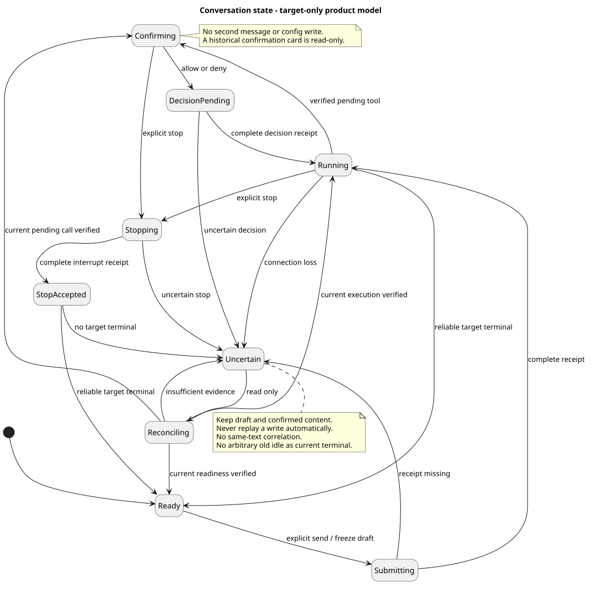

# 公共对话前端对齐

[整体体验](README.md) · [交互评审](frontend-review.html#conversation-workbench)

| 属性 | 值 |
|---|---|
| 版本 / 日期 | 1.5.0 / 2026-09-15 |
| 设计仓基线 | `2ee2a3211da68ad87b0d9cab353e691b00bdaebd` |
| 实现源码基线 | `pi-mono-java@dfb90cac4e233e09a0b8f047f7e9f4682f5ad238` 仅作历史迁移证据；当前 Runtime 前端见[实现状态](source-evidence.md#current-implementation) |
| 性质 | Mate 公共接入为 target-only；内部 Runtime 前端已有实现，公司认证及 Chat/Session 边界保持 |
| 契约依据 | [Mate Events 1.5.0](../../02-服务与接口/07-mate-service通用对话API/README.md)、[Claw POST 0.7.0](../01-CampusClaw多Agent运行时/chat-events-stream-design.md)、[Claw 历史 0.5.0](../01-CampusClaw多Agent运行时/chat-events-history-design.md) |

Thinking 展示模型返回的原始推理，规则与局部源码依据见[Thinking 展示](../01-CampusClaw多Agent运行时/chat-events-history-design.md#thinking-original-text)。

## 1. 结论与两跳边界

沿用 O1、浅暖灰导航、开放式 Assistant 正文和纵向工具详情，只补齐行为与状态。
产品只消费 Mate 公共 Chat；内部诊断适配器独立装配，不能成为生产失败后的回退。
两份契约都包含已确认决定，但并不相同。本次不修改任何 method/path/VO，不擅自将两层合并。

| 关注点 | Mate 公共契约 1.5.0 | Claw 内部新契约 | 前端与桥接责任 |
|---|---|---|---|
| 提交 | `POST /mate-service/v1/chats/{chatId}/events` 返回 `result.event` JSON | `POST /campusclaw-service/v1/sessions/{sessionId}/events` 返回 SSE，首帧完整 user.* | 产品先打开公共流再提交；不能把内部首帧处理器直接接到公共 POST |
| 实时观察 | `GET /mate-service/v1/chats/{chatId}/events/stream`，跨执行长连接 | 无独立 GET stream；对应 idle 后关闭 POST 响应 | 公共 idle 不关闭订阅；断线重开读流，不重放写入 |
| 历史 | `GET /mate-service/v1/chats/{chatId}/events`；固定快照、不透明 page；默认 100；末页省略 nextPage | 普通数字页码；默认 50；末页 nextPage=null；保持已提交顺序 | 分别校验和归一为本地 HistoryBatch，严禁混用分页参数、排序和末页判定 |
| 控制归属 | interrupt 暂无 targetEventId；Agent/idle 暂无 sourceEventId | targetEventId/sourceEventId 指向原 user.message；迟到中断返回冲突 | 公共精确目标与历史终态归属仍需桥接契约确认；禁止浏览器自行添加内部字段或按文本猜关联 |
| 工具结果 | content 是字符串；工具名采用公共名称；失败可带 errorCode | content 为仅含 text 的数组；失败必有 errorCode；Mate 调用保留 CallMateTool/{tool,args} | 公共组件先按字符串解码；内部诊断用文本块 viewer。桥接的名称、文本块边界、错误映射需另审，不能按 JSON 形状猜版本 |
| 配置、压缩、用量 | 当前八类历史未定义这些扩展 | 已确认 model_changed、thinking_changed、compacted 和消息 usage | 先保持本地能力门禁；不能把内部扩展原样送进公共时间线或静默丢弃后宣称完整 |
| Skill | 公共执行 operation 未确认 | 共享 Command POST：Builtin JSON，Skill SSE，首帧为展开前 user.message | Builtin 临时卡；Skill 接入已确认公共映射后走消息时间线，不制造第二套命令运行历史 |

上述差异是接入前的明确门禁，不要求为本次前端设计重新决定全部 API。Mock Gateway 可以演示
完整 UX，但生产 Gateway 必须在认证会话、公共控制目标、工具投影、历史桥接与命令协议校验通过后启用。
特别是 Claw 无固定快照且 createdAt 可回退，Mate 的固定快照/时间查询不能仅转换数字页码实现。

## 2. 源码证据与差距

以下文件均按上述 dfb90ca 完整读取，是历史迁移差距，不能延伸为当前实现缺陷。当前 Runtime 前端已具备显式事件、统一 Session 更新、确认/问答、Composer 停止及只读恢复；公共 Gateway 仍待接入，详见[当前实现证据](source-evidence.md#current-implementation)。路径相对实现仓，源码不等于部署证明。

| 路径 / 符号 | 已观察行为 | 目标差距与理由 |
|---|---|---|
| `frontend/README.md`；`src` 路径以下均带 `frontend/` 前缀 | 自述为内部 Runtime 调试工作台，已有富文本、原始 thinking、原始工具参数和开发态 Headers | 不再将这些能力标成“尚未实现”；但也不能把内部数据可见性直接当作生产策略 |
| `frontend/src/App.vue` · submit/running/readFollowUpMode | 运行中调用 steer/followUp；localStorage 保存模式；streaming 或 Session running 即认定执行中 | 删除产品模式与自动队列；连接状态、提交状态和业务执行状态拆开 |
| `frontend/src/components/ComposerBox.vue` · onKeydown/template | textarea maxlength=262144；有模式反转快捷键；附件按钮禁用 | 公共文本用 Unicode code point 计数至 2048，最多 4 个文件；IME 不发送，附件上传未实现时不得伪造成功 |
| `frontend/src/composables/useRuntimeApi.ts` · sendMessage/dispatchSseFrame/abort | 提交旧 message/fileIds；读取 SSE event/id；独立 abort 后置 idle | 改为公共 Gateway 三方法，data-only 帧按 type/phase 解码；中断回执不能置为已停止 |
| 同文件 · loadHistory/normalizeHistoryEvent/matchesPendingSubmission | 字符串 nextPage 与 limit 同传；entryId 去重；按正文和文件匹配确认 | 公共游标续页仅传 page；用服务端事件身份合并；回执丢失时不靠同文历史认定本次成功 |
| 同文件 · changeModel/changeThinking/requestRaw | 已有完整 Session 替换及 ETag；thinking 修改后重新读历史 | 复用已有配置骨架但隔离内部标识；顶部与 Slash 共用一份配置快照；不能因关闭 thinking 删掉此前思考原文 |
| `frontend/src/projectors/runtimeEventProjector.ts` · projectRuntimeEvents/registerToolSpecs | 旧 assistant/tool 事件、内嵌 tool_call、entryId；结果截断至 4000 字符 | 公共工具调用已独立；完整事件与显示折叠分开保存，不把展示预算当作权威记录截断 |
| `frontend/src/types/runtime.ts` / `product.ts` | 有 RuntimeEnvelope、FollowUpMode、AcceptedControl；无确认/恢复状态 | 新增 UI 专用模型；不让 Record<string, unknown> 穿透全部组件 |
| `frontend/src/components/ConversationTimeline.vue` / `ToolActivity.vue` | 工具 running/error/completed，结果用 SafeRichText，无确认控件 | 产品工具结果和思考原文按纯文本展示；确认、拒绝、已取消、结果未知独立状态，不以缺结果推断成功 |
| `frontend/src/debugHeaders.ts`；App.submit | 有内存 Header 校验/快照，DEV 才装配 | 保留内部诊断边界；新 Events 三类请求各自的 Header 规则另行实现，不沿用旧控制请求免 Header 假设 |
| `frontend/package.json` | 已有 Vue、markdown-it；无共享状态库 | 使用现有 Composition API 和纯函数即可；本设计不增加 npm/Maven 直接依赖 |

旧设计的 320d7907/bde1237 源码证据保留为历史。本文不重新分析 pi Agent Loop，也不将
新状态机表述为 pi 既有 UI；行为依据是项目已确认契约，组件关系均为 target-only。

## 3. 全局目标结构

[PlantUML 源码](diagram.puml#L205) · [原尺寸](target_frontend_components.svg)

Workspace 只发用户意图、读取不可变展示快照。ConversationCoordinator 负责提交、确认、中断和恢复；
PublicChatGateway 负责公共协议校验，EventReducer 同时消费 POST 完整回执、live 和 history。
每个 Chat 有独立 Store、DraftStore、ToolConfirmationStore；切换 Chat 时取消旧读请求、递增本地 generation，
迟到响应不写入新 Chat，关闭读流不是业务停止。请求快照不可变，不与用户继续编辑的草稿共享可变对象。

HistoryRecovery 只协调只读查询，不持有“自动重发消息”的能力。ConfigurationCoordinator 让顶部、
Slash 和恢复后的配置读取共用配置快照；成功资源与并发版本一起更新。Mate 身份集成通过宿主网络边界，
不在 Chat 页面注入凭据表单。Mock、公共和内部诊断适配器显式选择；不使用响应探测来自动降级。

## 4. 状态与交互

[PlantUML 源码](diagram.puml#L339) · [原尺寸](target_conversation_states.svg)

连接使用独立 `connecting/live/offline/reconciling` 状态，不把连接打开当作执行中、EOF 当作完成。
下列业务状态是前端模型，不是新增 HTTP 枚举。所有目标推导以当前 Chat、请求快照和可靠关联为前提。

| 状态 | 用户看到什么 | 可用操作 / 退出条件 |
|---|---|---|
| ready | 已就绪；编辑框、附件、发送 | 当前权限及公共能力通过后发送；模型/思考仅 idle 可改 |
| submitting | 正在提交；保留草稿 | 禁止重复发送。收到本次 POST 完整 user.message 才确认；仅清空仍等于提交快照的草稿，不覆盖后续编辑 |
| running | 正在处理；当前工具详情展开 | 新消息仅保留草稿；停止可用，无队列、无反转快捷键 |
| confirming | 工具名称、公开参数、“允许执行”“拒绝” | 普通发送/配置不可用；核实待确认 toolCallId 后允许、拒绝或停止 |
| confirmingSubmit | 正在提交决定 | 两个决定按钮同时禁用；完整确认回执后等待结果，不把回执当工具成功 |
| stopping | 正在请求停止 / 停止请求已接受，等待结束 | 禁止重复中断及新消息；可靠终态后显示实际原因；自然完成不能伪装成被中断 |
| uncertain | 提交结果不确定 / 连接中断，执行可能继续 | 保留草稿与已确认内容；只提供“检查最新状态”，不自动重发、不按同文推断接受 |
| terminal | 已完成 / 已停止 / 执行失败 | 显示对应轻量状态，恢复普通发送；已停止不意味着此前远端副作用回滚 |

### 4.1 文本与附件

Composer 使用 `event.content[]`，text-only、file-only、混合均可；非空 text 最多一项且在第一项。
文本不使用 JS string.length 或 HTML maxlength 代替 code point 校验；界面显示 `当前字数 / 2048`。
最多 4 个不重复 fileId；每个附件显示上传中、可提交或失败，可删除/重试失败上传。
存在未完成上传时禁用发送；只提交已获 fileId 的引用，不发送二进制、文件名或预览 URL。
文件上传路径、类型与大小沿用附件专题及公共绑定评审，不在此编造限制；原型只用明确标识的附件 fixture。

Enter 发送、Shift+Enter 换行；compositionstart 至 compositionend 期间 Enter 不触发提交。
运行中仍可编辑新草稿，但任何快捷键都不能发送第二条消息。Slash 选择与二次执行由专项负责。

### 4.2 工具确认

只由已校验的 `agent.tool_call.requiresConfirmation` 和当前待确认状态打开操作区。
调用参数在上、结果在下；在输出前显示“尚未执行，等待确认”，不能出现成功图标或假进度。
`allow` 必须省略 denyMessage；`deny` 可选原因，填写时非空白且最多 2048 code point。
点击拒绝先展开原因编辑与“确认拒绝”，不自动生成用户拒绝理由。
确认快照包含当前 Chat、原样 toolCallId 和决定；不会把 eventId 当 toolCallId。

409/过期/其他端已操作时关闭旧按钮并重新读取状态；不能自动提交给新的待确认工具。
允许/拒绝回执仅标记决定已接受，等待 tool_result 才更新结果；拒绝是工具未执行，不等于整轮失败。
中断取消工具时不伪造工具结果。历史只读确认记录没有再次操作按钮；只有重新验证当前待确认项才恢复按钮。

### 4.3 停止与结果不确定

停止按钮使用 Composer 右下角原发送位置，提交中先切换方块，可信目标可用后启用；顶部不重复提供停止。普通消息编辑器 Enter 不触发停止。点击停止固定当前可验证目标，进入 stopping；未收到回执不得声称“停止请求已接受”。
公共 1.5.0 缺少 Claw B09 的精确目标字段，这是安全接入门禁：多客户端、断线恢复或迟到控制无法可靠关联时，
保留检查状态入口，禁止通过查询“当前执行”后直接拼接中断来掩盖竞态。
新公共映射确认前仅用 mock 演示精确目标停止；不自动给现行公共请求增加 targetEventId。

收到可信 terminated 才显示已停止；done 显示自然完成，failed 显示失败。confirming 不开放新消息。
旧历史 idle、空页、HTTP 200、EOF、超时都不是本次目标结束证据。终态归属未知就保留 uncertain。
已收到 user.message 回执时保存 eventId；未收到时不按相同正文/附件猜测身份，不自动删除草稿。

## 5. 事件、正文与工具显示

| 公共输入 | 展示对象与规则 |
|---|---|
| POST result.event / history user.message | 同 eventId 一条用户消息；按 content 顺序展示文本和附件引用 |
| agent.message + delta/completed | 第一帧创建；同 ID completed 覆盖预览，之后迟到 delta 忽略；空完整正文不画空气泡 |
| agent.thinking + delta/completed | 展示模型返回的可读原文，标注“原始推理”；delta 追加、completed 原文覆盖，历史同形。前端标题为“正在分析/分析过程”，不构造额外公共标题字段，不虚构耗时 |
| agent.tool_call | 按 eventId 建立工具行，toolCallId 用于限定作用域内的结果关联；requiresConfirmation=true 时等待确认，不能一收到调用就标记正在执行 |
| user.tool_confirmation | POST/历史合并为该工具的只读决定记录；不是 Assistant 发言 |
| agent.tool_result | 使用 isError 判成败，公共字符串作为纯文本；没有结果不伪造成功；工具失败后 Agent 仍可能继续处理 |
| chat.status_idle | done/terminated/failed/confirming 分开处理；不关闭公共长连接，不把确认等待视为空闲 |

计划方案是新增的受限 Markdown 内容面，界面和两跳接入门禁见[计划交互专项](plan-interaction.md)；当前 Mate 精确模型未接入计划审核与任务事件前，只装配 Mock，不直接转发内部事件。

Assistant `content` 保留 rawMarkdown 并使用现有安全渲染骨架；User/Thinking/Tool/error 不继承 Markdown 权限。
参数是已安全投影的 JSON 对象，使用惰性展开的键值 viewer；文本即使像 JSON/URL 也不变成可执行结构。
本地展示预算只控制展开、虚拟列表或纯文本回退，不覆写权威完整记录；复制只复制允许公开的数据。
完整数据不可解码时提示“数据格式不兼容”并保留已确认内容，不伪造空列表或回退展示内部 payload。

内部诊断的 text-block viewer 按块顺序显示，空文本显示“未返回文本”，多个块不丢失；CallMateTool
业务名从 arguments.tool 读取、参数从 args 展示，但保留原始包装的来源。
模型参数不合法时展示原参数与失败结果，不因业务 Schema 拒绝事件。内部确认按根消息及调用后的提交顺序关联，
读取 denyMessage 接受 4096 UTF-16 单元；不得套用输入框 2048 code point 上限。
具体规则及 af858b85 源码依据见[事件消费边界](../01-CampusClaw多Agent运行时/chat-events-history-design.md#event-consumer-boundaries)。此规则不自动改变 Mate 公共名称契约。

## 6. 历史与断线恢复

1. 先建立公共 Chat 读流，再读取历史/提交消息；读取器校验 data-only JSON，忽略 ping 注释，不期待 event/id 或 stream.end。
2. 三个来源共用 EventReducer；以 Chat + eventId 合并完整事件，toolCallId 只作工具关联，不作事件身份。
3. 公共首页按契约选择 limit/types/createdAtGte；续页只传原样 page，不再同时传 limit。省略 nextPage 才是公共末页。
4. SSE 断开时重开只读流并加载历史，采用有界退避、可见重试状态；不重放任何 POST，包括确认和停止。
5. 分页进行中保留实时尾部，不用一页结果替换整条时间线；完整记录覆盖同 ID preview。切 Chat 或改变过滤时丢弃旧 generation 的响应。
6. 公共快照读完后，按现行公共契约的 inclusive createdAtGte 继续查询并去重；这个算法不能用于新 Claw 数字分页。
7. 读取失败保留已有内容，显示“部分历史未加载”；游标失效从首页重建。授权撤销立即清空受影响的敏感展示和缓存，不能沿用一般读取失败保留策略。
8. 历史恢复了完整内容不代表已确定当前执行准入；旧终态、无下一页或空历史不开放未知执行。必要的当前 Chat 状态/根消息归属由公共接入补齐后验证。

列表提供“加载更多记录”、加载中、读取失败和没有更多记录；不显示无依据的总条数或百分比。
向上阅读时保留滚动锚点，实时追加仅在用户接近底部时跟随，否则显示“有新内容”。
后续删除、保留策略或权限变化触发重建；不得声称永久可恢复。

## 7. 配置、命令及身份集成

Composer 模型/思考/模式、Builtin model/name/thinking/status 与恢复读取共用 ConfigurationStore。
内部成功响应的完整 Session + ETag 必须原子替换；model 空参返回 Models 不覆盖 ETag。
版本冲突刷新后显示实际值和用户原选择，保留草稿，用户再次确认才修改；不自动用新 ETag 重放更新请求。
相同配置不提示“已变更”；切模型可能同时关闭 thinking，以完整资源为准，不把旧开关值覆盖回来。
模型不可用/集合为空时解释状态并禁用修改；已有名称不应由 modelId 字符串猜出供应商或能力。
已有思考原文不因关开关而删除。公开配置路径、错误及并发令牌表达未确认时使用能力门禁，不能泄漏内部 ETag。

Builtin 仍临时展示；Skill 按内部 B13 已成为消息执行，但 Mate 执行未确认。命令目录 GET 不是执行预约，
提交前重新准入。公共绑定未完成时保留参数和附件并说明不可运行，不把 Skill 当 Builtin JSON 或普通消息悄悄发送。

宿主认证集成先按 Mate 已确认 Header 要求校准，Chat 组件不持有 JWT/APPKEY/access-token。
401/403 进入统一身份/权限流程；不采集秘密、不自动带原请求重试。内部调试新控制和 Skill 的 Header
需要各自契约测试，不能由于路径同为 events 就共享当前正在运行的凭据对象或覆盖原执行。

## 8. 实施切片、理由与验收

| 切片 | 分类与理由 | 验收 |
|---|---|---|
| F1 Gateway / Decoder / Store 骨架 | 架构变化；隔离公共、内部、mock，防止字段与分页混用 | 两种分页/工具结果反例；错误 ResultBean 不带 result；未知 type/坏 Schema 显式失败；Chat generation 隔离 |
| F2 Composer / AttachmentDraft | 产品约束；发送规则匹配公共契约 | 2048/2049 code point、Emoji、IME、file-only、4/5 文件、重复 ID、上传失败、回执后不清除新编辑草稿 |
| F3 EventReducer / Timeline | 架构变化 + 安全加固；共享权威状态与纯文本边界 | 重复 completed、迟到 delta、空正文、工具缺结果、拒绝不等于整轮失败、纯文本 JSON/HTML/URL 不激活 |
| F4 Confirmation / Stop | 产品约束 + 安全加固；控制动作必须绑定原目标 | allow 省略理由、deny 可选原因、双击、跨端过期、停止与确认竞争、回执不当终态、旧终态不释放新消息 |
| F5 HistoryRecovery | 架构变化；恢复是读取，不是重执行 | 断线前后、无回执不确定、末页仍运行、空页/读取失败区分、实时尾部保留、游标失效、权限撤销清空 |
| F6 Configuration / Slash | 产品约束；顶部和命令入口一致 | 完整资源与版本一起更新、412 不自动重放、model 查询不覆盖版本、Skill 不进入 Builtin 临时结果 |

原型只模拟 fixture 状态，不发网络、不执行工具、不上传用户文件。回执和终态分别由评审控制触发，
以便验证“已接受不等于已完成”。布局检查应覆盖 1440/1024/768/390，所有可交互控件至少 44px；
新增操作具备焦点环、可读标签和状态播报，文本长时换行，参数与结果始终纵向排列。

机械校验与原型状态回归不证明生产接入、真实网络、公共认证或像素布局通过。

当前内部工作台的持久化索引、IP 认证助手和请求范围见 [Runtime 工作台交互对齐](runtime-workbench-alignment.md)。这些目标不把公共 Chat 映射替换为内部 Session，也不新增 Mate 生产登录接口。

## 9. 版本历史

| 版本 | 日期 | 变更 |
|---|---|---|
| 1.5.0 | 2026-09-15 | 区分已实现的 Runtime 前端与待接入的 Mate 公共能力。 |
| 1.4.0 | 2026-09-15 | 配置入口收敛到 Composer，新增计划审核与任务展示的公共接入引用。 |
| 1.3.0 | 2026-09-09 | 将停止收敛到 Composer 主操作并关联内部工作台恢复设计。 |
| 1.2.0 | 2026-09-09 | 明确事件身份、工具业务参数与 Runtime 响应读取边界。 |
| 1.1.0 | 2026-09-09 | 明确 Thinking 展示模型返回的原始推理。 |
| 1.0.0 | 2026-09-08 | 补齐主对话、工具确认、中断、恢复及配置共享；记录公共/内部差异与接入门禁；保持原视觉语言。 |
