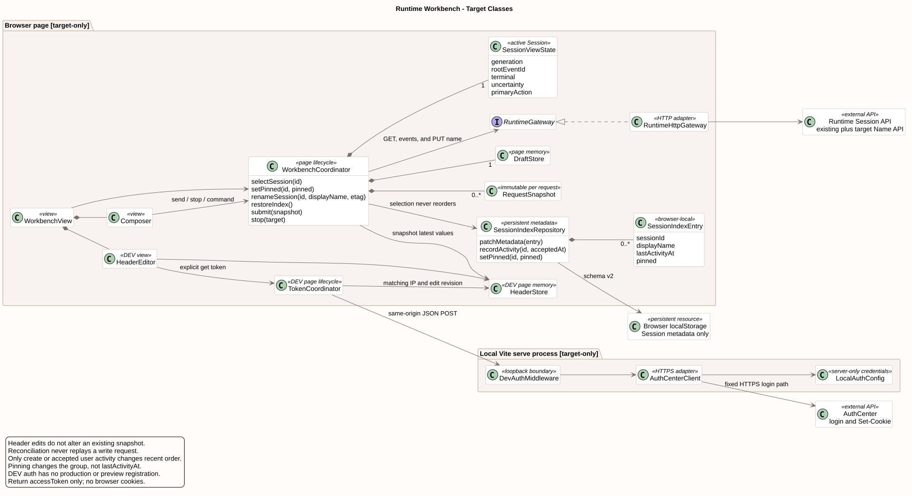

# Runtime 工作台交互对齐

[返回前端体验](README.md) · [交互原型](frontend-review.html#conversation-workbench)

| 属性 | 值 |
|---|---|
| 版本 | 1.0.0 |
| 日期 | 2026-09-09 |
| 设计起点 | `pi-mono-java-design@599edb072cf75e3d8f85c775c53c0e83befd285d` |
| 实现基线 | `pi-mono-java@7f1126262b16458e430c1a70aba9936e26391385` |
| 范围 | 当前研发使用的 Runtime Web 工作台；新增恢复、Composer 操作与认证助手为 target-only，尚未修改 Vue 或后端实现 |

## 1. 源码依据与差距

以下路径相对实现仓。此前交互基线为 `4cc8dd86f601417c22cf9306e52152acbb59bb60`，传输历史基线为 `dfb90cac4e233e09a0b8f047f7e9f4682f5ad238`；更新后的证据仅支持本表范围，不重新解释 Runtime 内核或生产 Mate 接口。

| 路径与符号 | 已观察行为 | 目标与原因 |
|---|---|---|
| `frontend/src/App.vue`：`threads`、`drafts`、`resumeSession`、`createSession` | 最近列表、选择与草稿均在页面内存；没有启动恢复 | 保存会话索引，启动时只读恢复，防止刷新后失去会话入口 |
| `frontend/src/App.vue`：`statusLabel`、顶部停止按钮、底部恢复栏 | 顶部存在有效停止操作；底部只有发送按钮，恢复栏常驻 | 停止放到 Composer 原发送位置，异常时才展示恢复动作 |
| `frontend/src/components/ComposerBox.vue`：template、`onKeydown`；`frontend/src/composables/useCommandComposer.ts` | `+` 打开命令；独立附件按钮禁用；已有命令标签及参数编辑 | `+` 负责添加附件/上下文；命令由首字符 `/` 进入，保持已实现的标签模型 |
| `frontend/src/components/DebugHeaders.vue`：`snapshot`；`frontend/src/App.vue`：`submit`、`executeCommand`、`stop`、`decideTool` | 四类写操作均在动作发生时读取最新有效 Header 并复制 | 保留此行为，修正文档中“仅初始消息”描述；改值无需保存或新建会话 |
| `frontend/src/debugHeaders.ts`：`validateDebugHeaders` | 三个空预置计数为零；仅空格/Tab 的值可被计数，构造 Headers 后变为空值 | 保留有效项计数；按 HTTP 空白规范化后的值判断是否为空 |
| `frontend/src/composables/useRuntimeApi.ts`：`canSend`、`recover`、`consume`；`frontend/src/runtime/eventStore.ts`：`executionState` | `canSend` 未排除有回执但无本轮终态的 `uncertainty` | 状态文字与按钮共用准入判定，旧 idle/末页/EOF 均不能释放新消息 |
| `frontend/src/App.vue`：`executeCommand` | 本地 Header 校验失败也返回 `uncertain` | 未发 POST 应标为本地校验失败，不能提示已提交但结果未知 |
| `frontend/vite.config.ts`；`frontend/package.json` | 已有 Vite、Node 和 Runtime 代理，没有 AuthCenter 登录助手 | 使用 DEV middleware 和 Node 内置 HTTPS；账号密码留在本地服务 |

源码分支不能替代实际交互验证：在基线运行页面发起纯文本长输出，顶部停止按钮经过“正在停止”到“本轮已停止”，证实停止能力存在；Composer 中缺少同位置停止才是本次修正对象。确定性探针复现了纯空白 Header 和有回执无终态时 `canSend=true`。基线 100 个单元测试与类型检查通过，不代表这些边界已覆盖。

## 2. 目标职责与生命周期

[PlantUML 源码](diagram.puml#L327) · [原尺寸 SVG](target_runtime_workbench.svg)

图中新增对象均为 target-only。页面协调器统一拥有选中会话与请求代次；Composer、恢复和停止读取同一执行状态，不各自推导可发送。索引只提供恢复入口，消息与执行状态仍以后端为权威。Header Store 与会话索引分开，避免恢复列表时顺带保存凭据。

本地认证助手属于 Vite 开发进程，不进入 Vue 包或 Java 服务。它只负责一次认证和 Token 提取，不负责 Session、工具执行或生产身份建立。此划分复用现有开发环境，不增加 Java API、数据库表、Maven 或 npm 直接依赖；Node 内置 `https`、`net` 足够完成定址请求与 IP 校验，无新增传递依赖。

## 3. 会话保存与恢复

这是产品交互约束及客户端状态架构调整。前端静态配置文件提供环境地址等启动配置，不承担用户会话的持续写入。当前工作台使用浏览器 `localStorage` 保存索引；刷新和关闭后重新打开都恢复最近列表与上次选中的会话。恢复只影响同一浏览器、同一站点，不等于跨设备同步。

| 数据 | 保存位置与语义 |
|---|---|
| `schemaVersion`、环境作用域、`activeSessionId` | 浏览器本地会话索引；作用域由 API base、Agent 与工作台 caller 配置组成，避免不同环境混用；作用域不是授权证明 |
| `sessionId`、`agentId`、显示名称、最近访问时间 | 索引项；ID 来自成功创建/读取响应，名称仅辅助列表显示，恢复后可由后端名称更新 |
| 未完成提交的最小标记 | 只保存操作种类、是否已得回执及可用的原目标/回执 ID，不保存请求正文；发送前写入，匹配权威结果后清除，用于刷新后的不确定结果提示 |
| 消息历史、执行结果与配置版本 | 后端权威资源；通过 GET 重新读取，不把缓存状态当作已完成 |
| 普通消息、命令及附件草稿、临时命令结果 | 页面内存；会话切换按既有草稿规则处理，本项不承诺刷新恢复未发送内容 |
| Header、Token、登录密码、Cookie | 不进入会话索引或其他浏览器持久存储；页面刷新后 Header 值清空 |

启动恢复顺序：

1. 校验版本、结构与作用域，显示最近列表和“正在恢复会话”；没有索引时显示新会话入口，不自动创建会话。
2. 用保存的 ID 调用现有 `GET /sessions/{sessionId}`，随后读取历史、模型并更新配置；完整读取分页后按现有事件规则重建本轮状态。
3. 恢复期间允许编辑草稿，发送保持禁用。已有根事件时，只有其匹配的终态与当前资源一致才恢复发送；尚未加载到根事件时不猜测停止目标。
4. 若后端仍在执行，恢复运行态和已加载的确认/停止目标。内部接口没有独立恢复读流，使用有界 GET 历史/Session 补读；不重新发送原 POST。前台可采用 1、2、5 秒退避，最多连续 6 次，仍未结束时显示“后台仍在执行”和“刷新状态”；返回页签或用户点击再启动补读。
5. 切换会话递增 generation 并中止旧读请求；旧响应不得覆盖新会话。中止浏览器观察不等于终止后台执行。
6. 网络错误保留索引并显示重试；404/明确无权限显示该会话不可恢复且清除其消息视图，由用户移除列表项。只有明确新建动作才创建新会话。

索引写入、损坏或版本不兼容不应使页面崩溃：仅处理本功能的命名空间，写入失败告知本次无法保存恢复入口，现有会话仍可使用。读取原目标/回执标记只能辅助对账；未知结果不能按文本相同自动认领，也不能自动重放。不同页签各自保持当前选择，索引变化不强迫另一页签导航。

## 4. Composer 的发送与停止

这是产品交互约束，沿用现有 `user.interrupt` 语义，不增加 abort 接口，也不改变 Runtime Loop。

| 当前状态 | 右下角主按钮 | 行为 |
|---|---|---|
| 空闲、可提交 | 上箭头，“发送消息”或“运行命令” | 校验后冻结草稿、目标和当前 Header；清单浏览或空内容时禁用 |
| 消息/Skill 提交中，尚无完整回执 | 停止方块，禁用，提示“正在提交，确认接收后可停止” | 立即切换外观；尚无可信目标时不发送伪造中断 |
| 执行中 / 等待工具确认 | 停止方块，“停止生成” | 不受输入框是否有草稿影响；点击绑定当前根目标提交一次中断 |
| 确认决定正在提交 | 停止方块，暂时禁用 | 共用控制操作锁，避免重复或竞争控制请求 |
| 停止请求发送中 / 已接受但未终止 | 停止方块，禁用，“正在停止” | 回执只说明接受；草稿保留，不提前恢复发送 |
| 结果未知 / 恢复中 | 根据已确认执行保留停止语义；目标未确认时禁用 | 显示恢复动作，不把“未知”降级为可发送 |
| 当前目标可信终态 | 上箭头 | `done/terminated/failed` 按实际结果显示；保留运行中写入的草稿，不自动发送 |

顶部不再重复提供停止按钮。鼠标点击停止或键盘焦点明确位于停止按钮时 Enter 才停止；在普通消息 textarea 内按 Enter 不得因按钮改形而停止任务。IME、长按 Enter、重复点击仍须防重。

“已就绪”仅曾表示客户端判断没有活动执行，不能证明凭据有效。目标顶部空闲文案为“空闲”，执行时为“正在执行”“等待确认”“正在停止”；输入框上方不重复显示健康状态和常驻“重新核对”。只有恢复中、连接异常或提交结果未知时显示状态条及“刷新状态”；该动作只读历史/Session，不校验 Token，也不重发消息。

运行中命令的入口、执行按钮与焦点规则统一见 [Slash 专项 §4.3](../../04-命令与技能/00-Slash-Command通用模块/前端设计/README.md#43-选择与执行)。普通消息仍无 Follow-up 队列和 Steer，不把运行中草稿自动续发。

## 5. 添加入口与 Header

`+` 的产品语义为添加附件或上下文，不再包含“命令”；命令仍由空消息首字符 `/` 触发，或点击已选标签更换。附件与上下文实际能力必须与已接入资源一致，当前无上传实现时“添加附件”禁用并提示“暂未接入附件上传”，不虚构上传或新增一个未定义的上下文 API。移除工具栏重复的独立附件按钮。

Header 行、计数与生命周期以 [主设计 §6.1](README.md#61-开发者调试-header) 为唯一规则。三条空预置显示 `Headers (0)` 正确；仅空格或 Tab 的值按 HTTP 首尾空白规范化后视为空。CR/LF 一律拒绝，不用 trim 掩盖非法换行。每次新消息、命令、中断和确认读取最新有效值；修改不追溯影响已发请求或正在执行的凭据快照。

## 6. 按认证中心 IP 获取 Token

此能力是 DEV-only 产品约束与凭据边界加固，全部为 target-only。用户提供的 Postman 界面证明了以下调用形态；尚未对真实认证中心发起验证，不能把它当作完整上游契约：

- `POST https://{ip}/service/AuthCenter/0.1.0/auth/login`，JSON 字段 `loginAccount`、`password`。
- 成功响应 Cookies 中出现 `access-token` 与 `JSESSIONID`；截图中的 `access-token` 标记 HttpOnly、Secure。
- 不记录截图里的真实密码、Token 或 Cookie；测试使用明确的合成值。

浏览器 Fetch 不向页面脚本公开 `Set-Cookie` 响应头；HttpOnly Cookie 也不能通过页面脚本读取，因此不能直接照搬 Postman 提取方式。[WHATWG Fetch](https://fetch.spec.whatwg.org/#forbidden-response-header-name)、[RFC 6265 §4.1.2.6](https://www.rfc-editor.org/rfc/rfc6265#section-4.1.2.6)。

### 6.1 页面流程

Headers 面板增加“认证中心 IP”输入和“获取 Token”次级按钮。IP 输入只改变草稿；点击按钮才登录，不在每次键入或刷新时自动登录。获取中按钮禁用，成功后自动填充并启用唯一的 `access-token` 行，显示短暂“Token 已更新”；没有对应行时创建一行，已有重复同名行时先要求解决重复。

账号与密码配置在未提交的本地开发服务配置中，例如 `.env.local` 的 `CAMPUSCLAW_DEV_AUTH_ACCOUNT`、`CAMPUSCLAW_DEV_AUTH_PASSWORD`。不得使用 `VITE_` 前缀、传给 `define` 或进入客户端包。页面不显示账号密码。IP 与 Token 均先保持页面内存，刷新后可重新输入并获取。

获取过程冻结 IP 与请求代次。切换 IP、清空 Header、关闭页面或切换环境后旧结果不得回填；请求过程中手动编辑 Token 行时也不得用迟到结果覆盖手工值，提示重新获取。修改 IP 时清除本助手为原 IP 生成且未被手工修改的 Token。失败不覆盖同一 IP 的现有有效值，不产生虚构的有效期或“认证成功”标记。

### 6.2 本地开发服务接口（目标私有契约）

| 项目 | 目标定义 |
|---|---|
| 路径 | `POST /__debug/auth/token`，仅 Vite `serve` middleware；非 CampusClaw 公共 API，生产构建和 preview 不注册 |
| 页面请求 | `Content-Type: application/json`，body 为 `{ "ip": "192.0.2.10" }`；不接收账号密码、上游 URL、路径或 Cookie |
| 校验 | 服务端用 Node `net.isIP` 校验 IPv4/IPv6 字面值；协议 HTTPS、端口 443、登录路径固定；不跟随重定向；沿用 TLS 校验，本地 CA 由开发服务配置 |
| 访问边界 | 本地 loopback 服务、受校验的 Host 与同源 Origin；JSON POST，跨源与不符方法拒绝。开发服务配置缺失返回明确错误，不向其他来源开放登录代理 |
| 上游请求 | Node HTTPS 使用本地账号密码构造 JSON；不附带调试 Headers 或截图 Cookie；10 秒超时、64 KiB 响应读取上限；失败后无自动重试 |
| 提取 | 仅在上游 HTTP 2xx 后遍历 Node 的独立 `set-cookie` 数组，按 Cookie 名精确匹配 `access-token`，不以逗号拆分；空、删除或相互冲突的 Token 视为失败；不返回 `JSESSIONID` 或原始响应 |
| 成功 | HTTP 200，`{ "resCode": "0", "resMsg": "Token 已获取", "result": { "accessToken": "synthetic-token" } }`；示例是合成值 |
| 失败 | 使用非 2xx 与 `resCode/resMsg`，不带 result；`INVALID_AUTH_IP`(400)、`DEV_AUTH_NOT_CONFIGURED`(503)、`AUTH_UPSTREAM_REJECTED`(502)、`AUTH_TOKEN_MISSING`(502)、`AUTH_UPSTREAM_UNAVAILABLE`(502)、`AUTH_UPSTREAM_TIMEOUT`(504) 为本地稳定目标码，不声称是上游错误码 |
| 存储与错误 | 响应 `Cache-Control: no-store`；不设置浏览器 Cookie，不记录请求正文、密码、Token、Set-Cookie 或原始上游错误；页面仅更新内存 Header |

Token 获取是独立请求，不重放失败的对话 POST。后续是否携带新 Token 由该 Header 行启用状态和提交时快照决定；不自动拼接 `Bearer`。Token 到期后按实际失败提示重新获取，不从截图推断续期接口或有效时长。

## 7. 实施与验收

| 切片 | 目标依赖与验收 |
|---|---|
| W1 会话索引与恢复协调器 | 新建/切换后刷新、关闭重开均恢复同一 ID；网络失败不创建新 Session；损坏存储、404、跨环境、旧响应、运行中恢复与未知提交只读对账 |
| W2 统一 Composer 操作状态 | 消息提交立即变方块；无回执禁用、可停止时启用、控制回执不释放发送、实际终态恢复；草稿 Enter 不停止；顶部无重复按钮 |
| W3 Header 与本地错误 | 三空预置 0，纯空白 0，CR/LF 拒绝；四种 POST 使用最新值，旧快照不变；本地校验失败不归类为网络未知结果 |
| W4 本地认证助手 | 固定 IP/HTTPS/path、账号配置不进入 bundle、独立 Cookie 数组、超时/上限/无 Token/重定向/TLS/异常脱敏、代次与编辑冲突；生产与 preview 路径不存在 |
| W5 入口与状态提示 | `+` 只含真实附件/上下文能力；`/` 发现命令；空闲不常驻恢复栏；故障动作只读取，不自动续发、重登或重放 |

设计原型使用本地 fixture 演示按钮与 Token 回填，不调用真实认证中心，不代表新增能力已实现。真实认证中心的失败响应、CA 配置、Cookie 刷新/删除语义需在实现联调中补证；不阻塞本地组件与 fixture 验证，也不宣称真实登录已通过。

## 8. 版本历史

| 版本 | 日期 | 变更 |
|---|---|---|
| 1.0.0 | 2026-09-09 | 定义会话索引恢复、Composer 停止、添加入口和本地认证 Token 回填。 |
