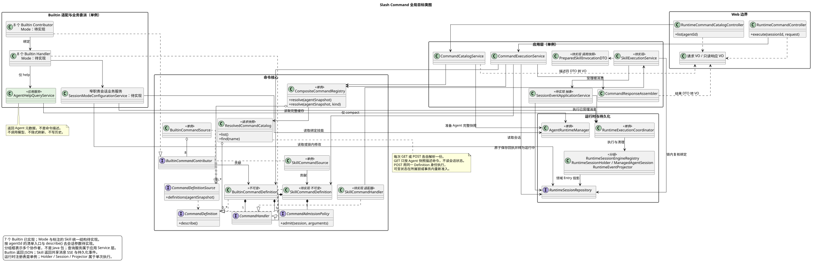
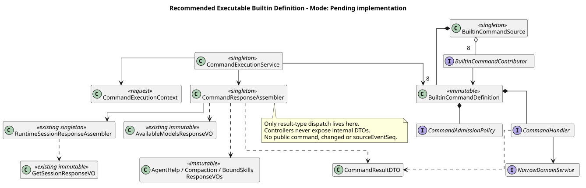
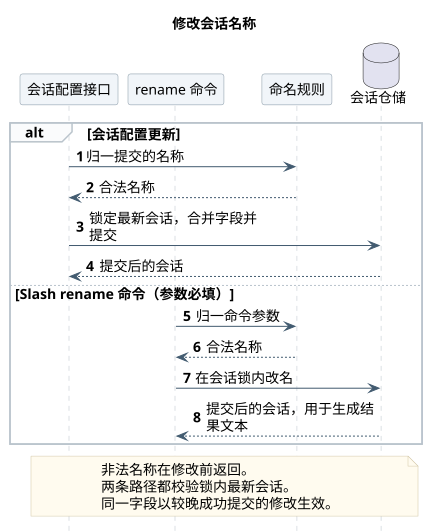
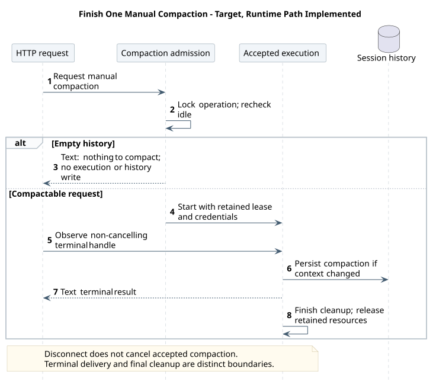

# CampusClaw Builtin Command 设计

[返回命令系统](../README.md)

> Slash 只是业务能力的调用入口：响应复用既有 Session/模型清单，不再提供命令专属回执。
> `/help` 无参介绍当前 Agent，结果只有 displayName/description/useCases；[Help 专项设计](Help-Agent使用指南/README.md)维护缓存与展示语义。

| 属性 | 值 |
|---|---|
| 文档版本 | 2.16.0 |
| 更新日期 | 2026-10-16 |
| 设计仓基线 | `0eaa70ff365bf4d4e328b3473809341ca4cfc58d` |
| CampusClaw 分析基线 | `d84dd3d6a306b7587c70b29e0100e741dacef989` |
| Help 专项源码基线 | `53eff85c7f41de23eb434e027782f5085a8b8e45`；Help 查询、useCases 缓存往返、Agent 级锁、响应投影与 Command POST 已实现 |
| 当前 Runtime 核验基线 | `53eff85c7f41de23eb434e027782f5085a8b8e45`；七个 Builtin 的 Contributor、业务服务、JSON 投影与共享 POST 已实现；验收范围见 §8.3 |
| Name 历史复核基线 | `510d882ca45541e0086586dab89c429c5a18cf20`；仅保留当时命名服务证据，统一 Session POST 已在当前核验基线实现 |
| 初始 Command 发现候选 | `0bb794f222273e12fc24fe98d6ab4e9013ac8599`（PR #210） |
| 最新前置 PR #210 | `9d0d76f4a571b559dc77ae52736caebbcc8fad88`，已通过 a8192e047f4061bd385297d3dc6c4358362d0d49 合并 |
| 状态 | 七个 Builtin 的 Runtime 调用链已实现；不等于全部目标契约、Mate 公共接入或部署验收完成 |

本期不支持排队续跑；Compact 复用 Runtime 已有执行与可靠清理边界。
[FollowUp 未来专题](../../01-CampusClaw多Agent运行时/chat-follow-up-future-design.md)
记录 dfb90ca 源码证据与待启用方向，不改变七个 Builtin、Help 或 Skill 的归属与字段。

## 1. 范围与证据

Builtin 与 Skill Command 由用户统一负责设计、实现和集成。命令清单改为按 Agent 查询 `GET /agents/{agentId}/commands`，sessionId 为可选查询参数（待评审 · 待实现）：不带 sessionId 只返回 help、skills 与技能命令，带 sessionId 返回完整命令；轻量描述符、两类命令合并与固定排序保留，不再按 Session 状态过滤，运行中的禁用由前端状态规则表展示、POST 终判；Builtin 来源过滤只适用于内部 Builtin 专属解析，不是清单查询的全局限制。Builtin 使用已确认 JSON 契约；Skill 的当前契约状态、执行与发布要求由[Skill 专题](../02-技能命令/README.md#4-统一实施与集成要求)维护。

本文的 Builtin 目标覆盖 help、status、name、model、thinking、mode、compact、skills，不转换成模型提示词，不接受附件。
精确请求和结果以 Runtime
[操作 12](../../01-CampusClaw多Agent运行时/接口契约/操作/12-list-agent-commands.json)、
[操作 13](../../01-CampusClaw多Agent运行时/接口契约/操作/13-execute-session-command.json) 为准。
[通用模块源码证据表](../source-evidence.md#2-源码证据与差距)记录完整路径与基线。

d84dd3d6 的 `modules/coding-agent-cli/src/main/resources/db/gaussdb/install/session_schema.sql`
中 t_sessions 没有 display_name；配置服务已存在 Model/Thinking 的领域更新。
`modules/coding-agent-cli/src/main/java/com/campusclaw/codingagent/session/ManagedAgentSession.java`
的 compact 已提供共享压缩能力，但没有独立于请求 SSE 的 Runtime 压缩通道。
上述是 d84dd3d6 的历史差距；当前名称存储与独立压缩链已实现，见 §8.3。它们是 Java 架构变更，不是 pi 已有 HTTP 行为。

Skill 名称统一使用 Skill 域的严格规则，加载、命令发现和执行不能保留存量兼容例外。
`0300541fbbe3db8b05ffa1ac953f15f01df74b3e` 的历史名称专项曾观察到 LEGACY/STRICT 分裂；
当前核验基线已通过 ClawConstants.Skill 统一严格校验。源码路径、符号、统一规则和验收见 [Skill 设计](../02-技能命令/README.md#2-源码证据)。
Builtin 的来源过滤与 Skill 名称校验是不同职责，不能以过滤 Skill Source 代替加载时拒绝非法名称。

## 2. 全局目标与核心扩展

先看完整 Web → Application → Command Core → Builtin Adapter → Runtime/持久化结构；
主图沿用设计仓 `06bea56` 的完整分层骨架。八个 Contributor、八个 Handler、窄业务服务分别分组；新增 Mode 待实现，
Runtime Coordinator、执行对象和 Repository 分开表达。
这些分组表示协作者集合，不要求实现同名大类，也不改变 Service 的 Java 包归属。

[PlantUML 源码](../diagram.puml#L124) · [展开原尺寸 SVG](../target_slash_command_global_classes.svg)

Slash 与 Builtin 共用这一份图源；[Help 元数据补充图](Help-Agent使用指南/README.md#2-全局入口与-help-补充类图)
和以下核心扩展类图只作下钻，不替代或重排全局主图。

[PlantUML 源码](diagram.puml#L1) · [展开原尺寸 SVG](target_command_core_classes.svg)

BuiltinCommandSource 聚合八个 Contributor 并在 Spring 启动期查重。
可执行 Builtin Definition 持有 Handler/Admission；Skill 发现定义不安装伪 Handler；当前 Skill 已由独立执行服务接入，统一 Definition/Handler 结构仍待实现。
CommandExecutionContext 固定只读 Session、Locale 和同一 Catalog View。
Help 只从 Context 取 Session 绑定，经 AgentHelpQueryService 查询一个完整 Agent 缓存；不消费命令清单、不反向注入 Registry。
响应组装器才允许按结果类型分派，不允许中央按命令名称 switch。

| 命令 | 窄服务 |
|---|---|
| help | AgentHelpQueryService → AgentRuntimeManager.prepareCached |
| status | RuntimeSessionStatusService |
| skills | BoundSkillQueryService |
| name | SessionNamingService |
| model | SessionModelConfigurationService |
| thinking | SessionThinkingConfigurationService |
| mode | SessionModeConfigurationService（待实现；共享 Session 模式规则与事务） |
| compact | SessionCompactionApplicationService |

## 3. 串行 PR 与交付边界

下表保留 Builtin 的实施切片与依赖顺序，不代表这些切片当前仍未实现；当前能力状态见 §8.3。Skill 执行与共享 HTTP 集成同时纳入[统一实施计划](../README.md#5-实施与验收)。
后续增量 PR 必须等前一相关 PR 合并，
再从最新 origin/main 建立独立 worktree 和 codex/* 分支，不使用堆叠分支。

| 顺序 | 分支 | 职责与发布边界 |
|---:|---|---|
| 1 | codex/builtin-command-core | 来源过滤、可执行定义、准入/Handler/Context、Contributor、快照与查重；实现设计、PlantUML/SVG、未占用序号 ADR；无 HTTP |
| 2 | codex/builtin-command-readonly | Help 的 Service、Contributor、Definition 内 Handler、DTO、useCases 保存/重载及读取/发布互斥已实现，元数据更新通过显式刷新完成；Status/Skills 查询与响应已实现，见 §8.3 |
| 3 | codex/builtin-command-name | display_name、Mapper/Repository/DTO 与 GET Session；无 Command 路由 |
| 4 | codex/builtin-command-model | Model 窄服务与锁内最新配置校验；统一 Session POST 复用原子更新规则 |
| 5 | codex/builtin-command-thinking | Thinking 窄服务与同一事务入口 |
| 6 | codex/compact-runtime-lifecycle | 操作锁、容量、Holder、持久化 Projector、30 分钟超时与独立终态 Future |
| 7 | codex/builtin-command-compact | Compact Contributor/Handler/Application Service、中断绑定与清理 |
| 8 | codex/builtin-command-application | Catalog/Execution 应用边界；复用业务资源 VO 与 Session 投影，不为每个命令新建响应类型 |
| 9 | codex/builtin-command-http | 统一对齐 Skill 清单与请求类型后发布 GET/POST、VO/Header/ResultBean、契约和跨进程测试；删除旧 command 原型；更新实施状态 |

开发规模统一遵守[通用模块交付规则](../README.md#5-实施与验收)。
按职责和验收边界组织 PR，不提前公开未完成路由；ADR 在同步最新 main 后分配。

## 4. 命令行为

| 命令 | 空参数 | 非空参数 | running |
|---|---|---|---|
| help | 当前 Agent 的显示名、用途介绍与使用场景 | 拒绝，不再查询命令详情 | 可用 |
| status | 持久化 state/modelId/thinking | 拒绝 | 可用 |
| skills | 最新完整绑定快照的名称/描述 | 拒绝 | 可用 |
| name | 查询当前名称 | 更新当前名称 | 可查询和修改 |
| model | 当前与可选模型 | 修改模型 | 仅查询 |
| thinking | 当前开关 | 仅小写 on/off | 仅查询 |
| mode | 当前模式（完整 Session） | 仅小写 plan/build | 仅查询 |
| compact | 压缩 | 拒绝 | 不可用 |

空参数是 Service 归一后的空字符串。全空白 Name 修改在去除两端空白后为空时拒绝，不视为清空。
Help 的 arguments 缺省/null/空白归一为空；非空参数（包括 model）为 INVALID_COMMAND_REQUEST，不进入命令详情或 COMMAND_NOT_FOUND 分支。
GET 的 Help 描述符只有 name/type/description，不返回 argumentType，不允许执行参数；Agent 命令清单按[轻量契约](../README.md#31-get-轻量清单已确认)排序，不按 Session 状态过滤。
Help 不刷新：读取最近成功发布的完整 Agent 缓存；无快照为 422 AGENT_NOT_AVAILABLE，只有文案缺失则返回 200 空数组。
displayName 取 Agent 显示名，空白回退 Agent name；不是 `/name` 的 Session 名称。文案按纯文本展示，不调用模型、不写历史或模型上下文。
清单查询不暴露内部准入原因；缓存缺失时先按 Agent 准备完整快照，Agent 不存在为 404 AGENT_NOT_FOUND，准备失败为 422 AGENT_NOT_AVAILABLE；不改变上述 POST Help 的 422。
Skills 不触发刷新：无完整快照返回 AGENT_NOT_AVAILABLE；完整空快照返回 []，只展示名称/描述并稳定排序。

## 5. Name 当前状态

本图比较两个改名入口如何复用同一套校验，分支本身就是图要回答的问题。HTTP 与 Slash 均在数据库行锁内读取最新状态，HTTP 只合并本次提交的配置字段；同名不写入，真实改名更新名称、时间与版本。名称不创建 Entry，不改变活动执行；仅改名可在运行中进行，携带执行字段仍要求 idle。

[PlantUML 源码](diagram.puml#L61)

`t_sessions` 使用可空 `display_name`；GET Session 始终保留 `displayName`，即使为 null。
修改去除两端空白、保留内部空白，拒绝空值、CR/LF、C0/C1、Unicode 双向覆盖/隔离字符及超过 80 UTF-8 字节。
命名规则和 Repository 更新只保留一份。目标统一 `POST /sessions/{sessionId}` 与 `/name` 均不接收客户端版本令牌，由数据库锁内校验并更新；同字段以较晚成功提交的修改生效。同一归一值不升版本，running 允许两条入口修改。
不写 `session.name.changed` 或通用命令事件，不修改 active leaf；重启只恢复当前名称。

`53eff85c` 已有 `RuntimeSessionController.update` 和 `RuntimeSessionUpdateService.update`：统一 POST 接收
`UpdateSessionRequestVO` 与 `If-Match`，准备候选后调用 Repository.updateSession；Slash 仍由
`NameCommandContributor` 委派 `SessionNamingService`。两入口共享名称约束常量，当前统一 POST
有自己的 normalizeName，不能据此宣称已复用同一个命名 Service。无新增 Maven 依赖或数据库字段。

统一 POST 已准备组合字段并调用统一 Repository 更新；目标要求名称规则一致、最终一次事务提交；不调用会自行提交的 execute，再拼接模型/思考更新。完整规则由[HTTP §2.4](../../01-CampusClaw多Agent运行时/chat-http-v1-design.md#session-update)维护。

## 6. Model / Thinking

Repository 在行锁内读取最新记录，合并本次提交字段并验证最终配置。统一 Session POST 与 Command 均不使用 If-Match、Idempotency-Key 或配套 ETag，也不增加同用途 body/query 令牌；内部版本仅用于服务端一致性。同值操作不写领域 Entry。
查询在 running 可用，修改在锁内重新检查并返回 SESSION_BUSY。
Model 不可用为 MODEL_NOT_AVAILABLE；开启不受支持的 Thinking 为 THINKING_NOT_SUPPORTED；
Manager 不可用为 MANAGER_UNAVAILABLE。Model 切换到不支持 Thinking 的模型时沿用自动关闭规则。

### 6.1 Mode：查询与切换 plan/build

园区用户准备先评估设备告警处置方案、再执行工单操作时，可以在 Composer 输入 `/mode`，选择“计划（plan）”或“实施（build）”，再明确执行；也支持直接输入 `/mode plan`、`/mode build`。切换只影响后续消息的工作模式，保留同一 Agent、Session 与上下文，不修改 Agent 默认模式、不启动模型，也不代替方案批准。

| 调用 | 请求中的 name / arguments | 结果与准入 |
|---|---|---|
| `/mode` | `mode` / 省略 | 查询完整 Session；idle/running 均可用 |
| `/mode plan` | `mode` / `plan` | idle 时校验计划能力，再原子切换；缺少能力返回 422 PLAN_MODE_UNAVAILABLE |
| `/mode build` | `mode` / `build` | idle 时原子切换；无需计划能力，不隐含批准或继续当前执行 |
| 同值切换 | `mode` / 当前值 | 仍检查 idle 和目标模式能力；通过后原资源、updatedAt 和内部版本不变，不追加事件 |
| 非法参数、附件 | 如 `PLAN`、`auto`、`plan now` 或 fileIds | 400 INVALID_COMMAND_REQUEST；不写配置或历史 |

arguments 缺省、null、空字符串及全空白按共享规则归一为查询；非空值必须精确等于小写 plan/build，不裁剪、猜测或接受别名。等待方案审核、工具授权或用户回答仍属于 running；任何带参切换（包括同值）都返回 409 SESSION_BUSY。无参查询不消费等待中的交互。

真实变更在 Session 行锁内重新检查当前状态，将 mode、updatedAt、resourceVersion 与 `session.mode_changed(reason=requested)` 一次事务提交；失败整体回滚。该事件只进入历史，不带 sourceEventId/confirmationEventId；没有通用命令事件。返回锁内更新结果或同值当前快照，并由同一快照组装完整 Session。

Command 与直接 Session POST 均采用锁内最新记录，按提交字段更新；同字段后一次成功提交生效。消息接受与模式更新竞争时，以锁内权威状态决定能否切换。结果不确定时只读取 Session/Events 对账，保留草稿，不自动重放命令；看到 build 不能推断方案已批准。

**实现切片（待实现）。** 注册 ModeCommandContributor 和 SessionModeConfigurationService，复用 Definition → Admission → Handler → 窄服务 → Repository 链路。抽取统一 Session POST 的模式准备、计划能力校验与 mode-change Entry 构造规则，让两个入口共享；统一 POST 的组合更新仍只提交一次事务。命令不调用 HTTP Controller，也不调用会独立提交的统一更新入口再拼接其他字段。Repository 保留内部一致性保护，但不将客户端版本比较作为 HTTP 或命令准入；迁移须调整旧 expectedVersion 检查和配置准备，不能仅删除 Header 后把 null 传入旧实现。

**源码核对（2026-09-22）。** Java 固定基线 `53eff85c7f41de23eb434e027782f5085a8b8e45`；下表路径相对 `modules/coding-agent-cli/src/main/java/com/campusclaw/codingagent/runtimeapi/`，未运行 Java 测试。

| 路径与符号 | 已观察实现 | 待实现增量 |
|---|---|---|
| `session/RuntimeSessionUpdateService.java#prepare/requirePlanModeAvailable` | 统一 POST 已准备 mode、校验 profile/提示词计划能力，并生成 requested 模式事件 | 抽取供命令和组合更新共同使用的模式规则 |
| `dto/SessionUpdateSpecificationDTO.java#expectedVersion`；`persistence/MyBatisRuntimeSessionRepository.java#updateSession/rejectUnifiedUpdate` | 已有行锁、状态复核、无变化判断与配置/Entry 事务；版本比较直接拆箱 Long，不能直接传 null | 迁移客户端条件更新，保留锁内最终配置校验及组合事务 |
| `service/command/contributor/`；`service/command/CommandDiscoveryResponseAssembler.java#assemble` | 仅七个 Builtin，未注册 mode | 新 Contributor、固定排序和中英文描述；复用 Session 结果投影 |
| `service/command/SessionThinkingConfigurationService.java#execute` | 已有空参查询与带参修改的窄服务模式 | 参照职责分工，不能复制为第二套模式事务 |

这是产品入口扩展与共享规则的架构变更；不新增 HTTP 路径、请求字段、数据库表或 Maven 依赖。代价是增加一个 Contributor/窄服务以及命令与 Session POST 的一致性验收。前端选择控件与八命令映射仍待实现，不能把已有模式按钮当作 Slash 已接通。

## 7. Compact 生命周期

本图只展示手工压缩的准入、JSON 终结结果与资源释放。Accepted execution 对应持有租约、凭据及非取消等待句柄的执行对象；它作为生命线保留，是为了明确响应完成可能早于最后清理。空历史不创建租约、执行状态或 Entry；中断接线和失败契约仍由命令专题维护。

[PlantUML 源码](diagram.puml#L110)

只接受 idle Session 和空参数。空历史观察无副作用：不占容量、不改状态、不写 Entry，返回 compacted=false。
真实压缩与 POST Events 共用操作锁、全局容量、Active Holder、Event Projector 和 30 分钟超时。
Projector 不依赖请求 SSE 仍持久化权威领域 Entry。

虚拟请求线程等待独立“压缩终态 Future”，使用不会传播客户端断线取消的完成句柄。
成功或无变化即返回 JSON；本期不接受排队续跑，失败/超时清理容量、Holder 和 Session 状态。
停止方向统一为 Events user.interrupt；Compact 的目标绑定、响应衔接需命令专项评审，
不恢复独立 Abort 204。请求 Mate Header 只保留到本次执行结束，不写日志、Prompt 或存储。
客户端不自动重放结果不确定的 Compact；通过 GET Session/Events 对账。

## 8. JSON 与错误

POST 请求只有 name 和 arguments；name 必填，1～64，匹配 `^[a-z0-9]+(?:-[a-z0-9]+)*$`。
arguments 缺省/null 在 Service 归一为 ""，最大 262144 UTF-16 代码单元。
Builtin 请求拒绝 fileIds 与未知字段；共享入口已按 Builtin/Skill 请求类型分派。所有命令均不定义 If-Match、Idempotency-Key 或配套 ETag，也不以其他字段代替；附件限制仍按命令类型处理。

| 命令与操作 | 成功 result / 响应 VO | 复用基线 |
|---|---|---|
| help | displayName、description[]、useCases[] / AgentHelpResponseVO（已实现） | 无独立 API，保留最小业务结果 |
| status；name/thinking/mode 空参查询 | 完整 Session / GetSessionResponseVO | [GET Session](../../01-CampusClaw多Agent运行时/接口契约/操作/02-get-session.json) |
| name 修改（包括同值） | 完整 Session / GetSessionResponseVO | [Session POST](../../01-CampusClaw多Agent运行时/接口契约/操作/07-update-session.json)；同形完整响应 |
| model 空参查询 | currentModelId、models[] / AvailableModelsResponseVO | [GET Models](../../01-CampusClaw多Agent运行时/接口契约/操作/06-list-session-models.json) |
| model 修改（包括同值） | 完整 Session / GetSessionResponseVO | [Session POST](../../01-CampusClaw多Agent运行时/接口契约/操作/07-update-session.json) |
| thinking 修改（包括同值） | 完整 Session / GetSessionResponseVO | [Session POST](../../01-CampusClaw多Agent运行时/接口契约/操作/07-update-session.json) |
| mode 修改（包括同值；待实现） | 完整 Session / GetSessionResponseVO | Session POST 同形完整响应 |
| compact | compacted:boolean / CompactionResponseVO（已实现） | 无独立 API，保留压缩有无变化 |
| skills | skills[{name, description}] / BoundSkillsResponseVO（已实现） | 无独立 API，保留最小列表 |

完整 Session 的字段、空值和类型只由 GET Session 维护，不能裁剪成 Status/Name/Thinking/Mode 的子集；
这包含既有目标 lifetimeUsage，而非新增上下文用量估算。模型修改只返回 Session，不再重复带候选模型；
`/model` 空参仍提供选择器所需的实时 models，顺序、空列表与 currentModelId 不在候选中的规则沿用 GET Models。
调用方依据自己提交的 name 与参数区分查询/修改，不要求服务端回显命令或增加类型判别字段。

所有成功 result 禁止 command、changed、sourceEventSeq，不用新包装、commandId 或 eventId 替代。
内部 DTO 可以保留结果分派、是否更新和最后 Entry 序号，但不能直接序列化。
不按命令分别新建 Command 响应 VO；复用 `runtimeapi.vo` 下既有业务 VO，三个新增只读业务 VO 也归该边界。
列表始终非 null，Session 的 displayName 即使 null 也保留；Help 的 displayName 必填非空。
成功 HTTP 200、application/json、Cache-Control: no-store、Content-Language；Controller 只收发 VO。
错误使用真实 HTTP 状态与仅 resCode/resMsg 的 ResultBean，不使用流内错误。
完整 400/404/409/422/500/503 映射由操作 13 唯一维护。

### 8.1 共享投影与一致性

CommandResponseAssembler 在应用层按内部结果类型选择业务投影；Session 路径委派
RuntimeSessionResponseAssembler，模型查询使用 AvailableModelsResponseVO，不调用其他 HTTP Controller。
查询取一份权威 Session 快照；修改在锁/事务内返回提交后的 RuntimeSessionDTO，或同值时的当前 DTO。
完整资源从这份数据组装，不能用旧 Catalog 拼字段，也不能提交后无约束地重新 GET 拼入并发修改结果。
这要求内部 Name/Model/Thinking 结果能携带权威 Session 数据，不能只保留已裁剪的字段再反向查询。

同值更新返回当前资源，updatedAt 和内部版本不变，不写 Entry；发生变更时沿用内部资源版本规则。
全部 Claw 接口不提供客户端条件更新或请求回执重放令牌；数据库事务仍检查状态、能力与提交字段。
领域 Entry 继续内部持久化，客户端用 GET Session/Events 对账；删除公开序号不替 Events v2 决定新的身份或恢复协议。

### 8.2 源码证据、差距与理由

响应复用以既有 CampusClaw API 为依据。以下是历史证据，当前实现状态见 §8.3；历史核对固定在
`6f52fddc87a03c20916fc7b6ef1de87f6a7a8cf5`，设计基线为 `bb3bd26d5cc52efede08645dfe266af0b31e3490`。
以下路径均相对于 pi-mono-java；既有 pi 命令/Session 行为基线不变。

| 源码路径与符号 | 观察到的实现 | 目标决策与具体原因 |
|---|---|---|
| `modules/coding-agent-cli/src/main/java/com/campusclaw/codingagent/runtimeapi/web/RuntimeSessionConfigurationController.java` · listModels、sessionResponse | Models 返回 ResultBean；PUT 返回完整资源和 ETag | Command 对应业务复用相同结果，避免客户端维护两套资源形状（架构变更） |
| `modules/coding-agent-cli/src/main/java/com/campusclaw/codingagent/runtimeapi/session/RuntimeSessionResponseAssembler.java` · getView | 从同一 RuntimeSessionDTO 生成资源及 ETag | 复用完整资源的同一权威快照，当前目标不继承配套 ETag（架构变更） |
| `modules/coding-agent-cli/src/main/java/com/campusclaw/codingagent/runtimeapi/vo/GetSessionResponseVO.java`、`AvailableModelsResponseVO.java` | 已有 Session、currentModelId/models 响应；前者尚无 lifetimeUsage | 复用这些 VO，并补齐既有 Session 目标差距；不能以源码缺字段为由缩减已确认契约 |
| `modules/coding-agent-cli/src/main/java/com/campusclaw/codingagent/runtimeapi/session/RuntimeSessionConfigurationService.java` · listModels、changeModel、changeThinking、requireUpdated | 基线 PUT 共享窄服务，UPDATED/UNCHANGED 均投影 Session；要求条件版本 | 共享成功结果和数据库状态/能力准入；客户端条件更新迁移待实现（产品约束） |
| `modules/coding-agent-cli/src/main/java/com/campusclaw/codingagent/runtimeapi/service/command/SessionModelConfigurationService.java` · query、execute、change、modelChangeEntries | execute 仍返回含 changed/sourceEventSeq 的内部 Model DTO；change 保留 Session 更新结果 | 该历史提交的 Command HTTP 投影尚待实现；当前投影已在 §8.3 核对，让修改结果带权威 Session 数据，不透传内部 DTO（架构变更） |
| `modules/coding-agent-cli/src/main/java/com/campusclaw/codingagent/runtimeapi/dto/SessionConfigurationUpdateDTO.java` | sourceEventSeq 是内部最后 Entry 序号 | 内部信息不必成为公共响应；不新增命令回执或公共路径（架构变更） |

不新增 Maven 依赖；使用已有 VO、ResultBean、Assembler 与序列化设施。

### 8.3 当前 Runtime 实现与验收边界

2026-09-22 按用户指定的 `pi-mono-java@53eff85c7f41de23eb434e027782f5085a8b8e45` 核对。下表路径相对
`modules/coding-agent-cli/src/main/java/com/campusclaw/codingagent/runtimeapi/`。

| 能力 | 源码与符号 | 当前状态 |
|---|---|---|
| 七个 Builtin 装配 | `service/command/contributor/` 的七个 definition；`service/command/CommandExecutionService.java` · executeBuiltin | 已实现元数据、准入、Handler 委派与结果组装 |
| Session / Models / Help / Skills / Compact 响应 | `service/command/CommandResponseAssembler.java` · assemble/session/models/help/skills | 已实现按内部结果类型投影业务 VO；Session 委派同源资源与 ETag 组装 |
| 共享 HTTP | `web/RuntimeCommandController.java` · execute；`web/RuntimeCommandCatalogController.java` · list | 已实现清单 GET、Builtin JSON 与 Skill SSE 分派；不按七个命令名称分支 |
| 名称与统一配置入口 | `web/RuntimeSessionController.java` · update；`session/RuntimeSessionUpdateService.java` · update/prepare；`service/command/SessionNamingService.java` · execute | 两入口已存在；统一 POST 校验 If-Match 后调用 Repository.updateSession，Slash 保留独立命名入口 |
| Compact | `service/command/SessionCompactionApplicationService.java` · execute；`compaction/RuntimeCompactionService.java` · start/prepare/acceptAndStart；`vo/CompactionResponseVO.java` | 已实现压缩准备、准入、共享执行资源接入与 JSON 结果；不能再把响应标为待实现 |
| Skills | `service/command/readonly/BoundSkillQueryService.java` · query；`vo/BoundSkillsResponseVO.java` | 已实现完整缓存读取、排序、名称/描述投影与空列表 |

旧 `6f52fddc` 的响应缺口、`510d882c` 的无统一 Session POST 结论不再代表该基线。
`425354eb` 的 Builtin 应用与响应、`ca4b79f4` 的共享入口已包含在核验提交中。
这证明实现存在，不证明所有错误码、并发、真实压缩和企业集成都已验收。未重跑 Java 测试；
既有 Help 专项测试结果保持原归属。清单英文描述差距见[语言专项](../source-evidence.md#331-清单字段与语言专项核对)，
Mate 公共接入仍见其独立设计；不能笼统表述为“Builtin 全部目标已经完成”。

当前接口设计已取消客户端条件请求与 ETag，数据库原子性继续保留；[无客户端条件令牌的当前目标与实现差距](../../08-CampusClaw定时任务/source-evidence.md#schedule-header-free-contract)记录 2026-10-04 的 Java `553dcd5e` 复核，旧表中的 If-Match/ETag 为实现事实，移除仍待实现。

## 9. 测试与交付

每个 PR 执行针对性单元测试、新增测试质量检查、Spotless/Checkstyle、模块测试、
sync-campusclaw 和 diff --check；最终 HTTP PR 执行完整 mvnw verify。
测试覆盖：

- 八项稳定排序、重名启动失败、单次快照、Builtin 不调用 Skill Source。
- Skills 查询只展示满足 Skill 域严格名称规则的已验证绑定元数据；加载、命令发现和执行的一致性由共享规则验收，不保留宽松加载分支。
- 缺失/类型错误/未知字段/Slash/非法或未知名称/超长参数。
- 跨接口比较 Session/Models 的完整字段与类型、查询/修改/同值场景、Session 来自提交快照；响应不依赖 ETag，所有成功结果无 command/changed/sourceEventSeq，不泄漏内部 DTO。
- Help 无参、空白归一、拒绝非空参数与附件；idle/running 均无副作用；显示名回退与空数组。
- Help 的 useCases 远端 → 保存 → 重载 → 重启往返不丢失；旧缓存显式刷新、刷新失败保留旧值、单次完整快照与并发发布一致性。
- Name Unicode/UTF-8 字节边界、并发、幂等、重启和 GET Session。
- 仅名称的 Session POST 不携带条件或幂等请求令牌；并发不同字段互不覆盖，同字段后成功提交生效；running 可改名且不返回 SESSION_BUSY；与 `/name` 运行同一组 Unicode/字节边界反例。
- Mode 查询、plan/build 切换与同值幂等；非法枚举、附件拒绝、计划能力缺失；running/审核等待（含同值）拒绝；并发消息接受、模式事件与配置事务回滚；网络不确定不重放，不代替计划批准。
- Model/Thinking 忙状态、能力、自动关闭、事件序号和 统一 POST 锁内字段合并回归。
- Compact 空历史、真实压缩、容量、锁竞争、超时、断线和清理；拒绝排队续跑，中断绑定衔接另评审。
- 无通用命令或 Name 历史；POST Events SSE 完全不变。
- openGauss 跨进程：创建 → Name/Model/Thinking → Help/Status/Skills → Compact → GET Session/Events。

`command_response_contract.py` 和 `test_command_response_contract.py` 由 `validate-chat-api.py --full` 统一执行，
直接比较各操作的资源形状，不另存 Session 字段清单。门禁同时检查仅名称的 Session POST
的无条件请求、错误码、running 准入、同值结果和命名边界，并覆盖 JSON/HTML 字节同步、
PlantUML 生成/ASCII/XML/链接/行锚点及 diff 检查。图形还需检查原尺寸与文档缩放视图。
以上文档门禁不单独证明 Java 行为。Help 的缓存往返、Agent 级互斥、查询、响应投影和端到端路由结论已由
`53eff85c7f41de23eb434e027782f5085a8b8e45` 源码与定向测试确认；已执行测试和真实 Mate、OpenGauss 集成测试的验收边界见 [Help 实现与验收状态](Help-Agent使用指南/README.md#6-实现与验收状态)。

## 版本历史

| 版本 | 日期 | 变更 |
|---|---|---|
| 2.16.0 | 2026-10-16 | Help 描述符不返回 argumentType，表示不带参数；原 hints 已移除。 |
| 2.15.0 | 2026-10-16 | 命令清单改为按 Agent 查询 `GET /agents/{agentId}/commands`，不再按 Session 状态过滤；缓存缺失时准备 Agent，错误改为 404/422；同步全局类图锚点与证据链接。 |
| 2.14.0 | 2026-10-04 | 命令与直接配置统一取消客户端条件令牌及 ETag，以数据库锁内合并维护更新一致性。 |
| 2.13.0 | 2026-09-22 | 增加 mode 查询及 plan/build 切换，共享 Session 模式校验、原子更新与领域事件。 |
| 2.12.0 | 2026-09-22 | Builtin 描述符统一 type/hints，Help 继续保持无参语义。 |
| 2.11.5 | 2026-09-22 | 按 53eff85c 更新七个 Builtin、业务响应和统一 Session POST 的已实现状态。 |
| 2.11.4 | 2026-09-22 | 按 53eff85c 将 Help 缓存、查询、响应投影和公开执行更新为已实现。 |
| 2.11.3 | 2026-09-22 | 将 Help Agent 使用场景字段统一为 `useCases`，同步命令结果和缓存验收。 |
| 2.11.2 | 2026-09-14 | 统一引用 Skill 契约状态并重排命名与压缩流程，精确命令行为保持不变。 |
| 2.11.1 | 2026-09-14 | 实施按职责与验收边界组织，不设新增行数预算。 |
| 2.11.0 | 2026-09-14 | 名称、模型、思考和模式统一由 Session POST 更新，Command 保留原入口与准入规则。 |
| 2.10.0 | 2026-09-10 | 增加独立 Session Name API，与 `/name` 共用命名服务并以 `If-Match` 保护直接调用。 |
| 2.9.0 | 2026-09-07 | 成功响应复用业务资源，Help、Compact、Skills 返回最小业务结果。 |
| 2.8.0 | 2026-09-07 | GET 使用轻量描述符并按执行状态过滤。 |
| 2.7.1 | 2026-09-07 | 复用完整全局主图，保留 Handler、业务服务和持久化职责边界。 |
| 2.7.0 | 2026-09-07 | Compact 独立结束执行并按生命周期清理资源。 |
| 2.6.1 | 2026-09-05 | Builtin、Skill 与共享 HTTP 统一集成验收。 |
| 2.6.0 | 2026-09-04 | Help 基于元数据返回无参指南并统一空数组与缓存规则。 |
| 2.5.0 | 2026-09-04 | 将 Help 元数据指南作为独立设计专题。 |
| 2.4.2 | 2026-09-04 | Skill 加载、发现和执行统一严格名称校验。 |
| 2.4.1 | 2026-09-04 | 明确 Builtin 实施切片与共享 HTTP 集成边界。 |
| 2.4.0 | 2026-09-04 | 定义七项 Builtin 的 JSON 行为、领域记录与 Compact 终态。 |
| 2.3.0 | 2026-09-03 | 正文保留推荐目标类图，以证据表表达实现差距。 |
| 2.2.0 | 2026-09-03 | 明确应用层、请求快照、DTO/VO 与 Help 无环依赖。 |
| 2.1.0 | 2026-09-02 | 定义实施权威顺序、事务边界与参数语法。 |
| 2.0.4 | 2026-09-01 | 命令相关表述统一使用“命令清单”，移除可能被理解为文件路径的用词 |
| 2.0.3 | 2026-08-31 | 统一七个 Builtin 的动作式短句，简化运行状态和组件职责说明；不改变命令行为 |
| 2.0.2 | 2026-08-31 | 简化 `/help` 命令矩阵文案，改为“列出命令清单”“查看指定命令详情”“始终可用” |
| 2.0.1 | 2026-08-31 | 将 `/help` 无参行为改述为列出当前 Session 可发现的命令，避免被理解为文件路径 |
| 2.0.0 | 2026-08-31 | 收敛为 HTTP 七项 Builtin 和窄职责服务。 |
