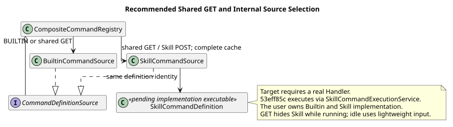
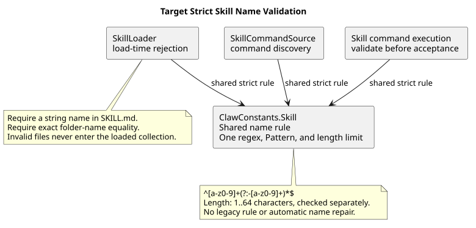
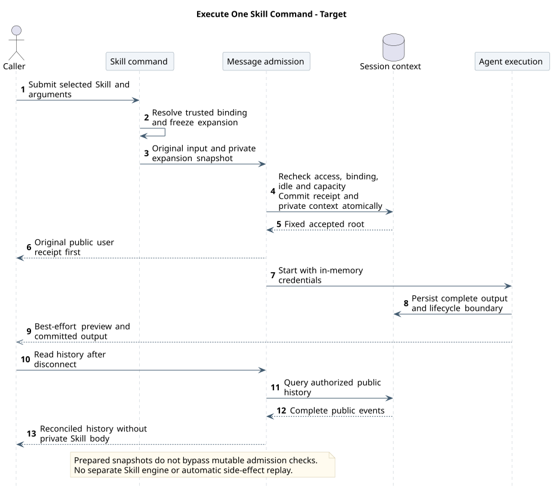

# CampusClaw Skill Command 设计

[返回命令系统](../README.md)

| 属性 | 值 |
|---|---|
| 文档版本 | 4.5.0 |
| 更新日期 | 2026-10-16 |
| 设计仓基线 | `0eaa70ff365bf4d4e328b3473809341ca4cfc58d` |
| Skill 发现候选 | `9d0d76f4a571b559dc77ae52736caebbcc8fad88`（PR #210，已通过 a8192e047f4061bd385297d3dc6c4358362d0d49 合并） |
| 当前专项基线 | `53eff85c7f41de23eb434e027782f5085a8b8e45`；Runtime 执行、严格名称与展开文本恢复已实现，版本化快照等剩余差距见 §4.2 |
| 名称历史证据 | `0300541fbbe3db8b05ffa1ac953f15f01df74b3e`，仅记录当时的宽松加载行为 |
| 状态 | Runtime Skill POST/SSE、严格名称校验与内部展开文本持久化已实现；统一扩展结构、完整版本快照、统计与 Mate 公共接入仍待实现或独立确认 |

## 1. 职责与当前目标

Builtin 与 Skill Command 由用户统一负责设计、实现和集成。命令清单改为按 Agent 查询 `GET /agents/{agentId}/commands`（待评审 · 待实现）：轻量描述符、两类命令合并与固定排序保留，不再按 Session 状态过滤，运行中的禁用由前端状态规则表展示、POST 终判；Builtin 来源过滤只适用于内部 Builtin 专属解析，不是清单查询的全局限制。POST 保留已确认 Builtin JSON 契约；Skill 请求联合类型、SSE 执行结果和 Events 集成按 B13/B14 已确认语义实施。
PR #210 的动态 SkillCommandSource 可保留，但 Registry 必须在调用 Source 前按来源过滤。
内部 Builtin 专属解析不读取 Skill 来源；Agent 命令清单必须取得完整 Agent 快照，缓存缺失时准备 Agent（与创建会话同一入口），准备失败整体返回 422，不返回部分 Builtin。
现有 Skill 发现定义只展示，不安装伪 Handler；实际执行已由 RuntimeCommandController 委派 SkillCommandExecutionService。
共享 Registry 中的真实 Skill Definition/Handler 是待实现的结构整合，不是整个 Skill 执行缺失。

**用户命令与模型工具分工。** 本文的 `skill:<name>` 是用户显式选择 Skill 的 Command 入口；模型在既有执行中调用的 `Skill({name})` 是正文加载工具，契约由 [M03 工具注册与发现](../../02-CampusClaw工具系统/README.md#9-工具注册与发现)维护。后者返回正文、基础文件夹和抽样资源路径，参考文件继续由普通 Read 按需读取，不另行提交用户消息、不执行整个 Skill，也不增加工具或权限。新增模型入口待实现，本文原有 Command 请求、事件与快照规则不因它改变。



[PlantUML 源码](diagram.puml#L1) · [原尺寸 SVG](skill_catalog.svg)

## 2. 源码证据

以下 PR #210、0300541f 和 pi 对照均为历史快照；当前 Java 实现以 §4.2 为准，外部基线不在本次升级范围。

PR #210 的 `modules/coding-agent-cli/src/main/java/com/campusclaw/codingagent/runtimeapi/command/SkillCommandSource.java`
读取 Prepared Agent 元数据并生成描述符，没有执行 Handler。
同基线 `modules/coding-agent-cli/src/main/java/com/campusclaw/codingagent/skill/SkillNamePatterns.java`
已集中兼容/严格策略的正则字符串、编译模式与长度上限，Loader 仍使用兼容策略。
这是该历史快照的实现差距，不是产品兼容要求；当前已按第 3 节统一严格校验。
旧候选 `0bb794f2` 的 SkillNameValidator 已删除；发现结果使用只读 DTO，并复制建议列表。
这些证据只证明当时的发现行为；当前 Runtime 内部 HTTP 执行已存在，不能从前置 PR 推导当前仍未实现。

pi `4af9d21d3b4d664e4a29fcabfec85171077248e3` 的
`packages/coding-agent/src/core/skills.ts` 提供 Skill 发现，而
`packages/coding-agent/src/core/agent-session.ts` 有本地展开/执行语义；
这不是 CampusClaw 的企业 HTTP 契约。完整外部基线和差异分类见[通用模块](../README.md)。

### 2.1 名称专项复核

本节保留旧分支 `3004419a467b77bac08d0f2b3dad21f8815568c5` 的证据，并追加本地源码提交
`0300541fbbe3db8b05ffa1ac953f15f01df74b3e` 的名称专项复核。后者没有替代其余章节的历史
基线，也不表示本文已复核所有 Command 实现。以下 Java 路径均相对 `pi-mono-java` 仓库。

| 分类 / 基线 | 源码路径与符号 | 结论 |
|---|---|---|
| 旧实现 / `3004419a` | `modules/coding-agent-cli/src/main/java/com/campusclaw/codingagent/skill/Skill.java`：`NAME_PATTERN`；同包 `SkillLoader.java`：`validateName` | 加载使用宽松 `^[a-z0-9-]+$` |
| 旧实现 / `3004419a` | `modules/coding-agent-cli/src/main/java/com/campusclaw/codingagent/runtimeapi/command/SkillNameValidator.java`：`isValid`；同包 `SkillCommandSource.java`：`descriptor`、`skillNameOf` | 命令路径使用独立严格规则，和加载路径不一致 |
| 历史复核 / `0300541f` | `modules/coding-agent-cli/src/main/java/com/campusclaw/codingagent/skill/SkillNamePatterns.java:15-49` | 规则已迁到 Skill 域，但仍有 LEGACY/STRICT 两套正则、Pattern 和判定方法；集中位置没有消除策略分裂 |
| 历史复核 / `0300541f` | `modules/coding-agent-cli/src/main/java/com/campusclaw/codingagent/skill/SkillLoader.java`：`parseSkillFile:110-118`、`validateName:138-150` | 缺少名称仍回退文件夹名；加载仍使用 `SkillNamePatterns.LEGACY` |
| 历史复核 / `0300541f` | `modules/coding-agent-cli/src/main/java/com/campusclaw/codingagent/runtimeapi/service/command/SkillCommandSource.java`：`resolved` | 命令发现使用 `SkillNamePatterns.isStrictValid`；`-pdf`、`pdf-`、`pdf--tools` 仍形成加载与发现差异 |
| pi 对照 / `4af9d21d` | `packages/coding-agent/src/core/skills.ts`：`validateName`、`loadSkillFromFile:320-344` | 检查首尾及连续连字符，但名称错误仅记录 warning，描述有效时仍加载；CampusClaw 不采用此容忍行为 |
| 已确认目标 / 产品约束与安全加固 | Skill 域唯一严格规则；所有消费者一致拒绝 | 当前已由 ClawConstants.Skill 统一严格规则，加载、发现、准入与执行均使用；不再将执行整体列为待实现 |

## 3. 名称统一严格校验

```regex
^[a-z0-9]+(?:-[a-z0-9]+)*$
```

`name` 指 Skill 包名称，不含命令命名空间前缀。入口解析命令前缀后，
必须复用 Skill 域的同一套严格规则；共享 HTTP 联合类型已由 B13 确认。规则对齐
[Agent Skills specification](https://agentskills.io/specification)。正则本身没有 64 字符上限，
必须同时校验长度为 1～64 个字符。以下规则已在当前专项基线实现；第 2 节的宽松规则与回退行为只保留为历史证据：

- `ClawConstants.Skill` 维护唯一严格名称表达式、编译后的 Pattern、长度上限与 isValidName；
  加载、发现、准入和执行共享它。带 skill: 前缀的请求正则从同一表达式派生；不保留 LEGACY 或第二套宽松策略。
- 非法名称在加载时就拒绝，不进入已加载 Skill 集合或模型发现提示词；命令发现和执行同样
  拒绝。禁止保留“加载可用、命令隐藏”的兼容分支。
- `SKILL.md` 的 `name` 必须是非空字符串，与所在文件夹及绑定元数据逐字符一致；缺少名称
  不回退到文件夹名，也不通过字符串强制转换、裁剪、替换连字符或自动改名修正非法值。
- 单文件加载失败沿用 `SkillLoadException`；批量扫描可以沿用跳过无效文件的行为，但不能
  把无效 Skill 加入返回集合。存量非法名称必须修正后重新加载。

取消宽松加载是已确认产品约束与安全加固。旧代码或兼容测试只能证明曾经接受过非法名称，
不能建立产品迁移要求。统一规则避免同一 Skill 能进入模型发现、却不能通过命令发现或执行。



[PlantUML 源码：`skill_name_validation`](diagram.puml#L35)

## 4. 统一实施与集成要求

Agent 命令清单的 Skill 名称为 `skill:<name>`，排在固定 Builtin 顺序之后并按 name 排序；
清单不按 Session 状态省略，运行中由前端置灰，POST 返回 409。返回 name、type=skill、description 和可选 hints（示例 `["request"]`），
不输出 Skill ID、版本、正文、路径或建议值。hints 缺失或为空不禁止参数或附件。
所有 Skill 均允许可选文件引用，不要求逐个 Skill 声明接受附件；不返回 acceptsFiles，
也不承诺任意文件格式都能被处理。文件数量、标识、所有权与可用性沿用普通消息边界。
Java 53eff85c 的 InputResponseVO 仍输出旧附件标记，type/hints 投影待实现；fileIds 执行传递已存在。
前端 freezeCommandArguments 尚未组装 fileIds，上传按钮仍禁用，前端与 Mate 公共桥接分别验收。
完整规则与最新源码差距见[Agent 命令清单契约](../README.md#31-get-轻量清单已确认)。
发现与执行分别核验：当前 Runtime Skill POST 已实现；Mate 公共执行是否开放仍由独立契约决定。

B13/B14 已确认共享 `POST /sessions/{sessionId}/command`。精确联合请求、错误与 SSE 示例见
[当前命令契约](../../01-CampusClaw多Agent运行时/chat-api-review.html#ExecuteSessionCommand)。
Builtin 保持 JSON；Skill 使用 name="skill:<name>"、arguments 与可选 fileIds，成功返回请求级
SSE。普通 Events 不解析 Slash；Skill 的首帧 user.message 保留展开前调用，随后复用普通 Agent、
Tool 和 idle 事件。无 commandId/通用生命周期；user.message.eventId 即本次根消息，
sourceEventId 和 targetEventId 支撑确认、中断与历史归属。

全局目标类图复用[通用模块主图](../target_slash_command_global_classes.svg)，
不维护一张割裂的 Skill 总图。SkillCommandDefinition 显式组合准入策略和真实 Handler；
Handler 委派 SkillExecutionService，后者使用普通消息接受/执行应用服务，不越层调用 Controller。
这条统一扩展结构仍待实现；现有 SkillCommandExecutionService 已复用 RuntimeMessageEventService，具体映射见 §4.2。

本图保留用户显式 Skill 命令的目标流程：从提交到执行、断线后读取历史；前提是已绑定 Skill。普通消息执行接入与原始/展开文本分离已实现，完整版本快照及统一定义结构待实现。快照作为 Skill command 的准备产物，不单列生命线；Message admission 与 Agent execution 分开，数据库保留私有展开上下文与公开原始输入的差别。历史查询复用消息应用的读边界，完整 Skill 原文不进入公共历史；权限、绑定、空闲和容量在所属事务内重新检查。



[PlantUML 源码](diagram.puml#L71) · [原尺寸 SVG](target_skill_execution.svg)

受理前从一份完整缓存解析绑定、定义和 Skill 正文，固定成不可变请求快照；GET 和 POST 是独立
快照，不能把先前清单当作授权。POST 在所属锁/事务内重检绑定、权限和容量，原子接受根消息并
将 Session 改为 running；接受失败不写成功历史，不回退普通消息。Skill 只作为用户选择的资源
上下文，不提升为系统权限，不将包内指令当作认证或工具授权。

内部 Session 已保存恢复模型上下文所需的展开内容；完整绑定版本与元数据快照仍待实现（不是新增独立 Skill 审计副本），
公开投影只显示原调用和执行结果。恢复不得重新读取新 Skill 正文悄悄改变旧任务；凭据仍只存在
Active Holder 内存，实例丢失不自动恢复凭据或重放副作用工具。引用文件依然通过原有 Skill
资源解析边界读取，本次快照承诺只覆盖已解析正文和元数据，不虚构所有外部文件均被冻结。
参数/附件复用普通消息上限；展开后的输入预算在接受前检查，不截断 Skill 正文后继续。
B15 沿用部署统一保留策略，未配置时不新增自动清理；删除按根消息及必要引用保持对账完整。
不新增 Maven 依赖，继续使用现有缓存、JDK/Jackson 与 Session 组件。

### 4.1 执行源码证据与差异

设计基线 `9096f1e9ae445e67292c5e7d5a9e0d2ac10d8f5d`；Java 固定
`dfb90cac4e233e09a0b8f047f7e9f4682f5ad238`，下表只记录历史行为；当前执行与恢复差异见 §4.2。

| 仓库 / 相对路径与符号 | 已观察行为 | 已确认目标与理由 |
|---|---|---|
| pi-mono-java · modules/coding-agent-cli/src/main/java/com/campusclaw/codingagent/runtimeapi/service/command/SkillCommandSource.java · list/resolved/hasSkillMarkdown | prepareCached 后产生发现 DTO 和 SkillCommandSnapshotDTO，包含内部 Skill 身份、版本与内容；使用 ClawConstants.Skill.isValidName，检查规范位置；不执行 Skill | 保留发现事实，增加真实执行 Definition/Handler 与共享消息接受链；不能将发现实现当成 HTTP Skill 执行已发布 |
| pi-mono · packages/coding-agent/src/core/agent-session.ts · _expandSkillCommand/prompt，固定 5cd93f688aaab89dbb6dfa4aca535f21796ae185 | /skill:name 查本地 Skill 并展开正文；找不到或读失败可返回原文本；扩展后作为模型输入 | 学习展开语义；HTTP 精确匹配失败必须拒绝、不回退；正文不进公共回执。产品约束与安全加固，不复制 CLI 文件路径或内存排队 |
| pi-mono-java · modules/coding-agent-cli/src/main/java/com/campusclaw/codingagent/runtimeapi/event/RuntimeEntryCodec.java · userEntry/toAgentMessages | 公开 user payload 与模型恢复已有不同方法，但该历史提交的 userMessage 仅按公开文本/附件重建 | 当时待增加内部展开输入与公开原调用的独立投影；当前文本分离已实现，完整版本快照仍待实现 |

上一版的 pi 4af9d21d 对照仍保留在历史证据；Skill 展开证据使用项目固定 5cd93f，不静默漂移。
上述历史缺口中的执行接入与展开文本恢复已实现；当前剩余范围如下，不以旧提交差距覆盖现状。

使用统计的已确认 待实现 增量由[统计主设计](../03-Skill加载统计/README.md)维护：显式 Skill 候选来自同一输入快照，在根消息受理提交、真实 target 绑定后且模型启动前交给 SkillUsageTracker；与模型 Skill 工具、Read 共用根/Skill 去重；模型入口按最终成功正文读取形成信号，读取参考文件不另计。三张统计表独立事务，失败不改变受理结果；恢复、确认与审核续跑不因重用正文重计。全局结构引用统计专题主图，Command 请求和公共 SSE 字段保持。

### 4.2 当前实现、剩余增量与测试证据

2026-09-22 核对用户指定的 `pi-mono-java@53eff85c7f41de23eb434e027782f5085a8b8e45`。下面 Java 文件除常量外，
均相对 `modules/coding-agent-cli/src/main/java/com/campusclaw/codingagent/`。

| 能力 | 当前实现证据 | 状态与限制 |
|---|---|---|
| 严格名称 | `skill/SkillLoader.java` · requireDeclaredName/validateName；`modules/common/src/main/java/com/campusclaw/common/constant/ClawConstants.java` · Skill.isValidName；`runtimeapi/service/command/SkillCommandSource.java` · resolved | 已实现严格正则、1～64 长度、非空字符串与文件夹同名；无缺名回退，01530523 已包含在核验提交 |
| HTTP 与执行 | `runtimeapi/web/RuntimeCommandController.java` · execute/executeSkill；`runtimeapi/service/command/skill/SkillCommandExecutionService.java` · executeRequest/execute/expand；同包 SkillCommandAdmission.requireBoundSkill | 已实现 skill:<name> 分派、实际 Agent 快照绑定检查、正文展开与请求级 SSE |
| 受理与文本分离 | `runtimeapi/event/RuntimeMessageEventService.java` · submitPreparedMessage/submitPrepared/accept | 操作锁内准备并受理；内部 userEntry 保存 context.message()，公共 userMessage 使用原调用文本 |
| 文本恢复 | `runtimeapi/event/RuntimeEntryCodec.java` · userEntry/toAgentMessages/userMessage | 已从持久化展开文本重建模型上下文，不能再写“只按公开 Slash 文本恢复” |
| 统一命令扩展结构 | 核对 `runtimeapi/command/` 与 `runtimeapi/service/command/` | 当前 Controller 分别调用 Builtin 与 Skill 服务；SkillCommandDefinition、SkillCommandHandler、SkillExecutionService、PreparedSkillInvocationDTO 目标链待实现 |
| 完整 Skill 版本快照 | 上述 accept/userEntry 与展开路径；发现层 SkillCommandSnapshotDTO 不等于持久化执行快照 | 已保存文本，不等于已保存完整 Skill 身份、版本、元数据；版本化恢复增量待实现 |
| 使用统计 | 搜索 `modules/` 与 `campusclaw/` 未找到 SkillUsageTracker | 显式 Command、模型 Skill 工具及 Read 的执行级统计接入仍待实现；不升级其他开发分支证据 |

测试源码 `modules/coding-agent-cli/src/test/java/com/campusclaw/codingagent/runtimeapi/persistence/SkillCommandExecutionOpenGaussIT.java`
的 `testPersistsAndRestoresActualSnapshotTextEvenAfterDetach` 和 `assertRestored` 覆盖内部展开文本、公共原调用、
断流后继续及重开恢复；这里确认的是测试存在和断言范围，未运行该测试，不能报告该提交的集成验收通过。
Mate 公共 bridge、错误映射与附件边界继续由[公共命令设计](../../../02-服务与接口/06-mate-service聊天命令API/README.md)维护。

## 5. 实施验收

后续结构整合补齐 SkillCommandDefinition/Handler、SkillExecutionService 与版本快照；
复用已存在的共享消息接受、联合 VO 和 JSON/SSE 入口，不重复建设已经实现的执行链。验收 Skill 正常 SSE、确认分段、原消息中断、根 ID 对账，
以及解析失败不接受、受理前绑定变更拒绝、受理后版本固定、展开预算超限拒绝、公开历史不泄露正文，
恢复不换版本、丢失凭据不自动重跑。Builtin JSON 和 GET 轻量清单必须保持现有行为。


统一验收同时覆盖 Builtin 与 Skill Command。Builtin 专项验证来源视图只含七项、Builtin Registry 不调用 SkillCommandSource；
Skill 专项验证发现、真实执行与失败恢复；最终共享清单和请求联合类型覆盖两类命令，不能以 POST skill:* 必须失败作为整体验收。
skills Builtin 只展示最新完整绑定快照中的名称/描述，不等于发布 Skill Command。

名称规则已覆盖加载与执行，回归验收继续使用以下共享样例：

- 加载、命令发现和执行使用同一组名称样例，统一接受 `a`、`0`、`pdf-tools` 和长度恰为 64 的合法名称；统一拒绝空值、空字符串、65 字符、`-pdf`、`pdf-`、`pdf--tools`、`PDF`、`pdf_tools`、空白及换行。
- 单文件加载拒绝缺少、非字符串的 frontmatter 名称及文件夹名称不一致；批量扫描返回集合、模型发现提示词和命令清单均不包含非法 Skill，直接执行也不能绕过校验。
- Skill 域只保留一份严格正则字符串、编译后的 Pattern 和长度上限；不存在 LEGACY 加载分支、Command 专用第二套正则或“非法名称加载成功”的兼容测试。

## 版本历史

| 版本 | 日期 | 变更 |
|---|---|---|
| 4.5.0 | 2026-10-16 | Skill 发现改由 `GET /agents/{agentId}/commands` 返回，不再在运行中省略；缓存缺失时准备 Agent，失败为 422。 |
| 4.4.0 | 2026-09-22 | Skill 描述符改用 type/hints，附件作为所有 Skill 的统一规则。 |
| 4.3.2 | 2026-09-22 | 明确所有可用 Skill 允许附件引用，区分附件通道、内容能力和前端接入状态。 |
| 4.3.1 | 2026-09-22 | 按 53eff85c 区分已实现的执行、严格名称与文本恢复及待实现的结构和版本快照。 |
| 4.3.0 | 2026-09-20 | 区分用户 Skill Command 与模型 Skill 加载工具，统一引用既有根执行统计口径。 |
| 4.2.0 | 2026-09-16 | 显式 Skill 在受理提交后记录使用信号，同根重复不重计。 |
| 4.1.0 | 2026-09-15 | 显式调用统计复用 Skill 输入快照和原根消息受理事务。 |
| 4.0.1 | 2026-09-14 | 按发现、名称与执行职责整理说明，并分阶段呈现执行和恢复时序。 |
| 4.0.0 | 2026-09-08 | Skill 通过共享 Command SSE 执行，复用快照、绑定重检和历史恢复。 |
| 3.2.0 | 2026-09-07 | GET 投影轻量描述符并在 running 时过滤 Skill。 |
| 3.1.3 | 2026-09-05 | Builtin、Skill 与共享 HTTP 统一实施及验收。 |
| 3.1.2 | 2026-09-04 | 加载、发现和执行统一严格名称校验。 |
| 3.1.1 | 2026-09-04 | Skill 发现与执行分别维护职责边界。 |
| 3.1.0 | 2026-09-04 | 发现骨架与执行 Handler 分离，历史复用领域记录。 |
| 3.0.4 | 2026-09-01 | 命令相关表述只使用“命令清单”；Skill 文件位置统一表述为“文件夹” |
| 3.0.3 | 2026-09-01 | Skill 名称遵循 Agent Skills 规则，参数和附件复用普通消息限制。 |
| 3.0.2 | 2026-08-31 | 以规则表说明名称、发现、快照和信任分层。 |
| 3.0.1 | 2026-08-31 | 面向读者统一使用“命令清单”，明确 Skill 命令发现不依赖磁盘扫描 |
| 3.0.0 | 2026-08-31 | 定义 HTTP Skill 命令、调用快照与可恢复执行。 |
