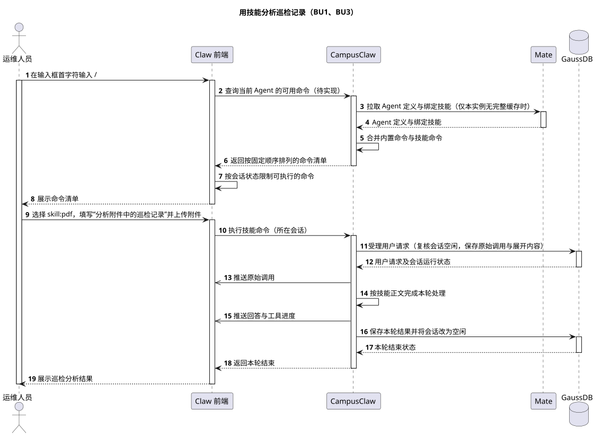
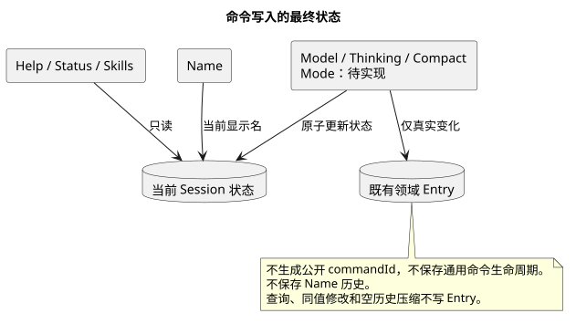
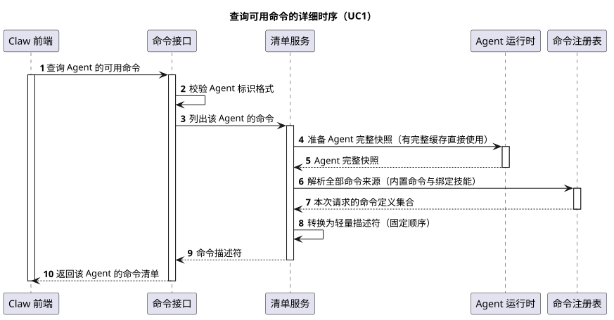
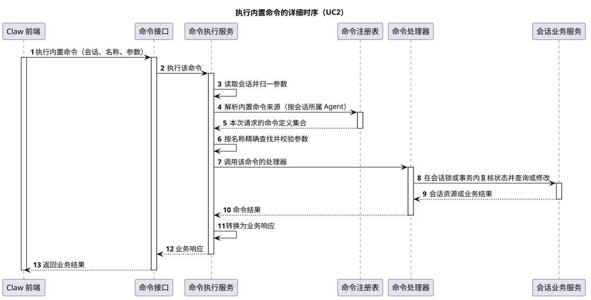

# CampusClaw 命令系统设计

[模块索引](../../README.md#module-index) · [源码证据](source-evidence.md)

本文是命令系统的通用设计（原 Slash Command 通用模块），原 `04-命令与技能` 下的专题已整体并入本专题，锚点不变：

| 子专题 | 解决的问题 | 入口 |
|---|---|---|
| 内置命令 | 八个 Builtin 的行为、业务委派和实施验收 | [Builtin 设计](01-内置命令/README.md) |
| Help 使用指南 | 读取 Agent 显示名、用途和场景并生成说明文本；空介绍、缓存往返与显式刷新旧缓存 | [Help 专项设计](01-内置命令/Help-Agent使用指南/README.md) |
| 技能命令 | Skill 名称、调用快照、执行与恢复 | [Skill 设计](02-技能命令/README.md) |
| Skill 使用统计 | 每次 Skill 成功结果同事务加一，三入口复用统一历史 | [使用统计设计](03-Skill加载统计/README.md) · [Codex 详解](03-Skill加载统计/codex-skill-counting.md) |
| 前端 Slash 交互 | Composer 清单、参数与结果展示 | [前端命令设计](../../07-前端设计/技术设计/命令/README.md) |

| 属性 | 值 |
|---|---|
| 文档版本 | 2.7.0 |
| 更新日期 | 2026-10-20 |
| 模块 | M05 · Command 与 Skill · Slash Command 通用模块 |
| 设计状态 | 按 Agent 查询清单、type/argumentType、按会话的可选值接口、mode 与描述国际化已在 main `628dca25` 实现；2026-10-20 对齐的清单范围、rename、argumentRequired、按 Agent 的可选值、必填参数、Builtin 文本结果与 Skill 错误码待实现。逐项见 [§8.1](#current-runtime-status) |
| 源码基线 | `pi-mono-java` main `628dca25a694d9d056b15f012e1223d68091ab66`，2026-10-20 核验三个命令接口；其他能力沿用 [§8.1](#current-runtime-status) 所列核验提交 |
| 主基线 | OpenCode dev `e25b7abf8955a4fa1b02b935964cb47db4c3a02a`（命令清单路由为 Experimental）；Codex main `b2aa07db8ac892a865de888dd08726680fcf873c`（2026-10-20，新会话设置）与 `6b991972c5b539198dcea9bac4fc14e57559c3af`；pi main `4954d760504c11df9b2cbdc040346107b6a8153d` |

Builtin 的逐命令行为见 [内置命令](01-内置命令/README.md)，Skill 的名称、快照与恢复见 [技能命令](02-技能命令/README.md)，Composer 交互见 [Slash Command 前端](../../07-前端设计/技术设计/命令/README.md)。本文维护三者共用的命令清单、可选值、执行入口与分层。Builtin 与 Skill Command 由用户统一负责设计、实现和集成。Mate 对外的聊天命令接口不在本设计范围内，由 Mate 负责人另行设计。

## 评审记录

### 评审结论

2026-10-20 Lotus 逐个接口对齐了 ListAgentCommands、ListAgentCommandValues 与 ExecuteSessionCommand，结论见 T9～T13；其余章节尚未整体评审。

### 评审 Todo

| # | 事项 | 负责人 | 来源 |
|---|---|---|---|
| T1 | ~~清单接口与范围~~ 已确认（2026-10-20）：`GET /agents/{agentId}/commands?sessionId=`，不填 sessionId 时返回 help、rename、model、thinking、mode、skills 与技能命令，填写时返回完整命令；不按运行状态过滤 | Lotus | [D1](#key-decisions) · [§4.1](#31-get-轻量清单已确认) |
| T2 | 确认冷缓存时清单按创建会话的方式准备 Agent（可能访问 Mate），错误码与创建会话一致 | Lotus | [D2](#key-decisions) |
| T3 | 确认旧路径直接下线，不保留兼容期（含 `name` 改为 `rename`、可选值接口改为 Agent 路径） | Lotus | [§5.3](#compatibility) |
| T5 | ~~Skill 执行错误码设计与实现不一致~~ 已确认（2026-10-20）：错误码准确对应原因，受理阶段与普通消息一致，见 [§4.3.3](#command-errors) | Lotus | [F11](#failure-recovery) |
| T6 | ~~Builtin 描述按 Accept-Language 本地化的契约~~ 已确认（2026-10-16）：Builtin 国际化，Skill 原样返回 | Lotus | [§4.1](#31-get-轻量清单已确认) · [源码证据 §6](source-evidence.md#331-清单字段与语言专项核对) |
| T8 | ~~参数形态与可选值的归属~~ 已确认（2026-10-17）：Runtime 清单返回 argumentType，不返回 hints 或占位文字。已调整（2026-10-20）：可选值接口改为按 Agent 查询，sessionId 可选 | Lotus | [D7](#key-decisions) · [§4.2](#command-values) |
| T9 | ~~新对话怎样执行命令~~ 已确认（2026-10-20）：前端先创建会话再执行，不新增 Agent 级执行入口；只执行 /help 也会生成一个没有消息的对话，正常显示 | Lotus | [D8](#key-decisions) |
| T10 | ~~参数是否可省略~~ 已确认（2026-10-20）：`name` 改名 `rename`；rename、model、thinking、mode 参数必填，不再有无参查询；技能命令参数可选；清单新增 argumentRequired | Lotus | [D7](#key-decisions) · [§4.3.1](#command-arguments) |
| T11 | ~~Builtin 响应结构~~ 已确认（2026-10-20）：Builtin 成功只返回 Markdown 文本，前端随后读取 Session 刷新状态，不解析文本 | Lotus | [D4](#key-decisions) |
| T12 | ~~Mate 公共命令接口~~ 已确认（2026-10-20）：从本设计删除，由 Mate 负责人另行设计；原 T4、T7 关闭 | Lotus | [§4](#interface-protocol) |
| T13 | Mate 若按第一条消息自动生成对话标题，可能覆盖新对话里先执行的 /rename，需与 Mate 负责人确认 | Lotus | [§4.4](#command-interaction-flow) |

### 需求信息

| 编号 | 来源 | 说明 |
|---|---|---|
| REQ-1 | Lotus，2026-10-16 项目对话 | 重新设计 Slash Command 设计文档，命令清单查询改为基于 agentId；sessionId 改为可选查询参数，不填时只展示与会话无关、属于智能体的命令，填时展示完整命令 |
| REQ-2 | 已确认的 B13/B14 与历史版本 | Skill SSE、轻量描述符与状态规则 |
| REQ-3 | Lotus，2026-10-20 项目对话 | 逐个接口对齐：新对话也能在发第一条消息前设置模型、深度思考与模式并改名；可选值接口按 Agent 查询；参数必填与否由清单表达；Builtin 只返回可读文本；错误码准确；Mate 接口不在本设计 |

## 1. 概述

### 1.1 术语解释

| 术语 | 含义 |
|---|---|
| Slash 命令 | 用户在输入框首字符输入 `/` 后选择执行的结构化命令；`/` 只在交互层出现，接口里的命令名不带 `/` |
| Builtin | 产品固定提供的八个命令：help、status、rename、model、thinking、mode、compact、skills |
| 技能命令 | 以 `skill:<name>` 调用 Agent 绑定的某个 Skill，执行一轮完整的 Agent 处理 |
| 命令清单 | 某个 Agent 可用命令的轻量描述，只用于发现和展示，不是执行授权；不带 sessionId 时是新对话清单，带 sessionId 时是完整清单 |
| 新对话清单 | 执行后会对新会话产生作用、或帮助用户了解 Agent 的命令：help、rename、model、thinking、mode、skills 与全部技能命令；status、compact 只读或处理已有内容，只在完整清单中出现 |
| 描述符 | 清单中的一项：name、type、description，以及可选的 argumentType 与 argumentRequired |
| 可选值 | options 型命令可提交的值与当前值 `{currentValue, values}`；带 sessionId 时为会话当前值，不带时为创建会话时的初始值 |
| 完整 Agent 快照 | Agent 定义、系统提示词与绑定 Skill 都已就绪的本地缓存；残缺时不用于生成清单 |
| 命令状态规则 | [§4.3.1](#command-arguments) 的表，规定每个命令的参数与在会话空闲和运行中能否执行 |

### 1.2 需求整理

| 编号 | 需求 | 类型 | 来源 |
|---|---|---|---|
| R1 | 按 Agent 返回命令清单；不带 sessionId 时返回新对话清单，带 sessionId 时返回完整命令 | 功能 | REQ-1、REQ-3 |
| R2 | 清单按固定 Builtin 顺序排列，再追加按名称排序的技能命令 | 功能 | REQ-2 |
| R3 | 在会话内执行 Builtin，修改会话设置或读取说明，返回可读文本 | 功能 | REQ-3 |
| R4 | 在会话内执行技能命令，以与普通消息相同的 SSE 返回本轮处理 | 功能 | REQ-2 |
| R5 | 清单与可选值不作执行授权；执行时在所属锁或事务内重新检查会话状态、绑定和参数 | 安全 | REQ-2 |
| R6 | 描述符不返回 Skill 正文、路径、版本、内部 ID 或凭据 | 安全 | REQ-2 |
| R7 | 未匹配的 Slash 不回退为普通消息；普通消息接口不解析 Slash | 约束 | REQ-2 |
| R8 | 不生成公开 commandId，不保存通用命令生命周期 | 约束 | REQ-2 |
| R9 | Agent 快照不完整时整体失败，不返回残缺清单 | 稳定性 | REQ-2 |
| R10 | Skill 名称在加载、发现与执行使用同一严格规则 | 约束 | [技能命令 §3](02-技能命令/README.md#3-名称统一严格校验) |
| R11 | 新对话发第一条消息前即可查看 model、thinking、mode 的初始值与可选值 | 功能 | REQ-3 |
| R12 | 每个错误码准确对应一种原因；技能命令受理阶段的错误码与普通消息一致 | 约束 | REQ-3 |

## 2. 整体方案

### 2.1 业务用例

园区运维人员在对话中经常要做两类事：调整对话的设置（改名、切换模型或工作模式、打开深度思考、压缩上下文），以及让 Agent 用某项固定技能处理一件业务（例如分析附件里的巡检记录）。靠自然语言描述，模型可能误解意图，用户也记不住 Agent 绑定了哪些技能。Slash 命令让用户输入 `/` 就看到当前 Agent 提供的命令，选择后按确定的方式执行。新对话也一样：用户可以先把模型切到擅长工单分析的模型、打开深度思考，再提交“分析本周 3 号楼的告警工单”。

| 编号 | 参与者 | 业务目标 | 业务结果 |
|---|---|---|---|
| BU1 | 运维人员 | 查看当前 Agent 提供哪些命令 | 看到内置命令和 Agent 绑定的技能，每项带用途说明和参数形态 |
| BU2 | 运维人员 | 修改对话的设置，包括还没发消息的新对话 | 对话的名称、模型、深度思考或工作模式按要求生效，看到一段说明结果的文字 |
| BU3 | 运维人员 | 用某项技能处理一项业务请求 | Agent 按该技能完成本轮处理，回答逐步显示；对话历史保留用户原始调用 |
| BU4 | 运维人员 | 压缩当前对话的上下文 | 较早的对话被压缩成摘要，后续对话继续可用 |
| BU5 | 运维人员 | 了解当前 Agent 能做什么、对话现在的状态 | 看到 Agent 的显示名、用途和使用场景，或对话的名称、模型、模式与用量 |

### 2.2 整体时序

场景：运维人员在已有对话中输入 `/`，选择 `skill:pdf` 分析附件中的巡检记录。起点是输入 `/`，终点是看到分析结果。前提是该 Agent 已绑定 pdf 技能且对话空闲。已有对话带 sessionId 读取完整清单；全部步骤已在 main `628dca25` 实现，技能命令受理失败时的错误码修正待实现（见 [§4.3.3](#command-errors)）。新对话的调用顺序见 [§4.4](#command-interaction-flow)。

| 参与者 | 职责 | 映射 |
|---|---|---|
| 运维人员 | 选择命令并填写请求 | 人 |
| Claw 前端 | Composer、命令清单与状态规则 | `frontend/src/composables/useCommandComposer.ts`、`useRuntimeApi.ts` |
| CampusClaw | 命令清单、命令执行与 Agent 运行 | `RuntimeCommandCatalogController`、`RuntimeCommandController` 及其应用服务 |
| Mate | Agent 定义与绑定技能的发布方 | `AgentRuntimeManager.prepare` 的远端来源 |
| GaussDB | 会话、事件与领域 Entry | `t_sessions`、`t_session_events`、`t_session_entries` |



[原尺寸 SVG](slash_command_overview.svg) · [PlantUML 源码](diagram.puml#L1)

| 阶段 | 详细时序 |
|---|---|
| 步骤 1～8：查询可用命令 | [§3.3](#list-commands-sequence) |
| 步骤 9：选择命令并填写参数 | [前端命令输入](../../07-前端设计/技术设计/命令/README.md#command-input-controls) |
| 步骤 10～19：执行技能命令 | [§3.5](#execute-skill-sequence) |

<a id="key-decisions"></a>

### 2.3 关键设计决策

| # | 要解决的问题 | 基线怎么做 | 业务约束 | 我们的选择 | 代价 |
|---|---|---|---|---|---|
| D1 | 命令清单归属谁，新对话展示哪些命令 | OpenCode `command.list` 按实例所在的工作位置列出，不带会话；Codex `skills/list` 按工作路径（cwd）列出；pi `get_commands` 在会话进程内，因为一个 RPC 进程就是一个会话 | 命令来源只取决于 Agent：固定 Builtin 加 Agent 绑定的 Skill；新对话在发出第一条消息前就要能展示 `/` 清单，并能设置模型、深度思考与模式 | 清单归属 Agent：`GET /agents/{agentId}/commands` 接受可选查询参数 sessionId。判断标准是“执行后会对新会话产生作用，或帮助用户了解 Agent”：不填时返回 help、rename、model、thinking、mode、skills 与技能命令，status、compact 只在填写时出现。每个 Builtin 在定义上声明是否只用于已有会话。执行仍归属会话，`POST /sessions/{sessionId}/command` 在锁内最终准入 | 带 sessionId 时多一次会话查询；完整清单不隐藏运行中不可执行的命令，前端必须按 [§4.3.1](#command-arguments) 集中限制 |
| D2 | 清单遇到本实例没有 Agent 完整缓存时怎么办 | OpenCode、pi 在本地进程启动时加载命令来源，没有远端回源；Codex 可显式 `force_reload` | 按 Agent 查询时可能还没有任何会话，冷缓存是常态；不能返回残缺清单 | 与创建会话共用 `AgentRuntimeManager.prepare`：有完整缓存直接用，缺失时在 Agent 锁内从 Mate 准备一次；不提供强制刷新；错误码与创建会话一致 | 首次查询可能访问 Mate，耗时变长；Mate 暂时不可用时返回 422 而不是可重试的 503，前端提供手动重试 |
| D3 | 清单与执行如何保持一致 | OpenCode 执行时按名称重新取 Command；pi 每次 prompt 重新展开 Skill | 清单可能过期；绑定和会话状态随时变化 | GET 与 POST 各自解析一份请求级快照，按名称查找同一 Definition；描述与会话无关，准入只在执行时按会话检查，`ResolvedCommandDTO` 不再携带可用性 | 每次执行都重新解析来源，不能复用 GET 的结果 |
| D4 | Builtin 与技能命令用什么响应 | OpenCode 会话命令 POST 返回 JSON 消息，事件流独立；pi 的 Skill 展开后作为普通 prompt | Builtin 是一次性修改或说明；技能命令会跑完整一轮推理并可能等待确认；前端不按命令名分支 | 同一 POST 入口：Builtin 成功只返回 `{text}`，内容为按 Accept-Language 生成的 Markdown，前端统一展示后 `GET /sessions/{sessionId}` 刷新状态；技能命令返回与普通消息相同的请求级 SSE | 前端每次 Builtin 后多一次 GET Session；文本不是可解析契约，需要状态时必须读 Session |
| D5 | 是否保存通用命令记录 | DeepSeek Harness 有 CommandExecution 与命令日志（alpha） | 现有会话、领域 Entry 和事件已能对账 | 不生成 commandId，不保存通用命令生命周期；状态变化复用会话和既有领域 Entry | 无法按命令维度审计，需要时只能从领域 Entry 与事件推断 |
| D7 | 命令清单怎样描述参数，可选值由谁提供 | pi 命令描述有 `argumentHint`（如 `<level>`），可选值由挂在命令上的补全函数按会话实时取（`interactive-mode.ts:761`）；Codex 用 `model/list`、`collaborationMode/list` 单独查询可选值，新会话的模型、effort 与协作模式在 `TurnStartParams` 中随第一轮提交（`v2/turn.rs:254,271,291`） | 前端是图形界面，选项型命令直接展示列表；thinking 能否开启取决于模型；新对话没有会话也要能读初始值；参数形态与必填与否是命令自身属性 | 清单返回 argumentType（text / options / 省略）与 argumentRequired（有 argumentType 时必填）；rename、model、thinking、mode 必填，技能命令可选。可选值由 `GET /agents/{agentId}/commands/{commandName}/values?sessionId=` 提供，所有选项型命令共用 `{currentValue, values}`：带 sessionId 时为会话当前值，不带时为创建会话的初始值。显示名由调用方决定 | Runtime 要为每个选项型命令登记取值逻辑和初始值；不带 sessionId 时 thinking 只按 Agent 默认模型计算 |
| D8 | 新对话选了命令后怎样执行 | Codex 先 `thread/start` 建线程（可带 model，`v2/thread.rs:62-64`），再由 `turn/start` 携带 model、effort、collaborationMode（`v2/turn.rs:254,271,291`）；OpenCode、pi 的命令都在已有会话内执行 | 前端不按命令名分支；Builtin 与技能命令都要会话作为作用对象 | 前端先创建会话，再调用会话执行入口；不新增 Agent 级执行入口 | 只执行 /help 或 /model 也会生成一个没有消息的对话，该对话正常显示 |

完整基线证据见 [源码证据 §1.2](source-evidence.md#agent-catalog-evidence) 与 [§9](source-evidence.md#slash-alignment-evidence)。差异分类：D1、D2、D7、D8 是架构变更，D3、R5 是安全加固，D4、D5 是产品约束。原 D6（Mate 补显示名）随 Mate 接口移出本设计删除。

## 3. 详细设计

### 3.1 系统用例

| 用例 | 对应业务用例 | 触发者 | 前置条件 | 主成功结果 | 关键约束 |
|---|---|---|---|---|---|
| UC1 查询 Agent 命令清单与可选值 | BU1、BU2 | Claw 前端 | Agent 已发布；带 sessionId 时会话属于该 Agent | 不带 sessionId 返回新对话清单与初始值，带 sessionId 返回完整命令与会话当前值 | 不读会话运行状态；快照不完整时整体失败；不返回内部字段 |
| UC2 执行 Builtin | BU2、BU4、BU5 | Claw 前端 | 会话存在（新对话已先创建） | 返回说明结果的 Markdown 文本 | 只接收 name 和 arguments；参数按定义统一检查；锁内复核状态；不写通用命令记录 |
| UC3 执行技能命令 | BU3 | Claw 前端 | 会话空闲且 Agent 绑定该技能 | 受理根消息并以 SSE 返回本轮处理 | 与普通消息共用受理链与错误码；精确匹配失败即拒绝 |

### 3.2 数据模型

本模块不新增表。命令清单与可选值不持久化，每次请求从 Agent 快照或会话解析。执行写入复用既有表：

| 表 | 关键字段 | 约束与生命周期 |
|---|---|---|
| `t_sessions` | 会话状态、显示名、模型、深度思考、模式 | rename/model/thinking/mode 在行锁内合并本次提交；同值不更新 updatedAt |
| `t_session_entries` | Model/Thinking/Mode/Compact 的领域 Entry；技能命令的展开内容 | 只在真实变化时追加；同值修改和空历史压缩不写 |
| `t_session_events` | 技能命令的 user.message（原始调用）及后续事件 | 与普通消息相同，见 [Session Events](../01-CampusClaw多Agent运行时/chat-events-design.md) |



[原尺寸 SVG](authoritative_command_state.svg) · [PlantUML 源码](diagram.puml#L104)

全局目标类图：


[原尺寸 SVG](target_slash_command_global_classes.svg) · [PlantUML 源码](diagram.puml#L125)

缩略图只用于定位分层，阅读类名和多重性请打开原尺寸 SVG。

| 分层 | 职责 | 不能合并的原因 |
|---|---|---|
| Web | 请求/响应 VO、Jakarta 校验、Locale 与 ResultBean | Controller 不依赖 Repository、Registry、Holder 或内部 DTO |
| 应用层 | 清单服务准备 Agent 快照、按是否带 sessionId 确定范围并投影描述符；可选值服务按会话或 Agent 初始值取值；执行服务读取会话、按名称查找、统一检查参数与准入、调用 Handler 并生成文本 | 清单只确认会话归属、不读运行状态，执行必须读会话状态，两者归属不同 |
| 命令核心 | Definition、来源、Contributor、准入策略、Handler 与请求级 Catalog | `describe()` 只描述命令，准入只在执行时判断；新增命令或命令来源不改中央 switch |
| 业务服务 | Naming、Model、Thinking、Mode、Compact 等窄职责服务；Help 委派 AgentHelpQueryService | 业务约束、执行协调与持久化分开，最终准入在所属锁内完成 |
| 运行时与持久化 | Repository、Agent 运行时、执行协调器与事件投影 | 单例与单次执行对象生命周期不同 |

为什么这样分：清单与会话脱钩后，Definition 的描述不能再依赖会话快照，否则新对话清单无从计算；把“能不能执行”全部收拢到执行入口，既让清单可以跨会话复用，也保证执行入口仍是唯一的最终判断点。实现基线中 `CompositeCommandRegistry.resolve(session)` 仍对每个命令调用 `describe(session)` 生成 available、unavailableCode、input，而这些字段只有测试读取，准入实际由 `CommandExecutionService.requireAdmission` 再判断一遍（[源码证据 §9](source-evidence.md#slash-alignment-evidence)）。目标改为 Registry 只按名称查找 Definition，`ResolvedCommandDTO` 删除这三个字段（待实现）。

八个 Contributor/Handler 的精确映射见 [内置命令 §2](01-内置命令/README.md#2-全局目标与核心扩展)；Help 的元数据与缓存见 [Help 设计](01-内置命令/Help-Agent使用指南/README.md)。

<a id="command-design-patterns"></a>

#### 3.2.1 设计模式与命名

命令核心组合了下面几种常见模式。类名以 main `628dca25` 为准，证据见 [源码证据 §8](source-evidence.md#command-patterns-evidence)。

| 模式 | 落在哪些类 | 解决什么 | 边界与代价 |
|---|---|---|---|
| 注册表（插件式注册） | 每个 Builtin 一个 `XxxCommandContributor`；`BuiltinCommandSource` 注入 `List<BuiltinCommandContributor>` 并在启动期查重；`CompositeCommandRegistry` 再聚合 Builtin 与 Skill 两个 `CommandDefinitionSource` | 新增命令或命令来源只加类，不改中央 switch | 重名在 Spring 启动期失败。实现基线中 `SkillCommandSource` 虽注入 Registry，但主代码唯一的解析调用只取 BUILTIN，清单直接读取 Agent 快照中的技能；技能命令的清单与执行改走该来源待实现。`CompositeCommandRegistry` 只把来源平铺合并成一张清单，没有树形嵌套，不是 GoF 组合模式，名称沿用 main |
| 策略 | `BuiltinCommandDefinition` 持有 `CommandAdmissionPolicy`（当前状态能否执行）、`CommandHandler`（执行）与可选的 `CommandValuesProvider`（选项型命令的当前值、初始值与可选值） | `CommandExecutionService`、`CommandValuesService` 只按接口调用，不按命令名分支 | argumentType 为 options 的命令必须登记取值逻辑，其他命令不得登记，构造 Definition 时校验 |
| 命令模式（轻量） | Definition 封装“做什么”，`CommandExecutionService` 按名称查找、检查参数与准入后调用 Handler | 执行入口统一，最终准入仍在各业务服务的锁内完成 | 不支持撤销与排队，也不保存通用命令记录（见 D5） |
| Assembler | `CommandListResponseAssembler` 把 Builtin 元数据与 Skill 转成清单描述符，负责排序和描述本地化；`CommandResponseAssembler` 把 Handler 结果生成本地化 Markdown 文本 | 业务服务不依赖 VO，Controller 不依赖内部 DTO | 转换方法用 `toXxx`，校验用 `requireXxx` |

命名约定沿用实现仓 AGENTS.md：`Assembler` 是约定后缀之一，`Mapper` 在实现仓专指 MyBatis 持久化接口，不用于响应转换。Builtin 命令名集中在 `ClawConstants.RuntimeApi.Command`（如 `COMPACT_COMMAND`），Contributor 与展示顺序引用这些常量；是否只用于已有会话由每个 Builtin 的元数据（`BuiltinCommandMetadataDTO`）声明，替代 `SESSIONLESS_BUILTINS` 常量（待实现）。Builtin 描述与结果文本模板只在 i18n 资源文件中维护，描述 key 为 `COMMAND_BUILTIN_<NAME>_DESCRIPTION`，与错误码一样用大写下划线；每个 Builtin 在中英文资源中都必须有描述，由单元测试检查。

基线对照（2026-10-19 默认分支快照）：pi、OpenCode、Codex 都没有 Assembler 这类转换类。pi 在 RPC `get_commands` 分支里直接拼出 `RpcSlashCommand`；OpenCode 的 `command.list` 直接返回 `Command.Service.list()` 的结果；Codex 把内外模型转换放在 `mappers.rs`、`event_mapping.rs`、`item_builders.rs` 中，用 `impl From<A> for B`、`xxx_to_yyy`、`build_xxx` 表达。三者用的都是函数或语言内置转换。Java 没有扩展函数，转换要放进类里，集中到一个 Spring 组件也便于注入 MessageSource 和单独测试，所以保留 Assembler 类名，方法名与基线一样用 `to` 前缀。

<a id="list-commands-sequence"></a>

### 3.3 查询可用命令的详细时序（UC1）

展开整体时序步骤 1～8 中的 CampusClaw 部分。主链路已实现；新对话清单范围、rename 与 argumentRequired 待实现。



[原尺寸 SVG](list_agent_commands.svg) · [PlantUML 源码](diagram.puml#L38)

| 生命线 | 映射 |
|---|---|
| 命令接口 | `RuntimeCommandCatalogController.listCommands(agentId, sessionId?)` |
| 清单服务 | `CommandCatalogService.listCommands(agentId, sessionId?)` |
| 会话仓储 | `RuntimeSessionRepository`：只按 sessionId 查归属的 agentId |
| Agent 运行时 | `AgentRuntimeManager.prepare(agentId)` |
| 命令注册表 | `CompositeCommandRegistry`，含 `BuiltinCommandSource` 与 `SkillCommandSource` |

- 校验顺序：格式校验 → 带 sessionId 时先确认会话存在、未删除且属于该 Agent（否则 404 SESSION_NOT_FOUND，不准备 Agent，也不回退为新对话清单）→ 准备 Agent 快照。只读归属，不读运行状态。
- 范围由 Definition 声明：每个 Builtin 声明是否只用于已有会话，status、compact 为是；不带 sessionId 时去掉这些命令，其余顺序不变（待实现，实现基线用 `SESSIONLESS_BUILTINS=[help, skills]`）。
- 准备 Agent 快照与创建会话使用同一个 `prepare`：完整缓存直接返回；缺失时在 Agent 锁内从 Mate 重建，失败时保留原有缓存。不触发强制刷新，不调用模型。
- 完整快照中 Skill 绑定为空是成功，清单只含 Builtin；快照不完整是失败，不返回只有 Builtin 的残缺清单。
- 描述符只输出 [§4.1](#31-get-轻量清单已确认) 的五个字段；argumentRequired 由定义中已有的 `CommandInputMode`（REQUIRED / OPTIONAL）投影，`NONE` 对应省略 argumentType（待实现，实现基线中 REQUIRED 未被使用）。

### 3.4 执行内置命令的详细时序（UC2）

独立对应 BU2、BU4、BU5，不在整体时序中。执行链路已实现；参数统一检查、只返回文本与运行中规则调整待实现。



[原尺寸 SVG](execute_builtin_command.svg) · [PlantUML 源码](diagram.puml#L71)

| 生命线 | 映射 |
|---|---|
| 命令接口 | `RuntimeCommandController.execute` |
| 命令执行服务 | `CommandExecutionService.executeBuiltinAndAwait` 与 `CommandResponseAssembler` |
| 命令注册表 | `CompositeCommandRegistry`：按名称查找 Definition |
| 命令处理器 | 各 Builtin Contributor 绑定的 Handler |
| 会话业务服务 | `SessionNamingService`、`SessionModelConfigurationService`、`SessionThinkingConfigurationService`、`SessionModeConfigurationService`、`SessionCompactionApplicationService` 等 |

- 执行顺序：读取会话、去掉 arguments 首尾空白、按名称精确查找、按定义统一检查参数（[§4.3.1](#command-arguments)）、准入、锁内复核、调用 Handler、生成文本。合法但未注册的名称为 COMMAND_NOT_FOUND；Builtin 名称正则不覆盖 `skill:*`。
- 参数检查集中在 `CommandExecutionService`，删除 Help、Status、Skills、Compact 服务里各自的检查（实现基线中 Help 用 `isBlank`，其余用 `isEmpty`，口径不一致，见 [源码证据 §9](source-evidence.md#slash-alignment-evidence)）。待实现。
- 成功结果只有 `{text}`：按 Accept-Language 选择 zh-CN 或 en-US 模板，模型名称取自 Mate 模型管理的模型信息，没有名称时回退 modelId；结果不含会话资源、command、changed、sourceEventSeq，也不返回 ETag。各命令的文本内容见 [§4.3.2](#builtin-text)。删除 `ModelCommandResultDTO`、`HelpCommandResultDTO`、`SkillsCommandResultDTO` 等按命令区分的结果结构；领域 Entry、事件与同值不写 Entry 的规则不变。待实现。
- Compact 断线不取消，调用方通过 GET Session/Events 对账，不自动重放；Mate 凭据只在本次 Active Holder 中保留到执行结束，见 [内置命令 §7](01-内置命令/README.md#7-compact-生命周期)。

<a id="execute-skill-sequence"></a>

### 3.5 执行技能命令的详细时序（UC3）

展开整体时序步骤 10～19。Runtime 执行、原始调用与展开内容分离、恢复已实现；错误码修正、统一 Definition/Handler 与版本快照待实现。下钻图见 [技能命令 §4](02-技能命令/README.md#4-统一实施与集成要求)。

- 请求为 `name=skill:<name>`、可选 arguments 与最多四个 fileIds；在实际执行的 Agent 快照上找到绑定 Skill，展开为“正文 + 空行 + arguments”作为内部模型输入。
- 受理后首帧是展开前的 `user.message`，其 eventId 即本次根消息；随后复用普通 Agent、工具和 `session.status_idle` 事件。遇到需要确认的工具时发出 `reason=confirming` 后关闭本次 SSE，确认通过 Session Events 继续；断线不取消执行。
- 受理阶段与普通消息共用一条链，错误码保持一致：首帧背压为 503 EVENT_SERVICE_UNAVAILABLE，受理写入失败为 500 EVENT_ACCEPTANCE_FAILED；技能正文为空或正文本身超长为 422 SKILL_NOT_AVAILABLE，正文加用户文本后超长为 400 INVALID_COMMAND_REQUEST。实现基线把前两者折叠为 500 COMMAND_EXECUTION_FAILED，并在 `SkillCommandExecutionService.java:79` 记录失败时丢掉原始异常（J07）；修正待实现。
- 目标结构：SkillCommandDefinition 组合准入策略与真实 SkillCommandHandler，Handler 委派 SkillExecutionService，经 SessionEventApplicationService 复用普通消息受理；PreparedSkillInvocationDTO 固定正文、元数据和版本。

<a id="interface-protocol"></a>

## 4. 接口协议

| 操作 | 方法与路径 | 成功结果 | 详细契约 |
|---|---|---|---|
| ListAgentCommands | `GET /campusclaw-service/v1/agents/{agentId}/commands?sessionId={sessionId}`（sessionId 可选） | 200，ResultBean 包裹 `commands` 数组 | [查看 Agent 命令清单](../01-CampusClaw多Agent运行时/chat-api-review.html#ListAgentCommands) |
| ListAgentCommandValues | `GET /campusclaw-service/v1/agents/{agentId}/commands/{commandName}/values?sessionId={sessionId}`（sessionId 可选，待实现；原 `GET /sessions/{sessionId}/commands/{commandName}/values`） | 200，`{currentValue, values}`；model、thinking、mode 共用 | [查询命令可选值](../01-CampusClaw多Agent运行时/chat-api-review.html#ListAgentCommandValues) |
| ExecuteSessionCommand | `POST /campusclaw-service/v1/sessions/{sessionId}/command` | Builtin 200 `{text}`；技能命令 200 SSE | [执行会话命令](../01-CampusClaw多Agent运行时/chat-api-review.html#ExecuteSessionCommand) |

前端直接调用这三个接口；Mate 对外的聊天命令接口不在本设计内。每一步调用哪个接口、拿到什么、交给下一步什么，见 [§4.4 交互流程](#command-interaction-flow)。

<a id="31-get-轻量清单已确认"></a>
<a id="32-get-轻量清单已确认"></a>

### 4.1 命令清单：描述符、范围与排序

| 字段 | 必填 | 契约 |
|---|---|---|
| name | 是 | 不带前导 `/`；Builtin 裸名或 `skill:<name>`，稳定标识命令 |
| type | 是 | `builtin` 或 `skill`，必须与 name 的命名空间一致；不表示控件或响应类型 |
| description | 是 | 命令用途的非空说明。Builtin 按 `Accept-Language` 返回 zh-CN 或 en-US，缺失或不支持时回退 en-US；技能命令原样返回 Skill 作者写的描述，不做翻译 |
| argumentType | 否 | 命令怎样接收参数：`text` 为自由文本（rename 与技能命令），`options` 为从可选值中选择（model、thinking、mode），省略表示不接受参数（help、status、compact、skills）。由命令定义决定，不随语言和会话状态变化 |
| argumentRequired | 有 argumentType 时必填 | 参数是否必须填写：rename、model、thinking、mode 为 `true`，技能命令为 `false`；argumentType 省略时一并省略。待实现 |

清单范围：

| 命令 | 不填 sessionId | 填 sessionId | 理由 |
|---|---|---|---|
| help | ✓ | ✓ | 了解 Agent |
| status | — | ✓ | 只读会话，空会话没有可看的内容 |
| rename | ✓ | ✓ | 可先建会话再命名 |
| model、thinking、mode | ✓ | ✓ | 发第一条消息前设置 |
| compact | — | ✓ | 空会话没有可压缩的内容 |
| skills | ✓ | ✓ | 了解 Agent |
| `skill:<name>` | ✓ | ✓ | 执行时先建会话 |

- 判断标准：执行后会对新会话产生作用，或帮助用户了解 Agent 的命令，进入不填 sessionId 的清单。进入会话后同一接口给出完整清单，前端不必拼接两份。
- 排序固定为 help、status、rename、model、thinking、mode、compact、skills，再追加按 name 升序的技能命令；新对话清单是其子序列。服务端控制顺序，客户端只做前缀过滤，不重新排序。理由：内置命令的使用频率和语义分组稳定，技能数量不定，按名称追加最好找。
- `name` 直接改名为 `rename`，不保留兼容期（待实现）。理由：`name` 读起来像“查看名称”，参数改为必填后命令只负责修改。
- Builtin 描述去掉“查看或”，例如 model 为“切换模型”，rename 为“修改会话名称”：参数必填后这些命令只负责修改，查看由 status 与可选值接口承担。
- 描述国际化只作用于 Builtin：Builtin 文案由服务端资源维护，按请求语言选择，`Content-Language` 返回实际选中的语言。Skill 描述来自作者元数据，只有一种语言，服务端不翻译；因此同一份清单里 Builtin 与技能命令的语言可能不同。name、type、argumentType、argumentRequired 在各语言下完全相同。
- 可选值、当前值、占位文字与运行中能否执行都不在清单中：可选值与当前值由 [§4.2](#command-values) 提供，运行中规则见 [§4.3.1](#command-arguments)。
- 清单由 agentId 与可选 sessionId 标识，不接受前缀、搜索词或 forceReload。理由：清单规模小，过滤在前端完成；强制刷新会绕过 Agent 发布流程。
- 不返回 kind、input、available、unavailableCode、allowedValues、catalogVersion、acceptsFiles。
- 响应 `Cache-Control: no-store`，不返回 ETag。前端可在页面内存中按 Agent 与范围（有无会话）复用清单（见前端 §5），不做持久缓存。
- 技能命令都允许可选附件，Builtin 都不接收附件；不按 Skill 建附件白名单，允许附件不代表任意格式都能处理。

错误（校验顺序见 [§3.3](#list-commands-sequence)）：400 INVALID_AGENT_ID / INVALID_SESSION_ID，404 SESSION_NOT_FOUND（不回退为新对话清单），404 AGENT_NOT_FOUND，422 AGENT_NOT_AVAILABLE（不返回残缺清单）。

<a id="command-values"></a>

### 4.2 命令可选值

`GET /agents/{agentId}/commands/{commandName}/values?sessionId=` 只接受 argumentType 为 options 的命令，返回 `{currentValue, values}`。值与执行参数相同，与语言无关；显示名由调用方决定。路径从会话改为 Agent、sessionId 改为可选查询参数，待实现。

| 命令 | 填 sessionId | 不填 sessionId（待实现） |
|---|---|---|
| model | currentValue：会话当前模型；values：Agent 启用且 Model Manager 当前可用的模型，按 Agent 配置顺序 | currentValue：Agent 默认模型（与创建会话的 `resolveDefaultModel` 相同）；values：同左 |
| thinking | currentValue：会话开关；values：会话模型支持深度思考时为 on、off，否则只有 off | currentValue：on；values：按 Agent 默认模型计算，默认模型必须支持深度思考，因此为 on、off |
| mode | currentValue：会话模式；values：plan、build | currentValue：Agent 发布的 mode；values：plan、build |

- 不填 sessionId 时，currentValue 就是创建会话时会得到的初始值，前端据此勾选。
- 不填 sessionId 时 thinking 只按默认模型计算，不接受 modelId 参数，以保持所有选项型命令共用一个结构。新对话里用户执行 /model 时会先建会话；如果切到不支持深度思考的模型，会话的 thinking 按现有规则自动关闭，之后再打开 /thinking 读到的就是会话的真实值。
- 可选值是读取时的观察结果，不缓存，不是执行授权；每次打开选项都重新读取，提交的值仍由执行入口终判。
- 错误：400 INVALID_AGENT_ID（新增）/ INVALID_SESSION_ID，404 SESSION_NOT_FOUND，404 AGENT_NOT_FOUND（新增），404 COMMAND_VALUES_NOT_FOUND（commandName 不是 options 命令），422 AGENT_NOT_AVAILABLE（新增，不填 sessionId 时需要准备 Agent 快照），503 MANAGER_UNAVAILABLE（model、thinking 无法读取 Model Manager；mode 不受影响）。

<a id="execute-command"></a>

### 4.3 执行命令

- 新对话由前端先创建会话，再调用 `POST /sessions/{sessionId}/command`（D8）。
- Builtin 只接收 name 与 arguments，arguments 缺省或 null 由服务归一为空串，最多 262144 个 UTF-16 代码单元；拒绝 fileIds 和其他未知字段。
- 技能命令另接收最多四个不重复的 32 位十六进制 fileId；显式 null 拒绝。
- 共享入口先按 name 选定类别，再应用该类别的约束；不得用 Builtin 名称正则全局拒绝 `skill:*`。

<a id="command-state-rules"></a>
<a id="command-arguments"></a>

#### 4.3.1 参数与命令状态规则

清单不随会话状态变化；下表是前端限制输入和 POST 准入共同遵循的唯一规则。执行入口先把 arguments 去掉首尾空白，再按命令定义统一检查（待实现）。

| 命令 | argumentType | 参数 | 会话空闲 | 会话运行中 |
|---|---|---|---|---|
| help、status、skills | 省略 | 不接受，有内容返回 400 | 可执行 | 可执行 |
| compact | 省略 | 不接受 | 可执行 | 409 SESSION_BUSY |
| rename | text | 必填，空返回 400 | 可执行 | 可执行 |
| model、thinking、mode | options | 必填，空返回 400；thinking 只接受 on/off，mode 只接受 plan/build | 可执行 | 409 SESSION_BUSY |
| `skill:<name>` | text | 可选；可附最多四个 fileId | 可执行 | 409 SESSION_BUSY |

- rename、model、thinking、mode 不再有无参查询：当前值从 status、可选值接口或 GET Session 读取。名称原本就不能清空（`SessionNamingService.normalizeName` 拒绝空白），改为必填不损失功能。
- 运行中禁止的命令即使目标值与当前相同也返回 409，不再区分查询与修改。
- 前端控件只看清单：text 用文本框，options 读取 [§4.2](#command-values) 的可选值，argumentRequired 为 true 时参数为空则执行按钮不可点；省略 argumentType 即直接执行。前端不按命令名查询模型信息或维护命令逻辑。
- 会话状态未知、恢复中或清单读取失败时暂停提交。状态从空闲变为运行中时保留参数草稿并禁用修改；409 后刷新会话状态，保留草稿，不自动重放。
- 交互层遇到 Slash 先按清单精确匹配；清单失败、未命中或形态不支持时保留草稿并提示，不当作普通消息发送。

mode 的业务与事务见 [内置命令 §6.1](01-内置命令/README.md#mode-command)；选择 build 不批准计划，也不启动执行。

<a id="builtin-text"></a>

#### 4.3.2 Builtin 文本结果

Builtin 成功只返回可读文本，前端用同一种方式展示，成功后统一 `GET /sessions/{sessionId}` 刷新标题、模型、模式等界面状态（待实现）。

```json
{ "resCode": "0", "resMsg": "success", "result": { "text": "已切换到 **园区工单分析模型**。该模型不支持深度思考，已关闭深度思考。" } }
```

| 命令 | 文本内容（zh-CN 示例） |
|---|---|
| help | Agent 显示名、用途和使用场景列表（Markdown 标题与列表）；介绍未填写时为“暂无介绍。” |
| status | 会话名称、运行状态、模型名称、深度思考、工作模式与累计用量 |
| rename | “已将会话命名为“园区网络故障分析”。”；同名时“会话名称已是“…”，未修改。” |
| model | “已切换到 **园区工单分析模型**。”；因模型能力关闭深度思考时一并说明；同值时“当前已是 **…**，未修改。” |
| thinking | “已开启深度思考。”或“已关闭深度思考。”；同值时说明未修改 |
| mode | “已切换到计划模式。”或“已切换到实施模式。不会批准已有计划，也不会启动执行。” |
| compact | “已压缩当前会话的上下文。”或“当前会话没有可压缩的内容。” |
| skills | 技能名称与描述列表；没有绑定时“当前智能体没有可用的技能。” |

- 文本为 Markdown，按 Accept-Language 选择 zh-CN 或 en-US 模板，`Content-Language` 返回实际语言；技能名称、描述与 Agent 介绍原样插入，不翻译。中英文完整示例见 [执行会话命令契约](../01-CampusClaw多Agent运行时/chat-api-review.html#ExecuteSessionCommand)。
- 模型名称从 Mate 模型管理的模型信息中读取，没有名称时回退 modelId。“模型管理补名称字段”是待实现要求。
- 文本是展示结果，不是可解析契约，前端不得从文本中提取状态。

<a id="command-errors"></a>

#### 4.3.3 错误码

原则：错误码准确对应原因；技能命令与普通消息共用受理链，受理阶段错误码与普通消息一致。

| 状态 | resCode | 条件 | 相对实现基线的变化 |
|---|---|---|---|
| 400 | INVALID_SESSION_ID | sessionId 格式不正确 | — |
| 400 | INVALID_COMMAND_REQUEST | 请求体不合法；不接受参数的命令带了参数；必填参数为空；thinking、mode 的值不合法；技能正文加用户文本后超长 | 新增必填为空；Builtin 的 INVALID_SESSION_UPDATE_REQUEST 在命令场景映射为此码 |
| 404 | SESSION_NOT_FOUND | 会话不存在 | — |
| 404 | COMMAND_NOT_FOUND | 命令不存在，或 Agent 未绑定该技能 | — |
| 409 | SESSION_BUSY | 运行中执行 [§4.3.1](#command-arguments) 中禁止的命令 | 范围扩大到 model、thinking、mode 的全部调用 |
| 422 | AGENT_NOT_AVAILABLE | Agent 无法准备完整快照（Builtin 与技能命令相同） | 删除设计中的 503 SKILL_AGENT_UNAVAILABLE |
| 422 | SKILL_NOT_AVAILABLE | 技能正文为空，或正文本身超过长度上限 | 新增；实现基线分别为 422 AGENT_NOT_AVAILABLE、400 INVALID_COMMAND_REQUEST |
| 422 | MODEL_NOT_AVAILABLE | 指定模型当前不可用 | — |
| 422 | THINKING_NOT_SUPPORTED | 当前模型不支持深度思考 | — |
| 422 | PLAN_MODE_UNAVAILABLE | 切换到 plan 但计划能力不可用 | — |
| 500 | SESSION_NAME_UPDATE_FAILED | 名称写入失败 | — |
| 500 | SESSION_UPDATE_FAILED | model、thinking、mode 写入会话失败 | 新增；实现基线折叠为 COMMAND_EXECUTION_FAILED |
| 500 | EVENT_ACCEPTANCE_FAILED | 技能命令受理写入失败 | 新增；实现基线折叠为 COMMAND_EXECUTION_FAILED |
| 500 | COMMAND_EXECUTION_FAILED | 其他未知异常，原始异常随日志记录 | 删除设计中的 SKILL_PREPARATION_FAILED |
| 503 | EVENT_SERVICE_UNAVAILABLE | 技能命令事件流接收不了首帧（背压），可稍后重试 | 新增；实现基线折叠为 500 |
| 503 | RUNTIME_CAPACITY_EXCEEDED | 执行容量已满 | — |
| 503 | MANAGER_UNAVAILABLE | Model Manager 不可用 | — |

`CommandExecutionService.translate` 与 `SkillCommandExecutionService.translate` 的白名单补齐上表新增的码（待实现）。

<a id="command-interaction-flow"></a>

### 4.4 交互流程与接口调用

| 步骤 | 用户操作 | 新对话（还没有会话） | 已有对话 |
|---|---|---|---|
| 1 | 输入 `/` | `GET /agents/{agentId}/commands`，得到新对话清单 | `GET /agents/{agentId}/commands?sessionId=…`，得到完整清单 |
| 2 | 继续输入并选中命令 | 按前缀过滤，选中后按 argumentType 与 argumentRequired 决定控件和执行按钮是否可点 | 同左，另按 [§4.3.1](#command-arguments) 运行中规则置灰 |
| 3 | 打开选项（仅 options） | `GET /agents/{agentId}/commands/{commandName}/values`，currentValue 为创建会话时的初始值 | `…/values?sessionId=…`，currentValue 为会话当前值 |
| 4 | 选值或输入文本后执行 | 先 `POST /agents/{agentId}/sessions` 创建会话，再 `POST /sessions/{sessionId}/command` | `POST /sessions/{sessionId}/command` |
| 5 | 查看结果 | Builtin：展示返回的 Markdown 文本，再 `GET /sessions/{sessionId}` 刷新状态；技能命令：按 SSE 展示；失败保留草稿，不自动重放 | 同左 |

以新对话里的 `/thinking` 为例，三次调用的数据依次是：

```jsonc
// 1. 清单中的一项
{ "name": "thinking", "type": "builtin", "description": "开启或关闭深度思考", "argumentType": "options", "argumentRequired": true }

// 3. 可选值（不带 sessionId：Agent 默认模型支持深度思考，初始为 on）
{ "currentValue": "on", "values": ["on", "off"] }

// 4. 先创建会话，再执行
{ "name": "thinking", "arguments": "off" }

// 4 的结果
{ "text": "已关闭深度思考。" }
```

- 已有对话的模型不支持深度思考时，第 3 步的 values 只有 off；提交 on 仍由第 4 步的准入拒绝（422 THINKING_NOT_SUPPORTED）。
- 新对话第 4 步创建会话成功、命令执行失败时，不回滚会话，对话保留，可重试命令（见 F12）。
- 清单和可选值都只是读取时的观察结果，不是执行授权；执行入口在会话锁内最终准入。
- 新对话先执行 /rename 后，若 Mate 按第一条消息自动生成标题，可能覆盖用户的命名，待与 Mate 负责人确认（T13）。

## 5. 架构指标

### 5.1 安全性

- Runtime 是内部接口，调用方授权由上游 Mate 或部署边界保证。按 agentId 查询清单与可选值、与按 agentId 创建会话的信任边界相同；带 sessionId 时只校验会话属于该 Agent，防止用一个 Agent 的路径读到另一个 Agent 的会话。
- 清单与可选值不是授权：任何执行都在 POST 内重新解析并在所属锁或事务内复核绑定、状态和参数。
- 描述符不暴露 Skill 正文、存放路径、版本、内部 ID 或凭据；Skill 正文只进入会话内部模型上下文，不提升为系统权限。Builtin 文本只插入技能名称与描述，不插入正文。
- Builtin 调用方无需发送执行凭据；技能命令可携带四项可选凭据，只随实际 Mate 工具调用发送，不写入会话、事件或日志。

### 5.2 稳定性

<a id="failure-recovery"></a>

#### 5.2.1 失败处理与恢复

**不变量**（任何失败都不能破坏）：

1. 清单要么完整（全部适用的 Builtin 加完整快照中的全部绑定 Skill），要么整体失败。
2. 被拒绝的 POST 不写成功历史，不改变会话状态，不回退为普通消息。
3. 已受理的命令不因断线而取消，也不被自动重放。

| # | 失败 | 发生阶段 | 副作用状态 | 处理方 | 系统处置 | 用户可见结果与下一步 | 不保证项 |
|---|---|---|---|---|---|---|---|
| F1 | agentId 或 sessionId 格式错误 | UC1 参数校验 | 未发生 | CampusClaw | 400 INVALID_AGENT_ID / INVALID_SESSION_ID | 清单或可选值读取失败，保留草稿 | — |
| F1a | 会话不存在、已删除或不属于该 Agent | UC1 确认会话归属 | 未发生 | CampusClaw | 404 SESSION_NOT_FOUND，不回退为新对话清单 | 前端刷新会话 | — |
| F2 | Agent 不存在 | UC1 准备快照 | 未发生 | CampusClaw | 404 AGENT_NOT_FOUND | 提示 Agent 不存在 | — |
| F3 | Agent 不可用或从 Mate 准备失败 | UC1 准备快照 | 未发生（失败时保留原有缓存） | CampusClaw | 422 AGENT_NOT_AVAILABLE | 显示“重试”，重试只调 GET | Mate 短暂故障也是 422，不带 Retry-After |
| F4 | 会话不存在 | UC2/UC3 读取会话 | 未发生 | CampusClaw | 404 SESSION_NOT_FOUND | 前端刷新会话 | — |
| F5 | 清单显示可用但会话已运行 | UC2/UC3 锁内准入 | 未发生 | CampusClaw | 409 SESSION_BUSY | 刷新会话状态，保留草稿，等待用户再次操作 | 清单与会话状态不是跨请求原子快照 |
| F6 | 命令或技能已不再绑定 | UC2/UC3 解析 | 未发生 | CampusClaw | 404 COMMAND_NOT_FOUND | 前端标记清单过期并重新读取 | — |
| F7 | 参数非法、必填参数为空或不接受参数的命令带了参数 | UC2/UC3 参数检查 | 未发生 | CampusClaw | 400 INVALID_COMMAND_REQUEST | 保留草稿并提示 | — |
| F8 | Builtin 业务写入失败 | UC2 Handler | 未发生（事务回滚） | CampusClaw | 500 SESSION_NAME_UPDATE_FAILED / SESSION_UPDATE_FAILED | 提示失败，读取会话对账 | — |
| F9 | Compact 或技能命令执行中断线 | UC2/UC3 执行 | 已提交或执行中 | 前端 | 服务端继续执行 | 重连后读 GET Session/Events 对账 | 不自动重放，不恢复断线期间的临时增量 |
| F10 | 技能命令受理后执行失败 | UC3 执行 | 已提交 | CampusClaw | SSE 以 `session.status_idle(reason=failed)` 结束 | 显示失败；可重新提交 | 已执行的工具副作用不回滚 |
| F11 | 技能命令受理前失败：技能正文不可用、首帧背压、受理写入失败 | UC3 受理前 | 未发生 | CampusClaw | 422 SKILL_NOT_AVAILABLE、503 EVENT_SERVICE_UNAVAILABLE、500 EVENT_ACCEPTANCE_FAILED（待实现；实现基线分别为 422 AGENT_NOT_AVAILABLE 或 400、500、500） | 背压提示稍后重试；其余提示失败 | 不自动重放 |
| F12 | 新对话创建会话成功、命令执行失败 | UC2/UC3 执行 | 已创建空会话 | 前端 | 不回滚会话，按命令错误码提示 | 对话保留，可重试命令 | — |
| F13 | Builtin 成功、随后 GET Session 刷新失败 | UC2 展示 | 已提交 | 前端 | 文本照常展示，状态区按会话读取失败处理并重试 | 状态可能短暂未刷新 | — |

#### 5.2.2 容量与限流

- 清单与可选值查询不占会话执行容量；Agent 快照的读取与准备在 Agent 级锁内串行，同一 Agent 的并发冷查询只准备一次。
- 回源 Mate 的次数上限约为“每个 Agent × 每个实例一次”，之后命中完整缓存；Agent 发布新版本后的刷新沿用既有显式刷新流程。
- 技能命令与普通消息共用单消息准入与运行容量，超限为 503 RUNTIME_CAPACITY_EXCEEDED。
- 【缺口】未压测，不给出容量数值。

#### 5.2.3 监控告警

| 指标 | 为什么需要 | 告警条件 |
|---|---|---|
| 清单查询触发 Mate 准备的次数与耗时 | D2 接受了首次查询访问 Mate 的代价 | 【缺口】阈值待压测后确定 |
| 清单查询 AGENT_NOT_AVAILABLE 比例 | 区分 Agent 配置问题与 Mate 故障 | 【缺口】 |
| 命令 POST 的 SESSION_BUSY 次数 | D1 把运行中的过滤交给前端，比例升高说明前端状态规则失效 | 【缺口】 |
| 只有命令、没有消息的会话数量 | D8 接受了新对话执行命令生成空会话的代价 | 【缺口】 |

现有失败日志使用 `campusclaw.failure` 事件与 errorCode 字段，见 [调用日志](../05-CampusClaw调用日志/README.md)。

#### 5.2.4 应急预案

【缺口】未定义。

<a id="compatibility"></a>

### 5.3 兼容性

- 清单路径已在 `628dca25` 改为 `GET /agents/{agentId}/commands`。本次可选值接口从 `GET /sessions/{sessionId}/commands/{commandName}/values` 直接改为 `GET /agents/{agentId}/commands/{commandName}/values`，`name` 直接改为 `rename`，不双写、不保留兼容期（T3）。理由：Runtime 是内部接口，唯一消费方 Claw 前端在同一实现仓，可同版本切换。
- Builtin 响应从会话资源和按命令区分的结构改为 `{text}`，与前端同一批次交付；前端从读取响应字段改为读取 GET Session。
- rename、model、thinking、mode 的无参调用从“查询”变为 400；前端按 argumentRequired 禁止空提交。
- 新增 argumentRequired 字段是加法；旧前端忽略它不受影响，但会在空参数时收到 400。

## 6. 质量保证

### 6.1 灰度能力

【缺口】Runtime 与前端同版本发布，无独立灰度开关。

### 6.2 回滚能力

前后端一起回滚到旧版本即可恢复；不涉及数据迁移。单独回滚其中一端会导致可选值读取 404、`/name` 与 `/rename` 不匹配或响应结构不一致，不允许。

<a id="5-实施与验收"></a>

### 6.3 自动化测试

| 范围 | 覆盖内容 |
|---|---|
| 清单 | 固定顺序、完整空 Skill、无 sessionId 只含 help/rename/model/thinking/mode/skills/技能命令、带 sessionId 返回完整命令、argumentRequired 与 argumentType 同时出现、会话不存在或属于其他 Agent 返回 404 且不准备 Agent、冷缓存准备一次、Agent 不存在 404、不可用 422、无内部字段泄漏、不读会话运行状态 |
| 可选值 | 带 sessionId 返回会话当前值；不带时 model 为默认模型、thinking 为 on、mode 为 Agent 发布值，且与创建会话得到的初始值一致；非 options 命令 404；Agent 不存在 404、不可用 422 |
| 描述与准入 | `describe()` 不依赖会话；Registry 只按名称查找；运行中 model/thinking/mode/compact 与技能命令被 POST 拒绝，help/status/rename/skills 不受影响 |
| 参数 | 去首尾空白后统一检查：不接受参数的命令带参数 400，必填参数为空 400，技能命令空参数可执行 |
| 执行 | 每个 Builtin 只返回 `{text}`、中英文模板与 `Content-Language`、模型名称回退 modelId、同值不写 Entry、无通用命令记录 |
| 技能命令 | 正常 SSE、确认分段、原消息中断、公开历史不含正文、正文为空 422 SKILL_NOT_AVAILABLE、首帧背压 503 EVENT_SERVICE_UNAVAILABLE、受理写入失败 500 EVENT_ACCEPTANCE_FAILED 且日志带原始异常 |
| 前端 | 新对话只传 agentId 读取清单与可选值、执行前先建会话、Builtin 后读取 GET Session、按 argumentRequired 禁止空提交、409 后保留草稿、未命中 Slash 不发普通消息 |
| 设计门禁 | 运行 `validate-global-class-view.py`、`validate-chat-http-v1.py` 与 `check-diagrams.py --render`；这些检查不证明视觉可读性 |

### 6.4 QA 流程

【缺口】未定义。

## 7. 基建规范

- 遵循 Java DTO/VO、方法长度、版权头与中文注释规范；内部结果用 DTO，响应用只读 VO。
- 参数缺省与去空白只在执行服务归一；标准输入约束放在请求 VO 或路径参数上。
- 不新增 Maven 依赖；无新增配置项。
- 单次开发和 PR 不设新增代码行数上限，按职责和可独立验证的边界划分批次；前一 PR 合并后再开下一个。

## 8. 其他补充

<a id="current-runtime-status"></a>

### 8.1 当前实现与剩余增量

| 能力 | 状态 | 核验提交与证据 |
|---|---|---|
| 按 Agent 与可选 sessionId 查询清单 | 已实现；新对话清单范围与 rename 待实现 | main `628dca25`：`RuntimeCommandCatalogController.listCommands` → `CommandCatalogService.listCommands`；范围仍由 `SESSIONLESS_BUILTINS=[help, skills]` 决定，见 [源码证据 §9](source-evidence.md#slash-alignment-evidence) |
| type/argumentType 描述符 | 已实现；argumentRequired 待实现 | main `628dca25`：`CommandListResponseAssembler`；`CommandInputMode.REQUIRED` 已声明但未使用 |
| 命令可选值 | 按会话已实现；按 Agent、sessionId 可选与初始值待实现 | main `628dca25`：`GET /sessions/{sessionId}/commands/{commandName}/values` → `CommandValuesService.listValues` |
| Builtin 描述国际化 | 已实现；去掉“查看或”待实现 | main `628dca25`：描述只在 i18n 资源中维护（`COMMAND_BUILTIN_<NAME>_DESCRIPTION`） |
| 八个 Builtin | 已实现；必填参数、统一参数检查、运行中规则与 `{text}` 结果待实现 | main `628dca25`：八个 Contributor；结果仍为会话资源与 `ModelCommandResultDTO`、`HelpCommandResultDTO`、`SkillsCommandResultDTO` |
| 描述与准入分离 | 待实现 | main `628dca25`：`BuiltinCommandDefinition.describe(session)` 仍生成可用性，`CommandExecutionService.requireAdmission` 再判断一次 |
| 统一 Session POST | 已实现 | `53eff85c`：RuntimeSessionController.update → RuntimeSessionUpdateService.update |
| Skill 严格名称 | 已实现 | `53eff85c`，见 [技能命令 §4.2](02-技能命令/README.md#42-当前实现剩余增量与测试证据) |
| Skill Runtime POST/SSE 与文本分离 | 已实现；错误码修正待实现 | main `628dca25`：`SkillCommandExecutionService`；差距见 F11 |
| Skill 统一结构与版本快照 | 待实现 | main `628dca25`：`SkillCommandSource` 已注入 Registry，但主代码只按 BUILTIN 解析，清单绕过 Registry 读取技能 |
| Skill 使用统计 | 部分实现 | `dad4433d`，见 [统计源码证据](03-Skill加载统计/source-evidence.md) |
| Claw 前端 Slash | 已实现；新对话、argumentRequired 与文本结果待实现 | 见 [前端命令设计](../../07-前端设计/技术设计/命令/README.md) |
| 模型管理补名称字段 | 待实现 | Builtin 文本中的模型名称依赖该字段，未提供时回退 modelId |

未运行 Java、数据库或前端测试；实现存在不等于契约验收完成。

### 8.2 证据与对比

源码与外部基线核验记录见 [source-evidence.md](source-evidence.md)；跨基线比较见 [Agent 架构对比 M05](../07-Agent架构对比/README.md)。Skill 统计口径由 [Skill 成功调用统计](03-Skill加载统计/README.md) 维护。

### 8.3 版本历史

| 版本 | 日期 | 变更 |
|---|---|---|
| 2.7.0 | 2026-10-20 | 按与 Lotus 逐个接口对齐的结论更新清单范围、rename、argumentRequired、按 Agent 的可选值、必填参数、Builtin 文本结果与错误码，并删除 Mate 聊天命令接口。 |
| 2.6.0 | 2026-10-19 | 新增 §3.2.1，说明命令核心采用的设计模式、命名约定与基线对照，并按实现 PR #364 更新 §8.1 状态。 |
| 2.5.0 | 2026-10-18 | 按 Lotus 决定，model、thinking、mode 的可选值合并为一个 Runtime 接口 ListSessionCommandValues（`GET /sessions/{sessionId}/commands/{commandName}/values`），替代 models、thinking-values 与 modes；D7、T8、§4、§4.4 同步。 |
| 2.4.0 | 2026-10-17 | 新增 D6/T7：选项型命令的当前值、候选与显示名交给 Mate，新增 Mate 命令选项接口。新增 D7/T8（已确认）：Runtime 清单去掉 hints，返回 argumentType，不返回占位文字；thinking、mode 的可选值改由 Runtime 会话查询提供。新增 §4.4 交互流程与接口调用。 |
| 2.3.0 | 2026-10-16 | 优化 Builtin 描述为面向用户的中文（会话、智能体、技能、计划/实施）；hints 改为可提交的固定参数值列表（thinking 为 on/off，mode 为 plan/build），其他命令省略，接口不带界面文案；sessionId 改为可选查询参数，省略时只返回 help、skills 与技能命令，传入时返回完整命令，会话不存在或不属于该 Agent 返回 404。 |
| 2.2.0 | 2026-10-16 | 确认 T6：Builtin description 按 Accept-Language 国际化（zh-CN/en-US，回退 en-US），Skill description 原样返回，hints 不随语言变化。 |
| 2.1.0 | 2026-10-16 | 专题迁到 `01-总体架构/04-CampusClaw命令系统`，原 `04-命令与技能` 的 Builtin、Help、Skill 命令与 Skill 统计并入为子专题；图源与 SVG 平铺到各专题根，对齐总体架构的命名与布局；设计内容不变。 |
| 2.0.0 | 2026-10-16 | 按设计模板重写；命令清单改为按 agentId 查询，运行中的限制交给前端状态规则与执行准入。 |
| 1.18.0 | 2026-10-10 | Skill 统计复用统一最终工具结果，同事务累计且删除会话不扣减。 |
| 1.17.0 | 2026-10-10 | Skill 统计按最终成功调用计数，登记 #335 实现及公共观察改造边界。 |
| 1.16.0 | 2026-10-04 | Slash 响应取消 ETag，配置写入复用数据库锁内最新记录与原子提交。 |
| 1.15.0 | 2026-09-22 | 增加 mode 命令，复用 Session 模式事务并区分查询、切换与计划审核。 |
| 1.14.0 | 2026-09-22 | 命令描述符采用 type 与 hints，分离输入提示、会话状态和附件规则。 |
| 1.13.0 | 2026-09-22 | 明确命令选项交互与 hint 的分工，并统一所有可用 Skill 的附件能力说明。 |
| 1.12.4 | 2026-09-22 | 按 53eff85c 分列当前 Runtime、Skill、前端实现及结构、版本快照和统计增量。 |
| 1.12.3 | 2026-09-22 | 补充命令字段与调用示例入口，并区分中文展示样例和实际描述语言。 |
| 1.12.2 | 2026-09-22 | 按 53eff85c 更正 Help 缓存、查询、响应与统一 POST 的已实现状态。 |
| 1.12.1 | 2026-09-22 | 将 Help Agent 使用场景字段统一为 `useCases`，与 Runtime 命令契约保持一致。 |
| 1.12.0 | 2026-09-18 | Skill 统计查询改为批量 POST，其他命令与采集结论保持原核验范围。 |
| 1.11.0 | 2026-09-16 | 显式与 Read 共用根执行使用统计，受理后独立记录。 |
| 1.10.0 | 2026-09-15 | Skill 调用事实通过共享受理与结果追加事务接入统计。 |
| 1.9.1 | 2026-09-15 | 统计先按 Skill 调用事实与既有模块边界推导。 |
| 1.9.0 | 2026-09-15 | 将 Skill 加载统计归入 M05 并明确与命令清单的职责边界。 |
| 1.8.2 | 2026-09-14 | 清理确认过程叙述并明确公共核心、发现证据与专题分工。 |
| 1.8.1 | 2026-09-14 | 取消开发、PR 及模块/镜像新增行数预算，按职责和验收边界组织交付。 |
| 1.8.0 | 2026-09-08 | Skill 使用请求级 SSE 并复用消息接受链，Builtin 保持 JSON。 |
| 1.7.0 | 2026-09-07 | 定义独立 Slash Composer、草稿、临时结果与恢复边界。 |
| 1.6.0 | 2026-09-07 | Command 成功响应复用业务资源，Help 返回三个业务字段。 |
| 1.5.0 | 2026-09-07 | GET 返回轻量描述符并统一排序、状态过滤与交互路由。 |
| 1.4.3 | 2026-09-07 | 全局主图连贯展示完整职责链，局部图只作补充。 |
| 1.4.2 | 2026-09-07 | Compact 凭据保留至执行结束，完成后按需提交新执行。 |
| 1.4.1 | 2026-09-05 | 统一 Builtin、Skill 与共享 HTTP 的集成验收。 |
| 1.4.0 | 2026-09-04 | Help 委派元数据指南服务，内容不依赖命令清单。 |
| 1.3.2 | 2026-09-04 | Skill 加载、发现和执行采用同一严格名称规则。 |
| 1.3.1 | 2026-09-04 | 区分 Builtin 实施切片与完整 Skill 产品能力。 |
| 1.3.0 | 2026-09-04 | 建立单次清单快照、窄职责服务和领域历史边界。 |
| 1.2.0 | 2026-09-03 | 明确 HTTP、应用、命令核心与 Runtime 适配层及对象生命周期。 |
| 1.1.0 | 2026-09-03 | 通过请求级清单快照共享发现与执行解析结果。 |
| 1.0.4 | 2026-09-01 | 统一命令清单与 Skill 文件夹术语。 |
| 1.0.3 | 2026-09-01 | 名称遵循 Agent Skills 规则，参数复用普通消息限制。 |
| 1.0.2 | 2026-08-31 | 以短句和规则表说明命令行为。 |
| 1.0.1 | 2026-08-31 | 明确命令清单是按 Session 解析的逻辑注册表。 |
| 1.0.0 | 2026-08-31 | 建立 Builtin 与 Skill 的注册、可用性及持久化公共边界。 |
