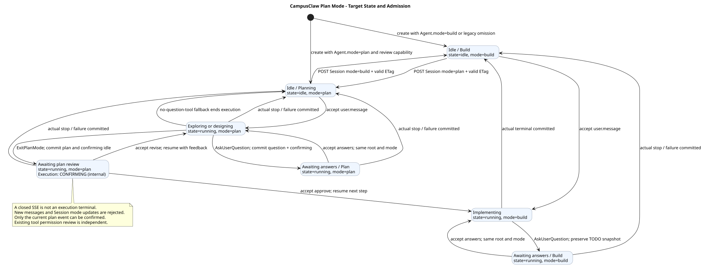
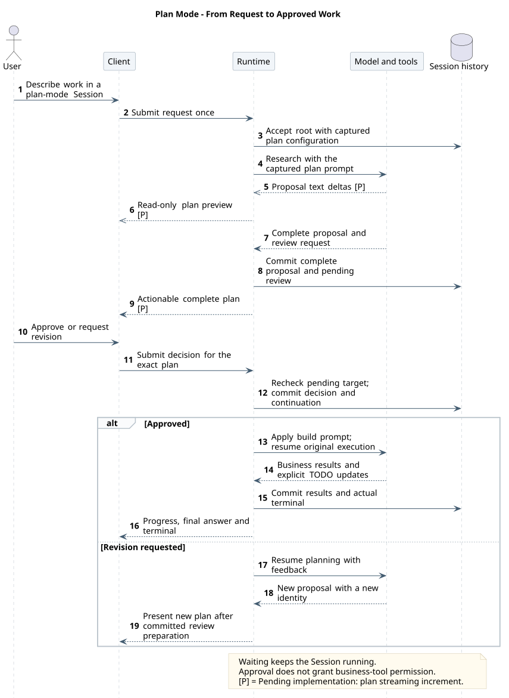
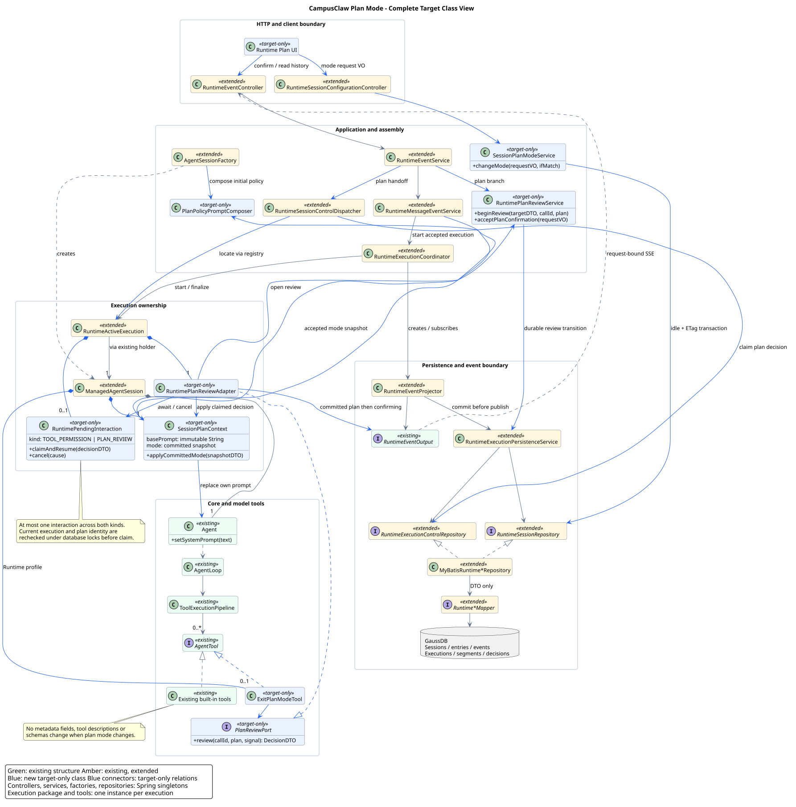
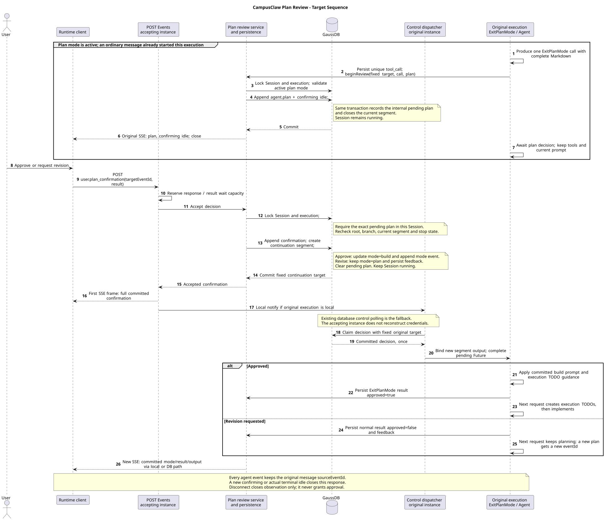

# CampusClaw 计划模式设计

| 属性 | 值 |
|---|---|
| 文档版本 | 1.24.0 |
| 更新日期 | 2026-10-13 |
| 状态 | 完整 plan 参数、AI 通用部分 JSON 与计划两 phase 投影已在 PR #336 实现，未合入 main；Mate 桥接待实现，真实模型验收未完成 |
| 计划长度专项基线 | 2026-10-09 fetch DeepSeek master `5badb15009ae1756c3afe0ae0cef1faafc290ccc`（plan-mode 0.2.1-alpha.1）及 pi main；仅升级长度核验，见[证据 §17](source-evidence.md#plan-length-baseline) |
| 计划模式主基线 | 2026-09-28 fetch DeepSeek master `4878cdabd87d4041bdaff61d04c966883b9fd07a`（plan-mode 0.2.0-rc.1），参数退出与调用流对照 Codex/pi；旧新提交、路径及范围见[证据 §15](source-evidence.md#plan-argument-streaming-evidence) |
| TODO 公共交互基线 | DeepSeek / OpenCode / Codex 显式清单事件；Claude Managed Agents Beta 的历史与对账，2026-09-15 核对 |
| Runtime 语义基线 | 2026-10-09 fetch pi main `f1b2e77f5b13b2a199b1052cb79c235451afe7d7`，仅核验 AI 部分 JSON、OpenAI 适配、事件与工具循环收尾；其他历史范围不升级 |
| CampusClaw 实现基线 | main `769e86592285f4a25b0febaf551eddea6bc7212c`；参数流实现 `ad289648be09474465d20548cdfaab85b8a6d368`（PR #336），范围见[§16](source-evidence.md#plan-generic-json-evidence)与[§17](source-evidence.md#plan-length-baseline)；未重核验范围保留历史归属 |
| 设计仓变更前基线 | `77163754da2d04beb72cc6f28bb1d98c27add9e4` |
| 源码依据 | [基线、符号与差距](source-evidence.md) |

本页维护模式与审核的整体设计；专题按职责分工：

| 需要查阅 | 唯一维护位置 |
|---|---|
| 模式、审核事务、生命周期与验收 | 本页 |
| AI 通用参数预览、最终快照与计划审核绑定（PR 已实现） | [计划流式输出](plan-streaming.md)；最新核验见[证据 §16](source-evidence.md#plan-generic-json-evidence) |
| 模式正文与装配 | [PLAN.md](PLAN.md)、[BUILD.md](BUILD.md)；[提示词组织](plan-policy.md)维护基础 SYSTEM、工具描述和模式文件分工 |
| TODO 工具输入输出、进度权威与恢复 | [TodoUpdate](todo-update.md) |
| 结构化提问、答案事件与原执行续跑 | [AskUserQuestion](ask-user-question.md) |
| 已登记接口的集成边界 | [接口增量](interface-delta.md) |
| 固定源码提交、符号与实现差距 | [源码证据](source-evidence.md) |

计划审核决定的表结构、约束和索引统一见 [Claw 数据库设计](../../03-数据与存储/Claw数据库设计.md#t_session_plan_confirmations)；本文维护交互与执行规则，不另定义物理表。

## 1. 设计结论

名称、模型、思考和模式统一通过 `POST /sessions/{sessionId}` 更新；单字段与组合提交共享一笔事务。Session 的工作模式使用 `mode=plan|build` 表达，切换归属 Session 资源更新。`state=idle|running` 继续表示执行忙闲，两者共同描述 Session，不能合并为一个枚举。采用 DeepSeek 的“稳定工具清单、计划提示词、完整方案审核、批准后续跑”机制，接入 CampusClaw 已有的 `AgentSessionFactory`、`ManagedAgentSession`、Session Events 和数据库执行控制。

用户界面统一显示 **Build** 和 **Plan**，协议继续使用小写 `build|plan`。Plan 的流程是调研、必要澄清、完整方案、明确批准，再进入 Build 实施。Agent 先查明可查询的事实；目标与约束已明确时直接形成方案，不固定先问三题，也不把每个请求变成问卷。纯解释或状态查询可以直接回答，不为没有实施内容的请求生成审核卡。

需要用户掌握的信息或重要选择时，优先只问一个当前关键问题；确有多个相互独立且必须同时解决的问题时，一次工具请求可包含 2～3 题。前端每次只显示一题，允许回看修改，全部完成后一次提交 `user.question_answer`；逐题导航只改变本地草稿，不逐题恢复 Agent。多轮澄清保持同一根执行、Agent 与 Session；工具未装配时才降级为普通问题和下一条 user.message。问题答案、工具调用 JSON 和方案批准各有不同职责，详见[提问交互](ask-user-question.md#7-前端交互与企业服务边界)。

执行任务清单在 build 实施阶段由 [TodoUpdate](todo-update.md) 独立维护；plan 调研、方案生成和修订不记录 TODO 进度。后端在成功 ToolResult 的同一事务中保存显式 `agent.todo_updated` 快照；前端直接消费 todos 并从历史恢复。方案审核、Session 模式和任务进度各自保持职责；不增加 Session 或元数据字段。

配置接口不使用 If-Match、Idempotency-Key 或配套 ETag，不增加同用途的 body/query 字段。不同字段在锁内基于最新记录合并，同字段后一次成功提交生效；旧条件更新实现与迁移差距见[2026-10-04 核验](../08-CampusClaw定时任务/source-evidence.md#schedule-header-free-contract)，该协议迁移待实现。

### 1.1 明确采用的边界

- **Agent 默认模式与 Session 当前模式分离。** Agent 新增字符串 `mode`，仅支持 build/plan；新建交互 Session 从已发布 Agent 快照初始化，旧元数据缺省 build，已有 Session 不被 Agent 更新覆盖。字段存储、兼容与生效时机唯一维护在[Agent 元数据主设计 §4.4](../../03-数据与存储/02-Agent元数据GaussDB/README.md#44-agent-mode)。
- **工具元数据稳定。** `ToolInfo`、`MateToolMeta`、Agent/Skill 绑定结构、`ListMateTools` 输出、`CallMateTool` 输入均不增加计划字段；不添加 `readOnly`、`sideEffect`、`allowedInPlan`，不改变 `permission` 和 `isConcurrencySafe` 的含义。
- **通过提示词限制规划行为。** 工具描述和参数帮助模型理解操作；不增加按计划模式拦截业务工具的白名单或副作用分类器；只有记录 build 实施进度的内置工具 TodoUpdate 在 plan 模式被拒绝（待实现），见 [TodoUpdate](todo-update.md#1-目标与基线选择)。原有工具权限、工作区边界、绑定检查与凭据规则继续生效。该方案不提供服务端强制只读保证。
- **审核状态由服务端维护。** 普通对话中的“可以”“继续”不自动批准方案。确认请求必须引用当前待审核 `agent.plan.eventId`；旧方案不可被误批准，不建立独立 `planId/version` 管理体系。
- **复用现有执行。** 继续使用 POST Events 对应 SSE、GET 历史、固定根消息和内部续跑段；等待审核期间 Session 仍为 `running`，不接受第二条普通消息。
- **保持工具定义跨模式一致。** Runtime profile 增加内置工具 `ExitPlanMode`、`TodoUpdate` 和 `AskUserQuestion`，在普通模式和计划模式中都保持注册。新增工具名称不等于新增元数据字段；普通模式调用 ExitPlanMode 返回模式不匹配错误；TodoUpdate 定义保持登记，提示词规定只在 build 实施阶段调用，plan 模式调用由 Runtime 在执行前返回 `BUILD_MODE_REQUIRED`（待实现）。

统一更新及 mode 已纳入[当前九项契约](../01-CampusClaw多Agent运行时/接口契约/catalog.json)，语义由[HTTP 主设计](../01-CampusClaw多Agent运行时/chat-http-v1-design.md#24-模型目录与统一-session-更新)唯一维护。计划审核输入和批准事件已纳入同一共享 JSON 源，[接口集成边界](interface-delta.md)维护接入理由；契约登记不能据此声称客户端或服务端已实现完整计划审核。

### 1.2 与 DeepSeek 的对应及差异

| DeepSeek 观察行为 | CampusClaw 目标 | 分类与理由 |
|---|---|---|
| 计划状态控制系统提示词，工具清单不变 | `mode` 控制每个执行实例的系统提示词；模式切换不重装工具 | 直接借鉴；隔离工作方式与工具契约 |
| `exit_plan_mode` 展示完整 Markdown 并请求批准 | `ExitPlanMode` + `agent.plan` + `user.plan_confirmation` | 架构变更；接入已有 HTTP、SSE 和事件身份 |
| 计划状态以 `plan/mode` 日志恢复 | Session 行保存当前模式，领域 Entry 保存变更；同事务维护 | 架构变更；复用既有 GaussDB 配置和历史模型 |
| 运行中切换在后续 step 生效 | 用户主动切换只允许 idle；审核批准是唯一运行中退出路径 | 产品约束；与当前配置准入一致，不引入通用运行中模式队列 |
| standard preset 禁止规划期使用 todo_write，实施进度由工具描述指导 | plan 不调用 TodoUpdate；批准后加载短 BUILD.md；批准引导与 BUILD.md 只提示多步实施先建清单，其余进度规则由 TodoUpdate description 维护 | 直接借鉴阶段边界与显式清单事件；公共名称采用 agent.todo_updated |
| 通过独立提问能力澄清需求 | AskUserQuestion + 显式问题/答案事件，原执行等待与续跑 | 架构变更；复用数据库交接和事件恢复，精确问题关联由后端校验；见 [提问设计](ask-user-question.md) |
| 新 spawn 默认不继承计划模式 | Child 在调用时复制父执行当前模式，并只向父返回结果 | 产品约束；避免把规划任务委派成默认实施任务；仍是提示词约束 |
| 没有本专题定义的 Agent.mode → 企业 Session 默认值链 | Agent 定义提供默认值，创建后由 Session 独立维护 | 产品约束与架构扩展；支持默认先规划的 Agent，不重置既有会话 |
| 插件依赖进程内待切换状态 | 已受理审核决定先持久化，再唤醒原执行实例 | 架构变更；复用 CampusClaw 跨实例确认交接 |

只借鉴 DeepSeek 的计划机制，不引入其 Cordis 插件系统、WebSocket Remote Journal、token 级日志或完整事件溯源存储格式。本次重新核验的 plan-mode 包为 0.2.0-rc.1，历史 alpha 结论保留原版本归属；预发布成熟度不作为方案正确性的依据。

### 1.3 完整方案保存在哪里

当前目标不要求独立计划文件。Main Agent 直接调用唯一的 `ExitPlanMode({plan})`，完整 Markdown 是该次调用的必需参数。后端从同一调用参数增量解码计划，发送既有 agent.plan delta；完整参数校验通过并提交审核事务后，发送同 ID completed。模型历史保留完整参数与配对 ToolResult，公共完整计划保存同一正文，来源 Entry 绑定留在后端。修订产生新计划 ID，批准精确引用该 eventId。参数流与通用 JSON 已在 PR #336 实现，尚未合入 main；两 phase 事件继续复用，详见[流式专题](plan-streaming.md)。

复用 Session 的持久化、单条追加时间线、权限和保留边界，避免文件路径与数据库审核记录形成两份权威。代价是不能直接使用工作区文件进行外部编辑、Git 评审或跨会话引用；如产品需要这些能力，再设计方案文件的身份与版本绑定。基线并不统一：Codex 从模型正文流解析计划，DeepSeek 把正文放入退出工具参数；本目标采用完整工具参数提交并自行补充参数流预览，保留企业审核事务，详见[最新对照](source-evidence.md#plan-argument-streaming-evidence)。

## 2. 用户流程与状态

### 2.1 操作流程

1. 用户在空闲 Session 通过更新 `mode=plan` 进入计划模式，成功响应返回提交后的完整 Session 资源。
2. 用户提交普通消息。工厂恢复当前模式并加入计划提示词；Agent 使用已有工具调研。
3. 仅在存在不能自行查明的关键问题时，Agent 以本次响应最后一个工具调用的方式调用 AskUserQuestion；后端保存 agent.question 与 confirming，Session 仍 running/plan。前端逐题收集，同一批完整答案一次提交 user.question_answer 后原执行继续；无待决问题直接进入方案阶段，未装配工具时才普通回复提问。
4. Agent 直接生成 ExitPlanMode({plan}) 参数，后端对已确认的内置调用发送 agent.plan delta；完整响应的唯一调用经过最终参数校验与准备后提交审核，事务成功才发送同 ID completed 与 confirming 并关闭本段 SSE。参数流接线在 PR #336 已实现，公共事件与审核协议复用既有能力。
5. “修改计划”提交 `result=revise` 和可选反馈；原执行继续规划，重新提交时产生新的计划 eventId。
6. “执行计划”提交 `result=approve`；服务端原子接受决定、关闭计划模式并创建续跑段。原执行收到决定后更新提示词，返回工具结果，下一次模型请求创建实施清单并开始实施；逐项完成及验证后调用 TodoUpdate 更新进度。
7. 业务工具仍按既有 `allow/ask/deny` 执行；方案批准不能代替具体工具的权限确认。

关闭计划卡片不发送批准请求。审核等待中要退出任务，使用现有 `user.interrupt`，目标仍是原始 `user.message.eventId`；收到真实终态后再修改模式或发送新消息。

### 2.2 状态组合

| Session state | mode | 待审核计划 | 含义与允许操作 |
|---|---:|---|---|
| idle | build | 无 | 普通模式；可进入计划、发送消息 |
| idle | plan | 无 | 计划模式等待下一条用户输入；可退出计划、回答澄清问题 |
| running | plan | 无 | 正在调研或生成方案；允许中断，不接受 M2 或执行配置更新；仅名称更新允许 |
| running | plan | 有 | 等待计划审核；接受针对该 eventId 的批准/修订，或中断 |
| running | build | 无 | 普通执行或批准后的实施；权限确认仍独立适用 |

在 plan/build 的 running 中均可等待问题回答；不以“无待审核计划”推断没有待交互。问题/答案状态由 [AskUserQuestion](ask-user-question.md#6-状态事务与恢复) 维护，Session Schema 不扩展。

`session.status_idle(reason=confirming)` 继续表达“当前 HTTP 交互结束、执行等待用户处理”，不增加粗粒度 Session 状态。前端根据完整计划、审核决定与结束事件恢复审核卡片，规则见 [§6.2](#62-恢复与结果不确定)；Session 响应不暴露待审核目标。工具权限确认继续使用 `agent.tool_call.requiresConfirmation`。

[原尺寸 SVG](plan_mode_state.svg) · [PlantUML 源码：`plan_mode_state`](diagram.puml#L426)

新建 Session 的初始模式来自 Agent.mode；已是 plan 时直接发消息，无需再切换。创建接口仍无请求体，不自动调用模型或生成任务清单；普通 Session POST 只更新该 Session，不写回 Agent。

### 2.3 从进入计划到实施完成的整体交互

本图以已处于 plan 模式的 Session 为前提，从提交园区需求到批准后执行或反馈后继续规划。Session 创建与模式选择、逐题澄清、计划参数解码、TODO 完整快照、跨实例决定领取分别由所属专题下钻；这里保留同根继续、精确审核目标及批准后才进入 build 的边界。断线只触发历史与 Session 对账，不重放写入。

[原尺寸 SVG](plan_mode_end_to_end.svg) · [PlantUML 源码：`plan_mode_end_to_end`](diagram.puml#L534)

| 阶段 | 用户与 Agent 交互 | 模式 / 进度与权威 |
|---|---|---|
| 创建与进入计划 | 创建时复制 Agent 默认；需要切换时通过统一 Session POST 设置 plan | 新建仍 idle；手动切换在数据库锁内校验最新记录，返回完整 Session |
| 调研与方案设计 | 普通消息启动；模型读取资料、查询业务、形成方案 | running/plan；正常思考和工具事件，不调用 TODO |
| 必要澄清 | 仅询问待决信息；每次显示一题，同批完整答案一次提交 | running/plan；同一根新段续跑，不创建调研 TODO；没有待决问题时跳过 |
| 生成与提交审核 | 唯一 ExitPlanMode({plan})，首个已解码计划 delta 建卡，无 started | 完整参数校验及审核事务成功后发同 ID completed 与 confirming；仍 running/plan；参数来源在 PR #336 已实现 |
| 修订 | 用户针对计划 eventId 提交 revise | 原执行新段继续 plan；不创建实施清单，新方案使用新 eventId |
| 批准 | 用户提交 approve，服务端事务接受并唤醒原执行 | mode=build；替换系统指令；批准本身不代表任何实施项已完成 |
| 实施 | 创建完整 TODO → 业务工具与验证 → 每项完成立即更新 | running/build；成功结果同事务产生 agent.todo_updated，直接驱动面板 |
| 完成或异常 | 最终答案与真实终态；中断/失败如实保留进度 | 终态提交后 idle/build；清单全完成不替代真实终态 |

问题回答与批准续跑均保留原始 user.message 根身份；只有未装配提问工具的普通消息降级才形成新根。TODO 首次在 build 实施阶段创建，不需要把计划 Markdown 自动解析成任务，也不从调研阶段继承清单。断线后复用 GET Events 与 GET Session 对账，已接受写入不自动重放。

此图展示 Runtime 内部目标闭环；企业浏览器经 Mate 公共 Chat 身份与事件投影接入，仍遵守 §7 的两跳边界。详细审核事务见 §5.1，单次 TODO 提交见工具专题；不存在额外的 TodoUpdate HTTP 接口。

## 3. 推荐全局目标类图

图中绿色为复用结构，蓝色为推荐新增结构，`extended` 表示扩展职责；该图是推荐结构蓝图，不是当前实现类图。具体类名、关系的落地映射与尚未接入边界见[专项源码证据](ask-user-question.md#2-基线与已观察实现)。

[原尺寸 SVG](plan_mode_target_classes.svg) · [PlantUML 源码：`plan_mode_target_classes`](diagram.puml#L1)

这张主图贯通入口、应用服务、执行对象、公共工具接口和数据库。文档宽度用于定位完整分层，类与连线细节通过上方原尺寸 SVG 查看。HTTP Controller 只接收请求 VO、输出响应 VO；工具依赖窄的 `PlanReviewPort`，不读取 Servlet、SSE 或 Mapper。模式与审核业务分别由应用服务负责，底层共用已有事务和执行控制端口。

### 3.1 组件职责与生命周期

| 组件 | 生命周期 / 目标调整 |
|---|---|
| `RuntimeSessionController`、`RuntimeEventController` | Spring 单例；分别增加 Session 更新和计划确认输入，保持 ResultBean / SSE 分工 |
| `RuntimeMessageEventService`、`RuntimeExecutionCoordinator`、`RuntimeSessionControlDispatcher` | 既有 Spring 单例；分别在接受后应用模式快照、收尾时取消待交互、按固定执行目标领取计划决定；通过原有 registry/holder 定位执行 |
| `RuntimeSessionConfigurationService`（扩展） | 既有 Spring 单例；增加 `updateSession`，处理四类属性、按提交字段准入、最终配置与模式能力检查，复用响应组装；不持有活动 Agent |
| `RuntimePlanReviewService`（新增） | Spring 单例；校验方案审核业务、构造事件，调用既有事务边界；不长期持有用户请求 |
| `RuntimeExecutionPersistenceService`、两个 Repository | 既有 Spring 单例；增加计划等待和确认事务；数据库仍是跨实例权威 |
| `RuntimePlanReviewAdapter`（新增） | 每个根执行一个；实现 `PlanReviewPort`，连接工具与既有等待/续跑机制 |
| `RuntimeActiveExecution`、`RuntimePendingInteraction`（后者新增） | 每个执行一个；把现有工具权限与计划审核 Future、输出交接和取消责任收敛到一个最多容纳一项交互的对象，支持 `TOOL_PERMISSION`、`PLAN_REVIEW`、`USER_QUESTION` 三种明确类型 |
| `ManagedAgentSession`、`SessionPlanContext`（后者新增） | 每个执行一个；保存不可变 AgentPromptSnapshotDTO、当前执行模式快照、提示词应用方法；不包含 HTTP 请求或数据库句柄 |
| `RuntimeSessionService`、`FileAgentDirectoryResolver`、`AgentDirectorySnapshotDTO`（扩展） | 创建时从同一已解析目录快照读取 Agent 默认模式并持久化，恢复不重套默认；复用 AgentRuntimeManager 的完整目录发布边界 |
| `RuntimeAgentPromptLoader`、`AgentRuntimeManager`（目标调整） | Loader 安全解析业务/预制模式正文；Manager 在既有 Agent 目录锁内取得一致快照并在刷新中保留可选模式文件 |
| `AgentPromptSnapshotDTO` 与 `PreparedAgentRuntime`（已实现） | 不可变 BASE、PLAN、BUILD 及两模式来源，准备结果传给执行；读取/发布共用同一锁边界，活动执行不再读盘 |
| `PlanPolicyPromptComposer`（目标调整） | Spring 无状态单例，纯函数根据提示词快照、已提交模式与入口组合角色及模式正文；无文件 I/O、无 Agent 可变缓存；工具可用性仅用于独立准入检查 |
| `TodoUpdateTool`（已实现） | Runtime profile 按执行创建的无列表状态工具；校验并返回完整 JSON 文本快照；后端 Mapper 校验最终结果，持久化复用 ToolResult 的多事件路径 |
| `RuntimeTodoEventMapper`（已实现单例） | 从已确定内置调用和最终成功结果生成不可变 TodoSnapshotDTO，供既有 Factory 构造显式任务事件 |
| `executionTodos`（已实现，客户端派生函数） | 从统一事件仓库取当前轮次最后一条 agent.todo_updated 作为面板内容；不识别工具名、不解析工具结果 |
| `AskUserQuestionTool`、`UserQuestionPort`、`RuntimeUserQuestionService/Adapter`（新增） | 每执行工具/Adapter 经窄端口等待；单例服务编排问题事务，复用控制接受骨架；完整责任见 [提问设计 §5](ask-user-question.md#5-推荐目标结构与内部接口) |
| `ExitPlanModeTool`（PR 已实现） | 每个 Runtime Session 实例新建；恢复 plan Schema，prepare 生成最终不可变参数快照，执行通过 PlanReviewPort 等待；保持串行 |
| `RuntimeEventProjector`、`RuntimeEventOutput` | 沿用每执行投影与每请求输出边界；完整事件先提交再推送，跨实例确认响应通过既有结果轮询获得完整事件 |
| `StreamingJsonParser`、`PlanArgumentPreview`、`PlanArgumentSnapshotDTO`（PR 已实现） | AI 每调用解析通用部分参数；Runtime 每响应只提取可信 plan 增量并记录内部诊断；工具 prepare 从完整参数生成共享不可变快照，详见[流式职责](plan-streaming.md#3-权威对象与内部职责) |
| `PlanProposalBinder`、`PlanProposalSnapshotDTO`（PR 已实现） | 绑定同次参数快照、已保存原 Entry、预分配计划 ID 和唯一退出调用；事务内复核模式、执行与停止状态，不采用预览作为权威 |

不引入通用 Mode Registry、工作流引擎、第二套 Agent Loop、动态工具注册或可插拔 Plan Backend。`RuntimePendingInteraction` 只共享已存在的等待、取消与输出交接责任，问题回答、计划批准和工具授权的业务判断仍分别维护。

### 3.2 内部接口与接入位置

以下签名表达推荐职责划分；已有功能的实际符号与实现位置见[§12 源码核验](source-evidence.md#12-主线实现状态核验2026-09-18)，不能由推荐类名尚未单独抽取推断功能待实现。类型名中 VO 只出现在 Web/Application 边界，Mapper 参数和返回使用 DTO。

| 位置 | 目标接口 / 方法 | 接入理由 |
|---|---|---|
| 配置应用服务 | `updateSession(sessionId, UpdateSessionRequestVO)` → `RuntimeSessionView<GetSessionResponseVO>` | 由 Session 更新入口调用既有配置服务；复用配置事务、完整 Session 响应 |
| 审核输入 | `acceptPlanConfirmation(sessionId, UserPlanConfirmationEventRequestVO, locale)` → `AcceptedControlStreamDTO` | 复用接受前预留、完整回执、固定续跑段 |
| 工具端口 | `PlanReviewPort.review(toolCallId, CancellationToken)` → `PlanReviewResultDTO` | 已实现；只等待当前调用已绑定的审核结果，不接受第二份正文 |
| 参数准备与审核 | `ExitPlanModeTool.prepare` → 携带 PlanArgumentSnapshotDTO 的 PreparedToolInvocation；Binder → PlanProposalSnapshotDTO | PR 已实现；最终校验先于 Host 审核，before hook 从同次准备结果绑定当前 Entry/调用；事务另查可变状态 |
| 持久化边界 | `markPlanReviewing(...)`、`acceptPlanConfirmation(...)`、`claimPlanConfirmation(...)`、`acknowledgePlanConfirmation(...)` | 对照现有工具确认的四阶段，独立校验计划 eventId |
| 提示词组合 | `compose(AgentPromptSnapshotDTO, mode, entryPoint)` → 完整 SYSTEM String | 由模式和入口选择快照中的已解析正文，不按工具切割正文；工具可用性由独立准入检查负责，矩阵见提示词文档 |
| Session 提示词 | `SessionPlanContext.applyCommittedMode(SessionModeSnapshotDTO)` | 用完整基础文本重新组装提示词，不用字符串删除或重复追加 |
| 消息接受结果 | `UserMessageAcceptanceDTO` 增加 `SessionModeSnapshotDTO`，`startAccepted` 在启动前应用 | 保留接受前 prepare，避免配置竞争与数据库锁内远程装配 |
| 工厂参数 | `ManagedAgentSessionRequest` / `ToolAssemblyContext` 增加计划上下文与退出工具工厂 | 这是内部装配参数；与 Agent 顶层 mode 各自独立，不修改 Tool/Skill 元数据 |

开发分支已通过 RuntimeEventService 接收五类输入；user.question_answer 转交应用服务，分派处不实现答案或审核业务规则。

公共 `AgentTool` 接口保持不变。`ExitPlanMode` 使用现有 `SEQUENTIAL`；从 `BeforeToolCallContext.preparedInvocation` 读取同次最终准备快照，该响应只包含 ExitPlanMode 这一个 ToolCall 的条件由批次规划在任何调用执行前检查，违规时整批返回 `TOOL_BATCH_INTERACTION_INVALID`（待实现，规则见 [M03 §7.1](../02-CampusClaw工具系统/README.md#interactive-tool-batch)）；计划绑定只校验计划来源与调用身份。保持唯一而非仅要求末位，是因为 plan 模式中排在前面的只能是调研调用，方案应基于模型已看到的调研结果。

## 4. 提示词与工具装配

### 4.1 提示词应用

内置模式正文在 [PLAN.md](PLAN.md) 与 [BUILD.md](BUILD.md) 维护；业务 Agent 的 `.campusclaw/PLAN.md`、`BUILD.md` 分别优先完整替换，不存在者回退对应内置正文，组合与通用行为归属见[提示词组织](plan-policy.md)。Runtime 根使用基础 SYSTEM + 可信 Main Agent 角色 + 当前模式文件；Child plan 使用自身基础 SYSTEM + 可信 Subagent 角色 + PLAN.md，Child build/Cron 保持既有基础行为。两份内置文件作为 classpath UTF-8 文本随部署提供，启动时校验；业务来源、非法文件失败、快照与刷新保留规则由[提示词组织 §1](plan-policy.md#11-业务文件优先与独立回退)唯一维护，不按 Markdown 标题解析或按工具拼接段落。

通用执行、验证、汇报与必要澄清要求写入现有受管 SYSTEM.md；TodoUpdate 状态细则归工具 description，BUILD.md 说明模式恢复、获批方案衔接，以及多步实施先建清单（待实现）。主线 8c5fda1d 已完成两文件与工具描述迁移；加载器不会自动补通用文本，业务 SYSTEM 的实际发布与模型行为仍须独立验收。

执行装配顺序：

1. 保留 `RuntimeMessageEventService` 的 prepare → accept → start 顺序：接受前预留容量、通过 AgentRuntimeManager 在目录锁内取得包含 BASE 与两份已解析模式正文的 PreparedAgentRuntime，再创建尚未启动的 `ManagedAgentSession`。此时可预读模式用于准备，但该值不作为最终执行依据；工厂加载和远程 I/O 不进入数据库锁。
2. 接受事务锁定 Session 后读取最新 `t_sessions.mode`，对已准备的固定工具 profile 检查计划能力，将 `SessionModeSnapshotDTO` 与固定执行目标一起作为接受结果返回。Session 更新与消息接受在同一 Session 锁上串行化。
3. 提交后、`RuntimeExecutionCoordinator.start` 前，将接受结果应用到 `SessionPlanContext`，用已加载的基础 SYSTEM 组合提示词并调用 `Agent.setSystemPrompt`，再绑定审核 Adapter、入队回执并启动模型。禁止直接沿用 prepare 阶段可能过期的模式；接受后初始化失败走现有 accepted-start-failure 可靠收尾。
4. 原执行领取批准决定后，在返回 `ExitPlanMode` 的工具结果前应用已提交的 `mode=build`。`AgentLoop.invokeModel` 下一次读取 `AgentContext.systemPrompt()`，自然使用更新后的文本；从原提示词快照重新组合已选定的 BUILD.md，不重新读盘；多步骤实施按 TodoUpdate description 建立清单，不再追加独立进度段。
5. 修订决定保持 `mode=plan`。模式配置事件不转换为模型角色消息；工具结果向模型说明批准或修订结果。

不需要在循环中增加“如果是计划模式就跳过某工具”的分支，也不需要调用 `Agent.setTools`。只更改当前执行自己的 Prompt；Spring 单例不保存某个 Session 的模式，活动执行的 BASE、PLAN 和 BUILD 不因目录刷新而改变。

普通澄清消息、完整方案正文、`AskUserQuestion` 与 `ExitPlanMode` 调用/结果进入模型历史；`agent.plan` / `agent.question` 的独立展示投影、模式配置和用户回答/确认回执不再次注入为重复模型消息。压缩摘要不成为模式或批准事实的权威，恢复模式从 Session 行读取。批准后的首次模型请求须保留来源 Assistant 中完整 plan 参数和调用/结果配对，不能仅依赖卡片或摘要；参数来源调整后的绑定与压缩路径须重新验收。

### 4.2 工具 profile

| 入口 | 目标行为 |
|---|---|
| Runtime | 原八项默认工具后依次追加 `ExitPlanMode`、`TodoUpdate`、`AskUserQuestion`；两种模式使用同一个已解析 profile，名称、description、parameters、顺序均不随模式变化 |
| Child | 不增加审核工具；在每次 `Agent` 调用开始时复制父执行当前模式，构造新的 Child `SessionPlanContext`；Child 提问或方案返回父 Agent |
| Cron | 保持当前工具 profile，默认普通模式；不新增 Job 字段或无人审批队列 |

显式配置 profile 的完全替换语义保持不变。Runtime profile 未包含 `ExitPlanMode` 时，进入计划模式返回 `PLAN_MODE_UNAVAILABLE`，不偷偷补入工具；已处于计划模式的 Session 在下一次执行前也必须检查该能力。离开计划模式不依赖此工具可用性。

Child 继承发生在调用时。不能把根执行创建时的 `plan` 永久捕获在 `BoundAgentTool` 中，否则批准后新建 Child 仍会错误保持规划。传递不可变 `SessionModeSnapshotDTO`，不共享父 `AgentState`、审核 Future 或可变上下文。父取消与最大深度继续按既有实现处理。

TODO 的精确名称、Schema、返回文本、profile 可用性和边界集中见 [TodoUpdate §2](todo-update.md#todo-tool-contract)。不把 TODO 可用性加入计划模式的准入条件。

### 4.3 ExitPlanMode 模型契约

| 项目 | 目标 |
|---|---|
| 名称 | `ExitPlanMode`，遵循现有 PascalCase |
| 参数 | 必需的字符串 plan，禁止额外字段；完整 Markdown 首个非空行以 `# ` 开始，Schema minLength=1，不设 maxLength，应用层校验完整 Unicode；不再要求正文控制标记；参数恢复及通用部分 JSON 接线在 PR #336 已实现 |
| description / 结果引导 | 固定文本见[提示词 §7](plan-policy.md#7-工具描述与结果引导)，两种模式同一工具定义 |
| 大小 | 正文不设置独立字符数上限；仍受完整事件编码容量约束，不截断正文；准确失败分类见[流式约束](plan-streaming.md#21-模型输出与工具契约) |
| 使用条件 | Runtime 根执行、当前计划模式、响应正常以 TOOL_USE 完成且只有该 ToolCall、原 Entry/调用已保存、最终参数已校验并按同次准备快照绑定、无其他待交互；禁止从历史或预览猜测正文 |
| 批准结果 | `AgentToolResult` 文本块包含 JSON `{"approved":true}` 及明确续跑指令；公共结果仍沿用 text 块数组 |
| 修订结果 | 正常结果文本包含 `{"approved":false,"feedback":"..."}`，说明继续规划；不把用户修订作为工具执行故障 |
| 失败 | 完整调用参数无效保持 isError=true，给模型字段错误和同次可信定义，不确认、不执行业务、不猜参或自动重放；非法/截断 JSON 沿 Provider 失败路径；重复键/尾随内容的内部 INVALID 诊断使计划审核失败，普通工具接受语义保持，详见流式专题；模式或审核异常同样不批准、不退出 |

相对 DeepSeek，修订采用正常的 `approved=false` 结果，是产品展示上的差异，避免将正常的审核反馈显示为工具故障。新增模式/审核失败码集中在接口增量中定义，不通过解析异常文本推断。

计划正文不设置独立字符数上限，完整事件仍须满足部署的 SSE 编码字节上限。提交审核前按现有编码器验证 `agent.plan` 帧大小；超出时按既有 `EVENT_PAYLOAD_TOO_LARGE` 路径可靠结束，不建立待审指针或截断正文。来源 Assistant 或调用若先触发现有大小限制，同样不能继续产生可批准计划。

### 4.4 TodoUpdate 与显式任务事件

TodoUpdate 使用现有 AgentTool/Pipeline，返回完整任务清单；Projector 在既有 TurnEndEvent 路径将工具结果与 agent.todo_updated 一起提交，再依次发出同形 SSE。模型仅在 build 实施阶段使用 TODO，在步骤开始前、实际完成并验证后立即更新，或随授权范围内的任务调整更新清单，普通思考、业务工具和答案继续正常输出。前端直接根据 agent.todo_updated.todos 更新，调用参数与失败结果均不提交进度；列表全完成不能取代真实执行终态。

TodoUpdateTool 不访问数据库或 HTTP，也不维护第二份可变 TODO 状态。公共任务事件是客户端的快照来源，与模型使用的成功 ToolResult 同源同事务；客户端 executionTodos 从同一事件仓库派生，实时与历史共用。默认仅 Runtime 根执行装配，按原始 user.message 归属；下一根执行重置当前视图，审核续跑保持同一归属。完整约束、时序、源码差距和独立实施切片见 [TODO 主设计](todo-update.md)。

## 5. HTTP 与事件接口增量

统一 Session 更新及 requested 模式事件由[当前契约](../01-CampusClaw多Agent运行时/chat-api-review.html#UpdateSession)维护；计划审核报文同样由共享 JSON 维护，[接口集成边界](interface-delta.md)说明原因与发布联动。本节只说明接入关系。

Session 是配置权威资源。当前内部契约以统一 POST 更新名称、模型、思考和模式，入口为 `RuntimeSessionController`，应用编排复用 `RuntimeSessionConfigurationService`。三个交互工具及内部事件已在 main 实现，当前源码范围见 §12；Mate 接入及部署验收分别记录，不能由内部实现推断。

| 接口 | 目标增量 |
|---|---|
| `POST /campusclaw-service/v1/sessions/{sessionId}` | 已登记四字段部分更新；含 mode/modelId/thinking 时要求 idle，仅名称可在 running 更新；数据库锁内读取最新记录、合并提交字段并原子提交，返回完整 Session；不要求客户端条件令牌 |
| `GET /campusclaw-service/v1/sessions/{sessionId}` | `mode` 已进入共享响应源；Session 响应不增加待审核目标，审核卡片由 Events 恢复 |
| `POST /campusclaw-service/v1/sessions/{sessionId}/events` | 四输入上增加 `user.question_answer`；问题回答、计划审核复用接受回执和对应续跑 SSE |
| `GET /campusclaw-service/v1/sessions/{sessionId}/events` | 完整计划、问题、回答、审核、两种原因的模式事件与任务更新均已登记到共享事件源 |

不增加 `/plans` CRUD、单独批准 endpoint、独立 Session 订阅流、公共 Run/Execution ID 或幂等键。模式按钮调用 Session 更新接口，Slash 使用 [`/mode`](../../04-命令与技能/01-内置命令/README.md#mode-command) 查询或切换 plan/build；两入口共享模式校验与事务，mode 命令待实现，均不代替方案批准；普通消息接口仍不解析 Slash 文本。

### 5.1 审核事务与事件顺序

本图聚焦完整方案进入等待后的一次决定接纳与消费。Review service 包含审核应用及其 HTTP 边界，Control delivery 保留独立领取职责；本地通知只是提示，数据库轮询为交付后备。接纳事务重查 Session、根执行、分段、精确待审核目标和停止状态；批准同时提交 build 模式，执行端更新捕获提示词后完成原等待工具。

[原尺寸 SVG](plan_mode_review_sequence.svg) · [PlantUML 源码：`plan_mode_review_sequence`](diagram.puml#L364)

提交计划时：AI 生成通用部分参数快照，Projector 从可信 ExitPlanMode 的 plan 前缀发送 agent.plan delta。响应结束后保存原始 Assistant、普通正文的 agent.message completed 和完整 agent.tool_call（{plan}、requiresConfirmation=false）；运行时从已装配工具集解析可信目标，ToolPipeline 校验最终参数并准备不可变 PlanArgumentSnapshotDTO，再交给 Host 的 before hook。Host 先拒绝内部 INVALID 原始 JSON 诊断及身份冲突；Binder 从同次 preparedInvocation 固定原 Entry、计划 ID、完整 plan 及唯一调用。短事务复核固定执行/段、来源、模式和停止状态，保存 agent.plan completed、待审目标与 confirming；成功后才按序推送并关闭 SSE。参数闭合或普通消息完成不等于审核就绪，工具仍等待决定。详见[目标时序](plan-streaming.md#22-目标顺序)。

接受审核时，锁顺序保持 `t_sessions` → 当前 `t_session_executions` → 段/决定行：

1. 复核同 Session、根消息、当前执行、未停止、当前等待类型及 `targetEventId` 精确相等，并确认对应计划事件已提交且属于该 Session 的时间线。
2. 追加完整 `user.plan_confirmation`，创建新续跑段并登记决定；清除待审核指针，执行控制状态恢复 `RUNNING`，Session 粗粒度状态仍为 `running`。
3. 对 approve，在同事务把 `mode` 改为 build、追加 `session.mode_changed` 并更新资源版本。对 revise，不变更模式，只保存反馈。
4. 提交后接收实例先入队本次完整回执，再投递新段的模式变更及后续输出。本地通知只是优化，执行实例通过数据库控制检查也能领取决定。
5. 领取决定时再次校验固定执行/旧段/计划 eventId/停止状态。绑定新段输出后，完成该执行唯一的等待 Future。原执行应用提示词、返回工具结果、继续模型循环。

模式变更、确认回执与续跑目标有任何一项保存失败，整个接受事务回滚。前端“同意”按钮、预读 Session 或历史卡片的可点击状态都不能替代锁内最终校验。

### 5.2 并发与取消

- approve、revise、重复确认之间只允许一个事务成功；其余返回 `PLAN_CONFIRMATION_NOT_PENDING`。不因重复请求生成新的执行段。
- 中断先提交时拒绝确认；确认先提交后中断仍定位同一个根执行，新段按正常停止流程处理。若原执行尚未领取批准就已停止，不继续实施，也不撤销已经保存的用户批准事实；真实根执行终态与未领取决定的 `CANCELED` 收尾在同一事务完成，详见[统一消费状态](../01-CampusClaw多Agent运行时/chat-events-design.md#46-已接受决定的消费终态)。
- 计划必须作为该 Assistant 的唯一 ToolCall 提交；与其他调用同批时，批次规划在任何调用执行前整批拒绝并返回 `TOOL_BATCH_INTERACTION_INVALID`，不建立审核等待，模型下一轮单独提交（待实现，见 [M03 §7.1](../02-CampusClaw工具系统/README.md#interactive-tool-batch)）。
- 问题回答、计划审核与工具授权共用“最多一个待交互”不变量；类型不得互相消费。`user.tool_confirmation` 不能消费计划等待，`user.plan_confirmation` 不能消费工具权限等待。
- 终态、取消、超时和清理路径必须清除待审核指针并取消等待 Future；先提交可靠终态，再释放资源准入。HTTP 关闭不会触发这些操作。

## 6. 持久化与恢复

### 6.1 最小存储增量

以下为目标结构；沿用现有 MyBatis、GaussDB、Entry 树、公共事件表和执行段机制。

| 位置 | 增量 / 权威边界 |
|---|---|
| `t_sessions` | 增加 `mode VARCHAR(16) NOT NULL DEFAULT 'build'`，CHECK 限定为 plan/build；当前模式权威，修改时与 Entry、resource_version 同事务 |
| `t_session_executions` | 增加可空 `pending_plan_event_id VARCHAR(128)`；存在时与 `pending_tool_call_id` 一起定位 ExitPlanMode，状态必须为 `CONFIRMING`；工具权限等待时该字段为空 |
| `t_session_plan_confirmations`（新增） | 保存已接受的审核决定及跨实例消费状态；只引用计划 eventId，不复制完整方案，不提供业务计划版本 |
| `t_session_entries`、`t_session_events` | agent.plan delta/completed 已实现，仅 completed 保存；本次调整正文来源，模型历史保存携带完整 plan 的调用，不增加表、sourceMessageEventId 或 token 日志；旧空参数历史按原关联读取 |
| `t_session_execution_segments` 及关联表 | 复用；允许 `user.plan_confirmation` 触发新段；approve 的模式变更也关联该段以供确认响应读取 |

新决定表字段：`session_id`、`execution_id`、`confirmation_event_id`、`target_event_id`、`previous_segment_id`、`segment_id`、`tool_call_id`、`result`、可空 `feedback`、`state`、`created_at`、可空 `claimed_at/completed_at`。ID 列沿用现有 128 长度；tool_call_id 和反馈用 TEXT；result 只允许 `approve/revise`；state 使用 `PENDING/CLAIMED/COMPLETED/CANCELED`，时间约束、终态事务和 74f1b831 源码差距由[统一消费状态](../01-CampusClaw多Agent运行时/chat-events-design.md#46-已接受决定的消费终态)维护；CANCELED 在该核验基线尚未实现。

主键为 `(session_id, confirmation_event_id)`；唯一约束为 `(session_id, target_event_id)` 和 `(session_id, execution_id, segment_id)`。仅 revise 可带反馈，时间戳与消费状态约束对齐现有工具决定表。所有追加与查询都带 Session 条件，不单凭 eventId 查询跨 Session 内容。新表必须纳入 Session 删除/保留清理，清理顺序先决定及引用、后执行和事件；SQL COMMENT 使用中文。

`pending_plan_event_id` 仅属于当前执行的内部控制状态，不投影到 Session 响应，也不在 `t_sessions` 再保存一份指针。它与计划事件、确认决定和执行段在同一事务内维护；不为该内部指针单独增加 Session 的 `resource_version/updated_at` 变更。mode、state 等公共资源变化继续按既有规则维护内部版本，不对外提供 ETag。

这一边界沿用当前工具确认：客户端从事件计算展示状态，服务端从锁内执行记录判断是否仍可接受决定。减少 Session 响应与具体交互类型的耦合，代价是刷新审核卡需要补齐相关事件，GET Session 本身不能定位待审核方案。该差异属于架构变更；普通历史分页和页面可点击状态均不作为提交准入的权威。

### 6.2 恢复与结果不确定

审核卡片复用既有工具确认的事件恢复方式，以下是当前计划恢复规则，开发分支验证范围见专项证据：

1. 从完整事件历史确定最近一条 `user.message` 的根消息 eventId；只处理属于该根消息的计划、工具结果和结束事件。`user.plan_confirmation` 通过 `targetEventId` 关联计划，不按最后一段 Markdown 或时间戳猜测目标。
2. 完整 `agent.plan` 负责正文展示；其后的对应 `session.status_idle(reason=confirming)` 表示本段进入等待。确认回执、对应 ExitPlanMode 的工具结果、中断请求或真实终态出现后，旧计划不再提供审核按钮。修订后的新计划使用新 eventId；历史方案仍可展示。
3. 刷新时沿用 `loadHistory` 分页补读，再读取 Session 的 mode/state 并按 eventId 对账。历史尚未补齐、缺少关联记录、正在停止或 Session 状态与事件矛盾时禁用审核，显示恢复中或待核对。不能仅凭某页未出现确认记录断言仍可批准；分页读完也不是跨请求固定快照。
4. 事件投影只决定客户端展示，确认请求始终由服务端在锁内复核当前等待类型、计划 eventId、分支及停止状态。其他客户端已先处理时返回接口增量定义的冲突错误，刷新历史和 Session，不自动重放确认。

| 场景 | 目标行为 |
|---|---|
| 浏览器刷新 / SSE 断开 | 分页 GET Events 恢复计划、决定及结束记录，GET Session 核对 mode/state；按上述事件规则恢复审核卡，不自动重发消息或确认 |
| 计划帧丢失，但原执行仍在等待 | 补齐当前根消息的完整计划和确认等待记录后恢复卡片；读到确认、结果或终态即移除旧审核操作，缺失记录时保持待核对 |
| 确认由另一实例接收 | 决定入库；原持有执行和凭据的实例领取，接收实例按固定新段读取已提交结果；本地 preview 不承诺跨实例重放 |
| 批准回执丢失 | 查询目标计划后是否已有确认记录，并读取 Session/后续事件；已接受的确认不重发，EOF 不代表执行成功 |
| 执行达到既有 maxDuration | 审核等待计入现有执行时限，不无限占用活动容量；取消等待，按既有可靠收尾提交真实终态，不能把超时当成批准 |
| 执行进程丢失 | 可以恢复已提交历史和模式，不能恢复原内存凭据、Future 或自动实施；不得仅因某实例无本地 Holder 就宣称任务已结束 |

当前基线没有可证明的跨实例失联执行自动接管能力。本设计不增加租约调度器，也不承诺进程丢失后自动续跑。未能确认原执行已退出时，保留不确定/running 并走现有故障处置；确认退出后的修复必须使用固定执行身份提交失败终态并释放准入，禁止直接把 Session 改 idle 或重放 Mate 调用。**断线恢复可实施，进程崩溃自动接管不在本功能承诺中。**

关闭整个集群的功能配置或回滚前，需要停止接收新的计划任务，等待或中断现有待审核执行；旧版本无法解释新事件类型，不允许直接在已有计划数据上降级旧读写路径。

TODO 恢复复用同一事件历史，规则由 [TodoUpdate §4](todo-update.md#4-客户端投影与恢复) 唯一维护；不增加 Session 当前 TODO 字段或 TODO 数据表。压缩摘要不用于恢复客户端进度。

## 7. 前端与 Mate 边界

CampusClaw 自带 Runtime 调试前端可以直接消费本专题的内部 Session 契约。模式控件显示 Build/Plan；Plan 卡片直接展示完整方案和“执行计划”“修改计划”，必要澄清采用[逐题问题卡](ask-user-question.md#7-前端交互与企业服务边界)。待回答时显示“等待回答”，待审核时显示“等待审核”，工具权限交互显示“等待确认”；这些是现有事件的客户端展示状态，不扩展 Session 枚举。页面显示独立的模式开关和审核卡片；`running` 时禁用手动切换，审核按钮绑定 eventId 而非“最后一段 Markdown”；卡片恢复按 [§6.2](#62-恢复与结果不确定)处理，Session 类型不新增待审核字段。提交按钮点击后进入提交中，不能重复创建确认请求；409 后重新获取 Session 和历史。

主对话中的问题和答案卡吸收与之精确关联的 AskUserQuestion 调用/结果；完整方案卡继续吸收 ExitPlanMode 调用/结果。模型历史与完整事件保持，原始参数和结果仅在开发者诊断中按需查看；关联缺失或调用失败时给出简短状态，不把 JSON 当作最终用户答复。展示汇聚与逐题导航已在主线 8c5fda1d 实现，旧 1d08f98e 差距仅作历史证据，不改变审核、工具结果或续跑协议。

计划 delta/completed 与客户端预览已实现；本次把增量来源改为 ExitPlanMode.plan，前端仍在首个非空 delta 建卡、同 ID completed 全量覆盖，不解析参数。公开完整 tool_call 的 arguments 内容从 {} 变为 {plan}，需回归瞬时/失败日志和旧历史；不新增其他工具参数公开流。预览中止、模式对账、终态与两跳身份边界见[流式恢复](plan-streaming.md#4-公共事件与页面恢复)。

只有收到并对账到服务端接受决定，才显示“已批准”或“已退回修改”；生成方案结束、关闭 SSE、普通回答中的肯定文本都不能触发执行。计划 Markdown 按前端现有安全渲染规则显示，不执行其中 HTML/脚本，外链与工具调用不由文档内容自动触发。

面向企业浏览器的 mate-service 仍拥有 `chatId → sessionId` 私有映射、认证、权限和公共事件投影。本专题不替换既有 Mate 公共三接口：产品桥接需要将新增审核、问题/答案及任务事件投影到公共事件，并保持批准目标从公共 eventId 到内部计划 eventId 的可校验映射。字段同名不能推定两跳 ID 共值。公共 Chat 模式配置及确认联合类型需在 Mate 契约中同步，不能把内部 Session 更新路径或 sessionId 直接暴露给浏览器。

Runtime、Mate bridge 和客户端必须在同一发布切片完成相关事件解码；未升级消费者不显示计划入口。Runtime 本身仍可通过内部 HTTP 和调试前端独立验证完整闭环。

## 8. 实施切片与验收

| 切片 | 落地范围 | 必须验证 |
|---|---|---|
| S1：模式骨架 | Session 更新入口、mode 列、DTO/VO、既有配置服务、工厂提示词、Agent 默认 mode | 统一 POST 按提交字段更新四类属性，拒绝只读字段，未提交属性保持；双 Session 隔离；模式与消息接受竞争使用事务快照；相同值不新增事件；新 Session 复制 Agent.mode，旧元数据缺省 build；持久化后按实际 mode 恢复，Agent 更新不覆盖旧 Session；Agent 仅新增 mode，Tool/Skill 字段不变 |
| S2：稳定工具与审核 | ExitPlanMode 工厂/profile、PlanReviewPort/Adapter、独占审核调用、统一待交互对象 | 普通/计划两次请求工具定义和顺序相同；非计划调用失败；未配置退出工具不能进入计划；无新增权限判断 |
| S3：事务与续跑 | 三种新事件、审核决定表、控制轮询、原执行续跑段、提示词退出 | 批准指向精确计划；修订后旧ID失效；跨实例决定只领取一次；完整回执先行；旧 SSE 不接收新段；工具调用/结果无重复 |
| S4：取消和恢复 | GET Session/历史投影、超时、中断、删除清理、压缩与 Child | approve/revise/interrupt 竞争；未领取审核决定随真实终态取消消费，STOPPING 不提前收尾、已领取记录和批准事实不变；两类确认不能互相消费；断线无重放；分页未补齐与 Session/事件矛盾时不开放审核；已确认或终止的旧计划不可重审；未可靠结束不释放准入；批准后新 Child 使用 build；摘要不修改模式 |
| S5：客户端与契约发布 | 统一 catalog/operation JSON、生成 HTML、Runtime 前端、所需 Mate 公共投影 | Session 更新成功返回提交快照，不依赖 ETag；两跳不泄露 ID/凭据；审核卡从完整事件恢复；创建/GET/更新/Command 的完整 Session 均不含待审核目标；内部待审指针不单独推进 Session 版本；未知事件版本兼容；UI 接受才标记批准 |
| S6：TODO 进度 | TodoUpdateTool/profile、plan 模式门禁、显式任务事件及 executionTodos，精确切片见 [T1～T4](todo-update.md#6-实施切片与验收) | plan 不调用 TODO，build 正常消息与进度交错；成功提交才更新；失败/缺页/断线/重复帧恢复一致；新根隔离；增加完整 agent.todo_updated，保持 Session 和元数据字段不变 |
| S7：两文件提示词与模型评估 | PLAN.md/BUILD.md、基础 SYSTEM 发布、工具 description、角色/模式组合和简短审核结果引导 | [P01～P23](plan-policy.md#8-组合检查与模型场景验收)：业务文件逐一覆盖/缺失回退，非法文件失败、执行快照和刷新保留；无旧 TXT 回退；基础行为无缺失；plan 无 TODO；批准后替换模式文件；缺工具降级、Subagent 角色、双 Session 与压缩；代码校验和模型遵循分别记录 |
| S8：结构化提问 | [Q1～Q5](ask-user-question.md#8-实施切片与验收) | 精确问题/答案、三类互斥、原根续跑、取消与恢复；Session 与元数据字段稳定；plan 无调研 TODO，build 保留原清单 |
| S9：Plan 交互优化（展示已实现，模型行为待验收） | Build/Plan 文案、逐题问题卡、调用/结果汇聚、必要澄清提示词 | 一题无需导航，多题前进/返回不发请求、最后仅一次完整提交；回答不批准；完整事件保留；无问答事件的失败可见；无待决问题不强制提问；窄屏和缩放下当前题与操作可达 |
| S10：计划参数流式输出（PR 已实现，外部待验收） | plan Schema/prepare、Provider 身份、参数预览、同次最终快照、既有两 phase 与业务提示词联动 | [PS1～PS5](plan-streaming.md#6-实施切片与验收)：无额外往返、只生成一次；校验先于审核、错误可修正；旧历史和其他工具协议保持；真实模型成功率、首字和审核耗时独立验收 |

规划行为还需要模型级场景评估：查询型工具可用、混合查询/修改工具依描述选参、Cron 管理/触发属于规划期不应执行的动作、用户口头同意不自动退出、Child 返回待决问题、资料中的诱导执行指令不能改变计划约束。这些评估衡量提示词遵循情况，不宣称证明了强制无副作用。

不新增 Maven 直接依赖；复用 JDK CompletableFuture、现有 Spring、MyBatis、Jackson、Bean Validation、取消和 SSE 设施。部署提示词和审核页只使用已有文件/Markdown能力，不引入 YAML 解析器或工作流库。新增 Java 类型和方法按仓库的中文 Javadoc、DTO/VO、方法长度规则实现；只改 `modules/*` 主源码，再经仓库同步机制生成镜像。

## 9. 文档校验范围

本专题维护一张完整目标类图、审核与 TODO 执行时序、端到端交互及状态图。修改图源后生成 SVG，检查 ASCII、XML、链接、行锚点、生成同步及原尺寸/文档缩放可读性；修改接口增量时检查 JSON 示例。设计校验不代替计划模式实现测试、模型遵循评估或跨实例恢复验收。

## 10. 版本历史

| 版本 | 日期 | 变更 |
|---|---|---|
| 1.24.0 | 2026-10-13 | plan 模式调用 TodoUpdate 在执行前被拒绝，前端清单派生改记为 executionTodos，批准后多步实施先建清单。 |
| 1.23.0 | 2026-10-13 | 计划提交与其他工具同批时在执行前整批拒绝，不再让同批其他调用先行执行。 |
| 1.22.1 | 2026-10-10 | 关联 Claw 数据库设计中的计划审核决定表，保持业务与接口规则。 |
| 1.22.0 | 2026-10-09 | 取消计划正文最大字符数，保留内容有效性、审核绑定与完整事件容量约束。 |
| 1.21.0 | 2026-10-09 | 计划预览消费 AI 通用部分参数快照与内部诊断，同步 PR 实现及兼容性边界。 |
| 1.20.0 | 2026-10-04 | 模式配置取消客户端条件令牌和 ETag，保留数据库原子更新与审核准入。 |
| 1.19.0 | 2026-09-28 | 恢复完整 plan 工具参数，以参数增量复用计划预览并保持审核与其他工具协议边界。 |
| 1.18.0 | 2026-09-22 | 模式按钮与 mode 命令共享 Session 模式规则，切换不代替方案批准。 |
| 1.17.0 | 2026-09-22 | 计划审核按 Session 线性历史核对目标，保留根与执行准入。 |
| 1.16.0 | 2026-09-19 | 后端解析计划标记并通过 agent.plan delta/completed 展示，审核事务保持独立。 |
| 1.15.0 | 2026-09-19 | 计划正文复用文本流，空参数退出调用绑定同响应的完整消息后提交审核。 |
| 1.14.0 | 2026-09-18 | 同步主线交互工具、模式文件及逐题展示的实现状态，并区分待实现与未核验。 |
| 1.13.0 | 2026-09-17 | 业务 Agent 可按同名文件覆盖模式正文，准备时固定快照并在目录刷新中保留覆盖。 |
| 1.12.1 | 2026-09-17 | 模型角色统一为 Main Agent/Subagent，保持 Runtime/Child 入口及执行关系术语。 |
| 1.12.0 | 2026-09-17 | 模式提示词仅保留 PLAN.md/BUILD.md，通用行为与工具细则按职责集中维护。 |
| 1.11.0 | 2026-09-17 | 计划审核复用统一 CANCELED 消费终态，可靠结束时收尾未领取决定且保留批准事实。 |
| 1.10.0 | 2026-09-16 | 明确 Build/Plan、必要澄清、逐题聚合提交及问题卡吸收工具日志的目标交互。 |
| 1.9.1 | 2026-09-15 | 同步计划与结构化问答的开发分支证据和验证边界。 |
| 1.9.0 | 2026-09-15 | 澄清采用 AskUserQuestion 和显式问题/答案事件，保持原执行续跑。 |
| 1.8.0 | 2026-09-15 | 计划审核报文纳入共享契约，制作、批准执行和修订示例与历史同源。 |
| 1.7.0 | 2026-09-15 | 明确方案以完整事件保存，并由后端显式发布执行任务快照。 |
| 1.6.1 | 2026-09-14 | 明确专题分工并优化完整类图、审核与实施顺序图的阅读层次。 |
| 1.6.0 | 2026-09-14 | Agent.mode 初始化新 Session，已有会话独立维护当前模式。 |
| 1.5.0 | 2026-09-14 | 按模式组合规划审核与实施提示词，TODO 仅记录实施进度并补齐整体交互。 |
| 1.4.0 | 2026-09-14 | TodoUpdate 通过通用工具调用和成功结果维护任务进度，保持事件与元数据结构稳定。 |
| 1.3.0 | 2026-09-14 | 计划审核通过事件恢复，待审核目标仅保留在执行内部。 |
| 1.2.0 | 2026-09-14 | 模式写入并入四字段统一 Session POST，复用原子更新与条件准入。 |
| 1.1.0 | 2026-09-14 | 将 plan/build 归入 Session 资源更新，统一 mode 字段及既有配置服务接入。 |
| 1.0.0 | 2026-09-14 | 基于 DeepSeek 在现有 Session、工具和事件控制框架上定义稳定元数据的计划模式与审核续跑。 |
