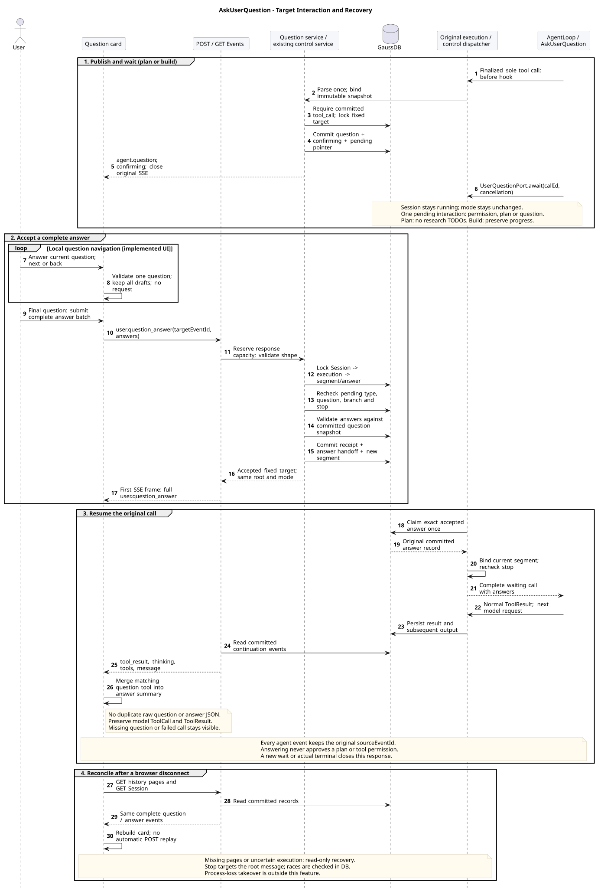

# AskUserQuestion：结构化提问与原执行续跑

版本：1.0.0；日期：2026-09-15。状态：已确定的目标设计，**target-only，尚未实现**。

本专题归 M01 的人机交互生命周期，关联 M03 工具装配、M06 事件契约和 M07 前端。它维护工具语义、等待与续跑、状态及验收；精确 Schema、事件字段和报文由 [共享事件源](../01-CampusClaw多Agent运行时/事件契约/common.json) 的 `questionContract`、[POST Events](../01-CampusClaw多Agent运行时/事件契约/操作/01-submit-session-event.json) 和 [GET Events](../01-CampusClaw多Agent运行时/事件契约/操作/02-list-session-events.json) 唯一维护，并生成[当前接口页](../01-CampusClaw多Agent运行时/chat-api-review.html#submitSessionEvent)。提示词组合由 [plan-policy.md](plan-policy.md) 维护。

## 1. 目标与边界

根 Agent 遇到需要用户决定的目标、约束或重要取舍时，调用 `AskUserQuestion`。后端发布完整 `agent.question`，前端据此展示问题；用户通过既有 POST Events 提交 `user.question_answer`。回答作为该工具的正常结果返回，原 Agent Loop 继续，保持根消息、Session、mode、原执行凭据和实施进度归属。

- Runtime 默认 profile 在现有十项之后追加 `AskUserQuestion`，执行模式为 `SEQUENTIAL`；plan/build 的名称、Schema、description、顺序一致。默认 Child/Cron 不装配；即使显式配置也必须拒绝无交互根上下文的调用。Child 把待决问题交给父 Agent，Cron 汇报缺失信息并按既有任务生命周期结束。
- 一次询问包含 1～3 个问题，支持单选、多选和自由文本。一次提交回答全部问题；首版没有跳过、附件、动态表单、问题编辑或问题 CRUD。用户可以明确回答“无法确定”；不使用空答案表示默认同意。
- `AskUserQuestion` 收集信息；`ExitPlanMode` 审核完整方案；`user.tool_confirmation` 控制工具权限。回答不会改变 mode、批准方案、扩大工具权限或修改 TODO。build 中的问题回答继续受已有任务授权约束；实质改写获批方案仍按原规则结束执行后重新进入 plan。
- 不新增 HTTP 路径、Session 响应字段或 Agent/Tool/Skill 元数据字段。问题数组和答案属于运行事件，不是元数据。内部执行控制与答案交接需要持久化增量，不能只增加模型工具说明和前端卡片。
- 工具可用时，需要用户回答的澄清使用该工具。显式 profile 未装配它时保留普通 Assistant 提问并结束执行的降级方式；不得生成不存在的问题事件或自动补装工具，也不因此禁止 plan 模式。

## 2. 基线与已观察实现

设计仓起点：`b6ea996537925d702022ee13a6b030e8bea054f5`。实现核对：`pi-mono-java@699f929f6826b595ed1d0162f6def66e2f84760b`（代码提交 `17dbb20ae998c58c2b3f5ae19c254922e9f93210`，开发分支，非主线合入声明）。它比计划专题旧核对点 `09b32d8ea4a4b43b34be302d8b2745bdc417c9a2` 已增加 mode、审核与 TODO；本次只更新所列接入范围，不将旧差距表当作新提交缺陷。

下表 Java 路径前缀 R 为 `modules/coding-agent-cli/src/main/java/com/campusclaw/codingagent/`；资源前缀为 `modules/coding-agent-cli/src/main/resources/`。

| 源码 / 符号 | 已观察事实 | 本次目标增量 |
|---|---|---|
| R `tool/builtin/BuiltInToolName.java`、`tool/plan/ExitPlanModeTool.java`、`PlanReviewPort.java` | 十项工具已有 ExitPlanMode/TodoUpdate；没有提问工具；审核工具依赖窄端口 | 增加枚举、工厂和 `UserQuestionPort`，不改变 AgentTool 接口 |
| 资源 `prompts/plan/PLAN_ROOT_REVIEW.txt` | 普通回复提问后结束执行，等待下一条消息 | 工具可用时结构化等待；未装配时才使用原降级 |
| R `runtimeapi/event/RuntimeEventProjector.java` · `beginPlanReview`、`finishConfirmingOutput` | 验证完整且唯一的审核调用，保存计划与 confirming，关闭该段 SSE | 复用提交顺序，增加问题快照解析、问题事件和等待登记 |
| R `runtimeapi/runtime/RuntimeActiveExecution.java` · `beginPlanReview`、`await`、`claimAndResumePlanReview`、`prepareStop` | 两类 Future 互斥；批准切换 mode；新段保持根身份；停止可切到已提交续跑目标 | 收敛为一个 `RuntimePendingInteraction`，增加 USER_QUESTION；回答不切模式 |
| R `runtimeapi/event/RuntimeControlEventService.java` · `acceptPlanConfirmation`、`accept` | 预留响应容量、事务接受、完整回执先行、固定段补读 | 添加答案分支与严格答案校验，保留同一接受骨架 |
| R `runtimeapi/vo/SessionUserEventRequestVO.java`、`UserPlanConfirmationEventRequestVO.java` | sealed 联合类型为四输入，严格区分条件字段、省略和 null | 新增 UserQuestionAnswerEventRequestVO 及嵌套请求 VO |
| 资源 `db/gaussdb/install/session_schema.sql` · `t_session_executions`、`t_session_plan_confirmations` | 已有内部待审指针和跨实例决定表；没有问题等待/答案表 | 增加内部问题指针及专用答案交接表，见 §6 |

### 2.1 同层基线与取舍

| 基线证据 | 已核对行为 | 采纳与差异理由 |
|---|---|---|
| DeepSeek Harness `0a53fb55bea101816fa226bb964ae2bed71c343b`（alpha），[`packages/interaction/tool-ask-user/src/index.ts`](https://github.com/deepseek-ai/deepseek-harness/blob/0a53fb55bea101816fa226bb964ae2bed71c343b/packages/interaction/tool-ask-user/src/index.ts) · `apply/execute` | ask_user_question 提交 questions，等待 userQuestions.ask，answers 作为 JSON 文本工具结果 | 直接借鉴工具等待与结构化问题/答案；使用 CampusClaw PascalCase 和 lowerCamelCase |
| 同提交 [`packages/interaction/user-questions/src/index.ts`](https://github.com/deepseek-ai/deepseek-harness/blob/0a53fb55bea101816fa226bb964ae2bed71c343b/packages/interaction/user-questions/src/index.ts) · `UserQuestionService.ask`；`src/types.ts`；`docs/subsystems/user-questions.md` | 校验 live root、委派调用与取消；问题 id、选项 label、selected/custom；支持表达 plan-review 的 intent，UI 可跳过问题 | 保留根上下文与取消边界；产品约束：最多三题且全部作答；安全加固：闭合字段及答案关联校验；计划审核继续独立，不迁入 intent 或 Cordis waterfall |
| pi `5cd93f688aaab89dbb6dfa4aca535f21796ae185`，[`packages/agent/src/agent-loop.ts`](https://github.com/badlogic/pi-mono/blob/5cd93f688aaab89dbb6dfa4aca535f21796ae185/packages/agent/src/agent-loop.ts) · `executeToolCalls/runLoop` | 工具结果写入上下文后进入下一次模型调用 | 保留 Loop 顺序；数据库等待、请求级 SSE 与跨实例答案交接属于 CampusClaw 架构扩展 |
| Claude Managed Agents 官方 [Tools](https://platform.claude.com/docs/en/managed-agents/tools)、[Events and streaming](https://platform.claude.com/docs/en/managed-agents/events-and-streaming)，2026-09-15 核对，Beta | 公开自定义工具由应用返回结果以继续任务，完整事件与临时 preview 分离；所列内置工具没有 AskUserQuestion | 借鉴工具结果与权威历史风格；本专题两种事件是 CampusClaw 自定义，不声称 Claude 有同名事件，不推断其服务端存储 |

收益是确定的问题关联、原执行续跑和可恢复的前端控件；代价是新增两种事件、答案校验与交接状态，以及所有消费者的同步发布。仅普通问答仍可使用 Assistant 消息；工具不会提高模型事实判断的正确率，也不能保证模型每次都恰当提问。

## 3. 工具契约

精确 `parameters` 与长度只维护在共享源的 `questionContract`。所有对象闭合字段；字符串长度在服务端按 UTF-16 单元复核，不能只依赖 JSON Schema 的字符计数。模型输入不得带公共 eventId、Session ID、答案、批准标记、超时参数或执行标识。

| 字段 | 语义 |
|---|---|
| `questions[].id` | 模型声明的本批局部问题标识；本批内唯一、区分大小写；回答原样引用。不是服务端资源 ID，可在另一批中重用 |
| `question` / 可选 `header` | 完整问题与简短标题，前端按普通文本展示 |
| 可选 `options[]` | 每项 label 和可选 description；同题 label 唯一。selected 使用该不可变快照中的 label，不按索引或解析“推荐”文本取值 |
| 可选 `multiSelect` | 省略由解析 Service 归一为 false，事件快照显式返回；没有 options 时只能 false |
| `answers[].id/selected/custom` | 每题 id 和 selected 必填；custom 可选非空文本；全部答案一次提交 |

参数解析对展示文本执行 Java `String.strip`，在归一后检查展示文本的非空、长度和选项 label 唯一；问题 id 按原值校验格式与本批唯一性，不裁剪或改变大小写，不把未知字段或 null 当缺省。`options` 出现时为 2～6 项，省略时为纯文本问题；所有问题始终允许自由文本输入。单选的 custom 与选择互斥，多选可在已选项之外补充 custom；selected 不得重复且只能来自该题选项。纯文本问题 selected=[] 且 custom 必填；每题至少有一个选择或非空 custom，禁止全空跳过。按问题顺序、选项原顺序规范化答案，回执与工具结果使用同一份规范化答案。

模型可见工具结果为一个 JSON 文本块 `{"answers":[...]}`，成功 `isError=false`。后端不接受调用方提供工具结果文本或 isError，也不通过 after hook 文本反推是否已有用户回答。模型历史保留原 ToolCall 和正常 ToolResult；问题展示 Entry 与用户答案回执不重复转换成 user/assistant 消息。

固定 description：

```text
Ask the user one to three concise questions when required information or a user-owned choice blocks further work. Use stable question ids, optional choices and optional multiSelect; free text is always supported. Ask only what cannot be established by inspecting available information. This must be the only tool call in the assistant response. Wait for the returned answers before continuing the same task. Answers do not approve a plan, change mode, or replace business-tool permission confirmation. Never invent an answer or treat cancellation, silence or failure as consent.
```

## 4. 整体交互与事件



[原尺寸 SVG](ask_user_question_sequence.svg) · [PlantUML 源码](diagram.puml#L674)

1. Agent 形成完整 `AskUserQuestion` ToolCall；该 Assistant 响应只能包含这一项 ToolCall，普通说明文本可同时存在。框架先校验 Schema，Runtime 再从最终调用解析一个不可变问题快照；before hook、等待对象、持久化事件和工具端口共享该快照，不从普通回复提取问题，也不再次各自解析不同版本。
2. 既有路径保存唯一 `agent.tool_call`，`requiresConfirmation=false`。随后在同一短事务保存 `agent.question`、`session.status_idle(reason=confirming)`，登记内部等待目标并关闭旧段；提交后推送并关闭本次 SSE。`confirming` 统一表示本段等待用户处理，具体是提问、计划审核还是授权由对应完整事件确定；它不是执行成功或 Session idle。
3. 前端直接消费 `agent.question.questions`，显示问题卡片；无需根据工具名称或工具参数解析问卷。Session 保持 running，mode 不变，Agent 在该工具处等待；不能提交下一条普通消息，也不能手动修改执行配置。
4. 用户点击“提交回答”，沿用 `POST /campusclaw-service/v1/sessions/{sessionId}/events`，事件为 `user.question_answer`。`targetEventId` 精确指向这张 `agent.question.eventId`；不是问题条目的 id、toolCallId 或根消息 id。请求不复制问题、选项或方案。
5. 服务端原子接受答案和新段后，响应第一个业务帧为完整 `user.question_answer` 回执。原实例领取答案、绑定新段，再唤醒工具等待；工具正常返回，后续 `agent.tool_result`、思考、业务工具和回答继续落在同一根 `sourceEventId` 下。
6. plan 中继续调研或单独调用 ExitPlanMode；build 中继续实施，已有 TODO 不重置、不自动 completed。下一次确需提问时产生新的 agent.question.eventId；旧问题及回答保持不可变。

SSE 和 GET 历史的两种新事件完全同形，无 phase/delta。agent.question 含 sourceEventId/toolCallId/questions；user.question_answer 含 targetEventId/answers，不另带 sourceEventId，通过目标问题关联原根。精确示例在接口页的“提出问题”“回答后继续规划”及 GET 对应历史中；计划制作和批准场景继续保留。

## 5. 推荐目标结构与内部接口

复用并扩展[计划与交互全局目标类图](README.md#3-推荐全局目标类图)。入口 → 应用服务 → 执行对象/工具窄端口 → 持久化与输出的完整链在同一张图中；下表所有新增类型和方法均是 target-only，不等同于已开发分支的现有 API。

| 组件 / 接口 | 生命周期与责任 |
|---|---|
| `RuntimeEventController` → `RuntimeEventService` | 单例；第五类请求转到答案应用分支；Controller 使用 UserQuestionAnswerEventRequestVO，嵌套 QuestionAnswerRequestVO 使用 @Valid；不把 VO 传到工具或 Mapper |
| `RuntimeUserQuestionService` | 单例；beginQuestion、acceptAnswer 编排问题/答案业务；复用 RuntimeControlEventService 的容量预留、接受与回执骨架；不要再复制一套 SSE 接受器 |
| `QuestionRequestParser.parse(finalCall)` → `QuestionRequestSnapshotDTO` | 无状态单例 → 不可变的本次请求快照；结构、文本归一、唯一性；校验答案时复用该结构规则，但待回答是否有效仍需锁内复核 |
| `AskUserQuestionTool` → `UserQuestionPort.await(toolCallId, CancellationToken)` → `QuestionAnswerResultDTO` | 工具及 Adapter 每根执行一份；before hook 已登记快照，工具只等待该精确调用，不接触 HTTP/Mapper。无匹配等待或取消时失败，不能创建另一张问题卡 |
| `RuntimeUserQuestionAdapter` | 每根执行一份；连接窄端口和 RuntimePendingInteraction；校验调用归属并返回可信答案 DTO |
| `RuntimePendingInteraction` | 每根执行最多一个槽；明确 TOOL_PERMISSION / PLAN_REVIEW / USER_QUESTION，保存目标、不可变快照、等待 Future、新旧段及输出交接；三类互斥。答案、审核、权限业务规则留在各自服务 |
| `RuntimeExecutionPersistenceService` / ControlRepository / MyBatis Mapper | 单例；markQuestionWaiting、acceptQuestionAnswer、claimQuestionAnswer、acknowledgeQuestionAnswer；Mapper 仅 DTO。共享原行锁顺序和事务边界 |
| `RuntimeSessionControlDispatcher` / `RuntimeExecutionCoordinator` | 单例；领取精确答案与可靠终态；对三种等待统一取消、超时及资源释放，不增加第二套 Loop 或调度器 |
| 前端 `QuestionCard` / `QuestionInteractionStore` | 每 Session 投影，草稿再按问题事件分组；实时与历史共享 reducer；不持有后端 DTO、凭据或可变执行对象 |

现有实现将计划 Future 和权限 Future 放在 RuntimeActiveExecution；本设计要求先抽出共同的等待/取消/输出交接责任，再接入第三种交互。抽取必须保留“回答已持久化但尚未被工具消费”的窗口，不能先清空 Future 使工具误报 unavailable，也不能在停止后继续唤醒模型。它是窄的状态收敛，不是通用工作流框架。

## 6. 状态、事务与恢复

### 6.1 存储与接受原子性

| 持久化位置 | 目标增量与权威 |
|---|---|
| `t_session_executions` | 可空 `pending_question_event_id VARCHAR(128)`；非空时 state=CONFIRMING、pending_tool_call_id 非空、pending_plan_event_id 为空。与已有 pending_plan 指针互斥；两指针均空的确认等待仍是工具权限。三类接受路径都必须检查类型 |
| `t_session_question_answers`（新增） | `session_id/execution_id/answer_event_id/target_event_id/previous_segment_id/segment_id/tool_call_id/state/created_at/claimed_at/completed_at`；ID 列 VARCHAR(128)，tool_call_id TEXT，消费状态沿用 PENDING/CLAIMED/COMPLETED；主键 `(session_id, answer_event_id)`，唯一 `(session_id,target_event_id)` 与 `(session_id,execution_id,segment_id)` |
| `t_session_entries` / `t_session_events` | 问题 Entry 和完整问题事件；答案 Entry 和完整回执。交接表只引用 answer_event_id，领取时读取同一已提交答案记录，不再复制一份 answers JSON 权威 |
| `t_session_execution_segments` | 复用原段关闭、新段接受与段内事件排序；新段触发事件可以为 user.question_answer，原始根不变 |

所有引用带 Session 条件及相应外键/完整性约束，删除与保留清理先删除交接引用、再删执行/事件。SQL COMMENT 用中文。安装与既有部署迁移都要交付；不修改用户可见 Session Schema，不为内部问题指针或答案单独推进资源版本，真实 mode/state/name 等变化仍按原规则更新 ETag。

接受答案沿用锁顺序 `t_sessions → 当前 t_session_executions → 段/答案行`：先确认 Session 存在和访问范围，再检查停止，随后校验当前分支、根、固定执行、等待类型与精确问题目标；再根据该已提交问题快照核对答案。结构错误 400；当前 Session 无有效对应等待 409；不能通过错误区分另一 Session 存在同 ID。

一笔事务追加完整答案回执、插入交接行、创建新段、清除问题指针并恢复内部 RUNNING；mode 与根消息不变。任一写失败全部回滚。接受前完成响应/轮询容量预留、规范化答案回执和事件编码容量检查；锁内对可变权威状态再次检查。提交后回执先入队，原实例再通过本地通知优化或数据库轮询领取决定；只由持有原执行及原凭据的实例续跑，答案请求中的凭据不替换它。

### 6.2 并发、取消与失败

- 同一目标只能接受一次完整答案；重复提交及两客户端竞争只有一个成功，其余 `QUESTION_ANSWER_NOT_PENDING`。答案缺题、多题、重复 id、未知选项或违背单选规则返回 `QUESTION_ANSWER_INVALID`，不写部分答案，也不关闭等待。
- 任何一种等待只能被对应输入消费。权限确认/计划批准不能回答问题，question_answer 不能消费权限或计划等待；生成问题的前置调用必须已提交。只校验当前待交互，不根据“最新一条问题”猜测目标。
- AskUserQuestion 与其他 ToolCall 同批时，不建立问题等待，返回 `USER_QUESTION_UNAVAILABLE`；该规则不承诺撤销同批已执行的其他工具。参数错误沿用 TOOL_ARGUMENTS_INVALID。
- 中断先提交则拒绝答案；答案先提交则停止仍针对同一根执行，并使用数据库当前段可靠收尾。持久化成功的回答事实保留，但不能被解释成一定已续跑；超时回调与重试也必须重新检查当前段，避免旧段终态失败后永久 running。
- 关闭卡片、切会话、SSE 断开和浏览器退出都不提交答案，也不取消任务。显式停止走 user.interrupt，目标是原 user.message.eventId；等待计入既有执行 maxDuration，不新增客户端自定义超时或无限等待。
- 取消/超时唤醒等待为失败，模型不能编造答案；有可靠退出事实时提交真实终态，再释放 Session 和执行容量。答案已接受而续跑失败沿用 EXECUTION_RESUME_FAILED；不能回头返回声称未接受的 JSON。

新增 HTTP 错误同时维护枚举/resCode/MessageSource zh-CN、en-US；稳定工具失败码 USER_QUESTION_UNAVAILABLE 与既有参数、超时、执行失败码分工。接口 Header、access-token、ResultBean、无幂等键、data-only SSE 等现有规则保持。

### 6.3 断线与模型历史

前端从完整 agent.question 建卡，结合对应 confirming、答案回执、关联工具结果、原根停止请求与真实终态恢复交互。问题及依赖事件未补齐时只读；缺页不等于未回答。分页对账沿用 GET Events + GET Session，不能只看到 Session running 就重新开放某张旧卡片。其他客户端已回答或网络结果不确定时只补读，不自动重放 POST；历史与 live 按权威顺序合并，不按 createdAt 排序。

原模型 ToolCall/ToolResult 保留问答；公共 agent.question/user.question_answer 是展示与控制记录，不重复注入模型上下文。活动工具等待期间不进行会破坏调用/结果配对的压缩；后续压缩遵守既有消息配对规则，摘要不判断某问题是否已接受。build 回答后保留同一根 TODO，plan 回答后仍没有调研 TODO。

浏览器断线恢复与进程崩溃接管不同。本设计可恢复已提交卡片和答案，但不重建丢失的内存凭据/Future、不自动重放业务工具、不新增租约接管。原实例失联而尚无可靠终态时保留结果不确定；确认退出后才按固定执行修复收尾，沿用[计划模式恢复边界](README.md#62-恢复与结果不确定)。

## 7. 前端交互与企业服务边界

问题卡片直接使用后端问题快照：单选 radio、多选 checkbox、纯文本 textarea；有选项时同时提供自由输入。没有预选即自动提交、自动超时选择或默认肯定。每题独立显示校验错误，一次提交全部答案；普通 Composer 草稿独立保留，提问等待中其发送功能仍按 running 禁用。

卡片投影状态为 waiting/submitting/answered/closed/recovering，仅为 UI 派生值，不新增 Session 状态。提交中冻结会话、generation、targetEventId 和答案快照；与停止共用写入控制锁，双击只发一次。收到完整回执才标记 answered，后续执行失败不抹掉回答事实；不确定则 recovering。停止或终态前无回答时标记 closed，不伪造用户跳过。新批问题重新建卡，旧卡只读；折叠不丢草稿，切换 Session 不把草稿带到另一张卡。

标题、问题、选项和回答按普通文本转义，不执行 HTML/Markdown；只读工具日志可折叠，问题交互不依赖工具日志是否加载。问题 id 仅作关联，不作为页面 HTML id 直接拼接。使用 fieldset/legend、明确 label、键盘可操作控件与行内错误；新卡片通知不抢正在编辑的焦点；textarea 的 Enter 换行，显式提交按钮提交，IME 组合不触发发送。窄屏选项纵向排布，长文自然换行。

Runtime 调试前端可直接接内部 Session 契约。Mate 公共 Chat 仍是单独契约：新增事件和回答输入需要独立投影、公共问题 eventId 与内部事件 ID 的校验映射，以及原公共根身份关联；不暴露 sessionId/executionId，也不把内部 request-scoped SSE 透传成公共 live 流。未同步的 Mate/客户端不开放此工具入口。默认工具启用必须在事件解码、持久化、控制、恢复和客户端已就绪的同一发布切片中完成；旧二进制不能直接回退读取新类型。

## 8. 实施切片与验收

| 切片 | 实施内容 | 必须验收 |
|---|---|---|
| Q1 契约及工具 | 严格 Schema/DTO/VO、Parser、Port/Adapter、枚举/profile、两种新事件及错误 | 单/多/纯文本；UTF-16、strip、重复/未知/null/缺题/选项归属；Runtime 两模式工具定义相同；Child/Cron 拒绝；无元数据和 Session 字段扩展 |
| Q2 等待与事务 | 收敛唯一待交互槽；问题/confirming/指针同事务；答案/回执/新段同事务；答案领取与消费 | tool_call 前置；共享不可变快照；错误无卡片；三类不能互相消费；插入失败整笔回滚；在工具 await 前已领取答案仍正常返回；原根与凭据不变 |
| Q3 控制及恢复 | 跨实例轮询与单次领取、中断/超时、可靠终态、删除和保留清理 | 回答/回答、回答/停止、回答/超时竞争；原段关闭；新段首帧完整回执；不重放写；失联不假装成功或自动接管 |
| Q4 前端及桥接 | QuestionCard/Store、规范化提交、同 reducer 历史恢复；需要企业入口时同步 Mate 公共契约 | 单/多/文本展示无需工具日志；缺页禁答、重复帧、跨端已回答、回执丢失、切会话草稿、IME/键盘/390px；plan 不建 TODO，build 回答不重置清单 |
| Q5 提示词与场景 | 通用提问指令、plan/build 组合、降级与角色边界 | 可查事实自行检查；需选择时使用工具；问题肯定不批准方案；不编造/重复问；无工具回退普通消息；模型评估与确定性测试分别记录 |

不新增 Maven/npm 直接依赖；复用 JDK、Jackson、Jakarta Validation、现有 Spring/MyBatis、取消、SSE 与 Vue 设施。Java 方法、DTO/VO、中文文档及镜像规则沿用仓库约定。设计校验只证明文档/契约一致性，Q1～Q5 的产品实施、数据库竞争和真实模型遵循仍待开发后验收。

## 9. 版本历史

| 版本 | 日期 | 变更 |
|---|---|---|
| 1.0.0 | 2026-09-15 | 增加结构化提问工具、显式问题与回答事件及原执行续跑设计。 |
