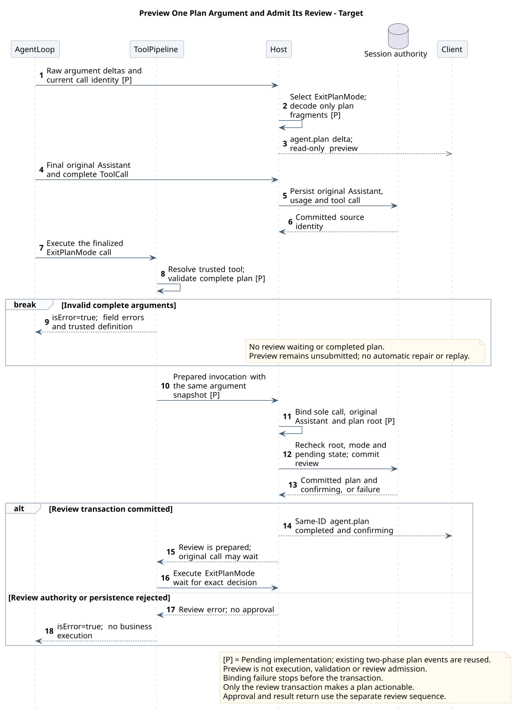

# 计划正文流式生成与审核绑定

版本：1.0.0；日期：2026-09-19。状态：**目标设计，待实现**。既有普通文本流、完整计划审核和批准续跑已实现；本增量不把这些能力重新标为待实现。[主设计](README.md)维护模式与审核事务，[源码证据 §13](source-evidence.md#plan-streaming-evidence)维护最新源码和基线范围。

## 1. 当前流程与等待来源

已观察实现基线为 pi-mono-java 默认 main `fb842b1ac6cb4818f6b146f79dd184a5cd88bf12`。本地旧工作树 `21c3f59be033e7bdd5506a2d9d48baa2581bc3c7` 不作为当前主线声明。

| 阶段 | 当前行为 | 用户能看到什么 |
|---|---|---|
| 调研与澄清 | 普通模型正文、工具调用及问题事件走既有链路 | 正文可以流式；工具/问题按各自契约展示 |
| 模型生成计划 | 模型生成 `ExitPlanMode({plan})` 的参数；此时工具尚未执行 | Mate parser 能产生工具参数增量，但 Runtime 公共投影不消费它；计划正文不可见 |
| 完整响应落盘 | AgentLoop 先发送 MessageEnd；Projector 保存 Assistant 及完整 ToolCall | 普通正文 completed、完整调用事件 |
| 提交审核 | beforeToolCall 校验模式、独占调用和完整 plan；计划与 confirming 同事务保存 | 一次出现完整 agent.plan；本段 SSE 关闭，Session 仍 running/plan |
| 等待决定 | ExitPlanMode.execute 经 PlanReviewPort 等待 | 审核卡；尚无成功工具结果 |
| 批准或修订 | 接受决定并创建续跑段；批准才原子切 build；原执行领取后返回工具结果 | 批准后实施，或保持 plan 生成新方案 |

计划由模型生成，退出工具不生成正文。当前首屏等待包含整份参数生成时间；没有生产计时证据，不能据此认定数据库、模型或网关各占多少耗时。

## 2. 目标：同一响应内先生成正文，再提交审核

Main Agent 在一条 Assistant 响应中先输出完整 Markdown 计划正文，再调用唯一的 `ExitPlanMode({})`。这两个逻辑阶段可以属于同一次模型请求，不要求模型先结束一条无工具消息、再额外发起一轮“退出计划”的请求。工具只有提交审核和等待决定的职责；用户批准后 Runtime 才退出 Plan。

正文复用已有 `agent.message(phase=delta/completed)`。生成期间按普通 Assistant Markdown 流展示，不提前承诺它是可审核计划；同一响应的空参数退出调用完整后，后端精确绑定这条已提交消息，产生完整 `agent.plan`。客户端按新增的 `sourceMessageEventId` 把该消息与计划卡合并，在原位置保留一份正文。

不引入计划标记解析器、`agent.plan` delta、新 HTTP 路径、独立计划文件或 `/plans` 资源。普通回答即使包含标题“计划”，也不会因文字内容变成审核目标。

### 2.1 模型输出与工具契约

| 项目 | 规则 |
|---|---|
| 正文 | 同一响应中所有 TextContent 按原顺序直接拼接，与现有 agent.message.content 投影相同；不添加换行、不 trim、不重写 Markdown；首个非空行以 `# ` 开始 |
| 顺序 | 正文在 ExitPlanMode ToolCall 之前；可有 Thinking，但其内容不进入方案；ToolCall 后不允许再有非空正文 |
| 调用 | `ExitPlanMode({})`；Schema 为空对象且 additionalProperties=false；同一 Assistant 仅此一个 ToolCall |
| 绑定 | 由 Runtime 的当前 Assistant/调用上下文决定，不接收模型提供的 eventId、正文或版本；不回看“最近一条答案” |
| 返回 | 仍是完整 approved/feedback 结果；不回传或再次生成整份计划；失败不批准 |
| 缺正文或缺调用 | 空正文加退出调用返回 PLAN_REVIEW_UNAVAILABLE；仅正文无调用保持普通回答，按既有 Loop 自然结束，不自动补工具、不自动进入等待 |
| 错误或截断 | ERROR、ABORTED、LENGTH、正文超限、混合工具、非空参数或正文顺序不合法均不得创建审核等待；参数违反 Schema 用 TOOL_ARGUMENTS_INVALID，其余审核准入失败用 PLAN_REVIEW_UNAVAILABLE；帧容量超限沿用 EVENT_PAYLOAD_TOO_LARGE |

“同一响应”是服务端 BeforeToolCallContext.assistantMessage 的对象归属，不是客户端相邻事件或同一个用户根消息。事实查询、澄清与先前轮次的正文不能成为这次无正文退出调用的隐式兜底。

完整正文的逻辑上限保持 262144 UTF-16 单元，同时服从既有 Assistant/计划帧容量。长度预算用于保护边界，不鼓励模型写满。PLAN.md 与固定工具 description 同步说明正文只生成一次、按任务复杂度控制篇幅；业务覆盖文件必须同步升级并验收。

### 2.2 目标顺序

[原尺寸 SVG](plan_streaming_sequence.svg) · [PlantUML 源码：plan_streaming_sequence](diagram.puml#L815)

1. 模型生成正文，Provider TextDelta → Agent MessageUpdate → Runtime agent.message delta → UI；普通思考不改变审核状态。
2. 模型在同一响应末尾生成空参数退出调用。模型响应完整后，先保存 Assistant Entry 及 completed 消息，再保存完整 tool_call。
3. 从已提交 completed 消息与该 Assistant 的唯一退出调用建立不可变 PlanProposalSnapshotDTO，固定正文、消息 eventId、调用身份与原根/固定执行目标。
4. 审核事务验证快照引用、同 Session/根/分支、当前执行/段、未停止、mode=plan 和无其他交互；保存 plan、待审指针及 confirming。预览曾成功、消息曾保存都不能替代事务准入。
5. 推送完整 plan 与 confirming，关闭本段 SSE；前端关联原消息并开放审核。工具等待决定，mode 仍为 plan。
6. approve/revise 沿用现有接受、领取与原执行续跑。修订重新生成完整正文、新消息 eventId、新计划 eventId；不能批准旧目标。

## 3. 权威对象与内部职责

复用[完整目标类图](README.md#3-推荐全局目标类图)。新增职责只补到原链路，不要求先完成历史推荐 Adapter 的全部提取。

| 对象 / 接入点 | 生命周期与职责 |
|---|---|
| RuntimeEventProjector | 每执行；保留普通文本流。persistAssistant 提交成功后保留当前响应的消息身份和不可变投影，不再依赖提交后被清空的 assistantEntryId |
| PlanProposalBinder（待实现） | 无状态；从当前完整 Assistant、已提交消息投影与唯一调用构建 PlanProposalSnapshotDTO；复用一个文本提取函数，不让消息与审核各自解析正文 |
| PlanProposalSnapshotDTO（待实现） | 每次模型响应至审核收尾；不可变字段包含固定执行目标、assistantEntryId（内部）、sourceMessageEventId、sourceEventId、toolCallId、content；前端不接触内部 Entry/Execution ID |
| PlanReviewPort / RuntimePendingInteraction | 提交路径携带共享快照；工具等待改为 await(toolCallId, cancellation)，以待交互中的原调用身份读取审核决定，不再接受第二份正文 |
| 持久化服务 / Repository | 同事务重新检查可变权威状态；验证消息已提交、属于当前 Assistant/分支、正文与快照一致，再建立审核；沿用 DTO/Mapper 和既有锁序 |
| RuntimeEventFactory / 编解码器 | agent.plan 保存完整正文及 sourceMessageEventId；GET 读取保存值，不重解析模型历史或临时缓冲 |
| Client event store / PlanCard | 以 Session + 原根 + sourceMessageEventId 关联；completed 覆盖 delta，plan 替换展示载体。保留原事件供诊断、恢复和 usage 统计，不重复计费 |

快照是事实来源的一致封装，不是第二份可变方案。新 MessageStart 必须清除上一响应候选；取消、错误、终态和清理必须释放快照。不同响应即使重复 toolCallId，也必须受固定 Assistant/段归属校验，不能复用旧内容。

模型上下文保存原 Assistant 正文和空参数 ToolCall，随后是配对 ToolResult。agent.plan 不额外注入一次；批准后的首次模型请求必须仍包含原计划正文及调用/结果，压缩策略需保护该配对与正文直到此次请求组装完成。若无法保留，不得用摘要替代已批准方案而宣称等价；实施验收必须覆盖溢出压缩与修订。活动执行快照及原内存凭据不增加进程崩溃自动接管能力。

## 4. 公共事件与页面恢复

精确字段及正常/修订示例只维护于[共享事件源](../01-CampusClaw多Agent运行时/事件契约/common.json)与其 POST/GET 操作，不在本页复制报文。

| 事实 | 身份与用途 |
|---|---|
| 用户原始请求 | sourceEventId，始终指原 user.message，不因计划或审核续跑改变 |
| 生成计划的 Assistant 消息 | sourceMessageEventId，指该响应已保存的 agent.message completed；delta 与 completed 使用同一消息 eventId |
| 待审核方案 | agent.plan.eventId；user.plan_confirmation.targetEventId 只引用它，不批准 Assistant 消息 ID |
| 退出调用 | toolCallId；关联工具执行和结果，不替代审核身份 |

agent.plan 仍是无 phase 的完整待审记录，content 精确等于引用消息的完整正文。新格式 sourceMessageEventId 必填；为读取既有存量，公共解码允许省略该字段并按旧完整卡片展示。新写入不得以“兼容旧格式”为由省略；字段出现时禁止 null/空白，类型和 128 UTF-16 单元上限遵守公共 eventId。旧记录不追溯猜测或补造引用。

只有收到完整 plan 和对应 confirming 并核对当前执行状态，才开放审核。正文 completed 只证明消息已保存，不证明审核事务已成功。事务失败时已保存正文保持普通回答，显示相应工具失败/真实终态；不能从文字自造待审卡。

计划消息与 plan 可能跨历史分页：有完整 plan 但来源消息尚未读取时可只读显示它的 content，缺页时禁审；补齐后按引用合并。引用缺失、跨根、正文不一致或重复竞争的关联视为协议错误，保持只读并对账，不能悄悄选最后一个。既有无引用历史卡仍沿旧恢复规则展示。

预览不入历史、不逐 token 持久化。沿用有界缓冲：一条消息丢弃部分 preview 后停止该消息后续 delta，等待完整消息覆盖；完整事件不能投递时断开观察，执行继续。刷新或断线只读历史及 Session，不重放 POST；没有承诺续接丢失 delta。跨实例控制响应仍可能只得到已提交完整事件，预览是 best-effort，不保证每次续跑均可实时观察。

前端不新增“计划生成百分比”；生成时显示正文原有流式状态，转换为审核卡后保持同一位置、滚动与复制内容，不闪现双份正文。不自动滚走用户正在阅读的位置，状态播报只报告已就绪，不逐 token 播报。原型尚未实现该增量，不能据旧原型声称通过。

Mate 公共桥接待实现。它必须分别映射根消息、来源 Assistant 消息、计划及工具身份；sourceMessageEventId 投影成公共消息 eventId，不暴露内部 ID。仅在公共解码、历史和确认目标映射同时升级后开放入口，本设计不擅自改写 Mate 尚未整合的精确联合模型。

## 5. 取舍、兼容与性能验证

| 方案 | 评价 |
|---|---|
| 普通正文流 + 同响应空参数退出调用（采用） | 复用现有文本 SSE，无新解析语法或额外模型轮次；需要同响应正文绑定与客户端合并，模型/Provider 必须能输出文本后接工具调用 |
| 保留 plan 参数并预览其 JSON 字符串 | 迁移较小，但继续把大正文放在工具参数；还需增量 JSON 字符串解析、转义处理及专用预览投影，上游参数缓冲可能延后首片段 |
| 独立正文响应完成后，再开一轮退出调用 | 需要额外继续触发和跨响应引用，增加一次模型往返；不把既有无工具响应自然结束语义改成自动续跑 |
| Codex 风格 proposed_plan 标签 | 能提前识别专用计划展示，但需跨 chunk 标记解析和最终重解析；首版不为卡片样式新增 DSL，参考其正文与工具结果分离而不复制协议 |

正文与审核分离是架构变更；完整批准、单交互和原根续跑是产品约束；固定来源绑定及锁内复核是安全与一致性保障。无新增 Maven/npm 直接依赖，复用 JDK、Jackson、现有 Spring/MyBatis/Bean Validation、Vue 与 Markdown 渲染。

升级涉及 ExitPlanMode Schema 的不兼容变更。先停止新 Plan 接受并排空/中断旧活动执行，再一致发布工具、默认/业务 PLAN/BUILD、Runtime 编解码及前端；不在活动执行中途切换 Schema。旧数据可读，不重写历史。禁止同时宣称新空参数和旧 plan 参数都是当前模型契约；若业务覆盖未迁移或 Provider 无法稳定生成“正文 + 工具”，入口暂不启用新能力，不能静默从历史寻找替代正文。

记录模型请求开始、首个 TextDelta、模型响应结束、Assistant 提交完成、plan 事务完成、浏览器首字与审核可用时刻。比较相同任务/模型/上下文下的首字时间及可审核总时间；流式改善可见等待，不保证推理或整体任务耗时降低。先测再判断模型/网关缓冲、长上下文、持久化与渲染瓶颈，不记录正文、推理和凭据为计时日志。

## 6. 实施切片与验收

| 切片 | 范围 | 必须验证 |
|---|---|---|
| PS1 | 工具 {} Schema、PLAN/BUILD 与业务覆盖迁移 | 同一响应先正文后唯一退出调用；正文只生成一次；无工具纯解释正常结束；缺正文/混合调用/旧参数不进入审核；Build/Subagent 准入保持 |
| PS2 | Binder、不可变 DTO、Projector 与共享正文投影 | 多 TextContent 原序拼接；不包含 Thinking；消息提交后才建候选；不同响应/root/Session/重试隔离；空白/长度/截断/调用后正文均失败 |
| PS3 | 计划持久化与公共编解码 | completed → tool_call → plan → confirming 顺序；计划正文和 sourceMessageEventId 一致；事务失败/停止竞争无可审记录；新写必有引用、旧读兼容；源正文与工具配对保留到批准后的首次模型调用 |
| PS4 | 前端流式阅读、来源合并和恢复 | 首字可见、完整覆盖、只展示一次、usage 一次计数；丢 delta/缺页/迟到历史/重复帧/409/EOF 均不误审；修订新身份；390 px 和文档缩放可读，键盘焦点及滚动保持 |
| PS5 | Provider/Mate 与性能 | 实际模型能在同响应输出正文与调用；网关及时透传文本；跨实例仅完整事件也正确；公共四类身份映射不泄露；记录首字/可审核耗时，无未经实测的百分比收益 |

设计与契约校验只能证明文档和样例一致。Java/数据库/浏览器/真实模型与延迟验收均待实施，不以本设计通过校验代替产品测试。
