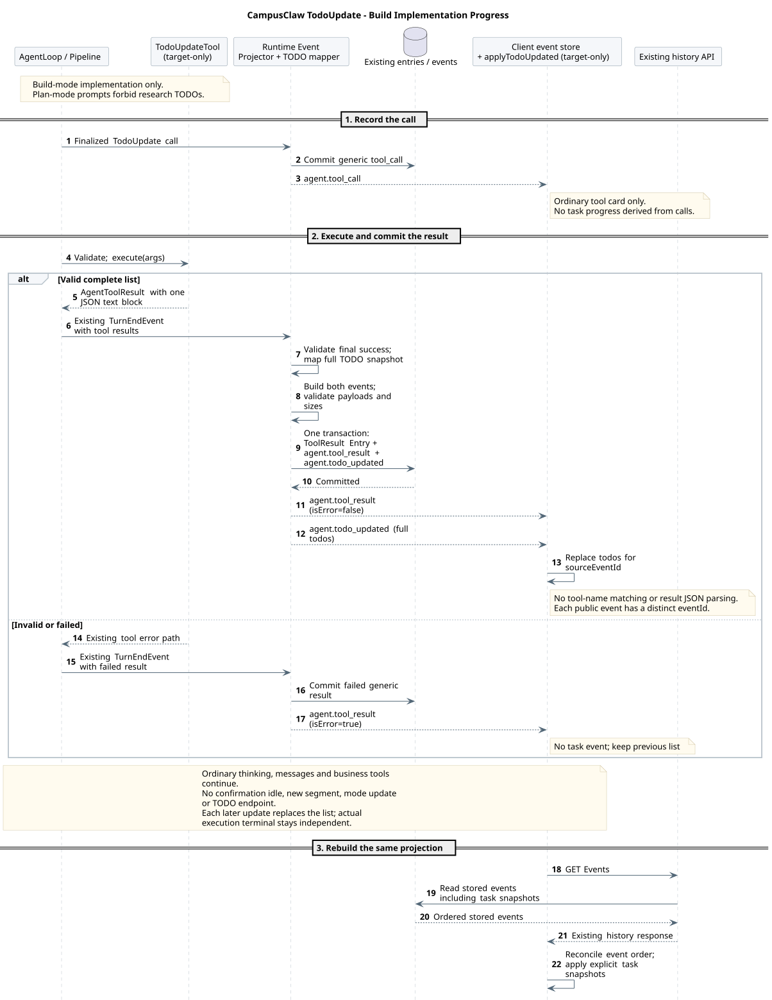

# TodoUpdate：通过通用工具事件维护任务进度

版本：1.1.0；日期：2026-09-14。状态：已确认设计方向，target-only；固定 Java 基线尚无 TodoUpdate 工具与进度投影。

本专题属于 M03/M06/M07，整体结构复用[计划模式全局目标类图](README.md#3-推荐全局目标类图)。本文件唯一维护 TodoUpdate 的目标工具契约、进度生命周期和验收；现有八项工具保持原契约，正式登记工具枚举与 profile 时同步[内置工具契约](../02-CampusClaw工具系统/built-in-tool-contracts.md)。公共事件外层继续以[共享事件源](../01-CampusClaw多Agent运行时/事件契约/common.json)为准。

## 1. 目标与基线选择

模型在 build 实施阶段通过 `TodoUpdate` 提交完整执行清单。plan 阶段不调用它，也不记录调研进度。Runtime 执行工具，沿用 `agent.tool_call` 和 `agent.tool_result` 传递调用与结果；客户端从成功的完整结果生成进度视图。TODO 不增加公共事件类型、Session 字段、元数据字段、HTTP endpoint 或数据库表。

公共交互参考 Claude Managed Agents 的通用工具事件与历史对账风格；完整列表替换和三种步骤状态参考 DeepSeek Harness。Claude 没有公开内置 TodoUpdate 工具或 TODO 专用事件，这里的工具名称、参数和作用域由 CampusClaw 定义。基线、核对日期及源码符号见[源码证据 §6](source-evidence.md#6-todo-update-基线与接入证据)。

| 边界 | 当前目标与理由 |
|---|---|
| 方案与进度 | `agent.plan` 固定完整待审核方案；TodoUpdate 记录任务清单。进度更新不修改已批准正文，不批准方案、不更新 mode。 |
| 工具执行方 | Runtime 内置工具直接执行；不要求浏览器回传工具结果。相对 Claude 的 client custom tool，这是复用现有受管工具执行链的架构选择。 |
| 公开事件 | 工具名与成功结果决定展示类型；不增加 `agent.todo_updated` 或 `planType`。代价是客户端需关联调用和结果，并识别工具的 JSON 内容。 |
| 进度作用域 | `(sessionId, sourceEventId)` 对应一次原始用户消息的根执行；审核续跑段仍属于同一清单。新普通消息开始新的清单，历史清单留在原执行。属于产品约束。 |
| 首版入口 | Runtime 根执行；默认追加 TodoUpdate，Child/Cron profile 保持原值。父 Agent 可将 Child 工作列为一个任务，子调用不能直接修改父清单。 |
| 运行方式 | 工具定义在 plan/build 中保持一致；固定 description 与模式提示词规定仅 build 阶段调用，plan 中不记录调研进度。沿用 DeepSeek 标准预设的阶段边界，不新增元数据或模式工具过滤。 |
| 权威 | 成功 ToolResult 的持久化记录是任务清单快照；UI 缓存和模型摘要不是恢复权威。没有独立 TODO Repository 或第二次状态提交。 |

## 2. 模型工具契约

| 项目 | 定义 |
|---|---|
| 名称 | `TodoUpdate`，遵循现有区分大小写的 PascalCase；不提供别名 |
| 执行模式 | `SEQUENTIAL`，沿用现有串行 barrier；按批次原始调用顺序产生结果，不并行更新同一清单 |
| 暴露 | Runtime 缺省 profile 在 ExitPlanMode 后追加；显式 profile 仍完全替换默认值。缺少 TodoUpdate 只关闭进度能力，不影响计划审核准入 |
| 输入 | 必填 `todos` 数组；每项只有 `content` 和 `status`；每次提交整个列表 |
| 状态 | `pending`、`in_progress`、`completed`；首版最多一项 in_progress，与串行工作流一致 |
| 成功 | `isError=false`；恰好一个 text 块，其 text 是完整 JSON 对象 `{"todos":[...]}`；不混入自然语言或 Markdown 围栏 |
| 失败 | 沿用既有工具参数错误与执行失败映射；`isError=true` 不更新清单，不增加 TODO 专用公共错误码 |

固定 description：

```text
Track implementation progress in build mode; do not call this tool during plan-mode research or proposal design. Before multi-step implementation, submit the complete task list and mark the first active task in_progress. Mark each task completed immediately after its work and required verification finish; do not batch independent completions. The same call may complete the previous task and start the next one. Send the entire list every time, retaining completed tasks that should remain visible; use pending, in_progress, or completed with at most one task in_progress. Skip trivial work. This tool reports progress only and does not execute tasks, approve proposals, or change session mode.
```

仅 build 根执行注入完整的实施进度指令，逐项更新、失败与收尾规则见[提示词 §6](plan-policy.md#6-execution_todos实施进度)。plan 中不注入该段，PLAN_COMMON 和固定 description 都明确不调用。此处是模型行为约束，工具层的值校验不负责判断业务任务是否真正完成，也不新增模式拦截。

参数 Schema：

```json
{
  "type": "object",
  "properties": {
    "todos": {
      "type": "array",
      "maxItems": 100,
      "items": {
        "type": "object",
        "properties": {
          "content": {"type": "string", "minLength": 1, "maxLength": 1024},
          "status": {"type": "string", "enum": ["pending", "in_progress", "completed"]}
        },
        "required": ["content", "status"],
        "additionalProperties": false
      }
    }
  },
  "required": ["todos"],
  "additionalProperties": false
}
```

工具层逐项校验并创建独立快照：content 使用 Java `String.strip()` 去除首尾空白后非空，最多 1024 个 UTF-16 单元，规范化后内容不得重复；最多一个 in_progress。Schema 的 maxLength 按 JSON Schema 字符定义校验，工具层另外执行 UTF-16 上限，返回正文取规范化后的值。100 项上限用于限制每轮上下文和完整事件体积，仍须通过既有 SSE 编码字节检查，不能截断清单后当作成功。所有规则一次校验，任一项失败则整次失败。

空数组是明确清空当前清单；省略 todos、null、未知字段或状态均失败。整份替换使新建、调整、完成、清空共用一个工具，不增加 action、条目 ID、优先级、版本或百分比。列表顺序就是展示顺序，完成比例由客户端从列表计算；没有清单或空列表不显示为“100% 完成”。

## 3. 事件与执行顺序



[原尺寸 SVG](todo_update_sequence.svg) · [PlantUML 源码：`todo_update_sequence`](diagram.puml#L321)

1. 模型在 build 实施阶段生成 TodoUpdate ToolCall；既有 Projector 保存并发布完整 `agent.tool_call`，`arguments` 包含完整输入列表，`requiresConfirmation=false`。
2. Pipeline 完成 Schema 校验，再运行 TodoUpdateTool 的值校验；工具返回规范化后的完整列表，不直接写 DB、改 Session 或发布公共事件。
3. 沿用现有 `TurnEndEvent → RuntimeEventProjector.persistToolResults`：先检查编码大小，再将 ToolResult Entry 与公共 `agent.tool_result` 一起提交，提交后发送该事件。
4. 客户端收到匹配的成功完整结果，才替换进度视图。消息、Thinking 和业务工具仍按原有事件正常输出；当前工具批次未完成时，进度结果可能尚未公开提交。
5. 模型继续实施，在步骤开始前、完成并验证后立即更新，或在授权范围内分解调整时再次调用工具。调用完成不自动等于业务任务完成，模型负责基于工作结果报告步骤状态。

TodoUpdate 不等待用户审核，不生成 confirming idle，不关闭当前 SSE，也不创建续跑段。框架仍可依据既有取消、错误和终态规则结束执行；任务列表全部 completed 不能代替最终答案或 Runtime 真实终态。

以下是复用现有外层结构的目标工具示例，不是新增 event Schema：

```json
{
  "eventId": "evt-call-todo-01",
  "type": "agent.tool_call",
  "createdAt": "2026-09-14T06:00:00.000Z",
  "sourceEventId": "evt-msg-01",
  "toolCallId": "call_todo_01",
  "toolName": "TodoUpdate",
  "arguments": {
    "todos": [
      {"content": "查询告警与影响范围", "status": "completed"},
      {"content": "核对设备配置", "status": "in_progress"},
      {"content": "汇总定位结果", "status": "pending"}
    ]
  },
  "requiresConfirmation": false
}
```

```json
{
  "eventId": "evt-result-todo-01",
  "type": "agent.tool_result",
  "createdAt": "2026-09-14T06:00:00.100Z",
  "sourceEventId": "evt-msg-01",
  "toolCallId": "call_todo_01",
  "content": [
    {"type": "text", "text": "{\"todos\":[{\"content\":\"查询告警与影响范围\",\"status\":\"completed\"},{\"content\":\"核对设备配置\",\"status\":\"in_progress\"},{\"content\":\"汇总定位结果\",\"status\":\"pending\"}]}"}
  ],
  "isError": false
}
```

成功结果不增加 phase、toolName、todos、details 或 structuredContent 等公共字段；JSON 是既有 content 中 text 的工具级内容。`toolName` 来自关联的调用，不能从结果文本或用户消息猜测。

## 4. 客户端投影与恢复

新增纯客户端函数 `deriveTodos(events, rootEventId)`，消费统一事件仓库，不直接发请求、不修改 Session。实时和历史使用同一投影，规则如下：

1. 先按已有 eventId 去重、历史顺序和 live 尾部对账规则合并；不按 createdAt 排序，不解析 eventId。
2. 在同一 Session、根 sourceEventId 内，用 toolCallId 匹配调用和结果。只识别精确 `toolName=TodoUpdate`。
3. 仅当 `isError=false`、结果满足本工具 JSON 契约，才把完整 todos 替换为新快照。调用参数只能显示“正在更新”，不能成为已提交进度。
4. 失败结果保留上一个成功快照。缺少关联调用、分页不完整或成功结果格式不符合约定时，保留已知列表并标记待对账，不能把未知状态当作空列表或已完成；缺少能力的旧客户端仍可显示通用工具卡。
5. 当前根执行没有成功结果时不显示任务清单；新 `user.message` 切换到新根的清单。confirming 或计划审核续跑不清空；真实结束后保留最后列表并单独显示执行结果，失败/中断不伪造所有任务 completed。
6. SSE 断开后分页 GET Events 补齐调用和结果，重建相同列表。已保存结果可恢复，只有调用而没有结果时不能推断成功，不重新 POST 消息或 TODO 更新。

前端可以折叠 TodoUpdate 工具卡为任务面板，但保留原始调用和结果的查看入口。条目内容按纯文本展示；出现同名文本并不建立跨执行的任务身份。任务进度是 Agent 报告的工作记录，不是工作流调度或业务验收证明。

模型继续沿用普通 ToolCall/ToolResult 上下文与压缩机制；压缩不删除公共历史，客户端不从摘要重建进度。下一次普通消息如需继续旧工作，由 Agent 重新提交完整清单，不隐式拼接上一根执行的列表。

## 5. 接入结构与权威提交

全局目标类图中的 TodoUpdateTool 实现既有 AgentTool，由既有 Session 工厂/工具装配器按 profile 创建；不新增 Controller、TodoService 或 TodoRepository。工具只依赖现有 JSON 编解码、参数校验和取消域，不读取 Servlet、Session 公共 VO 或 Mapper，也不持有可变的当前列表。

`AgentToolResult.content` 是模型和公共工具结果共用的内容来源；不依赖未公开的 details。Projector 复用通用 ToolResult 路径；成功快照的保存就是状态提交，无需先更新内存 TODO 再另写事件，避免两份状态提交不一致。持久化失败走既有可靠收尾，不向客户端发布成功进度。事件与 Entry 使用原根执行、原段、原清理与保留规则，不推进 Session ETag。

Mate 继续投影通用工具调用和结果，复用现有两跳 ID 关联，企业浏览器按公共调用身份识别 TodoUpdate；不暴露内部 Session ID，不增加 user.custom_tool_result 输入或浏览器执行工具的职责。该产品桥接仍需按 Mate 主契约与实际源码独立验收，不能因 Runtime 设计完成宣称两跳已实现。

不新增 Maven 依赖；复用 JDK、现有 Jackson、JSON Schema 校验和工具 Pipeline。新增 Java 内部数据对象使用 DTO，Web VO 和元数据结构不增加字段。

## 6. 实施切片与验收

| 切片 | 实施内容 | 验收 |
|---|---|---|
| T1 | TodoUpdateTool、枚举/工厂和 Runtime 默认 profile | plan/build 工具定义相同；固定描述要求仅 build 实施时调用；显式配置不被自动补齐；无额外字段、空白/重复项/非法状态/多 in_progress 整次失败；空列表清空；返回值是独立的完整快照 |
| T2 | 复用通用 ToolResult 的持久化、编码与发出路径 | 调用和结果按原顺序关联；成功提交前不发布进度；失败与超限不改变列表；批次内多次更新串行；不增加事件类型、Session 列或 TODO 表 |
| T3 | deriveTodos 与任务面板 | 实时与分页恢复结果一致；缺调用、失败、重复帧、错误 JSON、另一根执行、空列表、断线和终态分别验证；不靠工具调用或普通文本判定完成 |
| T4 | 模型与 Mate 场景验收 | plan 调研与修订不调用 TODO；批准后先创建实施清单；多工具完成一个任务并验证后立即更新；下一任务开始时更新；进度与正常输出交错；批准方案不被 TODO 覆盖；两跳关联不串根、不泄露内部身份 |

先实现 T1/T2 的完整成功工具结果，再增加客户端投影；无需等待计划审核存储才能单独验证 build 模式 TODO 闭环。设计检查不代替尚不存在的产品测试。
