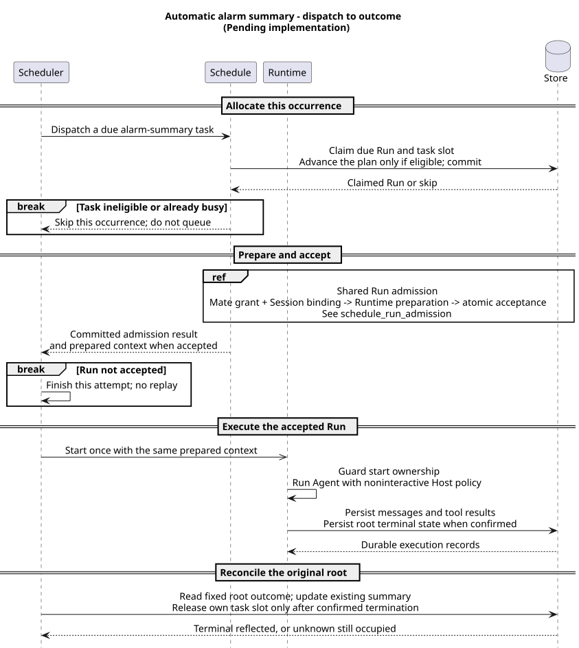
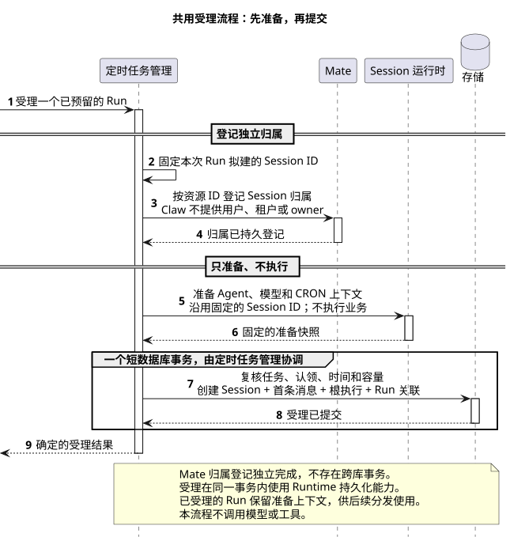
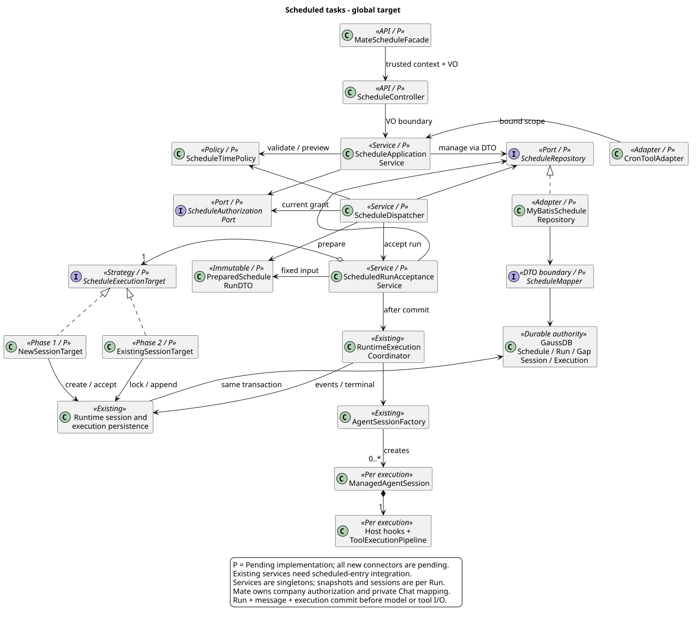

# CampusClaw 定时任务设计

[模块索引](../../README.md#module-index) · [接口 HTML 展示](schedule-api-review.html) · [架构对比 A14](../07-Agent架构对比/README.md#a14) · [源码与官方证据](source-evidence.md)

| 属性 | 值 |
|---|---|
| 文档版本 | 0.31.1 |
| 更新日期 | 2026-10-09 |
| 模块 | M10 · 调度与并发治理 |
| 产品范围 | 每次自动或手动触发均创建新的独立 Session，复用配置绑定的 Agent 定义；不选择或追加已有 Session |
| 设计状态 | Claw配置、生命周期与Run读取接口已收口为目标，待实现；执行采用不补漏跑、遇忙跳过、失败与故障不重跑、非交互任务范围；删除不取消已受理执行。Mate接口及工程接线见专项；是否自动暂停整个Schedule仍待明确 |
| 已观察实现 | Java main `553dcd5e2ff682f9684810a043b442b37a02e54a` 已有进程内 Cron、JSON Job/JSONL Run 和公共 Session 工厂；不等于已具备企业调度能力 |
| 主基线 | Claude Managed Agents Scheduled deployments，2026-10-04 重核名称、Cron、执行目标、Deployment 读取契约及资源类型/暂停原因、部分更新及删除差异；2026-10-05 重核run/pause/unpause、Run模型及列表/详情；2026-10-08 仅重核公开操作目录与计划时间摘要，Beta；仅引用公开契约，无服务端源码 commit |

页面行为与原型见[M07 场景09](../../07-前端设计/场景/09-配置与管理定时任务/README.md)：Manual映射schedule:null，Schedule映射完整Cron；触发方式、active/paused和单次Run结果分别展示，保存后读取权威计划时间。2026-10-08重核Claude Console与官方Beta文档的范围见[专项证据](source-evidence.md#schedule-console-evidence)，不新增前端专用后端字段或独立预览。

## 1. 要解决什么问题

接口规则由[Claw 配置专题](configuration.md)维护；运行策略、物理模块合并、持久化边界和上线初始值由[执行专题](execution.md)维护。Mate负责可信接口定义、执行资格和凭据解析，新增内部契约见[Mate执行上下文草案](../../02-服务与接口/02-CampusMate共享客户端配置/scheduled-execution.md)。本文保留整体职责、主流程与全局目标类图。所有新增能力均待实现，不把旧进程内Cron当成新接口已交付。

[接口 HTML 展示](schedule-api-review.html)从上述 Claw 契约生成，复用 Runtime 接口页的共享渲染器、样式和按操作展开交互，展示 10 个 Claw 操作的调用上下文、参数、请求示例、规则与响应状态/语言标签；实现状态与证据日期按各自核验范围记录。Markdown 继续作为维护源，HTML 可离线阅读，不发起业务调用。生成与同步检查见[展示页维护](#html-maintenance)。

园区运营人员配置“每天 08:00 汇总设备告警、检查未关闭工单”，保存后由服务端按时发起 Agent 工作，无需浏览器保持打开。用户能看见下一次计划时间、每次是否成功启动、执行结果和失败原因，并能暂停后续运行。

正常情况下，调度器发现到期任务，持久化一条触发记录，核对 Agent 与执行资格，再把该记录与一次新 Session 的首条消息原子关联。事务提交后才运行模型与工具；运行内容进入既有 Session 历史，任务页链接到本次结果。

失败时先区分发生在哪一层：规则无效则不保存；未受理且配置仍存续则记录原因；受理后执行失败则保留原 Session 和根执行；结果未知则对账，不重新发起业务写入。暂停只阻止未来自动受理，停止已运行任务使用既有定向取消机制。

每次运行使用同一任务绑定的 Agent 定义，新建的是承载这次执行的 Session 和运行实例，不创建新的 Agent 定义资源。不同运行不自动继承聊天历史；需要昨日告警结论时，任务应明确查询业务记录。该范围对齐 Claude Deployment，代价是不能把定时消息追加到已有会话中。

## 2. 职责、边界与基线取舍

以“每天 08:00 检查园区隐私安全”为例：用户保存检查内容与计划，定时模块在到期时安排一次运行，Mate 核验执行资格，Runtime 在新的独立会话中推进检查。用户通过运行记录找到会话，再查看风险报告和工具证据。以下描述当前目标职责；数据库调度、后台受理和 Mate 接线仍待实现，已有 Cron 与 Runtime 的可复用范围见[源码证据](source-evidence.md#java-evidence)。

### 2.1 谁负责什么

| 职责归属 | 负责的工作 | 与其他职责的交接 |
|---|---|---|
| 定时任务模块（M10） | 管理配置和时间规则，领取到期任务，协调运行准备与受理，维护同任务占用并对账运行结果 | 管理页面与 `Cron` 模型工具委托同一应用服务；自动与手动运行共用准备和受理规则，受理提交后再交给 Runtime 推进 |
| Runtime 与会话能力（M01/M04/M06） | 准备本次智能体执行上下文，提供容量准入、Session/首消息/根执行持久化，推进模型和工具，保存事件与真实终态，处理停止请求 | M10 协调同库受理事务，将 Run 与新 Session、首消息、根执行一起关联；Runtime 提供既有存储与执行能力，根执行终态用于后续对账 |
| 工具系统（M03） | 解析可信工具目标，校验参数，执行权限判断并协调业务调用及结果回传 | 定时执行复用既有工具链；任务执行资格通过后，每次工具调用仍须经过自身校验与权限判断 |
| Mate | 确认公司身份、租户和管理/执行授权，提供可信接口定义、凭据引用资格及执行时凭据；维护公共安全投影 | 保存与准备阶段提供非秘密定义和授权依据；工具通过校验与权限判断后，执行适配器才按可信目标解析凭据 |
| 前端（M07） | 编辑任务配置，展示保存结果、计划时间和运行记录，提供会话结果入口及管理操作 | 读取后端权威资源；浏览器关闭不影响后台调度，页面不承担计时、业务执行或授权判定 |

M10 是职责边界，定时能力按[模块合并方案](execution.md#module-merge)并入既有 coding-agent，不因此新增独立服务进程。图中的职责角色与具体实现映射见[§5.1](#sequence-roles)。

### 2.2 哪份记录回答哪个问题

| 权威对象 | 回答的问题 | 保存的内容与边界 |
|---|---|---|
| Schedule（任务配置） | “要做什么、由谁做、何时触发？” | 长期保存智能体绑定、任务内容、可选 Cron、凭据引用和当前配置状态；保存配置不创建会话、不执行模型 |
| Run（单次运行记录） | “这一次触发是否被受理，关联哪个会话？” | 记录本次触发来源、受理结果和 Session 关联；成功建立会话不等于隐私检查已完成或没有风险 |
| Session 与原根执行 | “检查实际做了什么，结果是什么？” | 保存本次消息、工具结果和真实执行终态；业务结论从会话输出与工具证据读取，不在 Run 中复制一份完整对话 |

每次自动或手动运行复用绑定的智能体定义，在受理事务中创建新的独立 Session。新会话不自动继承昨天的聊天历史；检查“过去 24 小时”需要读取业务数据，引用昨天报告也须明确查询保存的业务记录。运行完成后的人工对话不改写原 Run 所关联的根执行结果。具体规则见[§7](#7-每次运行新建-session)。

任务配置状态、一次运行结果和会话停止分别管理。暂停与删除影响后续任务受理，已受理执行按原 Session 生命周期处理；删除的记录范围和停止入口见[§3](#3-使用与管理)及[§9](#9-持久化与生命周期)。管理权限、运行资格和具体工具权限也分别检查，保存成功不构成永久业务授权，详见[§8](#8-身份授权与公共投影)。

定时模块复用既有会话、工具和执行能力；调度器在模型循环之外判断到期时间。首版覆盖文本、无需人工交互的任务，不扩展通用工作流 DAG、智能体历史版本仓库、附件或消息通知渠道；非交互执行与失败恢复规则由[执行专题](execution.md#noninteractive)维护。

### 2.3 为什么采用这些边界

Claude Managed Agents 是公共调度资源模型的主参考，所引公开契约按原核验记录的 Beta 范围理解；其他基线的分层对照由[A14](../07-Agent架构对比/README.md#a14)维护。下表按现有证据归属说明当前取舍，外部事实保留原核验日期，不据此推断托管服务内部实现。

| 设计选择 | 要解决的问题与收益 | 代价或适用限制 | 基线关系与差异分类 |
|---|---|---|---|
| 配置、运行记录、会话分开 | 分别回答长期任务、单次受理和实际执行结果，避免把“启动成功”当作业务完成 | 结果页面需要组合 Schedule、Run 与 Session 读取，并分别遵守其授权和生命周期 | 参考 Claude Deployment / DeploymentRun / Session 的职责划分 |
| 每次受理新建独立会话 | 隔离每次检查的输入、历史与根执行，减少已有会话的忙闲和上下文竞争 | 不支持向指定旧会话追加定时消息，也不自动继承前次聊天 | 采用 Claude Scheduled deployments 的新会话语义；精确执行目标见[§7](#7-每次运行新建-session) |
| 绑定智能体身份，使用同次准备快照 | 复用当前发布目录与公共准备能力，使同次准备和执行使用一致上下文 | 不承诺绑定历史版本，也不承诺每次从 Mate 刷新最新定义 | 产品约束；与 Claude 创建/显式更新 Deployment 时固定版本的方式不同，见[证据](source-evidence.md#creation-response-evidence) |
| 仅 Cron，采用 Spring 六字段和默认上海时区 | 复用既有时间解析能力，满足园区日历任务，减少多种时间类型的起点与更新规则 | 首版不提供绝对单次或任意起点间隔；不能直接接收五字段表达式 | Cron 范围参考 Claude；方言和时区默认值为产品约束，见[时间规则](configuration.md#3-配置字段与时间规则) |
| 管理、执行资格与工具权限分开检查 | 支持撤销和范围变化，避免把创建者浏览器身份当作长期执行授权 | 需要 Mate 权威及企业认证接线；授权不可用时不能受理，保存成功不保证未来调用一直可用 | 公司产品约束与安全加固；公开 workspace 模型不替代企业租户授权，见[§8](#8-身份授权与公共投影) |
| 同任务串行，不补漏跑、不重跑故障执行 | 限制重叠与积压，降低重复业务操作风险；未知结果先对账 | 忙碌或故障时可能漏执行；未知占用需要对账或独立授权的人工处置 | 产品约束与安全加固；不以 Claude 未公开的重叠或接管策略作为保证，见[执行策略](execution.md) |
| 删除 Schedule 及 Run，Session 独立保留 | 让任务退出管理范围，同时保留已形成的对话及业务证据；在途执行仍有独立停止入口 | 任务和 Run 无归档恢复入口；已受理执行的停止需另行操作 | 产品约束；不同于 Claude 的归档资源模型，见[删除证据](source-evidence.md#schedule-deletion-evidence) |
| GaussDB 保存调度权威，同库原子受理 | 使配置状态、Run 与新 Session 的受理关联在一致边界内确定，定时器只负责唤醒扫描 | 首版要求与 Runtime 受理记录使用同一事务资源，多副本竞争及故障边界须实施验证 | CampusClaw 架构变更；Claude 无公开服务端源码，不能推断其数据库、锁或部署拓扑 |

本节解释职责和理由；精确接口归[配置专题](configuration.md)，并发、恢复与部署规则归[执行专题](execution.md)，来源和实现差距归[源码证据](source-evidence.md)。已有源码快照与新增目标分别记录，不能用参考基线或页面原型证明完整调度能力已实现。

## 3. 使用与管理

配置动作、字段与接口以[配置专题](configuration.md)为准。schedule可省略，省略时只保存；有效规则保存后即参与自动调度，无需显式启用。试运行是独立显式操作。输入为一条user.message，首版content仅支持文本，拒绝附件。新建资源为active，type固定schedule，pausedReason为null；非空schedule包含lastRunAt/upcomingRunsAt，metadata和credentialIds可选。创建只校验绑定与保存，不调用模型、Session工厂或旧Cron create；尚未接通运行及身份依赖时不能发布可自动运行的成功承诺。

配置[列表与详情读取](configuration.md#get-schedule-review)返回相同完整资源；分页参考ListEvents的整数page/nextPage。读取按当前可信范围过滤，不换取业务凭据、不启动任务。Agent或凭据失效不妨碍有权限者读取配置并修复，源码差距见[读取证据](source-evidence.md#schedule-read-evidence)。

[部分更新接口](configuration.md#update-schedule-review)沿用创建的七个可写字段，省略保持，按字段清空/替换或 metadata 按键合并，返回相同的完整资源；保存不触发执行，不改变当前暂停状态或原因。服务在事务中锁定最新行，只合并本请求提交的字段并校验完整结果；不同字段的并发修改可以保留，同一字段以后一次成功提交的值为准。现有 Session 更新可参考省略标记和事务重查；其条件更新及全部拒绝 null 的行为属于实现证据，不直接作为 Schedule 目标；[更新证据](source-evidence.md#schedule-update-evidence)维护实现边界。

Schedule 各接口不要求或声明 If-Match、Idempotency-Key，也不返回配套 ETag；不以正文、查询参数中的版本或请求键替代。配置不保存可供原请求回放的响应快照或请求去重记录。响应丢失时先只读核对当前配置或运行记录，超时不证明事务失败；再次创建可能生成另一任务，独立手动运行调用可能产生另一 Run。更新重发会再次基于最新配置应用所提交字段，也可能覆盖期间发生的同字段修改，不能把读取后的再次提交视为原请求回执恢复。

[立即运行](configuration.md#run-schedule-review)已确认采用200 Run受理结果，sessionId/error二选一；已记录的失败不表示HTTP请求失败，也不等待业务完成。[暂停](configuration.md#pause-schedule-review)与[取消暂停](configuration.md#unpause-schedule-review)采用200完整Schedule，同值操作不改时间/游标，恢复前检查资格。任务页面可组合配置、Run与Session读取；配置GET本身不内嵌历史。运行内部状态继续区分“未启动、已受理、执行中、执行结束、需要处理”，不直接作为本次Run回执字段；[Run列表与详情](configuration.md#schedule-run-read-lifecycle)遵守删除Schedule及Run、保留Session的已确认关系，返回同形完整Run；业务执行摘要不并入八字段Run。模型自然结束不等于设施巡检或工单操作业务成功，业务结论来自对应 Session 的输出与工具证据。

| 管理动作 | 有效行为 |
|---|---|
| 创建、修改 | 校验可信 Agent 绑定、时间规则和提示内容，保存成功后返回规范化规则及未来计划时间摘要；保存内部配置代次（不进入公共 JSON）；不在保存时执行模型 |
| 暂停 | 阻止尚未完成受理的自动触发并保存当前暂停原因；已受理 Run 继续；允许有权限的显式手动运行 |
| 恢复 | 重新检查资格，恢复 active 并清空当前暂停原因，计算严格晚于恢复时刻的下一次运行；不补暂停期间任务 |
| 手动运行 | 每次成功建立运行记录的独立调用产生新的 manual Run；使用相同授权、互斥、受理和审计，不移动正常计划游标 |
| 删除 | 删除Schedule及对应全部Run，两类详情404、列表排除；保留Session及其内容，不再受理新运行；不取消已受理执行，Session入口独立停止 |
| 停止一次执行 | 向原Session及其根execution提交取消请求；收到真实终态前保持“停止中”，不能依赖已删除的Schedule/Run授权 |

公开配置状态仅为active/paused。没有计划或没有未来匹配时nextFireAt为空；删除不产生archived/deleted公共状态或恢复入口。删除成功返回200/ResultBean完整Schedule作为一次回执，随后Schedule和Run详情404、列表排除。回执和重复删除规则见[删除契约](configuration.md#delete-schedule-review)。

创建 active 资源不要求额外启用动作；后续暂停/恢复是独立生命周期操作。现有 Cron 工具契约保持原参数面；其适配、delete 与新删除服务的接线及 trigger 回执须在迁移切片中一并对齐，未接线前不宣称新 API 与旧工具已共用存储。写入动作在事务中重新检查最新可变状态；内部 revision 继续供调度准备与受理检查，不参与客户端条件更新。外部绑定与授权检查在事务外准备，锁内校验合并结果和准备结果的适用性，不持有数据库行锁调用远程服务。

HTTP路由、VO、错误及保存规则由[配置专题](configuration.md#2-claw-接口清单)维护，属于待实现目标。立即运行/启停见§4.7～§4.10，Run读取见§4.11。业务执行结果仍从关联Session观察，Run的成功受理不能作为业务完成证明。

## 4. 时间规则

配置的输入、空值、校验与回显以[配置专题 §3](configuration.md#3-配置字段与时间规则)为准。非空 schedule 仅支持 cron，采用 Spring 六字段；timezone 可省略，默认保存并回显 Asia/Shanghai。省略 schedule 只保存配置，显式手动运行仍独立提供；新 HTTP 不接收 at/every/intervalSeconds/startAt。仅 Cron 的能力代价与旧工具边界见[配置专题 §3.2](configuration.md#32-仅-cron-的范围与代价)。

时间响应统一UTC秒级、无小数秒。正常扫描容差和运行配额属于部署配置，不新增Schedule公开字段；不设置补跑窗口或漏跑历史表。

### 4.1. 六字段表达什么

CampusClaw 沿用 Spring 六字段 Cron，顺序为“秒、分、时、日、月、星期”。例如 `0 0 8 * * MON-FRI` 配合 `Asia/Shanghai`，表示周一至周五 08:00:00；它不自动识别法定节假日。完整字段范围、秒位示例和匹配规则由[配置契约](configuration.md#spring-cron-contract)唯一维护。

“支持秒字段”表示能配置计划时间的秒位，不表示普通 Java 应用保证在该秒准时开始，更不表示 Agent 必须在一秒内完成。线程排队、系统负载和 JVM 暂停都可能带来延迟；JDK 调度器明确不提供硬实时启动保证。表达式能力与产品允许的最小执行频率分别确定。[JDK 调度说明](https://docs.oracle.com/en/java/javase/21/docs/api/java.base/java/util/concurrent/ScheduledThreadPoolExecutor.html)

界面可在后续设计中提供日/周时间选择与规则说明，高级表达式应明确标识 Spring 六字段。现有 Cron 工具的可选 timezone 在迁移时必须归一化成明确存储值，具体默认来源随工具契约切片确定，不静默采用运行节点时区。

<a id="spring-scheduling"></a>

### 4.2. 固定任务与用户动态任务如何使用 Spring

园区告警汇总可以有两种配置来源：开发人员预先为系统定义统一任务，或运营人员通过页面持续新增、修改、暂停自己的任务。两者都可以使用 Spring 六字段，区别在于任务如何注册和管理；Spring 的 Cron 解析器、触发器及调度注解均由已有 `spring-context` 提供，无需为六字段另加 Maven 依赖。

| 场景 | 常用方式 | 适用边界 |
|---|---|---|
| 应用预先定义的固定任务 | `@EnableScheduling` + Spring Bean 上的 `@Scheduled` | 适合固定的统计、清理或轮询方法；Cron 可来自配置属性，但普通注解绑定不等于提供用户任务的运行期增删改 |
| 用户运行期创建、修改、取消任务 | 编程式 `TaskScheduler` + `CronTrigger` | 服务读取已保存配置，动态注册任务，保存本地句柄用于取消或重建；`ThreadPoolTaskScheduler` 底层使用 JDK 调度线程池 |
| 不依赖 Spring 的延迟或周期任务 | JDK `ScheduledExecutorService` | 支持延迟一次、固定频率和固定延迟，不直接解析 Cron；日历表达式需由其他组件计算 |
| 只校验规则或计算未来时刻 | Spring `CronExpression.parse(...).next(...)` | 只负责计算，不注册线程、不持久化配置，也不调用业务方法 |

固定任务示例：配置类开启 `@EnableScheduling`，在 Spring 管理的 Bean 中定义以下方法。这里的 `alarmService` 是业务服务示意，不是 CampusClaw 新增接口。

```java
@Scheduled(cron = "0 0 8 * * MON-FRI", zone = "Asia/Shanghai")
public void summarizeAlarms() {
    alarmService.summarizeLast24Hours();
}
```

固定间隔也可通过注解表达：`fixedRate = 10000` 以每 10 秒一次为目标频率；`fixedDelay = 10000` 则在上一次方法完成后再等 10 秒。若方法耗时 3 秒，后者两次开始约隔 13 秒。固定频率不保证任务在过载时仍能准点执行，也不能由此推断同一任务会自动并发。[Spring 调度文档](https://docs.spring.io/spring-framework/reference/integration/scheduling.html)

动态任务的正常流程是“保存并校验配置 → 调度服务读取规则 → 注册或重新计算下一次时间 → 到期执行业务入口”；修改或暂停时调整对应注册或调度游标。规则不合法应在保存时返回字段错误；服务重启后需要从持久化配置恢复，取消本地定时句柄不能代替任务状态、运行记录或停止在途执行。

### 4.3. CampusClaw 当前实现与目标边界

已观察的 `CronEngine` 采用 **Spring 算时间、JDK 安排执行**：`computeNextDelay` 使用 `CronExpression`，`scheduleJob` 使用 `ScheduledExecutorService.schedule`，`executeAndReschedule` 执行后重新安装计划。它没有使用 `TaskScheduler + CronTrigger`；上节展示的是可用的 Spring 编程方式，不是已经完成的项目重构。[源码与框架证据](source-evidence.md#spring-scheduling-evidence)

用户配置通过统一应用服务和持久化规则管理，不为每条任务新增一个带 `@Scheduled` 的方法。固定注解可以用于应用自己的周期扫描，但不会自动解决多实例重复触发、持久化、漏跑、权限或执行结果对账。目标采用数据库权威状态和周期扫描唤醒，旧逐任务JSON定时器在迁移时停用，见[模块合并](execution.md#module-merge)。

### 4.4. 到期与恢复规则

调度推进与响应摘要计算共用ScheduleTimePolicy、规则快照与已保存时区；数据库时间决定准入和租约。正常轮询允许有限派发延迟，恢复后不补之前的计划，也不补最近一次。超过容差、繁忙或容量不足时记录本次观察到的结果并前移游标，不排队重试；停机期间未观察到的计划不逐个补造Run。具体运行代次和恢复边界见[不补漏跑](execution.md#no-catch-up)。

夏令时目标为缺失钟面跳过、重复钟面对应两个不同UTC occurrence；须以当前JDK/Spring边界测试验收。时间库升级比较未来计划时间，不重算已分配的历史身份。首次无未来匹配拒绝保存，既有规则耗尽清空游标并显示原因。

扫描周期、容差、并发、期限和保留初始值见[部署配置](execution.md#deployment-defaults)，均不代表已压测容量。

## 5. 正常触发与受理事务

场景是“每天 08:00 创建新的设备告警汇总会话”。从扫描器派发一个到期任务开始，到原根执行的结果持久化并被对账结束；前提是当前实例具有有效扫描资格，任务已保存且身份策略可用。以下为待实现目标。先看自动触发总览，再沿图中的 Shared Run admission 下钻准备与原子受理；模型与工具循环由 Runtime 承接，不在调度图中重复展开。

<a id="sequence-roles"></a>

### 5.1. 参与者与调用归属

同一角色在配置创建、自动触发、手动运行和受理下钻中保持相同含义。角色表示职责，不代表独立进程；Schedule 和 Runtime 各包含若干实现协作者，Store 明确表示数据库权威边界。Scheduler→Schedule 表示从扫描/推进职责进入任务状态规则，同一 Dispatcher 可以承担两侧的一部分逻辑，不据此新增远程调用或强制拆成两个服务。

| 角色 | 负责的交互 | 实现映射与状态 |
|---|---|---|
| Caller | 发起 Claw 管理或立即运行请求，接收资源或受理回执 | 已授权调用方；不假定为浏览器，不拥有任务调度权 |
| Scheduler | 发起到期派发、提交后启动及原根执行结果对账 | `ScheduleDispatcher`，待实现；执行推进独立于管理服务，保留扫描资格、运行代次和启动约束 |
| Schedule | 管理配置；领取/占用 Run，协调可信准备和原子受理 | `ScheduleApplicationService`、`ScheduleRunPreparation`、`ScheduledRunAcceptanceService` 等 M10 应用职责，待实现；图中统一为模块应用边界，不要求实现为一个大 Service；领取逻辑可由 Dispatcher 调用 Repository 承担，仍归 Schedule 的状态规则 |
| Mate | 提供可信绑定、当前管理/执行授权及凭据引用资格 | `MateScheduleAdapter` 对接外部 Mate 权威，定时接线待实现；准备阶段不返回业务秘密，执行时的凭据解析另见 Mate 专项 |
| Runtime | 提供 Agent/模型/工具上下文准备；受理后推进模型与工具，保存实际根执行结果 | 既有 `AgentSessionFactory.create`、`RuntimeExecutionCoordinator.start` 和运行时持久化能力；后台准备、受理接线及非交互 Host 策略待实现 |
| Store | 原子保存任务、Run、Session/首消息/根执行，以及执行事件与终态 | 同一 GaussDB 事务资源；通过 Schedule Repository 与 Runtime 持久化协作者访问，不表示 Controller 直接调用 Mapper |

**受理归属。** 新 Session、首消息、根执行和 Run 关联的事务由 Schedule 中的 `ScheduledRunAcceptanceService` 协调，并调用既有 Runtime 持久化能力参与同一事务；Runtime 执行器不拥有 Schedule 的生命周期判断。图中 Schedule→Store 汇总这个事务内的数据库操作，具体依赖仍由[全局目标类图](#10-全局目标类图与依赖)完整表达。

**准备与执行。** Schedule→Runtime 的 prepare 只调用准备能力，不启动模型；Scheduler→Runtime 才表示提交后的执行推进。Runtime 在两阶段分别映射到准备协作者与执行协调器，不要求 Schedule 管理服务依赖 `RuntimeSessionEngineRegistry` 或 Dispatcher，不新增构造依赖环。Host 的工具权限判断留在 Runtime 内，Mate 的外部授权单独画出；两者不能互相替代。

### 5.2. 自动触发总览



[原尺寸 SVG](scheduled_run_sequence.svg) · [PlantUML 源码](diagram.puml#L1)

1. **分配 occurrence（Schedule）。** Scheduler 按租户有界轮转批次，任务按 nextFireAt/id 稳定扫描；Schedule 的领取职责使用短事务，锁定 Schedule，复核未删除、active、revision、到期时间和 activeRunId；插入唯一 Run，推进下一次游标，同时占用本任务。重叠触发记录为 `SKIPPED_OVERLAP`，不排无限队列。暂停/删除操作与领取竞争同一行锁。
2. **可信准备（Schedule 协调 Mate 与 Runtime）。** 事务外解析 Agent 已发布目录、模型、CRON profile、工作区及执行资格，固定一次 `PreparedScheduleRunDTO`。准备可以失败，但不调用模型或执行业务工具。远端授权检查不能持有数据库行锁。
3. **原子受理（Schedule 协调 Store）。** 新增 `ScheduledRunAcceptanceService` 在同一事务复核 Schedule 存在且未删除、状态/revision、Run 领取 owner/代次及 lease_until、授权断言有效期与容量；自动触发还用数据库当前时间复核派发期限；创建新 Session、首条 user.message、根 execution/segment，并写回 Run 的唯一关联。任一步失败整体回滚。已有配置更新或暂停先提交时，旧自动 Run 结束为跳过；删除与最终受理共享同一数据库权威，删除先提交则不再受理，受理先提交则保留已生成Session并将Run纳入删除，已受理执行继续由原Session管理，停止由Session入口单独发起。同库受理是待实现目标，不能由旧Cron的本地取消句柄推导已经具备该保证。
4. **事务后启动（Scheduler 推进 Runtime）。** 受理不等待 Agent 完成。持有本次完整准备快照的原 Runtime 实例，以持久化的单次启动 CAS 标记由 READY 转为 STARTING 后启动公共执行链，使用 `RuntimeEventOutput.persistenceOnly()` 保存完整事件。后台执行不需要伪造浏览器 SSE 连接。
5. **结果对账（Scheduler 读取 Store）。** 按受理时固定的根execution读取权威终态，仅在Schedule/Run仍存续时幂等更新其摘要和释放activeRunId；删除后只完成原Session、根执行及必要内部协调，不重新插入Run或配置。既有根执行是终态权威，仍存续任务的摘要可通过重读根execution修复；后续人工对话不会改写该次运行的结论。

第一阶段限定 Schedule、Run 与 Runtime 受理记录位于同一事务资源。现有 HTTP 创建 Session 和提交消息不提供此受理原子性，不能串联它们并在断连后重复 POST。跨数据库或独立外部调度服务的受理协议不在此实现切片内，需另行设计内部 Run 身份关联和只读对账能力，不据此要求调用方提交请求键。

自动和手动受理均要求配置存在且未删除；自动受理要求 active，手动受理允许 active/paused，不移动计划游标、不应用自动 occurrence 的迟到窗口。未受理 Run 的失败/跳过必须在收尾事务中按 scheduleId、runId、claimEpoch 条件释放自己的 activeRunId；重叠跳过不得覆盖或释放另一条活动 Run。准备失败或运行完成的收尾不得恢复已删配置、重新插入已删Run或安装计划；删除后只完成必要内部协调，不补写可查询的失败Run。

同一任务 activeRunId 的检查、占用和释放都受行锁保护；自动 occurrence 的唯一约束防重复分配，同一内部 runId 的受理复用原关联，启动 CAS 防重复调用入口。旧领取者提交必须匹配owner与claimEpoch；失效后只结束本次未受理结果，不由新节点重新准备执行。这些内部机制不合并不同手动调用，也不能被宣传为外部业务 exactly-once：工具副作用仍受下游业务幂等和已执行结果对账约束。

<a id="run-admission-sequence"></a>

### 5.3. 共用准备与原子受理

本图只展开总览中的 Shared Run admission。场景是“一次告警汇总 Run 已分配并占用自己的任务槽，能否受理为新 Session”；起点为本次执行授权查询，终点为确定的受理结果或权威故障，不包含模型执行。自动和手动入口共用此流程；自动还检查 active 与派发期限，手动允许 paused 且不推进自动游标。均为待实现目标。



[原尺寸 SVG](schedule_run_admission.svg) · [PlantUML 源码](diagram.puml#L220)

Mate 的授权和 Runtime 准备都发生在数据库受理事务之前。准备成功只固定本次上下文；Schedule 在最终事务中复核最新配置、领取资格、授权期限与容量，不能拿准备结果替代可变状态校验。图中的 Runtime 准备与既有 `AgentSessionFactory.create` 的内存对象装配有关，不等于已创建公共持久 Session，也不等于已经发送模型请求。

Store 返回“确定拒绝”须以未受理及可靠失败记录为依据；失败只释放自己的占用。任务已删除则只清理内部状态，不补造 Run。提交结果未知或存储不可用不伪造确定回执，不执行、不重放；调用方按既有 HTTP 错误或后台对账规则处理。图中的成功返回也不触发模型，原实例保留同次准备上下文，提交后由 Scheduler/执行推进职责取得单次启动权再进入 Runtime。

**总览省略项的归属。** 扫描运行代次、启动 CAS 与失效拥有者隔离见[执行专题](execution.md#no-catch-up)；Runtime 内部按“可信目标解析→参数校验→权限判断/必要确认→业务执行→结果回传”执行，ASK、参数错误、凭据解析和 Child 传播见[非交互范围](execution.md#noninteractive)。主图中“Guard start ownership”包含持久化启动检查，检查未通过不进入模型；对账只有取得原根执行真实终态才释放占用，未知保持占用。暂停、删除、取消及晚到回调继续按下节和§9处理。

**源码核验边界。** 2026-10-08 确认并隔离 fetch Java 默认分支 main，旧、新提交均为 `553dcd5e2ff682f9684810a043b442b37a02e54a`。本次重读 `modules/cron/src/main/java/com/campusclaw/cron/engine/CronEngine.java` 的 `executeAndReschedule`、`store/CronStore.java` 的 `saveUnsafe`（同一 cron 包根），以及 `modules/coding-agent-cli/src/main/java/com/campusclaw/codingagent/` 下 `session/AgentSessionFactory.java#create`、`tool/cron/ManagedCronSessionRunner.java#execute`、`runtimeapi/event/RuntimeMessageEventService.java#submitLocked`、`RuntimeExecutionCoordinator.java#start`、`RuntimeEventOutput.java#persistenceOnly`（后二者同一 event 目录）和 `runtimeapi/persistence/RuntimeExecutionPersistenceService.java#acceptMessage`。源码证明公共准备、受理与推进已有分层基础，不证明上述 M10 数据库链路已实现；本次只校正职责表达，不改变产品策略、全局结构或 Agent 基线比较结论，外部基线保留原核验日期。

## 6. 失败、交互与恢复

未受理时的失败保存为Run.error；成功受理后Session的真实终态不回写成受理失败。模型/业务失败不重跑本次，数据库回执丢失先只读对账；结果未知不伪造失败、不重发输入，仍占用该任务，后续触发遇忙跳过。原实例失联后不重新prepare并启动旧Run；可靠未启动证据、真实终态与未知的处理见[执行专题](execution.md)。是否由错误自动暂停整个Schedule仍待明确，不能默认继承旧Cron连续三次失败自动禁用。

首版只支持无需人工交互的工作。Host遇到权限ASK、提问或计划审核时，阻止业务调用并结束本次根执行，记录需要人工处理的原因；不创建等待卡、不默认批准、不新增持久等待和交互恢复。业务限制与运行时门禁共同生效，不能只靠提示词或工具名过滤。

工具调用保持“可信目标解析→参数校验→权限判断→业务执行→结果回传”。参数错误保持isError=true，向模型返回同次可信定义以便修正；它不等于人工交互，不自动终止全部工具错误。完整规则引用[M03](../02-CampusClaw工具系统/README.md#tool-argument-recovery)及[非交互执行范围](execution.md#noninteractive)。

## 7. 每次运行新建 Session

| 边界 | 当前目标 |
|---|---|
| 配置绑定 | Agent 身份、单条 user.message、可选 Cron 规则；不接收 target、sessionId 或 chatId |
| Agent 与 Session | 复用已绑定的 Agent 定义，每次自动或手动运行新建独立 Session 与运行实例；不新建 Agent 定义资源 |
| 消息上下文 | 新建空历史，再接受首条 user.message；不自动复制其他 Run 的聊天历史，共享受管资源和业务状态仍遵守各自边界 |
| 模型与模式 | 当前已发布 Agent default，thinking=OFF，CRON profile，build 入口；精确后台准入继续由运行专题定义 |
| 受理事务 | 新建 Session、首消息、根 execution 和 Run 关联；ScheduledRunAcceptanceService 直接协调既有 Runtime 持久化边界 |
| 配置刷新 | 使用本次 prepare 的不可变快照，不以新建 Session 承诺 Agent 版本固定或每次远端最新 |
| 准备失败 | 记录本次Agent/授权错误，不重试；自动暂停整个Schedule的策略仍待明确 |
| 对其他聊天的影响 | 不向已有 Session 追加定时输入；新 Session 完成后可供有权限的用户继续聊天，但不成为后续定时触发目标 |

Cron 的 build 表示非计划执行模式；首版继续使用该入口的 basePrompt，不因后台持久化而自动追加交互 BUILD 提示词，当前实现依据见[证据 J10](source-evidence.md#java-evidence)。不能直接复用现有 HTTP 创建默认 thinking=true 的入口覆盖上述策略。

固定新会话使受理路径无需目标策略分支；应用受理服务仍与 Runtime 持久化和执行协调器分层。每个 Run 固定本次首消息与根执行的关联，后续人工聊天不改写该次运行的结果。创建配置只保存任务；创建响应不返回尚未产生的 Session 或 Run，字段对齐见[创建响应审阅](configuration.md#creation-response-review)。

## 8. 身份、授权与公共投影

公司身份和租户授权由 Mate 权威确认，任务管理权限与业务执行权限分别判断。Schedule 保存可信租户/管理作用域、Agent 绑定和授权引用；这些值不能从模型 prompt 或任意客户端字段推导。已有源码只做 Agent 范围过滤，不证明已实现租户隔离。

`ScheduleAuthorizationPort` 是待实现的宿主能力：创建/修改时校验管理资格，启用和每次受理前校验执行资格、撤销状态及范围。授权断言绑定 tenant、schedule、revision、Agent 与有效期，通过受信内部通道传递。新建 Session 的归属由本次可信任务范围确定；数据库记录 scope 不是认证凭据。授权服务不可用时不受理。

Schedule通过credentialIds直接引用独立凭据，不增加Vault集合层。Mate提供接口定义、引用资格、可信Session归属和执行时凭据，Claw只持久化非秘密引用，不保存Token/JWT/APPKEY。服务身份或用户委托的实际授权政策由Mate权威确认，不能由Claw自行选择管理员或借用浏览器身份。新增Mate操作见[内部接口草案](../../02-服务与接口/02-CampusMate共享客户端配置/scheduled-execution.md)；服务认证的企业适配仍需联调。

保存与准备阶段只查询定义及授权引用；工具完成可信解析、参数校验和权限判断后，执行Adapter按可信目标向Mate解析当前凭据并执行业务。权限ASK时不换取secret；元数据发现不复制业务凭据。普通HTTP消息仍沿用[M06当次Header快照规则](../01-CampusClaw多Agent运行时/chat-http-v1-design.md#credential-forwarding)，定时来源作为新增入口接入，不改变普通Session契约。所有秘密只在受限执行内存中使用，不进入模型、metadata、Schedule/Run、事件或日志。

下述为未来Mate公共展示边界，不是本次Claw内部响应约束：公共任务详情使用公共任务/Run 标识与 Chat 链接，Mate 异步幂等建立新 Session 的私有 Chat 映射；映射未完成显示“结果入口准备中”，不能重复触发任务。映射失败不更改已接受执行。Run 可记录内部 sessionId、executionId 供后台对账，Mate公共安全投影不直接暴露它们；Claw的Run回执可向已授权调用者返回sessionId，本次不定义Mate映射接口。独立任务结果归属和可见人群跟随已确定的任务授权范围；跨租户访问拒绝。

## 9. 持久化与生命周期

以下是逻辑模型，具体 DDL、Mapper DTO 和索引 SQL 待实施切片冻结，不伪称已安装。使用 `t_` 表名、UTC 时间和中文 SQL COMMENT；精确类型沿用所属 GaussDB/运行时规范。

| 权威对象 | 关键数据及约束 |
|---|---|
| `t_schedule` | id、可信 scope、agent_id、单条 user.message 配置、cron_expression/timezone、status、paused_reason、内部 revision、metadata、credential_ids、last_run_at、next_fire_at、active_run_id、授权引用、创建/修改审计；删除后该表不保留配置或墓碑，必要内部协调归原根执行；消息仅保存文本user.message，修改/删除/受理在行锁内复核 |
| `t_schedule_run` | id、schedule_id、配置 revision 与安全配置快照、trigger_type、scheduled_at、dispatch/execution 摘要、claim_owner/claim_epoch/lease_until、session_id/root_execution_id、实际 Agent 发布版本/摘要、关键时间和安全错误；手动运行不使用计划 occurrence，不存完整消息与凭据；随Schedule删除，不连带删除Session |
| `t_schedule_dispatch_state` | 自动扫描leader/epoch/lease及已完成游标，区分连续调度与恢复边界；不保存漏跑队列或替代Run历史 |
| 既有 Session/执行表 | 消息、工具结果、根执行/segment及终态的权威；复用 M04/M06，不重建相同数据；独立于Schedule/Run删除和授权 |

paused_reason 保存当前暂停原因，与 status 在同一事务内修改；精确字段、清空条件和安全投影由[配置契约](configuration.md#schedule-type-paused-reason)维护。历史 Run 错误和暂停审计不代替当前原因，也不随恢复删除。资源 type 是 ResponseVO 的固定值，不需要因此增加数据库类型列。

自动触发唯一约束为 `(schedule_id, scheduled_at)`，UTC instant 区分夏令时重复钟面；配置修改不能让同一 occurrence 再次自动执行。手动运行由服务端为每次独立调用分配新 runId，不使用 manual_request_key，也不凭相同任务内容复用旧 Run；具体运行 HTTP 见[立即运行](configuration.md#run-schedule-review)，Run独立查询见配置专题§4.11。同一内部 runId 的受理关联保持唯一，内部配置代次继续用于调度竞态。配置创建每次成功生成新 ID，配置更新锁定最新行合并字段；不建立 t_schedule_request 或原请求响应快照，精确规则由配置契约维护。

定时器、执行线程、扫描缓存和本地租约计时都可丢弃；数据库游标、Run 关联与根执行不可被它们覆盖。Spring 单例服务只保存线程安全基础设施，不保存可变租户上下文；准备快照、凭据和执行对象按每次 Run 隔离。

删除Schedule时删除对应全部Run，保留已经生成的Session及其消息、工具结果和根执行。删除生效后的新查询中，两类详情404、任何列表均排除已删资源，不提供归档或恢复；Session按自身可信归属与当前权限独立访问和管理。不能通过Schedule或Run的数据库外键级联删除Session，也不能要求先读取已删任务才能鉴权。

持久化方案须使Schedule及其Run在同一删除边界退出公开读取，提交前失败不产生部分删除。删除与最终受理共享权威状态检查；删除先提交则不得创建Session/首消息，受理先提交则保留Session并删除Run。必要时仅暂存收尾、未知结果对账及防重复受理需要的最小内部协调信息，安全收尾后清理；Schedule/Run在删除事务中物理删除；临时协调信息归原根执行并在安全收尾后清理，不以永久软删除保存完整Schedule/Run。内部协调不作为Run历史公开，晚到的失败或完成回调不得重新插入已删资源。

删除Schedule不自动取消已受理执行，由Session入口单独停止；不回滚已发生的园区业务。单独删除Session时保留仍存续Run的受理事实及sessionId，不把历史成功受理改为失败；链接后续可以404。独立审计及Session遵守各自保留策略，不作为隐藏Run归档。精确删除关系见[配置契约§4.11](configuration.md#schedule-run-read-lifecycle)，[基线历史证据](source-evidence.md#schedule-delete-baselines)只用于解释差异，不宣称存在统一删除规范。

定时任务时间列目标为 `TIMESTAMPTZ(0)`，应用先规范化再写入；具体列尚待 DDL 实施。与 Session、完整事件共用[秒级时间一致性](../01-CampusClaw多Agent运行时/time-contract.md)，不自动改变内部租约与计时精度。

## 10. 全局目标类图与依赖

本图是 M10 的 Claw 完整目标骨架：从 Claw HTTP/模型工具入口到应用服务、时间与授权策略、数据库、新建 Session 的受理服务，再到既有 Runtime 和 Session 工厂。所有新增节点和连线均为待实现；标识为既有的 Runtime 类仍需后台入口扩展。图中Mate表示外部权威边界，内部实现和上游页面不在本图展开。



[原尺寸 SVG](scheduled_task_architecture.svg) · [PlantUML 源码](diagram.puml#L45)

| 层次 | 责任与生命周期 |
|---|---|
| Claw 边界与入口 Adapter | `ScheduleController` 接受可信上下文和 RequestVO、返回 ResponseVO；`CronToolAdapter` 传入 Host 已绑定作用域，不能绕过授权；不规定上游页面和 Mate 路由 |
| 绑定解析 | `ScheduleBindingResolver` 只读检查 Agent 绑定，管理调用不发布运行目录；MateAdapter接权威定义、执行资格与凭据端口，均待实现 |
| 应用编排 | `ScheduleApplicationService` 负责管理规则与 VO/DTO 转换；`ScheduleRunPreparation`与受理服务承接共享入口；`ScheduleDispatcher`独立推进已受理执行，均为Spring单例 |
| 策略与准备 | `ScheduleTimePolicy` 统一规则校验与计划时间计算；`ScheduleAuthorizationPort` 对接 Mate；`PreparedScheduleRunDTO` 每次准备创建不可变快照，不代替事务内可变状态检查 |
| 持久化 | `ScheduleRepository` 实现委托 `ScheduleMapper`，Mapper 只收发 DTO；Schedule/Run/扫描协调状态是持久化权威，不引入 PO/DO/Entity 类型 |
| Runtime 适配 | `ScheduledRunAcceptanceService` 直接协调既有 Session/执行存储，在同库短事务中新建 Session 并关联首消息和 Run；`RuntimeExecutionCoordinator` 事务后启动、投影与关闭；每次独立 `ManagedAgentSession` 由公共工厂创建 |

十个 Claw 接口由配置专题维护；管理路径不调用 Session 工厂或执行协调器，立即运行入口委托运行服务职责复用准备与受理。Run独立查询的资源删除边界见[§4.11](configuration.md#schedule-run-read-lifecycle)，到期与恢复按执行专题实施；全局图表示待实现目标。Controller 不直接调用 Mapper 或模型，模型与外部 I/O 不进入配置数据库事务。

## 11. 实施切片与验收

当前实施入口为[配置专题 §8](configuration.md#8-实施与验收)。下表与[执行专题](execution.md)共同定义实施顺序和验收，不代表已完成实现。

| 切片 | 交付与通过条件 |
|---|---|
| S1：独立任务管理 | 固定 M06 管理/Run 契约、DTO/VO、DDL和授权范围；规则校验及保存后的计划时间摘要、最新行字段合并、后提交同字段生效、暂停/恢复/删除及审计可验证；删除后Schedule及Run详情404、列表排除、无恢复入口且Session独立保留；创建独立 ID 和超时核对边界明确 |
| S2：后台原子受理 | 新 Session/首消息/根执行/Run 同事务；故障注入覆盖提交前、提交后和回执丢失；同一内部 runId 只返回原关联，不合并不同手动调用；明确 build/CRON、工具权限与 persistenceOnly 接线 |
| S3：持久调度与恢复 | 两副本竞争仅一条受理；暂停/修改/删除与最终受理竞态可线性判定；删除先提交阻止受理，已受理执行按原Session/根执行收尾且不复活配置或Run，删除不请求取消；崩溃恢复不重放 STARTING；时钟、DST、Cron 未来匹配、无补跑、重叠及限流有确定性验证 |
| S4：结果与运营 | 后台完整 Session 历史可读、公共 Chat 映射可重试对账、取消指向原根、未知不显示成功；控制台能定位授权和执行失败 |
| S5：旧 Cron 入口迁移 | 按可信 scope 迁移 Job，缺租户、时区或授权信息的记录保持禁用等待补全；切换时确保旧扫描器停用且旧在途任务已核对，不能双写双执行；Run 历史保留来源 |

S1～S5均待实现；物理模块合并与旧入口迁移按[合并计划](execution.md#module-merge)同步完成，旧JSON调度不得与新SQL调度并行。已有进程内 Cron 能力不能等价为上述切片已完成。没有业务执行身份、可靠受理或结果对账时，不验收需要凭据的园区无人值守任务。

验收还须覆盖不同 Run 关联不同 Session、固定 Agent 身份而非新建定义、五阶段工具顺序、无效参数不确认/不执行业务、ASK 不被自动放行、租户篡改、旧 claimEpoch 拒绝、手动触发与自动互斥、单次根执行摘要不受后续聊天覆盖、运行取消与真实结束区别、日志/历史中无凭据。单元测试存在、确定性测试通过、真实 GaussDB/多副本/企业身份联调分别记录，本文未运行实现测试或压测。

## 12. 依赖与实施校准

Cron并入现有modules/coding-agent-cli和campusclaw-coding-agent制品，包归codingagent.schedule，不再独立发布campusclaw-cron。管理/受理与后台推进分层，避免RuntimeRegistry→CronTool→Dispatcher→Registry构造依赖环。源码、测试、Reactor、同步脚本与corporate镜像一并迁移，见[模块边界和依赖](execution.md#module-merge)。

不新增外部Maven依赖；复用JDK、Spring CronExpression、Jackson、MyBatis3.0.4及现有数据库驱动，不引入Quartz、XXL-JOB、Redis锁或另一Cron解析器。完整Maven依赖树及corporate NativeParent尚未核验，不把局部POM读取称为依赖审计完成。

剩余决策是是否自动暂停整个Schedule。Mate新增接口路径/VO仍为内部草案，实际企业身份适配、凭据保管系统、可信scope和授权TTL需联调校准；DDL及真正的原子受理、启动fencing、取消终态和多副本故障测试必须在实现阶段验证。部署初始值已给出，不能把这些验证工作再表述为用户尚未决定产品范围。

<a id="html-maintenance"></a>

### HTML 展示页维护

修改 `configuration.md` 后，使用 Python 标准库与仓库既有 `render_chat_http_v1.py` 重新生成页面；不手工修改生成的 HTML，不新增应用或 Maven 依赖。CSS、响应切换及按操作延迟挂载直接复用 Runtime 的页面资源，不另维护一套样式或交互：

```bash
python3 scripts/render-schedule-api.py
python3 scripts/render-schedule-api.py --check
```

在仓库根运行；`--check` 对比完整生成内容，检查 Markdown、共享渲染资源与 HTML 同步。生成器从原文取表格、规则和报文，按操作组装临时展示模型，不增加独立JSON契约源。详情复用原文同形资源，Run列表仅按原文明确的结构包装已有示例。页面链接、按操作展开与关闭后状态保留、响应/语言切换、窄屏表格和JavaScript禁用后的可读性仍须检查，生成同步不等于接口已实施验收。

## 13. 版本历史

| 版本 | 日期 | 变更 |
|---|---|---|
| 0.31.1 | 2026-10-09 | 按职责归属、权威记录及理由与代价组织定时任务边界说明。 |
| 0.31.0 | 2026-10-08 | 引用定时任务前端场景与Console核验，明确触发方式和生命周期的独立映射。 |
| 0.30.3 | 2026-10-08 | 统一定时图的职责与调用归属，分离触发、共用受理及Runtime执行。 |
| 0.30.2 | 2026-10-08 | 清理Mate独立展示链接，定时任务HTML继续仅展示Claw操作。 |
| 0.30.1 | 2026-10-08 | 定时任务HTML仅展示Claw操作，Mate上下文与凭据接口移至独立页面。 |
| 0.30.0 | 2026-10-08 | 移除独立时间预览，同步接口展示、目标类图及保存后计划时间摘要的验收。 |
| 0.29.2 | 2026-10-08 | 定时接口HTML复用仓库现有接口渲染器、操作折叠和响应状态/语言切换。 |
| 0.29.1 | 2026-10-08 | 增加从现有Claw契约和Mate草案生成的HTML展示入口及同步检查。 |
| 0.29.0 | 2026-10-05 | 确定非交互、无补跑和不重跑策略，明确Mate权威、删除不取消与coding-agent模块合并。 |
| 0.28.0 | 2026-10-05 | 删除Schedule及对应Run并保留Session，明确删除后的读取与收尾边界。 |
| 0.27.0 | 2026-10-05 | 补充其他基线的配置、运行历史及会话删除关系，区分数据清理与执行取消。 |
| 0.26.0 | 2026-10-05 | 区分删除任务配置与清理Run/Session，登记独立历史查询的条件入口和授权边界。 |
| 0.25.0 | 2026-10-05 | 补充手动运行及暂停生命周期入口，明确Run返回受理结果与管理状态/执行状态分离。 |
| 0.24.0 | 2026-10-04 | 删除成功以200返回完整配置回执，区分终止快照、后续读取404与重复删除候选。 |
| 0.23.0 | 2026-10-04 | 配置采用直接删除并退出公开读取，保留内部墓碑及删除与受理协调的候选边界。 |
| 0.22.0 | 2026-10-04 | 增加删除与归档的生命周期审阅入口，区分 Claude 公开归档和 Claw 在途执行候选。 |
| 0.21.0 | 2026-10-04 | Schedule 接口采用独立创建与最新行字段合并，保留内部调度去重并明确超时核对边界。 |
| 0.20.0 | 2026-10-04 | 明确部分配置更新入口、状态保持和完整响应，区分既有 Session 更新基础与新增能力。 |
| 0.19.0 | 2026-10-04 | 完整任务资源增加类型与当前暂停原因，明确状态原子更新及持久化归属。 |
| 0.18.0 | 2026-10-04 | 配置列表与详情返回完整任务资源，明确读取权限、故障处理与独立 Run 观察边界。 |
| 0.17.0 | 2026-10-04 | 定时任务通过 credentialIds 直接绑定独立凭据，集合管理不进入首版范围。 |
| 0.16.0 | 2026-10-04 | 明确凭据绑定属于产品范围，并区分独立凭据和集合引用的命名候选。 |
| 0.15.0 | 2026-10-04 | 配置响应采用小写状态、时间摘要和 metadata，内部版本不外露，并明确凭据引用的待定边界。 |
| 0.14.0 | 2026-10-04 | 每次运行固定新建独立 Session，移除已有会话目标和策略分支，并补充创建响应审阅入口。 |
| 0.13.0 | 2026-10-04 | 配置仅支持 Cron，名称上限对齐 256，并澄清附件和会话目标的能力边界。 |
| 0.12.0 | 2026-10-02 | 定时任务时间统一秒级，并引用 Session 与完整事件共用的时间一致性规则。 |
| 0.11.0 | 2026-09-30 | 绝对时刻响应统一 UTC 并固定三位毫秒，输入精度继续由配置契约细化。 |
| 0.10.0 | 2026-09-30 | 明确 Cron 默认上海时区及 at/startAt 的输入偏移量，区分已定字段与待定输出规范。 |
| 0.9.0 | 2026-09-30 | 明确整数秒及固定起点的保存、更新与校验，时区默认值保持候选并补充基线入口。 |
| 0.8.0 | 2026-09-30 | 创建 every 时省略 startAt 默认先等待一个完整间隔，精确取时与更新规则继续细化。 |
| 0.7.0 | 2026-09-30 | every.startAt 可选，默认首次时间与更新规则由配置契约继续细化。 |
| 0.6.0 | 2026-09-30 | every 采用不随任务耗时漂移的固定时间表，首次触发与运行恢复细节继续独立定义。 |
| 0.5.0 | 2026-09-30 | 明确三种时间类型均在支持范围，区分间隔重复能力与尚待确定的起点、触发和恢复细节。 |
| 0.4.0 | 2026-09-30 | 明确 Spring 六字段、秒级计划边界及固定注解与动态编程式调度的适用场景，同步已定输入和创建行为。 |
| 0.3.0 | 2026-09-29 | 配置设计收敛到 Claw 接口及 Claude 取舍，创建登记自动计划，已有目标使用 Session 标识。 |
| 0.2.0 | 2026-09-29 | 优先建立配置页面至 Mate/Claw 持久化的完整闭环，执行与恢复策略保留待细化边界。 |
| 0.1.0 | 2026-09-29 | 建立以 Claude Scheduled deployments 为主基线的两类定时执行目标，优先设计独立会话与持久受理。 |
