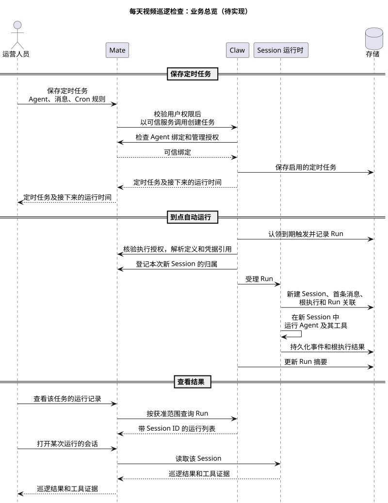
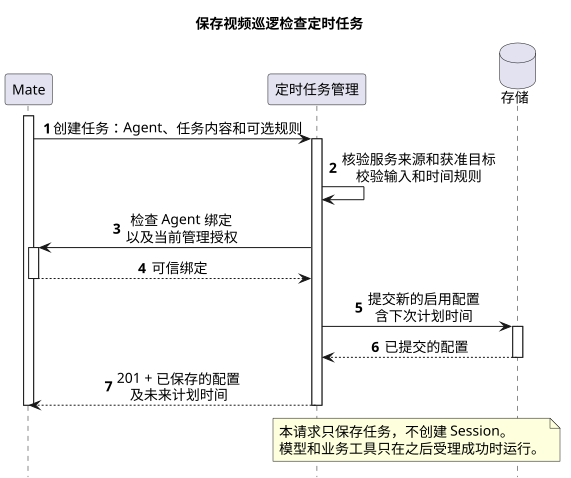
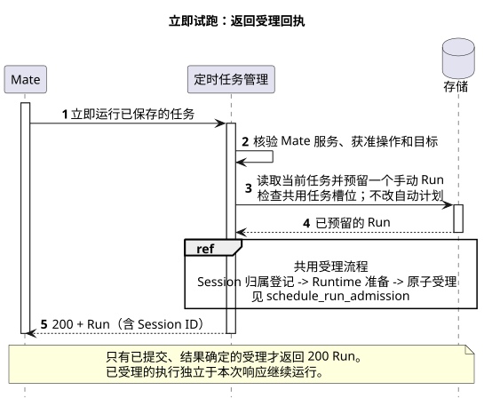

# CampusClaw 定时任务设计

[模块索引](../../README.md#module-index) · [接口 HTML 展示](schedule-api-review.html) · [Mate 定时执行接口草案](../../02-服务与接口/02-CampusMate共享客户端配置/scheduled-execution.md) · [架构对比 A14](../07-Agent架构对比/README.md#a14) · [源码与官方证据](source-evidence.md)

本文是定时任务模块唯一的设计文档，按“评审记录 / 概述 / 整体方案 / 详细设计 / 接口协议 / 架构指标 / 质量保证 / 基建规范 / 其他补充”组织：待对齐事项在[评审 Todo](#review-todo)，两张表的结构在 [§3.2](#persistence-lifecycle)，HTTP 契约在 [§4](#interface)。Mate 侧接口由 [Mate 草案](../../02-服务与接口/02-CampusMate共享客户端配置/scheduled-execution.md)维护，源码与基线核验记录在 [source-evidence.md](source-evidence.md)。标注 **【缺口】** 的位置表示现有材料不足，需要补充。

| 属性 | 值 |
|---|---|
| 文档版本 | 0.56.0 |
| 更新日期 | 2026-10-15 |
| 模块 | M10 · 调度与并发治理 |
| 产品范围 | 每次自动或手动触发均创建新的独立 Session，复用配置关联的 Agent 定义；不选择或追加已有 Session |
| 设计状态 | 目标设计，待实现。Java PR #332 已实现调度表、Mapper 与同库受理，尚未合并，与目标的差异见 [§3.2.5](#schedule-pr-diff)；Mate 归属登记、调度扫描及其余能力待实现；main 上已观察实现仅为进程内 Cron |
| 源码基线 | Claw Java main `553dcd5e2ff682f9684810a043b442b37a02e54a`（2026-10-05 隔离 fetch）；PR #332 `e9d31e8888a81b7fe95071e705482bb16fa10476`（2026-10-10 核验，见 [§3.2.7](#source-baseline)） |
| 主基线 | Claude Managed Agents Scheduled deployments 公开 Beta 契约，最近核对 2026-10-08；无服务端源码 |

## 评审记录

### 评审结论

评审中。评审人：Lotus；评审开始日期：2026-10-11。结论待逐项评审完成后填写。

<a id="review-todo"></a>

### 评审 Todo

需另开设计确定的问题、实现阶段验证项、文档缺口以及 Claw 首版开发前提都在本节维护；正文中的 T1～T10 编号指向这里。

<a id="claw-dev-readiness"></a>

#### Claw 首版开发前提

Claw 端的配置接口、两张表、到期扫描与领取、原子受理、立即运行、暂停与取消暂停、删除、失败自动暂停（D12）和 Run 结束（D11）均已确定，可以开发。以下依赖不阻塞编码，但决定能否联调和上线：

| 依赖 | 开发期做法 | 联调或上线前必须完成 |
|---|---|---|
| Mate 的 Agent 启用校验、Session 归属登记与统一账号 access-token 三个接口（调用边界见 [§5.1](#security)，[Mate 草案](../../02-服务与接口/02-CampusMate共享客户端配置/scheduled-execution.md)） | 按 `ScheduledAccessTokenPort`、`ScheduleAuthorizationPort` 编码，测试用桩实现 | Mate 实现接口，路径与 VO 定稿 |
| Claw 与 Mate 的服务鉴权（[T2](#todo-t2)） | 入站校验与出站凭据各留一个端口，先用测试配置 | 确定鉴权机制 |
| Runtime 的事务内终态扩展点（[D11](#key-decisions)）、后台准备与非交互 Host 策略 | 属于 M06 改造；2026-10-14 确定终态扩展点随定时任务 PR #332 一起实现 | 随 PR #332 合入 Runtime |
| 实例宕机后自动恢复（[T9](#todo-t9)） | 首版不实现 | 上线前须有人工释放被占用任务的处置方式，见[应急预案](#524-应急预案)缺口 |

<a id="separate-design"></a>

#### 需另开设计确定

| # | 问题 | 影响 | 首版做法 | 归属 |
|---|---|---|---|---|
| <a id="todo-t2"></a>T2 | Claw 与 Mate 互相调用时如何认证对方；统一账号如何配置；access-token 有效期多长 | 不定则无法联调；有效期影响是否需要缓存 Token | Mate 新增接口仍为[内部草案](../../02-服务与接口/02-CampusMate共享客户端配置/scheduled-execution.md)；每批工具调用取一次 Token，不缓存 | Claw 与 Mate 共同 |
| <a id="todo-t7"></a>T7 | Mate 任务配额准入与 Session 归属登记的内部契约 | 归属登记未定则受理流程无法联调 | 列表由 Mate 拉取全部后自行过滤，不传获准集合；归属登记保留在 Mate | Mate |
| <a id="todo-t8"></a>T8 | Mate 管理入口在调用 Claw 前后的处理（权限、配额、任务与用户关联） | 只影响 Mate 侧；Claw 侧逻辑已定 | Claw 只接收可信服务调用 | Mate |
| <a id="todo-t9"></a>T9 | 实例宕机后执行卡在运行中：会话无法继续对话，任务一直被占用，后续计划全部遇忙跳过 | 需人工处置才能恢复 | 不自动恢复。候选方案（Runtime 通用能力，定时任务复用）：① 实例心跳表与执行所属实例，心跳超时约 30 秒后把执行标为中断、写入中断事件，中断终态走 D11 的同一终态提交，Run 随之结束；② 执行期写入与工具调用前检查执行未终止，防止恢复的旧实例继续执行；③ 工具调用携带幂等键（executionId + toolCallId），并在会话中显示中断时所在的工具调用 | Runtime |
| <a id="todo-t10"></a>T10 | 是否在 Claw 的 t_schedule（及 Run、Session）增加 userId，使列表直接按用户查询；需先确定任务仅创建者可见还是同范围共享，以及与 Mate 归属的同步规则 | 任务量增长后 Mate 全量拉取的读取量随之增长 | 方法 A：Mate 拉取全部后过滤（[D9](#key-decisions)） | Claw 与 Mate 共同 |

<a id="implementation-verification"></a>

#### 实现阶段验证

| # | 事项 | 来源 |
|---|---|---|
| <a id="todo-t3"></a>T3 | PR #332 已实现但未合并，与目标结构仍有差异，按差异表修改；本地身份链路和对 Mate 的反向授权调用按 Mate 调用边界移除 | [§3.2.5](#schedule-pr-diff)、[§5.1](#security) |
| <a id="todo-t4"></a>T4 | 原子受理、受理后失联、取消终态与多副本故障测试 | [自动化测试](#auto-tests) |
| <a id="todo-t5"></a>T5 | 完整 Maven 依赖树与 corporate NativeParent 未核验 | [模块与依赖](#module-merge) |
| <a id="todo-t6"></a>T6 | 每实例 8 个活动执行上限在多副本下会放大总并发，部署阶段按实例数与下游配额核对 | [部署初始值](#deployment-defaults) |

<a id="template-gaps"></a>

#### 文档缺口

以下内容需要项目或运维信息补充，正文中对应位置标注【缺口】：

| 缺口 | 正文位置 |
|---|---|
| 原始需求文档、需求编号、优先级和目标版本；各待办事项的负责人 | [需求信息](#需求信息)、[需求整理](#12-需求整理) |
| 容量目标与压测计划 | [容量与限流](#deployment-defaults) |
| 监控指标与告警 | [监控告警](#523-监控告警) |
| 应急预案：人工处置结果未知的入口、权限与审计，数据库长时间不可用时的步骤，紧急停用全部自动运行 | [应急预案](#524-应急预案) |
| 灰度与回滚方案 | [灰度能力](#61-灰度能力)、[回滚能力](#62-回滚能力) |
| QA 流程 | [QA 流程](#64-qa-流程) |
| 删除与受理竞争的详细时序图（规则已定） | [§3.7](#37-删除任务配置的详细时序bu7uc5) |

<a id="closed"></a>

#### 已关闭

| # | 问题 | 结论 |
|---|---|---|
| <a id="todo-t1"></a>T1 | 运行失败是否自动暂停整个 Schedule | 2026-10-14 评审确定，见 [D12](#key-decisions) |

### 需求信息

需求来源：安全 Agent 场景四“配置空间安全管理规则”，其中视频巡逻检查规则需要按设定时刻自动执行，由定时任务承载。场景四目前没有需求文档。**【缺口】** 需求编号、优先级和目标版本。

页面行为与原型见 [M07 场景09](../../07-前端设计/场景/09-配置与管理定时任务/README.md)：Manual 映射 schedule:null，Schedule 映射完整 Cron；触发方式、active/paused 和单次 Run 结果分别展示，保存后读取权威计划时间。Console 核验范围见[专项证据](source-evidence.md#schedule-console-evidence)。

<a id="problem"></a>

## 1. 概述

### 1.1 术语解释

| 术语 | 含义 |
|---|---|
| Claw | CampusClaw Agent 服务，本设计的实现方 |
| Mate | 用户、组织、租户、资源归属与权限的维护方，也是可信接口定义、Session 归属和定时执行统一账号凭据的提供方；运营人员通过 Mate 管理入口操作定时任务 |
| Schedule | 长期保存的任务配置：Agent 关联、纯文本 prompt、可选 Cron 规则 |
| Run | 一次自动或手动触发的受理记录；只表示是否成功创建 Session，不表示业务成败 |
| Session | 每次 Run 新建的独立会话，承载消息、工具结果与根执行 |
| 根执行（root execution） | Session 内本次运行的顶层执行，是执行终态的最终决定方 |
| occurrence | 一个具体的自动计划时刻，以 `(schedule_id, scheduled_at)` 唯一标识 |
| 计划游标 | `upcoming_run_at`，下一次自动计划时刻；领取或跳过一次后推进到下一次 |
| 派发容差 | 计划时刻与数据库当前时刻之差的上限，首版 5 秒；超过则不运行、不补跑 |
| 受理（acceptance） | 在同一数据库事务内创建 Session、首条消息、根执行并写入 Run 关联 |
| 未结束 Run | finished_at 为空的 Run；同一 Schedule 至多一条，由运行表部分唯一约束保证同任务不并发 |
| lease_until | Run 的受理准备期限，过期后不得受理并由清理结束 |
| pausedReason | 当前暂停原因：人工暂停为 `manual`，自动暂停为 `error` 并带错误类型（D12）；恢复后清空 |
| Spring 六字段 Cron | 秒、分、时、日、月、星期；不接受五字段 POSIX 或年字段 |

### 1.2 需求整理

**【缺口】** 没有原始需求文档。下表是从已确认决策反推的需求清单，供评审确认是否与原始需求一致。

| 编号 | 需求 | 类型 | 来源 |
|---|---|---|---|
| R1 | 运营人员可创建、查看、修改、删除定时任务配置，浏览器无需保持打开 | 功能 | §4.2 |
| R2 | 时间规则仅支持 Spring 六字段 Cron，timezone 省略时默认 Asia/Shanghai；可省略规则表示仅手动运行 | 功能 | §4.3 |
| R3 | 每次自动或手动运行新建独立 Session，复用关联的 Agent 定义，不追加到已有会话 | 功能 | [§3.9](#new-session-per-run) |
| R4 | 支持立即运行、暂停、取消暂停；暂停只阻止未来自动受理 | 功能 | §4.4.7～§4.4.9 |
| R5 | 用户能看到下一次计划时间、每次是否成功启动、执行结果入口和失败原因 | 功能 | §4.3.3、§4.4.11 |
| R6 | 删除 Schedule 同时删除其 Run，保留已生成的 Session；删除不取消已受理执行 | 功能 | §4.4.6、§4.4.11 |
| R7 | 不补漏跑、遇忙跳过、失败与故障不重跑 | 约束 | [§3.8](#no-catch-up) |
| R8 | 首版只支持文本输入、无需人工交互的任务；ASK 结束本次根执行 | 约束 | [§3.10](#noninteractive) |
| R9 | 定时执行统一使用 Mate 配置的同一个账号，运行时向 Mate 取 access-token；Claw 不保存凭据引用或秘密 | 安全 | [§5.1](#security) |
| R10 | 多副本部署下同一 occurrence 只受理一次 | 稳定性 | [§3.5](#scheduled-run-sequence) |
| R11 | 用户、资源归属与权限由 Mate 维护；Claw 不保存用户范围或 owner，新 Session 受理前由 Mate 登记归属 | 安全 | [§5.1](#security) |

## 2. 整体方案

### 2.1 业务用例

园区里有些 Agent 工作需要在设定时刻反复执行，例如视频巡逻检查，不能依赖有人在线发起；运营人员还要能确认每次是否执行、结果如何、失败原因是什么。定时任务让运营人员保存“时间规则 + 要完成的任务”，由服务端按时交给关联的 Agent 执行，并保留每次运行的记录和结果入口。

| 编号 | 参与者 | 业务目标 | 业务结果 |
|---|---|---|---|
| BU1 | 园区运营人员 | 设置一个“每天 22:00 执行一次园区视频巡逻检查”的定时任务 | 任务保存并启用；能看到实际生效的时间规则和时区（未填时区时为 Asia/Shanghai）以及最多五个未来计划时刻，据此确认下一次何时运行 |
| BU2 | 园区运营人员 | 修改任务内容或时间规则 | 保存后看到更新后的规则和计划时刻；之后的运行按新配置执行，已开始的运行不受影响 |
| BU3 | 园区运营人员 | 到点自动执行视频巡逻检查，无需人工值守 | 每次到点生成一个新会话，由安全 Agent 完成本次巡逻检查 |
| BU4 | 园区运营人员 | 立即试跑一次，验证任务内容 | 立刻得到本次运行记录和会话入口 |
| BU5 | 园区运营人员 | 临时停止、之后恢复自动运行 | 暂停期间不再自动运行，恢复后从下一个计划时刻继续 |
| BU6 | 园区运营人员 | 查看已有任务、每次运行及其结果 | 看到任务列表与下一次计划时间；运行记录链接到对应会话，从会话读取巡逻结论和工具证据 |
| BU7 | 园区运营人员 | 不再需要该任务 | 任务及运行记录删除，已生成的会话保留 |

### 2.2 整体时序

场景：运营人员配置“每天 22:00 执行一次园区视频巡逻检查”，从配置任务开始，经过一次 22:00 自动运行，到查看该次巡逻结果结束。覆盖 BU1、BU3、BU6；状态：目标设计，待实现。图只画正常流程，每个阶段的内部细节见对应的详细时序。

| 参与者 | 职责 | 映射 |
|---|---|---|
| 运营人员 | 园区运营人员 | 通过 Mate 管理入口操作 |
| Mate | 管理入口；用户权限、资源归属与定时执行凭据 | 外部服务，以可信服务调用 Claw；调用前完成用户授权、配额与任务用户关联（内部处理待定，T8）；为 Claw 提供 Agent 启用校验、Session 归属登记与统一账号 access-token |
| Claw | coding-agent 服务：定时任务管理、到期扫描、受理协调，以及创建 Session 并推进 Agent 与工具 | `codingagent.schedule` 与既有 Session 运行时，同一进程，见 §3.3～§3.6 |
| GaussDB | 调度与 Session 存储，调度状态的最终决定方 | 同库事务资源 |



[原尺寸 SVG](scheduled_task_overview.svg) · [PlantUML 源码](diagram.puml#L308)

| 阶段 | 详细时序 |
|---|---|
| 步骤 1～8：配置定时任务 | [§3.3 配置定时任务的详细时序](#save-sequence) |
| 步骤 9～20：运行定时任务 | [§3.5 运行定时任务的详细时序](#scheduled-run-sequence)，其中受理部分见 [§3.6 共用受理的详细时序](#run-admission-sequence) |
| 步骤 21～26：查看巡逻结果 | 无详细时序：运行记录读取为单次查询，规则见[§4.4.11](#schedule-run-read-lifecycle)；会话读取沿用 M06 既有接口 |

<a id="key-decisions"></a>

### 2.3 关键设计决策

CampusClaw 的基线集合为 Claude Managed Agents、Codex harness、OpenCode、pi、DeepSeek Harness（DSH）；本模块以 Claude Managed Agents 为主基线，按问题选择相关基线。在已登记快照中，pi 只有实验性进程 Job（pico3），Codex harness 只有插件计划元数据，二者都没有可直接对照“用户定时任务”的实现。基线事实均引用 [A14](../07-Agent架构对比/README.md#a14) 与[源码证据](source-evidence.md)中已登记的日期和提交；Claude 为公开 Beta 契约，DSH 为 alpha，OpenCode 为 dev 分支。

| # | 要解决的问题 | 基线怎么做 | 园区业务约束 | 我们的选择 | 代价 |
|---|---|---|---|---|---|
| D1 | 怎样让用户分清“任务启动了”和“业务做完了”？ | Claude 把 Deployment（配置）、DeploymentRun（一次触发）、Session（执行内容）分开，Run 只记录 Session 创建结果；现有 CampusClaw CronEngine 是 JSON Job 加 JSONL 运行日志 | 模型自然结束不等于巡检或工单处理成功，业务结论必须来自 Session 里的输出和工具证据 | 采用三类资源分离：Schedule / Run / Session；Run 只回答“是否成功受理” | 多一层资源，看业务结果要从 Run 跳到 Session |
| D2 | 每次定时运行放进哪个会话？ | Claude 每次新建 Session；OpenCode 的 GitHub schedule 入口每次新建 Session；DSH 的提醒固定投递回创建它的原 Session；OpenAI 宿主 Scheduled tasks 支持新聊天和继续原聊天两种模式 | 同一任务每天产生独立结论，要避免与人工聊天争用同一会话；多一种目标模式就多一套关联、忙闲和授权规则 | 每次新建独立 Session，复用关联的 Agent 定义，不提供 target / sessionId | 不能延续聊天上下文，需要昨日结论时必须显式查询业务记录 |
| D3 | 谁决定“这次该不该跑”，多副本下如何不重复？ | Claude 未公开内部实现；OpenCode 把计时交给外部 GitHub Actions；DSH 和 pi pico3 都在单进程内计时（DSH 用串行队列处理投递与删除） | 企业部署多副本；Session 创建和首条消息必须与 Run 一起成功或一起失败，崩溃后要能对账 | GaussDB 是调度状态的最终决定方，定时器只负责唤醒扫描；各副本并行扫描，以行锁和唯一约束防重；同库事务内原子受理 Run、Session、首条消息和根执行 | 首版要求 Schedule、Run 与 Runtime 同库；查询量随副本数增加，需要压测 |
| D4 | 进程崩溃、停机或回执丢失后，这次要不要补跑或重跑？ | Claude 公开资料未给出完整重叠与故障策略；DSH 的固定间隔只取最新到期项，不逐个补历史；pi pico3 在进程结束后按当前时间加间隔推进 | 工单、门禁、告警处置等工具有真实副作用，重复执行比漏执行更危险 | 不补漏跑、遇忙跳过、失败与故障不重跑；结果未知时保持占用并对账 | 故障时可能漏跑一次；结果未知需要对账或人工处置，自动恢复见 T9 |
| D5 | 用户用什么方式描述“什么时候跑”？ | Claude 只支持五字段 POSIX Cron，时区必填；DSH 支持 Cron（时区必填）、单次与固定间隔；pi pico3 只有毫秒级 notBefore/every，没有日历时区；OpenCode 用 GitHub Actions 的五字段 Cron，默认 UTC | 园区任务以“工作日 08:00”这类日历规则为主，主要在中国时区；Java 工程已有 Spring CronExpression，不希望新增依赖 | 仅支持 Spring 六字段 Cron；timezone 可省略，默认 Asia/Shanghai 并保存回显 | 不支持单次任务和严格固定间隔；Claude 表达式不能直接复制，日与星期组合语义也不同 |
| D6 | 删除任务时，运行记录、会话和在途执行怎么处理？ | Claude 采用归档；DSH 删除任务及投递历史，保留原 Session，不取消在途；辅助基线 OpenClaw 保留运行历史，操作者删除时请求取消 | 用户不想为了删任务再逐条清理运行记录；已生成的对话和园区业务结果要独立保留；取消在途执行可能留下半完成的业务操作 | 同删 Schedule 和 Run，保留 Session，不取消已受理执行，停止由 Session 入口单独发起 | 删除后无法再查启动失败和触发来源，尤其是没有生成 Session 的失败 |
| D7 | 无人值守时遇到权限确认或提问怎么办？ | 无可对照实现（已登记基线没有定时场景下的交互处理） | 定时执行时没有人在线回答；默认批准会绕过园区业务权限 | 首版只支持无需人工交互的任务；Host 遇 ASK 时阻止业务调用并结束本次根执行 | 需要人工确认的任务暂时不能定时执行 |
| D8 | 任务运行时使用 Agent 的哪个版本？ | Claude 在创建或显式更新 Deployment 时固定 Agent 版本 | 现有 Agent 目录没有可解析的历史定义，只保存一个版本号兑现不了版本固定 | 只关联 agentId，每次使用当时已发布的定义 | Agent 发布新版本后，后续运行行为可能改变，无法复现历史运行；这是能力缺口，不是字段简化 |
| D9 | 首版任务列表和 Run 列表如何按用户过滤？ | Claude 按 workspace 范围列出，无用户级过滤 | 用户与任务的关联在 Mate；Claw 不保存用户范围或 owner | 方法 A：Claw 返回全部记录，Mate 拉取全部页后按用户过滤、排序和分页；单任务的 Run 由 Mate 先确认可见再带 scheduleId 查询 | 读取量随全部任务与 Run 增长，Claw 页码只用于分批拉取；Claw 加 userId 见 T10 |
| D10 | 定时执行时没有用户请求，Claw 用什么权限调用业务工具？ | Claude 部署引用 workspace 范围的 Vault 凭据；普通对话由用户请求带 Header | 用户登录 Token 会过期，且没有确认过的刷新或代签接口；不能保存用户密码 | 用户权限只在配置时由 Mate 检查；运行时统一使用 Mate 配置的同一个账号，模型每批需要凭据的工具调用前，Claw 无入参向 Mate 取一次 access-token（2026-10-13 评审确定） | 所有任务权限相同；创建者失去权限或离职后任务仍照常运行；每批工具调用多一次 Mate 请求 |
| D11 | 执行结束后，Run 怎么知道并释放任务？ | 未核验各基线的同类机制 | 同一任务不并发，Run 不结束后续计划就全部遇忙跳过；实例可能在任意时刻失联 | 写根执行终态的同一数据库事务内，经 Runtime 通用终态扩展点结束本次 Run（按 execution_id 条件更新 finished_at）；不用提交后回调，也不轮询（2026-10-14 评审确定） | Runtime 需新增事务内扩展点；Run 需 execution_id 索引；实例宕机写不进终态时仍靠 T9 |
| D12 | 运行失败要不要自动暂停任务？ | Claude 只对不可恢复的建 Session 错误（如 Agent、环境、Vault 已归档）首次即自动暂停，限流等临时错误只记失败 Run；DSH 投递失败只记日志、任务保持 active；pi、OpenCode 产品内无定时任务，Codex 调度器未开源（2026-10-14 核验，见[证据](source-evidence.md#auto-pause-baseline-evidence)） | 不改配置就必然再次失败的错误，继续每次触发只会产生无意义的失败记录；临时故障不应让任务停下来；业务执行失败的结论在 Session 里 | 按错误类型区分：自动运行记录 agent_unavailable_error 时，同一事务内把仍为 active 且 Agent 未变的任务改为 paused，pausedReason 记录该错误；agent_unavailable_error 只依据 `ScheduleAuthorizationPort` 按 agentId 直接向 Mate 查询“存在且启用”的技术校验（不经本地缓存，不查用户资格），Mate 明确返回已删除或已禁用才记录；Runtime 准备阶段的 Agent 不可用、Agent 未找到、本地路径校验、目录 I/O、Skill 准备等通用故障，以及该校验调用本身失败或超时，都不记此类型、不暂停；容量、忙、准备超时等临时错误与执行中失败均不暂停；手动运行失败从不暂停；恢复需显式取消暂停，不补跑（2026-10-14 评审确定） | 不采用旧 Cron 连续三次失败禁用；Agent 恢复后需人工取消暂停；临时错误若持续存在只会累积失败 Run，需要监控发现 |

时间、执行目标和删除的多基线对照见 [A14](../07-Agent架构对比/README.md#a14) 和[删除基线证据](source-evidence.md#schedule-delete-baselines)。

<a id="claude-tradeoffs"></a>

### 2.4 与 Claude Managed Agents 的逐项取舍

本节比较公开 Beta [创建](https://platform.claude.com/docs/en/api/http/beta/deployments/create)、[更新](https://platform.claude.com/docs/en/api/http/beta/deployments/update)和[定时 Deployment](https://platform.claude.com/docs/en/managed-agents/scheduled-deployments)契约，不推断服务端实现。字段与报文以 [§4](#interface) 为准；读取、删除的报文差异分别在§4.4.3～§4.4.4、§4.4.6。

| 决策 | Claude 公开契约 | Claw 目标、理由与代价 | 分类 |
|---|---|---|---|
| 名称长度 | name 的 maxLength 为 256 | 名称上限同为 256，不增加缺少业务依据的限制；Java 字符计数不声明为已验证的跨语言 Unicode 等价 | 参考基线 |
| 配置资源 | Deployment 关联 Agent、环境、初始事件和可选规则 | Schedule 关联 Agent、纯文本 prompt 和可选规则；保留配置与 Session 执行分离，范围聚焦现有调度领域，不建设完整部署平台 | 架构范围 |
| 创建即登记计划 | 提供 schedule 后自动触发，新建示例为 active | 同样登记自动计划；创建处理器不直接运行。不能因为先开发配置就永久默认 paused；运行未接线应限制发布 | 参考基线，无额外启用流程 |
| 执行目标 | 每次触发创建新 Session | 每次运行固定新建 Session，不提供 target；减少原会话授权、模式、忙闲状态及多任务竞争的规则，代价是不自动延续原会话上下文 | 参考基线、产品范围 |
| Agent 版本 | 字符串固定当时最新版本，亦可指定历史版本 | 只关联 agentId，使用执行时实际取得的已发布目录；现有 prepare 可命中缓存，非每次远端最新。目录刷新后未来行为可能变，暂缺固定版本可复现保证 | 现有能力缺口 |
| 运行环境 | 显式 environment_id | 不提供空壳 environmentId，沿现有 Host/Agent 目录装配；减少资源模型，但失去独立环境选择与复用 | 架构范围 |
| 初始输入 | initial_events 支持多事件及受约束事件类型 | 一段纯文本 prompt，运行时作为首条用户消息提交；不支持附件、多初始事件、system.message 或 user.define_outcome，亦不支持交互等待；普通 Session 文件引用契约保持 | 产品范围、实现差距 |
| 时间表达 | 五字段 POSIX Cron，IANA 时区 | 采用 Spring 六字段，复用现有解析器且不新增 Maven 依赖；代价是 Claude 表达式不能直接复制，日/周组合语义也不同，见 [Spring 调度背景](#spring-scheduling) | 产品约束（方言选择）、实现成本取舍 |
| 时间精度 | 创建 Session/Deployment 示例为整秒 UTC；公开文档未保证只支持秒级或披露数据库精度 | Claw 明确仅支持秒级，Session、完整事件与定时任务一致；降低展示和存储差异，代价是放弃这些字段的亚秒时间差。见[时间证据](source-evidence.md#claude-time-precision-evidence) | 产品约束 |
| Cron 时区 | timezone 必填，使用 IANA 名称 | timezone 可省略，默认 Asia/Shanghai，保存并回显有效值；适配主要园区场景，代价是调用方需了解省略时采用的产品预设，不能继承运行节点默认值。其他基线也没有统一默认值：DSH 必填、GitHub Actions 默认 UTC、pi 无日历时区，见[时区证据](source-evidence.md#timezone-evidence) | 产品约束 |
| 时间类型范围 | schedule 模型只声明 cron | 同样只接受 cron，减少一次性任务耗尽、间隔起点和更新重置等规则；代价是不支持未来指定时刻只执行一次，也不支持从任意起点按固定秒数重复：`0 0 8 1 10 *` 每年匹配 10 月 1 日，`0 */7 * * * *` 每小时重新匹配，不能冒充严格每隔 7 分钟 | 产品约束（范围收敛） |
| 更新 | 省略保持、schedule:null 清除、初始事件/规则整体替换 | 沿用；Claw 的 prompt/schedule 整体替换，metadata 逐 key 更新，不引入通用深层合并 | 参考基线 |
| 立即运行 | POST run，无业务正文，200 返回 DeploymentRun，记录 Session 创建结果 | 200 返回 ScheduleRun，可靠记录的失败在 Run.error；新 Session 与首消息受理分开于业务完成，不等待模型结束；ResultBean 和无 Agent 版本固定沿既有约束 | 参考基线、公司契约与受理架构增量 |
| 暂停/取消暂停 | POST pause/unpause，200 完整资源；暂停允许手动运行，恢复不补跑 | 采用同样入口与完整 Schedule；暂停受理屏障、同值调用不改时间/游标和恢复资格校验需新增实现与验收 | 参考基线、企业授权与一致性设计 |
| 并发与重试 | 官方配置操作未声明客户端版本或请求键协议，内部实现未公开 | 不引入此类公共协议；数据库锁最新记录、合并部分字段并原子写入。简化调用和存储，代价是允许同字段后写生效、创建重提可能生成重复资源，且不提供原回执恢复 | 产品约束、数据库一致性设计 |
| 运行与计划时间摘要 | schedule 内有 last_run_at/upcoming_runs_at | 同样返回最近自动开始与最多五次计划；ResultBean、lowerCamelCase、UTC 秒级是公司/产品规则；动态摘要只用于显示，不参与客户端更新准入 | 参考基线、公司契约 |
| 状态与版本 | active/paused，另有 archived_at；未声明 revision | 新建 active、存续资源 active/paused；不保存配置版本；删除成功返回最后配置回执，随后读取 404，无归档时间字段 | 参考基线、边界明确 |
| 删除配置 | POST archive，200 完整资源，以 archived_at 表示不可恢复终态 | 直接删除及 200 完整 Schedule 回执、随后 GET 404 且列表排除；重复删除 404。Schedule 和 Run 同删，Session 保留；简化任务侧历史生命周期，代价是无法再查询已删任务的受理失败和来源记录 | 产品约束、生命周期架构选择 |
| 资源类型 | 顶层 type 固定为 deployment | 顶层 type 固定为 schedule，完整响应统一返回；便于识别资源，代价是增加一个恒定字段，不扩展现有 Session 契约 | 产品约束 |
| 暂停原因 | paused_reason 为 null 或 manual/error 原因对象，恢复后清空 | pausedReason 保留相同职责，随状态持久化并安全投影；增加当前原因维护成本，不能用最后一个 Run 错误替代，error 形状保留；自动暂停只由自动运行的 agent_unavailable_error 触发（D12） | 参考基线、架构增量 |
| metadata | 最多 16 对字符串，键最多 64、值最多 512 | 支持可选 map，采用同样限制；不进模型，不作身份、权限或凭据依据 | 参考基线、产品约束 |
| 凭据 | vault_ids 引用 workspace 范围 Vault，运行时使用其中凭据 | 不保存凭据引用；所有定时任务统一使用 Mate 配置的同一个账号，每批工具调用前无入参取 access-token（D10）。实现最简单，代价是所有任务权限相同、用户权限只在配置时检查 | 企业产品约束 |

固定 Agent 版本是最显著的能力差距，不应包装成单纯“字段简化”。未来若要求长期告警策略可重复审计，需要先建设可解析的历史定义与资源关联，再开放 agentVersion；只保存一个 version 数字不能兑现版本固定。Spring 六字段的理由是复用 Java 现有能力与降低维护成本，不是园区业务天然要求秒级执行。

## 3. 详细设计

<a id="system-use-cases"></a>

### 3.1 系统用例

前 10 项为 HTTP 操作，由 Mate 管理入口以可信服务调用发起（Mate 内部处理待定，见 T8）；后 3 项为后台作业。BU6 还需读取 M06 既有 Session 接口，不在本模块新增。

| 用例 | 对应业务用例 | 触发者 | 前置条件 | 主成功结果 | 关键约束 |
|---|---|---|---|---|---|
| UC1 创建配置 | BU1 | Mate 管理入口 | Mate 已授权的操作与目标 | 201 完整 Schedule，status=active | 不调用模型或 Session 工厂；未接线运行能力前不发布自动运行承诺 |
| UC2 列表 | BU6 | Mate 管理入口 | Mate 已确认用户身份 | 200 分页完整资源 | Claw 返回全部存续任务，Mate 拉取全部页后按用户过滤、排序和分页；不换取凭据 |
| UC3 详情 | BU6 | Mate 管理入口 | 读取资格 | 200 完整资源 | Agent 或凭据失效不妨碍读取 |
| UC4 部分更新 | BU2 | Mate 管理入口 | 管理资格 | 200 完整资源 | 锁最新行合并提交字段；不触发执行、不改暂停状态 |
| UC5 删除 | BU7 | Mate 管理入口 | 管理资格 | 200 完整 Schedule 回执 | 同删 Run，保留 Session，不取消已受理执行 |
| UC6 立即运行 | BU4 | Mate 管理入口 | 运行资格；active 或 paused | 200 Run（sessionId 与 error 二选一） | 先占用任务，再走共用受理；不移动计划游标 |
| UC7 暂停 | BU5 | Mate 管理入口 | 管理资格 | 200 完整 Schedule，paused/manual | 同值操作不改时间与游标 |
| UC8 取消暂停 | BU5 | Mate 管理入口 | 管理资格 | 200 完整 Schedule，active/null | 只从未来匹配继续，不补跑 |
| UC9 Run 列表 | BU6 | Mate 管理入口 | Mate 已确认用户身份 | 200 runs/nextPage | 单任务时 Mate 先确认可见再带 scheduleId 查询；跨任务时 Mate 拉取全部后过滤；不含已删除任务的 Run |
| UC10 Run 详情 | BU6 | Mate 管理入口 | 读取资格 | 200 八字段 Run | 任务或 Run 已删除时 404 |
| UC11 自动扫描与受理 | BU3 | 调度器 | 任务到期 | 新 Session 受理并启动 | 不补漏跑、遇忙跳过；受理前须完成 Mate 归属登记 |
| UC12 Run 结束 | BU3 | Runtime 终态提交 | 已受理 Run 的根执行结束 | 与根执行终态同事务写入 Run.finished_at，释放任务 | 已删除任务更新 0 行，不复活资源 |
| UC13 运行超时停止 | BU3 | 调度器 | 单次运行超过 30 分钟 | 向原根执行请求停止 | 停止未确认前保持停止中或未知 |

<a id="persistence-lifecycle"></a>

### 3.2 数据模型

目标只有两张表 `t_schedule`、`t_schedule_run`，不修改既有 Session 与根执行表。两张表的字段、约束、索引与事务在本节维护；全库命名、时间类型与 Mate 身份边界见 [Claw 数据库设计](../../03-数据与存储/Claw数据库设计.md)，其中的[定时任务表](../../03-数据与存储/Claw数据库设计.md#schedule)只保留指向本节的入口。PR #332 中需要撤销或改名的结构集中在 [§3.2.5](#schedule-pr-diff)。

业务生命周期：Schedule 保存长期配置，Run 保存一次受理事实，Session 与原根执行保存实际执行结果。删除 Schedule 同时删除 Run，保留已受理的 Session 且不自动取消；单独删除 Session 不改写历史 Run 的受理事实。Claw 只保存资源关联，不保存凭据、授权引用、用户范围、owner 或操作者副本，见 [Mate 归属边界](../../03-数据与存储/Claw数据库设计.md#mate-ownership)。

<a id="schedule"></a>

#### 3.2.1 表职责与关联

| 表 | 权威职责 | 关联及生命周期 |
|---|---|---|
| `t_schedule` | 当前任务配置与自动计划游标 | 一条配置对应多条 Run；删除时与其 Run 同事务删除 |
| `t_schedule_run` | 一次触发是否受理、受理时的 Session 与根执行身份，以及同任务唯一未结束 Run | `schedule_id` 外键指向配置并级联删除；`session_id`、`execution_id` 为逻辑引用，不设外键 |
| `t_sessions`、`t_session_executions` | 已受理会话与根执行，结构不变 | 不受 Schedule/Run 删除级联；用户在定时会话中继续对话不改变原 Run 的关联 |

一次受理对应一个 Session 和一个根执行，由同库事务与锁内检查维持，不靠唯一约束或外键。同任务不并发由 `t_schedule_run` 的部分唯一索引表达，`t_schedule` 不保存指向 Run 的列，避免与级联删除形成循环依赖。

不新增 gap 表、请求去重表、扫描协调表、可恢复的墓碑或隐藏归档。停机期间错过的计划只推进游标；任务忙时跳过会形成一条已结束且未受理的 Run。不同手动请求各自分配 runId，内容相同也不合并。

<a id="t_schedule"></a>

#### 3.2.2 t_schedule：任务配置

各列没有数据库 DEFAULT，由应用赋值。表名统一 `t_` 小写蛇形，SQL 对象注释使用中文。

| 字段 | SQL 类型 | 可空 | 数据库默认值 | 含义 |
|---|---|---|---|---|
| id | VARCHAR(41) | 否 | — | `schedule-` 加 32 位 UUID 十六进制 |
| agent_id | VARCHAR(38) | 否 | — | 任务关联的 Agent 标识；每次运行按它新建 Session，修改后只影响之后的运行 |
| name | VARCHAR(256) | 否 | — | 任务名称 |
| description | VARCHAR(2048) | 是 | — | 任务描述 |
| prompt | TEXT | 否 | — | 纯文本任务内容，受理时作为首条用户消息提交 |
| cron_expression | TEXT | 是 | — | Spring 六字段表达式；仅手动运行的任务为空 |
| timezone | TEXT | 是 | — | 与 Cron 成对保存的时区，缺省值由服务归一化 |
| status | VARCHAR(16) | 否 | — | `active` / `paused` |
| paused_reason | VARCHAR(64) | 是 | — | 当前暂停原因：人工暂停存 `manual`，自动暂停存触发暂停的 Run 的 error_type（目前仅 `agent_unavailable_error`），投影为 `{type:error,error:{type}}`；规则见 [D12](#key-decisions) |
| metadata | TEXT | 否 | — | 附加元数据 JSON 对象，无值时写 `{}` |
| last_run_at | TIMESTAMPTZ(0) | 是 | — | 最近一次自动运行的受理时刻，在受理事务中写数据库当前时间；手动、准备失败和忙跳过不更新 |
| upcoming_run_at | TIMESTAMPTZ(0) | 是 | — | 下一次自动运行的计划时刻，即扫描游标；到期领取后推进；仅手动、暂停或规则无后续时刻时为空 |
| created_at | TIMESTAMPTZ(0) | 否 | — | 创建时间 |
| updated_at | TIMESTAMPTZ(0) | 否 | — | 配置更新时间；写 last_run_at 不改它 |

主键：`id`。

| 索引 | 规则 | 支持的访问 |
|---|---|---|
| idx_schedule_due | `(status, upcoming_run_at, id)` | 各副本每秒扫描 active 且到期的任务 |
| idx_schedule_list | `(updated_at DESC, id)` | 按更新时间返回全部任务，由 Mate 分批拉取后按用户过滤 |

数据库约束：

- status 只能是 `active` / `paused`。
- active 时 paused_reason 为空，paused 时非空。
- cron_expression 与 timezone 同空或同非空。

暂停原因的具体枚举、Cron 可解析性、JSON 结构与引用资格由应用校验。资源 `type` 是响应常量，不落库；`upcomingRunsAt` 由保存的规则计算，不存多个未来时刻。JSON 以 TEXT 保存，不新增 JSON 查询或索引。

<a id="t_schedule_run"></a>

#### 3.2.3 t_schedule_run：一次触发记录

各列没有数据库 DEFAULT。Run 只记录是否受理，不代表园区业务成功；业务状态和错误从原 Session 与根执行读取。

| 字段 | SQL 类型 | 可空 | 数据库默认值 | 含义 |
|---|---|---|---|---|
| id | VARCHAR(36) | 否 | — | `run-` 加 32 位 UUID 十六进制 |
| schedule_id | VARCHAR(41) | 否 | — | 所属任务；外键 `ON DELETE CASCADE` |
| agent_id | VARCHAR(38) | 否 | — | 领取时任务关联的 Agent；受理时与任务当前值不同则不受理 |
| trigger_type | VARCHAR(16) | 否 | — | `manual` / `schedule`，投影为 triggerContext.type |
| scheduled_at | TIMESTAMPTZ(0) | 是 | — | 自动触发的计划时刻（UTC）；手动为空 |
| error_type | VARCHAR(64) | 是 | — | 未受理原因，投影为 error.type；error.message 按请求语言生成，不落库 |
| session_id | VARCHAR(40) | 是 | — | 受理时创建的 Session |
| execution_id | VARCHAR(64) | 是 | — | 本次首消息的根执行，内部对账用，不公开 |
| lease_until | TIMESTAMPTZ(3) | 否 | — | 受理准备期限，内部使用。领取时写入：手动为领取时刻加 10 秒；自动取该值与 scheduled_at 加 5 秒中较早者。受理和清理都在行锁内与数据库当前时间比较，过期未受理的 Run 不得受理 |
| created_at | TIMESTAMPTZ(0) | 否 | — | 创建时间 |
| finished_at | TIMESTAMPTZ(0) | 是 | — | 结束时间，不公开；为空表示仍占用任务 |

主键：`id`。外键：`schedule_id → t_schedule(id) ON DELETE CASCADE`。

| 索引 | 规则 | 支持的访问 |
|---|---|---|
| 自动触发唯一 | 唯一 `(schedule_id, scheduled_at)` | 同一计划时刻只领取一次；UTC 区分夏令时重复钟面 |
| uk_schedule_run_unfinished | 唯一 `(schedule_id) WHERE finished_at IS NULL` | 同一任务至多一条未结束 Run，即不并发 |
| idx_schedule_run_list | `(schedule_id, created_at DESC, id DESC)` | 按任务或时间倒序查询 Run，from/to 走同一索引 |
| idx_schedule_run_retention | `(finished_at, id)` | 批量删除超过保留期的已结束 Run |
| uk_schedule_run_execution | 唯一 `(execution_id)`，空值不参与 | 根执行终态提交时按 execution_id 结束本次 Run；一个根执行至多对应一条 Run |

数据库约束：

- manual 的 scheduled_at 为空，schedule 的 scheduled_at 非空。
- session_id 与 error_type 不能同时非空；准备中两者都空。

**阶段由列推出，不保存状态列。**

| 阶段 | finished_at | session_id | error_type | 占用任务 |
|---|---|---|---|---|
| 准备中 | 空 | 空 | 空 | 是 |
| 已受理，执行中或结果未知 | 空 | 非空 | 空 | 是 |
| 已受理，根执行已结束 | 非空 | 非空 | 空 | 否 |
| 未受理（准备失败、过期、任务忙） | 非空 | 空 | 非空 | 否 |

忙跳过在插入时即带 finished_at，不占用任务。受理后由原实例在进程内直接启动；之后任何时刻失联都按结果未知处理，Run 保持未结束，自动恢复见[待定 T9](#todo-t9)。

公开接口（[Run 查询](#schedule-run-read-lifecycle)）只返回 session_id 与 error_type 恰好一个非空的记录，投影 id、schedule_id、agent_id、trigger_type、scheduled_at、session_id、error_type、created_at。列表可按 scheduleId、triggerType、hasError 与 createdAt 区间 `[from, to)` 筛选，按 `created_at DESC, id DESC` 页码分页；triggerType、hasError 只有两个值，不单独建索引。

单独删除 Session 不清空 Run.session_id，不级联删除 Run，也不把已受理改成失败；原会话链接可能返回 404。

<a id="transactions"></a>

#### 3.2.4 事务、删除与保留

| 操作 | 同一事务内维持的不变量 |
|---|---|
| 创建、修改、暂停、恢复任务 | 最新配置、状态与暂停原因、游标一起提交，不保存配置版本；暂停不结束在途 Run；远端授权准备在锁外，锁内复查 |
| 领取 Run | 锁 Schedule；任务无未结束 Run 时插入未结束 Run，有则插入带 finished_at 的忙跳过 Run；自动触发同时推进游标 |
| 受理 | 锁 Schedule 与 Run，复查任务存在（自动运行要求 active 且未过派发期限，手动运行允许 active 或 paused）、任务 agent_id 等于 Run.agent_id、Run 未结束且 lease_until 未过；不查询用户执行资格（D10）；首消息用锁内读到的最新 prompt；Session、首消息、根执行、Run 关联与自动运行的 last_run_at 一起提交 |
| 受理后启动 | 原实例在进程内启动，不写启动权；模型与业务执行不在受理事务内 |
| 根执行终态提交 | Runtime 写根执行终态的同一事务内，按 execution_id 条件更新本次 Run 的 finished_at，释放任务；Run 已删除时更新 0 行；只看本次根执行，会话后续聊天不改写；终态写不进（结果未知）不释放，见 T9 |
| 记录未受理 Run | 锁 Run 写 finished_at 与 error_type；自动运行且为 agent_unavailable_error 时同事务锁 Schedule，仍为 active 且 agent_id 等于 Run.agent_id 才改为 paused 并写 paused_reason |
| 清理过期准备 | 锁 Run，只对 session_id、error_type 都为空且 lease_until 已过的 Run 写 finished_at 与错误 |
| 保留期清理 | 按 `(finished_at, id)` 批量删除超期的已结束 Run，不级联 Session，不删除未结束 Run |
| 删除任务 | 锁 Schedule，同事务删除 Run 与 Schedule；受理先提交则保留 Session，删除先提交则拒绝旧准备结果；外键级联作兜底 |

删除不取消、不回滚已发生的园区业务；已受理会话由自身权限与停止入口管理。删除后的回调只条件更新仍存在的记录，影响行数为零时不重新插入。

Run 保留 30 天；清理频率与批量见[部署初始值](#deployment-defaults)。Session 的保留策略归其自身模块。

定时业务时间遵守[统一秒级规则](../01-CampusClaw多Agent运行时/time-contract.md)；内部的 lease_until 保留毫秒。定时器、线程、本地缓存与本地计时都不是权威状态，不能覆盖数据库游标、Run 关联或根执行。

<a id="schedule-pr-diff"></a>
<a id="t_schedule_dispatch_state"></a>

#### 3.2.5 PR #332 差异

PR #332 已实现定时任务表，未合入 main。下表列出它与 §3.2.2–§3.2.4 目标结构的全部差异，实施时按此修改 PR，不以 PR 结构为准。

| 对象 | PR #332 | 目标 | 原因 |
|---|---|---|---|
| t_schedule.scope_ref、operator_ref | 保存管理范围与操作者 | 撤销 | 范围、操作者与审计在 Mate |
| t_schedule.session_owner_ref | 保存会话归属 | 撤销 | Session 归属在 Mate |
| t_schedule.credential_ids | 保存凭据引用 | 撤销 | 运行时统一使用 Mate 账号的 access-token，不落库 |
| t_schedule.message | 单条 user.message 的 JSON | 改为 `prompt` TEXT | 只保存纯文本任务内容 |
| t_schedule.revision、t_schedule_run.revision | 配置版本，受理时比较 | 撤销 | 受理改为锁内比较 agent_id |
| t_schedule.active_run_id | 指向在途 Run，实现同任务占用 | 撤销 | 改用 `uk_schedule_run_unfinished` |
| t_schedule.next_fire_at | 自动计划游标 | 改名 `upcoming_run_at` | 与接口字段一致 |
| t_schedule_run.scope_ref | Run 范围 | 撤销 | 同 Schedule |
| t_schedule_run.state | PREPARING / READY / STARTING / FINISHED | 撤销 | 阶段由 finished_at、session_id、error_type 推出 |
| t_schedule_run.claim_owner、claim_epoch | 领取实例与代次 | 撤销 | 锁内检查 lease_until 已足以阻止失效准备者受理 |
| t_schedule_run.root_event_id、segment_id | 首消息事件与初始段 | 撤销 | 可由 `t_session_executions` 与初始段按 execution_id 查到 |
| t_schedule_dispatch_state | 单行表：领跑者、代次、租约、恢复边界 | 撤销整表 | 各副本以 `FOR UPDATE SKIP LOCKED` 并行扫描，锁内复查游标；超过 5 秒的计划直接推进，见[不补跑](#no-catch-up)；GaussDB 不支持 SKIP LOCKED 时退回 FOR UPDATE |
| t_sessions.scope_ref、session_owner_ref | 会话范围与归属 | 撤销 | 归属在 Mate，按 sessionId 维护 |
| t_session_executions.started_at | 实际开始时刻 | 撤销 | last_run_at 改为受理时刻 |
| t_session_executions.execution_context_json | 编码 scheduleId、runId、agentId、范围、归属、授权、凭据 | 撤销 | 调度上下文只在原实例内存中传给 Runtime 与子 Agent；反查用 Run.execution_id |
| t_session_executions.schedule_start_state、owner、deadline 及 idx_t_session_executions_schedule_start | 一次性启动权：READY→STARTING，过期置 FENCED | 撤销 | 只在受理的原实例上执行；失联按结果未知处理，代价是该窄窗口不能自动释放任务，见 T9 |
| idx_schedule_scope_list | `(scope_ref, updated_at DESC, id)` | 改为 `idx_schedule_list(updated_at DESC, id)` | 去掉 scope 前缀 |
| idx_schedule_run_list | `(scope_ref, created_at DESC, id DESC)` | 改为 `(schedule_id, created_at DESC, id DESC)` | 按任务查询 |
| idx_schedule_run_retention | `(state, finished_at, id)` | 改为 `(finished_at, id)` | state 已撤销 |
| uk_schedule_run_unfinished | 无 | 新增 | 同任务不并发 |
| uk_schedule_run_execution | 无 | 新增 | 终态提交时按 execution_id 结束 Run |

<a id="gaps"></a>

#### 3.2.6 实现差距与验收

| 项目 | 状态与边界 |
|---|---|
| PR 结构差异 | **待修改**：按 §3.2.5 修改 DDL、Mapper、受理与扫描逻辑，JSON 编解码相应简化 |
| 安全配置快照、Agent 发布版本 | 原设计包含这些目标，PR 与目标表都没有对应列。**待设计**，本文不为此擅自增列；Run.agent_id 只用于受理比较 |
| 标识长度 | Run.session_id 为 40、execution_id 为 64，既有根表对应列为 128；跨入口 ID 上限须核验，不能默认已对齐 |
| GaussDB 能力 | **未验收**：NULL 参与唯一约束、部分唯一索引、SKIP LOCKED、时间函数与锁竞争须在真实 GaussDB 上验证；PR 报告的 PostgreSQL 验证不能替代 |
| 查询性能 | 首版由 Mate 拉取全部任务或 Run 后过滤，全量读取耗时须联调并查看 GaussDB 执行计划；索引存在不等于查询已使用它 |
| 存量升级 | S1 是会 DROP 并重建的全量安装脚本，不是升级方案；存量迁移不在首版范围 |

实施至少验证：同一自动计划并发只受理一次、手动与自动互斥、更新/暂停/删除与受理竞争、事务中途失败全回滚、重复内部通知不创建第二个 Session、受理后失联保持未知且不释放任务、删除任务后根执行仍可收尾、删除 Session 后 Run 保留受理事实、历史清理不删除会话。真实 GaussDB 执行计划、两副本故障注入和企业身份联调分别记录，文档校验不能替代。

<a id="source-baseline"></a>

#### 3.2.7 定时源码证据

所有实现路径均属于 `pi-mono-java`，链接固定到 PR #332 head；§3.2.5 中 PR 一列的字段长度、可空性和索引以 S1 为证据。

| 编号 | 仓库相对路径与关键符号 | 证明范围 |
|---|---|---|
| S1 | [modules/coding-agent-cli/src/main/resources/db/gaussdb/install/session_schema.sql](https://github.com/superheromeZzh/pi-mono-java/blob/e9d31e8888a81b7fe95071e705482bb16fa10476/modules/coding-agent-cli/src/main/resources/db/gaussdb/install/session_schema.sql#L616)；`t_schedule`、`t_schedule_run`、`t_schedule_dispatch_state`，以及 `t_sessions`、`t_session_executions` | 三张新表、既有表扩展、CHECK、外键与索引；是新环境完整安装脚本 |
| S2 | [modules/coding-agent-cli/src/main/resources/mapper/schedule/ScheduleMapper.xml](https://github.com/superheromeZzh/pi-mono-java/blob/e9d31e8888a81b7fe95071e705482bb16fa10476/modules/coding-agent-cli/src/main/resources/mapper/schedule/ScheduleMapper.xml)；`lockSchedule`、`lockDispatchState`、`updateRun`、`releaseActiveRun`、`listRuns`、`deleteExpiredRuns` | 行锁、领取身份条件更新、查询与清理；`now` 使用数据库 `clock_timestamp()` |
| S3 | [modules/coding-agent-cli/src/main/java/com/campusclaw/codingagent/schedule/application/ScheduleApplicationService.java](https://github.com/superheromeZzh/pi-mono-java/blob/e9d31e8888a81b7fe95071e705482bb16fa10476/modules/coding-agent-cli/src/main/java/com/campusclaw/codingagent/schedule/application/ScheduleApplicationService.java)；`createLocked`、`update`、`delete`、`pause`、`unpause` | 配额协调、最新行合并、配置及 Run 同事务删除 |
| S4 | [modules/coding-agent-cli/src/main/java/com/campusclaw/codingagent/schedule/dispatch/ScheduleRunCoordinator.java](https://github.com/superheromeZzh/pi-mono-java/blob/e9d31e8888a81b7fe95071e705482bb16fa10476/modules/coding-agent-cli/src/main/java/com/campusclaw/codingagent/schedule/dispatch/ScheduleRunCoordinator.java)；`claim`、`accept`、`requireAcceptance`、`reconcilePersisted` | 领取、事务外准备、事务内复查与原根执行对账 |
| S5 | [modules/coding-agent-cli/src/main/java/com/campusclaw/codingagent/runtimeapi/schedule/ScheduledRuntimeAdmissionService.java](https://github.com/superheromeZzh/pi-mono-java/blob/e9d31e8888a81b7fe95071e705482bb16fa10476/modules/coding-agent-cli/src/main/java/com/campusclaw/codingagent/runtimeapi/schedule/ScheduledRuntimeAdmissionService.java)；`accept`、`start`、`recoverExpiredStarts`、`encodeContext` | 同事务创建会话、提交后启动、配置删除后的独立收尾与最小上下文 |
| S6 | [modules/coding-agent-cli/src/main/resources/mapper/session/RuntimeExecutionControlMapper.xml](https://github.com/superheromeZzh/pi-mono-java/blob/e9d31e8888a81b7fe95071e705482bb16fa10476/modules/coding-agent-cli/src/main/resources/mapper/session/RuntimeExecutionControlMapper.xml#L26)；`saveExecutionContext`、`claimScheduledStart`、`fenceExpiredScheduledStart` | 数据库启动期限、READY→STARTING / FENCED 的条件更新 |

JSON 编码和省略值另核对 `modules/coding-agent-cli/src/main/java/com/campusclaw/codingagent/schedule/application/ScheduleJsonCodec.java` 的 `write/metadata/credentials` 与同目录 `ScheduleConfigurationMerger.java` 的 `merge/message/metadata/credentials`；同一 PR head。临时上下文清理检索范围为 `modules/coding-agent-cli/src/main` 中上述扩展列的写入及 Mapper 更新。

<a id="class-diagram"></a>

全局目标类图（分层、依赖与生命周期）：所有新增节点和连线均为待实现；标识为既有的 Runtime 类仍需后台入口扩展。Mate 表示外部权威边界，其内部实现不在本图展开。


[原尺寸 SVG](scheduled_task_architecture.svg) · [PlantUML 源码](diagram.puml#L45)

| 层次 | 责任与生命周期 |
|---|---|
| 边界与入口 | `ScheduleController` 收发 RequestVO/ResponseVO；`CronToolAdapter` 传入 Host 已绑定的 Session/执行和目标资源，不能绕过授权 |
| 关联解析 | `ScheduleBindingResolver` 只读检查 Agent 关联，管理调用不发布运行目录；MateAdapter 只调用 Mate 的 Agent 启用校验、Session 归属登记与统一账号 access-token 三个接口 |
| 应用编排 | `ScheduleApplicationService` 管理规则与 VO/DTO 转换；`ScheduleRunPreparation` 与受理服务承接共享入口；`ScheduleDispatcher` 推进已受理执行；均为 Spring 单例 |
| 策略与准备 | `ScheduleTimePolicy` 统一校验与计划计算；`ScheduleAuthorizationPort` 调用 Mate 的归属登记，并按 agentId 校验 Agent 存在且启用（技术校验，不查用户资格），不是 Claw 的用户权限策略；`ScheduledAccessTokenPort` 在每批工具调用前取 access-token；`PreparedScheduleRunDTO` 每次准备的不可变快照，不代替事务内可变状态检查 |
| 持久化 | `ScheduleRepository` 委托 `ScheduleMapper`，只收发 DTO，不引入 PO/DO/Entity |
| Runtime 适配 | `ScheduledRunAcceptanceService` 在同库短事务中受理；`RuntimeExecutionCoordinator` 事务后启动、投影与关闭；每次独立 `ManagedAgentSession` 由公共工厂创建 |

管理路径不调用 Session 工厂或执行协调器，立即运行入口委托运行服务复用准备与受理。Controller 不直接调用 Mapper 或模型，模型与外部 I/O 不进入配置数据库事务。

<a id="save-sequence"></a>

### 3.3 配置定时任务的详细时序（UC1、UC4）

展开整体时序的“配置定时任务”阶段。场景：保存视频巡逻检查任务，从调用 Claw 到返回持久化结果。状态：待实现。



[原尺寸 SVG](schedule_configuration_save.svg) · [PlantUML 源码](diagram.puml#L192)

保存步骤、并发语义与结果不确定时的处理见[§4.5](#reliable-write-flow)。

<a id="manual-run-sequence"></a>

### 3.4 立即运行的详细时序（BU4、UC6）

独立对应业务用例，不展开整体时序的阶段：它与“运行定时任务”共用受理路径，只是触发方式不同。场景：手动触发一次视频巡逻检查，从请求到返回 Run 回执。状态：待实现。



[原尺寸 SVG](schedule_manual_run.svg) · [PlantUML 源码](diagram.puml#L225)

**正常调用如何完成：** 核验 Mate 服务、获准操作和目标 → 短事务锁定任务，插入一条未结束的手动 Run 占用任务，不改自动计划 → 进入[共用受理流程](#run-admission-sequence) → 返回 200 和带 sessionId 的 Run，不等待业务完成。

<a id="scheduled-run-sequence"></a>
<a id="normal-acceptance"></a>

### 3.5 运行定时任务的详细时序（UC11、UC12）

展开整体时序的“运行定时任务”阶段。场景：每天 22:00 为“视频巡逻检查”创建一个新 Session，从一次到期扫描开始，到新 Session 根执行终态入库结束；前提是任务为 active。状态：目标设计，待实现。

<a id="sequence-roles"></a>

图中角色表示职责，不代表独立进程，同一角色在配置、自动触发、手动运行和受理下钻中含义相同：

| 角色 | 负责的交互 | 实现映射 |
|---|---|---|
| 调度器 | 发起到期扫描、提交后启动 | `ScheduleDispatcher`；各副本并行扫描，不选领跑者 |
| 定时任务管理 | 管理配置；领取 Run，协调可信准备和原子受理 | `ScheduleApplicationService`、`ScheduleRunPreparation`、`ScheduledRunAcceptanceService` 等 M10 应用职责，不要求实现为一个大 Service |
| Mate | 按 agentId 校验 Agent 存在且启用，登记 Session 归属，提供统一账号的 access-token；不为 Claw 做用户授权，调用边界见 [§5.1](#security) | `MateScheduleAdapter` 对接外部 Mate |
| Session 运行时 | 准备 Agent/模型/工具上下文；受理后推进模型与工具，保存根执行结果 | 既有 `AgentSessionFactory.create`、`RuntimeExecutionCoordinator.start` 和运行时持久化能力；后台准备与非交互 Host 策略待实现 |
| 存储 | 原子保存任务、Run、Session/首消息/根执行，以及执行事件与终态 | 同一 GaussDB 事务资源；通过 Repository 与 Runtime 持久化协作者访问 |

受理事务由 `ScheduledRunAcceptanceService` 协调，并调用既有 Runtime 持久化能力参与同一事务；Runtime 执行器不拥有 Schedule 的生命周期判断。准备阶段只调用 Runtime 的准备能力，不启动模型；提交后的执行推进由调度器发起。Host 的工具权限判断留在 Runtime 内，Mate 的外部授权单独画出，两者不能互相替代。


[原尺寸 SVG](scheduled_run_sequence.svg) · [PlantUML 源码](diagram.puml#L1)

1. **分配 occurrence。** 各副本每秒按 upcoming_run_at/id 有界扫描，不按用户或租户分组；以 `FOR UPDATE SKIP LOCKED` 锁定到期的 Schedule 行，锁内复核未删除、active 与游标仍是本次计划时刻。任务无未结束 Run 时插入一条未结束 Run（部分唯一约束即占用）并推进游标；已有未结束 Run 时插入一条已结束的忙跳过 Run，不排队。超过 5 秒派发容差的处理见 [§3.8](#no-catch-up)。
2. **Agent 校验、归属登记与准备。** 先按 agentId 向 Mate 校验 Agent 存在且启用，明确已删除或禁用时记录 agent_unavailable_error 并结束 Run，不再登记（[D12](#key-decisions)）；再固定拟建 Session ID，由 Mate 独立登记归属并确认；再在事务外解析 Agent 已发布目录、模型、CRON profile、工作区，固定 `PreparedScheduleRunDTO`；不持数据库行锁调用远端，不调用模型或业务工具。
3. **原子受理。** 同一事务锁定 Schedule 与 Run，复核任务存在且状态允许、任务 agent_id 等于 Run.agent_id、Run 未结束且 lease_until 未过与容量；创建 Session、首条用户消息（使用锁内读到的最新 prompt）、根执行，写 Run 关联，自动运行同时写 last_run_at 为数据库当前时间。任一步失败整体回滚。
4. **事务后启动。** 受理不等待 Agent 完成。原实例在进程内直接启动一次，调度上下文（scheduleId、runId、agentId 及非交互策略）只在内存中传给 Runtime 和子 Agent，使用 `RuntimeEventOutput.persistenceOnly()` 保存完整事件，不伪造 SSE 连接。模型每次返回需要凭据的工具调用时，向 Mate 取一次统一账号 access-token，本批工具共用（[D10](#key-decisions)）。Runtime、Cron 与 Child 共用受理原语与执行协调器，规则见[统一执行历史](../01-CampusClaw多Agent运行时/unified-event-persistence.md)。
5. **Run 结束。** Runtime 提交根执行终态时，在同一事务内调用终态扩展点；定时任务的实现按 execution_id 条件更新本次 Run 的 finished_at，释放任务（[D11](#key-decisions)）。终态写入失败由 Runtime 既有重试负责，两者一起成功或一起失败。Run 已随任务删除时更新 0 行，只保留 Session 与根执行终态，不重新插入 Run 或配置。用户在同一 Session 后续发起的对话不产生新的根终态，不改写本次结果。

自动和手动受理均要求配置存在；自动受理要求 active 并检查派发期限，手动受理允许 active/paused，不移动计划游标，也不更新 last_run_at。暂停或 Agent 关联变更先提交时，已领取的自动 Run 不受理；仅修改 prompt 或时间规则不取消已领取的这次运行，受理使用最新 prompt。删除先提交则不受理；受理先提交则保留 Session 并删除 Run。

首版限定 Schedule、Run 与 Runtime 受理记录位于同一事务资源。现有 HTTP 创建 Session 和提交消息不提供这种原子性，不能串联它们并在断连后重复 POST。自动 occurrence 唯一约束防止重复分配，同一 runId 的受理复用原关联；这些内部机制不合并不同手动调用，也不等于外部业务 exactly-once，工具副作用仍受下游业务幂等和已执行结果对账约束。

<a id="run-admission-sequence"></a>

### 3.6 共用受理的详细时序（UC6、UC11）

展开 §3.4 和 §3.5 中的“共用受理流程”。场景：一次视频巡逻检查 Run 已领取并占用任务，从校验 Agent 开始，到受理结果提交结束，不包含模型执行。自动和手动入口共用此流程；自动还检查 active 与派发期限，手动允许 paused 且不推进自动游标。状态：待实现；PR #332 已实现同库受理部分，Mate 归属登记待实现。


[原尺寸 SVG](schedule_run_admission.svg) · [PlantUML 源码](diagram.puml#L261)

**正常调用如何完成：** 按 agentId 向 Mate 校验 Agent 存在且启用 → 固定拟建 Session ID，由 Mate 按资源 ID 登记 Session 归属（Claw 不提供用户、租户或 owner）→ Session 运行时只准备 Agent、模型和 CRON 上下文，不执行业务 → 一个短事务内复核任务、Run、时间和容量，创建 Session、首条消息、根执行并写入 Run 关联。

本图只画正常受理。用户执行权限只在配置任务时由 Mate 检查，运行时不再查询。Mate 归属登记未确认和 Runtime 准备失败分别属于跨服务持久登记和本地准备，核对责任不同，处理见 [F4、F14](#failure-recovery)。Mate 登记与 Claw 受理之间没有跨库事务，详细规则见 [Mate 会话归属](../../02-服务与接口/02-CampusMate共享客户端配置/scheduled-execution.md#session-ownership)。

准备成功只固定本次上下文，最终事务仍复核可变状态。Runtime 准备与既有 `AgentSessionFactory.create` 的内存对象装配有关，不等于已创建持久 Session，也不等于已发送模型请求。提交结果未知或存储不可用时不伪造确定回执，不执行、不重放。

### 3.7 删除任务配置的详细时序（BU7、UC5）

独立对应业务用例，不展开整体时序的阶段。**【缺口】** 删除没有独立时序图，规则分散在[§4.4.6、§4.4.11](#schedule-run-read-lifecycle)与[数据库事务](#transactions)。删除与最终受理的竞态（删除先提交则不受理；受理先提交则保留 Session 并删除 Run）是本模块最容易出错的交互之一，建议补一张详细时序图。

<a id="no-catch-up"></a>

### 3.8 时间规则与不补跑

Cron 字段、timezone 默认值与校验以[§4.3](#schedule-fields)为准。支持秒位不表示服务在该秒准时开始，线程排队、系统负载和 JVM 暂停都可能带来延迟。

**是否运行只看计划时刻与数据库当前时刻之差。** 各副本每秒扫描 upcoming_run_at 不晚于数据库当前时刻的 active 任务：

- 差值不超过 5 秒派发容差，按正常派发处理。例如计划 08:00:00、08:00:01 才扫描到，仍正常受理，不算补跑。
- 差值超过 5 秒（停机、扫描停顿或数据库不可用后恢复），不运行、不记录 Run，直接把游标推进到当前时刻之后的下一次计划；不补最近一次，也不逐个补造历史计划。
- 机会因繁忙、容量不足或权限失败而未受理时，记录对应 Run 并前移游标，不为同一 occurrence 入队或重试。

不维护扫描领跑者、全局扫描代次或恢复边界：锁内复核游标后推进，其他副本拿不到锁或看到游标已推进就跳过，`UNIQUE(schedule_id, scheduled_at)` 是最终防重。GaussDB 不支持 `SKIP LOCKED` 时退回 `FOR UPDATE`，只多等待锁。代价是每个副本每秒扫描一次，查询量随副本数增加，扫描走 `idx_schedule_due`。

准备中、从未受理且 lease_until 已过的 Run，由清理在锁内写入 finished_at 并记录未能受理，不由其他副本重新准备执行；其他副本接替的是未来调度，不是旧执行。恢复后的副本不能删除或重发已受理的 Session。

夏令时目标为缺失钟面跳过、重复钟面对应两个不同 UTC occurrence；须以当前 JDK/Spring 边界测试验收。首次无未来匹配拒绝保存；既有规则耗尽时清空游标。

<a id="new-session-per-run"></a>

### 3.9 每次运行新建 Session

| 边界 | 当前目标 |
|---|---|
| 配置关联 | Agent 身份、纯文本 prompt、可选 Cron 规则；不接收 target、sessionId 或 chatId |
| Agent 与 Session | 复用已关联的 Agent 定义，每次自动或手动运行新建独立 Session 与运行实例；不新建 Agent 定义资源 |
| 消息上下文 | 新建空历史，再把 prompt 作为首条用户消息提交；不复制其他 Run 的聊天历史，共享受管资源和业务状态仍遵守各自边界 |
| 模型与模式 | 当前已发布 Agent default，thinking=OFF，CRON profile，build 入口；不能复用现有 HTTP 创建默认 thinking=true 的入口 |
| 配置刷新 | 使用本次 prepare 的不可变快照，不承诺 Agent 版本固定或每次远端最新 |
| 对其他聊天的影响 | 不向已有 Session 追加定时输入；新 Session 完成后可供有权限的用户继续聊天，但不成为后续定时触发目标，也不改写本次 Run 的结果 |

Cron 的 build 表示非计划执行模式；首版继续使用该入口的 basePrompt，不因后台持久化而自动追加交互 BUILD 提示词，依据见[证据 J10](source-evidence.md#java-evidence)。

<a id="noninteractive"></a>

### 3.10 无需人工交互的执行范围

首版定时执行仅支持无需人工交互的工作，工具调用仍按“可信目标解析→参数校验→权限判断→业务执行→结果回传”推进。框架默认不装配提问和计划审核工具；Host 还须识别业务权限 ASK、自定义问题准备结果及误配的交互工具，不能仅按工具名屏蔽。需要人工处理时，先阻止待确认业务调用，记录真实失败结果与原因，再结束本次根执行；不创建等待卡、不返回默认答案或批准，也不允许模型改名重试绕过。

参数错误不属于人工交互：仍在权限判断前返回同次可信定义与 isError=true，保持 [M03](../02-CampusClaw工具系统/README.md#tool-argument-recovery) 的修参规则。结束执行不回滚此前已发生的业务操作；可靠终态提交后释放任务占用，本次失败不自动重跑。

非交互限制沿根执行传递到其 Child 执行，不能通过子会话或工具别名绕过。根执行结束按既有取消域收尾已启动子任务；未确认终止的调用仍按停止中或未知处理。业务配置应只选择输入完整、权限已具备且无需人工决定的任务；创建时可发现的明显不支持项应拒绝，运行时仍按可信能力和实际权限兜底。首版不新增持久等待检查点、交互恢复器或无人审批队列。

附件首版不支持：prompt 是纯文本，无法携带文件，也不保存 fileId。普通 Session 既有文件引用契约不受影响；附件长期授权和跨 Session 复用留待 M09 单独设计。

<a id="interface"></a>

## 4. 接口协议

本章是 Claw 定时任务 HTTP 契约的唯一维护处，字段、报文、错误码与示例都在这里；可读版本见 [HTML 展示](schedule-api-review.html)，由 §7.3 的脚本从本章生成。Mate 侧新增的内部接口见 [Mate 定时执行接口草案](../../02-服务与接口/02-CampusMate共享客户端配置/scheduled-execution.md)。

### 4.1 业务结果与接口边界

调用方配置“工作日 08:00 汇总园区设备告警”，向 Claw 提交 Agent、任务内容和时间规则。Mate 验证当前用户权限，Claw 验证服务授权结果、关联和规则，持久化后返回任务 ID、完整配置及计划时间摘要。之后可读取、修改该配置，不依赖调用方在线。

创建行为：schedule 可省略，省略时只保存、不立即执行；填写有效 schedule 后保存即登记自动计划，无需额外启用。试运行是独立的显式操作，可用于无 schedule 的配置；其 HTTP 契约见 §4.4.7，采用已记录受理结果的200 Run回执与八字段返回模型，同一任务不重叠，手动失败不改暂停状态，错误映射见 §4.4.7，原子受理见[定时任务受理流程](#normal-acceptance)。每次运行均新建独立 Session，将配置中的 prompt 文本作为首条用户消息；关联的 Agent 定义继续复用；Cron 沿用 Spring 六字段。

时间规则仅支持 `cron`，采用 Spring 六字段。Cron 的 timezone 可省略，默认 Asia/Shanghai 并保存、回显；不接收 at、every、intervalSeconds 或 startAt。schedule 仍可整体省略或为 null，表示仅手动运行。绝对时刻响应统一为 UTC、以 Z 结尾且不含小数秒，与 Session 和完整事件共同采用秒级目标。响应的非空 schedule 包含只读 lastRunAt/upcomingRunsAt，status 使用小写，并支持可选 metadata；顶层只读 type 固定为 schedule，pausedReason 返回当前暂停原因或 null，见 [§4.4.1.1](#schedule-type-paused-reason)。任务内容是纯文本 prompt；配置不保存凭据引用，运行时统一使用 Mate 配置的同一个账号取 access-token，详见 §4.4.2。名称上限为 256；时间类型范围与名称上限对齐 Claude，Cron 方言和时区默认值沿用 CampusClaw 既有约束。

本章维护八个配置及生命周期操作和两个 Run 读取的当前目标契约，均待实现。新建状态为 `active`，创建处理器不调用模型或创建 Session。自动执行不补漏跑、遇忙跳过，失败或故障不重跑同一次执行；首版只支持文本及无需人工交互的任务，遇 ASK 由 Host 阻止待确认调用并结束本次根执行，不建立持久等待，见[执行范围](#noninteractive)。删除 Schedule 及对应 Run，保留已受理 Session 且不请求取消；单独删除 Session 不改写 Run 的受理事实和 sessionId。自动运行记录 agent_unavailable_error 时自动暂停任务，见 §4.4.1.1；服务鉴权、ID 格式与持久化接线仍需实施校准。

上述创建语义不能被解释为“后端暂未接线也返回 active”。配置服务可以先开发和测试，但调度接线、执行身份及准入尚未交付时，不发布可自动运行的创建承诺；未满足依赖的请求返回服务不可用。保存成功也不保证后续业务一定成功，执行时仍须检查当前 Agent 状态和容量。

失败时，格式或规则无效不写入；更新在数据库事务内锁定最新记录并合并提交字段，失败不部分保存；数据库失败不返回成功。响应丢失时先读取核对当前结果，不据断网推断原事务未提交，也不承诺重复创建仍返回同一任务。Claw 不定义浏览器草稿、Mate 转发、公共 Chat 映射或 Agent 选择器。

### 4.2 Claw 接口清单

基础路径为 `/campusclaw-service/v1`。资源名沿用定时任务领域的 `schedules`；它保存完整任务配置，不是只有一个 Cron 字符串，也不宣称兼容 Claude Deployment 报文。

| 操作 | 方法与完整路径 | 成功结果 |
|---|---|---|
| 创建配置 | POST `/campusclaw-service/v1/schedules` | 201；完整资源及 Location |
| 列表 | GET `/campusclaw-service/v1/schedules` | 200；全部存续任务的分页结果（首版由 Mate 拉取后按用户过滤），每项为与详情同形的完整资源 |
| 详情 | GET `/campusclaw-service/v1/schedules/{scheduleId}` | 200；完整资源 |
| 部分更新 | POST `/campusclaw-service/v1/schedules/{scheduleId}` | 200；完整资源 |
| 删除配置 | DELETE `/campusclaw-service/v1/schedules/{scheduleId}` | 200；ResultBean 包装完整 Schedule 删除回执；删除Schedule及Run、保留Session，不取消已受理执行，见 §4.4.6 |
| 立即运行 | POST `/campusclaw-service/v1/schedules/{scheduleId}/run` | 200；本次已记录的Run受理结果，sessionId/error二选一；不重叠且不等待业务完成，见 §4.4.7 |
| 暂停 | POST `/campusclaw-service/v1/schedules/{scheduleId}/pause` | 200；完整 Schedule，paused/manual，见 §4.4.8 |
| 取消暂停 | POST `/campusclaw-service/v1/schedules/{scheduleId}/unpause` | 200；完整 Schedule，active/null，见 §4.4.9 |
| 运行列表 | GET `/campusclaw-service/v1/schedule-runs` | 200；runs/nextPage；全部存续任务的Run（首版由 Mate 拉取后按用户过滤），可选scheduleId/hasError/triggerType/from/to，不包含已删除任务的Run，见 §4.4.11 |
| 运行详情 | GET `/campusclaw-service/v1/schedule-runs/{runId}` | 200；同形完整Run；任务或Run已删除时404，见 §4.4.11 |

定时任务全部接口不采用 If-Match 或 Idempotency-Key，不返回配套 ETag；额外传入这两个 Header 时按普通未知 Header 忽略，不赋予并发或去重语义，也不专门因此报错。不把版本或请求键改放请求体、查询参数或其他自定义 Header；创建、读取、更新、删除，以及后续试运行、暂停、恢复和 Run 读取均沿用这一接口约束。数据库内部的 Run 身份、自动触发唯一约束和同任务未完成 Run 唯一约束继续保留。同一约束适用于已有 Session 等其他 Claw 接口；现有源码迁移差距见[专项证据](source-evidence.md#schedule-header-free-contract)。各操作的具体规则集中在下文。

本切片不增加 options、Agent 目录或请求回执查询接口。调用方只提交业务输入；事务控制、当前状态校验和内部调度去重由服务端完成，网络结果不确定时的核对规则见 §4.5。

<a id="mate-access-boundary"></a>

**身份与权限边界（当前目标）。** 本文所有“当前调用者、管理范围、可见范围、功能权限”的判断均由 Mate 维护并执行。Claw 不解析或保存用户、scope、owner、operator，不以本地字段比较决定用户权限；收到 Mate 可信服务请求后校验服务来源、具体操作及目标资源，再检查自己的输入、状态和事务条件。浏览器或模型提交的 ID 不能作为授权依据，缺少有效 Mate 授权结果时拒绝。

**首版列表过滤由 Mate 完成（2026-10-13 评审确定，方法 A）。** Claw 的任务列表与 Run 列表不接收用户或获准 ID 集合，按自身排序与页码返回全部存续记录；Mate 拉取全部页后，按其维护的用户与任务关联过滤，再自行排序、分页返回给浏览器。查看单个任务的 Run 时 Mate 先确认该任务可见，再带 scheduleId 查询。代价：每次列表都要读取全部用户的记录，读取量随任务和 Run 总量增长，Claw 的页码只用于 Mate 分批拉取；Claw 不保存 userId。后续是否在 Claw 增加 userId 以便直接按用户查询列为待定 [T10](#todo-t10)。403/404 等用户侧语义保持；Mate 的拒绝与不可用分别映射到既有错误，不能把服务故障伪装成空列表。

定时执行时 Claw 不再向 Mate 查询用户执行资格：用户权限只在配置任务时由 Mate 检查，运行时统一使用 Mate 配置的同一个账号取得 `access-token`（见 §4.4.2）；业务凭据与服务认证分开。新 Session 在受理前由 Mate 独立登记归属，Schedule/Run 删除不删除该关联；完整规则见[Mate 专项](../../02-服务与接口/02-CampusMate共享客户端配置/scheduled-execution.md#session-ownership)。本次不新增公共身份字段或自定义 Header。Claw 对 Mate 的全部调用见 [§5.1](#security)。

普通 JSON 成功使用 `resCode/resMsg/result`，包括删除成功的完整 Schedule 回执及立即运行的Run记录；Run.error描述已记录的受理结果，不把它混同于HTTP请求失败；失败仅返回 `resCode/resMsg`，保留真实 HTTP 状态。JSON 为 lowerCamelCase。配置响应为 `Cache-Control: no-store`；语言支持 zh-CN/en-US，缺省或不支持时回退 zh-CN，JSON 响应返回 Content-Language。scheduleId 由服务端生成、大小写敏感且不复用；示例中的 UUID 后缀不构成客户端可构造 ID 的许可。

<a id="schedule-fields"></a>

### 4.3 配置字段与时间规则

| 字段 | 创建与更新约束 |
|---|---|
| name | 创建必填；去首尾空白后 1～256 个 Java 字符；允许重名，不作为身份 |
| description | 可选，最多 2048 个 Java 字符；创建省略默认 null，更新省略保持，空白或显式 null 清除；不附加到模型输入 |
| agentId | 创建必填；复用 `ClawConstants.Agent.ID_REGEX`，经 Mate 校验存在且启用（与 D12 同一 agentStatus 校验）；当前用户能否使用该 Agent 由 Mate 在调用 Claw 前检查；只关联 Agent 身份，不保证固定历史版本 |
| prompt | 创建必填；纯文本字符串，去首尾空白后非空，否则返回400/SCHEDULE_PROMPT_INVALID；每次运行作为新 Session 的首条用户消息提交；首版不支持附件，见 §4.3.6；不开放多条消息、system.message 或 user.define_outcome |
| schedule | 可选；创建省略默认 null，更新省略保持；非空时只允许下表的 cron 对象，更新时整体替换 |
| metadata | 可选字符串键值对象；创建省略为 {}；沿用 Claude 最多 16 对、键最多 64、值最多 512 个字符；不传给模型、不作为授权依据，详见 §4.3.7 |
| type | 资源顶层只读字段，固定为 schedule；创建、详情、列表元素、更新及删除回执均返回；区别于 schedule.type，见 §4.4.1.1 |
| pausedReason | 只读的当前暂停原因，始终返回 object 或 null；创建为 null，人工暂停为 manual，自动暂停为 error，恢复后清空；精确边界见 §4.4.1.1 |
| status/id/createdAt/updatedAt | 全部只读；新建 active；时间为 UTC ISO 8601，秒级且无小数；status 为 active/paused；采用直接删除，无 archived/deleted 公共状态；删除成功返回完整回执，随后读取404 |
| schedule.lastRunAt / schedule.upcomingRunsAt | 仅响应使用；最近一次自动运行的开始时间（受理时刻）及最多五个未来计划时刻，见 §4.3.3；创建和更新请求传入时拒绝 |

以下为当前规则模型；创建和更新共用同一校验及默认值。

| schedule.type | 完整输入 | 语义与边界 |
|---|---|---|
| cron | type、expression、timezone（可选） | type 固定为 cron；Spring 六字段 `second minute hour day-of-month month day-of-week`；timezone 使用 IANA 名称，省略默认 Asia/Shanghai，保存并回显有效值；拒绝五字段，不自动补秒 |

名称允许重名，不承载资源身份。256 的上限与 Claude 的 maxLength 对齐；不另设缺少业务依据的 128 限制。当前长度校验沿用 Java 字符计数；本次未验证两端对补充 Unicode 字符的计数是否完全一致。

<a id="spring-cron-contract"></a>

#### 4.3.1 Spring 六字段的含义

对外 Cron 契约采用六个以空格分隔的字段，不自动识别或转换五字段 POSIX，也不接收年字段。秒字段可指定计划触发秒，但不承诺任务在该秒准时开始；首版时间分辨率和部署限额见[上线初始配置](#deployment-defaults)。

| 顺序 | 字段 | 范围与含义 |
|---|---|---|
| 1 | second | 秒，0～59 |
| 2 | minute | 分，0～59 |
| 3 | hour | 时，0～23 |
| 4 | day-of-month | 月内日期，1～31 |
| 5 | month | 月，1～12 或 JAN～DEC |
| 6 | day-of-week | 星期，0～7 或 SUN～SAT；0 与 7 都是周日 |

| 示例 expression | 在 Asia/Shanghai 下的含义 |
|---|---|
| `0 0 8 * * MON-FRI` | 每周一至周五 08:00:00；不自动排除法定节假日 |
| `30 0 8 * * *` | 每天 08:00:30 |
| `*/10 * * * * *` | 每分钟第 0、10、20、30、40、50 秒；仅说明表达式含义，不代表产品已允许该频率 |

各字段支持 Spring 的列表、范围、步长及其日期扩展，具体匹配以项目使用的 Spring `CronExpression` 为准；本 API 只接受显式六字段，不开放宏快捷写法。月内日期与星期同时受限时要求同时匹配：`0 0 8 1 * MON` 表示“每月 1 日且为周一的 08:00”，不能按 POSIX 常见的日期或星期匹配方式解读。时区由显式 timezone 或 §4.3.4 的服务端默认值确定并保存，避免运行节点配置改变计划含义。[官方语法](https://docs.spring.io/spring-framework/docs/6.2.x/javadoc-api/org/springframework/scheduling/support/CronExpression.html)

#### 4.3.2 仅 Cron 的范围与代价

非空 schedule 只接受 `type:"cron"`。创建和更新使用同一限制；其他类型及 at、intervalSeconds、startAt 等额外字段均拒绝，不尝试转换成 Cron。仅手动运行继续用 schedule 省略或 null 表达，即时测试通过独立运行操作完成。

本接口不支持未来指定时刻只执行一次，也不支持从任意起点按固定秒数重复；取舍与代价见[§2.4](#claude-tradeoffs)。

旧 CronTool/CronSchedule 中 At/Every 的实现保留为既有源码事实；新配置 HTTP 不暴露这些类型。旧任务不自动迁移成 Cron，也不直接删除旧类型及其调用方；旧入口与数据迁移按[模块合并](#module-merge)处理，新旧调度器不得并行启用。收敛时间类型不改变 Spring 六字段、默认上海时区、每次新建 Session 或显式试运行的既有决定。

#### 4.3.3 计划时间与最近运行摘要

创建、详情、更新及列表元素中的非空 schedule 包含 type、expression、有效 timezone，以及只读 lastRunAt/upcomingRunsAt。两个只读字段已纳入响应范围；以下为具体运行语义，与运行接口一起验收。

| 响应字段 | 语义 |
|---|---|
| lastRunAt | 最近一次自动运行的开始时间，即受理事务提交时的数据库时间；首次创建为 null；未受理的失败/跳过不更新，手动试跑不更新。不是计划时刻、结束时间或成功标志；自动运行开始后再失败仍保留该开始时间 |
| upcomingRunsAt | 响应计算时刻之后、按升序排列的最多五个 Cron 计划时刻；active/paused 均按规则计算，paused 的值仅表示恢复运行时对应规则的计划，不代表已经登记触发；删除成功回执的数组为空，随后不再通过读取接口返回已删资源 |

创建取一次服务端计算时刻完成规则校验，并以已保存配置组装 upcomingRunsAt、lastRunAt:null。详情/更新在各自一致读写快照中重新计算，数组按时间推进；不持久化用于客户端重试的原成功响应。所有时刻为 UTC 秒级 Z 格式。实际受理/启动可能晚于计划时刻，跳过和失败通过 Run 记录说明，不以数组保证执行。

lastRunAt 归属于整个任务，修改 Cron 或消息不清除历史；规则为 null 时整个 schedule 返回 null，不另造空规则对象。若之后重新配置 Cron，回显任务已有的最近自动开始时间。[定时任务受理流程](#normal-acceptance)规定在受理事务中写入该时间；字段存在不等于该链路已经实现。Claude 同字段说明同时提到实际开始与“Null until one completes”，本产品采用受理时刻作为开始时间，不据文档推断其内部写入点。

创建与更新复用同一时间策略完成规则校验和计划计算；无未来匹配的 Cron 返回 `SCHEDULE_RULE_INVALID`，失败不改动已保存资源。调用方保存成功后从完整 Schedule 响应查看未来计划时间，读取时按当前配置重新计算；不提供未保存规则的独立时间预览。频率与配额由部署策略约束；超过范围返回稳定的策略错误，策略本身未配置则服务不可用。DST 与解析库版本边界必须验收，本接口不复制 Claude 的 jitter 承诺。动态摘要仅用于读取展示，不作为客户端更新前置条件。

<a id="timezone-rules"></a>

#### 4.3.4 时区选择与校验

Cron 的 timezone 可省略，服务端默认使用 Asia/Shanghai；显式提供时允许其他合法 IANA 时区。保存前确定具体时区并随规则持久化，创建、详情和更新响应均回显有效值；计划计算使用已保存值，不取运行节点默认时区。创建和整体替换 Cron 规则使用同一默认处理；更新省略整个 schedule 则保留原规则及其时区。默认处理位于 Service；显式 null、空白和裸 UTC 偏移量返回 SCHEDULE_TIMEZONE_INVALID。显式名称须在部署 JDK 的 IANA 时区集合中；集合中可解析的名称按输入保存回显，不额外接受自定义缩写映射。

例如，调用方省略时区的 schedule 片段为：

```json
{ "type": "cron", "expression": "0 0 8 * * MON-FRI" }
```

保存并回显的 schedule 片段为：

```json
{ "type": "cron", "expression": "0 0 8 * * MON-FRI", "timezone": "Asia/Shanghai" }
```

定时任务绝对时刻响应统一为 UTC、以 Z 结尾且不含小数秒，适用于 createdAt/updatedAt 及最近运行和未来计划时间字段。Session 与完整事件同步采用这一目标；[秒级时间一致性](../01-CampusClaw多Agent运行时/time-contract.md)维护写入规范化、存储与回显要求。Cron 的 timezone 仍回显已保存的 IANA 名称。当前创建/更新请求不接收绝对计划时间字段；只读时间摘要不作为请求输入。

服务端生成记录时间先转 UTC 并截断到秒再保存和响应，Cron 计算得到的计划时间按秒表示。秒级表示不承诺准时启动。[既有实现证据](source-evidence.md#runtime-time-format-evidence)保留当前毫秒实现与目标差距，不能把目标规则表述为现状。

默认上海时区的理由与代价见[§2.4](#claude-tradeoffs)；省略时采用的值必须通过保存和回显可见。

#### 4.3.5 每次运行创建独立 Session

每次运行新建独立 Session 的行为与取舍见[§3.9](#new-session-per-run)和 [D2](#key-decisions)，本节只写接口约束。

创建、更新请求均不提供 target 或 sessionId，响应也不回显恒定目标；这些字段按未知字段拒绝。Schedule 配置没有待关联的 Session，创建保存不启动 Session；真正运行后的 sessionId/rootExecutionId 归 Run 关联。不同创建请求可以产生不同配置资源；它们与后台同一 Run 的重复受理不是同一问题。后台已分配 Run 必须复用原受理关联，不因内部重复投递而再建会话。

#### 4.3.6 文件引用与上传边界

当前 Claw 已实现的普通 Session 消息块是 `{"type":"file","fileId":"0123456789abcdef0123456789abcdef"}`：ID 为 32 位十六进制，最多四个、不重复；文本块如有必须位于第一项。它能保存引用并在完整事件中回显，不接收 multipart 文件字节。

2026-10-04 在 Java main `553dcd5e2ff682f9684810a043b442b37a02e54a` 的 modules、campusclaw、frontend 及 Runtime/ControlPlane Controller 范围未发现 Claw 上传路由；前端附件按钮明确禁用。RuntimeEntryCodec 仅把 fileId 转成 `[File IDs]` 文本交给模型，未下载、解析或验证文件可读性；Read 工具按工作区 path 读取文件，不能自动充当 fileId 解析器。精确路径见[文件证据](source-evidence.md#target-file-evidence)。

既有 [M09 附件设计](../../02-服务与接口/01-CampusMate附件服务/README.md)把上传、扫描与文件存储归于 mate-service，把 Claw 定位为引用及内容消费者；该设计标记待实现，不能当作当前上传实现。其附件不可变绑定单个 Session、内部 resolve 拒绝跨 Session，且文件 ID 格式仍为 file_<26 alnum>，与当前 Runtime 的 32 位十六进制引用未对齐。

首版定时任务不支持附件：prompt 是纯文本字符串，无法携带 file 块，也不保存文件引用。旧 CronPayload 只有纯文本，普通 Session 的现有文件引用事实保持不变。未来若支持重复使用巡检附件，须先在 M09 明确跨 Session 授权、ID、保留及执行时读取规则；不在首版实现。外部 Mate/附件服务实现本次未核验。Claude Files API 和 Deployment resources 文件挂载是对照能力，不代表 Claw 已有接口。

#### 4.3.7 metadata 的用途与范围

metadata 是可选的业务关联信息，例如 `{ "parkCode": "park-east", "purpose": "alarm-summary" }`。支持该字段，沿用 Claude 的字符串 map 与 16/64/512 限制，长度沿用本项目 Java 字符计数，不声称补充 Unicode 字符与 Claude 的计数完全一致。键必须非空，值允许空字符串；创建及保存值拒绝 null、数值、布尔值、数组和嵌套对象，不自动转换成字符串。

创建省略返回 {}。更新沿用 Claude 的逐 key patch：字符串新增或覆盖，key 的值为 null 时删除该 key，省略 key 保留；{} 不做修改，需清空时逐 key 删除。合并后的存储对象仍满足 16/64/512 限制且不含 null；顶层 metadata:null 拒绝。metadata 不进入 prompt、系统提示或工具参数，也不自动继承为 Session 元数据；不得用其中的 tenantId、owner 或凭据标识代替可信授权。不得保存 Token、密码或其他 secret；业务凭据由 Mate 保管，见 §4.4.2。首版不承诺按 metadata 过滤或索引。

### 4.4 创建、读取、更新与删除报文

创建 `POST /campusclaw-service/v1/schedules`：

```json
{
  "name": "工作日园区告警汇总",
  "agentId": "agent-550e8400e29b41d4a716446655440000",
  "prompt": "汇总园区过去24小时的设备告警，并标出需要跟进的工单。",
  "schedule": {
    "type": "cron",
    "expression": "0 0 8 * * MON-FRI",
    "timezone": "Asia/Shanghai"
  },
  "metadata": {
    "parkCode": "park-east",
    "purpose": "alarm-summary"
  }
}
```

响应 HTTP 201，`Location: /campusclaw-service/v1/schedules/schedule-927e03d2a4784f90a6238e790539c6e4`：

```json
{
  "resCode": "0",
  "resMsg": "success",
  "result": {
    "type": "schedule",
    "id": "schedule-927e03d2a4784f90a6238e790539c6e4",
    "name": "工作日园区告警汇总",
    "description": null,
    "agentId": "agent-550e8400e29b41d4a716446655440000",
    "prompt": "汇总园区过去24小时的设备告警，并标出需要跟进的工单。",
    "schedule": {
      "type": "cron",
      "expression": "0 0 8 * * MON-FRI",
      "timezone": "Asia/Shanghai",
      "lastRunAt": null,
      "upcomingRunsAt": [
        "2026-10-05T00:00:00Z",
        "2026-10-06T00:00:00Z",
        "2026-10-07T00:00:00Z",
        "2026-10-08T00:00:00Z",
        "2026-10-09T00:00:00Z"
      ]
    },
    "status": "active",
    "pausedReason": null,
    "createdAt": "2026-10-04T02:00:00Z",
    "updatedAt": "2026-10-04T02:00:00Z",
    "metadata": {
      "parkCode": "park-east",
      "purpose": "alarm-summary"
    }
  }
}
```

GET 详情返回同形完整资源；列表每项同样返回完整资源。分页与筛选见[读取详情](#get-schedule-review)与[读取列表](#list-schedules-review)。全部读取接口待实现。

部分更新的完整请求、响应、字段处理和失败规则集中在[更新接口](#update-schedule-review)。创建、详情、列表元素和更新响应共用完整资源模型，不把只读字段加入更新请求。

<a id="creation-response-review"></a>

#### 4.4.1 创建成功响应（待实现）

创建 `POST /campusclaw-service/v1/schedules` 解决的是保存可运行配置。上述 JSON 是完整响应模型，包含资源 type、pausedReason、只读时间字段、小写 active 和 metadata；HTTP201及Location沿用现有Session创建风格。

| 项目 | 创建时的值及含义 | 与 Claude 的对应或差异 |
|---|---|---|
| HTTP / Location | 201 Created；Location 指向新配置详情 | Claude 创建参考页为 200；Claw 沿用现有 Session 创建风格 |
| resCode/resMsg/result | 成功有三字段；resCode 为字符串 0，result 为完整资源 | 公司 ResultBean；Claude 直接返回资源 |
| id | 定时任务配置 ID | 对应 Deployment id，不是 agentId/sessionId/runId |
| type | 固定为 schedule，标识返回的是任务配置资源 | 对应 Claude 的 type:deployment；采用 Claw 自身资源名称 |
| name/description | 规范化名称；未提供 description 返回 null | 对应同名字段；description 不参与模型输入 |
| agentId | 关联的 Agent ID | Claude 返回 id/version/type 对象；Claw 无历史版本关联，不伪造 agentVersion |
| prompt | 保存的纯文本任务内容 | Claude initial_events 为事件数组；Claw 首版只有一段文本，不包装为 user.message |
| schedule | 规则及 lastRunAt/upcomingRunsAt；未配置则 null | 对应 Claude schedule；Claw 六字段且默认上海时区 |
| schedule.lastRunAt | 创建为 null；表示最近自动运行的开始（受理时刻） | 对应 last_run_at；手动试跑不更新，不当作业务成功 |
| schedule.upcomingRunsAt | 最多五个未来计划时刻 | 对应 upcoming_runs_at；计划值不保证实际启动 |
| status | 创建 active；存续资源 active 且 schedule 非空才有自动计划；删除回执保留最后状态，见 §4.4.6 | 与 Claude active 拼写一致；Claw 直接删除，不采用归档资源模型 |
| pausedReason | 创建为 null；表示当前暂停原因，不是最近运行错误 | 对应 paused_reason，采用 lowerCamelCase；manual/error 与恢复清空语义对齐 |
| metadata | 原样保存的字符串对象；省略默认 {} | 对应同名字段；沿用 16/64/512 限制，不传模型 |
| createdAt/updatedAt | 新建相等；UTC 秒级无小数 | 对应 created_at/updated_at；Claw 精度是产品规则 |

任务配置只保存最新值，不保存配置版本或修改历史。创建不返回 sessionId、runId、executionId、模型答案或业务完成状态。

省略 schedule 的创建响应仍含 `type:"schedule"`、`schedule:null`、`status:"active"`、`pausedReason:null`：可以手动运行，但没有自动计划，不隐含立即试跑。提供有效 schedule 后无需再显式启用；状态与时间摘要是服务端保存的响应快照，不是客户端收包时的实况。需要当前计划、状态和运行时间时 GET；重复创建作为新的请求处理。

状态采用小写并直接删除；存续资源使用 active/paused，不提供 archived/deleted 状态、archivedAt、deletedAt 或 includeArchived。Claude 则以 archived_at 表达归档，归档后的 status 仍可为 active。此处是明确的产品与生命周期差异，删除成功返回完整 Schedule 作为一次回执，随后不再提供读取；暂停/恢复规则见 §4.4.8～§4.4.10。environment_id/resources/budget/vault_ids 不引入；业务凭据见 §4.4.2，不能把 metadata 当成凭据或权限入口。

<a id="schedule-type-paused-reason"></a>

#### 4.4.1.1 资源类型与当前暂停原因

园区运营人员发现告警汇总没有继续执行，需要知道当前是否暂停以及暂停原因。pausedReason 随完整资源返回当前原因，历史运行错误继续由 Run 记录。顶层 type 则使调用方脱离请求路径仍能辨认这是 Schedule 配置。两字段待实现。

type 始终为字符串 schedule，创建、详情、列表元素和更新使用同一规则；无 Cron 计划时也不改变。它与 schedule.type 的 cron 分属不同层，不增加时间规则类型。

| 当前状态或动作 | pausedReason 的响应语义 |
|---|---|
| 新建或处于 active | null；字段不能省略 |
| 人工暂停 | 非空对象，type 为 manual |
| 自动暂停 | `{type:"error",error:{type,message}}`，内层采用 §4.4.7 的安全错误形状，type 与触发暂停的 Run 的 error.type 相同。只有**自动运行**记录的 `agent_unavailable_error`（关联的 Agent 已删除或被禁用）会自动暂停任务，见[D12](#key-decisions) |
| 恢复为 active | 清空为 null；不删除历史 Run 或暂停审计 |
| 修改已暂停配置 | 保持当前原因；修复配置后仍需显式恢复 |

人工暂停后的**资源片段**如下，其余字段继续按完整资源返回：

```json
{
  "type": "schedule",
  "status": "paused",
  "pausedReason": { "type": "manual" }
}
```

在 active/paused 范围内，pausedReason 非空当且仅当 status 为 paused；不能返回 active 与 manual/error 原因的组合。任务删除成功的完整回执保留最后 status/pausedReason，随后不再提供读取；不产生额外的删除原因响应对象。自动暂停只由自动运行的 agent_unavailable_error 触发：写入该失败 Run 的同一事务锁定任务，仅当任务仍为 active 且 agent_id 等于 Run.agent_id 时改为 paused 并写入原因；已被人工暂停或已换 Agent 则不改。容量、忙、准备超时等临时错误与执行中失败不暂停，手动运行失败也不暂停；不采用旧 Cron 连续三次失败禁用。

两个字段由服务端生成；创建和配置更新若传入顶层 type 或 pausedReason，即使值看似正确，也按只读字段返回 400 `SCHEDULE_REQUEST_INVALID`。合法的 schedule.type 仍是原有输入。暂停/恢复操作负责生成原因，调用方不能通过配置更新伪造或清空它。

status 与 pausedReason 在同一持久化边界原子修改，并按生命周期变更更新 updatedAt；读取只能观察一致组合。原因属于 Schedule 当前状态，不能由 GET 临时推断最近一个 Run 的错误。错误投影不暴露原始异常、堆栈、凭据或敏感业务参数。读取返回当前状态与原因的一致快照，历史变化通过审计/Run 观察，不提供原 HTTP 写请求回执重放。

Claude 的资源 type 固定为 deployment，Claw 改为 schedule 以匹配自身领域；paused_reason 对应 pausedReason，保留 manual/error 和恢复清空的语义。依据为 2026-10-04 重读的[Deployment 模型](https://platform.claude.com/docs/en/api/http/beta/deployments)与[调度指南](https://platform.claude.com/docs/en/managed-agents/scheduled-deployments)。创建参考页的 active 配 manual 示例与模型约束冲突，不作为本设计依据。公开证据及现有 Session VO/Cron 状态差距见[专项核验](source-evidence.md#schedule-type-pause-reason-evidence)。

<a id="credential-reference-proposal"></a>

#### 4.4.2 业务凭据使用 Mate 统一账号

业务问题是“每天 08:00 自动读取园区告警时，凭什么身份调用业务服务”。创建任务的登录凭据可能早已过期；管理任务的权限也不自动等于调用告警、门禁或工单接口的权限。模型服务认证是第三个独立边界。

定时任务配置不保存凭据引用，没有 credentialIds 字段。2026-10-13 评审确定：所有定时任务统一使用 Mate 配置的同一个账号，首版只支持 `access-token`。模型一次返回中有需要凭据的工具调用时，Claw 无入参向 Mate 取一次该账号的 `access-token`，本批共用，作为 `access-token` Header 透传给 Mate execute；不保存秘密、授权引用或凭据 ID。接口见 [Mate 定时执行凭据接口](../../02-服务与接口/02-CampusMate共享客户端配置/scheduled-execution.md)。请求中出现 credentialIds、vaultIds、credentialRefs 或原始 credentials 对象，按未知字段返回 400 `SCHEDULE_REQUEST_INVALID`。

| 产品 | 资源关系 | 收益与代价 |
|---|---|---|
| Claude | Deployment → vault_ids → Vault → Credential | 每个部署自选凭据集合，需要维护集合及成员变更规则 |
| CampusClaw | Schedule → agentId；运行时统一账号的 access-token | 任务配置最简单，凭据只在 Mate 一处维护；代价是所有定时任务权限相同，用户权限只在配置时检查，创建者失去权限后任务仍照常运行 |

正常流程为：保存时由 Mate 检查用户权限、Claw 校验 Agent 关联，不领取 secret → 到期准备 Agent 并受理一个新 Session → 模型返回一批工具调用，逐个完成可信目标解析、参数校验和权限判断 → 本批有需要凭据的工具通过判断时，向 Mate 取一次统一账号的 `access-token` → 实际执行。取 Token 失败时本批需要凭据的工具都不执行，按工具失败返回模型，属于原 Session 的结果，不改写 Run；不能借用创建者浏览器 Token 或其他账号。

Claw 已观察行为是：普通消息只捕获本次执行 Header 的不可变 MateCredentials 并在工具执行时转发，Cron 明确使用 empty()，不会恢复旧请求凭据。模型当前使用内部 CampusMateProvider，不能把模型 API Key 与业务凭据合并成一个请求字段。普通交互 Session 的 Header 快照规则保持；定时入口的快照只含 `access-token`，不做 X-HW-ID + access-token + JWT/APPKEY 的完整性检查。服务间认证按企业机制接线，与业务凭据分别处理。

<a id="get-schedule-review"></a>

#### 4.4.3 读取任务详情（待实现）

运营人员打开“工作日园区告警汇总”，需要看到保存的任务内容、Agent、时间规则和当前计划摘要。详情读取返回这一份配置；某次运行的结果另从 Run 和关联 Session 读取，不在配置中嵌入完整执行历史。

```http
GET /campusclaw-service/v1/schedules/schedule-927e03d2a4784f90a6238e790539c6e4
Accept-Language: zh-CN
```

| 请求项 | 目标契约 |
|---|---|
| path.scheduleId | 必填，使用创建返回的原 ID；不通过名称查找，不自行构造 |
| query / body | 无业务查询参数，无请求体 |
| 认证与授权 | 复用 §4.2 的可信调用上下文：校验服务来源与获准操作后按 ID 查找任务；用户可见性由 Mate 在调用前判断（D9）；服务鉴权待定（T2） |
| Accept-Language | 可选；支持及回退规则见 §4.2 |
| 重试 | 读取可安全重试，不触发任务 |

成功为 HTTP 200，返回 `Content-Type: application/json`、`Cache-Control: no-store`及 `Content-Language`。result 与 §4.4 创建成功的完整资源同形，固定包含 type、id、name、description、agentId、prompt、schedule、status、pausedReason、metadata、createdAt、updatedAt；无计划时 schedule 为 null，空元数据为 {}。不返回凭据、文件内容、Agent 完整定义、内部调度游标或尚未关联的 Session/Run ID。

读取返回当前持久化配置及按 §4.3.3 生成的时间摘要。一次读取使用一致的配置/lastRunAt 快照，并取一次权威计算时刻生成 upcomingRunsAt；配置或生命周期最近修改时间 updatedAt 不因 GET 或时间数组滚动而变化。读取不改变更新准入条件；计划数组自然推进，不产生客户端版本过期错误。当前不提供 304 缓存协商流程。

正常调用只进行身份与范围校验、持久化读取、时间计算和安全投影。Agent 停用、Mate 侧凭据失效或无人值守执行依赖不可用，不妨碍有读取权限的用户查看已保存任务并修复；不在 GET 中重新 prepare、换取业务凭据、刷新 token、读取 secret、验证下游登录或创建 Session。读取资格本身被撤销仍应拒绝。不附加未经验证的 credentialStatus。

删除提交后开始的详情读取返回404，不提供读取已删除配置或恢复它的入口。已在删除前取得快照的并发 GET 可能先后抵达客户端，读取响应不构成任务仍可运行的保证；所有新受理在数据库内重新检查资源存在性。该任务的 Run 同时删除，保留的历史对话由 Session 独立读取，不能借旧关联重新开放配置或Run详情。

失败采用 §4.6 的两字段错误体：非法 ID 为 400 `SCHEDULE_REQUEST_INVALID`；未认证为 401；无读取功能资格为 403 `SCHEDULE_READ_FORBIDDEN`；任务不存在或已删除均为 404 `SCHEDULE_NOT_FOUND`，用户可见性由 Mate 在调用前判断（D9）。持久化暂不可用为 503；已存记录损坏或响应投影失败为 500 `SCHEDULE_READ_FAILED`，不能把读取故障转成 404。普通 GET 不因 Agent 执行资格失效而返回 409。成功和错误均按本专题目标禁用缓存。

```json
{
  "resCode": "SCHEDULE_NOT_FOUND",
  "resMsg": "定时任务不存在或不可访问。"
}
```

en-US 的同一错误为 `{"resCode":"SCHEDULE_NOT_FOUND","resMsg":"Schedule not found or not accessible."}`，HTTP 状态仍为 404。读取权限错误是功能级拒绝；资源级不可见使用上述统一 404，避免泄露另一范围内的任务是否存在。

Claude 对应 `GET /v1/deployments/{deployment_id}`，同样返回完整配置，但直接返回 Deployment，包含其 Agent 版本、环境、初始事件、Vault 引用等资源。Claw 保持既定 Schedule 字段和公司包装。[官方详情](https://platform.claude.com/docs/en/api/http/beta/deployments/retrieve)与[读取源码证据](source-evidence.md#schedule-read-evidence)分别说明公开契约和当前实现缺口。

<a id="list-schedules-review"></a>

#### 4.4.4 读取任务列表（待实现）

列表用于按名称、Agent 和状态找到任务，并直接取得任务配置。每个列表元素与详情 result 采用相同的完整资源，包含 prompt、description 和 metadata，不维护单独的摘要字段集合；这与 Claude 的完整 Deployment 元素取舍一致。只返回调用方有权读取的任务。分页按现有 [ListEvents 权威契约](../01-CampusClaw多Agent运行时/事件契约/操作/02-list-session-events.json)及[数字分页规则](../01-CampusClaw多Agent运行时/chat-events-history-design.md#3-普通数字页码)收敛为普通整数 page/limit 和 nextPage；下文定义具体映射与筛选目标，待实现。

```http
GET /campusclaw-service/v1/schedules?page=1&limit=1&status=active
Accept-Language: zh-CN
```

| query | 规则 |
|---|---|
| page | 可选正整数，默认 1；1、2、3……是普通页码，不是游标或 Schedule ID；禁止 0、负数、非整数及超出支持范围的数值 |
| limit | 沿用 ListEvents：可选正整数，默认 50，范围 1～200；表示本页最多任务数，越界拒绝，不静默截断；Service 应用默认值 |
| name | 可选；去首尾空白后 1～256 个 Java 字符，按名称包含匹配；空值拒绝，省略不筛选。按字面量匹配，用户输入的 %/_ 不作为 SQL 通配符；按大小写敏感的字面量匹配，实现时固定对应数据库比较规则 |
| agentId | 可选；格式复用 Agent ID 规则，按关联 ID 精确匹配；合法但无匹配任务时返回空页，不借查询探测 Agent 存在性 |
| status | 可选单值精确匹配，小写；只允许 active/paused，省略时均可返回；不接受 archived/deleted |

无请求体；认证、读取功能资格和语言与详情一致，不要求写入控制 Header。筛选条件以 AND 组合，不提供客户端 owner/scope、任意排序、metadata 查询或按凭据查询。重复标量、未知查询项及非法格式以 400 `SCHEDULE_REQUEST_INVALID` 拒绝。查询始终排除已删除记录；删除过滤与业务筛选均先于分页；Claw 不做用户权限过滤（D9）。没有 includeArchived/includeDeleted 查询入口。

成功 HTTP 200，普通响应 Header 与详情一致。以下例子请求 page=1、limit=1，当前查询还有后续记录，因此 nextPage=2：

```json
{
  "resCode": "0",
  "resMsg": "success",
  "result": {
    "schedules": [
      {
        "type": "schedule",
        "id": "schedule-927e03d2a4784f90a6238e790539c6e4",
        "name": "工作日园区告警汇总",
        "description": null,
        "agentId": "agent-550e8400e29b41d4a716446655440000",
        "prompt": "汇总园区过去24小时的设备告警，并标出需要跟进的工单。",
        "schedule": {
          "type": "cron",
          "expression": "0 0 8 * * MON-FRI",
          "timezone": "Asia/Shanghai",
          "lastRunAt": null,
          "upcomingRunsAt": [
            "2026-10-05T00:00:00Z",
            "2026-10-06T00:00:00Z",
            "2026-10-07T00:00:00Z",
            "2026-10-08T00:00:00Z",
            "2026-10-09T00:00:00Z"
          ]
        },
        "status": "active",
        "pausedReason": null,
        "metadata": {"parkCode": "park-east", "purpose": "alarm-summary"},
        "createdAt": "2026-10-04T02:00:00Z",
        "updatedAt": "2026-10-04T02:00:00Z"
      }
    ],
    "nextPage": 2
  }
}
```

列表每项直接采用详情资源，不增加 agentName、nextRunAt、lastRunStatus 或执行结果。完整元素便于直接消费同一响应模型，也避免调用方为读取每条消息另发详情请求；代价是列表传输全部任务内容，需要限制页大小。result 仅包含 schedules/nextPage，不返回 total、page、limit 或额外 hasMore。读取完整元素不提供凭据或文件字节；列表中的配置是当次读取快照；编辑可重新读取详情确认内容，写入由数据库当前状态决定。

首版 Claw 不做用户权限过滤，业务筛选先于分页；用户可见范围由 Mate 拉取全部页后自行过滤，见 §4.2 身份与权限边界。计算 offset=(page-1)*limit，查询前检查整数和乘法边界，溢出或不支持的数值返回 400。读取最多 limit+1 个匹配任务，额外一条仅用于判断下一页；响应最多 limit 条，有后续记录时 nextPage=page+1，否则为 null，不为此接口执行 total 的 COUNT 查询。整页配置及下一页判断来自单次一致读取边界，时间摘要共用本次计算时刻，不跨 HTTP 请求持有事务或快照。

排序为 updatedAt DESC、id ASC，而 ListEvents 按已提交事件顺序从旧到新读取；只复用分页协议，不照搬事件顺序。运行摘要变化不更新 updatedAt，因此不会仅因一次自动启动改变任务排序。但任务配置可被编辑、删除，新任务会进入列表前部，不能借用事件只在尾部追加的稳定位置前提；并发翻页仍可能重复或遗漏，按 id 去重不能补回漏项。同一轮保持 limit 与筛选不变；修改它们或已知列表发生变更时从 page=1 重读，不将此接口作为可靠增量同步协议。

无匹配或合法超末页均返回 HTTP 200、schedules:[]、nextPage:null，不返回 404、204 或 null 数组；nextPage:null 仅说明本次查询无下一页，不表示不会再有任务或任务已执行完成。无读取功能资格返回 403，认证失败为 401；权限/存储暂不可用为 503，记录损坏或投影失败为 500，不伪装成空列表。具体错误格式、语言与详情一致。

| 对比项 | Claude Deployment 列表 | Claw 当前目标及取舍 |
|---|---|---|
| 元素 | 完整 Deployment，包含 initial_events、metadata、vault_ids | 完整 Schedule，与详情同形；复用响应模型，代价是传输每条任务内容 |
| 分页 | limit 默认 20、最多 100；page 为不透明游标，响应 data/next_page，末页 next_page:null | 参考 ListEvents 的整数 page/nextPage，limit 默认50、最多200；result 为 schedules/nextPage，无 total。保持 Claw 客户端风格，代价是深页 OFFSET 和并发翻页移动 |
| 过滤 | agent_id、创建时间 gte/lte、status、include_archived；status 与 include_archived 不能组合 | 增加名称搜索，保留 agentId/status；暂不提供创建时间区间；已删除任务始终排除，不提供 includeArchived |
| 顺序 | 本次公开页未声明默认排序、稳定快照或游标失效规则 | 显式 updatedAt DESC、id ASC，便于最近修改的任务靠前；仍有并发翻页限制 |
| 身份 | Anthropic API 身份/workspace 边界 | 公司可信调用范围；Agent ID 与 metadata 不代替租户/园区授权 |

官方证据为 2026-10-04 重读的[列表参考页](https://platform.claude.com/docs/en/api/http/beta/deployments/list)。Claude page 必须原样传回，不能把它当成数字页码；Claw 的 page 则明确是可按规则构造的正整数，nextPage 为整数或 null，两者同名但类型和语义不同。不依据 Claude 未声明内容推断其内部 SQL、索引或分页快照。

配置读取与运行读取分开：Claude 另有 `GET /v1/deployment_runs` 和 `GET /v1/deployment_runs/{deployment_run_id}`，记录 Session 创建结果；Agent 后续业务结果需要 Session 观察。Claw 的独立 Run 读取、过滤、错误及删除历史边界见 §4.4.11；任务详情页面可以组合配置详情与 Run 列表，但配置 GET 不因此内嵌运行历史。

<a id="update-schedule-review"></a>

#### 4.4.5 更新任务配置（待实现）

运营人员把“工作日园区告警汇总”从 08:00 改为 09:00，并调整描述与业务标签；任务 ID、历史 Run 和结果 Session 保持原有归属。调用方先读取详情，提交需要修改的字段，服务端验证合并后的配置并原子保存，返回完整资源。任何校验失败都不留下部分修改；并发修改不按版本冲突拒绝；修改不触发试运行。

本操作复用已确定的创建字段范围、完整响应、只读 type/pausedReason 和暂停语义。下表定义六个字段的清空与替换语义；不使用客户端版本或请求键，由数据库权威保证原子修改。

| 请求项 | 目标契约 |
|---|---|
| 方法与路径 | POST `/campusclaw-service/v1/schedules/{scheduleId}`；部分更新既有配置，不创建新任务 |
| path.scheduleId | 创建返回的原 ID，大小写敏感；不通过 name 定位，不允许请求体修改身份 |
| query | 无业务查询参数 |
| 身份与授权 | 沿用 §4.2 的可信调用上下文，用户管理资格由 Mate 在调用前判断；agentId 改变时校验新 Agent 存在且启用；不接收客户端 scope/owner |
| Content-Type | 必须为 application/json；请求体为非空对象 |
| Accept-Language | 可选；zh-CN/en-US，缺省或不支持时回退 zh-CN，响应回显实际 Content-Language |

认证适配器与具体公司认证 Header 仍由 §4.2 的权威边界确定。资源不存在或不在可管理范围内统一 404；不能先回显其状态或 Agent 再拒绝授权。

**可写字段仅有以下六个，全部可省略，但请求至少包含一个。** 省略一律保持已有值，创建时的默认值不能覆盖省略的顶层字段。

| 字段 | 提供非 null 值时 | 显式 null 与空值 |
|---|---|---|
| name | 使用新名称，去首尾空白后 1～256 个 Java 字符；允许重名 | null、空字符串或空白拒绝 |
| description | 替换描述，最长 2048；不进入模型任务 | null、空字符串或空白均清除，保存并返回 null |
| agentId | 替换后续运行关联，校验新 Agent 存在且启用；不修改历史 Run/Session | null 或空值拒绝；重复提交同一 ID 不提供版本 re-pin 或目录强制刷新 |
| prompt | 整体替换任务文本，沿用创建校验 | null、非字符串及空白文本拒绝；不追加到已有 Session |
| schedule | 整体替换 cron 规则，必含 type/expression；timezone 省略默认保存 Asia/Shanghai，不继承旧规则的时区 | null 清除自动计划；{} 或仅 timezone 的对象拒绝；显式 timezone:null、空时区或无效IANA名称按 §4.3.4 拒绝 |
| metadata | 逐 key patch：字符串新增/覆盖，key:null 删除该 key，未列出的 key 保留；合并后再校验大小与类型 | 顶层 null 拒绝；{} 为无修改；删除全部键后响应 {}，不返回含 null 值的 map |

重复 JSON 字段拒绝，不采用后一个值覆盖前一个值。顶层 `{}` 拒绝。`{"metadata":{}}` 或字段值与保存值相同的请求可成功，但归一化后的配置未变时不改 updatedAt。metadata 删除不存在的 key 也是无修改。当前授权及资源状态仍须检查，响应时间摘要按本次一致快照计算。

以下均为只读或不属于配置输入：顶层 type、id、status、pausedReason、createdAt、updatedAt，以及嵌套 schedule.lastRunAt/upcomingRunsAt；传入即拒绝，不静默忽略。target/sessionId、credentialIds、vaultIds/credentialRefs 也不开放。schedule.type 仍是合法的嵌套输入。调用方不能把详情响应整个回传作为更新请求。

下例只修改三个字段，其余保持。metadata 中 parkCode 未提交，继续保留：

```http
POST /campusclaw-service/v1/schedules/schedule-927e03d2a4784f90a6238e790539c6e4
Content-Type: application/json
Accept-Language: zh-CN
```

```json
{
  "description": "汇总前一日告警并跟进未关闭工单",
  "schedule": {
    "type": "cron",
    "expression": "0 0 9 * * MON-FRI",
    "timezone": "Asia/Shanghai"
  },
  "metadata": {
    "purpose": "alarm-follow-up"
  }
}
```

成功为 HTTP 200，返回 application/json、Cache-Control:no-store 和 Content-Language；不返回 201/202/204，也不返回仅含被修改字段的对象。result 与创建、详情和列表元素使用相同字段集合与类型。示例按 2026-10-04T02:30:00Z 计算，任务尚未自动运行：

```json
{
  "resCode": "0",
  "resMsg": "success",
  "result": {
    "type": "schedule",
    "id": "schedule-927e03d2a4784f90a6238e790539c6e4",
    "name": "工作日园区告警汇总",
    "description": "汇总前一日告警并跟进未关闭工单",
    "agentId": "agent-550e8400e29b41d4a716446655440000",
    "prompt": "汇总园区过去24小时的设备告警，并标出需要跟进的工单。",
    "schedule": {
      "type": "cron",
      "expression": "0 0 9 * * MON-FRI",
      "timezone": "Asia/Shanghai",
      "lastRunAt": null,
      "upcomingRunsAt": [
        "2026-10-05T01:00:00Z",
        "2026-10-06T01:00:00Z",
        "2026-10-07T01:00:00Z",
        "2026-10-08T01:00:00Z",
        "2026-10-09T01:00:00Z"
      ]
    },
    "status": "active",
    "pausedReason": null,
    "createdAt": "2026-10-04T02:00:00Z",
    "updatedAt": "2026-10-04T02:30:00Z",
    "metadata": {
      "parkCode": "park-east",
      "purpose": "alarm-follow-up"
    }
  }
}
```

id/type/createdAt 保持原值；实际配置变化更新 updatedAt，UTC 秒级无小数。两次真实修改可能发生在同一秒，updatedAt 只用于展示，不作为客户端写入条件。status 与 pausedReason 保持本次更新事务观察到的合法组合；修改已暂停任务返回 paused 和原原因，不因修改任务内容或 Agent 而清空原因。数据库并发与结果核对规则见 §4.5。

lastRunAt 继续表示该任务最近自动开始时间，修改 Agent、prompt 或规则不抹掉历史。schedule 非空时重新计算最多五个未来计划时刻；schedule:null 时整个字段为 null，不保留空规则外壳。调用方需要某次运行的实际配置与结果时读取 Run/Session，不能用当前任务配置解释历史执行。

清除计划的独立请求体为下列内容；它只清除自动规则，不暂停任务、不立即执行，也不取消已受理运行：

```json
{ "schedule": null }
```

当前 active 任务补充有效 Cron 后参与后续自动调度，无需额外启用；当前 paused 任务补充或修改 Cron 后仍暂停。修改影响提交后受理的运行，已受理 Run 固定原输入。已领取但尚未受理的自动运行在受理时读取最新配置：使用最新 prompt；若 agentId 已改变，该次结束为跳过。修改 Cron 只重算下一次计划时刻，不取消已领取的这次运行；只改名称、描述、prompt 或 metadata 不重置计划相位，不补跑历史时刻。更新、暂停与到期受理的事务先后按 §4.5 和运行专题确定，不在 HTTP 成功回包中保证业务执行结果。

**失败与重试。** 使用 §4.6 的真实 HTTP 状态和两字段错误体；下列为本操作的主要分支：

| HTTP / resCode | 更新失败边界 |
|---|---|
| 400 / SCHEDULE_REQUEST_INVALID 或相应字段错误 | 空请求、非法类型、未知/只读字段、非法 JSON，或合并后配置无效；全部不改 |
| 401 / SCHEDULE_AUTH_REQUIRED | 未认证 |
| 403 / SCHEDULE_MANAGE_FORBIDDEN | 无管理功能资格 |
| 404 / SCHEDULE_NOT_FOUND 或 SCHEDULE_AGENT_NOT_FOUND | 任务/目标 Agent 不存在或不可见；不泄露范围外记录 |
| 409 / SCHEDULE_AGENT_DISABLED | 关联的 Agent 不可用；任务已删除按404处理 |
| 422 / SCHEDULE_POLICY_REJECTED | 合并后的规则超出部署策略 |
| 500 / SCHEDULE_UPDATE_FAILED | 配置更新内部处理失败，不返回部分成功 |
| 503 / SCHEDULE_SERVICE_UNAVAILABLE | 当前操作所需身份、授权、目录或持久化权威暂不可用；不能据此推断此前超时请求没有提交 |

400 字段错误的 zh-CN 示例为：

```json
{
  "resCode": "SCHEDULE_RULE_INVALID",
  "resMsg": "定时规则无效，请使用合法的 Spring 六字段 Cron 表达式。"
}
```

en-US 使用相同 resCode，文案为 `Invalid schedule rule. Use a valid Spring six-field Cron expression.`；响应不含 result、原始用户消息、凭据或内部异常。空白或非字符串 prompt 使用 SCHEDULE_PROMPT_INVALID；权威不可用不能伪装为配置无效。

并发更新按 §4.5 在事务内锁定最新配置并合并本次字段，不因客户端持有旧页面而返回版本冲突。不同字段更新应同时保留；同一字段以后一次成功提交的值为准。metadata 按 key 合并，因此不同 key 可以保留；prompt/schedule 是整体替换，同一字段内的不同改动不能自动合并。

网络超时后先 GET 核对当前资源；读取只说明当前状态，不能证明某个历史请求必然提交或未提交。客户端基于核对结果重新决定是否修改，禁止后台无限盲重放旧正文，否则可能覆盖后续改动。无并发干扰时重复赋值可收敛到同一配置，但不提供同次请求的原成功响应保证。

**与 Claude 的对应。** Claude 更新也是 POST，省略保持，初始事件/计划整体替换，schedule:null 清除，metadata 按 key patch，并返回完整 Deployment。其 agent 字符串会重新关联最新版本，vault_ids 可用 [] 或 null 清空；Claw 只有 agentId 身份关联，不保存凭据引用。Claw 的纯文本 prompt、Spring 六字段、默认上海时区、公司包装是自身取舍；客户端不承担版本或请求键协议，数据库负责当前状态上的原子更新。metadata 顶层 null 在 Claude 类型声明中出现，但正文未明确其效果，不能据此宣称为清空全部元数据。依据为 2026-10-04 重读的[官方更新接口](https://platform.claude.com/docs/en/api/http/beta/deployments/update)；精确源码差距见[更新证据](source-evidence.md#schedule-update-evidence)。

<a id="delete-schedule-review"></a>

#### 4.4.6 删除任务配置（待实现）

园区不再需要“工作日园区告警汇总”时，删除这份任务配置，使它不再产生新的运行。正常调用在删除状态和调度停止条件原子提交后返回；此后详情404、列表不返回该任务。处理失败不得返回成功。删除同时清除该任务的Run，保留已生成的Session；不自动请求取消已受理的Session。

**范围。** 采用直接删除，不提供归档、恢复已删除配置或查询已删除配置的入口；创建、详情、列表元素和更新响应保持原完整资源形状，无 archivedAt/deletedAt，status 只保留 active/paused，不新增 archived/deleted；列表不提供 includeArchived/includeDeleted。成功使用 HTTP 200，ResultBean.result 返回与创建、详情和更新同形的完整 Schedule，借鉴 Claude Deployment 归档的完整资源返回方式。删除关联已确定为Schedule与Run同删、已生成Session保留；下文定义回执、重复调用、错误和受理竞态；删除不自动取消已受理Session。

| 请求项 | 目标契约 |
|---|---|
| 方法与完整路径 | DELETE `/campusclaw-service/v1/schedules/{scheduleId}` |
| path.scheduleId | 必填，使用服务端创建返回的原 ID，大小写敏感、不复用；沿配置 ID 统一格式校验，不用名称定位；精确正则随 ID 契约确定 |
| query | 无业务查询参数，不提供 force、cascade 或恢复参数 |
| body | 无请求体；非空正文返回400，不接受 `{}` 作为删除选项 |
| 身份与授权 | 沿 §4.2 的可信调用上下文；用户管理资格由 Mate 在调用前判断，Claw 校验服务来源与获准操作后按 ID 删除；不接受客户端 scope/owner |
| Content-Type | 无请求体，不要求；不会因省略而返回415 |
| Accept-Language | 可选，zh-CN/en-US，缺省或不支持回退 zh-CN；JSON 响应返回实际 Content-Language，错误文案按该语言选择 |
| 条件与请求键 | 不采用 If-Match、Idempotency-Key 或配套 ETag，不通过其他字段替代；按 §4.2 处理额外 Header |

公司认证模式与适配器仍以 §4.2 为边界，不新增认证 Header。删除授权须覆盖完整配置的读取与删除，不能借成功回执泄露任务内容或 metadata；记录级资格不足统一按下文404处理。删除管理权限不要求被引用 Agent 可运行，也不要求凭据仍有效；不得在删除过程中调用 prepare、换取业务凭据、访问模型或执行下游业务。身份/管理范围权威不可用必须失败，不能降级成无权限限制的删除。

```http
DELETE /campusclaw-service/v1/schedules/schedule-927e03d2a4784f90a6238e790539c6e4
Accept-Language: zh-CN
```

**成功响应。** HTTP 200，完整 Schedule 的字段取删除事务快照，具体取值如下。

```http
HTTP/1.1 200 OK
Content-Type: application/json
Content-Language: zh-CN
Cache-Control: no-store
```

```json
{
  "resCode": "0",
  "resMsg": "success",
  "result": {
    "type": "schedule",
    "id": "schedule-927e03d2a4784f90a6238e790539c6e4",
    "name": "工作日园区告警汇总",
    "description": null,
    "agentId": "agent-550e8400e29b41d4a716446655440000",
    "prompt": "汇总园区过去24小时的设备告警，并标出需要跟进的工单。",
    "schedule": {
      "type": "cron",
      "expression": "0 0 8 * * MON-FRI",
      "timezone": "Asia/Shanghai",
      "lastRunAt": null,
      "upcomingRunsAt": []
    },
    "status": "active",
    "pausedReason": null,
    "createdAt": "2026-10-04T02:00:00Z",
    "updatedAt": "2026-10-04T03:00:00Z",
    "metadata": {
      "parkCode": "park-east",
      "purpose": "alarm-summary"
    }
  }
}
```

result 的字段、类型和可空性复用完整 Schedule，不新增 deleted:true、archivedAt、deletedAt 或 schedule_deleted 类型。只有删除事务提交成功后才能返回200；该对象是删除完成时的一次配置回执，此后 GET404、列表排除，客户端应移除该任务，不能将回执重新作为存续配置加入列表。200不表示历史数据已物理擦除、已受理运行终止或业务回滚。

| 字段 | 删除回执的取值 |
|---|---|
| type/id/name/description/agentId/prompt/metadata | 返回删除事务锁定的最后配置，沿用完整资源的安全投影 |
| status/pausedReason | 保留删除前最后状态及匹配原因，不制造一次暂停；active/paused 在此描述最后配置，不表示删除后仍能运行 |
| schedule | 原为 null 则仍为 null；原有 Cron 则保留 type/expression/timezone，不伪造清空规则操作 |
| schedule.lastRunAt | 保留事务快照中已有值；回执不随已受理 Run 后续变化而更新 |
| schedule.upcomingRunsAt | 原有 Cron 时固定为空数组，表示后续计划已终止，不再按 active/paused 的普通读取规则计算 |
| createdAt | 保留原创建时间 |
| updatedAt | 使用删除事务记录、随提交生效的时间，UTC 秒级；不承诺精确 commit 瞬间，可能与原值同秒 |

Service 在锁内复核当前资格、读取最后配置并构造不可变安全响应快照，原子提交Schedule及关联Run的删除可见性和调度停止条件后返回；不能提交后调用 GET 回读已不存在的配置来拼回执。投影所需校验须在提交前完成；提交后响应发送失败属于结果未知，不把连接断开视为删除回滚。不为回执重放长期保存完整 HTTP 响应；内部协调墓碑和独立审计各自遵循其职责；不为已删Run保留可恢复的完整历史快照。

**重复调用与不存在。** 在认证、功能资格及 ID/请求格式校验通过后，首次真正删除返回200及完整回执；已经删除、有效 ID 不存在或不在当前可读取并删除的范围内，统一返回404 / SCHEDULE_NOT_FOUND。不伪造完整资源、不返回空 result 冒充同形成功，也不暴露范围外资源的内容或存在性。未知 ID 不生成资源、墓碑或清理任务；可信权限/数据库查询失败不属于“不存在”，须返回真实错误。

自然幂等指重复调用不会再次删除或改变已删状态，不要求每次 HTTP 响应一致，也不依赖客户端请求键；服务端必须保证 ID 不复用。响应丢失后可以有界重试同一 DELETE，每次重新检查当前资格；再次404只表示当前范围内不可用，不能恢复完整回执、证明是哪次删除成功，或区别不存在、已删除与不可见。GET404具有相同的核对限制，不得自动重新创建任务。断开连接不撤销已提交删除。

**失败响应。** 失败返回 `Content-Type: application/json`、`Cache-Control: no-store` 和实际 `Content-Language`，正文仅有 resCode/resMsg。

| HTTP / resCode | 触发条件 | zh-CN / en-US 文案 |
|---|---|---|
| 400 / SCHEDULE_REQUEST_INVALID | 非法 ID、业务查询参数或非空正文 | 定时任务请求无效。 / Invalid schedule request. |
| 401 / SCHEDULE_AUTH_REQUIRED | 未通过可信认证 | 请先完成身份认证。 / Authentication is required. |
| 403 / SCHEDULE_MANAGE_FORBIDDEN | 无任务管理功能资格，尚未查找目标 | 无定时任务管理权限。 / Schedule management is not permitted. |
| 404 / SCHEDULE_NOT_FOUND | 已删除、不存在或不在当前可读取并删除的范围内 | 定时任务不存在。 / Schedule not found. |
| 500 / SCHEDULE_DELETE_FAILED | 删除事务内部处理失败 | 删除定时任务失败，请稍后重试。 / Failed to delete the schedule. Please try again later. |
| 503 / SCHEDULE_SERVICE_UNAVAILABLE | 当前身份、授权或存储权威暂不可用，或有界事务竞争无法完成 | 定时任务服务暂不可用，请稍后重试。 / The schedule service is temporarily unavailable. Please try again later. |

本操作将已删除、不存在或记录级不可见统一为404，不因任务 paused 或存在已受理 Run 返回409；不引入412/428。成功和失败状态保持真实 HTTP 语义，错误不包含任务内容、凭据、秘密、原始异常或范围外的存在性信息。例如中文删除失败：

```json
{
  "resCode": "SCHEDULE_DELETE_FAILED",
  "resMsg": "删除定时任务失败，请稍后重试。"
}
```

**执行与历史边界。** 删除Schedule时删除对应全部Run，保留已生成Session及其消息、工具结果和根执行记录；删除生效后的新查询不再返回已删配置或Run。Session读取、继续对话、取消和删除依其自身权限及生命周期，不依赖Schedule/Run仍存在。不会级联删除Agent、共用凭据或Session附件，也不回滚已经产生的园区业务结果。

删除不请求取消已经受理的执行；其继续由Runtime按原运行、超时或显式取消规则管理，删除回执不表示执行已停止。尚未受理的工作在删除生效后不得创建Session或提交初始消息。进行中/结果未知执行仍必需的内部协调证据可暂留至安全收尾，但不对外作为Run历史，协调结束后清理，不形成归档或恢复入口。精确读取影响见[§4.4.11](#schedule-run-read-lifecycle)。

**并发与数据库边界。** 删除、更新、暂停/恢复、自动/手动最终受理使用同一 Schedule 权威记录串行化。数据库事务删除Schedule及其Run，清除未来调度资格；提交前失败整体回滚。必要执行协调信息归根执行生命周期，不保留可查询的配置墓碑或Run历史。所有读取、扫描及晚到回写遵守同一存续检查；详细权威关系见[定时任务受理流程](#normal-acceptance)。

| 竞争场景 | 结果 |
|---|---|
| 删除先于最终受理提交 | 不得新建Session或提交配置消息；仅领取/准备的工作以内部协调结果收尾，不新增或恢复可查询失败Run |
| 最终受理先于删除提交 | 已生成Session保留，Run纳入删除；不请求取消该已受理执行，删除回包不证明模型已停止 |
| 更新先于删除提交 | 更新可以成功，随后配置被删除；更新响应不是持续存在的保证 |
| 删除先于更新或暂停/恢复 | 后续操作返回404，不复活配置；基于事务外旧快照的写入必须再次检查删除标记 |
| 两次删除并发 | 同一可管理配置最多发生一次真实删除状态变更；提交成功的一次返回200完整回执，另一次404；重复调用不更新时间、不重复登记清理任务 |
| 已受理 Run 完成回写 | 继续保存Session/根执行权威结果并完成必要内部收尾；不重建已删Run或配置、不重新安装计划 |

上述删除检查限制新的受理；内部重复投递只能利用原执行协调证据只读核对，不重新创建Run、Session、消息或计划。删除前已受理的手动请求可能晚于删除回包返回原200 Run快照；它不代表Run当前仍存在，后续详情仍404，不能以404或空列表证明未执行并自动重发。

取消进程内定时句柄可在提交后做清理，不作为成功依据；取消失败或旧回调被唤醒仍必须在数据库最终受理处被拦截。内部记录物理清理须等待其进行中/未知 Run 不再需要协调，并保留ID不复用与去重所需最小证据；清理滞后不影响已删配置/Run的404及列表排除，也不允许永久保留完整历史。具体 DDL/清理策略是实施切片，不将当前 Cron 的本地 JSON 移除包装为已有数据库保证。

**与 Claude 的取舍。** Claude 公开 Beta 目录提供 POST archive，200返回完整 Deployment，使用 archived_at 和 include_archived 表达保留资源。Claw 已选择直接删除，成功同样为200完整资源，并保留 ResultBean；回执借鉴 Deployment archive，生命周期仍为删除。回执保留最后状态、清空后续计划等具体取值为 Claw 目标，不能照搬 Claude 的 archived_at/status 组合。重复或不存在返回404，读接口不再返回已删配置。收益是无需向调用方维护归档状态与筛选，代价是无法回读原配置及Run，包括没有Session的受理失败记录；已生成Session独立管理。这是产品约束和生命周期架构选择；不宣称与 Claude 删除协议一致。公开文档未明确重复归档、归档 ID 的 GET 或在途处理，Claw 的设计不得冒充基线保证。[官方 Archive](https://platform.claude.com/docs/en/api/http/beta/deployments/archive)及[删除专项证据](source-evidence.md#schedule-deletion-evidence)记录事实边界。

删除目标及读取影响见 §4.4.11；公司认证和服务端资源ID校验接线待实现，不改变上述HTTP契约或删除关系。

<a id="run-schedule-review"></a>

#### 4.4.7 立即运行定时任务（待实现）

运营人员保存“工作日园区告警汇总”后，希望现在验证任务内容和凭据是否能正常工作，不必等到明早。立即运行使用已保存的配置，独立新建一次 Session 并提交已保存的 prompt；这是实际执行，会遵守正常工具权限并可能产生业务副作用，不是仅解析配置的 dry-run。

```http
POST /campusclaw-service/v1/schedules/{scheduleId}/run
Accept-Language: zh-CN
```

| 请求项 | 目标契约 |
|---|---|
| path.scheduleId | 必填，透传创建返回的服务端 ID；大小写敏感、不复用，精确正则沿统一 ID 契约 |
| query / body | 无业务查询、无请求体；非空正文（包括 `{}`）返回400；不接收 prompt、agentId、schedule 或 target 覆盖 |
| 身份与范围 | 沿 §4.2 可信调用上下文；用户能否运行由 Mate 在调用前判断，Claw 校验服务来源、获准操作与目标资源；运行时不查询用户执行资格，业务调用统一使用 Mate 账号的 access-token（D10） |
| Header | 可选 Accept-Language；无正文不要求 Content-Type；不采用 If-Match、Idempotency-Key 或 ETag，未知 Header 沿 §4.2 处理 |
| 可运行配置 | 存在且未删除；active、paused、有 Cron、schedule:null 均允许尝试运行，不因 paused 而先恢复自动计划 |

**返回模型对齐 Claude Run。** POST不等待模型或业务工具完成，也不返回完整 Schedule；200与 ResultBean 包装本次 ScheduleRun，Content-Type:application/json、Cache-Control:no-store、Content-Language 沿 §4.2。返回的是一次会话受理结果，不是任务执行完成结果；本设计不新增202排队回执或在这个请求上输出 SSE。

**返回分层。** 本次尝试已可靠记录且受理结果确定时返回200：受理成功带 sessionId，已记录的受理失败带 error；请求本身未获授权、目标不存在、格式错误或无法可靠形成回执仍返回真实4xx/5xx。具体错误类型及各失败归类如下，同一任务占用时采用schedule_busy_error。Claude公开模型证明 Run 可表达两类结果，但没有逐项说明每种手动错误都必定返回200。

受理成功示例：

```json
{
  "resCode": "0",
  "resMsg": "success",
  "result": {
    "type": "schedule_run",
    "id": "run-734915adff6345c9bb67e3746c64dc25",
    "scheduleId": "schedule-927e03d2a4784f90a6238e790539c6e4",
    "agentId": "agent-550e8400e29b41d4a716446655440000",
    "triggerContext": { "type": "manual" },
    "sessionId": "session-790b245b4ec34335b557c573fca7c4f6",
    "error": null,
    "createdAt": "2026-10-05T02:00:00Z"
  }
}
```

| 字段 | 含义与 Claude 映射 |
|---|---|
| type | 固定 schedule_run；对应 deployment_run；区分一次尝试和长期 Schedule 配置 |
| id | 服务端生成的独立 Run ID，大小写敏感、不复用；不同调用即使正文相同也不合并 |
| scheduleId | 本次采用的配置 ID；对应 deployment_id，不是 Session ID |
| agentId | 本次配置快照关联的 Agent；Claw 当前不保证固定历史版本，因此不伪造 Claude 的 agent.version |
| triggerContext | 本接口固定 {type:manual}；对应 trigger_context；不传 scheduledAt:null，不伪造 Cron occurrence。自动触发使用 {type:schedule,scheduledAt}，见 §4.4.11 |
| sessionId | 受理成功为新建的持久 Session ID，失败为 null；只在 Claw 边界返回，不自动成为 Mate 浏览器公共字段 |
| error | 受理成功为 null，已记录的失败为安全 {type,message}；与 sessionId 恰好一个非空，二者均不可省略 |
| createdAt | Run 记录的创建时间，UTC秒级Z格式；不是模型启动或业务完成时间 |

Run不增加 status、updatedAt、模型回答或完整 Schedule；后续 Session 失败也不把已成功受理的 Run 改成创建失败。内部 finished_at/lease_until、根execution关联和占用仍按 §3.2 维护，不直接透出本成功体。Run查询只投影已确定的受理结果；内部准备中或受理结果未知不以 sessionId/error 同时为null的对象冒充公开Run，具体见 §4.4.11。已经成功受理但业务结果未知时保留原sessionId/error:null。

在200 Run方案下，同一任务仍有在途运行时，已持久记录的拒绝示例为：

```json
{
  "resCode": "0",
  "resMsg": "success",
  "result": {
    "type": "schedule_run",
    "id": "run-407b1f6d15264bf384fd69ce727f1276",
    "scheduleId": "schedule-927e03d2a4784f90a6238e790539c6e4",
    "agentId": "agent-550e8400e29b41d4a716446655440000",
    "triggerContext": { "type": "manual" },
    "sessionId": null,
    "error": {
      "type": "schedule_busy_error",
      "message": "该定时任务仍有进行中或待核对的运行。"
    },
    "createdAt": "2026-10-05T02:01:00Z"
  }
}
```

此处 resCode:0表示“调用已取得可靠的运行结果记录”；调用方还须检查 result.error，不能把200展示为告警汇总成功。它不改变普通HTTP失败只含resCode/resMsg的公司规则。Run.error.type 与HTTP resCode是不同层：使用小写稳定type，message按Accept-Language做安全投影，持久化类型和脱敏参数，不保存原始异常文案或秘密。

| Run.error.type | 已确定且可记录的受理失败 | zh-CN / en-US 安全文案 |
|---|---|---|
| schedule_busy_error | 同一任务已有占用，包括尚未核对清楚的执行；不排队、不另建Session | 该定时任务仍有进行中或待核对的运行。 / This schedule has an active or unresolved run. |
| agent_unavailable_error | 关联的 Agent 已删除或被禁用，不改配置必然再次失败；自动运行时同时自动暂停任务（§4.4.1.1）。只依据 `ScheduleAuthorizationPort` 按 agentId 直接向 Mate 查询“存在且启用”的技术校验（不经本地缓存，不查用户资格），Mate 明确返回已删除或已禁用才记录；Runtime 准备阶段的 Agent 不可用、Agent 未找到、本地路径校验、目录 I/O、Skill 准备等通用故障，以及该校验调用本身失败或超时，都不记此类型、不暂停（这些记其他错误类型，如 unknown_error） | 关联的 Agent 已删除或被禁用。 / The associated agent has been deleted or disabled. |
| session_capacity_exceeded_error | 本次会话准入容量不足 | 当前没有可用的执行容量。 / Execution capacity is unavailable. |
| session_creation_rejected_error | Session或首消息受理明确拒绝且已回滚 | 本次会话受理被拒绝。 / Session acceptance was rejected. |
| unknown_error | 已确认未受理、已完成回滚且可记录的其他失败 | 本次运行未能受理。 / The run could not be accepted. |

错误集合与[定时任务受理流程](#normal-acceptance)的受理事实对应，不能复制 Claude 的 Environment/Vault 等本产品不存在的资源类型；也不把“事务提交结果未知”归为 unknown_error，否则可能误导再次执行。认证权威不可用或无法确定当前访问范围属于HTTP503，不能降级为可向任意调用者披露的Run错误。明确失败必须确认没有Session/首消息残留；业务执行已经发生后的错误属于原Session。

**配置影响与不重叠规则。** 手动运行保持status/pausedReason、配置updatedAt、自动计划时刻（upcoming_run_at）及schedule.lastRunAt，不因手动失败自动暂停配置；lastRunAt继续只跟踪自动运行的开始。每次运行使用保存的输入与当前可信执行准备；不借用调用者临时Header模拟未来定时任务身份。任务已暂停或没有Cron也能测试同一套后台权限。手动与自动共享同一任务占用，已有在途/未知Run时拒绝本次并记录schedule_busy_error，不能复用别次Run充当本次成功；自动忙跳过也记录schedule_busy_error；停机未观察到的时刻不补造Run，见[无补跑规则](#no-catch-up)。

**正常受理与失败边界。** 先校验身份、请求和资源范围，在短事务内读取可信配置快照、分配本次Run并检查/预占共享任务槽；忙时记录本次拒绝。取得槽位后，在事务外按[共用受理](#run-admission-sequence)先校验 Agent 存在且启用，再由 Mate 登记 Session 归属并完成 Runtime 准备；不取Token，不调用模型或业务工具。最后在同一受理边界复核最新配置、未删除、Agent 关联及占用；配置已改变时记录本次未受理结果，不重新准备或运行同一Run；后续自然触发采用新配置，不混用新旧配置。受理成功原子提交Run、新Session、首条用户消息和根执行关联，然后通过既有执行协调器后台启动。准备/准入明确失败且配置仍存续时持久化失败Run、sessionId:null，并释放本次取得的占用；删除先提交时仅完成内部清理，不新增失败Run；忙时不得释放其他Run的占用。只有成功提交对应记录后才返回200，不沿用旧trigger同步等待prompt.join()的实现。

删除先提交时返回404且不得受理；手动运行已受理后再暂停，执行继续；随后删除则清除对应Run、保留Session且不请求取消。人工暂停只限制自动受理，不能仅因paused拒绝手动受理；若本次 lease_until 已过，则记录本次未受理结果，不重新准备同一Run。无法可靠提交失败记录、事务结果未知或响应连接丢失时，不伪造成功或再次创建Session，应只读核对；内部同一runId重复投递只复用原关联。

时序图见[§3.4](#manual-run-sequence)。

200 必须以结果记录成功提交为前提；请求/授权/权威故障走HTTP错误。已占用时保存本次busy拒绝，不释放另一Run的槽位；取得槽位后才进入共用准备与受理。准备结果只固定本次输入，最终受理仍检查最新状态。受理后的执行推进复用[自动总览](#scheduled-run-sequence)的启动及对账阶段，不要求HTTP响应送达后才开始，也不等待模型结束；手动入口不移动自动计划。

**重复与超时。** 独立POST调用均是新的运行尝试，没有客户端请求键。用户连点可能生成多条Run；共享占用最多限制同时执行，不能保证去重，前一Run快速完成后重试仍会再次执行。因此调用方应防重复点击，网络超时后先查运行历史，不自动重发POST。已知sessionId可沿现有Session事件查看结果；Run详情/列表和Session独立授权是上线依赖，读取规则与删除范围见 §4.4.11；Run已删除时的404或空列表不能作为安全重发依据，未交付前不声称已具备完整超时核对能力。客户端断开不取消已经受理的执行。

**与 Claude 的取舍。** 借鉴其POST run、无业务正文、200返回Run及Session结果分离；lowerCamelCase、ResultBean、秒级时间和agentId沿Claw现有取舍。运行记录定义为会话受理结果，Claw额外要求首消息、根执行和Run关联可靠提交；同一任务不重叠；执行身份与可靠受理属于待实现的企业产品约束和架构增量，不推断Claude内部锁或重叠策略。[官方 Run](https://platform.claude.com/docs/en/api/http/beta/deployments/run)与[Run 模型](https://platform.claude.com/docs/en/api/beta/deployment_runs)

<a id="pause-schedule-review"></a>

#### 4.4.8 暂停定时任务（待实现）

场景是园区运营人员临时停止工作日告警汇总的自动触发，同时保留配置和运行历史。暂停成功表示后续自动受理已关闭，不表示正在汇总告警的 Session 已被取消；有权限者仍可显式立即运行。

```http
POST /campusclaw-service/v1/schedules/{scheduleId}/pause
Accept-Language: zh-CN
```

无业务查询参数、无请求体；不用传 status 或 pausedReason，也不接受 reason/force/cascade。非空正文（含 `{}`）返回400。path.scheduleId、身份认证、范围过滤、无客户端版本/请求键和语言约束沿 §4.2；Content-Type 在无正文时不要求。用户管理资格由 Mate 在调用前判断，不依赖 Agent、模型或业务凭据当前可执行；禁止为暂停调用 prepare、模型、工具或换取执行凭据。

**成功为200完整 Schedule。** Content-Type:application/json、Cache-Control:no-store、Content-Language 按 §4.2；ResultBean.result 与创建、详情、更新及删除回执保持同一字段集合。以下为暂停后的完整示例，计划时间摘要按2026-10-05T02:10:00Z计算。

```json
{
  "resCode": "0",
  "resMsg": "success",
  "result": {
    "type": "schedule",
    "id": "schedule-927e03d2a4784f90a6238e790539c6e4",
    "name": "工作日园区告警汇总",
    "description": null,
    "agentId": "agent-550e8400e29b41d4a716446655440000",
    "prompt": "汇总园区过去24小时的设备告警，并标出需要跟进的工单。",
    "schedule": {
      "type": "cron",
      "expression": "0 0 8 * * MON-FRI",
      "timezone": "Asia/Shanghai",
      "lastRunAt": null,
      "upcomingRunsAt": [
        "2026-10-06T00:00:00Z",
        "2026-10-07T00:00:00Z",
        "2026-10-08T00:00:00Z",
        "2026-10-09T00:00:00Z",
        "2026-10-12T00:00:00Z"
      ]
    },
    "status": "paused",
    "pausedReason": {
      "type": "manual"
    },
    "createdAt": "2026-10-04T02:00:00Z",
    "updatedAt": "2026-10-05T02:10:00Z",
    "metadata": {
      "parkCode": "park-east",
      "purpose": "alarm-summary"
    }
  }
}
```

| 字段或行为 | 规则 |
|---|---|
| status / pausedReason | 原子保存 paused / {type:manual}；人工操作改写原 error 原因时，历史 Run 错误及审计保留 |
| schedule | 保留原 Cron；原本 null 仍为 null，允许预先暂停仅手动运行的配置 |
| upcomingRunsAt | 有 Cron 时继续显示最多五次“如果取消暂停将匹配的计划时间”；不是已登记触发，不清空为[]；规则无未来匹配时可为空 |
| lastRunAt / createdAt | 保留原值；暂停不制造一次 Run |
| updatedAt | 状态或原因实际变化时更新为事务记录时间；已是 paused/manual 时为同值成功，不刷新时间 |
| 在途和手动运行 | 已受理 Run 继续；暂停不结束在途 Run（它继续占用该任务），不取消已创建 Session；显式 run 仍检查任务存在、Agent 关联与占用，不查询用户执行资格（D10） |

**正常流程与竞态。** 先认证、验证 ID 和管理范围，事务内锁定最新 Schedule，复核未删除与当前资格，实际状态或原因变化时设置paused/manual、清空内部自动游标；已领取未受理的自动 Run 在受理时因任务已暂停而结束为跳过。已是paused/manual时仅返回当前快照。提交后返回同次完整配置快照。暂停与自动最终受理共享同一权威边界：暂停先提交则旧自动 Run 不再受理，受理先提交则原 Run 继续；不能只取消进程内定时器。暂停不重新保存旧整条配置，也不覆盖同时已提交的任务内容或规则修改。

**失败与重试。** 使用 §4.4.10 的共同错误表；存储/授权失败不能返回 paused 假成功。重复 pause 在当前状态上执行赋值；若期间发生 unpause，重试会再次暂停，因此应先 GET 核对，不能把再次调用视作原回执恢复。若任务已有error原因，人工pause将其改为manual，并保留既有审计及Run结果；此转换规则不决定是否开放自动暂停。HTTP 200只证明返回快照对应的事务成功，不保证它在响应到达时未被后续 unpause 改变。

与 Claude 对齐的部分为 POST pause、无业务正文、200完整资源、人工原因以及“仅暂停未来自动触发”。Claw相同状态不改时间；事务受理屏障与error→manual转换是Claw的待实现规则，公开文档没有逐项承诺这些细节。[官方 Pause](https://platform.claude.com/docs/en/api/http/beta/deployments/pause)

<a id="unpause-schedule-review"></a>

#### 4.4.9 取消暂停定时任务（待实现）

运营人员修复凭据或完成临时维护后，恢复告警汇总的自动计划。取消暂停后，从下一次未来 Cron 时刻开始；不立刻执行、不补暂停期间漏掉的汇总。需要立即验证效果时再显式调用 run。

```http
POST /campusclaw-service/v1/schedules/{scheduleId}/unpause
Accept-Language: zh-CN
```

请求约束与 pause 相同：无业务查询、无请求体，不提供 runNow、catchUp、force 或 status。保留 unpause 这一操作名对齐 Claude，不另设 resume/enable 同义接口。

**成功为200完整 Schedule。** 响应头、ResultBean 和字段集合与 pause 一致；下例按2026-10-05T02:20:00Z计算，取消暂停不会新建 Session。

```json
{
  "resCode": "0",
  "resMsg": "success",
  "result": {
    "type": "schedule",
    "id": "schedule-927e03d2a4784f90a6238e790539c6e4",
    "name": "工作日园区告警汇总",
    "description": null,
    "agentId": "agent-550e8400e29b41d4a716446655440000",
    "prompt": "汇总园区过去24小时的设备告警，并标出需要跟进的工单。",
    "schedule": {
      "type": "cron",
      "expression": "0 0 8 * * MON-FRI",
      "timezone": "Asia/Shanghai",
      "lastRunAt": null,
      "upcomingRunsAt": [
        "2026-10-06T00:00:00Z",
        "2026-10-07T00:00:00Z",
        "2026-10-08T00:00:00Z",
        "2026-10-09T00:00:00Z",
        "2026-10-12T00:00:00Z"
      ]
    },
    "status": "active",
    "pausedReason": null,
    "createdAt": "2026-10-04T02:00:00Z",
    "updatedAt": "2026-10-05T02:20:00Z",
    "metadata": {
      "parkCode": "park-east",
      "purpose": "alarm-summary"
    }
  }
}
```

| 字段或行为 | 规则 |
|---|---|
| status / pausedReason | 实际从 paused 转为 active 时原子清空原 manual/error 原因，历史审计和 Run 错误保留 |
| Cron 与内部游标 | 保留规则和时区；以事务内确定的恢复基准计算严格晚于该基准的下一个 occurrence，不逐次补跑暂停期间计划 |
| schedule:null | 可取消暂停为 active，仍只支持手动运行；不因没有 Cron 报错，也不自动创建规则 |
| upcomingRunsAt | 有 Cron 时按同一响应基准重新计算最多五次未来时间；取消暂停成功不表示模型已开始 |
| lastRunAt / createdAt | 保留原值，不因取消暂停而制造运行时间 |
| updatedAt | 实际状态变化才更新；已经 active 时同值成功，保持时间及既有调度游标，不能借重试推迟尚未处理的 occurrence |

**恢复资格。** 从 paused 转为 active 前，只读校验关联 Agent 存在且启用；有 Cron 时还检查其有未来匹配且符合当前计划策略。外部只读检查在事务外完成，记下所查的 Agent；锁内重新读取最新状态及关联，Agent 未变才视为检查结果仍适用，然后原子改状态、原因和游标。有界重查失败返回503。校验明确失败返回409 SCHEDULE_ACTIVATION_REJECTED，保留原暂停原因，不先清空再异步补回；权威暂不可用返回503，不伪装为配置失效。仅恢复管理状态不调用模型或业务工具，也不领取业务执行凭据；实际每次受理仍重新检查任务状态与 Agent 关联。

已经 active 时只验证身份、管理范围和资源可读，直接返回当前完整资源，不重新登记游标或把其他依赖的故障包装成新的状态转换；并不承诺所有后续运行都能成功。取消暂停与更新/删除/自动受理在事务内协调，不能使用旧配置覆盖新修改。若旧自动 Run 在暂停前已领取但未受理，受理按锁内当前状态判定：暂停期间到达受理点则结束为跳过；已恢复为 active 且 Agent 关联未变则照常受理，并使用最新 prompt。

**失败与重试。** 使用 §4.4.10；失败保持原状态。重复 unpause 为同值成功；若期间被人工或系统再次暂停，重试会尝试恢复当前暂停，因此先 GET 核对最新原因。任务有已受理 Run 时允许取消暂停，不隐含终止该 Run；下一次自动触发仍遵守同一任务不重叠的规则，本次忙跳过结果按 §4.4.7 保存，故障核对见[§5.2.1](#failure-recovery)。

与 Claude 对齐的部分为 POST unpause、无业务正文、200完整资源、清空暂停原因和“下一次计划继续、不补跑”。恢复前只读资格检查、重复调用和事务竞态是 Claw 目标边界；不将它们声称为 Claude 内部实现。[官方 Unpause](https://platform.claude.com/docs/en/api/http/beta/deployments/unpause)与[生命周期指南](https://platform.claude.com/docs/en/managed-agents/scheduled-deployments)

#### 4.4.10 三个动作的错误边界

三个动作均使用可信调用范围和当前资格，拒绝请求中的 scope/owner；不引入 If-Match、Idempotency-Key、ETag 或正文中的等价字段。错误响应沿 §4.2：真实 HTTP 状态，只有 resCode/resMsg，Content-Type:application/json、Cache-Control:no-store 和实际 Content-Language。资源 ID 由服务端生成、大小写敏感且不复用，客户端只透传创建时返回的 scheduleId。

| HTTP / resCode | 适用及触发条件 | zh-CN / en-US |
|---|---|---|
| 400 / SCHEDULE_REQUEST_INVALID | 三者：非法 ID、业务查询或非空正文 | 定时任务请求无效。 / Invalid schedule request. |
| 401 / SCHEDULE_AUTH_REQUIRED | 三者：未通过可信认证 | 请先完成身份认证。 / Authentication is required. |
| 403 / SCHEDULE_MANAGE_FORBIDDEN | pause/unpause：无管理功能资格 | 无定时任务管理权限。 / Schedule management is not permitted. |
| 403 / SCHEDULE_RUN_FORBIDDEN | run：无立即运行功能资格 | 无定时任务运行权限。 / Schedule execution is not permitted. |
| 404 / SCHEDULE_NOT_FOUND | 三者：目标不存在、已删除或不在本次操作授权范围 | 定时任务不存在。 / Schedule not found. |
| 409 / SCHEDULE_ACTIVATION_REJECTED | unpause：明确不满足恢复资格，保持原状态 | 定时任务暂不满足恢复条件。 / The schedule cannot be activated in its current configuration. |
| 500 / SCHEDULE_RUN_FAILED | run：内部处理失败，未形成可靠运行回执 | 发起定时任务失败，请稍后核对运行记录。 / Failed to initiate the schedule. Check run history before retrying. |
| 500 / SCHEDULE_PAUSE_FAILED | pause：事务内部失败 | 暂停定时任务失败，请稍后重试。 / Failed to pause the schedule. Please try again later. |
| 500 / SCHEDULE_UNPAUSE_FAILED | unpause：事务内部失败 | 取消暂停失败，请稍后重试。 / Failed to unpause the schedule. Please try again later. |
| 503 / SCHEDULE_SERVICE_UNAVAILABLE | 三者：所需身份/授权/存储权威不可用，或有界并发重查无法完成 | 定时任务服务暂不可用，请稍后重试。 / The schedule service is temporarily unavailable. Please try again later. |

例如 unpause 的中文失败体：

```json
{
  "resCode": "SCHEDULE_ACTIVATION_REJECTED",
  "resMsg": "定时任务暂不满足恢复条件。"
}
```

三项操作采用POST入口、无业务正文：立即运行采用八字段Run，同一任务不重叠，已记录受理结果200、请求/权威故障4xx或5xx；暂停和取消暂停返回完整Schedule，仅改变未来自动触发，保留在途执行，同值操作不刷新时间或调度游标；恢复前校验关联 Agent 存在且启用。每次新建Session、秒级时间、无客户端条件/请求键规则继续生效。精确错误见上表，受理事务与身份接线见执行及Mate专题；两个运行读取和删除关系见 §4.4.11。自动暂停规则见 §4.4.1.1。

<a id="schedule-run-read-lifecycle"></a>

#### 4.4.11 Run 查询与删除后的历史（待实现）

运营人员删除“工作日园区告警汇总”后，任务配置和该任务的运行记录一起删除；已经生成的Session及其消息、工具结果继续由会话模块管理。用户可以从对话入口查看或独立删除这些Session，不需要为了保留对话而继续保留定时配置或Run。新增接口和持久化接线待实现。

| 对象 | 删除结果 |
|---|---|
| Schedule | 删除后详情404、列表排除、不可恢复，不再接受新的自动或手动运行 |
| 对应Run | 全部纳入删除，包括自动/手动来源、受理成功/失败记录；删除生效后的新查询不再返回这些记录，详情404，任何Run列表排除它们 |
| 已生成Session | 保留会话、消息、工具结果和对应执行记录；读取、继续对话、取消或删除依其自身权限与生命周期，不要求Schedule或Run仍存在 |
| 正在执行的工作 | 删除不请求取消已受理Session；原执行按Runtime自己的完成、超时和显式取消规则继续管理 |
| 内部协调数据 | 只保留根执行收尾、未知结果核对及防止重复受理仍必需的最小信息；不作为可查询Run或归档配置，协调结束后进入清理 |

**正常删除与失败处理。** 删除成功仍为200和ResultBean包装的完整Schedule回执，不增加Run列表、Session列表、deleted字段或cascade参数。服务提交同一删除边界，使Schedule及其Run同时退出公开读取；失败不能出现对外已删配置却仍可查Run的部分结果。物理清理是否在同一事务完成、是否需要内部清理任务属于实施方案，不能借在途协调永久保存整份配置或已删Run。Mate 为已存在的 Session 独立维护归属并执行当前权限检查，不能在删除时失去授权依据，也不能仅凭旧scheduleId/runId放行。

删除提交前已经读取或成功受理的请求，可能在提交后才把原快照送到客户端；这不代表资源重新存在。后续新读必须遵守删除结果。Run的404或空列表也不能证明之前没有创建Session、没有发生业务执行或可以安全重发run请求。

**在途与清理约束。** 删除生效后不能再受理新的Session或追加配置中的初始消息。已经受理的Session独立保留，其完成事件继续按Runtime规则保存；异步回调、失败记录与对账不得重新插入已删除Run、恢复Schedule或安装下一次计划。暂时留下的协调信息只服务于原执行收尾，不进入Run列表/详情；最小存储和清理边界见[定时任务受理流程](#normal-acceptance)，不以删除请求触发取消。不能用数据库外键级联把Run引用的Session一起删除。

**Run与Session反向删除不对称。** 单独删除Session保留仍存续任务的Run及原sessionId，不把过去的受理成功改成失败，不清空历史关联。Run读取不要求关联Session当前仍可读取；读取或删除Session始终执行其独立权限检查，404不能证明业务从未执行。

**两个读取接口。** 两者均不接收请求体，使用 §4.2 的认证、语言及两字段HTTP错误包装，成功为200/ResultBean、Cache-Control:no-store。列表跨任务返回全部存续任务的Run，删除过滤先于分页；首版由 Mate 拉取后按用户过滤，scheduleId 或 sessionId 不构成授权依据。

| 操作 | 方法与路径 | result |
|---|---|---|
| 列出定时运行 | GET /campusclaw-service/v1/schedule-runs | `{runs:[完整Run],nextPage:整数或null}`；不返回total、page、limit或hasMore |
| 获取定时运行 | GET /campusclaw-service/v1/schedule-runs/{runId} | 与 §4.4.7 相同的完整八字段Run；Run或所属Schedule不存在、已删除或不可见时404 |

| 列表query | 规则 |
|---|---|
| page | 正整数，默认1，普通页码；拒绝0、负数、非整数及offset溢出 |
| limit | 正整数，默认50，范围1～200；越界拒绝，不截断 |
| scheduleId | 可选，服务端原ID精确匹配；省略查询当前可见的所有任务；有效但不存在、已删除或不可见的ID返回空列表，不泄露资源存在性 |
| hasError | 可选，只接受true/false；true筛选error非空，false筛选sessionId非空；只表示Session受理结果，不是业务成败 |
| triggerType | 可选，只接受manual/schedule；按触发方式筛选，对应Claude的trigger_type；省略返回两种 |
| from / to | 可选，按Run的createdAt筛选半开区间 `[from, to)`；UTC秒级Z格式，与[按Agent查询事件](../01-CampusClaw多Agent运行时/agent-user-events-design.md)的from/to写法一致；可只给一端，同时给出时须 from < to，否则400；不设跨度上限，数据量由Run保留期约束。对应Claude的created_at[gte]/[lt]，不提供gt/lte变体 |

重复标量、未知参数、非法ID、非空正文或错误类型返回400/SCHEDULE_REQUEST_INVALID；详情不接受业务查询参数。列表按`createdAt DESC,id DESC`排序，在同一一致性边界过滤并读取limit+1条，额外一条仅判断nextPage；有后续时为page+1，否则null。空页或超末页均为200、runs:[]、nextPage:null。普通OFFSET翻页会因新记录、删除或保留期清理出现重复/遗漏；筛选变化时从page1重读，不能用于可靠增量同步或证明某次运行未发生。

每项沿用type、id、scheduleId、agentId、triggerContext、sessionId、error、createdAt八字段，不增加status或业务执行结果。手动来源为`{type:"manual"}`；自动来源为`{type:"schedule",scheduledAt:"2026-10-05T00:00:00Z"}`，scheduledAt是原计划时刻，createdAt是记录创建时间，均为UTC秒级。自动忙跳过以schedule_busy_error记录；停机时未观察到的计划不逐次补造Run。受理结果已确定的Run才公开，sessionId/error恰好一个非空；内部准备中及受理结果未知不进入公共模型。受理成功后业务失联、失败、交互被阻止或Session删除均不改写原受理事实，真实执行结果由Session/根执行管理。

| HTTP / resCode | 读取失败规则 |
|---|---|
| 400 / SCHEDULE_REQUEST_INVALID | 非法ID、分页、筛选、重复/未知参数或非空正文 |
| 401 / SCHEDULE_AUTH_REQUIRED | 未通过可信认证 |
| 403 / SCHEDULE_READ_FORBIDDEN | 没有读取运行记录的功能资格 |
| 404 / SCHEDULE_RUN_NOT_FOUND | 仅详情：Run或所属任务不存在、已删除或不在可见范围；中文“定时运行不存在或不可访问。”，英文“Schedule run not found or not accessible.” |
| 500 / SCHEDULE_READ_FAILED | 记录损坏、反序列化或安全投影失败，不能变成空列表或404 |
| 503 / SCHEDULE_SERVICE_UNAVAILABLE | 本次身份、授权或存储权威不可用 |

其余错误文案沿 §4.6/§4.4.10 的同名错误；成功与错误均返回实际Content-Language。查询不prepare、resolve secret、启动或取消Session，不修改Schedule/Run。记录与所属Schedule的存续、可见范围在同一一致性边界检查，避免先查配置后暴露残留Run。

**设计理由与代价。** 删除后不维护该任务的运行历史入口，避免用户再单独清理Run；已生成的对话和园区业务结果独立保留。代价是无法再从Run查询启动失败、触发来源和关联记录，尤其是没有Session的失败记录；不把保留Session说成能还原完整运行历史。普通独立审计如有保留要求由所属策略明确，不能变成隐藏的Run恢复接口，也不新增整份配置备份。删除不吊销共用凭据、不删除Agent或会话附件，不撤销已经创建的工单或告警处置结果。

沿用[当日已核验的基线证据](source-evidence.md#schedule-delete-baselines)：DSH删除任务及投递历史、保留原Session，为生命周期取舍提供参照；它的投递回执不同于Claw的新Session受理Run。OpenClaw保留Run历史且操作者删除请求取消，说明历史保留与在途取消各自独立。Claude仍为公共API主基线，其公开归档资料未明确相关级联规则；Claw采用直接删除并连带删除Run属于自身产品约束，不宣称与Claude内部实现一致。

<a id="reliable-write-flow"></a>

### 4.5 可靠写入与保存流程

时序图见[§3.3](#save-sequence)，以下是每一步的规则。

1. Mate 验证用户身份及管理资格；Claw 验证服务来源、获准操作/资源和请求形状。创建生成新的任务 ID；更新只接受提交字段，省略与 null 分开处理，不要求客户端携带版本或请求身份。
2. 在数据库事务外经 Mate 只读校验 Agent 存在且启用，固定当次校验依据。不能用会发布运行目录的 prepare 充当纯校验，也不能持数据库锁跨远程目录或授权 I/O；权威依赖暂不可用返回503。
3. 创建在事务中插入新配置；更新在事务中锁定并读取最新任务，复核范围和可修改状态，仅合并本次提交字段并校验最终整体。远端校验快照必须对应最终合并后的关联；若锁内读到的 Agent 关联与远端校验时不同，结束本事务、重新读取并校验，采用有界尝试，不能直接写回旧的完整对象。持续竞争无法完成时返回503，不以客户端缺版本为由拒绝。
4. 一次写入所有变化，失败整体回滚；真正变化时更新 updatedAt，同值不变。保存成功只以事务提交为依据，不沿用 jobs.json 写失败仅记日志的行为。提交后按当次已保存结果返回完整资源；状态和摘要需来自一致快照。
5. 保存处理器不调用模型、业务工具或 Session 工厂；后续调度只读取已提交配置。执行前重新检查任务状态、Agent 关联及容量，不宣称跨远端目录和本地数据库的全局原子性。

**并发语义。** 任务配置与暂停/恢复、删除及到期领取共享数据库状态检查边界。更新不同顶层字段或 metadata 的不同 key 时保留双方变化；更新相同字段时以后一次成功提交的值生效，不拒绝基于旧页面提交的合法更新。整体替换的消息、规则和凭据数组视作各自一个配置字段；同一数组中不同元素的变动不做自动合并。配置只保存最新值，不保存版本号；调度竞态由锁内复核当前状态与 Agent 关联处理，不让用户为计划时间摘要滚动处理编辑冲突。

**创建与结果不确定。** 每次成功创建都生成一个新资源；name 可重名，不能用同名或相同正文代替请求身份。再次提交相同创建正文可能产生第二份任务，不承诺返回第一次创建的 ID。客户端应阻止重复点击，写请求超时后先查询核对；这些措施不能提供跨请求的严格去重保证。已知 ID 时读取详情，未知 ID 时可结合列表核查，但列表未找到不证明原请求未提交，不据此自动再次创建。需操作者判断是否重新发起。

**更新与重试。** 更新只执行配置赋值，不启动作业；无其他修改插入时重复提交会收敛到同一配置，但每次请求都基于当前状态重新授权和校验。网络断开不取消已提交事务，客户端先读取当前资源再决定是否重提，不能把后续重提描述成原回执恢复。服务端不保存客户端请求键、原成功响应或专用请求回执表；普通审计继续保留，不能把审计记录伪装成请求去重能力。

**运行去重边界。** 删除公共请求头不删除自动调度的 `(schedule_id, scheduled_at)` 唯一约束、已分配 Run 的唯一受理关联。这些依靠服务端确定的运行身份处理内部重复投递。不同手动运行调用不因请求内容相同而视为同一次，精确受理与故障核对见[定时任务受理流程](#normal-acceptance)，并沿用 §4.2 的无客户端版本/请求键约束。

### 4.6 错误契约

| HTTP / resCode | 含义 |
|---|---|
| 400 `SCHEDULE_NAME_INVALID` / `SCHEDULE_PROMPT_INVALID` / `SCHEDULE_RULE_INVALID` / `SCHEDULE_TIMEZONE_INVALID` | 对应字段不合法 |
| 400 `SCHEDULE_REQUEST_INVALID` | 非法 ID/查询参数；写入非法 JSON、错误类型/字段或空更新；DELETE 携带业务查询或非空正文 |
| 401 `SCHEDULE_AUTH_REQUIRED` | 未通过 Claw 认证边界 |
| 403 `SCHEDULE_MANAGE_FORBIDDEN` | 无任务管理功能权限 |
| 403 `SCHEDULE_READ_FORBIDDEN` | 无任务读取功能权限；资源级不可见统一用 404 |
| 403 `SCHEDULE_RUN_FORBIDDEN` | 无立即运行功能资格；不创建 Run |
| 409 `SCHEDULE_ACTIVATION_REJECTED` | 取消暂停明确不满足恢复资格，保持原状态 |
| 500 `SCHEDULE_RUN_FAILED` / `SCHEDULE_PAUSE_FAILED` / `SCHEDULE_UNPAUSE_FAILED` | 对应动作内部处理失败；错误文案与暂不可用分层见 §4.4.10 |
| 404 `SCHEDULE_NOT_FOUND` / `SCHEDULE_AGENT_NOT_FOUND` | 读取/更新等操作的资源不存在、已删除或不可见；DELETE 同样返回 SCHEDULE_NOT_FOUND，见 §4.4.6 |
| 404 `SCHEDULE_RUN_NOT_FOUND` | Run详情不存在、已删除或不可见；列表筛选同类目标返回空页，见 §4.4.11 |
| 409 `SCHEDULE_AGENT_DISABLED` | 创建/更新等操作的 Agent 禁用；不用于 DELETE |
| 422 `SCHEDULE_POLICY_REJECTED` | 规则超出部署频率/配额策略 |
| 500 `SCHEDULE_UPDATE_FAILED` | 更新内部处理失败，不返回部分成功；结果未知时读取当前状态核对 |
| 500 `SCHEDULE_DELETE_FAILED` | 删除事务处理失败，不返回成功；提交结果不确定时允许有界重试同一 DELETE |
| 500 `SCHEDULE_READ_FAILED` | 配置记录损坏、反序列化或安全投影失败；不得降为空成功 |
| 503 `SCHEDULE_SERVICE_UNAVAILABLE` | 当前操作所需权威依赖不可用；读取仅依赖可信身份/可见范围、配置存储和本地时间计算，不因 Agent 或业务执行依赖不可用而失败 |

错误体固定只有 resCode/resMsg；按稳定错误码分支，不解析文案。字段错误按 name、description、agentId、prompt、schedule、metadata 的固定顺序返回首个错误；每个 Java enum、resCode、MessageSource key 同名。错误不泄露凭据、内部堆栈或用户消息；响应丢失不能据503或断网推断原请求未提交。

<a id="implementation-acceptance"></a>

### 4.7 实施与验收

本专题维护八个配置与生命周期操作和两个Run读取的当前目标，均待实现；§4.4.11集中定义运行查询、分页及删除关联。Controller 使用 RequestVO/ResponseVO 和 ResultBean；Service 处理默认值、完整更新合并与 VO/DTO 转换；Repository/Mapper 只收发 DTO。请求格式校验使用 Jakarta，业务状态和关联校验在 Service，最终唯一性与版本检查由数据库保障。更新使用独立 UpdateScheduleRequestVO，反序列化区分省略/null 并拒绝重复 JSON 字段；不可直接复用创建必填校验或为省略字段预设默认值，Service 合并后统一验证。

全局结构引用[目标类图](#class-diagram)。配置服务、解析策略和持久化 Adapter 是 Spring 单例，请求上下文/写入快照按请求隔离；配置管理路径不依赖执行协调器或 Session 工厂，立即运行通过独立运行服务职责接入共享受理链。Agent 启用校验与会话归属登记待实现，不能直接拿 prepare 替代。

验收至少覆盖：八个配置动作及两个Run读取的成功/错误报文；全部记录分页返回供 Mate 过滤；保存校验与响应计划时间计算一致；六字段秒位、拒绝五字段/年字段、日与星期同时受限、IANA/DST、UTC 输出；名称 256/257 边界；创建/更新均拒绝 at/every 与额外起点字段；Agent 关联校验、拒绝 target/sessionId、不同 Run 创建不同 Session 且同一 Run 不重复创建；prompt 为非空纯文本，空白或非字符串返回400/SCHEDULE_PROMPT_INVALID；未知字段/null/整体替换；事务内合并与写失败回滚；重复创建可能生成不同ID、未知结果先核对；拒绝 credentialIds/vaultIds/credentialRefs 字段，业务凭据在每批工具调用前向 Mate 取统一账号 access-token；响应不含配置版本、status 为小写、metadata 长度/类型/省略/空对象/key 删除和 patch 后大小限制；只读时间字段拒绝写入；创建 lastRunAt 为 null、手动不更新、开始后失败不清空；paused 的计划数组及已删除资源不可读；每次读取按当前快照计算数组；并发不同字段更新保留、同字段后成功提交生效；每次新请求重新校验当前资格；省略 schedule 只保存、有效 schedule 保存即自动调度；显式试运行独立触发，清除规则不取消在途执行。运行接线仍需独立验收，不能由配置单测替代；遇ASK阻止业务并结束本次根执行，不创建持久等待。

时区另须验收：创建或整体替换 Cron 时省略 timezone 均保存为 Asia/Shanghai，显式其他合法 IANA 时区按输入生效；响应回显保存值，节点时区变化不改变规则，更新省略整个 schedule 不重置时区。绝对时刻响应统一为 Z 结尾的 UTC，秒级且无小数；Cron 的 timezone 仍保留有效值。显式null、空白、裸偏移量与自定义缩写拒绝，合法IANA名称按输入保存回显。旧 At/Every 不得经新 HTTP 绕过仅 Cron 校验，旧 Job 迁移不得静默改变时间语义。

读取验收须覆盖：列表元素与详情字段和类型一致，包括 prompt/description；401/403/资源不存在404、读取损坏500与暂不可用503区分；删除过滤与业务筛选先于分页；page/limit 默认与边界、偏移溢出、limit+1 判断；空页与超末页为 schedules:[]/nextPage:null；result 仅 schedules/nextPage、无 total/COUNT；同次读取与排序；列表共用计划计算时刻；GET 不改 updatedAt、不推进调度、不换取凭据、不创建 Session；Agent 停用或引用凭据失效时仍可按读取资格查看；动态摘要不成为客户端更新条件；错误禁用缓存。读取必须验证删除后404、列表排除已删除记录和拒绝归档筛选；验证updatedAt DESC/id ASC稳定同秒顺序和并发翻页局限，目标不等于已通过实现测试。

资源类型与暂停原因验收须覆盖：创建、详情、列表元素和更新响应均含 type:schedule 与 pausedReason；有无 Cron 的新建资源均为 active/null；人工暂停为manual；自动运行记录 agent_unavailable_error 时同事务转为 paused/error 且 error.type 一致，已人工暂停或已换 Agent 时不改，其他错误类型、执行中失败与手动运行失败均不暂停；恢复清空原因但保留历史，配置修改不隐含恢复；status/pausedReason 原子一致；拒绝顶层只读字段写入而保留嵌套消息/规则 type；GET 返回当前状态与原因快照，配置修改不改变暂停原因。不按旧连续三次失败规则验收；删除后的读取不返回 status 或 pausedReason。

更新验收须覆盖：六个可写字段的省略/null/空值和替换语义、metadata 删除/无修改/合并后超限、prompt 整体替换且拒绝空白文本；默认值仅用于新提交的规则、不覆盖省略字段；拒绝整份详情回传的只读字段；成功为 200 且与创建/读取资源同形；id/createdAt/lastRunAt 保持、同秒更新不依赖时间戳并发；暂停任务修改不恢复、active 补充计划不另启用、清空规则不取消在途；事务失败不部分写入；无客户端条件标签或请求键依赖、无原回执重放；网络异常后读取核对再决定修改。精确请求/响应与错误由 §4.4.5 维护，目标不等于已通过实现测试。

删除验收须覆盖：active/paused、有无Cron均可删除；200/ResultBean完整资源且字段集合与创建/详情/更新一致；原schedule:null保持、Cron后续计划为空、状态/暂停原因保留最后值、创建时间保留且修改时间采用删除事务记录时间；删除回执不触发客户端恢复记录；非法请求400、认证401、功能403、资源404、内部500和依赖503；重复/不存在及记录级不可见均404且不泄露存在性，不为未知ID建墓碑；依赖故障不伪装成不存在；删除后GET404、列表及limit+1查询排除、旧更新/启停/新受理拒绝且不复活；双删除、删除与更新/受理两种事务顺序；对应全部Run删除且详情404/各列表排除、已生成Session与内容保留并可独立授权访问；仅准备不受理，不新增删除后的失败Run；晚到终态不复活Run/配置、不重排；删除不请求取消已受理Session，单独删除Session保留Run受理事实及sessionId；不级联删除Agent/共用凭据/会话附件；超时有界重试、无请求键；内部协调记录不可作为Run读取且安全收尾后清理；内部标记不进入JSON、ID不复用。上述为目标验收清单，未执行产品测试。

动作验收须覆盖：run/pause/unpause无正文且禁止配置覆盖；200 Run的sessionId/error恰好一个非空、类型为schedule_run且不跟踪业务完成；同一Run受理成功后执行失败不重写创建结果；有无Cron、active/paused均可手动尝试，手动不改status/pausedReason/自动游标/lastRunAt；受理失败可靠落Run与无法可靠记录的HTTP错误区分；重复调用不合并、响应丢失不自动重发；新Session/首消息/根执行/Run关联整体提交或回滚。不重叠规则的实现验收须覆盖自动/手动竞争、失败不释放别次占用、未知执行保持占用；Run查询与可信执行身份接线是上线依赖。Run读取还须覆盖scheduleId/hasError/triggerType/from/to组合、from≥to与非秒级时间拒绝、createdAt DESC/id DESC同秒顺序、数字页码边界、无total、被删除或不可见任务的列表空/详情404，以及单独删除Session保留sessionId和原受理结果。

暂停/取消暂停验收须覆盖：200完整字段与创建/详情一致；暂停保留假设恢复后的Cron计划时间；schedule:null不伪造计划；manual/error原因转换、同值操作不更新时间；取消暂停只从未来匹配继续、不立即运行、不补跑；重复unpause不推迟现有游标；恢复校验明确失败保留原状态/原因，依赖未知503；pause与最终自动受理两种顺序、pause→unpause后旧自动Run按受理时状态与Agent判定、在途收尾不覆盖人工状态；消息/凭据并发更新不被旧快照覆盖；本文目标不构成产品测试通过。

不新增直接 Maven 依赖：复用 JDK、Spring CronExpression/Jackson、宿主 MyBatis 3.0.4 与数据库驱动。完整传递依赖图未重跑。服务鉴权（T2）、Mate 的三个接口及实际调度是上线依赖，草案与实施切片分别见Mate专题及[实施切片](#implementation-slices)。当前没有产品代码、数据库或集群测试证据。

## 5. 架构指标

<a id="security"></a>

### 5.1 安全性

- 用户、组织、租户、资源归属与权限由 Mate 维护并执行。Claw 不解析或保存用户、scope、owner、operator，收到 Mate 可信服务请求后只校验服务来源、具体操作和目标资源，再检查自己的输入与状态，规则见[配置 身份与权限边界](#mate-access-boundary)。
- 首版列表由 Mate 拉取全部后按用户过滤、排序和分页（D9）；Claw 加 userId 见 T10。
- 用户权限只在配置任务时由 Mate 检查；运行时所有定时任务统一使用 Mate 配置的同一个账号，不再按用户查询执行资格（D10）。
- 新 Session 在受理前由 Mate 独立登记归属；登记失败或结果未知时不启动，删除 Schedule/Run 不删除该归属。
- Claw 不持久化凭据引用或 Token。模型一次返回中有需要凭据的工具调用，并且至少一个通过可信解析、参数校验和权限判断时，执行 Adapter 无入参向 Mate 取一次统一账号的 `access-token`，本批共用，只透传这一项；只含无凭据工具、参数错误或权限 ASK 时不取。取 Token 失败时本批需要凭据的工具都不执行，按工具失败返回模型。秘密只在受限执行内存中使用，不进入模型、metadata、Schedule/Run、事件或日志。普通 HTTP 消息仍沿用 [M06 当次 Header 快照规则](../01-CampusClaw多Agent运行时/chat-http-v1-design.md#credential-forwarding)。
- metadata 不进入模型输入，不作为身份、权限或凭据依据。
- 资源级不可见统一返回 404，不泄露存在性。
- Mate 公共展示边界（非本次 Claw 契约）：公共任务详情使用公共任务/Run 标识与 Chat 链接，Run 的内部 sessionId、executionId 不直接暴露；映射未完成显示“结果入口准备中”，不能重复触发任务。
- **Claw 对 Mate 的调用边界（首版）。** Claw 只调用 Mate 的三个接口：按 agentId 校验 Agent 存在且启用（`ScheduleAuthorizationPort.agentStatus`，D12）；Session 归属登记与核对（`ScheduleAuthorizationPort`，F14）；统一账号 access-token（`ScheduledAccessTokenPort`，见 [Mate 草案](../../02-服务与接口/02-CampusMate共享客户端配置/scheduled-execution.md) §3）。用户授权、配额准入和任务与用户的关联由 Mate 管理入口在调用 Claw 之前完成（T8），Claw 不回调 Mate 做 authorize、resolve 或 registerSchedule，也不保存授权引用。PR #332 的本地身份链路和这类反向调用按本条移除，见[职责核验](source-evidence.md#mate-boundary-review)；配额准入与归属登记的 Mate 内部契约待实现（T7）。

### 5.2 稳定性

<a id="failure-recovery"></a>
<a id="failure-interaction-recovery"></a>

#### 5.2.1 失败处理与恢复

**不变量**（任何失败都不能破坏）：

1. 受理事务提交前不调用模型或业务工具；远端调用不持有数据库行锁。
2. 同一 Schedule 最多一条未结束 Run，结果未知也占用。
3. 已受理的运行不会因失败、重启或回执丢失而重建 Session、重发首条消息或重放工具。
4. 根执行是执行终态的最终决定方；Run 只表示受理结果，不表示业务成败。
5. 晚到的回调与对账不得复活已删除的 Schedule 或 Run。
6. 秘密不进入模型、Schedule/Run、事件或日志。
7. 未取得 Mate 的 Session 归属登记确认前，不受理、不启动 Session。

**失败分类**：副作用状态取“未发生 / 部分发生 / 已提交 / 未知”之一。

| # | 失败 | 发生阶段 | 副作用状态 | 处理方 | 系统处置 | 用户可见结果与下一步 | 不保证项 |
|---|---|---|---|---|---|---|---|
| F1 | 字段或规则无效（含无未来匹配的 Cron、空白 prompt） | 保存 | 未发生 | 配置服务 | 400 字段错误，不写入 | 按错误码改正后重新提交 | — |
| F2 | 身份、授权或存储等最终决定方不可用 | 保存、运行、暂停/恢复、读取 | 未发生 | 配置服务 | 503，不受理 | 稍后重试 | — |
| F3 | 保存或删除事务失败、响应丢失 | 保存、删除 | 未知（超时不证明事务失败） | 调用方核对 | 5xx；不保存请求键或原响应 | 先读取详情或列表核对，再决定是否重提 | 重复创建可能生成第二个任务；列表未找到不证明未提交 |
| F4 | 准备被拒（Agent 禁用、容量、准备超时） | 受理前 | 未发生，无 Session | 调度器 | 记录 Run.error 并结束 Run，不重试 | Run 显示失败原因；手动运行仍返回 200 Run；自动任务等下一计划 | 自动运行的 agent_unavailable_error 同事务暂停任务（D12），其他原因不暂停 |
| F5 | 上一次运行未结束（含结果未知） | 领取 | 未发生 | 调度器 | 记录已结束的忙跳过 Run，前移游标 | Run 显示跳过原因 | 不排队，不补跑 |
| F6 | 停机或扫描停顿使计划时刻超过 5 秒容差 | 领取 | 未发生 | 调度器 | 不运行，游标推进到当前之后的下一次计划 | 停机期间没有 Run，只有运营指标和日志 | 不补跑；不超过 5 秒的延迟按正常派发处理 |
| F7 | 已受理，原实例在执行开始前失联 | 启动前 | 受理已提交，执行可能未发生 | 调度器，必要时人工 | 与 F8 相同，按结果未知保持占用，不转交新节点执行 | 运营视图标注未知 | 不持久化启动权，无法自动证明未启动；自动恢复见 T9 |
| F8 | 执行开始后失联、回执丢失或工具结果不明 | 执行中 | 未知 | 调度器，必要时人工 | 保持“结果未知”，保持占用，只读对账 | 运营视图标注未知；需对账或经授权的人工处置 | 不保证 exactly-once；可能漏执行一次 |
| F9 | 模型或业务执行失败 | 执行中 | 部分发生（已执行的业务不回滚） | Runtime | 保存根执行真实终态，结束 Run 释放任务，不重跑 | 从 Session 查看失败；下一计划照常 | 不回滚已发生的园区业务；不自动暂停（D12） |
| F10 | 遇到权限 ASK、提问或计划审核 | 执行中 | 待确认调用未执行，此前操作已发生 | Host | 阻止该调用，结束本次根执行，记录需人工处理的原因 | Session 中可见原因；需改为非交互任务 | 不创建等待卡，不默认批准 |
| F11 | 删除与最终受理竞争 | 受理 | 删除先提交：未发生；受理先提交：Session 已创建 | 数据库行锁 | 删除先提交则不受理；受理先提交则保留 Session、删除 Run | Run 与 Schedule 404，从 Session 入口查看或停止 | 删除不取消已受理执行 |
| F12 | 单次运行超过 30 分钟 | 执行中 | 部分发生 | 调度器 | 向原根执行请求停止 | 停止未确认前显示停止中或未知 | 停止请求不等于已终止 |
| F13 | 删除后晚到的完成或失败回调 | 收尾 | 已提交（Session 侧） | 调度器 | 条件更新影响 0 行即视为资源已删，只收尾 Session 与根执行 | 无 | — |
| F14 | Mate 归属登记被拒或结果未知 | 受理前 | 被拒：未发生；未知：Mate 侧可能已登记，Claw 未受理 | 调度器 | 停止本次受理；结果未知时在 lease_until 内按固定 Run 与 Session ID 只读核对，仍未知则本次不受理，Run 写 finished_at 与 unknown_error 后释放任务；实例失联时由过期准备清理结束。不新建 Session、不重放 | Run 显示未受理原因 | 过期后该 Session ID 不可能再被受理，Mate 侧登记只是待核对关联，不对外承诺可访问，由 Mate 确认 Claw 中不存在后清理；Run 表不区分准备超时与登记未知 |

不重跑不等于不对账：只读查询已有结果、幂等落地已确认终态、清理已结束资源可以继续重试，它们不调用模型或产生新的园区业务请求。未知执行不得因固定期限到期就写入 Run.finished_at，必须取得根执行终态或经独立授权的人工处置才解除占用。若根执行现有枚举不包含“未知”，运营视图须明确标注，不能把 Run 的受理错误冒充 Session 业务终态。

#### 5.2.2 容量与限流

- 不新增服务进程：定时任务运行在现有 coding-agent 进程内，多副本都能承载执行，也都扫描到期任务，以行锁和唯一约束防止重复分配。
- 数据库是调度状态的最终决定方，定时器、执行线程、扫描缓存和本地计时均可丢弃。

<a id="deployment-defaults"></a>

首版部署初始值由部署配置控制，不新增 Schedule 公共字段，未经压测，不代表容量：

| 配置 | 初始值 | 语义 |
|---|---:|---|
| 自动扫描周期 | 1 秒 | 期望扫描频率，不是精确启动承诺 |
| 自动派发容差 | 5 秒 | 计划时刻与数据库当前时刻之差的上限；超限不运行、不排队、不补跑，游标推进到下一次 |
| 扫描批量 | 100 条 | upcoming_run_at/id 有序、有界扫描；不按用户/租户分组，跨租户公平策略归 Mate |
| 每任务并发 | 1 | 自动和手动共享；结果未知也占用 |
| Cron 时间分辨率 | 1 秒 | 沿用六字段能力；不承诺每秒任务均有容量 |
| Mate 每管理范围任务数 | 100 个 | 由 Mate 配额准入维护，Claw 不计数 |
| 每实例定时活动执行上限 | 8 个 | 独立调度配额，且必须同时取得既有 Runtime 容量，不能绕过交互任务容量保护 |
| 受理准备期限 | 10 秒 | 准备超时只记本次失败；自动受理取它与 scheduled_at 加 5 秒中较早者，即 Run.lease_until |
| 单次运行上限 | 30 分钟 | 到期向原根执行请求停止；停止未确认仍保持停止中或未知 |
| Run 保留 | 30 天 | 只清理已结束的 Run；未结束 Run 不因到期删除；删除 Schedule 立即删除对应 Run |
| 清理频率 / 批量 | 每小时 / 500 条 | 有界删除；不级联 Session 或正在协调的根执行 |

- 瓶颈：各副本每秒扫描一次，数据库查询量随副本数线性增加；行锁竞争需在多副本下压测。
- 限流：每实例 8 个上限在多副本下会放大总并发（T6）；需要全局硬上限时复用 Runtime 已有的全局准入，不用各实例内存计数器冒充集群限流。
- Run 保留期不决定 Session 的保留期，Session 按所属模块策略管理。
- **【缺口】** 容量目标：全园区预计任务总数、整点等高峰时刻集中触发的数量、可接受的派发延迟。
- **【缺口】** 压测计划：扩容前需按数据库延迟、扫描容差、下游配额与交互任务资源竞争测试，在此之前不写“支持多少任务/并发”。

#### 5.2.3 监控告警

已有要求：停机漏跑只推进游标并输出非敏感运营指标与日志；结果未知在运营视图明确标注，不显示为成功或失败；控制台能定位授权与执行失败；日志不含凭据。

**【缺口】** 没有成体系的指标与告警设计。下列为建议项，待评审确认：

| 建议指标 | 为什么需要 | 建议告警 |
|---|---|---|
| 计划触发数与成功受理数之差 | D4 选择不补跑，漏跑必须可见，否则成为静默故障 | 差值持续大于 0 |
| 跳过次数（按原因：忙、超容差、权限、容量） | 区分“任务太长”与“系统过载” | 同一任务连续跳过 |
| 派发延迟（计划时刻到受理） | 验证 5 秒容差是否合理 | 接近或超过容差 |
| 结果未知的数量与持续时长 | 未知会一直占用任务，后续全部遇忙跳过 | 存在超过单次运行上限的未知 |
| 超容差跳过的计划数 | 停机或扫描停顿造成的漏执行 | 持续出现 |
| 活动执行数 / 每实例上限 | 判断容量是否接近配额 | 持续接近上限 |

#### 5.2.4 应急预案

已有要求：某副本失效后其余副本继续扫描，无需接管；结果未知的运行只有取得根执行终态，或经独立授权的人工处置后才解除占用；切换到新调度器前必须停止旧 CronEngine 并核对旧在途执行。

**【缺口】** 人工处置结果未知的操作入口、权限与审计；数据库长时间不可用时的处置步骤；需要紧急停用全部自动调度时的开关。

### 5.3 兼容性

- 旧进程内 CronEngine（JSON Job / JSONL Run）在新 SQL 调度器启用前必须停止，两套调度不得并行。
- 旧 At/Every 任务不静默转换为 Cron；迁移时由 Mate 建立任务授权关联，缺时区或 Mate 授权的旧 Job 迁移后保持禁用等待补全。
- 现有 CronTool 与 BuiltInToolContracts 各有一份旧 Schema，迁移时同步处理；Cron 工具与 HTTP 委托同一应用服务。现有工具的可选 timezone 在迁移时必须归一化成明确存储值，不静默采用运行节点时区。
- 普通 Session 的消息、文件引用和 Header 快照契约不因定时入口改变。
- Cron 方言采用 Spring 六字段，与 Claude 五字段 POSIX 不兼容，表达式不能直接复制。

## 6. 质量保证

### 6.1 灰度能力

**【缺口】** 没有灰度方案。约束冲突：旧 JSON 调度不得与新 SQL 调度并行，因此不能按实例或流量比例新旧并跑；灰度只能按 Mate 授权范围分批迁移，或先只开放配置接口、不开放自动执行。需要评审决定。

### 6.2 回滚能力

**【缺口】** 没有回滚方案。待回答的问题：模块合并后能否回退到独立 campusclaw-cron；旧 Job 迁移到 SQL 后能否回写 JSON；新调度器停用后在途 Session 如何收尾。

<a id="auto-tests"></a>

### 6.3 自动化测试

验收要求（均未实施）：

- 确定性时间测试：可控时钟验证 08:00:01 正常受理、08:00:06 发现 08:00:00 时跳过、超容差跳过、忙时不排队、DST 缺失跳过与重复钟面按不同 UTC occurrence。
- 故障注入：准备前、提交前、提交后、启动前后、业务调用后，确认无重复 Session、无重复首消息、未知不伪失败、重启不重放。
- 并发：2 副本竞争仅一次受理；手动与自动互斥；暂停/修改/删除与最终受理竞态可线性判定。
- 接口：10 个操作的成功与错误报文、字段边界、Mate 拉取全部后过滤分页，详见[§4.7](#implementation-acceptance)。
- 安全：越权目标资源被拒、每批需要凭据的工具调用只取一次 Token 且只透传 access-token、取 Token 失败时本批不执行、lease_until 过期后拒绝受理、未登记归属不受理、ASK 不被自动放行、日志与历史中无凭据。
- 删除：删除后 Schedule/Run 不可见，Mate 中原 Session 归属仍在且可按当前权限读取，晚到回调不复活资源，Run 清理不删除 Session。
- 工程：reactor verify、corporate 镜像布局、GaussDB 集成与 2 副本联调。

<a id="implementation-slices"></a>

实施切片（均待实现，已有进程内 Cron 不能等价为切片完成）：

| 切片 | 交付与通过条件 |
|---|---|
| S0：模块合并 | 迁移物理模块与包，旧模块/GAV 引用清零、Spring 构造无环、corporate 镜像布局一致；不以搬包替代新运行能力 |
| S1：独立任务管理 | 管理与 Run 契约、DTO/VO、DDL；规则校验与计划时间摘要、最新行字段合并、暂停/恢复/删除可验证；删除后 Schedule 及 Run 404、Session 独立保留 |
| S2：后台原子受理 | 新 Session/首消息/根执行/Run 同事务；故障注入覆盖提交前、提交后和回执丢失；明确 build/CRON、工具权限与 persistenceOnly 接线 |
| S3：持久调度与恢复 | 两副本竞争仅一条受理；暂停/修改/删除与受理竞态可线性判定；时钟、DST、Cron 未来匹配、无补跑、重叠及限流有确定性验证 |
| S4：结果与运营 | 后台完整 Session 历史可读、取消指向原根、未知不显示成功；控制台能定位授权和执行失败 |
| S5：旧 Cron 入口迁移 | 由 Mate 建立任务授权关联；切换时确保旧扫描器停用且旧在途任务已核对，不能双写双执行 |

没有业务执行身份、可靠受理或结果对账时，不验收需要凭据的园区无人值守任务。单元测试存在、确定性测试通过、真实 GaussDB/多副本/企业身份联调分别记录。

### 6.4 QA 流程

**【缺口】** 没有 QA 流程（提测标准、测试环境、准出条件）。已有要求只区分了“单元测试存在、确定性测试通过、真实 GaussDB/多副本/企业身份联调”三类证据需分别记录。

## 7. 基建规范

- 依赖：不新增外部 Maven 依赖，复用 JDK 21、Spring CronExpression、Jackson、MyBatis Spring Boot Starter 3.0.4 与既有数据库驱动；不引入 Quartz、XXL-JOB、Redis 锁或另一 Cron 解析器。
- 对象：Controller 使用 RequestVO/ResponseVO 与 ResultBean；Service 处理默认值、合并与 VO/DTO 转换；Mapper 只收发 DTO，不引入 PO/DO/Entity。
- 数据库：表结构见 [§3.2](#persistence-lifecycle)，全库约定遵循 [Claw 数据库设计](../../03-数据与存储/Claw数据库设计.md)；`t_` 表名、中文 COMMENT、`TIMESTAMPTZ(0)`、与[秒级时间一致性](../01-CampusClaw多Agent运行时/time-contract.md)对齐。

<a id="module-merge"></a>

### 7.1 模块与依赖方向

定时能力合并进 `modules/coding-agent-cli`，制品继续使用 `campusclaw-coding-agent`。根 Reactor 保留 common、ai、agent-core、coding-agent-cli 四个模块，不再发布独立 campusclaw-cron，也不新增服务进程。

| 位置 | 职责 |
|---|---|
| `codingagent.schedule` | Schedule/Run 应用规则、时间计算、受理准备、扫描派发、Run 结束（终态扩展点实现）及数据库访问；按职责拆分 application、dispatch、persistence、config 子包 |
| `codingagent.tool.cron` | 将模型工具调用和当前 Agent、Session/执行及目标资源 ID 转换为相同应用服务请求，不保存另一份任务或调度状态 |
| `codingagent.runtimeapi` | HTTP Controller、请求/响应 VO 和既有 Runtime 受理边界；Controller 不直接使用 Mapper、调度线程或模型 |
| `codingagent.session` 与既有 Runtime | Session 创建、根执行、工具权限、终态与消息持久化；定时模块不重做 AgentLoop |
| `agent-core` / `ai` | 保持对宿主的单向依赖，不反向依赖 coding-agent 的定时或企业身份实现 |

RuntimeSessionEngineRegistry 为交互会话装配 CronTool 时，只需要薄管理/受理服务，不注入调度推进器。不得形成 `Registry → CronToolFactory → ScheduleService → Dispatcher → Registry` 构造环，也不以 `@Lazy` 掩盖。

当前独立 cron 有 15 个生产 Java 文件、7 个测试 Java 文件，无独立资源目录。合并时迁移源码和测试，删除根 POM 中模块条目、campusclaw-cron 版本管理项和 coding-agent 对其依赖；更新 `scripts/sync-campusclaw.sh` 的 MODULES、旧 CODEOWNERS 路径和工程文档，再用同步脚本生成 corporate 包树，不双份手工维护。

旧 CronService 是自动启动的 SmartLifecycle。新 SQL 调度器启用前，必须停止旧 CronEngine 和 JSON/JSONL 写入，完成旧在途执行核对。现有 CronTool 和 BuiltInToolContracts 各有一份旧 at/every/cron Schema，迁移需同步处理，不把旧 at/every 数据静默转换成所谓等价 Cron。

coding-agent 已直接依赖 agent-core、Jackson 和测试 Starter，Spring context 由既有依赖提供；如按“直接使用直接声明”补充 spring-context，只调整已有依赖归属。根 POM 的 JobRunr 7.3.1 只是无消费者的版本占位，可在实施全仓复查后清理，不能据此宣称运行包体减少。

<a id="implementation-calibration"></a>

### 7.2 实施校准

Mate 新增接口路径/VO 仍为内部草案，Claw 与 Mate 的服务认证、统一账号配置、Token 有效期与 Mate 归属登记需联调校准（T2）；DDL、原子受理、取消终态和多副本故障测试必须在实现阶段验证（T4）。完整 Maven 依赖树及 corporate NativeParent 尚未核验（T5），不把局部 POM 读取称为依赖审计完成。

<a id="html-maintenance"></a>

### 7.3 HTML 展示页维护

修改本文 §4 后，在仓库根重新生成页面，不手工修改 HTML：

```bash
python3 scripts/render-schedule-api.py
python3 scripts/render-schedule-api.py --check
```

生成器复用 Runtime 接口页的共享渲染器、样式和按操作展开交互，只用 Python 标准库；`--check` 对比完整生成内容。生成同步不等于接口已实施验收。

## 8. 其他补充

### 8.1 基线对照材料

关键决策见 [§2.3](#key-decisions)，Claude 逐项取舍见 [§2.4](#claude-tradeoffs)；多基线调度边界见 [A14](../07-Agent架构对比/README.md#a14)，源码与官方证据见 [source-evidence.md](source-evidence.md)。

<a id="failure-doc-references"></a>

### 8.2 失败处理写法参考

2026-10-11 隔离 clone 各默认分支最新快照，只读设计文档的组织方式，不据此得出新的实现结论；证据登记见[源码证据 §8.20](source-evidence.md#failure-doc-structure-evidence)：

| 基线 | 分支与提交 | 文档与位置 | 借鉴点 |
|---|---|---|---|
| pi | main `cdaf6c227d4718a72b59ccd02152c9614df44cfc` | `packages/durable/docs/spec.md` §1 不变量、§5.2 Effect sandwich、§10.1 Failures、§12 API footguns | 先列不变量；每类错误一条规则；用“意图—外部动作—结果”处理结果未知 |
| DSH | master `d743267388641bc76f17c45ce8b4c231aed1d32c`（alpha） | `.agents/notes/README.md`（问题 / 决策 / 放弃的方案 / 后果）、`.agents/notes/implemented/architecture/2026-09-16-host-schedule-storage.md`、`.agents/skills/dsh-error-handling/SKILL.md` | 每种失败写清处理方、影响范围、副作用状态、清理责任和用户可见的下一步；把限制写成“明确限制而非完成承诺” |
| OpenCode | dev `e31136bdbdb43e934d8bbd81e75a2065a2625699` | `specs/v2/session.md`（Retry Is Narrow And Observable、Recovery Boundaries Stay Explicit）、`specs/v2/tools.md` | 失败规则直接作为章节标题陈述；明确不保证 exactly-once |
| Codex harness | main `8c0f7011674145da7e10627769fb221c74fbf7a0` | `docs/`、`codex-rs/docs/` | 只有使用文档，未发现设计文档 |

Claude Managed Agents 本次未核对。

<a id="spring-scheduling"></a>

### 8.3 Spring 调度背景

固定任务与用户动态任务都可以使用 Spring 六字段，区别在于任务如何注册和管理；Cron 解析器、触发器及调度注解均由已有 `spring-context` 提供，无需另加 Maven 依赖。

| 场景 | 常用方式 | 适用边界 |
|---|---|---|
| 应用预先定义的固定任务 | `@EnableScheduling` + Spring Bean 上的 `@Scheduled` | 适合固定的统计、清理或轮询方法；普通注解绑定不提供用户任务的运行期增删改 |
| 用户运行期创建、修改、取消任务 | 编程式 `TaskScheduler` + `CronTrigger` | 服务读取已保存配置，动态注册任务并保存本地句柄；`ThreadPoolTaskScheduler` 底层使用 JDK 调度线程池 |
| 不依赖 Spring 的延迟或周期任务 | JDK `ScheduledExecutorService` | 支持延迟一次、固定频率和固定延迟，不直接解析 Cron |
| 只校验规则或计算未来时刻 | Spring `CronExpression.parse(...).next(...)` | 只负责计算，不注册线程、不持久化配置 |

固定任务示例（`alarmService` 是业务服务示意，不是 CampusClaw 新增接口）：

```java
@Scheduled(cron = "0 0 8 * * MON-FRI", zone = "Asia/Shanghai")
public void summarizeAlarms() {
    alarmService.summarizeLast24Hours();
}
```

`fixedRate = 10000` 以每 10 秒一次为目标频率；`fixedDelay = 10000` 则在上一次方法完成后再等 10 秒。固定频率不保证过载时仍准点执行。[Spring 调度文档](https://docs.spring.io/spring-framework/reference/integration/scheduling.html) · [JDK 调度说明](https://docs.oracle.com/en/java/javase/21/docs/api/java.base/java/util/concurrent/ScheduledThreadPoolExecutor.html)

已观察的 `CronEngine` 采用 **Spring 算时间、JDK 安排执行**：`computeNextDelay` 使用 `CronExpression`，`scheduleJob` 使用 `ScheduledExecutorService.schedule`，`executeAndReschedule` 执行后重新安装计划，见[源码与框架证据](source-evidence.md#spring-scheduling-evidence)。目标不为每条用户任务注册定时器，而是以数据库为权威、由固定周期扫描唤醒（[§3.8](#no-catch-up)）；固定注解本身不解决多实例重复触发、持久化、漏跑、权限或结果对账。

### 8.4 版本历史

| 版本 | 日期 | 变更 |
|---|---|---|
| 0.56.0 | 2026-10-15 | 并入接口契约、待对齐事项与两张表结构成为单一设计文档，明确 Claw 只调用 Mate 的三个接口且受理先校验 Agent 再登记归属。 |
| 0.55.0 | 2026-10-15 | D12 明确 agent_unavailable_error 的判定依据：只认 Mate 按 agentId 的存在且启用校验，Runtime 通用准备故障不暂停。 |
| 0.54.0 | 2026-10-15 | F14 登记结果未知不再保持占用：与过期准备清理统一，lease_until 到期即结束 Run，待核对登记由 Mate 清理。 |
| 0.53.0 | 2026-10-14 | 清理 D10 前遗留的“执行资格”“身份策略”前提。 |
| 0.52.0 | 2026-10-14 | 评审 Todo 拆到独立的待对齐事项文档。 |
| 0.51.0 | 2026-10-14 | 新增 D12：自动运行遇 agent_unavailable_error 时自动暂停，其他失败不暂停；关闭 T1。 |
| 0.50.0 | 2026-10-14 | “绑定”统一改为“关联”（任务与 Agent 的关系）。 |
| 0.49.0 | 2026-10-14 | 新增 D11：根执行终态与 Run 结束同事务提交，取代调度器结果对账；更新运行步骤、角色、类图与时序图。 |
| 0.48.0 | 2026-10-14 | §3.5 第 2 步改为先登记归属再准备，与受理图一致；第 4 步补每批工具调用取 access-token；术语补计划游标与派发容差。 |
| 0.47.0 | 2026-10-14 | 全局目标类图按入口、应用、端口与适配器、Runtime 分包，补主要职责，删去与正文重复的业务规则图例，去掉已撤销的分发状态表。 |
| 0.46.0 | 2026-10-13 | 去重：§3.3 删除与§4.5 重复的步骤摘要；§3.8 的 Cron 字段说明改为链接§4.3；§3.4 增加锚点供配置文档引用。 |
| 0.45.0 | 2026-10-13 | 评审确认 Session 归属登记保留在 Mate；登记接口路径与 VO 仍待定。 |
| 0.44.0 | 2026-10-13 | 定时执行改为统一账号：配置时由 Mate 检查用户权限，运行时每批工具调用前向 Mate 无入参取 access-token；撤销运行时执行资格查询与 authorizationRef。 |
| 0.43.0 | 2026-10-13 | 按评审模板重组为唯一主设计，并入原执行专题与 Claude 逐项取舍，删除重复的重组稿、执行专题与数据库入口文件。 |
| 0.42.0 | 2026-10-13 | 按评审模板重组，补充关键设计决策、整体时序与稳定性章节，新增待定 T9、T10。 |
| 0.41.0 | 2026-10-13 | 首版列表由 Mate 拉取全部后自行过滤分页，Claw 不保存 userId；Claw 加 userId 列为待定 T10。 |
| 0.40.0 | 2026-10-13 | 撤销 PR 在 t_session_executions 上新增的 started_at、execution_context_json 与 schedule_start_*：受理后由原实例在进程内直接启动；lastRunAt 改为受理时刻；受理后任何时刻失联统一按结果未知处理。 |
| 0.39.0 | 2026-10-13 | 撤销扫描协调表与领跑者：各副本并行扫描，行锁与唯一约束防重；超过5秒派发容差的计划直接推进到下一次。 |
| 0.38.0 | 2026-10-13 | Run 撤销 state 与 claim_owner/claim_epoch，未结束由 finished_at 为空表达，受理以 lease_until 防失效准备者。 |
| 0.37.0 | 2026-10-13 | 撤销配置版本 revision 与 activeRunId；同任务不并发改由运行表部分唯一约束保证，受理锁内复核状态与 Agent 绑定并使用最新 prompt。 |
| 0.36.0 | 2026-10-13 | 任务内容 message 改为纯文本 prompt，移除 credentialIds，业务凭据改由 Mate 按 Agent 绑定在运行时决定。 |
| 0.35.0 | 2026-10-10 | 用户归属与权限回归 Mate，Claw 仅维护调度及运行数据并补齐会话登记边界。 |
| 0.34.0 | 2026-10-10 | 定时表及 Session 扩展归入 Claw 全库数据库设计，原文件仅保留导航。 |
| 0.33.0 | 2026-10-10 | 数据库设计独立维护字段、约束、索引和事务，登记 PR #332 的局部实现状态。 |
| 0.32.0 | 2026-10-10 | Cron 与 Child 统一持久 Runtime 链路，Skill 统计复用完整工具结果。 |
| 0.31.2 | 2026-10-09 | 用本次定时运行的执行记录解释根执行，明确会话后续追问不改变任务结果。 |
| 0.31.1 | 2026-10-09 | 按职责归属、权威记录及理由与代价组织定时任务边界说明。 |
| 0.31.0 | 2026-10-08 | 引用定时任务前端场景与Console核验，明确触发方式和生命周期的独立映射。 |
| 0.30.3 | 2026-10-08 | 统一定时图的职责与调用归属，分离触发、共用受理及Runtime执行。 |
| 0.30.2 | 2026-10-08 | 清理Mate独立展示链接，定时任务HTML继续仅展示Claw操作。 |
| 0.30.1 | 2026-10-08 | 定时任务HTML仅展示Claw操作，Mate上下文与凭据接口移至独立页面。 |
| 0.30.0 | 2026-10-08 | 移除独立时间预览，同步接口展示、目标类图及保存后计划时间摘要的验收。 |
| 0.29.2 | 2026-10-08 | 定时接口HTML复用仓库现有接口渲染器、操作折叠和响应状态/语言切换。 |
| 0.29.1 | 2026-10-08 | 增加从现有Claw契约和Mate草案生成的HTML展示入口及同步检查。 |
| 0.29.0 | 2026-10-05 | 确定非交互、无补跑和不重跑策略，明确Mate权威、删除不取消与coding-agent模块合并。 |
| 0.28.0 | 2026-10-05 | 删除Schedule及对应Run并保留Session，明确删除后的读取与收尾边界。 |
| 0.27.0 | 2026-10-05 | 补充其他基线的配置、运行历史及会话删除关系，区分数据清理与执行取消。 |
| 0.26.0 | 2026-10-05 | 区分删除任务配置与清理Run/Session，登记独立历史查询的条件入口和授权边界。 |
| 0.25.0 | 2026-10-05 | 补充手动运行及暂停生命周期入口，明确Run返回受理结果与管理状态/执行状态分离。 |
| 0.24.0 | 2026-10-04 | 删除成功以200返回完整配置回执，区分终止快照、后续读取404与重复删除候选。 |
| 0.23.0 | 2026-10-04 | 配置采用直接删除并退出公开读取，保留内部墓碑及删除与受理协调的候选边界。 |
| 0.22.0 | 2026-10-04 | 增加删除与归档的生命周期审阅入口，区分 Claude 公开归档和 Claw 在途执行候选。 |
| 0.21.0 | 2026-10-04 | Schedule 接口采用独立创建与最新行字段合并，保留内部调度去重并明确超时核对边界。 |
| 0.20.0 | 2026-10-04 | 明确部分配置更新入口、状态保持和完整响应，区分既有 Session 更新基础与新增能力。 |
| 0.19.0 | 2026-10-04 | 完整任务资源增加类型与当前暂停原因，明确状态原子更新及持久化归属。 |
| 0.18.0 | 2026-10-04 | 配置列表与详情返回完整任务资源，明确读取权限、故障处理与独立 Run 观察边界。 |
| 0.17.0 | 2026-10-04 | 定时任务通过 credentialIds 直接绑定独立凭据，集合管理不进入首版范围。 |
| 0.16.0 | 2026-10-04 | 明确凭据绑定属于产品范围，并区分独立凭据和集合引用的命名候选。 |
| 0.15.0 | 2026-10-04 | 配置响应采用小写状态、时间摘要和 metadata，内部版本不外露，并明确凭据引用的待定边界。 |
| 0.14.0 | 2026-10-04 | 每次运行固定新建独立 Session，移除已有会话目标和策略分支，并补充创建响应审阅入口。 |
| 0.13.0 | 2026-10-04 | 配置仅支持 Cron，名称上限对齐 256，并澄清附件和会话目标的能力边界。 |
| 0.12.0 | 2026-10-02 | 定时任务时间统一秒级，并引用 Session 与完整事件共用的时间一致性规则。 |
| 0.11.0 | 2026-09-30 | 绝对时刻响应统一 UTC 并固定三位毫秒，输入精度继续由配置契约细化。 |
| 0.10.0 | 2026-09-30 | 明确 Cron 默认上海时区及 at/startAt 的输入偏移量，区分已定字段与待定输出规范。 |
| 0.9.0 | 2026-09-30 | 明确整数秒及固定起点的保存、更新与校验，时区默认值保持候选并补充基线入口。 |
| 0.8.0 | 2026-09-30 | 创建 every 时省略 startAt 默认先等待一个完整间隔，精确取时与更新规则继续细化。 |
| 0.7.0 | 2026-09-30 | every.startAt 可选，默认首次时间与更新规则由配置契约继续细化。 |
| 0.6.0 | 2026-09-30 | every 采用不随任务耗时漂移的固定时间表，首次触发与运行恢复细节继续独立定义。 |
| 0.5.0 | 2026-09-30 | 明确三种时间类型均在支持范围，区分间隔重复能力与尚待确定的起点、触发和恢复细节。 |
| 0.4.0 | 2026-09-30 | 明确 Spring 六字段、秒级计划边界及固定注解与动态编程式调度的适用场景，同步已定输入和创建行为。 |
| 0.3.0 | 2026-09-29 | 配置设计收敛到 Claw 接口及 Claude 取舍，创建登记自动计划，已有目标使用 Session 标识。 |
| 0.2.0 | 2026-09-29 | 优先建立配置页面至 Mate/Claw 持久化的完整闭环，执行与恢复策略保留待细化边界。 |
| 0.1.0 | 2026-09-29 | 建立以 Claude Scheduled deployments 为主基线的两类定时执行目标，优先设计独立会话与持久受理。 |
