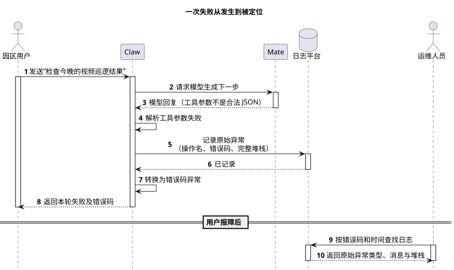
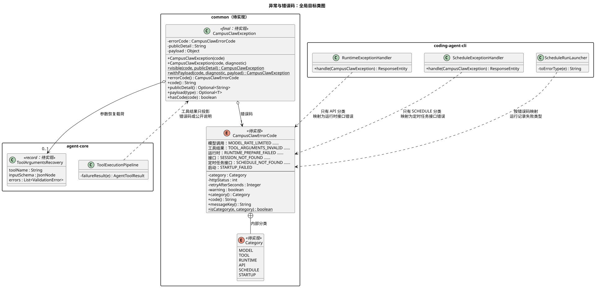
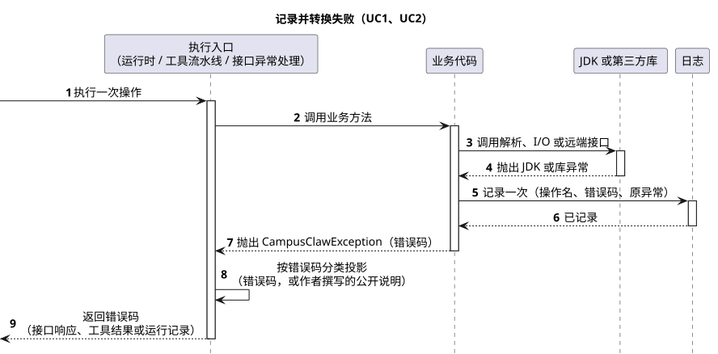

# CampusClaw 异常与错误码设计

[模块索引](../../README.md#module-index) · [Agent 架构对比 A17](../07-Agent架构对比/README.md#a17) · [PlantUML 源码](diagram.puml)

| 属性 | 值 |
|---|---|
| 文档版本 | 0.1.0 |
| 更新日期 | 2026-10-15 |
| 模块 | M12 · 异常与错误码（横切 M01～M11 的 Java 实现） |
| 设计状态 | 待实现。统一根异常、错误码接口、错误码族迁移与构建期拦截均待实现；转换时保留原始异常的日志规则与 `CatchCauseLost` 已由 Java PR #347 实现并合入 |
| 源码基线 | Claw Java main `455445a4db136a58381f866e073a82d1f16ff1f1`（2026-10-15 fetch，含 PR #347） |
| 主基线 | DeepSeek Harness master `571902028a75c64c1d767f4ae5fd099485f0ddf0`（开发者预览）与 Codex main `e89b7c442c0433ad5167e72a5a25bb6d0712766a`，均于 2026-10-15 fetch；OpenCode dev `4397ee44d038a5f17bf6ac161431673d93e563b5`、pi main `9a3ca68bda4db67efc506ec114bffe64635e8569` 作对照 |

## 评审记录

### 评审结论

【缺口】尚未评审。

### 评审 Todo

| # | 事项 | 负责人 | 来源 |
|---|---|---|---|
| T1 | 确认错误码按模块分枚举（D2），而不是讨论中举例的单一 `ClawErrorCode` | Lotus | [D2](#key-decisions) |
| T2 | 确认不采用 DSH、Codex 的 cause 链，沿用[简化异常日志设计](../05-CampusClaw调用日志/README.md)的“源头记录、只抛错误码”（D4） | Lotus | [D4](#key-decisions) |
| T3 | 确认唯一保留的子类 `ToolArgumentsInvalidException` 的例外条件 | Lotus | [D1](#key-decisions) |

### 需求信息

需求来源：2026-10-15 讨论串“parseArguments 抛异常时丢失异常堆栈”。用户确认的写法为 `LOGGER.error("xxx", e); throw new CampusClawException(XxxErrorCode.Y)`，只捕获 JDK 自带异常、第三方库异常或 `CampusClawException`，各自定义异常类合并为一个共用类、以错误码区分。【缺口】没有需求编号、优先级和目标版本。

<a id="problem"></a>

## 1. 概述

### 1.1 术语解释

| 术语 | 含义 |
|---|---|
| 错误码 | 机器可判别的失败类别，枚举常量名即对外字符串，例如 `TOOL_ARGUMENTS_INVALID` |
| 错误码族 | 实现 `ErrorCode` 的一个枚举，例如 `RuntimeErrorCode`；用来判断一类失败由谁处理 |
| 公开说明（publicDetail） | 作者撰写、可以展示给调用方或模型的文字，例如“Path does not exist” |
| 诊断文字（diagnostic） | 作者撰写、只进日志的上下文，例如 Agent ID 与操作名；不进入任何对外投影 |
| 源头记录 | 在第一次捕获 JDK 或库异常的 catch 中，带原异常记录一次日志 |
| 投影 | 把异常转换为接口响应、工具结果、事件或运行记录的过程 |

### 1.2 需求整理

| 编号 | 需求 | 类型 | 来源 |
|---|---|---|---|
| R1 | 任何异常转换都不能丢失原始异常的类型、消息与堆栈 | 稳定性 | 讨论串原始问题；PR #347 已部分落实 |
| R2 | 业务代码只抛 JDK 标准异常或一个共用的 `CampusClawException`，以错误码区分失败类别 | 约束 | 用户确认 |
| R3 | catch 只捕获 JDK、第三方库异常或 `CampusClawException`，按错误码而非异常类型或消息判断 | 约束 | 用户确认；DSH 规则 |
| R4 | 对外（接口、事件、工具结果、运行记录）只给错误码或作者撰写的公开说明，不透传内部异常消息 | 安全 | 用户确认；现有 J07 规则 |
| R5 | 迁移不改变现有接口响应、事件、工具结果和定时运行记录中的任何错误码与文字 | 约束 | 推导，需确认 |
| R6 | 构建期拦截新增自定义异常类和丢失原始异常的 catch | 稳定性 | “彻底解决”要求 |

## 2. 整体方案

<a id="business-use-cases"></a>

### 2.1 业务用例

Agent 服务在调用模型、工具和外部系统时会失败。用户需要一个稳定、能说清楚的失败结果，运维人员需要凭这个结果找到当时的原始异常和调用位置；如果失败在转换时只留下一句消息或一个码，问题就无法复现。本模块统一 Claw 内部的异常类型和错误码，让每次失败都对外给出稳定的错误码，同时在日志里保留完整的原始异常。

| 编号 | 参与者 | 业务目标 | 业务结果 |
|---|---|---|---|
| BU1 | 园区用户 | 知道本次请求为什么没有完成 | 看到稳定的错误码（工具类失败还能看到可读说明），不看到内部堆栈或第三方报文 |
| BU2 | 运维人员 | 按用户报告的错误码定位失败原因 | 在日志中查到该次失败的原始异常类型、消息和完整堆栈 |
| BU3 | 开发人员 | 新增一种失败 | 只需新增一个错误码常量，按统一写法抛出和记录 |

<a id="overall-sequence"></a>

### 2.2 整体时序

场景：用户请求检查视频巡逻结果，模型返回的工具参数不是合法 JSON；从用户发消息开始，到运维人员按错误码查到原始堆栈结束。覆盖 BU1、BU2。

| 参与者 | 职责 | 映射 |
|---|---|---|
| 园区用户 | 发起请求并接收失败结果 | 浏览器经 Mate 访问 |
| Claw | Agent 服务：调用模型、解析响应、转换失败 | `coding-agent-cli` 进程，含 ai、agent-core 模块 |
| Mate | 模型调用网关 | 外部服务 |
| 日志平台 | 保存 Claw 日志 | SLF4J 输出的收集端 |
| 运维人员 | 按错误码排查 | 人 |



[原尺寸 SVG](exception_overview.svg) · [PlantUML 源码](diagram.puml#L1)

| 阶段 | 详细时序 |
|---|---|
| 步骤 4～8：记录并转换失败 | [§3.3 记录并转换失败的详细时序](#translation-sequence) |
| 步骤 9～10：按错误码查找日志 | 无详细时序：日志平台的检索能力不属于本模块 |

<a id="key-decisions"></a>

### 2.3 关键设计决策

本模块属于 Runtime 内核的实现约定，按问题选择基线：异常类型结构以 DSH 和 Codex 为主，OpenCode 与 pi 对照；Claude Managed Agents 没有公开服务端源码，只在公共错误形状上可比，而公共形状本设计不变。证据见 [§8.2](#source-evidence)。

| # | 要解决的问题 | 基线怎么做 | 业务约束 | 我们的选择 | 代价 |
|---|---|---|---|---|---|
| D1 | 失败类别用异常类型区分，还是用一个异常加错误码区分？ | DSH 用一个 `HarnessError` 基类携带 `code` 与 `cause`，按包派生 19 个子类，规则要求“按 code 路由，不解析 message”；Codex 用单一 `CodexErr` 包装 `CodexErrorDetails` 枚举并以 `CodexErrKind` 判别；OpenCode 用 219 个 `Schema.TaggedError` 类，tag 即类别；pi 有 47 个各自的 `extends Error` | Claw 现有 18 个自定义类，其中 9 个已靠 `StableErrorCode` 接口暴露码，类型与码两套判别并存；新代码不断新增类 | 一个 `CampusClawException` 加错误码。只有需要携带结构化载荷的失败才派生子类，目前仅 `ToolArgumentsInvalidException`（工具名、Schema、校验错误用于参数恢复） | 失去按类型 catch：约 45 处判断改为检查错误码族；多重 catch 不再能表达类别，编译器也不再检查是否漏处理某类失败 |
| D2 | 错误码放在一个全局枚举，还是按模块分枚举？ | Codex 一个 `CodexErrorDetails` 枚举集中定义；DSH 码是各包自定义的字符串常量 | 模块依赖方向为 common ← ai ← agent-core ← cron ← coding-agent-cli；`RuntimeErrorCode` 带 Spring `HttpStatus`，不能下沉到无 Spring 依赖的 common | `ErrorCode` 接口放 common，各模块保留或新建自己的枚举：`MateInvocationErrorCode`、`ToolErrorCode`（新）、`CronErrorCode`、`AgentRuntimeErrorCode`、`RuntimeErrorCode`。枚举类型即错误码族，用于判断谁处理 | 不同族可能同名（现有 `MANAGER_UNAVAILABLE` 在两个族中都有），按名称比较会混淆，投影必须先判断族；讨论中举例的单一 `ClawErrorCode` 未采纳 |
| D3 | 对外文字和日志文字怎样分开？ | DSH 规则“separate machine identity from display text”；Codex 用 `to_codex_protocol_error` 把内部错误映射为协议错误，HTTP 状态单独映射 | 部分工具失败需要模型能读懂的说明（如“Path does not exist”），其他失败只能对外给码 | 异常带三个通道：错误码（总是对外）、公开说明（只由 `visible(...)` 设置，作者撰写）、诊断文字（只进日志）。所有投影只读错误码和公开说明 | 抛出方要选对通道；诊断文字是否含敏感信息无法机械检查，靠评审 |
| D4 | 原始异常由谁保留？ | DSH 规则“preserve causes”，`HarnessError` 支持 cause 链；Codex `Io(#[from] io::Error)` 等变体保留来源错误；Claw 已确认的[简化异常日志设计](../05-CampusClaw调用日志/README.md)要求源头记录、转换后的异常无 cause、无堆栈 | 公共错误不能带内部 cause；捕获点最清楚当时在做什么操作；日志按 logger name 定位源类 | 采用用户确认的写法并沿用既有规则：持有原异常的 catch 带原异常记录一次日志，再抛只含错误码的 `CampusClawException`。根异常不提供带 cause 的构造器，也不采集堆栈。现有约 10 处把 cause 传给下一层的位置改为在源头记录 | 不采用 cause 链：源头漏记就彻底丢失原异常，只能靠 `CatchCauseLost` 拦截常见写法（它只证明原异常被传给了某个方法，不证明真的记录）；上层无法再从异常里取原因做诊断，需要诊断的逻辑要搬到源头 |
| D5 | 怎样防止以后再出现自定义异常类和丢失堆栈？ | 未核验各基线的构建期规则；DSH 以 Agent 技能文档约束 | 问题由代码生成工具反复引入，仅靠文档会再次发生 | 在现有 PMD 规则集中新增 `CustomExceptionClass`：除 `CampusClawException` 及其子类外，禁止声明继承 Throwable 的类；保留 `CatchCauseLost`；AGENTS.md 同步规则 | 新增载荷子类需要评审判断是否真的携带结构化数据；XPath 按名称判断，`extends` 第三方异常的少见写法可能漏检 |

## 3. 详细设计

### 3.1 系统用例

| 用例 | 对应业务用例 | 触发者 | 前置条件 | 主成功结果 | 关键约束 |
|---|---|---|---|---|---|
| UC1 | BU2 | 业务代码中的 catch | 捕获到 JDK 或库异常 | 日志中有一条带原异常、操作名和错误码的记录 | 每次失败只在源头记录一次；转换后的异常无 cause、无堆栈 |
| UC2 | BU1 | 运行时、工具流水线、接口异常处理、定时任务引擎 | 收到 `CampusClawException` | 对外只给错误码或公开说明 | 只有 `RuntimeErrorCode` 族映射为接口错误码；其他族按现有兜底处理 |
| UC3 | BU3 | 开发人员 | 需要表达新的失败 | 在所属模块的错误码枚举中新增常量 | 不新增异常类；构建期 PMD 拦截 |

<a id="data-model"></a>

### 3.2 数据模型

本模块不涉及数据库表。定时运行记录的 `error_code` 列继续保存错误码名称，取值不变。



[原尺寸 SVG](exception_architecture.svg) · [PlantUML 源码](diagram.puml#L65)

分层理由：`ErrorCode` 和根异常放在依赖链最底层的 common，任何模块都能抛出；错误码族留在拥有该失败语义的模块，`RuntimeErrorCode` 继续携带 HTTP 状态而不污染 common。三个投影入口只依赖根异常的错误码和公开说明，因此新增错误码不需要改投影代码；`StableErrorCode` 接口因此失去存在理由而删除。

现有 18 个自定义类的去向如下。“对外内容”列是迁移前后都必须保持的工具结果或接口内容。

| 现有类 | 模块 | 目标写法 | 对外内容 |
|---|---|---|---|
| `ToolArgumentsInvalidException` | agent-core | 保留，改为 `CampusClawException` 子类，`ToolErrorCode.TOOL_ARGUMENTS_INVALID` | 错误码及参数恢复内容，不变 |
| `ToolSchemaInvalidException` | agent-core | 源头记录 Schema 解析异常，再 `new CampusClawException(ToolErrorCode.<原码>)` | 错误码 |
| `MateModelInvocationException` | ai | `new CampusClawException(MateInvocationErrorCode.X)` | 错误码 |
| `AgentRuntimeException` | coding-agent-cli | `new CampusClawException(AgentRuntimeErrorCode.X, diagnostic)`，缺省码 `RUNTIME_PREPARE_FAILED` | 错误码 |
| `RuntimeApiException` | coding-agent-cli | `new CampusClawException(RuntimeErrorCode.X)` | 接口错误码与 HTTP 状态，不变 |
| `BuildModeRequiredException`、`RuntimeToolCallDeniedException`、`PlanReviewException`、`UserQuestionException`、`MateToolResponseException`、`SearchTools.SearchToolsException`、`MateToolResolver.ResolutionException`、`MateToolExecutor.InvalidDefinitionException` | coding-agent-cli | `new CampusClawException(ToolErrorCode.<原字符串码>)`，原先带 cause 的位置改为源头记录 | 错误码，字符串值不变 |
| `WorkspaceAccessException` | coding-agent-cli | `CampusClawException.visible(ToolErrorCode.WORKSPACE_ACCESS_DENIED, 原文字)` | 原文字，例如“Path does not exist” |
| `SkillTool.SkillExecutionException` | coding-agent-cli | `visible(ToolErrorCode.SKILL_EXECUTION_FAILED, 原文字)` | 原文字 |
| `MateToolExecutionException` | coding-agent-cli | `visible(ToolErrorCode.MATE_TOOL_EXECUTION_FAILED, 原文字)` | 原文字 |
| `SkillLoadException` | coding-agent-cli | `new CampusClawException(AgentRuntimeErrorCode.SKILL_LOAD_FAILED, diagnostic)`，原先带 cause 的位置改为源头记录 | 不对外，加载时跳过无效 Skill |
| `CampusClawApplication.StartupException` | coding-agent-cli | `new CampusClawException(<启动错误码>)` | 进程退出前的日志，取值不变 |

`ToolErrorCode` 的常量名与 `ClawConstants.RuntimeApi` 中的公开白名单字符串逐字相同，公共事件投影 `RuntimeCommittedEventFactory.toolErrorCode` 不需修改；新增的内部码（如 `WORKSPACE_ACCESS_DENIED`）不在白名单中，按现有规则投影为 `TOOL_EXECUTION_FAILED`。

<a id="translation-sequence"></a>

### 3.3 记录并转换失败的详细时序（UC1、UC2）



[原尺寸 SVG](exception_translation.svg) · [PlantUML 源码](diagram.puml#L36)

步骤 5～7 是统一写法：

```java
} catch (JsonProcessingException error) {
    LOGGER.error("Failed to parse tool arguments, operation={}, errorCode={}",
            "mate.response.toolArguments.parse", MateInvocationErrorCode.RESPONSE_INVALID, error);
    throw new CampusClawException(MateInvocationErrorCode.RESPONSE_INVALID);
}
```

步骤 8 的投影规则：

| 投影入口 | 规则 | 迁移前对应实现 |
|---|---|---|
| 工具流水线 `ToolExecutionPipeline.failureResult` | `CampusClawException`：内容为公开说明，没有时为错误码，details 带 `errorCode`；其他异常保持现有 `getMessage()` 行为 | `StableErrorCode` 只给码，其余给消息 |
| 接口 `RuntimeExceptionHandler` | 错误码属于 `RuntimeErrorCode` 时按原映射返回且不记录；其他族带堆栈记录并按现有兜底返回内部错误 | `@ExceptionHandler(RuntimeApiException.class)` |
| 定时任务 `CronEngine`、`CronJobExecutor` | 运行记录保存 `code()`，其他异常保存 `CRON_EXECUTION_FAILED` | `StableErrorCode.stableErrorCode()` |

原先“先 catch `RuntimeApiException` 原样抛出、再 catch `RuntimeException` 转换”的约 20 处，改为 catch `RuntimeException` 后用 `RuntimeErrorCode.isApiError(error)` 判断是否原样抛出，保持只放行接口错误码族。其他按类型判断的位置（Skill 加载跳过、Mate 调用失败识别、工具 Schema 诊断等）改为判断错误码族或具体错误码，不匹配时原样抛出。

## 4. 接口协议

本模块不新增或修改接口。现有接口的错误码、HTTP 状态、`Retry-After`、公共事件中的工具错误码和定时运行记录的错误码保持不变，契约仍由各模块维护。

## 5. 架构指标

### 5.1 安全性

- 对外投影只读错误码和公开说明；公开说明只能由 `visible(...)` 设置，并且只用作者撰写的固定文字与已校验的标识。
- 诊断文字只进日志，根异常不携带 cause。禁止把捕获异常的 `getMessage()` 放入公开说明或诊断文字；需要时把原异常交给日志。
- 新增内部错误码不在公共白名单内时按 `TOOL_EXECUTION_FAILED` 对外，不会泄露内部分类。

### 5.2 稳定性

#### 5.2.1 失败处理与恢复

**不变量**（任何失败都不能破坏）：

1. 每次转换都能在源头日志中找到原始异常。
2. 对外错误码与迁移前逐字一致。
3. 公共投影不包含诊断文字、原始异常或堆栈。

| # | 失败 | 发生阶段 | 副作用状态 | 处理方 | 系统处置 | 用户可见结果与下一步 | 不保证项 |
|---|---|---|---|---|---|---|---|
| F1 | 非 `RuntimeErrorCode` 族的异常到达接口层 | 投影 | 未发生 | `RuntimeExceptionHandler` | 带堆栈记录，返回内部错误 | 内部错误码；运维按时间查日志 | 不推断更具体的接口错误码 |
| F2 | 原先按类型放行的 catch 迁移后误吞了其他族 | 迁移 | 未发生 | 各捕获点 | 判断族或具体码，不匹配原样抛出；每处有测试 | 与迁移前相同 | 未覆盖测试的分支依赖评审 |
| F3 | 不同族同名错误码被按名称比较 | 投影 | 未发生 | 投影入口 | 先判断族再比较；接口只认 `RuntimeErrorCode` | 与迁移前相同 | 日志与运行记录只存名称，跨族同名需结合日志上下文区分 |
| F4 | 抛出方把内部消息放进公开说明 | 编码 | 已提交 | 评审、AGENTS.md | 评审拦截；PMD 不检查参数内容 | 可能看到内部文字 | 无机械保证 |
| F5 | 源头 catch 只读了 `getMessage()` 或没有记录原异常 | 编码 | 已提交 | PMD `CatchCauseLost` | 构建失败 | 无 | 原异常传给了不记录的方法时无法发现 |

#### 5.2.2 容量与限流

不涉及：根异常不采集堆栈，与现有 `RuntimeApiException` 相同。

#### 5.2.3 监控告警

【缺口】现有日志未按错误码聚合；本设计只保证每次失败日志中带错误码，告警阈值另行设计。

#### 5.2.4 应急预案

纯代码重构，无运行时开关；出现行为差异时回滚实现 PR。

### 5.3 兼容性

- 对外契约不变（R5），由迁移前后的现有接口、事件与工具结果测试共同验证。
- 二进制兼容：删除的异常类都是 Claw 内部类型，公司镜像 `campusclaw/` 由同步脚本重新生成，无外部调用方。
- `ToolArgumentsInvalidException` 不再是 `IllegalArgumentException`，`AgentRuntimeException`、`MateToolResponseException` 的替代者不再是 `IllegalStateException`；依赖这些父类的 catch 与异常处理器在迁移中逐一检查。

## 6. 质量保证

### 6.1 灰度能力

不涉及：无运行时开关，随版本发布。

### 6.2 回滚能力

回滚实现 PR 即可；无数据迁移，运行记录中的错误码取值不变。

<a id="acceptance"></a>

### 6.3 自动化测试

| 切片 | 内容 | 验收 |
|---|---|---|
| S1 | common 新增 `ErrorCode`、`CampusClawException` | 单测覆盖消息优先级、公开说明、`hasCode`、无 cause 与空堆栈 |
| S2 | 各错误码族实现 `ErrorCode`，新增 `ToolErrorCode` | 单测证明 `ToolErrorCode` 与公开白名单字符串逐字一致 |
| S3 | 三个投影入口改读根异常，删除 `StableErrorCode` | 流水线测试区分公开说明与只给码；接口与定时任务现有测试不改期望值 |
| S4 | 迁移 18 个类及约 45 处按类型判断的位置；原先带 cause 的位置改为源头记录 | 全量单测通过；逐处保留或补充“不匹配族原样抛出”的测试；源头记录有日志捕获测试 |
| S5 | PMD `CustomExceptionClass`、AGENTS.md 规则，镜像同步 | 规则能拦截示例代码；`pmd:check`、Checkstyle、Spotless 通过；`campusclaw/` 同步 |

### 6.4 QA 流程

【缺口】无独立 QA 流程；以实现 PR 的 CI 与评审为准。

## 7. 基建规范

- PMD 规则集 `pmd-ruleset.xml` 绑定 `process-test-classes`，覆盖 main 与 test。
- 代码规则写入 Java 仓 AGENTS.md“数据、异常与线程”节；跨仓经验沉淀在 codex-style J07。

## 8. 其他补充

<a id="source-evidence"></a>

### 8.1 Claw 源码证据

Java main `455445a4db136a58381f866e073a82d1f16ff1f1`，2026-10-15 fetch。

| 路径 | 符号 | 证明范围 |
|---|---|---|
| `modules/agent-core/src/main/java/com/campusclaw/agent/error/StableErrorCode.java` | `StableErrorCode` | 9 个类靠该接口暴露码，与类型判别并存 |
| `modules/agent-core/src/main/java/com/campusclaw/agent/tool/ToolExecutionPipeline.java` | `failureResult`、`messageForException` | 带码异常只给码，其余给 `getMessage()` |
| `modules/coding-agent-cli/src/main/java/com/campusclaw/codingagent/runtimeapi/error/RuntimeApiException.java` | 构造器 `super(code, cause, false, false)` | 接口异常无堆栈，但仍有带 cause 的构造器 |
| `modules/coding-agent-cli/src/main/java/com/campusclaw/codingagent/runtimeapi/web/RuntimeExceptionHandler.java` | `@ExceptionHandler(RuntimeApiException.class)` | 接口错误映射且不记录 |
| `modules/coding-agent-cli/src/main/java/com/campusclaw/codingagent/runtimeapi/event/RuntimeCommittedEventFactory.java` | `toolErrorCode` | 公共工具错误码白名单，未知码投影为 `TOOL_EXECUTION_FAILED` |
| `modules/common/src/main/java/com/campusclaw/common/constant/ClawConstants.java` | `RuntimeApi.*_ERROR_CODE`、`TOOL_ERROR_CODES` | 约 30 个字符串码 |
| `modules/cron/src/main/java/com/campusclaw/cron/engine/CronEngine.java`、`CronJobExecutor.java` | `stableCodeOf` | 运行记录只存码 |
| `modules/ai/src/main/java/com/campusclaw/ai/provider/mate/MateChatSseParser.java` | `parseArguments` | 原问题位置，PR #347 已补带原异常记录 |
| `pmd-ruleset.xml` | `CatchCauseLost` | PR #347 已实现的构建期拦截 |

### 8.2 基线证据

均于 2026-10-15 确认默认分支并 fetch 最新 HEAD。

| 基线 | 提交 | 路径与符号 | 结论 |
|---|---|---|---|
| DeepSeek Harness（开发者预览） | master `571902028a75c64c1d767f4ae5fd099485f0ddf0` | `packages/llm/llm/src/error.ts` `HarnessError`；`packages/core/tools/src/schema.ts` `ToolArgsError`；`packages/core/tools/src/index.ts` `ToolNotFoundError`；`.agents/skills/dsh-error-handling/SKILL.md` | 一个基类携带稳定 `code` 和 cause，19 个按包派生的子类；规则要求预期失败有稳定判别、保留 cause、机器标识与展示文字分开、不解析 message |
| Codex | main `e89b7c442c0433ad5167e72a5a25bb6d0712766a` | `codex-rs/protocol/src/error.rs` `CodexErr`（L78）、`CodexErrKind`（L96）、`CodexErrorDetails`（L101）、`Io(#[from] io::Error)`（L210）、`to_codex_protocol_error`（L487）、`http_status_code_value`（L546） | 单一错误类型加枚举判别，边界处映射为协议错误与 HTTP 状态 |
| OpenCode | dev `4397ee44d038a5f17bf6ac161431673d93e563b5` | `Schema.TaggedError` 共 219 处；`packages/core/src/util/error.ts` `NamedError.create` | 每类失败一个带 tag 的类，tag 即类别 |
| pi | main `9a3ca68bda4db67efc506ec114bffe64635e8569` | 47 处 `extends Error` | 无统一约定 |

DSH 与本设计最接近：一个带码的基类，子类只在需要时出现。Claw 进一步把“需要时”限定为携带结构化载荷，因为 Java 的 catch 按类型匹配，子类一多就会回到按类型判别的老路。

### 8.3 版本历史

| 版本 | 日期 | 变更 |
|---|---|---|
| 0.1.0 | 2026-10-15 | 新增统一异常与错误码设计：一个只带错误码的根异常、按模块的错误码族、三通道文字与构建期拦截。 |
