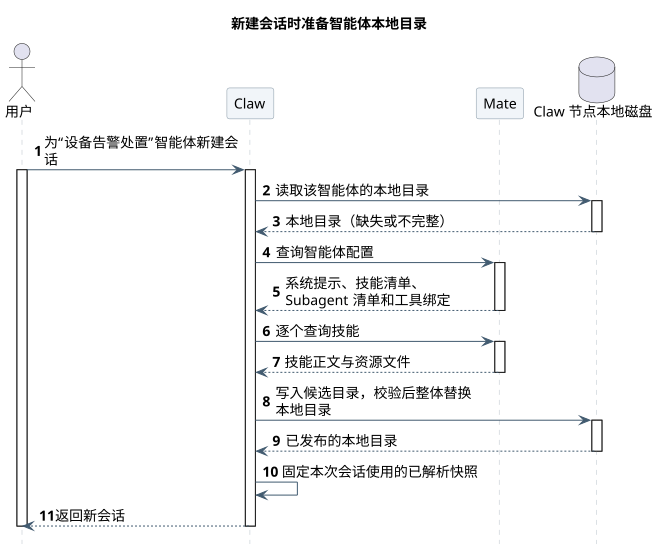
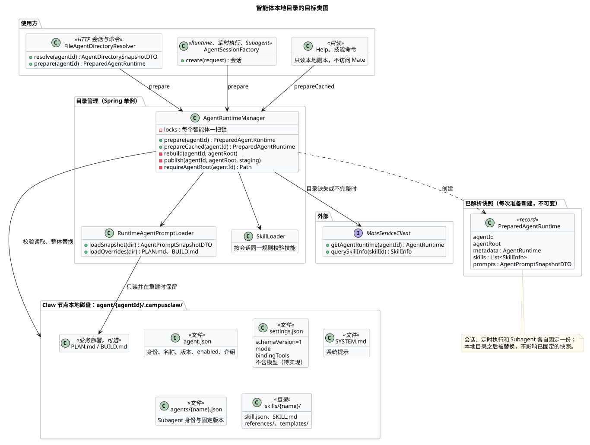
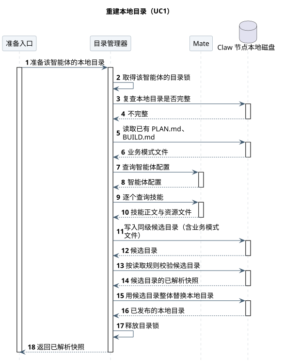
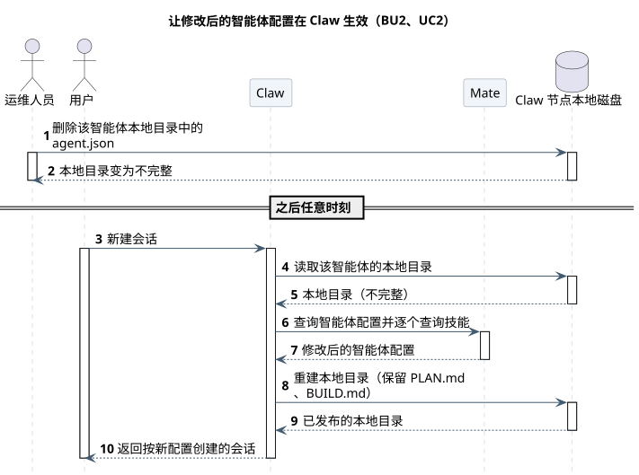

# CampusClaw 智能体本地目录设计

[模块索引](../../README.md#module-index) · [源码与基线证据](source-evidence.md) · [架构对比 A21](../07-Agent架构对比/README.md#a21)

| 属性 | 值 |
|---|---|
| 文档版本 | 1.0.0 |
| 更新日期 | 2026-10-22 |
| 模块 | M13 · 智能体本地目录 |
| 设计状态 | 准备、校验、整体替换、业务模式文件保留与只读副本已实现；删除 `refresh` 在 [pi-mono-java#381](https://github.com/superheromeZzh/pi-mono-java/pull/381) 待合并；目录不再保存模型待实现，见 [Model §2](../../02-服务与接口/03-Model/README.md#model-source) |
| 源码基线 | Claw Java main `3ade086fcbbe1f88b6729ef5f85d0e595d5b9421`（2026-10-22 fetch）；#381 head `e5126ac355b208fb00a4eabbda4fcc739669b31e` |
| 主基线 | Claude Managed Agents 中文公开文档（2026-10-22 读取，无服务端源码）；pi main `476a303c`、Codex main `94350a91`、OpenCode dev `b42c3161`（均 2026-10-22 fetch），见[证据 §2](source-evidence.md#baseline-evidence) |

## 评审记录

### 评审结论

评审中。评审人：Lotus；开始日期：2026-10-22。结论待评审完成后填写。

<a id="review-todo"></a>

### 评审 Todo

| # | 事项 | 负责人 | 来源 |
|---|---|---|---|
| T1 | 智能体配置在 Mate 修改后，目前要运维人员在每个 Claw 节点删除 `agent.json` 才生效。是否改为按 Mate 返回的版本自动重建（Codex、OpenCode 的做法），需要 Mate 提供版本或内容指纹 | 用户 | [D2](#key-decisions) |
| T2 | 技能资源文件写入前没有总大小上限，只受 Mate 响应 4 MiB 限制；是否需要单独的目录大小上限 | Claw | [§5.2.2](#capacity) |
| T3 | 目录锁只在单个 Claw 进程内有效；同一磁盘被多个 Claw 进程共享时是否需要文件锁，取决于部署方式，部署方式未确认 | 用户 | [D3](#key-decisions) |
| T4 | `settings.json` 缺失、损坏或不合规时准备直接失败而不是重建（F6）。这会让“目录不再保存模型”上线后的版本回滚需要人工删除文件（[§6.2](#rollback)）；是否改为按不完整处理并重建 | 用户 | [§3.2](#data-model) |

### 需求信息

本文把原来分散在工具系统、多 Agent 运行时、计划模式、Help 和 Model 中的“受管目录”说明收拢为一个主题，并改称“智能体本地目录”（用户 2026-10-22 要求）。删除 `refresh` 的要求同日由用户确认。

## 1. 概述

### 1.1 术语解释

措辞参考 [Claude Managed Agents 中文文档](https://platform.claude.com/docs/zh-CN/managed-agents/agent-setup)（2026-10-22 读取）。其他设计文档中的 “Agent” 与本文的“智能体”指同一事物。

| 术语 | 含义 |
|---|---|
| 智能体 | 运营人员在 Mate 上配置的业务角色，例如“设备告警处置”。与 Claude Managed Agents 一样，它把模型、系统提示、工具和技能打包在一起，决定会话中的行为 |
| 智能体配置 | 智能体在 Mate 中的定义。以 Mate 为准，Claw 只读取 |
| 智能体本地目录 | Claw 节点磁盘上的 `agent/{agentId}/.campusclaw/`，保存智能体配置在本节点的副本（不含模型），以及业务部署的 `PLAN.md`、`BUILD.md` |
| 智能体工作区 | `agent/{agentId}/`。本地目录在其中，Read、Find、Grep、Ls 只能访问这个范围，见[工具系统 §5](../02-CampusClaw工具系统/README.md#agent-workspace-boundary) |
| 系统提示 | 定义智能体行为和角色设定的文本，保存为 `SYSTEM.md` |
| 技能 | Skill。按需加载的领域说明及其资源文件，保存在 `skills/{name}/` |
| Subagent | 父智能体通过 `Agent` 工具调用的智能体（Claude Managed Agents 称“子智能体”，本仓按 [AGENTS.md 术语](../../AGENTS.md)写作 Subagent）。本地目录只保存它的身份和固定版本 |
| 准备 | 取得一份可用的本地目录：完整就直接用，缺失或不完整就从 Mate 重建 |
| 已解析快照 | 一次准备得到的不可变结果（`PreparedAgentRuntime`）。会话、定时执行和 Subagent 各自固定一份，与 Claude Managed Agents 会话响应中的“已解析快照”含义相同 |

<a id="requirements"></a>

### 1.2 需求整理

| 编号 | 需求 | 类型 | 来源 |
|---|---|---|---|
| R1 | 新建会话、定时执行和 Subagent 运行前，都能取得同一个智能体的系统提示、技能、Subagent 清单和工具绑定 | 功能 | 源码现状 |
| R2 | 本地副本完整时不访问 Mate | 约束 | 源码现状 |
| R3 | 读取方只看到完整的旧目录或完整的新目录，不会看到写了一半的目录 | 稳定性 | 源码现状 |
| R4 | 目录只能落在本智能体工作区内；符号链接、越界路径和集中式 `tools.json` 使目录无效 | 安全 | [ADR-0044](https://github.com/superheromeZzh/pi-mono-java/blob/main/docs/decisions/0044-validate-managed-agent-root-containment.html)、源码现状 |
| R5 | 模型不进入本地目录，每次需要时从 Mate 实时读取 | 约束 | 用户 2026-10-22，[Model §2](../../02-服务与接口/03-Model/README.md#model-source) |
| R6 | 重建本地目录时保留业务部署的 `PLAN.md`、`BUILD.md` | 功能 | [计划模式 §1.1](../06-CampusClaw计划模式/plan-policy.md#business-mode-files) |
| R7 | 运行时不提供强制重建入口；`refresh` 删除 | 约束 | 用户 2026-10-22 |
| R8 | 正在运行的会话不因本地目录被替换而改变配置 | 稳定性 | 源码现状 |

## 2. 整体方案

### 2.1 业务用例

一个业务智能体由系统提示、技能、可调用的 Subagent 和工具组成，这些都在 Mate 上配置。用户在 Claw 上和智能体对话时，Claw 要拿到这份配置，而技能正文和资源文件还要能被智能体用本地文件工具读取。本模块在每个 Claw 节点上维护一份智能体配置的本地副本，并保证读取方拿到的副本完整、属于这个智能体、在会话运行期间不变。

| 编号 | 参与者 | 业务目标 | 业务结果 |
|---|---|---|---|
| BU1 | 用户 | 和“设备告警处置”智能体开始一次会话 | 会话创建成功，智能体按 Mate 上的系统提示和技能工作 |
| BU2 | 运维人员 | 让 Mate 上修改过的智能体配置在 Claw 生效 | 之后新建的会话使用修改后的配置；已经在运行的会话不变 |
| BU3 | 业务部署人员 | 为某个智能体提供自己的计划说明和实施说明 | 该智能体的计划模式和实施模式使用业务提供的 `PLAN.md`、`BUILD.md` |

<a id="overall-sequence"></a>

### 2.3 整体时序

场景：用户为“设备告警处置”新建会话，该智能体在本节点还没有本地目录。从用户发出请求开始，到会话创建结束。模型的读取不在本图，见 [Model §2.3](../../02-服务与接口/03-Model/README.md#model-source)。

| 参与者 | 职责 | 映射 |
|---|---|---|
| 用户 | 新建会话 | 前端或 Mate 公共接口 |
| Claw | 准备本地目录，固定已解析快照，创建会话 | `RuntimeSessionService`、`FileAgentDirectoryResolver`、`AgentRuntimeManager` |
| Mate | 智能体配置以它为准 | `GET /mate-service/v1/agents/{id}/runtime`、`GET /mate-service/v1/skill/query/{id}` |
| Claw 节点本地磁盘 | 保存本地目录 | `campusmate.runtime.agents-root` 下的 `agent/{agentId}/.campusclaw/` |



[原尺寸 SVG](agent_local_dir_overview.svg) · [PlantUML 源码](diagram.puml#L1)

| 阶段 | 详细时序 |
|---|---|
| 步骤 2～9：重建本地目录 | [§3.3](#rebuild-sequence) |
| 步骤 10：固定已解析快照 | [§3.2](#data-model) 末段 |

本地目录完整时，步骤 3 返回完整目录，跳过步骤 4～9。

<a id="key-decisions"></a>

### 2.4 关键设计决策

| # | 要解决的问题 | 基线怎么做 | 业务约束 | 我们的选择 | 代价 |
|---|---|---|---|---|---|
| D1 | 智能体配置在 Claw 侧以什么形式存在 | Claude Managed Agents：智能体是服务端带版本的资源，用 ID 创建会话时使用最新版本，响应给出已解析快照，没有本地副本（公开文档）。pi：配置就是本机 `~/.pi/agent/` 下的 `SYSTEM.md`、`settings.json` 和技能目录，由用户自己维护。OpenCode：远端技能按 URL 拉到全局缓存目录后按本地技能加载 | 技能正文和资源要能被 Read、Grep 等本地工具读取，而这些工具只看智能体工作区；技能加载沿用文件规则（`SkillLoader`） | 在每个 Claw 节点保存一份本地文件副本，按智能体分目录。模型例外，不进目录，每次实时读取（R5） | 副本可能落后于 Mate；每个节点各有一份 |
| D2 | 什么时候重建本地副本 | Codex：内置技能写入 `CODEX_HOME/skills/.system`，用内容指纹文件判断，指纹不同就整个重写。OpenCode：每次加载都取远端索引，`.opencode-version` 不同才重新下载。pi：用户执行 `/reload` 才重新读取 | Mate 目前不提供版本比较或变更通知；`refresh` 没有调用方（用户要求删除） | 只按完整性判断：完整就用，缺失或不完整才重建；不比较版本，没有定时刷新，也没有强制重建入口。要让 Mate 上的修改生效，运维人员删除 `agent.json` | 生效依赖人工，多个节点要分别操作；是否改为按版本重建见 [T1](#review-todo) |
| D3 | 替换目录时怎样不让读取方看到一半 | OpenCode：写到临时目录，旧目录改名为备份，再把临时目录改名过去，失败时改回备份。Codex：先删除旧目录再写入新目录，中间状态可见 | 会话创建、命令列表、定时执行可能同时读同一个智能体；节点崩溃后不能留下半个目录 | 与 OpenCode 相同：同级候选目录写完并按读取规则校验后，原子移动替换，失败时恢复旧目录。同一进程内每个智能体一把锁，读取与重建互斥 | 要求候选目录和本地目录在同一文件系统；锁不跨进程（[T3](#review-todo)） |

## 3. 详细设计

<a id="system-use-cases"></a>

### 3.1 系统用例

| 用例 | 对应业务用例 | 触发者 | 前置条件 | 主成功结果 | 关键约束 |
|---|---|---|---|---|---|
| UC1 准备本地目录 | BU1、BU3 | 新建会话、命令列表与可选值、模型与思考切换、定时执行、Subagent | 智能体 ID 格式合法 | 返回已解析快照；目录缺失或不完整时先重建 | 完整时不访问 Mate；重建保留 `PLAN.md`、`BUILD.md` |
| UC2 让修改后的配置生效 | BU2 | 运维人员 | 能登录 Claw 节点 | 删除 `agent.json` 后，下一次 UC1 从 Mate 重建 | 不删除整个 `.campusclaw/`，否则业务模式文件丢失 |
| UC3 只读本地副本 | BU1 | Help、技能命令、已绑定技能查询 | 无 | 返回完整副本，或返回空 | 不访问 Mate，不触发重建 |

调用方对应源码：UC1 为 `FileAgentDirectoryResolver.prepare/resolve` 和 `AgentSessionFactory.create`；UC3 为 `AgentRuntimeManager.prepareCached`，调用点见[证据 §1](source-evidence.md#source-evidence)。

<a id="data-model"></a>

### 3.2 数据模型

本模块不使用数据库，数据是本地磁盘上的文件。

```text
agent/{agentId}/                 智能体工作区
└── .campusclaw/                 智能体本地目录
    ├── agent.json               身份
    ├── settings.json            默认模式与工具绑定
    ├── SYSTEM.md                系统提示
    ├── PLAN.md、BUILD.md         业务部署，可选
    ├── agents/{name}.json       每个直接 Subagent 一份
    └── skills/{name}/           每个技能一份
        ├── skill.json
        ├── SKILL.md
        ├── references/
        └── templates/
```

| 文件 | 关键字段 | 约束与生命周期 |
|---|---|---|
| `agent.json` | `schemaVersion=1`、`id`、`name`、`displayName`、`description`、`version`、`enabled`、`useCases` | `id` 必须等于目录名；缺失或损坏使目录不完整，下一次准备时重建 |
| `settings.json` | `schemaVersion=1`、`mode`、`bindingTools` | `bindingTools` 必须显式出现，合法的空值写 `[]`；缺这个字段时准备失败（见下方例外）。当前还写 `defaultModel`、`bindingModels`，删除待实现：新代码读取时忽略旧模型字段，`schemaVersion` 不升级，避免上线后所有智能体同时重建；旧字段在下一次重建时消失 |
| `SYSTEM.md` | 系统提示全文 | 必须存在 |
| `PLAN.md`、`BUILD.md` | 计划模式、实施模式说明 | 不来自 Mate，由业务部署放入；重建时原样带入新目录；缺失时使用内置说明，规则见[计划模式 §1.1](../06-CampusClaw计划模式/plan-policy.md#business-mode-files) |
| `agents/{name}.json` | `agentId`、`name`、`displayName`、`description`、`version`、`enabled` | 文件名与 `name` 一致；名称大小写折叠后唯一；必须有固定版本 |
| `skills/{name}/skill.json` | `schemaVersion=1`、`id`、`name`、`version`、`bindingTools` | 目录名、`skill.json` 的 `name`、`SKILL.md` frontmatter 的 `name` 三者一致；名称规则见 [ADR-0056](https://github.com/superheromeZzh/pi-mono-java/blob/main/docs/decisions/0056-enforce-declared-skill-name.html) |
| `skills/{name}/SKILL.md` | 技能正文 | Mate 返回的原文，不超过 1 MiB，`description` 必填，并用会话同一套 `SkillLoader` 校验 |

整个目录不允许出现符号链接或名为 `tools.json` 的文件，出现即视为不完整。

**完整的含义。** 上表每条约束都满足，才算完整。读取本地目录和校验候选目录用的是同一套规则（`loadSnapshot`），所以发布出去的目录一定能被读取，读取时发现损坏也一定会重建。只有一个例外：`settings.json` 缺失、损坏或不合规，而 `agent.json`、`SYSTEM.md` 中任一个还在时，准备直接失败，不重建（`loadSettings`、`hasPublishedRuntimeFiles`，测试 `shouldRejectOldCacheWhenAgentToolBindingsAreMissing`）。技能的 `skill.json` 不合规则按不完整重建。

**已解析快照。** 每次准备返回一个新的 `PreparedAgentRuntime`，包含身份、系统提示、技能、Subagent、工具绑定和模式说明的副本。会话在创建时固定一份，之后本地目录被替换也不影响它（R8）。定时执行和 Subagent 各自在开始时准备一次。



[原尺寸 SVG](agent_local_dir_classes.svg) · [PlantUML 源码](diagram.puml#L132)

目录管理器是 Spring 单例，持有每个智能体的锁；它产出的已解析快照不可变，按请求新建。使用方只依赖已解析快照，不直接读文件，这样读取规则只有一处。实施时先改 `settings.json` 的写入和校验（删除模型字段），再删除 `PreparedAgentRuntime.defaultModelId`，见 [Model §2.9](../../02-服务与接口/03-Model/README.md#model-source-todo)。

<a id="rebuild-sequence"></a>

### 3.3 重建本地目录的详细时序（UC1）



[原尺寸 SVG](agent_local_dir_rebuild.svg) · [PlantUML 源码](diagram.puml#L42)

| 步骤 | 说明 | 源码 |
|---|---|---|
| 1 | 先校验智能体 ID，再把配置的根目录和智能体目录都解析为真实路径；真实路径必须恰好等于 `根目录/{agentId}`，拒绝指向其他智能体的符号链接 | `requireAgentRoot` |
| 2 | 同一进程内每个智能体一把可重入锁；读取完整目录（UC3）也拿同一把锁 | `withAgentLock` |
| 3～4 | 锁内再检查一次，如果别的请求刚重建完，直接返回 | `prepare`、`loadIfComplete` |
| 5～6 | 读出已有的 `PLAN.md`、`BUILD.md`，非法时报错而不是丢弃 | `loadExistingModeOverrides` |
| 7～10 | 查询智能体配置，再按技能清单逐个查询；校验 ID、名称、版本和技能正文 | `getAgentRuntime`、`resolveSkills`、`requireValidRuntime` |
| 11 | 在 `agent/{agentId}/` 下新建 `.campusclaw-stage-*`，写入全部文件和业务模式文件 | `createStagingDirectory`、`writeRuntimeTree` |
| 12～14 | 用读取规则校验候选目录，得到已解析快照 | `loadSnapshot` |
| 15～16 | 旧目录原子移动为 `.campusclaw-backup-*`，候选目录原子移动为 `.campusclaw`，成功后删除备份；任一步失败就删掉新目录并移回旧目录 | `publish`、`rollbackPublish` |
| 17～18 | 无论成功失败都删除候选目录、释放锁 | `rebuild` 的 `finally` |

<a id="apply-change-sequence"></a>

### 3.4 让修改后的配置生效的详细时序（BU2、UC2）

本节独立对应 BU2，不在整体时序中。



[原尺寸 SVG](agent_local_dir_apply_change.svg) · [PlantUML 源码](diagram.puml#L89)

删除 `agent.json` 后目录不完整，下一次准备按 §3.3 重建，`PLAN.md`、`BUILD.md` 会带入新目录。这个路径有测试 `deletingIdentityRebuildsFromMateAndPreservesBothModeOverrides`（#381）。不要删除整个 `.campusclaw/`：那样也会重建，但业务模式文件随之丢失。多个 Claw 节点要分别操作；模型修改不需要这一步，因为模型实时读取。

## 4. 接口协议

本模块不提供 HTTP 接口，只调用 Mate。

| 操作 | 方法与路径 | 成功结果 | 详细契约 |
|---|---|---|---|
| 查询智能体配置 | `GET /mate-service/v1/agents/{agentId}/runtime` | 身份、系统提示、技能引用、Subagent 引用、工具绑定、默认模式 | [CampusMate 客户端](../../02-服务与接口/02-CampusMate与CampusMCP客户端/README.md)；Mate 侧见[元数据设计](../../03-数据与存储/02-Agent元数据GaussDB/README.md) |
| 查询技能 | `GET /mate-service/v1/skill/query/{skillId}` | 技能元数据、`SKILL.md` 原文和资源文件 | 同上 |

调用方看到的错误码：Mate 超时、连接失败或 5xx 为 `AGENT_SERVICE_UNAVAILABLE`，其他准备失败为 `AGENT_NOT_AVAILABLE`（`AgentDirectoryResolver.toPrepareErrorCode`），报文见 [HTTP 设计](../01-CampusClaw多Agent运行时/chat-http-v1-design.md)。

## 5. 架构指标

### 5.1 安全性

- 路径：智能体 ID 只能是固定格式的单个路径段；根目录和智能体目录解析为真实路径后必须精确匹配，拒绝符号链接别名（R4）。
- 内容：拒绝符号链接和 `tools.json`；技能资源文件名不能越出技能目录；技能名称严格校验，不做容错回退。
- 凭据：查询智能体配置和技能时不携带业务执行凭据，凭据规则见[工具系统 §9.3](../02-CampusClaw工具系统/README.md#mate-credential-forwarding)。
- 工具绑定只是可信元数据，不代替执行时的启停和权限检查。

### 5.2 稳定性

<a id="failure-recovery"></a>

#### 5.2.1 失败处理与恢复

**不变量**：

1. 磁盘上的 `.campusclaw` 要么是旧的完整目录，要么是新的完整目录。
2. 已固定的已解析快照不会因为目录变化而改变。
3. 业务的 `PLAN.md`、`BUILD.md` 不会因为重建而丢失。

| # | 失败 | 发生阶段 | 副作用状态 | 处理方 | 系统处置 | 用户可见结果与下一步 | 不保证项 |
|---|---|---|---|---|---|---|---|
| F1 | Mate 超时、连接失败或 5xx | 重建步骤 7～10 | 未发生 | Claw | 删除候选目录，保留旧目录 | 新建会话失败，`AGENT_SERVICE_UNAVAILABLE`，可重试 | 本地目录完整时不受影响，但也不会发现 Mate 已修改 |
| F2 | Mate 返回的配置非法（名称重复、缺版本、技能正文不合规） | 重建步骤 7～14 | 未发生 | Claw | 同上 | `AGENT_NOT_AVAILABLE`，需在 Mate 修正配置 | 无 |
| F3 | 已有 `PLAN.md`、`BUILD.md` 非法 | 重建步骤 5～6 | 未发生 | Claw | 不访问 Mate，不重建 | `AGENT_NOT_AVAILABLE`，需修正业务文件 | 无 |
| F4 | 原子移动失败或文件系统不支持 | 重建步骤 15～16 | 部分发生后回滚 | Claw | 删除新目录，备份移回原位 | `AGENT_NOT_AVAILABLE` | 回滚本身失败时，可能只剩备份目录，需要人工处理 |
| F5 | 进程在替换中途退出 | 重建步骤 15～16 | 未知 | 运维人员 | 可能留下 `.campusclaw-stage-*` 或 `.campusclaw-backup-*` | 下一次准备时 `.campusclaw` 缺失则重建；残留目录不自动清理 | 不自动清理残留 |
| F6 | `settings.json` 缺失、损坏或不合规，`agent.json` 或 `SYSTEM.md` 还在 | 读取本地目录 | 未发生 | 运维人员 | 准备失败，不自动重建（[T4](#review-todo)） | `AGENT_NOT_AVAILABLE`；删除 `agent.json`、`settings.json`、`SYSTEM.md` 后，下一次准备重建并保留 `PLAN.md`、`BUILD.md` | 无 |

<a id="capacity"></a>

#### 5.2.2 容量与限流

- 本地目录完整时，准备只读本地文件，不访问 Mate；重建时访问 Mate 的次数是 1 加技能个数。
- 单次 Mate 响应上限 4 MiB（`campusmate.runtime.max-response-bytes`），`SKILL.md` 上限 1 MiB；目录总大小没有单独上限（[T2](#review-todo)）。
- 锁粒度是单个智能体；不同智能体的准备互不阻塞。
- 未压测，不给出容量承诺。

#### 5.2.3 监控告警

| 指标 | 为什么需要 | 告警条件 |
|---|---|---|
| 重建次数与失败次数（按智能体） | D2 接受了“只按完整性重建”，需要知道重建是否异常频繁或持续失败 | 【缺口】现有代码只有日志，没有指标 |
| 残留 `.campusclaw-stage-*`、`.campusclaw-backup-*` 数量 | F4、F5 不自动清理 | 【缺口】 |

#### 5.2.4 应急预案

- Mate 上的修改需要立即生效：在每个 Claw 节点删除该智能体的 `agent.json`（UC2）。
- 本地目录损坏且自动重建失败：先备份 `PLAN.md`、`BUILD.md`，再删除整个 `.campusclaw/`，重建后把两个文件放回。

### 5.3 兼容性

- 删除 `refresh` 不影响 HTTP 契约，它没有生产调用方。
- 旧目录中的模型字段：读取时忽略，不迁移，`schemaVersion` 保持 1，见 [Model §2.6](../../02-服务与接口/03-Model/README.md#model-source)。
- 旧目录的 `settings.json` 缺少 `bindingTools` 时准备失败（F6）；技能的 `skill.json` 缺少时重建。

## 6. 质量保证

### 6.1 灰度能力

【缺口】本地目录按节点独立，没有单独的灰度开关。

<a id="rollback"></a>

### 6.2 回滚能力

删除 `refresh` 可直接回滚代码。“目录不再保存模型”上线后若回滚到旧版本：旧代码要求 `settings.json` 有模型字段，新目录在旧代码看来不合规，按 F6 准备失败，不会自动重建。回滚时要在每个节点对已重建过的智能体删除 `agent.json`、`settings.json`、`SYSTEM.md`（[T4](#review-todo)）。

### 6.3 自动化测试

| 覆盖内容 | 测试 |
|---|---|
| 完整缓存不访问 Mate、冷目录原子发布、发布失败不留目录 | `AgentRuntimeManagerTest` |
| 删除 `agent.json` 后重建并保留 `PLAN.md`、`BUILD.md` | `AgentRuntimeManagerTest.deletingIdentityRebuildsFromMateAndPreservesBothModeOverrides`（#381） |
| 符号链接别名、越界路径、非法 ID | `AgentRuntimeManagerTest.rejects*` |
| 技能名称严格校验 | `SkillNameContractTest` |
| 只读副本不访问 Mate | `BoundSkillQueryServiceTest`、Help 相关测试 |

### 6.4 QA 流程

【缺口】

## 7. 基建规范

### 7.1 可配置项

无新增配置项。现有配置：

| 配置键 | 环境变量 | 默认值 | 取值约束 | 用途 |
|---|---|---|---|---|
| `campusmate.runtime.agents-root` | `CAMPUSCLAW_AGENTS_ROOT` | `agent` | 规范化路径，不含 `.`、`..` | 所有智能体工作区的根目录 |
| `campusmate.runtime.connect-timeout` | `CAMPUSMATE_RUNTIME_CONNECT_TIMEOUT` | `PT10S` | ISO-8601 时长 | 查询 Mate 的连接超时 |
| `campusmate.runtime.request-timeout` | `CAMPUSMATE_RUNTIME_REQUEST_TIMEOUT` | `PT30S` | ISO-8601 时长 | 查询 Mate 的请求超时 |
| `campusmate.runtime.max-response-bytes` | `CAMPUSMATE_MAX_RESPONSE_BYTES` | `4194304` | 正整数 | 单次 Mate 响应上限 |

## 8. 其他补充

### 8.1 相关文档

- [工具系统](../02-CampusClaw工具系统/README.md)：工具如何使用已解析快照中的技能与工具绑定，以及工作区边界。
- [Model §2](../../02-服务与接口/03-Model/README.md#model-source)：模型为什么不进本地目录、怎样实时读取。
- [计划模式 §1.1](../06-CampusClaw计划模式/plan-policy.md#business-mode-files)：`PLAN.md`、`BUILD.md` 的取用规则。
- [架构对比 A21](../07-Agent架构对比/README.md#a21)：与基线的差异和讲解。

### 8.2 版本历史

| 版本 | 日期 | 变更 |
|---|---|---|
| 1.0.0 | 2026-10-22 | 将分散在各专题的受管目录说明收拢为“智能体本地目录”独立设计，删除 refresh，目录不再保存模型。 |
