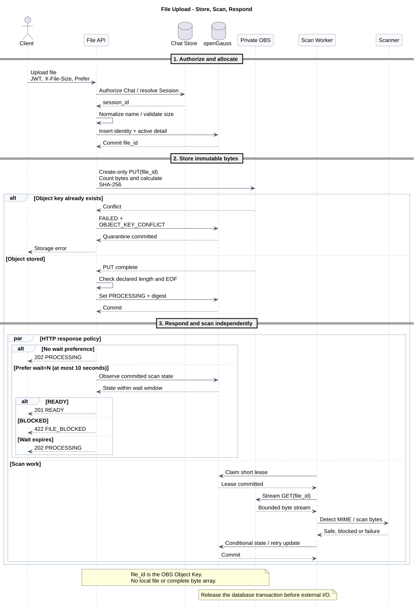
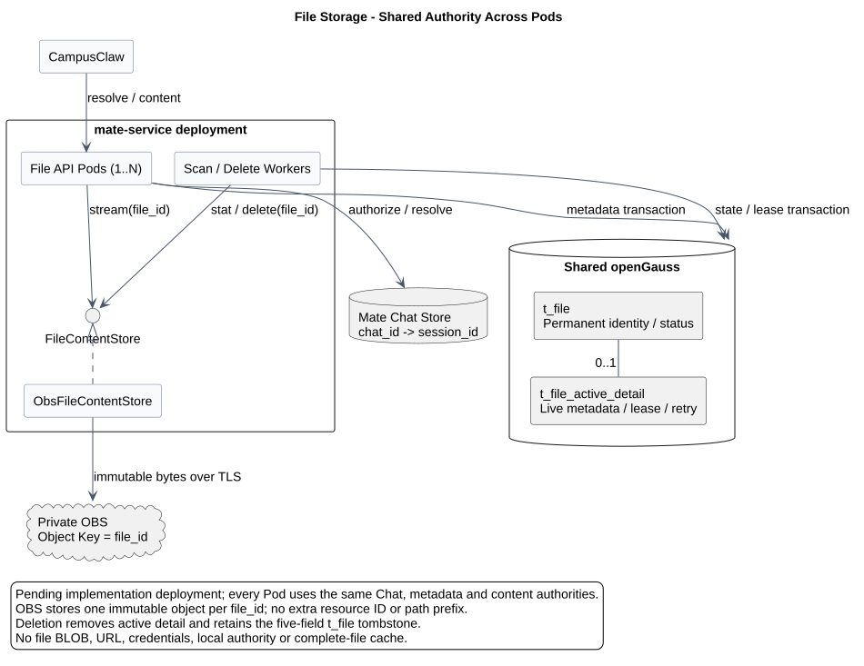
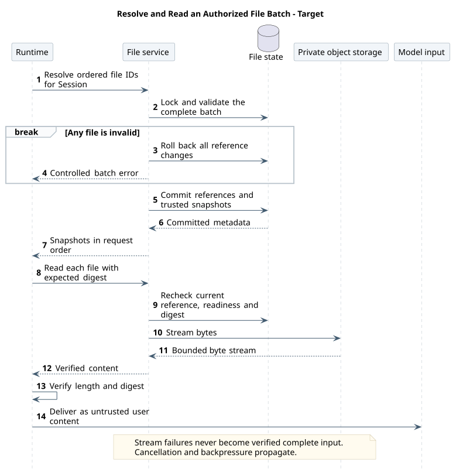
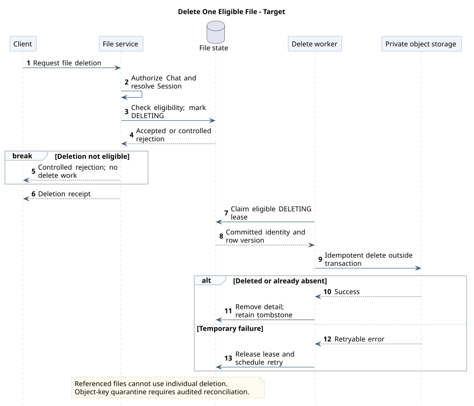
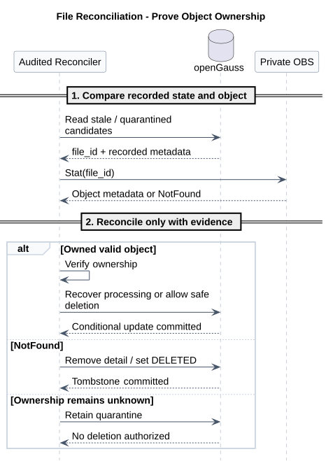

# CampusMate 文件服务：OBS + openGauss 设计

| 属性 | 值 |
|---|---|
| 文档版本 | 3.1.0 |
| 状态 | 待实现 目标；实现状态仅限下列固定源码范围 |
| OpenAPI | [`attachment-api.openapi.yaml`](attachment-api.openapi.yaml) |
| openGauss DDL | [`schema.sql`](schema.sql) |
| pi-mono 源码基线 | `086c32e74530564922d011ade23ff582c9d63116` |
| pi-mono-java 源码基线 | `195746614096312d4e93afb029d387837db78e0b` |
| 更新日期 | 2026-09-14 |

## 1. 职责与边界

mate-service 提供文件上传、状态、删除和 CampusClaw 内部读取能力。原始字节只保存
在共享私有 OBS；openGauss 保存身份、Session 绑定、处理状态、可信元数据、清理和
Worker lease。Pod 不保存本地文件，也不聚合完整 byte array。

文件的唯一资源 ID 是 `file_id`，JSON/Java 字段使用 `fileId/fileIds`。`file_id`
同时是完整 OBS Object Key；系统不维护第二套文件资源 ID 或 object-key 映射。
Runtime 通过 `event.content[]` 的文件块引用同一文件 ID；精确请求由 [Session Events 契约](../../01-总体架构/01-CampusClaw多Agent运行时/chat-api-review.html)维护，内部批量解析仍使用 `fileIds`。

公共接口按 `chat_id` 鉴权，mate-service 从权威 Chat Store 解析 `session_id`；公共
响应不披露 Session。内部接口只接受 CampusClaw 服务身份和 `session_id`，不接受
`chat_id`。

本专题为 待实现。固定 pi 基线 `086c32e7` 的 `packages/agent/src/agent.ts:prompt`、`packages/ai/src/types.ts:ImageContent`，以及 Java 基线 `19574661` 的 `modules/ai/src/main/java/com/campusclaw/ai/types/ImageContent.java` 和 `modules/coding-agent-cli/src/main/java/com/campusclaw/codingagent/session/AgentSession.java:prompt/abort`，只提供内联图片与会话调用能力，未包含这里定义的文件服务。最新实现未在本次文档整理中复核。

## 2. API 总览

公共基础路径是 `/mate-service/v1`，内部基础路径是
`/mate-service/internal/v1`：

| Method | Path | 响应 | 作用 |
|---|---|---|---|
| `POST` | `/chats/{chat_id}/attachments` | `201/202` ResultBean | 流式上传一个文件并触发扫描 |
| `GET` | `/chats/{chat_id}/attachments/{file_id}` | `200` ResultBean | 查询文件状态和安全公共投影 |
| `DELETE` | `/chats/{chat_id}/attachments/{file_id}` | `202` ResultBean | 异步删除未被 Session Entry 引用的文件 |
| `POST` | `/files:resolve` | `200` ResultBean | CampusClaw 原子解析有序 `fileIds` 并建立首次引用 |
| `GET` | `/sessions/{session_id}/files/{file_id}/content` | `200` binary | 向 CampusClaw 流式代理不可变正文 |

前三项是公共 Chat API，后两项是内部 Runtime API。OpenAPI 的可配置 server base
包含 `/mate-service`，表中省略该前缀。

### 2.1 ResultBean

JSON 成功响应为 `resCode/resMsg/result`，失败只有 `resCode/resMsg`；完整示例见 OpenAPI。保留真实 HTTP status，二进制 content 与 `204` 不包装。
Service 返回未包装的响应 VO，Controller 负责 ResultBean 包装；只有实际内部制品或兼容 Adapter 已验证提供该 API 时，才调用 `ResultBeanFactory.getFactory().normal(result)`。

JSON 使用 Jackson 默认 lowerCamelCase。路径参数和 SQL 列继续使用 snake_case，
两者不要求同名。

### 2.2 鉴权与国际化

| 接口 | 首选模式 | 兼容模式 |
|---|---|---|
| 公共 Chat 文件 API | `X-HW-ID + Authorization: Bearer <JWT>` | 无；浏览器不持有 APPKEY |
| CampusClaw 内部 API | `X-HW-ID + Authorization: Bearer <JWT>` | `X-HW-ID + X-HW-APPKEY` |

内部请求的 JWT 与 APPKEY 二选一；同时出现 `Authorization` 和 `X-HW-APPKEY` 返回
`401 AUTH_CREDENTIAL_CONFLICT`。选中一种模式后验证失败不得降级。每个请求独立
认证，不复用 Runtime SSE 的认证状态。

错误消息按 `Accept-Language` 解析，至少提供 `zh-CN` 与 `en-US`；响应通过
`Content-Language` 声明实际语言。`resCode` 稳定且不翻译，`resMsg` 不携带 OBS
路径、数据库键、凭据或安全扫描器原文。

## 3. 上传与扫描



[PlantUML 源码：`file_upload_and_scan_flow`](diagram.puml#L8) · [原尺寸 SVG](file_upload_and_scan_flow.svg)

上传使用单文件 `multipart/form-data` 和必填 `X-File-Size`。服务端：

1. 验证 JWT、Chat 所有权并解析内部 `session_id`；
2. 规范化 filename，校验 1..20 MiB；调用方 Content-Type 视为不可信；
3. 生成固定格式 `file_<26 alnum>`，将它直接作为 OBS Object Key；
4. 一个数据库事务插入 `t_file` 和 `t_file_active_detail`；
5. 以 create-only、已知长度的流写 OBS，同时计数和计算 SHA-256；
6. 必须同时验证实际长度等于 Header、file part 到达 EOF；
7. 写入成功后状态进入 `PROCESSING`，Worker 通过短 lease 扫描；
8. 安全结果进入 `READY`，拒绝进入 `BLOCKED`，终态处理失败进入 `FAILED`。

省略 `Prefer` 或 `respond-async` 时，文件稳定写入 OBS 并提交 `PROCESSING` 后返回
`202`。`Prefer: wait=N` 最多等待 10 秒；窗口内到达 `READY` 返回 `201`，到达
`BLOCKED` 返回 `422`。

OBS PUT 必须 create-only。若理论上的同名对象已存在，不覆盖或删除来源不明对象，
当前记录进入 `FAILED + OBJECT_KEY_CONFLICT` 隔离；只有受审计 reconciliation
证明归属或确认 NotFound 后才收束为 tombstone。

## 4. 存储模型



[PlantUML 源码：`file_obs_opengauss_storage_split`](diagram.puml#L98) · [原尺寸 SVG](file_obs_opengauss_storage_split.svg)

### 4.1 `t_file`

永久身份/状态表，删除后保留 tombstone：

| 字段 | 作用 |
|---|---|
| `file_id` | 唯一资源 ID、主键、精确 OBS Object Key，永久不复用 |
| `session_id` | 不可变 Runtime Session 绑定 |
| `status` | `UPLOADING/PROCESSING/READY/BLOCKED/FAILED/DELETING/DELETED` |
| `created_at` | 身份创建时间 |
| `deleted_at` | OBS 删除完成时间；只对 `DELETED` 非空 |

### 4.2 `t_file_active_detail`

每个非 `DELETED` 文件恰有一条活动明细：

| 字段组 | 作用 |
|---|---|
| filename、detected_media_type | 不可信显示名和扫描器确认的可信 MIME |
| expected_size_bytes、size_bytes、sha256 | 上传与后续读取的完整性依据 |
| referenced_at、expires_at | 首次 Runtime 引用与未引用 24 小时过期 |
| error_code、attempt_count、next_attempt_at | 有界错误与当前阶段重试 |
| lease_owner、lease_until、row_version | 跨 Pod Worker 恢复和乐观锁 |

正文、URL、Bucket、Endpoint、凭据、ETag、caller-declared MIME、`chat_id` 均不进入
两张表。Chat 到 Session 的映射只有 Mate Chat Store 持有。

状态转换锁定顺序固定为 `t_file -> t_file_active_detail`。Worker 在短事务内 claim
lease 并提交，之后才进行 OBS 或扫描 I/O；外部 I/O 期间不持有数据库事务。

## 5. Runtime 解析与内容流



[PlantUML 源码：`file_cross_pod_resolution_flow`](diagram.puml#L152) · [原尺寸 SVG](file_cross_pod_resolution_flow.svg)

CampusClaw 接受 User Event 后调用：

```http
POST /mate-service/internal/v1/files:resolve
```

请求 JSON 使用 lowerCamelCase：

```json
{
  "sessionId": "session_01JY8X2E3R4T5Y6U7I8O9P0A1B",
  "fileIds": [
    "file_01JY8X2E3R4T5Y6U7I8O9P0A1S"
  ]
}
```

服务在一个短事务内按稳定顺序锁定全部 ID，要求每项属于同一 `session_id`、状态为
`READY`、未删除且未过期，然后设置
`referenced_at = COALESCE(referenced_at, now())` 并清空 `expires_at`。任一项失败整体
回滚；响应顺序与请求 `fileIds` 完全一致。

不存在、跨 Session、过期、删除、BLOCKED、FAILED 统一投影为 `INVALID_FILE`，
避免泄露；仅确认属于当前 Session 的 `UPLOADING/PROCESSING` 返回
`FILE_NOT_READY`。

解析成功后，CampusClaw 逐项调用 content 接口，并携带 resolve 返回的 SHA-256。
mate-service 再校验 READY、已引用、Session 归属和摘要，按 `file_id` 从 OBS 流式
读取。双方增量验证长度和 SHA-256；任一方都不写本地文件或完整内存副本。

Runtime 只把可信元数据快照随 User Entry 保存：
`fileId/filename/mediaType/sizeBytes/sha256`。PDF、脚本和文档始终作为不可信用户内容，
不能提升为 System 或 Tool 指令；JavaScript 只存储和读取，不执行。

## 6. 删除与对账



[PlantUML 源码：`file_deletion_and_reconciliation`](diagram.puml#L221) · [原尺寸 SVG](file_deletion_and_reconciliation.svg)

- 未引用文件可被公共 DELETE 条件更新为 `DELETING`，重复调用幂等返回 `202`；
- `referenced_at` 非空的文件不能单独删除，返回 `409 FILE_REFERENCED`；
- 删除 Worker 对 OBS 执行幂等 DELETE，成功或 NotFound 后在一个事务中删除活动明细，
  并把主表更新为 `DELETED/deleted_at`；
- Session 删除取消 Runtime 读取后，把该 Session 的普通文件标为 `DELETING`；
- `OBJECT_KEY_CONFLICT` 隔离项不进入普通删除或 24 小时清理，只由受审计对账处理；
- `DELETED` tombstone 永久保留五个字段，不恢复、不复用 ID。

OBS 与 openGauss 之间不使用 XA。数据库决定处理资格，OBS 决定原始字节是否存在；短 lease、条件更新和幂等操作用于故障恢复。对象归属不明时保留隔离，由受审计的对账流程处理。



[PlantUML 源码：`file_audited_reconciliation`](diagram.puml#L295) · [原尺寸 SVG](file_audited_reconciliation.svg)

## 7. 错误目录

| HTTP | `resCode` | 说明 |
|---:|---|---|
| 400 | `INVALID_REQUEST` / `FILE_SIZE_MISMATCH` | 结构、Header、multipart 或实际长度无效 |
| 401 | `UNAUTHENTICATED` / `AUTH_CREDENTIAL_CONFLICT` | 凭据缺失、无效或两套模式混用 |
| 403 | `FORBIDDEN` | 身份无权调用 |
| 404 | `CHAT_NOT_FOUND` / `INVALID_FILE` | 非泄露的 Chat 或文件不可见 |
| 409 | `FILE_NOT_READY` / `FILE_REFERENCED` / `FILE_CONTENT_MISMATCH` | 当前状态或摘要冲突 |
| 413 | `FILE_TOO_LARGE` | 超过 20 MiB |
| 422 | `FILE_BLOCKED` | 安全策略拒绝 |
| 503 | `FILE_STORAGE_UNAVAILABLE` | openGauss、OBS 或终态处理失败 |

错误响应严格没有 `result`。是否可重试由 HTTP status、`Retry-After` 和具体 operation
说明共同决定，不在错误 body 增加另一套 `retryable/details` 协议。

## 8. 验收

- OpenAPI 所有 JSON Schema 使用 lowerCamelCase，成功/异常 envelope 与公司约定一致；
- 公共 operation 只允许 JWT Header 对，内部 operation 明示 JWT/APPKEY OR 关系并拒绝混用；
- 文件资源使用同一 `file_id` 身份；文件服务 JSON 使用 `fileId/fileIds`，Runtime 按当前 content 文件块契约引用；
- `file_id` 格式、SQL 长度、OpenAPI Schema 与 Runtime 示例完全一致；
- 上传和下载全程有界流式，无本地文件或完整 byte array；
- resolve 批次全成全败并保持请求顺序；
- 已引用文件不能单独删除，Session 删除可触发完整清理；
- 删除后只保留五字段 tombstone，ID 和 Object Key 永不复用；
- SQL 表名以 `t_` 开头，所有 `COMMENT ON` 使用中文；
- PlantUML 可生成全部 SVG，图源仅包含 ASCII。

## 9. 版本历史

| 版本 | 日期 | 变更 |
|---|---|---|
| 3.1.0 | 2026-09-14 | 按阶段重排文件生命周期及存储图，统一 Runtime content 引用入口与响应包装职责。 |
| 3.0.0 | 2026-08-18 | 统一 file_id、lowerCamelCase、ResultBean 和双模式认证，对齐 CampusClaw 文件解析边界。 |
| 2.0.0 | 2026-08-04 | 历史版 OBS/openGauss 两表、扫描、删除和 reconciliation 设计 |
| 1.0.0 | 2026-08-03 | 初版附件服务目标设计 |
