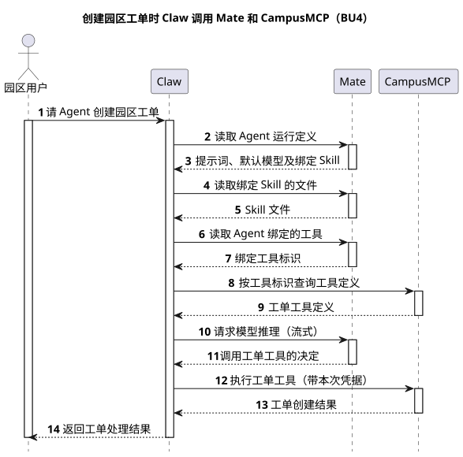
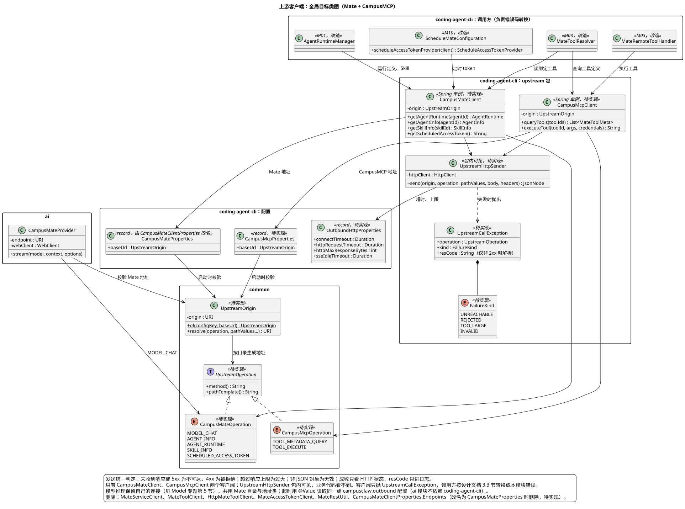
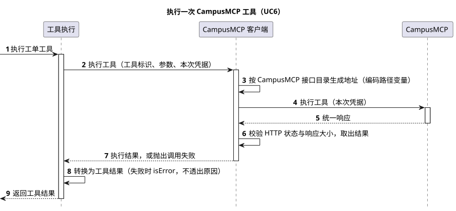

# CampusMate 与 CampusMCP 客户端设计

[模块索引](../../README.md#module-index) · [Model](../03-Model/README.md) · [工具系统](../../01-总体架构/02-CampusClaw工具系统/README.md) · [mate-service 定时任务](../08-mate-service定时任务/README.md) · [源码证据](source-evidence.md) · [PlantUML 源码](diagram.puml)

本文是 Claw 调用上游服务（CampusMate、CampusMCP）的唯一设计文档，按“评审记录 / 概述 / 整体方案 / 详细设计 / 接口协议 / 架构指标 / 质量保证 / 基建规范 / 其他补充”组织：待对齐事项在[评审 Todo](#review-todo)，接口目录在 [§3.2](#data-model)，可配置项在 [§7.1](#config-items)。模型推理、Agent 运行目录、工具装配和定时任务的业务契约分别由 [Model](../03-Model/README.md)、[多 Agent 运行时](../../01-总体架构/01-CampusClaw多Agent运行时/README.md)、[工具系统](../../01-总体架构/02-CampusClaw工具系统/README.md)、[mate-service 定时任务](../08-mate-service定时任务/README.md)维护，本文只管地址、路径、发送和失败判定。标注 **【缺口】** 的位置表示现有材料不足，需要补充。

| 属性 | 值 |
|---|---|
| 文档版本 | 3.0.0 |
| 更新日期 | 2026-10-21 |
| 模块 | M02 · Model（上游客户端专题；调用方横跨 M01 Runtime、M03 Tool、M10 定时任务） |
| 设计状态 | 实现中：实现仓 [pi-mono-java#376](https://github.com/superheromeZzh/pi-mono-java/pull/376)（Draft，未合并）按本设计改造；合并前正文中的“待实现”保持不变。被替换的 `campusmate.endpoints`、`MateRestUtil`、三个按业务划分的客户端等旧实现见 [§8.2](#source-evidence) |
| 源码基线 | Claw Java main `628dca25a694d9d056b15f012e1223d68091ab66`（2026-10-21 fetch） |
| 主基线 | Codex main `d571eaf1f61d0d93a797506335a99a9950ffe37b`、Anthropic Java SDK main `85bfc1966a94862ec39477278430c3f8f5a0c3f6`，均于 2026-10-21 fetch；pi main `16f5f0af4d85ca583d045ceb5ed6d646fcaf7761`、OpenCode dev `dbe08ddc3c405168c679a3dac0029ef64787b7af` 作对照 |

## 评审记录

### 评审结论

【缺口】尚未评审。

<a id="review-todo"></a>

### 评审 Todo

| # | 事项 | 负责人 | 来源 |
|---|---|---|---|
| T1 | 已确认（2026-10-21，Lotus）：部署不用环境变量，直接用公司镜像 `campusclaw/src/main/resources/application.properties` 的配置项。该文件第 39～45 行的 7 个路径值与代码默认值逐字相同，路径写进代码后行为不变 | Lotus | [D1](#key-decisions)、[§7.1](#config-items) |
| T2 | 已确认（2026-10-21，Lotus）：Mate 用 HTTP 状态表达成败，非 2xx 即失败，业务失败只带 `resCode`、`resMsg`，没有 `result`。发送组件只按 HTTP 状态判定成败，不检查 `resCode`，与实现仓 `b0f45547` 的决定一致 | Lotus | [§3.3](#short-request-sequence) |
| T3 | 已确认（2026-10-21，Lotus）：按传输方式分两组，同步 HTTP 请求 60 秒、模型 SSE 600 秒，均可配置 | Lotus | [§7.1](#config-items) |
| T4 | 采纳后修改 codex-style `design-doc-template` 中 7.1 的"路径放进服务的路径目录"规则，改为"路径进代码中的接口目录，配置只放服务地址" | Lotus | [§7.1](#config-items) |
| T6 | 采纳后同步 [Model §5.6](../03-Model/README.md#http-transport-config) 的两个超时配置键为 `campusclaw.outbound.connect-timeout`、`campusclaw.outbound.sse.idle-timeout` | Claude | [§7.1](#config-items) |
| T5 | 采纳后同步 [Agent 架构对比 A06/A18](../../01-总体架构/07-Agent架构对比/README.md)；原共享配置主设计已在 3.0.0 并入本文 | Claude | 设计仓 AGENTS.md |
| T7 | 已确认（2026-10-21，Lotus）：只保留 `CampusMateClient`、`CampusMcpClient` 两个客户端；其余名字按 [§8.4](#naming) 建议名确定 | Lotus | 2026-10-21 讨论 |
| T8 | 已确认（2026-10-21，Lotus）：① 读取 Agent 和 Skill 绑定的工具仍走 Mate；② CampusMCP 两个接口的报文与原 Mate 工具接口相同，也用统一响应、非 2xx 即失败；③ 目前不考虑新旧版本并存和回滚到 Mate 旧工具接口 | Lotus | [§3.2](#data-model)、[§6.2](#rollback) |

### 需求信息

需求来源：2026-10-21 讨论串"Mate 客户端配置精简"。用户认为 `CampusMateClientProperties.Endpoints` 参数过多、调用 Mate 的写法"五花八门"，要求"按照最优雅的方案改造"。同日用户补充：新增上游 CampusMCP，地址 `https://matemcp-service.mate.svc.cluster.local:8592`，工具定义查询改为 `/mcp-service/v1/runtime/tools/query`，工具执行改为 `/mcp-service/v1/runtime/tools/%s/execute`；并要求"只保留 CampusMateClient、CampusMcpClient"。【缺口】没有需求编号、优先级和目标版本。

## 1. 概述

### 1.1 术语解释

| 术语 | 含义 |
|---|---|
| Mate | CampusMate 服务，与 CampusMate 是同一个服务；提供模型、Agent 和 Skill 定义、定时 token |
| CampusMCP | 新增的工具服务，与 Mate 不在同一主机；提供工具定义查询和工具执行 |
| 上游 | Claw 调用的远端服务，目前是 Mate 和 CampusMCP |
| 服务地址 | 每个上游一个 `<服务>.base-url`，只含 scheme、host、port |
| 接口目录 | 某个上游的全部接口，每项是一个 HTTP 方法加路径模板，定义在代码中；每个上游一份 |
| 同步请求 | 除模型流式推理外的所有上游调用：读取 Agent 和 Skill、查询和执行工具、取定时 token；一次请求一次响应 |
| 上游客户端 | 每个上游一个：`CampusMateClient`、`CampusMcpClient`。按接口提供类型化方法，负责请求组装和响应 DTO 转换；失败统一抛出 `UpstreamCallException`，由调用方模块转换为本模块错误 |
| 共享发送组件 | 两个上游客户端内部共用的发送逻辑（`UpstreamHttpSender`，包内可见）：拼地址、超时、响应上限、失败判定和统一响应解包；业务代码不能直接使用 |

### 1.2 需求整理

| 编号 | 需求 | 类型 | 来源 |
|---|---|---|---|
| R1 | 部署对每个上游只配置一个服务地址（Mate、CampusMCP 各一个），新增一个接口不新增配置项或环境变量 | 约束 | 用户要求；推导，需确认 |
| R2 | 同一种调用失败（不可达、超时、非 2xx、响应过大、响应无效）在所有上游的所有同步请求上按同一规则判定 | 稳定性 | 用户"五花八门"；[§8.2](#source-evidence) 中三套不同判定 |
| R3 | 每个接口只能发往它所属上游的服务地址，路径不能改道到其他主机 | 安全 | 沿用 ADR-0026，扩展到多个上游 |
| R4 | 超时按传输方式分两组并均可配置：同步 HTTP 请求 60 秒、模型 SSE 600 秒；各上游共用 | 稳定性 | 用户确认（T3） |
| R5 | 工具定义查询和工具执行改发 CampusMCP 的新路径；其余接口的方法、路径不变；所有接口的请求头、请求体和响应体不变 | 约束 | 用户要求；报文不变已确认（T8） |
| R6 | 发现请求不携带业务凭据；工具执行只携带本次执行的凭据快照，凭据随执行请求发往 CampusMCP | 安全 | 沿用既有凭据边界，见 [§5.1](#security) |
| R7 | 调用上游的客户端只保留 `CampusMateClient`、`CampusMcpClient` 两个，每个上游一个 | 约束 | 用户要求（2026-10-21） |

## 2. 整体方案

<a id="business-use-cases"></a>

### 2.1 业务用例

Agent 服务依赖上游平台提供模型、Agent 定义、业务工具和定时凭据，平台由 Mate 和 CampusMCP 两个服务组成。部署人员需要用最少的配置把服务接到平台上；开发人员接入平台新接口或新服务时，需要改动范围小、失败处理一致，不必每次补一套配置和校验。本设计把 Claw 调用上游的地址、路径、发送和失败判定收敛成一处。

| 编号 | 参与者 | 业务目标 | 业务结果 |
|---|---|---|---|
| BU1 | 部署人员 | 把 Claw 接到某个环境的 Mate 和 CampusMCP | 服务启动成功，每个调用都发往所属上游的配置地址；每个上游只需设置一个地址 |
| BU2 | 运维人员 | 调整调用上游的超时 | 同步请求和模型推理两类超时各自生效，对所有上游一致 |
| BU3 | 开发人员 | 接入一个新接口或一个新上游 | 新接口在所属接口目录加一项、在所属客户端加一个方法；新上游加一份目录、一个服务地址和一个客户端；超时、响应上限和失败判定自动与其他接口一致 |
| BU4 | 园区用户 | 让 Agent 处理一项园区工单 | Agent 读取定义、装配工具、推理并执行工具，返回处理结果 |

### 2.2 整体时序

场景：园区用户让 Agent 创建一条园区工单，Agent 读取定义、装配工具、推理、执行工具后返回结果。前提：Agent 已在 Mate 中定义并绑定工单工具。图中 Claw 调 Mate 都经过 `CampusMateClient`（模型推理除外，仍由 Provider 发送），调 CampusMCP 都经过 `CampusMcpClient`；收敛本身待实现，工具查询和执行改走 CampusMCP 是本次变化。

| 参与者 | 职责 | 映射 |
|---|---|---|
| 园区用户 | 发起请求、查看结果 | 浏览器或调用方 |
| Claw | 准备 Agent、装配工具、驱动推理和执行 | CampusClaw 服务（Runtime、Tool、Model Provider 均在其中） |
| Mate | 提供 Agent 和 Skill 定义、模型 | CampusMate 服务 |
| CampusMCP | 提供工具定义、执行工具 | CampusMCP 服务（新增） |



[原尺寸 SVG](claw_mate_overall_sequence.svg) · [PlantUML 源码](diagram.puml#L1)

| 阶段 | 详细时序 |
|---|---|
| 步骤 2～5：准备 Agent | 运行目录写入沿用 [M01](../../01-总体架构/01-CampusClaw多Agent运行时/README.md)；同步请求发送见 [§3.3](#short-request-sequence) |
| 步骤 6～9：装配工具 | 工具装配沿用 [M03](../../01-总体架构/02-CampusClaw工具系统/README.md)；绑定关系从 Mate 读，工具定义从 CampusMCP 查；同步请求发送见 [§3.3](#short-request-sequence) |
| 步骤 10～11：推理 | 模型调用沿用 [Model §5](../03-Model/README.md#http-transport) |
| 步骤 12～13：执行工具 | [§3.3 发送同步请求的详细时序](#short-request-sequence) |

<a id="key-decisions"></a>

### 2.3 关键设计决策

这三个问题都属于"客户端怎么连到一个固定服务"，按问题选择 Provider 与 HTTP 客户端分层的基线：Codex 和 Anthropic Java SDK 为主，pi、OpenCode 对照。证据见 [§8.3](#baseline-evidence)。

| # | 要解决的问题 | 基线怎么做 | 业务约束 | 我们的选择 | 代价 |
|---|---|---|---|---|---|
| D1 | 接口路径由部署配置，还是写在代码里？第二个上游的地址怎么给？ | Codex 的 `Provider` 只有 `base_url`、请求头和重试，每个接口客户端在代码里写死路径（`"models"`、`"memories/trace_summarize"`、`/responses`），唯一例外 `model_catalog_url` 是因为模型目录可能在另一个主机；Anthropic SDK 只暴露 `baseUrl`，各 Service 用 `addPathSegments("v1", "messages")` 写死；pi 的模型只有 `baseUrl` 和 `api`；OpenCode 的 Provider 设置只有 `baseURL` | 一个上游的接口都在同一主机，CampusMCP 是另一个主机（用户确认）；路径变化必然伴随请求或响应变化，Claw 本来就要发版；仓库内没有部署覆盖任何路径变量 | 路径写成 common 模块中每个上游一份的接口目录：`CampusMateOperation`（5 项）、`CampusMcpOperation`（2 项），都实现 `UpstreamOperation`（方法 + 路径模板）；配置每个上游只保留服务地址 `campusmate.base-url`、`campusmcp.base-url`，分别绑定到 `CampusMateProperties`、`CampusMcpProperties`。不学 Codex 的 `model_catalog_url` 给单个接口配完整 URL，因为 CampusMCP 是一个服务，接口会继续增加 | 改路径时 Claw 必须发版；退役 7 个路径配置键和环境变量，不做兼容双读；新增 `CAMPUSMCP_BASE_URL`，通用模块必须设置；若以后某环境需要不同网关前缀，要再加一个前缀配置（目前部署值与默认值相同，T1 已确认） |
| D2 | 同步请求的发送、超时、响应上限和失败判定由谁负责？多个上游是否共用？ | Codex 的 `EndpointSession` 为一个 Provider 的所有接口客户端统一发请求，`Request` 带单次 `timeout` 和 `response_body_limit_bytes`；Anthropic SDK 每个客户端一份 `ClientOptions`（`baseUrl`、`HttpClient`、默认 `Timeout`），所有 Service 共用，单次调用可用 `RequestOptions` 覆盖 | 现状三个业务客户端各自封装 JDK HttpClient，HTTP 状态、`resCode`、响应上限的判定各不相同（[§8.2](#source-evidence)）；ai 模块不能依赖 cli 模块；工具执行带业务凭据，不能误发到另一个上游 | 两个上游客户端共用一个包内可见的发送组件 `UpstreamHttpSender`，它持有唯一的 JDK HttpClient 和 `campusclaw.outbound` 参数，统一拼地址、超时、响应上限，并只按 HTTP 状态判定成败（非 2xx 即失败，T2、T8）；每个客户端只持有自己上游的地址，只引用自己的接口目录。模型推理是长时 SSE，保留 Provider 自己的连接（[Model §5](../03-Model/README.md#http-transport)），只共用 Mate 目录和地址校验 | 现有三套失败判定合并成一套，工具执行和取 token 不再自行检查 `resCode`；若某个接口违反"非 2xx 即失败"，Claw 会把失败当成功；模型与同步请求仍是两条连接，不能共用连接池；某个上游需要不同超时时要另加覆盖项（[§7.1](#config-items)） |
| D3 | 调用上游的客户端按上游划分，还是按业务划分？ | Anthropic SDK 每个服务一个客户端 `AnthropicClient`，按资源暴露 `messages()`、`models()` 等，调用方自己处理 `AnthropicServiceException`；Codex 按接口划分 `ModelsClient`、`MemoriesClient` 等，共用同一个 `EndpointSession` | 用户要求只保留 `CampusMateClient`、`CampusMcpClient`（R7）；三个调用方属于不同模块（M01、M03、M10），各自的失败要转换成本模块的错误：工具执行失败要变成给模型看的工具结果，定时 token 失败要区分"需要重新授权"和"服务不可用" | 按上游划分，与 Anthropic SDK 一致：`CampusMateClient` 提供读取 Agent 运行定义、Agent 绑定工具、Skill 和取定时 token 四个方法；`CampusMcpClient` 提供查询工具定义和执行工具两个方法。两个客户端只做请求组装和 DTO 转换，失败统一抛出 `UpstreamCallException`；转换成模块错误由调用方负责（[§3.3](#short-request-sequence) 转换表）。删除 `MateServiceClient`、`MateToolClient` 与 `HttpMateToolClient`、`MateAccessTokenClient`、`MateRestUtil` | 错误码转换分散到 4 个调用点（`AgentRuntimeManager`、`MateToolResolver`、`MateRemoteToolHandler`、定时 token 适配）；"先从 Mate 读绑定、再到 CampusMCP 查定义"的编排移到 `MateToolResolver`；`MateServiceClient` 中的 DTO（`AgentRuntime`、`SkillInfo`、`BoundTool` 等）要迁到客户端包，约 10 个文件改 import；`CampusMateClient` 的改动同时影响三个模块 |

## 3. 详细设计

### 3.1 系统用例

| 用例 | 对应业务用例 | 触发者 | 前置条件 | 主成功结果 | 关键约束 |
|---|---|---|---|---|---|
| UC1 启动时校验服务地址 | BU1 | 部署人员启动服务 | 设置了 `CAMPUSMATE_BASE_URL`、`CAMPUSMCP_BASE_URL` | 服务启动，两个地址规范化后分别供各自上游的调用使用 | 任一地址缺失或非法时启动失败，不发任何请求；两个地址用同一套规则，见 [§7.1](#base-url-rules) |
| UC2 发送同步请求 | BU3、BU4 | 上游客户端 | 地址已校验 | 返回统一响应中的 `result`，转换为 DTO | 超时、响应上限和 HTTP 状态在两个上游按同一规则判定；只能发往接口所属上游 |
| UC3 读取 Agent 运行定义 | BU4 | Runtime 准备运行目录 | — | 返回提示词、默认模型和绑定 Skill | 不携带业务凭据 |
| UC4 读取 Skill | BU4 | Runtime 准备运行目录、Tool 装配 | — | 返回 Skill 文件和绑定工具 | 两处调用方共用 `CampusMateClient.getSkillInfo` 的同一个 DTO，不再各自解析 |
| UC5 查询工具定义 | BU4 | Tool 装配 | 已从 Mate 读到绑定工具 | CampusMCP 返回 Agent 或 Skill 绑定工具的定义 | 不携带业务凭据 |
| UC6 执行工具 | BU4 | 模型发起工具调用 | 工具已装配 | CampusMCP 返回给模型的工具结果 | 只携带本次执行的凭据快照 |
| UC7 取定时 token | BU4 | 定时执行准备调用工具 | — | 返回统一账号 access-token | 失败时区分需要重新授权和服务不可用 |

<a id="data-model"></a>

### 3.2 数据模型

无新增表或持久化数据。

接口目录（common 模块，待实现），每个上游一个枚举，都实现 `UpstreamOperation`：

| 上游 | 目录 | 常量 | 方法 | 路径模板 | 客户端方法 |
|---|---|---|---|---|---|
| Mate | `CampusMateOperation` | `MODEL_CHAT` | POST | `/mate-service/v1/LLM/chat` | `CampusMateProvider` |
| Mate | `CampusMateOperation` | `AGENT_INFO` | GET | `/mate-service/v1/agents/{agentId}` | `CampusMateClient.getAgentInfo` |
| Mate | `CampusMateOperation` | `AGENT_RUNTIME` | GET | `/mate-service/v1/agents/{agentId}/runtime` | `CampusMateClient.getAgentRuntime` |
| Mate | `CampusMateOperation` | `SKILL_INFO` | GET | `/mate-service/v1/skill/query/{skillId}` | `CampusMateClient.getSkillInfo` |
| Mate | `CampusMateOperation` | `SCHEDULED_ACCESS_TOKEN` | POST | `/mate-service/v1/runtime/scheduled-access-token` | `CampusMateClient.getScheduledAccessToken` |
| CampusMCP | `CampusMcpOperation` | `TOOL_METADATA_QUERY` | POST | `/mcp-service/v1/runtime/tools/query` | `CampusMcpClient.queryTools` |
| CampusMCP | `CampusMcpOperation` | `TOOL_EXECUTE` | POST | `/mcp-service/v1/runtime/tools/{toolId}/execute` | `CampusMcpClient.executeTool` |

Mate 的 5 项与当前默认值逐字相同。CampusMCP 的 2 项按用户 2026-10-21 给出的路径，原 Mate 路径 `/mate-service/v1/runtime/tools/query`、`/mate-service/v1/runtime/tools/%s/execute` 不再调用；`AGENT_INFO`、`SKILL_INFO` 仍在 Mate（T8 已确认）。模型能力查询 `/mate-service/v1/models/{modelId}` 实现时作为 Mate 第 6 项加入，无需新增配置。路径变量统一写成 `{name}`，替换 `%s`：一个模板可以有多个变量，变量值按路径段编码后再拼接，不再用 `String.replace`。

工具定义分两步取：先从 Mate 读 Agent 或 Skill 绑定的工具标识，再到 CampusMCP 按标识查询定义。两个上游之间只传工具标识。这一步编排由 Tool 模块的 `MateToolResolver` 完成，两个客户端互不依赖。



[原尺寸 SVG](campusmate_client_target_classes.svg) · [PlantUML 源码](diagram.puml#L38)

分层理由：

- **目录和地址放 common。** ai 模块的 Provider 和 cli 模块的两个客户端都要用，common 是两者唯一的共同依赖，而且只需要 `java.net`。这样 Provider 不再复制一份地址和路径校验。`UpstreamOrigin` 不绑定某个上游，Mate 和 CampusMCP 各建一个实例。
- **每个上游一个客户端。** `CampusMateClient`、`CampusMcpClient` 是 Spring 单例，各自只持有自己上游的地址、只引用自己的接口目录；带凭据的工具执行只在 `CampusMcpClient` 中，不可能发到 Mate（R3、R6）。
- **发送逻辑共享但不开放。** `UpstreamHttpSender` 与两个客户端放在同一个包，包内可见，持有唯一的 JDK HttpClient；业务代码只能看到两个客户端，看不到发送组件，也就无法绕过地址校验或自定判定规则。
- **错误码转换留在调用方。** 客户端只抛 `UpstreamCallException`（上游、操作、失败类型、`resCode`），每个模块按 §3.3 转换表映射成自己的错误。定时模块在 `ScheduleMateConfiguration` 中把 `CampusMateClient::getScheduledAccessToken` 适配成 `ScheduleAccessTokenProvider` 并在此转换错误码，不再有单独的客户端类。
- **新增上游的改动面：** 一个目录枚举、一个 `<服务>.base-url` 配置类、一个客户端；超时、上限、失败判定都不用动。
- **先落骨架：** 先加目录、地址、发送组件和两个客户端，再逐个迁移调用方（Runtime、Tool、定时 token），最后删除旧的三个客户端、`Endpoints` 和 `MateRestUtil`。

<a id="short-request-sequence"></a>

### 3.3 发送同步请求的详细时序（UC2、UC6）

以执行工具为例展开 [§2.2](#business-use-cases) 步骤 12～13；读取 Agent、读取 Skill、查询工具和取定时 token 走同一条路径，只是调用方、客户端和上游不同，使用同一个同步请求超时。待实现。



[原尺寸 SVG](campusmate_short_request_sequence.svg) · [PlantUML 源码](diagram.puml#L173)

| 角色 | 映射 |
|---|---|
| 工具执行 | `MateRemoteToolHandler`，负责把失败转换成工具结果 |
| CampusMCP 客户端 | `CampusMcpClient.executeTool`，内部经 `UpstreamHttpSender`、`UpstreamOrigin`、`CampusMcpOperation` 发送 |
| CampusMCP | CampusMCP 服务 |

发送组件包在客户端内部，不单列参与者；图中客户端的自调用就是发送组件的规则：拼地址、校验状态和大小。

发送判定规则（替代现有三套判定，两个客户端共用）：

1. 请求未发出或未收到响应（连接失败、超时、中断）→ 失败类型"不可达"；
2. HTTP 状态不是 2xx → 5xx 为"不可达"，4xx 为"被拒绝"；响应体能解析出 `resCode`、`resMsg` 时带上，只用于日志和错误映射；
3. `Content-Length` 或实际读取超过 `campusclaw.outbound.http.max-response-bytes` → "响应过大"；
4. 响应体不是 JSON 对象 → "响应无效"；
5. 否则成功，返回 `result` 节点（可能为空），由客户端方法转换为 DTO；`result` 缺失或形状不符时由客户端方法判为"响应无效"，工具执行的空结果按空字符串返回。

成败只看 HTTP 状态，不检查 `resCode`：Mate 的业务失败用非 2xx 返回，只带 `resCode`、`resMsg`，没有 `result`（T2，用户确认）。这样只有一个判定依据，也与实现仓 `b0f45547`"不按 resCode 预判"的决定一致。CampusMCP 也用统一响应、非 2xx 即失败（T8 已确认），按同一规则判定。

调用方的转换（客户端统一抛 `UpstreamCallException`，各模块在这里映射）：

| 调用方 | 调用 | 不可达 | 被拒绝 | 响应过大或无效 |
|---|---|---|---|---|
| `AgentRuntimeManager`（M01） | `CampusMateClient.getAgentRuntime`、`getSkillInfo` | `MATE_REQUEST_FAILED` | `MATE_REQUEST_FAILED` | `MATE_RESPONSE_TOO_LARGE` / `MATE_RESPONSE_INVALID` |
| `MateToolResolver`（M03 发现） | `CampusMateClient.getAgentInfo`、`getSkillInfo`，再 `CampusMcpClient.queryTools` | 发现失败 | 发现失败 | `MateToolResponseException` |
| `MateRemoteToolHandler`（M03 执行） | `CampusMcpClient.executeTool` | 工具结果 `isError=true` | 工具结果 `isError=true` | 工具结果 `isError=true` |
| 定时 token 适配（M10） | `CampusMateClient.getScheduledAccessToken` | `SCHEDULE_SERVICE_UNAVAILABLE` | `SCHEDULE_AUTH_REQUIRED` | `SCHEDULE_SERVICE_UNAVAILABLE` |

工具执行给模型的文字保持现状 `Mate tool execution request failed`，不透出 `resMsg` 或内部异常（R5、M12 R4）。

## 4. 接口协议

报文不变；工具查询与执行换到 CampusMCP 的新路径，其余接口方法和路径不变。列表见 [§3.2](#data-model)，各自契约仍由所属专题维护：

| 操作 | 上游 | 方法与路径 | 详细契约 |
|---|---|---|---|
| 模型推理 | Mate | `POST /mate-service/v1/LLM/chat` | [Model](../03-Model/README.md) |
| Agent 与 Skill 读取 | Mate | `GET /mate-service/v1/agents/{agentId}`、`/runtime`、`/skill/query/{skillId}` | [多 Agent 运行时](../../01-总体架构/01-CampusClaw多Agent运行时/README.md)、[源码证据](source-evidence.md) |
| 工具查询与执行 | CampusMCP | `POST /mcp-service/v1/runtime/tools/query`、`/{toolId}/execute` | [工具系统](../../01-总体架构/02-CampusClaw工具系统/README.md)；报文沿用原 Mate 接口（T8 已确认） |
| 定时 token | Mate | `POST /mate-service/v1/runtime/scheduled-access-token` | [mate-service 定时任务](../08-mate-service定时任务/README.md#scheduled-access-token) |

接口形状约定：路径变量用 `{name}` 并按路径段编码，原因见 [§3.2](#data-model)；请求头只由客户端方法的参数传入，发送组件不自行添加凭据，保证 R6。

## 5. 架构指标

<a id="security"></a>

### 5.1 安全性

- 所有请求地址由 `UpstreamOrigin.resolve(operation, ...)` 生成，调用方拿不到拼接入口，路径来自代码常量，不可能改道到其他主机（R3）。这比现状更强：现状的 `MateRestUtil.joinUrl` 不校验拼接后的路径。
- 每个客户端只持有一个上游的地址、只引用该上游的接口目录；发送组件包内可见，业务代码无法拿它向任意地址发请求。Mate 的接口发不到 CampusMCP，反之亦然。
- 路径变量按段编码，即使 ID 校验遗漏，也不会通过 `/` 或 `?` 改变目标接口。
- 发现请求不传请求头快照，执行请求只传本次快照；发送组件日志只记录上游、操作名和失败类型，不记录请求头和响应体（沿用 `ExceptionRedactionUtils`）。
- 业务凭据有两种来源，互不回退：普通 Session 只在工具执行时透传 POST Events 请求快照中已提供的 `X-HW-ID`、`Authorization`、`X-HW-APPKEY`、`access-token` 四项；定时执行只透传本批向 Mate 取得的统一账号 `access-token`。浏览器凭据不保存、不恢复，也不进入模型、Schedule.metadata、Session 事件、日志或数据库。
- 服务间认证与业务凭据是两个边界：读取 Agent、Skill 和查询工具定义不转发业务请求头，不等于这些接口无需认证；Claw 调用方身份由证书校验保证，不借用浏览器 Token。
- 信任边界变化：工具执行的凭据快照（含定时运行取到的统一账号 token）从此发往 CampusMCP，而不是 Mate。CampusMCP 必须与 Mate 同等可信；【缺口】未核对 CampusMCP 的鉴权方式，以及它的集群内证书能否被 JDK 默认信任库接受（Claw 现状不配置自定义 TLS）。

### 5.2 稳定性

<a id="failure-recovery"></a>

#### 5.2.1 失败处理与恢复

**不变量**（任何失败都不能破坏）：

1. 每个请求只发往所属上游的配置地址；
2. 已发出的工具执行请求不自动重试，避免园区工单重复创建；
3. 失败结果不向模型或用户透出 `resMsg`、内部异常或凭据。

| # | 失败 | 发生阶段 | 副作用状态 | 处理方 | 系统处置 | 用户可见结果与下一步 | 不保证项 |
|---|---|---|---|---|---|---|---|
| F1 | 任一服务地址缺失或非法 | 启动 | 未发生 | 部署人员 | 启动失败并输出配置项名 | 服务未启动，修正 `CAMPUSMATE_BASE_URL` 或 `CAMPUSMCP_BASE_URL` 后重启 | — |
| F2 | 读取或查询类同步请求不可达、被拒绝、响应无效 | UC3～UC5、UC7 | 未发生（只读） | 调用方模块 | 客户端抛 `UpstreamCallException`，调用方按 §3.3 转换为本模块错误，不重试 | 本次请求失败，用户可重试 | 不区分上游宕机和网络故障 |
| F3 | 工具执行超时或连接中断 | UC6 | 未知 | `MateRemoteToolHandler` | 返回 `isError=true` 的工具结果，不重试 | 模型看到执行失败，可提示用户核对园区工单是否已创建 | 不保证 CampusMCP 侧没有执行 |
| F4 | 工具执行被 CampusMCP 拒绝（非 2xx，带 `resCode`） | UC6 | 已提交或未发生，由 CampusMCP 决定 | `MateRemoteToolHandler` | 返回 `isError=true` 的工具结果，`resCode` 只进日志 | 模型看到执行失败 | 不透出失败原因 |
| F6 | Mate 可用而 CampusMCP 不可达 | UC5、UC6 | 只读请求未发生；工具执行未知 | `MateToolResolver`、`MateRemoteToolHandler` | 发现按 F2、执行按 F3 处理；Agent 定义照常读取 | 对话能开始，但工具装配或执行失败 | 两个上游的可用性互不保证 |
| F5 | 响应超过上限 | 任一同步请求 | 只读请求未发生；工具执行未知 | 发送组件 | 停止读取并按"响应过大"失败 | 同 F2 或 F3 | — |

#### 5.2.2 容量与限流

两个上游的同步请求共用一个 JDK HttpClient，连接池按主机分开、在同一主机的各接口之间共享；JDK 默认不限制连接数，本设计不新增限流。模型推理的并发上限仍由 [Model §5.6](../03-Model/README.md#http-transport-config) 维护。【缺口】未压测，不给容量承诺。

#### 5.2.3 监控告警

| 指标 | 为什么需要 | 告警条件 |
|---|---|---|
| 按上游、操作和失败类型统计的同步请求失败数 | D2 把三套判定合成一套后，各接口按状态码和 `resCode` 的失败分布要能看见；CampusMCP 是新上游，要能单独看 | 【缺口】阈值待定 |
| 工具执行超时次数 | F3 的副作用未知，需要人工核对 | 【缺口】阈值待定 |

【缺口】Claw 现有的指标上报方式未核验，首版先在发送组件统一打结构化日志字段（上游、操作名、失败类型、耗时）。

#### 5.2.4 应急预案

上游路径临时变更时，Claw 无法靠环境变量热修，只能发版（D1 代价）。应急时可在上游网关保留旧路径转发。CampusMCP 整体不可用时工具无法使用，本设计不提供回退到 Mate 旧工具接口的开关（T8 ③）。

<a id="compatibility"></a>

### 5.3 兼容性

| 变化 | 现状 | 目标 | 影响 |
|---|---|---|---|
| 路径配置 | 7 个 `campusmate.endpoints.*` 键（公司镜像 `application.properties` 第 39～45 行）和对应环境变量 | 删除，写进代码 | 部署只用 `application.properties`，其中的值与默认值逐字相同，无行为变化（T1 已确认） |
| 工具查询与执行的目标 | Mate `/mate-service/v1/runtime/tools/*` | CampusMCP `/mcp-service/v1/runtime/tools/*` | 部署必须能访问 CampusMCP；通用模块必须新设 `CAMPUSMCP_BASE_URL`，公司镜像有默认值 |
| 超时 | Runtime 30 秒可配；发现与执行 60 秒写死；定时 token 5 秒可配 | 同步请求统一 60 秒可配；模型推理 600 秒不变 | 工具发现与执行不变；Runtime 读取从 30 秒、取 token 从 5 秒放宽到 60 秒（T3）。Mate 挂起时，会话准备和定时运行要等更久才判定失败 |
| `resCode` 判定 | 执行和取 token 检查；发现和 Runtime 读取按 `b0f45547` 的决定不检查 | 全部不检查，成败只看 HTTP 状态 | Mate 非 2xx 即失败（T2 已确认），行为不变 |
| HTTP 状态 | Runtime 要求 2xx；取 token 要求 200；`MateRestUtil` 不检查 | 统一要求 2xx | 工具发现和执行遇到非 2xx 时更早失败 |
| 响应上限 | 只有 Runtime 限制 4 MiB | 所有同步请求限制 4 MiB | 工具结果超过 4 MiB 时失败；【缺口】未核验现有工具结果大小 |
| 配置键改名 | `campusmate.runtime.connect-timeout`、`campusmate.model.connect-timeout`、`campusmate.model.response-timeout` 等 | `campusclaw.outbound.*` | 环境变量改名，不做兼容双读（沿用 ADR-0035） |

## 6. 质量保证

### 6.1 灰度能力

目前不考虑新旧版本并存（T8 ③，用户确认）。配置迁移不保留双读；如果以后需要按实例灰度，新旧两套环境变量可以同时设置，互不影响。

<a id="rollback"></a>

### 6.2 回滚能力

目前不考虑回滚到旧版本（T8 ③，用户确认）。旧版本调用 Mate 的旧工具接口，Mate 下线这些接口后旧版本的工具发现和执行会失败，这是接受的代价。

### 6.3 自动化测试

- common：每个目录内的项互不重复；`CampusMateOperation` 的路径都以 `/mate-service/` 开头，`CampusMcpOperation` 的都以 `/mcp-service/` 开头；变量名与 `resolve` 参数数量一致；路径段编码；地址校验沿用现有用例，对两个地址各跑一遍。
- 发送组件：用一份本地 HTTP 桩覆盖 §3.3 五条判定规则和请求头透传（遵循 codex-style 审查经验 J10，只在这里起桩，配置和装配测试不起服务）。
- 客户端：`CampusMateClient`、`CampusMcpClient` 每个方法测请求组装（操作、路径变量、请求头）和 DTO 转换，发送组件用 mock。
- 装配：两个客户端分别拿到各自的地址，共用同一个 JDK HttpClient；缺少 `campusmcp.base-url` 时启动失败。
- 调用方：`AgentRuntimeManager`、`MateToolResolver`、`MateRemoteToolHandler`、定时 token 适配各测一遍 §3.3 转换表，客户端用 mock；`MateToolResolver` 断言绑定从 `CampusMateClient` 读、定义从 `CampusMcpClient` 查。
- 删除 `CampusMateClientPropertiesTest` 中的路径配置用例，以及 `MateRestUtil`、`MateServiceClient`、`HttpMateToolClient`、`MateAccessTokenClient` 的测试（迁到上面两层）。

### 6.4 QA 流程

【缺口】与 Mate 联调 5 个接口、与 CampusMCP 联调 2 个接口，各一次成功调用和一次非 2xx 失败；CampusMCP 另验证集群内证书和鉴权。

## 7. 基建规范

<a id="config-items"></a>

### 7.1 可配置项

| 配置键 | 环境变量 | 默认值 | 取值约束 | 用途 |
|---|---|---|---|---|
| `campusmate.base-url` | `CAMPUSMATE_BASE_URL` | 通用模块无默认值；公司镜像 `https://localhost:8591`（ADR-0042） | 见 [服务地址规则](#base-url-rules) | Mate 服务地址 |
| `campusmcp.base-url` | `CAMPUSMCP_BASE_URL` | 通用模块无默认值；公司镜像 `https://matemcp-service.mate.svc.cluster.local:8592` | 与 `campusmate.base-url` 同一套规则：绝对 HTTP(S) URI，只含 scheme、host、port | CampusMCP 服务地址，工具定义查询和工具执行发往这里（新增） |
| `campusclaw.outbound.connect-timeout` | `CAMPUSCLAW_OUTBOUND_CONNECT_TIMEOUT` | `PT10S` | 正数 | 建立连接的最长时间，同步与流式请求共用（新增，取代 `campusmate.runtime.connect-timeout`、`campusmate.model.connect-timeout`） |
| `campusclaw.outbound.http.request-timeout` | `CAMPUSCLAW_OUTBOUND_HTTP_REQUEST_TIMEOUT` | `PT60S` | 正数 | 同步请求等待完整响应的最长时间：读取 Agent 和 Skill、查询和执行工具、取定时 token（新增，取代 `campusmate.runtime.request-timeout`、`campusclaw.schedule.access-token-timeout` 和写死的 60 秒） |
| `campusclaw.outbound.http.max-response-bytes` | `CAMPUSCLAW_OUTBOUND_HTTP_MAX_RESPONSE_BYTES` | `4194304` | 正整数 | 同步请求的响应上限（新增，取代 `campusmate.runtime.max-response-bytes`） |
| `campusclaw.outbound.sse.idle-timeout` | `CAMPUSCLAW_OUTBOUND_SSE_IDLE_TIMEOUT` | `PT600S` | 正数 | 流式请求等待响应头、以及两条 SSE 事件之间的最长间隔，不限制总时长（新增，取代 `campusmate.model.response-timeout`，语义不变，见 [Model §5.6](../03-Model/README.md#http-transport-config)） |

<a id="base-url-rules"></a>

服务地址规则（两个上游相同，由 `UpstreamOrigin` 在启动时校验，属于安全加固，防止某一调用改道到其他主机）：

1. 必须是绝对 URI，scheme 只能是 `http` 或 `https`，必须有 host；
2. 不允许 user-info、query、fragment，path 只能为空或 `/`；
3. 规范化只去掉末尾 `/`，不改写 host 和 port；
4. 通用模块必须显式提供；公司镜像按实现仓 ADR-0042 带默认值，不改变校验规则；
5. 地址缺失或非法时启动失败，不发任何请求，错误信息带配置项名。

传输参数按请求类型放在 `campusclaw.outbound` 下，不放在某个服务下：Mate 和 CampusMCP 两个上游共用同一组超时和响应上限，`campusmate`、`campusmcp` 服务树只保留服务地址和业务参数。工具执行仍用 60 秒同步请求超时，与改走 CampusMCP 前一致。与基线不同：Codex 把 `stream_idle_timeout_ms` 放在每个 `model_providers.<name>` 下，Anthropic SDK 把 `timeout` 放在每个客户端的 `ClientOptions` 里，都是先按服务再按类型；这里选择共用（产品约束：各上游同为园区内部服务，用户确认），代价是某个上游需要不同超时时，要再加服务级覆盖项，届时按 `<服务>.outbound.*` 覆盖全局值，首版不加。

删除的配置：`campusmate.endpoints.*` 全部 7 项及其环境变量；`campusmate.runtime.connect-timeout`、`request-timeout`、`max-response-bytes`；`campusmate.model.connect-timeout`、`response-timeout`；`campusclaw.schedule.access-token-timeout`。`campusmate.model` 只剩模型业务参数（`api`、`reasoning`，以及待实现的全局并发许可，语义见 [Model §5.6](../03-Model/README.md#http-transport-config)）；`campusmate.runtime.agents-root`、`campusmate.tool.enabled` 不变。

部署直接使用公司镜像 `campusclaw/src/main/resources/application.properties` 的配置项（T1），改造后该文件中与上游相关的部分如下，原第 39～45 行的 7 个路径键和第 47～48、53～55 行的超时键删除：

```properties
campusmate.base-url=${CAMPUSMATE_BASE_URL:https://localhost:8591}
campusmcp.base-url=${CAMPUSMCP_BASE_URL:https://matemcp-service.mate.svc.cluster.local:8592}
campusclaw.outbound.connect-timeout=${CAMPUSCLAW_OUTBOUND_CONNECT_TIMEOUT:PT10S}
campusclaw.outbound.http.request-timeout=${CAMPUSCLAW_OUTBOUND_HTTP_REQUEST_TIMEOUT:PT60S}
campusclaw.outbound.http.max-response-bytes=${CAMPUSCLAW_OUTBOUND_HTTP_MAX_RESPONSE_BYTES:4194304}
campusclaw.outbound.sse.idle-timeout=${CAMPUSCLAW_OUTBOUND_SSE_IDLE_TIMEOUT:PT600S}
```

`${环境变量:默认值}` 沿用该文件现有写法：不设环境变量时就用冒号后的值，部署改这里的值即可。通用模块 `application.yml` 新增 `campusmcp.base-url: ${CAMPUSMCP_BASE_URL}`，不给默认值，与 `campusmate.base-url` 一致。

本节与 codex-style `design-doc-template` 7.1 中"调用某服务的路径放进该服务的路径目录"一条冲突：本设计不再有路径配置，路径进代码中的接口目录。采纳后按 T4 修改该规则。

## 8. 其他补充

### 8.1 Endpoints 为什么越来越大

- 2026-08-26 ADR-0026 把三个客户端的 7 个路径键合并成 6 项，但保留了"路径可配置"，备选方案中没有"路径写进代码"。
- 2026-10-05 定时任务加了 2 项（上下文查询、凭据解析），2026-10-14 方案改为统一账号 token 后删回 6 项。
- 2026-10-19～20 `scheduled-access-token-path` 先移入目录，又撤回到 `campusclaw.schedule`，最后再次移入，变成 7 项。

根因是规则要求"Mate 每多一个接口就多一个配置键"，每个键要同时改 record 字段、校验、唯一性列表、yml、镜像 properties、环境变量、README 和测试。D1 之后接口数仍是 7，但每项只是一行常量。

<a id="source-evidence"></a>

### 8.2 源码证据

Claw Java main `628dca25a694d9d056b15f012e1223d68091ab66`，2026-10-21 fetch。`campusclaw/` 公司镜像与 `modules/` 对应文件逐行相同，仅包名不同。

| 源码 | 已观察行为 |
|---|---|
| `modules/coding-agent-cli/src/main/java/com/campusclaw/codingagent/config/CampusMateClientProperties.java`：`Endpoints`、`validateEndpointPath`、`validateUniqueOperations`、`endpoint` | 7 个路径字段；启动校验前缀、`%s` 数量、点段和重复；`endpoint(path)` 校验后拼接 |
| `modules/coding-agent-cli/src/main/resources/application.yml:106-129`、`campusclaw/src/main/resources/application.properties:38-45` | 每个路径一个环境变量和默认值；仓库内无部署覆盖 |
| `modules/ai/src/main/java/com/campusclaw/ai/provider/mate/CampusMateProvider.java:95,299-313` | `@Value` 读取 `model-chat-path`，复制一份地址和路径校验 |
| `modules/coding-agent-cli/src/main/java/com/campusclaw/codingagent/runtime/MateServiceClient.java:72-132,134-180` | 用 `endpoint()` 拼地址；要求 2xx；按 `campusmate.runtime.max-response-bytes` 限制；不检查 `resCode`；`expandPathTemplate` 用 `String.replace` |
| `modules/coding-agent-cli/src/main/java/com/campusclaw/codingagent/common/util/MateRestUtil.java:35-37,96-156` | 连接 10 秒、请求 60 秒写死；不检查 HTTP 状态；`ofString` 无响应上限；`joinUrl` 不校验拼接结果 |
| `modules/coding-agent-cli/src/main/java/com/campusclaw/codingagent/common/client/HttpMateToolClient.java:225-256,316-333` | 发现"不按 resCode 预判"；执行 `resCode` 非 0 返回 `isError=true` 的工具结果 |
| `modules/coding-agent-cli/src/main/java/com/campusclaw/codingagent/schedule/mate/MateAccessTokenClient.java:63-108`、`schedule/config/ScheduleProperties.java:49` | 要求 HTTP 200，4xx 映射为需要授权；检查 `resCode`；超时 5 秒 |
| `modules/coding-agent-cli/src/main/java/com/campusclaw/codingagent/schedule/mate/ScheduleMateConfiguration.java:38-56` | 独立创建一个 JDK HttpClient |
| Git 历史 `9d65e5d2`、`72fd68c9`、`1b584adf`、`6e7cb8cb`、`c56c52c1`、`3e29c885` | §8.1 中 `Endpoints` 字段的增减 |

<a id="baseline-evidence"></a>

### 8.3 基线证据

均于 2026-10-21 fetch 默认分支。

| 基线 | 提交 | 源码 | 已观察行为 |
|---|---|---|---|
| Codex | `d571eaf1f61d0d93a797506335a99a9950ffe37b` | `codex-rs/codex-client/src/provider.rs`：`Provider`、`url_for_path`、`build_request` | 一个 `base_url` 加单次 `timeout`、`response_body_limit_bytes` 的请求 |
| Codex | 同上 | `codex-rs/codex-api/src/endpoint/models.rs`、`memories.rs`、`responses.rs`：`path()` | 各接口客户端写死路径 |
| Codex | 同上 | `codex-rs/model-provider-info/src/lib.rs`：`ModelProviderInfo` | 配置项是 `base_url`、`wire_api`、请求头、重试和流超时；只有可能在另一主机的 `model_catalog_url` 是完整 URL |
| Anthropic Java SDK | `85bfc1966a94862ec39477278430c3f8f5a0c3f6` | `anthropic-java-core/src/main/kotlin/com/anthropic/core/ClientOptions.kt`：`baseUrl`、`httpClient`、`timeout` | 所有 Service 共用一个客户端、地址和默认超时 |
| Anthropic Java SDK | 同上 | `client/AnthropicClient.kt`：`completions()`、`messages()`、`models()`、`beta()`；`errors/AnthropicServiceException.kt`：`statusCode()` | 一个服务一个客户端，按资源暴露方法；失败抛带 HTTP 状态的统一异常，由调用方处理 |
| Anthropic Java SDK | 同上 | `services/blocking/MessageServiceImpl.kt`：`addPathSegments("v1", "messages")`；`core/RequestOptions.kt`：`timeout` | 路径写在 Service 中；单次请求可覆盖超时 |
| pi | `16f5f0af4d85ca583d045ceb5ed6d646fcaf7761` | `packages/ai/src/types.ts`：`BaseModel.baseUrl`、`api` | 模型只配地址和 API 类型，路径由 API 实现决定 |
| OpenCode | `dbe08ddc3c405168c679a3dac0029ef64787b7af` | `packages/core/src/config/plugin/provider.ts`：`settings.baseURL` | Provider 只覆盖 `baseURL`；仅做了配置字段核对，未读请求实现 |

Claude Managed Agents 是托管产品，客户端侧以其官方 Java SDK 为证据，未核对服务端。

<a id="naming"></a>

### 8.4 命名（T7，已定）

2026-10-21 与 Lotus 确定：调用上游的客户端只保留 `CampusMateClient`、`CampusMcpClient`；其余名字按下表"定名"一列。

| # | 现名（或目标设计旧名） | 定名 | 理由 |
|---|---|---|---|
| N1 | 专题目录“02-CampusMate共享客户端配置”、标题“CampusMate 客户端收敛设计” | 目录“02-CampusMate与CampusMCP客户端”、标题“CampusMate 与 CampusMCP 客户端设计” | 专题已覆盖两个上游，不再只是共享配置；用户 2026-10-21 要求改名 |
| N2 | —（新增接口） | `UpstreamOperation` | 两个目录枚举的共同接口 |
| N3 | `CampusMateOperation` | 不变，只剩 Mate 的 5 项 | 仍只属于 Mate |
| N4 | —（新增） | `CampusMcpOperation` | 与 N3 成对 |
| N5 | `CampusMateOrigin`（旧目标设计） | `UpstreamOrigin` | 不再只校验 Mate 地址 |
| N6 | `CampusMateClientProperties` | `CampusMateProperties` | 与 `CampusMateClient` 区分；不再有 Endpoints，只剩 `baseUrl` |
| N7 | —（新增） | `CampusMcpProperties` | 与 N6 成对 |
| N8 | `OutboundHttpProperties` | 不变 | 绑定 `campusclaw.outbound` |
| N9 | `CampusMateHttpClient`（旧目标设计） | `UpstreamHttpSender`（包内可见） | 不叫 Client，避免多出第三个客户端；用组合而不是继承 |
| N10 | `CampusMateCallException`（旧目标设计） | `UpstreamCallException` | 两个客户端共用 |
| N11 | `FailureKind` | 不变 | — |
| N12 | `MateServiceClient`、`MateToolClient` 与 `HttpMateToolClient`、`MateAccessTokenClient` | `CampusMateClient`、`CampusMcpClient` | 按上游划分（D3） |
| N13 | 客户端、发送组件和 DTO 所在包 | `com.campusclaw.codingagent.upstream`（公司镜像 `com.huawei.hicampus.claw.upstream`） | 发送组件包内可见，两个客户端必须同包；`AgentRuntime`、`SkillInfo` 等 DTO 从 `MateServiceClient` 移到这里 |

### 8.5 版本历史

| 版本 | 日期 | 变更 |
|---|---|---|
| 3.0.0 | 2026-10-21 | 按评审模板把客户端收敛设计（下表 0.x）与原共享配置主设计（下表 1.0.0～2.14.0）合并为本专题唯一的 README，目录改名为“02-CampusMate与CampusMCP客户端”，删除已被取代的配置去重图。 |
| 0.7.2 | 2026-10-21 | T1 确认：部署只用公司镜像 `application.properties`，路径值与默认值相同；§7.1 给出改造后的配置片段。 |
| 0.7.1 | 2026-10-21 | 命名定稿（T7）：`UpstreamHttpSender`、`UpstreamOrigin`、`CampusMateProperties`、`CampusMcpProperties`、`upstream` 包。 |
| 0.7.0 | 2026-10-21 | 客户端按上游划分，只保留 `CampusMateClient`、`CampusMcpClient`，共用包内发送组件；错误码转换移到调用方；T8 三点确认，不考虑新旧版本并存和回滚。 |
| 0.6.0 | 2026-10-21 | 新增上游 CampusMCP：工具定义查询和执行改走 `/mcp-service/v1/runtime/tools/*`，新增 `campusmcp.base-url`；接口目录按上游拆分，通道一个实现、每个上游一个实例；新增类名为暂定名（§8.4）。 |
| 0.5.0 | 2026-10-21 | 传输参数按请求类型放到 `campusclaw.outbound` 下供各上游共用，流式超时改名 `sse.idle-timeout`。 |
| 0.4.0 | 2026-10-21 | 超时按传输方式分两组：同步 HTTP 请求 60 秒、模型 SSE 600 秒，均可配置。 |
| 0.3.1 | 2026-10-21 | 区分“同步请求”（经同一通道的全部非流式调用，含工具执行）与“查询请求”（10 秒超时分组）。 |
| 0.3.0 | 2026-10-21 | 超时分三组且均可配置：查询请求 10 秒、工具执行 60 秒、模型推理 600 秒。 |
| 0.2.0 | 2026-10-21 | 同步请求成败只按 HTTP 状态判定，不检查 `resCode`。 |
| 0.1.1 | 2026-10-21 | T2 注明统一检查 `resCode` 会推翻 2026-08-26 的既有决定，并给出不改变行为的备选。 |
| 0.1.0 | 2026-10-21 | Mate 接口路径写进代码目录，同步请求共用一个通道，超时按调用类型分组。 |
| 2.14.0 | 2026-10-21 | 新增客户端收敛设计稿（即上表 0.x，3.0.0 并入本文）：路径写进代码目录、短请求共用一个通道、超时按调用类型分组（待评审）。 |
| 2.13.1 | 2026-10-20 | 定时取 access-token 的调用方由证书校验保证，不再是暂缓的服务认证风险。 |
| 2.13.0 | 2026-10-20 | 调用 Mate 的路径集中到 `campusmate.endpoints`：定时 access-token 路径改为 `campusmate.endpoints.scheduled-access-token-path`（环境变量 `CAMPUSMATE_SCHEDULED_ACCESS_TOKEN_PATH`），目标路径目录共8项。 |
| 2.12.1 | 2026-10-19 | 原定时执行凭据草案并入 [mate-service 定时任务设计](../08-mate-service定时任务/README.md)，本专题改为链接。 |
| 2.12.0 | 2026-10-16 | `campusmate.model` 新增 Redis 全局许可开关、模型调用全局并发上限、Redis 不可用时的每实例上限、许可等待时间与租约，模型调用底层改用 JDK HttpClient。 |
| 2.11.0 | 2026-10-16 | 定时 access-token 路径改用代码中的 `campusclaw.schedule.access-token-path`，目标路径目录回到7项。 |
| 2.10.0 | 2026-10-15 | 定时任务 Mate 实现类改名为 `MateScheduleSessionRegistry` 与 `MateAccessTokenClient`。 |
| 2.9.0 | 2026-10-13 | 定时接口由上下文查询和凭据解析两项改为一项无入参 access-token 接口，目标路径共8项。 |
| 2.8.0 | 2026-10-13 | M10 定时任务移除 credentialIds，凭据改由 Mate 按 Agent 绑定在运行时决定。 |
| 2.7.2 | 2026-10-08 | 移除执行上下文与凭据HTML展示及生成入口，保留Markdown接口草案。 |
| 2.7.1 | 2026-10-08 | 上下文查询与凭据解析新增独立HTML展示及同步检查入口。 |
| 2.7.0 | 2026-10-05 | 目标目录增加定时上下文查询与凭据解析两项，并区分普通请求快照、服务认证和Mate执行授权。 |
| 2.6.0 | 2026-09-19 | 模型窗口按新执行读取，输出额度归 Mate，配置迁移与 Chat 字段退役协同发布。 |
| 2.5.0 | 2026-09-19 | 新增 Mate 模型能力查询 endpoint，删除统一 token 默认值并注明公司镜像地址例外。 |
| 2.4.0 | 2026-09-14 | 以目标配置与客户端关系组织正文，将历史源码差距集中为证据专题并重排配置图。 |
| 2.3.0 | 2026-09-14 | 目标 Provider 统一为 CampusMateProvider，沿用共享配置并保留旧提交源码证据。 |
| 2.2.0 | 2026-08-27 | Metadata 发现不携带凭据，Tool 执行透传当前 execution 的四项调用 Header。 |
| 2.1.0 | 2026-08-26 | 模型配置统一为 `campusmate.model` 与 `CAMPUSMATE_MODEL_*`。 |
| 2.0.0 | 2026-08-26 | 统一 CampusMate 配置树与端点目录，归并重复的 Skill 查询路径。 |
| 1.1.0 | 2026-08-26 | 将 `mate.innerGWSerive` 纳入共享 base URL，但仍保留顶层 `mate.endpoints`。 |
| 1.0.0 | 2026-08-26 | 新增 CampusMate 统一 `campusmate.base-url` 设计。 |
