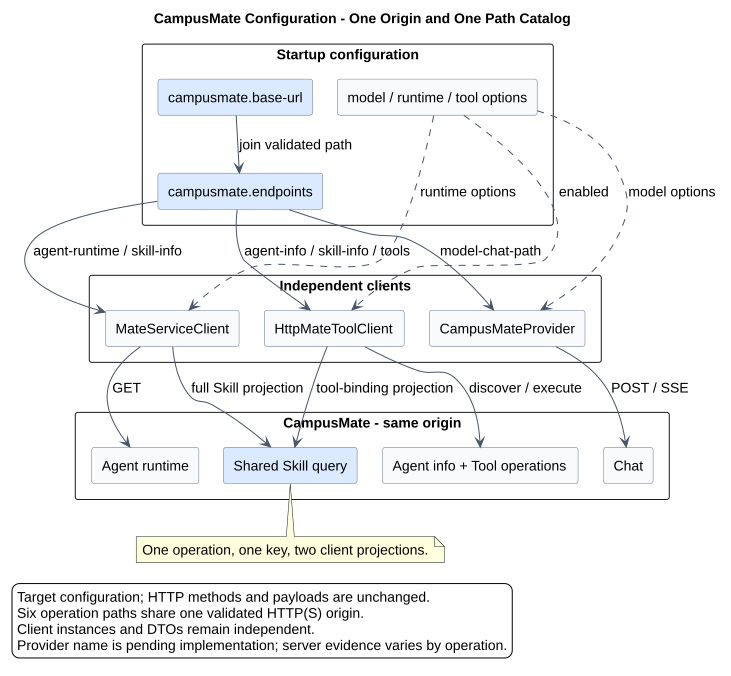

# CampusMate 统一配置与 Endpoint 目录设计

| 属性 | 值 |
|---|---|
| 文档版本 | 2.6.0 |
| 状态 | 已确认目标；不同客户端的实现核验范围见 §2 |
| 更新日期 | 2026-09-19 |
| pi-mono-java 源码基线 | `320d790726a70aada6100052952d5494d2a378ac` |
| mate-service 源码基线 | `956b547f5ca12ca89e68f73012f92a4406b0c9fa` |
| 适用边界 | CampusClaw -> CampusMate Model Manager、受管 Runtime 与 Tool 接口 |

## 1. 职责与目标配置

本专题维护 CampusClaw 调用 CampusMate 的连接配置：唯一服务地址、唯一 operation 路径目录，以及各客户端独立的传输参数。模型调用、Runtime 发现与 Tool 执行的业务契约分别由所属模块维护。

Mate 与 CampusMate 是同一个服务，所有连接与路径使用以下 `campusmate` 配置树：

```yaml
campusmate:
  base-url: ${CAMPUSMATE_BASE_URL}
  endpoints:
    model-capability-path-template: ${CAMPUSMATE_MODEL_CAPABILITY_PATH_TEMPLATE:/mate-service/v1/models/%s}
    model-chat-path: ${CAMPUSMATE_MODEL_CHAT_PATH:/mate-service/v1/LLM/chat}
    agent-info-path-template: ${CAMPUSMATE_AGENT_INFO_PATH_TEMPLATE:/mate-service/v1/agents/%s}
    agent-runtime-path-template: ${CAMPUSMATE_AGENT_RUNTIME_PATH_TEMPLATE:/mate-service/v1/agents/%s/runtime}
    skill-info-path-template: ${CAMPUSMATE_SKILL_INFO_PATH_TEMPLATE:/mate-service/v1/skill/query/%s}
    tool-metadata-query-path: ${CAMPUSMATE_TOOL_METADATA_QUERY_PATH:/mate-service/v1/runtime/tools/query}
    tool-execute-path-template: ${CAMPUSMATE_TOOL_EXECUTE_PATH_TEMPLATE:/mate-service/v1/runtime/tools/%s/execute}
  model:
    api: ${CAMPUSMATE_MODEL_API:openai-completions}
    connect-timeout: ${CAMPUSMATE_MODEL_CONNECT_TIMEOUT:PT10S}
    response-timeout: ${CAMPUSMATE_MODEL_RESPONSE_TIMEOUT:PT10M}
    reasoning: ${CAMPUSMATE_MODEL_REASONING:true}
  runtime:
    agents-root: ${CAMPUSCLAW_AGENTS_ROOT:agent}
    connect-timeout: ${CAMPUSMATE_RUNTIME_CONNECT_TIMEOUT:PT10S}
    request-timeout: ${CAMPUSMATE_RUNTIME_REQUEST_TIMEOUT:PT30S}
    success-code: ${CAMPUSMATE_SUCCESS_CODE:0}
    max-response-bytes: ${CAMPUSMATE_MAX_RESPONSE_BYTES:4194304}
  tool:
    enabled: ${CAMPUSMATE_TOOL_ENABLED:true}
```

配置有四项约束：

1. `campusmate.base-url` 是唯一 origin 权威；
2. `campusmate.endpoints` 是唯一出站路径目录；
3. 模型协议、传输与尚未迁移的 reasoning 配置放在 `campusmate.model`；窗口信息按新执行查询 Mate 并固定到执行快照，输出额度仅由 Mate 控制；
4. 目标配置中不存在顶层 `mate`、`mate.endpoints`、`mate.tool` 或
   `campusmate.model-manager`。

这是一项 **架构改造**。HTTP method、path、请求/响应、SSE 和超时语义不因
配置归并而改变。新增模型能力查询是独立增量，精确契约见[能力专题](../03-Model/model-capabilities.md)。凭据边界按 Runtime HTTP 1.42 另行收紧：Agent、Skill 与 Tool
metadata 发现无凭据，仅 Tool execute 透传 POST Events execution 快照中已提供的
`X-HW-ID`、`Authorization`、`X-HW-APPKEY` 和 `access-token`。

## 2. 源码与实现状态

Java 基线 `320d7907` 中，三个客户端使用三套地址和七个路径配置，其中两项 Skill path 指向同一 operation。Mate 基线 `956b547f` 可证明 Chat 与两个 Agent operation；该提交未发现 Skill/Tool 三个 Controller。完整路径、符号与规范化结果见[源码证据](source-evidence.md)。

Java 局部复核 `f61906b9` 已证明 Chat Provider 读取统一配置。这个局部结论不更新其他客户端、凭据边界或服务端的验收状态。目标配置不以旧提交中的差距作为当前未实现结论。

2026-09-19 token 能力专项核对 Java 本地 `21c3f59be033e7bdd5506a2d9d48baa2581bc3c7` 和 Mate 本地 `4b957a3a846659f5b7569c9d6133abc070cd2e3c`：统一配置和 CampusMateProvider 已存在；逐模型能力查询、快照及两个默认字段删除仍待实现。证据集中于[Model 源码专题](../03-Model/source-evidence.md#model-capability-evidence)。

## 3. 配置与客户端关系



[PlantUML 源码：`campusmate_shared_base_url_configuration`](diagram.puml#L1) · [原尺寸 SVG](campusmate_shared_base_url_configuration.svg)

三个客户端共享地址和路径定义，各自保留传输实现及 DTO。Skill 查询只有一个 operation、一个配置键，Runtime 与 Tool 从同一响应读取各自所需字段。Agent info 与 Agent runtime 的职责和路径不同，保持两个 operation。

## 4. 配置责任

| 配置 | 责任 | 禁止事项 |
|---|---|---|
| `campusmate.base-url` | CampusMate scheme、host、port | 子模块覆盖 origin |
| `campusmate.endpoints.*` | 目标 7 个 HTTP operation path（含待实现的模型能力查询） | 完整 URL、重复 operation、客户端私有副本 |
| `campusmate.model.*` | API 适配、SSE 传输与既有 reasoning 参数 | 保存 URL、path 或 contextWindow/maxTokens 默认值 |
| `campusmate.runtime.*` | 本地缓存、短请求超时、成功码与响应上限 | 保存 URL 或 path |
| `campusmate.tool.enabled` | 是否装配 Tool 能力 | 决定 URL 或 path |

共享配置不意味着共享 HTTP Client 实例或 DTO。Model Manager 保留 WebClient/SSE；Runtime
保留 JDK HttpClient、响应大小限制与完整 Skill DTO；Tool 客户端保留发现缓存，但发现请求不接收执行凭据；仅 execute 方法接收执行快照
和轻量 Skill 投影。两个客户端可以用不同 DTO 读取同一个 Skill operation，但不能各自
维护其 path。

`ListMateTools`、`CallMateTool`、`MateToolClient` 等名称是既有模型/Java 契约，不是
Spring 服务命名空间。本主题不为了配置归并破坏工具名；若产品需要把模型可见工具改名，
应独立评审 Schema、提示词与兼容性。

## 5. URL 与 Path 规则

`campusmate.base-url` 在启动时本地校验：

1. 必须是绝对 URI，scheme 只能为 `http` 或 `https`；
2. 必须有 host，不允许 user-info、query 或 fragment；
3. path 必须为空或 `/`；
4. 规范化只移除末尾 `/`，不改写 host 或 port；
5. 通用 modules 必须显式提供；公司镜像按实现仓 ADR-0042 使用 `${CAMPUSMATE_BASE_URL:https://localhost:8591}`。该公司集成例外不改变 origin 校验。

每个 endpoint path 必须：

1. 以 `/mate-service/` 开头；
2. 不是完整 URL；
3. `{agentId}`、`{skillId}`、`{toolId}`、`{modelId}` 对应的配置统一使用一个 `%s`；
4. 不能包含 query、fragment、`..` 或第二个 origin；
5. 同一 method + 规范化 path 只能有一个配置键。

终端地址固定为：

```text
endpoint = normalized(campusmate.base-url) + validated(campusmate.endpoints.<operation>)
```

这些规则属于 **安全加固**，防止某一客户端通过 path 配置改道到其他主机。

## 6. 配置迁移

| 当前配置 | 目标配置 | 处理 |
|---|---|---|
| `campusmate.model-manager.base-url` / `CAMPUSMATE_MODEL_MANAGER_BASE_URL` | `campusmate.base-url` / `CAMPUSMATE_BASE_URL` | 删除独立地址 |
| `campusmate.runtime.base-url` / `CAMPUSMATE_RUNTIME_BASE_URL` | `campusmate.base-url` / `CAMPUSMATE_BASE_URL` | 删除独立地址 |
| `mate.innerGWSerive` / `MATE_INNERGWSERIVE` | `campusmate.base-url` / `CAMPUSMATE_BASE_URL` | 删除历史拼写与顶层 `mate` |
| `campusmate.model-manager.chat-path` | `campusmate.endpoints.model-chat-path` | 路径移入统一目录 |
| `campusmate.model-manager.api` / `CAMPUSMATE_MODEL_MANAGER_API` | `campusmate.model.api` / `CAMPUSMATE_MODEL_API` | 配置分组改为模型能力语义；不保留兼容别名 |
| `campusmate.model-manager.connect-timeout` / `CAMPUSMATE_MODEL_MANAGER_CONNECT_TIMEOUT` | `campusmate.model.connect-timeout` / `CAMPUSMATE_MODEL_CONNECT_TIMEOUT` | 同步迁移模型连接超时 |
| `campusmate.model-manager.response-timeout` / `CAMPUSMATE_MODEL_MANAGER_RESPONSE_TIMEOUT` | `campusmate.model.response-timeout` / `CAMPUSMATE_MODEL_RESPONSE_TIMEOUT` | 同步迁移模型流响应超时 |
| `campusmate.model.context-window` 及旧 `model-manager` 键与环境变量 | 每个新执行查询得到的 `contextWindow` | 删除部署默认值及 Java fallback；必填正整数 |
| `campusmate.model.max-output-tokens` 及旧 `model-manager` 键与环境变量 | Mate 内部输出策略 | 删除部署默认值及 Java fallback；Claw 不查询、不设置输出额度 |
| `campusmate.model-manager.reasoning` / `CAMPUSMATE_MODEL_MANAGER_REASONING` | `campusmate.model.reasoning` / `CAMPUSMATE_MODEL_REASONING` | 同步迁移推理能力开关 |
| `mate.endpoints.agent-info-path-prefix` | `campusmate.endpoints.agent-info-path-template` | 移入统一目录并用 `%s` 模板 |
| `campusmate.runtime.agent-runtime-path-template` | `campusmate.endpoints.agent-runtime-path-template` | 路径移入统一目录 |
| `campusmate.runtime.skill-info-query-path-template` | `campusmate.endpoints.skill-info-path-template` | 与下一项合并 |
| `mate.endpoints.skill-tools-query-path-prefix` | `campusmate.endpoints.skill-info-path-template` | 删除重复键并用 `%s` 模板 |
| `mate.endpoints.tool-metadata-query-path` | `campusmate.endpoints.tool-metadata-query-path` | 只改服务命名空间 |
| `mate.endpoints.tool-execute-path-template` | `campusmate.endpoints.tool-execute-path-template` | 只改服务命名空间 |
| `mate.tool.enabled` | `campusmate.tool.enabled` | Tool 能力归入 CampusMate |

不保留旧键优先级或 fallback。否则配置仍可分流或让重复 Skill path 产生不同值。
部署平台若继续提供 `CAMPUSINNERGWSERVICE_DOMAIN_NAME_URL`，只能在安装边界转换成
`CAMPUSMATE_BASE_URL`；若两者同时存在且不同，部署校验必须失败。

## 7. Java 目标映射

Provider 的目标类名为 `CampusMateProvider`，身份为 `campusmate`；具体规则由[Model 主设计 §3](../03-Model/README.md#provider-identity)维护。下表是从固定源码到目标的映射，实施前应复核最新代码。

| Java 符号 | 目标调整 |
|---|---|
| `CampusMateProvider`（已实现身份） | 注入 `${campusmate.base-url}`、`${campusmate.endpoints.model-chat-path}` 及 `campusmate.model` 下的 API/超时参数；Provider 协议语义不变 |
| `MateModelManagerProperties` | 已绑定 `campusmate.model`；删除 contextWindow/maxOutputTokens，仅保留仍有消费者的字段 |
| `AgentRuntimeProperties` | 删除 `baseUrl`；只绑定 `campusmate.runtime` 的非 endpoint 参数 |
| `MateServiceClient` | 注入共享 base URL，以及统一目录中的 Agent Runtime、Skill 和模型能力 path；能力查询复用 runtime 短请求超时与响应上限，不发送 execution 凭据 |
| `MateToolAutoConfiguration` | 条件键改为 `campusmate.tool.enabled`；读取共享 base URL 和统一 endpoint 目录，不再读取任何 `mate.*` |
| `HttpMateToolClient` | Agent 与 Skill 前缀参数改为 `%s` path template；Skill path 与 Runtime client 读同一配置键；Agent/Skill/metadata 发现方法不接收凭据，仅 execute 接收不可变的四项 execution 凭据快照 |
| `MateToolProperties` | 绑定前缀改为 `campusmate.tool`；类名可保留以避免无关 Java API 改名 |
| `MateRestUtil` | 参数和诊断术语改为 CampusMate base URL；传输行为不变 |
| canonical YAML 与镜像 properties | 只保留一个 `campusmate` 根和一个 Skill endpoint 键 |
| 配置与客户端测试 | 断言历史归并后的 6 个 operation 加 1 个能力查询，各自唯一，并拒绝旧 `mate.*` 绑定 |

不同 Maven 模块不必为了共享一个属性对象形成反向依赖；它们可以分别注入相同的
`campusmate.*` 属性。唯一权威是配置键与启动校验，不是某个客户端类。

## 8. 差异分类

| 分类 | 目标差异 | 原因 |
|---|---|---|
| 产品约束 | Mate 与 CampusMate 只表达一个服务身份。 | 部署中不存在第二个 Mate 服务 origin。 |
| 架构改造 | 删除顶层 `mate`，全部配置统一到 `campusmate`。 | 避免服务命名和地址权威分裂。 |
| 架构改造 | 模型参数从 `campusmate.model-manager` 改为 `campusmate.model`。 | 配置树描述能力域，不重复暴露 Model Manager 组件名。 |
| 架构改造 | endpoint 统一维护，历史 6 个 operation 加 1 个模型能力查询。 | path 属于服务契约，不属于某个客户端。 |
| 架构改造 | 删除统一 token 能力默认值，每个新执行查询窗口，Mate 自主控制输出。 | 避免窗口长期陈旧及两端重复控制额度。 |
| 架构改造 | Runtime 与 Tool client 共享一个 Skill endpoint 配置。 | 两者调用相同 method/path 与响应契约。 |
| 安全加固 | base URL 只允许 HTTP(S) origin，path 不能携带 origin。 | 防止单客户端改道。 |
| 安全加固 | Agent/Skill/metadata 发现无凭据，仅 Tool execute 透传 POST Events execution 快照。 | 将凭据可见面限制到真正执行工具的单一端点。 |
| 产品约束 | 模型可见 Mate Tool 名称暂不改。 | 工具契约与服务配置命名是不同兼容边界。 |

## 9. 实施顺序

1. 增加统一 `campusmate.base-url`、`campusmate.endpoints`、`campusmate.model` 与启动校验；
2. 同一提交让 Model Manager、Runtime 和 Tool 三类客户端切换到新键，并将全部
   `CAMPUSMATE_MODEL_MANAGER_*` 环境变量迁移为 `CAMPUSMATE_MODEL_*`；
3. 合并 Skill path 消费点，Agent/Skill ID 路径统一改用 `%s` 模板；
4. 将 `mate.tool.enabled` 迁入 `campusmate.tool.enabled`；
5. 删除 `mate.*`、三个旧地址变量、旧 path 变量和部署脚本转换；
6. 同步 canonical YAML、镜像 properties、README、DTO 注释和配置/客户端测试；
7. 实现 Mate 信息查询、自主输出与执行快照后，同步删除 modules YAML、镜像 properties 及 Java 中两个 token 默认值；部署先提供查询端，再更新消费者，Agent 目录不增加能力字段；Chat 字段退役按 Model 专题协同发布；
8. 补充端到端断言：三个客户端 origin 相同、Skill endpoint 只解析一次且两种消费均成功。

## 10. 验收标准

- 目标配置源中只有一个顶层 `campusmate`，不存在顶层 `mate`；
- 模型协议、传输及既有 reasoning 配置位于 `campusmate.model.*`，窗口由执行快照维护、输出额度由 Mate 控制；目标配置和环境变量中不存在
  `campusmate.model-manager.*` 或 `CAMPUSMATE_MODEL_MANAGER_*`；
- 只有 `campusmate.base-url` / `CAMPUSMATE_BASE_URL` 能决定 CampusMate origin；
- 只有 `campusmate.endpoints` 能决定目标 7 个出站 operation path；
- `GET /mate-service/v1/skill/query/{skillId}` 只有一个配置键，并由 Runtime 与 Tool client 共用；
- `GET /agents/{agentId}` 与 `GET /agents/{agentId}/runtime` 保持两个独立 operation；
- `mate.innerGWSerive`、`mate.endpoints.*`、`mate.tool.enabled` 及所有 `MATE_*` 应用变量删除；
- canonical YAML 与镜像 properties 的业务配置绑定等价，公司地址默认值例外按 §5 维护；两者均无 `CAMPUSMATE_MODEL_CONTEXT_WINDOW`、`CAMPUSMATE_MODEL_MAX_OUTPUT_TOKENS` 及对应 Java fallback；
- base URL 或 path 非法时启动失败且不发送网络请求；
- Chat、Runtime、Tool 请求使用相同 scheme、host、port；
- 配置归并本身不改变 HTTP 语义；Chat 输出字段退役与新增信息查询按 Model 专题，其他契约保持；
- 模型能力、Agent、Skill 和 Tool metadata 发现请求不含四项 execution Header；
- 仅 Tool execute 透传 POST Events 快照中已提供的四项 Header，且 `access-token`
  不被改写为 `X-Access-Token`；
- 服务端尚未实现的 Skill/Tool Controller 仍明确标记为待补齐，不因客户端配置存在而宣称已实现。

## 11. 相关契约

- [Model](../03-Model/README.md)：Chat 参数、SSE 与 Provider 身份。
- [工具系统](../../01-总体架构/02-CampusClaw工具系统/README.md)：发现与执行，以及 execution 凭据快照。
- [源码证据](source-evidence.md)：客户端路径归属、历史重复项和服务端核验范围。

## 12. 版本历史

| 版本 | 日期 | 变更 |
|---|---|---|
| 2.6.0 | 2026-09-19 | 模型窗口按新执行读取，输出额度归 Mate，配置迁移与 Chat 字段退役协同发布。 |
| 2.5.0 | 2026-09-19 | 新增 Mate 模型能力查询 endpoint，删除统一 token 默认值并注明公司镜像地址例外。 |
| 2.4.0 | 2026-09-14 | 以目标配置与客户端关系组织正文，将历史源码差距集中为证据专题并重排配置图。 |
| 2.3.0 | 2026-09-14 | 目标 Provider 统一为 CampusMateProvider，沿用共享配置并保留旧提交源码证据。 |
| 2.2.0 | 2026-08-27 | Metadata 发现不携带凭据，Tool 执行透传当前 execution 的四项调用 Header。 |
| 2.1.0 | 2026-08-26 | 模型配置统一为 `campusmate.model` 与 `CAMPUSMATE_MODEL_*`。 |
| 2.0.0 | 2026-08-26 | 统一 CampusMate 配置树与端点目录，归并重复的 Skill 查询路径。 |
| 1.1.0 | 2026-08-26 | 将 `mate.innerGWSerive` 纳入共享 base URL，但仍保留顶层 `mate.endpoints`。 |
| 1.0.0 | 2026-08-26 | 新增 CampusMate 统一 `campusmate.base-url` 设计。 |
