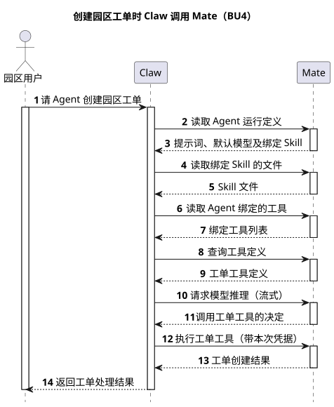
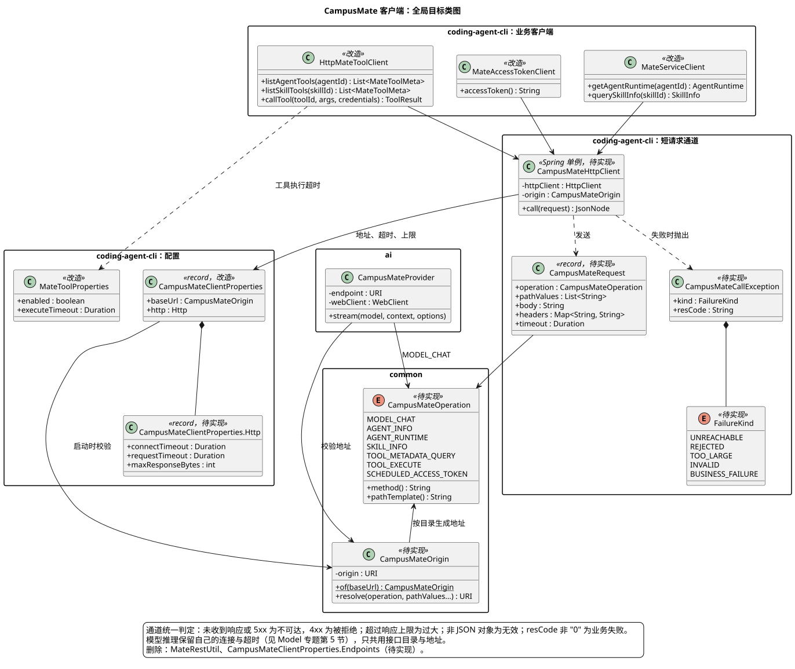
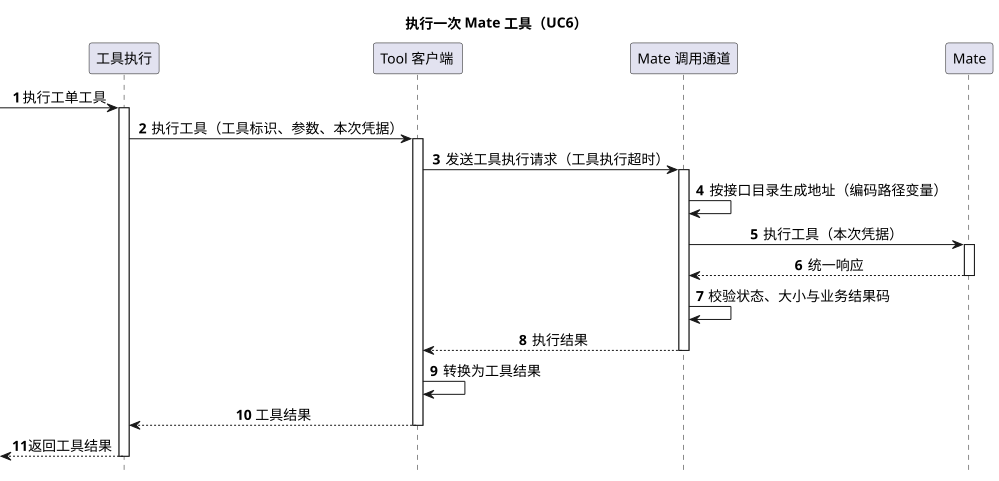

# CampusMate 客户端收敛设计

[共享客户端配置](README.md) · [源码证据](source-evidence.md) · [PlantUML 源码](diagram.puml)

| 属性 | 值 |
|---|---|
| 文档版本 | 0.4.0 |
| 更新日期 | 2026-10-21 |
| 模块 | M02 · Model（CampusMate 共享客户端配置专题；调用方横跨 M01 Runtime、M03 Tool、M10 定时任务） |
| 设计状态 | 待实现。路径目录、共享同步请求通道和超时分组都待实现；被替换的 `campusmate.endpoints`、`MateRestUtil` 等现状见 [§8.2](#source-evidence) |
| 源码基线 | Claw Java main `628dca25a694d9d056b15f012e1223d68091ab66`（2026-10-21 fetch） |
| 主基线 | Codex main `d571eaf1f61d0d93a797506335a99a9950ffe37b`、Anthropic Java SDK main `85bfc1966a94862ec39477278430c3f8f5a0c3f6`，均于 2026-10-21 fetch；pi main `16f5f0af4d85ca583d045ceb5ed6d646fcaf7761`、OpenCode dev `dbe08ddc3c405168c679a3dac0029ef64787b7af` 作对照 |

## 评审记录

### 评审结论

【缺口】尚未评审。

### 评审 Todo

| # | 事项 | 负责人 | 来源 |
|---|---|---|---|
| T1 | 确认公司部署流水线没有覆盖任何 `CAMPUSMATE_*_PATH*` 环境变量；若有，按 [D1 代价](#key-decisions)评估 | Lotus | [D1](#key-decisions) |
| T2 | 已确认（2026-10-21，Lotus）：Mate 用 HTTP 状态表达成败，非 2xx 即失败，业务失败只带 `resCode`、`resMsg`，没有 `result`。通道只按 HTTP 状态判定成败，不检查 `resCode`，与实现仓 `b0f45547` 的决定一致 | Lotus | [§3.3](#short-request-sequence) |
| T3 | 已确认（2026-10-21，Lotus）：按传输方式分两组，同步 HTTP 请求 60 秒、模型 SSE 600 秒，均可配置 | Lotus | [§7.1](#config-items) |
| T4 | 采纳后修改 codex-style `design-doc-template` 中 7.1 的"路径放进服务的路径目录"规则，改为"路径进代码中的接口目录，配置只放服务地址" | Lotus | [§7.1](#config-items) |
| T5 | 采纳后同步 [Agent 架构对比 A06/A18](../../01-总体架构/07-Agent架构对比/README.md) 与共享配置主设计 [README](README.md) §1、§4～§10 | Claude | 设计仓 AGENTS.md |

### 需求信息

需求来源：2026-10-21 讨论串"Mate 客户端配置精简"。用户认为 `CampusMateClientProperties.Endpoints` 参数过多、调用 Mate 的写法"五花八门"，要求"按照最优雅的方案改造"。【缺口】没有需求编号、优先级和目标版本。

## 1. 概述

### 1.1 术语解释

| 术语 | 含义 |
|---|---|
| Mate | CampusMate 服务，与 CampusMate 是同一个服务 |
| 服务地址 | `campusmate.base-url`，只含 scheme、host、port |
| 接口目录 | Claw 调用的全部 Mate 接口，每项是一个 HTTP 方法加路径模板，定义在代码中 |
| 同步请求 | 除模型流式推理外的所有 Mate 调用：读取 Agent 和 Skill、查询和执行工具、取定时 token；一次请求一次响应，都经过同步请求通道 |
| 同步请求通道 | 所有同步请求共用的发送组件，负责拼地址、超时、响应上限和 Mate 统一响应的解包 |
| 业务客户端 | 按业务分组调用 Mate 的类：Runtime、Tool、定时 token 三个，只负责请求和结果的业务转换 |

### 1.2 需求整理

| 编号 | 需求 | 类型 | 来源 |
|---|---|---|---|
| R1 | 部署只需配置 Mate 服务地址，新增一个 Mate 接口不新增配置项或环境变量 | 约束 | 用户要求；推导，需确认 |
| R2 | 同一种调用失败（不可达、超时、非 2xx、响应过大、响应无效）在所有同步请求上按同一规则判定 | 稳定性 | 用户"五花八门"；[§8.2](#source-evidence) 中三套不同判定 |
| R3 | 所有 Mate 请求只能发往 `campusmate.base-url` 指定的服务，路径不能改道到其他主机 | 安全 | 沿用 ADR-0026 |
| R4 | 超时按传输方式分两组并均可配置：同步 HTTP 请求 60 秒、模型 SSE 600 秒 | 稳定性 | 用户确认（T3） |
| R5 | 不改变任何 Mate 接口的方法、路径、请求头、请求体和响应体 | 约束 | 沿用 ADR-0026 |
| R6 | 发现请求不携带业务凭据；工具执行只携带本次执行的凭据快照 | 安全 | 沿用 [README §1](README.md) |

## 2. 整体方案

### 2.1 业务用例

Agent 服务依赖一个上游平台提供模型、Agent 定义、业务工具和定时凭据。部署人员需要用最少的配置把服务接到平台上；开发人员接入平台新接口时，需要改动范围小、失败处理一致，不必每次补一套配置和校验。本设计把 Claw 调用 Mate 的地址、路径、发送和失败判定收敛成一处。

| 编号 | 参与者 | 业务目标 | 业务结果 |
|---|---|---|---|
| BU1 | 部署人员 | 把 Claw 接到某个环境的 Mate | 服务启动成功，所有 Mate 调用都发往配置的地址；只需设置一个地址 |
| BU2 | 运维人员 | 调整调用 Mate 的超时 | 同步请求和模型推理两类超时各自生效 |
| BU3 | 开发人员 | 接入一个新的 Mate 接口 | 在接口目录加一项、写业务客户端方法即可调用，超时、响应上限和失败判定自动与其他接口一致 |
| BU4 | 园区用户 | 让 Agent 处理一项园区工单 | Agent 读取定义、装配工具、推理并执行工具，返回处理结果 |

### 2.2 整体时序

场景：园区用户让 Agent 创建一条园区工单，Agent 读取定义、装配工具、推理、执行工具后返回结果。前提：Agent 已在 Mate 中定义并绑定工单工具。图中 Claw 对 Mate 的调用全部经过同一个服务地址和接口目录，同步请求经过同一个通道；收敛本身待实现，Mate 接口不变。

| 参与者 | 职责 | 映射 |
|---|---|---|
| 园区用户 | 发起请求、查看结果 | 浏览器或调用方 |
| Claw | 准备 Agent、装配工具、驱动推理和执行 | CampusClaw 服务（Runtime、Tool、Model Provider 均在其中） |
| Mate | 提供 Agent 定义、工具、模型和业务执行 | CampusMate 服务 |

[原尺寸 SVG](claw_mate_overall_sequence.svg) · [PlantUML 源码](diagram.puml#L84)

| 阶段 | 详细时序 |
|---|---|
| 步骤 2～5：准备 Agent | 运行目录写入沿用 [M01](../../01-总体架构/01-CampusClaw多Agent运行时/README.md)；同步请求发送见 [§3.3](#short-request-sequence) |
| 步骤 6～9：装配工具 | 工具装配沿用 [M03](../../01-总体架构/02-CampusClaw工具系统/README.md)；同步请求发送见 [§3.3](#short-request-sequence) |
| 步骤 10～11：推理 | 模型调用沿用 [Model §5](../03-Model/README.md#http-transport) |
| 步骤 12～13：执行工具 | [§3.3 发送同步请求的详细时序](#short-request-sequence) |

### 2.3 关键设计决策

这三个问题都属于"客户端怎么连到一个固定服务"，按问题选择 Provider 与 HTTP 客户端分层的基线：Codex 和 Anthropic Java SDK 为主，pi、OpenCode 对照。证据见 [§8.3](#baseline-evidence)。

| # | 要解决的问题 | 基线怎么做 | 业务约束 | 我们的选择 | 代价 |
|---|---|---|---|---|---|
| D1 | Mate 接口路径由部署配置，还是写在代码里？ | Codex 的 `Provider` 只有 `base_url`、请求头和重试，每个接口客户端在代码里写死路径（`"models"`、`"memories/trace_summarize"`、`/responses`），唯一例外 `model_catalog_url` 是因为模型目录可能在另一个主机；Anthropic SDK 只暴露 `baseUrl`，各 Service 用 `addPathSegments("v1", "messages")` 写死；pi 的模型只有 `baseUrl` 和 `api`；OpenCode 的 Provider 设置只有 `baseURL` | Mate 是唯一服务，所有接口同一主机（产品约束）；路径变化必然伴随请求或响应变化，Claw 本来就要发版；仓库内没有部署覆盖任何路径变量 | 路径写成 common 模块的接口目录 `CampusMateOperation`（方法 + 路径模板），配置只保留 `campusmate.base-url`；ai 和 cli 两个模块共用这份目录 | Mate 单独改路径时 Claw 必须发版；退役 7 个配置键和环境变量，不做兼容双读；若某环境需要不同网关前缀，要再加一个前缀配置（T1） |
| D2 | 同步请求的发送、超时、响应上限和失败判定由谁负责？ | Codex 的 `EndpointSession` 为所有接口客户端统一发请求，`Request` 带单次 `timeout` 和 `response_body_limit_bytes`；Anthropic SDK 所有 Service 共用 `ClientOptions` 中的一个 `HttpClient` 和默认 `Timeout`，单次调用可用 `RequestOptions` 覆盖 | 现状三个业务客户端各自封装 JDK HttpClient，HTTP 状态、`resCode`、响应上限的判定各不相同（[§8.2](#source-evidence)）；ai 模块不能依赖 cli 模块 | cli 模块新增一个同步请求通道 `CampusMateHttpClient`，持有唯一的 JDK HttpClient，统一拼地址、超时、响应上限，并只按 HTTP 状态判定成败（Mate 非 2xx 即失败，T2）；业务客户端只做请求组装和结果转换。模型推理是长时 SSE，保留 Provider 自己的连接（[Model §5](../03-Model/README.md#http-transport)），只共用接口目录和地址校验 | 现有三套失败判定合并成一套，工具执行和取 token 不再自行检查 `resCode`；若某个 Mate 接口违反"非 2xx 即失败"，Claw 会把失败当成功；模型与同步请求仍是两条连接，不能共用连接池 |
| D3 | 业务客户端是合并成一个 Mate 客户端，还是按业务保留？ | Anthropic SDK 按资源保留 `MessageService`、`ModelService` 等，共用同一个 `ClientOptions`；Codex 按接口保留 `ModelsClient`、`MemoriesClient` 等，共用同一个 `EndpointSession` | 三个调用方属于不同模块（M01、M03、M10），各自的失败要转换成本模块的错误：工具执行失败要变成给模型看的工具结果，定时 token 失败要区分"需要重新授权"和"服务不可用" | 保留 `MateServiceClient`、`HttpMateToolClient`、`MateAccessTokenClient` 三个业务客户端，全部改用共享通道；删除 `MateRestUtil` | 新接口仍要选一个业务客户端或新建一个；通道的失败类型要映射到三套模块错误，直到 [M12 统一错误码](../../01-总体架构/09-CampusClaw异常与错误码/README.md)落地 |

## 3. 详细设计

### 3.1 系统用例

| 用例 | 对应业务用例 | 触发者 | 前置条件 | 主成功结果 | 关键约束 |
|---|---|---|---|---|---|
| UC1 启动时校验服务地址 | BU1 | 部署人员启动服务 | 设置了 `CAMPUSMATE_BASE_URL` | 服务启动，地址规范化后供所有调用使用 | 地址非法时启动失败，不发任何请求；规则沿用 [README §5](README.md) |
| UC2 发送同步请求 | BU3、BU4 | 业务客户端 | 地址已校验 | 返回 Mate 统一响应中的 `result` | 超时、响应上限和 HTTP 状态按同一规则判定 |
| UC3 读取 Agent 运行定义 | BU4 | Runtime 准备运行目录 | — | 返回提示词、默认模型和绑定 Skill | 不携带业务凭据 |
| UC4 读取 Skill | BU4 | Runtime 准备运行目录、Tool 装配 | — | 返回 Skill 文件或绑定工具 | 两个客户端读同一接口的不同字段 |
| UC5 查询工具定义 | BU4 | Tool 装配 | — | 返回 Agent 或 Skill 绑定工具的定义 | 不携带业务凭据 |
| UC6 执行工具 | BU4 | 模型发起工具调用 | 工具已装配 | 返回给模型的工具结果 | 只携带本次执行的凭据快照 |
| UC7 取定时 token | BU4 | 定时执行准备调用工具 | — | 返回统一账号 access-token | 失败时区分需要重新授权和服务不可用 |

### 3.2 数据模型

无新增表或持久化数据。

接口目录 `CampusMateOperation`（common 模块，待实现）：

| 常量 | 方法 | 路径模板 | 调用方 |
|---|---|---|---|
| `MODEL_CHAT` | POST | `/mate-service/v1/LLM/chat` | `CampusMateProvider` |
| `AGENT_INFO` | GET | `/mate-service/v1/agents/{agentId}` | `HttpMateToolClient` |
| `AGENT_RUNTIME` | GET | `/mate-service/v1/agents/{agentId}/runtime` | `MateServiceClient` |
| `SKILL_INFO` | GET | `/mate-service/v1/skill/query/{skillId}` | `MateServiceClient`、`HttpMateToolClient` |
| `TOOL_METADATA_QUERY` | POST | `/mate-service/v1/runtime/tools/query` | `HttpMateToolClient` |
| `TOOL_EXECUTE` | POST | `/mate-service/v1/runtime/tools/{toolId}/execute` | `HttpMateToolClient` |
| `SCHEDULED_ACCESS_TOKEN` | POST | `/mate-service/v1/runtime/scheduled-access-token` | `MateAccessTokenClient` |

路径与当前默认值逐字相同（R5）。模型能力查询 `/mate-service/v1/models/{modelId}` 实现时作为第 8 项加入，无需新增配置。路径变量统一写成 `{name}`，替换 `%s`：一个模板可以有多个变量，变量值按路径段编码后再拼接，不再用 `String.replace`。

[原尺寸 SVG](campusmate_client_target_classes.svg) · [PlantUML 源码](diagram.puml#L119)

分层理由：

- **目录和地址放 common。** ai 模块的 Provider 和 cli 模块的三个业务客户端都要用，common 是两者唯一的共同依赖，而且只需要 `java.net`。这样 Provider 不再复制一份地址和路径校验。
- **通道放 cli。** 只有 cli 有同步请求调用方。通道是 Spring 单例，持有唯一的 JDK HttpClient，连接复用和超时在一处决定。
- **业务客户端只依赖通道，不依赖配置类。** 它们不再接收 base-url 字符串或路径参数，也就不会绕过地址校验。
- **先落骨架：** 先加目录、地址和通道，再逐个迁移业务客户端，最后删除 `Endpoints` 和 `MateRestUtil`。

### 3.3 发送同步请求的详细时序（UC2、UC6）

以执行工具为例展开 [§2.2](#business-use-cases) 步骤 12～13；读取 Agent、读取 Skill、查询工具和取定时 token 走同一条路径，只是业务客户端不同、使用同步请求超时。待实现。

[原尺寸 SVG](campusmate_short_request_sequence.svg) · [PlantUML 源码](diagram.puml#L235)

| 角色 | 映射 |
|---|---|
| 工具执行 | `MateRemoteToolHandler` |
| Tool 客户端 | `HttpMateToolClient` |
| Mate 调用通道 | `CampusMateHttpClient`、`CampusMateOrigin`、`CampusMateOperation` |

通道单列为参与者，因为超时、响应上限和失败判定这些规则只在它这里生效，是本设计的独立边界。

通道判定规则（替代现有三套判定）：

1. 请求未发出或未收到响应（连接失败、超时、中断）→ 失败类型"不可达"；
2. HTTP 状态不是 2xx → 5xx 为"不可达"，4xx 为"被拒绝"；响应体能解析出 `resCode`、`resMsg` 时带上，只用于日志和错误映射；
3. `Content-Length` 或实际读取超过 `campusmate.http.max-response-bytes` → "响应过大"；
4. 响应体不是 JSON 对象 → "响应无效"；
5. 否则成功，返回 `result` 节点（可能为空），由业务客户端转换为 DTO；`result` 缺失或形状不符时由业务客户端判为"响应无效"，工具执行的空结果按空字符串返回。

成败只看 HTTP 状态，不检查 `resCode`：Mate 的业务失败用非 2xx 返回，只带 `resCode`、`resMsg`，没有 `result`（T2，用户确认）。这样只有一个判定依据，也与实现仓 `b0f45547`"不按 resCode 预判"的决定一致。

业务客户端的转换：

| 业务客户端 | 不可达 | 被拒绝 | 响应过大或无效 |
|---|---|---|---|
| `MateServiceClient` | `MATE_REQUEST_FAILED` | `MATE_REQUEST_FAILED` | `MATE_RESPONSE_TOO_LARGE` / `MATE_RESPONSE_INVALID` |
| `HttpMateToolClient` 发现 | 发现失败 | 发现失败 | `MateToolResponseException` |
| `HttpMateToolClient` 执行 | 工具结果 `isError=true` | 工具结果 `isError=true` | 工具结果 `isError=true` |
| `MateAccessTokenClient` | `SCHEDULE_SERVICE_UNAVAILABLE` | `SCHEDULE_AUTH_REQUIRED` | `SCHEDULE_SERVICE_UNAVAILABLE` |

工具执行给模型的文字保持现状 `Mate tool execution request failed`，不透出 `resMsg` 或内部异常（R5、M12 R4）。

## 4. 接口协议

Mate 接口的方法、路径和报文不变，列表见 [§3.2](#data-model)，各自契约仍由所属专题维护：

| 操作 | 方法与路径 | 详细契约 |
|---|---|---|
| 模型推理 | `POST /mate-service/v1/LLM/chat` | [Model](../03-Model/README.md) |
| Agent 与 Skill 读取 | `GET /mate-service/v1/agents/{agentId}`、`/runtime`、`/skill/query/{skillId}` | [README §3](README.md)、[源码证据 §2](source-evidence.md) |
| 工具查询与执行 | `POST /mate-service/v1/runtime/tools/query`、`/{toolId}/execute` | [工具系统](../../01-总体架构/02-CampusClaw工具系统/README.md) |
| 定时 token | `POST /mate-service/v1/runtime/scheduled-access-token` | [mate-service 定时任务](../08-mate-service定时任务/README.md#scheduled-access-token) |

接口形状约定：路径变量用 `{name}` 并按路径段编码，原因见 [§3.2](#data-model)；请求头只由业务客户端传入，通道不自行添加凭据，保证 R6。

## 5. 架构指标

### 5.1 安全性

- 所有请求地址由 `CampusMateOrigin.resolve(operation, ...)` 生成，业务客户端拿不到拼接入口，路径来自代码常量，不可能改道到其他主机（R3）。这比现状更强：现状的 `MateRestUtil.joinUrl` 不校验拼接后的路径。
- 路径变量按段编码，即使 ID 校验遗漏，也不会通过 `/` 或 `?` 改变目标接口。
- 发现请求不传请求头快照，执行请求只传本次快照；通道日志只记录操作名和失败类型，不记录请求头和响应体（沿用 `ExceptionRedactionUtils`）。

### 5.2 稳定性

#### 5.2.1 失败处理与恢复

**不变量**（任何失败都不能破坏）：

1. Mate 请求只发往配置的服务地址；
2. 已发出的工具执行请求不自动重试，避免园区工单重复创建；
3. 失败结果不向模型或用户透出 `resMsg`、内部异常或凭据。

| # | 失败 | 发生阶段 | 副作用状态 | 处理方 | 系统处置 | 用户可见结果与下一步 | 不保证项 |
|---|---|---|---|---|---|---|---|
| F1 | 服务地址非法 | 启动 | 未发生 | 部署人员 | 启动失败并输出配置项名 | 服务未启动，修正 `CAMPUSMATE_BASE_URL` 后重启 | — |
| F2 | 读取或查询类同步请求不可达、被拒绝、响应无效 | UC3～UC5、UC7 | 未发生（只读） | 业务客户端 | 按 §3.3 转换为本模块错误，不重试 | 本次请求失败，用户可重试 | 不区分 Mate 宕机和网络故障 |
| F3 | 工具执行超时或连接中断 | UC6 | 未知 | Tool 客户端 | 返回 `isError=true` 的工具结果，不重试 | 模型看到执行失败，可提示用户核对园区工单是否已创建 | 不保证 Mate 侧没有执行 |
| F4 | 工具执行被 Mate 拒绝（非 2xx，带 `resCode`） | UC6 | 已提交或未发生，由 Mate 决定 | Tool 客户端 | 返回 `isError=true` 的工具结果，`resCode` 只进日志 | 模型看到执行失败 | 不透出失败原因 |
| F5 | 响应超过上限 | 任一同步请求 | 只读请求未发生；工具执行未知 | 通道 | 停止读取并按"响应过大"失败 | 同 F2 或 F3 | — |

#### 5.2.2 容量与限流

同步请求共用一个 JDK HttpClient，连接池在发现、执行和取 token 之间共享；JDK 默认不限制连接数，本设计不新增限流。模型推理的并发上限仍由 [Model §5.6](../03-Model/README.md#http-transport-config) 维护。【缺口】未压测，不给容量承诺。

#### 5.2.3 监控告警

| 指标 | 为什么需要 | 告警条件 |
|---|---|---|
| 按操作和失败类型统计的同步请求失败数 | D2 把三套判定合成一套后，各接口按状态码和 `resCode` 的失败分布要能看见 | 【缺口】阈值待定 |
| 工具执行超时次数 | F3 的副作用未知，需要人工核对 | 【缺口】阈值待定 |

【缺口】Claw 现有的指标上报方式未核验，首版先在通道统一打结构化日志字段（操作名、失败类型、耗时）。

#### 5.2.4 应急预案

Mate 路径临时变更时，Claw 无法靠环境变量热修，只能发版（D1 代价）。应急时可在 Mate 侧网关保留旧路径转发。

### 5.3 兼容性

| 变化 | 现状 | 目标 | 影响 |
|---|---|---|---|
| 路径配置 | 7 个 `campusmate.endpoints.*` 键和 `CAMPUSMATE_*_PATH*` 变量 | 删除，写进代码 | 已设置的变量被忽略；与默认值相同时无行为变化（T1） |
| 超时 | Runtime 30 秒可配；发现与执行 60 秒写死；定时 token 5 秒可配 | 同步请求统一 60 秒可配；模型推理 600 秒不变 | 工具发现与执行不变；Runtime 读取从 30 秒、取 token 从 5 秒放宽到 60 秒（T3）。Mate 挂起时，会话准备和定时运行要等更久才判定失败 |
| `resCode` 判定 | 执行和取 token 检查；发现和 Runtime 读取按 `b0f45547` 的决定不检查 | 全部不检查，成败只看 HTTP 状态 | Mate 非 2xx 即失败（T2 已确认），行为不变 |
| HTTP 状态 | Runtime 要求 2xx；取 token 要求 200；`MateRestUtil` 不检查 | 统一要求 2xx | 工具发现和执行遇到非 2xx 时更早失败 |
| 响应上限 | 只有 Runtime 限制 4 MiB | 所有同步请求限制 4 MiB | 工具结果超过 4 MiB 时失败；【缺口】未核验现有工具结果大小 |
| 配置键改名 | `campusmate.runtime.connect-timeout` 等 | `campusmate.http.*` | 环境变量改名，不做兼容双读（沿用 ADR-0035） |

## 6. 质量保证

### 6.1 灰度能力

配置迁移不保留双读，不能在同一实例里新旧并存，只能按实例灰度：新版本实例使用新键，旧版本实例继续用旧键，两套环境变量可以同时设置，互不影响。

### 6.2 回滚能力

回滚到旧版本即可。旧路径变量的值等于默认值，回滚前不必补设；旧超时变量在灰度期间保留不删，回滚后仍然生效。

### 6.3 自动化测试

- common：接口目录项互不重复、每项路径以 `/mate-service/` 开头、变量名与 `resolve` 参数数量一致、路径段编码；地址校验沿用现有用例。
- 通道：用一份本地 HTTP 桩覆盖 §3.3 五条判定规则和请求头透传（遵循 codex-style 审查经验 J10，只在通道测试里起桩，配置和装配测试不起服务）。
- 业务客户端：只测请求组装和 §3.3 转换表，通道用 mock。
- 删除 `CampusMateClientPropertiesTest` 中的路径配置用例和 `MateRestUtil` 测试。

### 6.4 QA 流程

【缺口】与 Mate 联调覆盖 7 个接口各一次成功调用和一次非 2xx 失败。

## 7. 基建规范

### 7.1 可配置项

| 配置键 | 环境变量 | 默认值 | 取值约束 | 用途 |
|---|---|---|---|---|
| `campusmate.base-url` | `CAMPUSMATE_BASE_URL` | 通用模块无默认值；公司镜像 `https://localhost:8591`（ADR-0042） | 规则不变，见 [README §5](README.md) | Mate 服务地址 |
| `campusmate.http.connect-timeout` | `CAMPUSMATE_HTTP_CONNECT_TIMEOUT` | `PT10S` | 正数 | 同步请求连接超时（新增，取代 `campusmate.runtime.connect-timeout`） |
| `campusmate.http.request-timeout` | `CAMPUSMATE_HTTP_REQUEST_TIMEOUT` | `PT60S` | 正数 | 所有同步 HTTP 请求的单次超时：读取 Agent 和 Skill、查询和执行工具、取定时 token（新增，取代 `campusmate.runtime.request-timeout`、`campusclaw.schedule.access-token-timeout` 和写死的 60 秒） |
| `campusmate.http.max-response-bytes` | `CAMPUSMATE_HTTP_MAX_RESPONSE_BYTES` | `4194304` | 正整数 | 所有同步请求的响应上限（新增，取代 `campusmate.runtime.max-response-bytes`） |
| `campusmate.model.response-timeout` | `CAMPUSMATE_MODEL_RESPONSE_TIMEOUT` | `PT600S`（与现有 `PT10M` 相同） | 正数 | 模型流式推理超时（已有，不变） |

删除的配置：`campusmate.endpoints.*` 全部 7 项及其环境变量；`campusmate.runtime.connect-timeout`、`request-timeout`、`max-response-bytes`；`campusclaw.schedule.access-token-timeout`。`campusmate.model.*`、`campusmate.runtime.agents-root`、`campusmate.tool.enabled` 不变。

本节与 codex-style `design-doc-template` 7.1 中"调用某服务的路径放进该服务的路径目录"一条冲突：本设计不再有路径配置，路径进代码中的接口目录。采纳后按 T4 修改该规则。

## 8. 其他补充

### 8.1 Endpoints 为什么越来越大

- 2026-08-26 ADR-0026 把三个客户端的 7 个路径键合并成 6 项，但保留了"路径可配置"，备选方案中没有"路径写进代码"。
- 2026-10-05 定时任务加了 2 项（上下文查询、凭据解析），2026-10-14 方案改为统一账号 token 后删回 6 项。
- 2026-10-19～20 `scheduled-access-token-path` 先移入目录，又撤回到 `campusclaw.schedule`，最后再次移入，变成 7 项。

根因是规则要求"Mate 每多一个接口就多一个配置键"，每个键要同时改 record 字段、校验、唯一性列表、yml、镜像 properties、环境变量、README 和测试。D1 之后接口数仍是 7，但每项只是一行常量。

### 8.2 源码证据

Claw Java main `628dca25a694d9d056b15f012e1223d68091ab66`，2026-10-21 fetch。`campusclaw/` 公司镜像与 `modules/` 对应文件逐行相同，仅包名不同。

| 源码 | 已观察行为 |
|---|---|
| `modules/coding-agent-cli/src/main/java/com/campusclaw/codingagent/config/CampusMateClientProperties.java`：`Endpoints`、`validateEndpointPath`、`validateUniqueOperations`、`endpoint` | 7 个路径字段；启动校验前缀、`%s` 数量、点段和重复；`endpoint(path)` 校验后拼接 |
| `modules/coding-agent-cli/src/main/resources/application.yml:106-129`、`campusclaw/src/main/resources/application.properties:38-45` | 每个路径一个环境变量和默认值；仓库内无部署覆盖 |
| `modules/ai/src/main/java/com/campusclaw/ai/provider/mate/CampusMateProvider.java:95,299-313` | `@Value` 读取 `model-chat-path`，复制一份地址和路径校验 |
| `modules/coding-agent-cli/src/main/java/com/campusclaw/codingagent/runtime/MateServiceClient.java:72-132,134-180` | 用 `endpoint()` 拼地址；要求 2xx；按 `campusmate.runtime.max-response-bytes` 限制；不检查 `resCode`；`expandPathTemplate` 用 `String.replace` |
| `modules/coding-agent-cli/src/main/java/com/campusclaw/codingagent/common/util/MateRestUtil.java:35-37,96-156` | 连接 10 秒、请求 60 秒写死；不检查 HTTP 状态；`ofString` 无响应上限；`joinUrl` 不校验拼接结果 |
| `modules/coding-agent-cli/src/main/java/com/campusclaw/codingagent/common/client/HttpMateToolClient.java:225-256,316-333` | 发现"不按 resCode 预判"；执行 `resCode` 非 0 返回 `isError=true` 的工具结果 |
| `modules/coding-agent-cli/src/main/java/com/campusclaw/codingagent/schedule/mate/MateAccessTokenClient.java:63-108`、`schedule/config/ScheduleProperties.java:49` | 要求 HTTP 200，4xx 映射为需要授权；检查 `resCode`；超时 5 秒 |
| `modules/coding-agent-cli/src/main/java/com/campusclaw/codingagent/schedule/mate/ScheduleMateConfiguration.java:38-56` | 独立创建一个 JDK HttpClient |
| Git 历史 `9d65e5d2`、`72fd68c9`、`1b584adf`、`6e7cb8cb`、`c56c52c1`、`3e29c885` | §8.1 中 `Endpoints` 字段的增减 |

### 8.3 基线证据

均于 2026-10-21 fetch 默认分支。

| 基线 | 提交 | 源码 | 已观察行为 |
|---|---|---|---|
| Codex | `d571eaf1f61d0d93a797506335a99a9950ffe37b` | `codex-rs/codex-client/src/provider.rs`：`Provider`、`url_for_path`、`build_request` | 一个 `base_url` 加单次 `timeout`、`response_body_limit_bytes` 的请求 |
| Codex | 同上 | `codex-rs/codex-api/src/endpoint/models.rs`、`memories.rs`、`responses.rs`：`path()` | 各接口客户端写死路径 |
| Codex | 同上 | `codex-rs/model-provider-info/src/lib.rs`：`ModelProviderInfo` | 配置项是 `base_url`、`wire_api`、请求头、重试和流超时；只有可能在另一主机的 `model_catalog_url` 是完整 URL |
| Anthropic Java SDK | `85bfc1966a94862ec39477278430c3f8f5a0c3f6` | `anthropic-java-core/src/main/kotlin/com/anthropic/core/ClientOptions.kt`：`baseUrl`、`httpClient`、`timeout` | 所有 Service 共用一个客户端、地址和默认超时 |
| Anthropic Java SDK | 同上 | `services/blocking/MessageServiceImpl.kt`：`addPathSegments("v1", "messages")`；`core/RequestOptions.kt`：`timeout` | 路径写在 Service 中；单次请求可覆盖超时 |
| pi | `16f5f0af4d85ca583d045ceb5ed6d646fcaf7761` | `packages/ai/src/types.ts`：`BaseModel.baseUrl`、`api` | 模型只配地址和 API 类型，路径由 API 实现决定 |
| OpenCode | `dbe08ddc3c405168c679a3dac0029ef64787b7af` | `packages/core/src/config/plugin/provider.ts`：`settings.baseURL` | Provider 只覆盖 `baseURL`；仅做了配置字段核对，未读请求实现 |

Claude Managed Agents 是托管产品，客户端侧以其官方 Java SDK 为证据，未核对服务端。

### 8.4 版本历史

| 版本 | 日期 | 变更 |
|---|---|---|
| 0.4.0 | 2026-10-21 | 超时按传输方式分两组：同步 HTTP 请求 60 秒、模型 SSE 600 秒，均可配置。 |
| 0.3.1 | 2026-10-21 | 区分“同步请求”（经同一通道的全部非流式调用，含工具执行）与“查询请求”（10 秒超时分组）。 |
| 0.3.0 | 2026-10-21 | 超时分三组且均可配置：查询请求 10 秒、工具执行 60 秒、模型推理 600 秒。 |
| 0.2.0 | 2026-10-21 | 同步请求成败只按 HTTP 状态判定，不检查 `resCode`。 |
| 0.1.1 | 2026-10-21 | T2 注明统一检查 `resCode` 会推翻 2026-08-26 的既有决定，并给出不改变行为的备选。 |
| 0.1.0 | 2026-10-21 | Mate 接口路径写进代码目录，同步请求共用一个通道，超时按调用类型分组。 |
