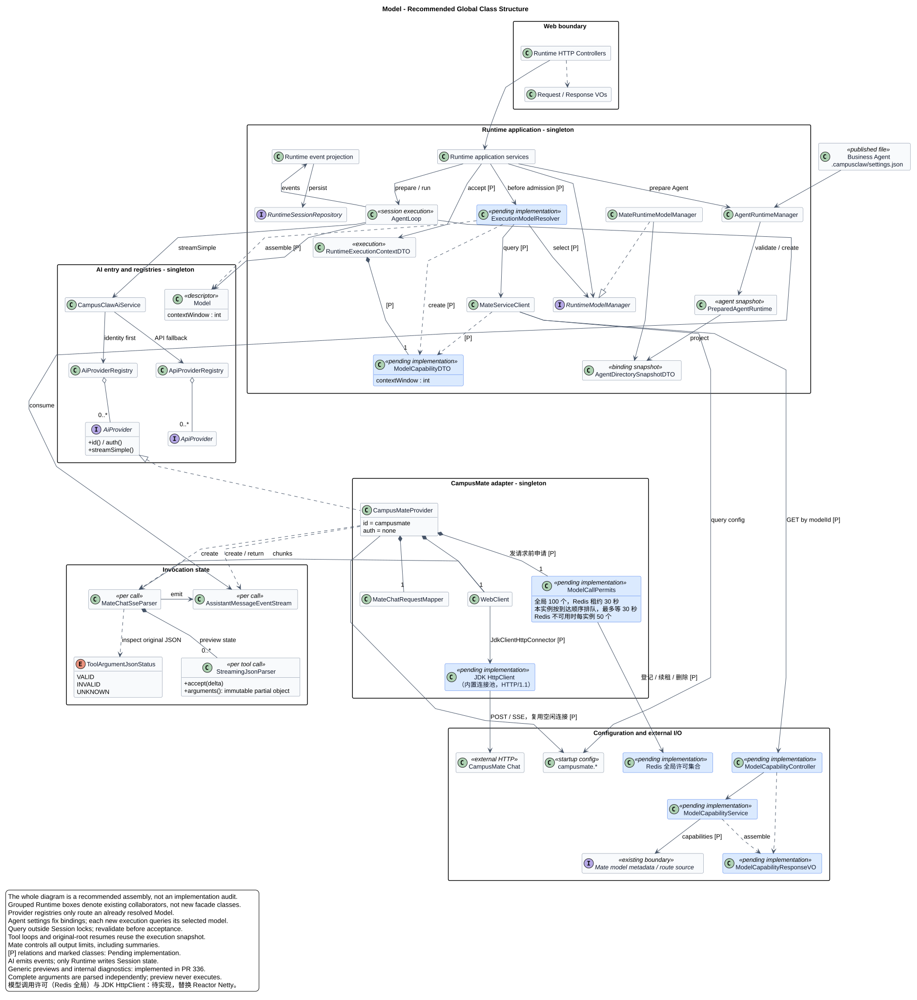
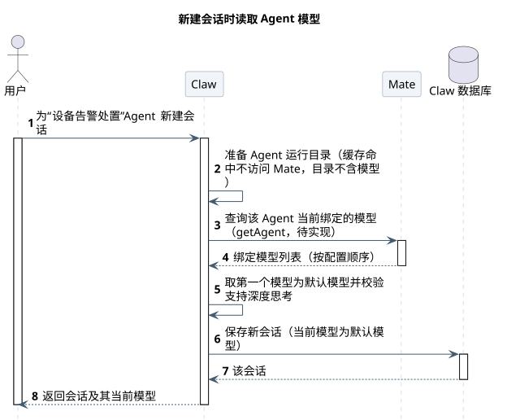
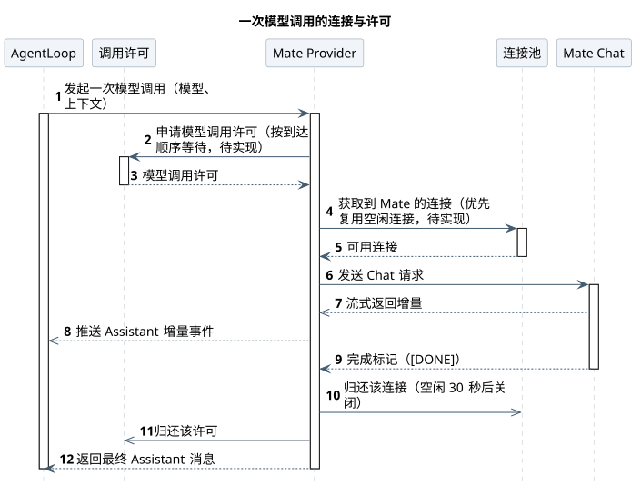

# Model

版本：2.13.0 · 2026-10-22 · M02。当前设计只通过 CampusMate 调用模型；Agent 的模型绑定每次通过 Mate getAgent 实时读取，本地目录不再保存模型（[§2](#model-source)，待实现）；每个新执行查询 Mate 窗口，输出额度由 Mate 控制；查询与输出策略迁移、旧全局目录删除待实现；模型调用改用 JDK HttpClient、用 Redis 全局许可限制并发（[§5](#http-transport)）待实现。

| 内容 | 维护位置 |
|---|---|
| 模型来源与选择、Provider 分层、调用适配与验收 | 本文 |
| Mate 模型信息查询与执行快照 | [模型能力](model-capabilities.md)；新增查询精确契约由该专题维护，待实现 |
| Chat 请求、响应、错误码和示例 | [Chat 接口说明](chat-api.html)，由 [chat-api.json](chat-api.json) 生成；输出额度由 Mate 控制，其他 Chat 行为保持 |
| 用量表、事务与统计 | [用量持久化](usage.md) |
| 固定源码基线、观察结果和实现差距 | [源码证据](source-evidence.md) |
| 服务地址、路径、超时、并发上限配置和配置校验 | [CampusMate 与 CampusMCP 客户端](../02-CampusMate与CampusMCP客户端/README.md) |
| 模型调用的连接、复用与并发 | 本文 [§5](#http-transport) |

## 1. 职责与全局结构

Runtime 选择模型、执行工具并保存会话；AI 模块把上下文转换为模型请求，把响应流转换为统一消息事件；CampusMate 管理上游路由、逐模型能力、协议差异、endpoint 和凭据。



[PlantUML 源码](diagram.puml#L1) · [原尺寸 SVG](model-classes.svg)

主图是推荐目标结构，分组表示职责边界。已有骨架与待清理实现见源码证据；不再保留另一套现状类图。Provider、请求 Mapper、WebClient、JDK HttpClient 与模型调用许可是共享对象；Parser、事件流和累积状态每次调用独立创建。AI 返回事件与最终消息，数据库写入留在 Runtime。

<a id="model-source"></a>

## 2. 模型来源

运营人员在 Mate 上给“设备告警处置”这类业务 Agent 换了模型，或者把某个模型从 Agent 上解绑，用户下次新建会话、打开模型选择或继续对话时，应该马上按新配置走。目前做不到：Claw 第一次准备 Agent 时把模型绑定写进本地 `.campusclaw/settings.json`，之后一直读这份缓存；强制刷新的 `AgentRuntimeManager.refresh` 在主线代码里没有调用方（已在 [pi-mono-java#381](https://github.com/superheromeZzh/pi-mono-java/pull/381) 删除），Mate 上的修改要等本地目录失效重建才会生效。本节让模型绑定只以 Mate 为准：Claw 不再在本地目录保存模型，每次需要时调用 Mate 的 getAgent 实时读取。

本节内容全部待实现。Agent 身份、SYSTEM、Skill、工具绑定和 Subagent 清单仍按原方式缓存在受管目录，它们的陈旧问题不在本节范围（见 [§2.9](#model-source-todo) T4）。

<a id="model-source-requirements"></a>

### 2.1 需求

| # | 需求 | 类型 | 来源 |
|---|---|---|---|
| R1 | 构建 Agent 本地目录时不再保存模型相关记录（默认模型、绑定模型列表） | 功能 | 用户需求（2026-10-22） |
| R2 | 每次创建会话时调用 Mate getAgent 查询默认模型 | 功能 | 用户需求（2026-10-22） |
| R3 | 查询到 Agent 没有配置模型时报错，提示需要先配置模型 | 功能 | 用户需求（2026-10-22） |
| R4 | 展示可选模型（`/model` 可选值）也调用 getAgent | 功能 | 用户需求（2026-10-22） |
| R5 | Mate 暂时不可用时不能提示“需要配置模型”，要提示稍后重试 | 稳定性 | 由 R3 推导，待确认 |
| R6 | 切换模型、已有会话继续对话、定时任务和 Subagent 也按 getAgent 的实时结果校验模型 | 约束 | 由 R1 推导：本地不再有模型列表，这些入口没有别的来源，待确认 |

<a id="model-source-flow"></a>

### 2.2 正常流程与失败处理

正常流程：

1. 用户新建会话。Claw 先准备 Agent 运行目录（缓存命中时不访问 Mate），再调用 getAgent 读取该 Agent 当前绑定的模型列表。
2. 列表中的第一个模型就是默认模型（Mate 按 `model_order` 返回）。Claw 校验它支持深度思考后，把它作为会话当前模型保存。
3. 用户打开模型选择时，Claw 再调用一次 getAgent，返回当前绑定的模型列表；带会话时当前值是会话保存的模型，不带会话时是默认模型。
4. 用户切换模型时，Claw 调用 getAgent 确认目标模型仍在列表里，再保存。
5. 用户在已有会话里发消息时，Claw 在接受消息前调用 getAgent：会话模型仍在列表里就继续用；已被解绑就换成当前默认模型，先记录模型变更，再接受消息。

失败处理：getAgent 返回的列表为空时，按需求报 `AGENT_MODEL_NOT_CONFIGURED`（需要配置模型）；Mate 超时、连不上或返回 5xx 时报 `AGENT_SERVICE_UNAVAILABLE`（稍后重试），不把它当成“没配置模型”，也不回退到任何旧值。完整分类见 [§2.7](#model-source-failure)。

<a id="model-source-sequence"></a>

### 2.3 新建会话的整体时序

场景：用户在园区工作台为“设备告警处置”Agent 新建会话，从请求到拿到会话结束。前提是 Agent 在 Mate 上存在且已启用。状态：待实现。

| 参与者 | 职责 | 映射 |
|---|---|---|
| 用户 | 新建会话、查看会话当前模型 | 工作台前端 |
| Claw | 准备 Agent 运行目录、查询模型、选默认模型、保存会话 | `RuntimeSessionService`、`FileAgentDirectoryResolver`、`AgentRuntimeManager`、`MateServiceClient`、`RuntimeModelManager` |
| Mate | 返回 Agent 当前绑定的模型 | `GET /mate-service/v1/agents/{agentId}`（getAgent） |
| Claw 数据库 | 保存会话及其当前模型 | `RuntimeSessionRepository` |



[原尺寸 SVG](agent_model_live_create.svg) · [PlantUML 源码](diagram.puml#L372)

| 阶段 | 详细时序 |
|---|---|
| 步骤 3～4：读取 Agent 模型 | 每个入口都用同一个查询，入口差异见 [§2.5](#model-source-entries) |
| 步骤 5：选择默认模型 | 规则见 [§2.6](#model-source-default) |

<a id="model-source-decisions"></a>

### 2.4 关键设计决策

基线核验日期 2026-10-22，提交与源码位置见[源码证据 §1.5](source-evidence.md#model-live-query-evidence)。

| # | 要解决的问题 | 基线怎么做 | 业务约束 | 我们的选择 | 代价 |
|---|---|---|---|---|---|
| D1 | Agent 的模型配置在 Mate 修改后，Claw 怎样尽快生效 | Claude Managed Agents：用 Agent ID 创建会话时由服务端取 Agent 最新版本（公开文档）。Codex：远端模型目录在本地缓存 5 分钟，带 ETag 刷新。OpenCode：models.dev 目录缓存 5 分钟，另带内置快照兜底。pi：默认模型来自本地 `settings.json`，可用模型由进程内模型运行时实时计算，不涉及远端 | 模型绑定由 Mate 管理，Claw 不是最终决定方；需求要求实时；Claw 是多实例部署，本地缓存在实例之间不一致；受管目录的强制刷新没有触发方，已删除 | 本地目录不再保存模型。每个需要模型的请求调用一次 getAgent，不做缓存；同一请求内查到的结果传给后续步骤复用，不重复查询 | 新建会话、打开模型选择、切换模型、每条用户消息、每次 Subagent 和定时执行都多一次 Mate 请求；Mate 不可用时这些入口失败。后者影响有限：模型调用本身就经过 Mate，Mate 不可用时对话原本也无法进行。不选“保留本地文件，补一个刷新触发”：需要 Mate 主动通知或定时轮询，生效时间仍不确定。不选 Codex/OpenCode 式 5 分钟缓存：修改最多延迟 5 分钟才生效，且各实例不一致；压测发现 getAgent 压力过大时再考虑（T2） |
| D2 | 调用 Mate 的哪个接口读取模型 | 无可对照实现 | 需求指定 getAgent；Claw 已经在不带用户凭据的情况下调用 getAgent 读取工具绑定（`HttpMateToolClient#queryToolIdsByAgentId`）；runtime 接口还要批量解析工具与 Subagent 依赖，比 getAgent 重 | 使用 getAgent `GET /mate-service/v1/agents/{agentId}`，只读取 `bindingModels` | getAgent 返回完整 Agent 聚合，只用其中一个字段；Mate 读取五张表。若压测显示负担过重，再请 Mate 提供只返回模型的轻量接口 |
| D3 | 查询失败或 Agent 没有模型时怎么办 | Codex：拉取失败时保留上一次成功的目录，不把失败当成空目录。pi：没有可用模型时提示用户配置（`formatNoModelsAvailableMessage`） | 本地不再有可以回退的模型记录；运营人员需要区分“没配置模型”和“Mate 故障”才能处理 | 列表为空报 `AGENT_MODEL_NOT_CONFIGURED`；Mate 故障报 `AGENT_SERVICE_UNAVAILABLE`；都不回退到旧值或其他模型 | Mate 短暂故障期间无法新建会话、无法发送消息，不像 Codex 那样用旧数据继续。Mate 读取接口对“Agent 没有模型”目前返回 HTTP 500，需按 [元数据设计 §5.1](../../03-数据与存储/02-Agent元数据GaussDB/README.md) 改为返回 200 和空列表（待实现）；改之前 Claw 会误判为 Mate 故障 |
| D4 | 已有会话保存的模型被解绑后怎么办 | pi：恢复会话时先用会话记录的模型，不可用时改用默认模型并提示（`sdk.ts` 恢复逻辑）。Claude Managed Agents：会话是否随 Agent 新版本变化，公开文档未说明 | 会话当前模型是会话自己的状态，保存在 Claw 数据库，不属于本地目录；同一会话的模型变化要能在历史中看到 | 会话继续保存当前模型。每条消息接受前按 getAgent 的结果校验：仍可用就保留，已解绑就换成当前默认模型，沿用现有的模型变更事件（原因值保持 `agentRefresh`） | 解绑后用户的下一条消息会使用另一个模型，用户只能从模型变更事件得知；没有默认模型时消息被拒绝 |

<a id="model-source-entries"></a>

### 2.5 各入口的查询时机

所有入口都通过 `AgentDirectoryResolver.resolve(agentId)` 取得模型快照：准备运行目录（缓存优先，不含模型），再调用 getAgent 填入默认模型和可选模型。查询发生在 Session 锁之外；锁内只用同一份快照复核，不再访问 Mate。

| 入口 | 何时查询 | 用到什么 | 现有代码位置 |
|---|---|---|---|
| 新建会话 | 创建前一次 | 默认模型 | `RuntimeSessionService#create` |
| 查看可选模型 `/model` | 每次请求一次 | 可选模型、默认模型（不带会话时） | `SessionModelConfigurationService`、`CommandValuesService` |
| 切换模型（UpdateSession 或 `/model <id>`） | 每次请求一次 | 可选模型 | `RuntimeSessionUpdateService`、`SessionModelConfigurationService` |
| 深度思考开关 | 每次请求一次 | 会话模型或默认模型的能力 | `SessionThinkingConfigurationService` |
| 发送消息 | 接受消息前一次；本次执行装配时复用，不再查询 | 校验会话模型、必要时取默认模型 | `RuntimeSessionModelReconciler#reconcile`；`RuntimeSessionEngineRegistry#requireModelAllowed` 改为使用同一快照 |
| 手工压缩 | 开始前一次 | 校验会话模型 | `RuntimeCompactionService` |
| 定时执行 | 每次触发一次 | 默认模型 | `ScheduledSessionStarter` |
| Subagent | 每次启动一次，查询 Subagent 自己的 Agent | 校验 Subagent 是否允许所选模型 | `SubagentExecutionService#requireModelAllowed` |

[模型信息查询](model-capabilities.md)（`GET /models/{modelId}`，待实现）在每个新执行中也查询一次 Mate，两者读取不同的数据：getAgent 决定“能用哪些模型”，模型信息决定“选中模型的上下文窗口”。首版不合并。

<a id="model-source-default"></a>

### 2.6 默认模型与本地目录

- **默认模型。** Mate 没有单独的默认模型字段，getAgent 返回的 `bindingModels` 按 `model_order` 排序，第一个就是默认模型，与现有 `AgentRuntime#defaultModel` 的规则相同。新会话默认开启深度思考，默认模型必须支持深度思考，否则报 `AGENT_MODEL_NOT_CONFIGURED`（现有规则不变）。
- **列表校验。** `bindingModels` 缺失或为空时视为未配置模型；元素为空白或重复时视为 Mate 返回的数据无效，同样报 `AGENT_MODEL_NOT_CONFIGURED` 并记录原始响应摘要。Claw 不检查模型在 Mate 模型网关中是否存在，调用时由 Mate Chat 判断。
- **本地目录。** `AgentRuntimeManager` 写 `settings.json` 时不再写 `defaultModel`、`bindingModels`；构建目录和读取缓存时不再要求模型非空，所以没有配置模型的 Agent 也能准备好目录，后续由 getAgent 报出“需要配置模型”。runtime 接口仍会返回 `bindingModels`，Claw 忽略它。
- **旧目录。** 已发布目录里的旧模型字段读取时忽略，不需要迁移，`schemaVersion` 保持 1。不升级版本是为了避免上线后所有 Agent 同时重建目录；旧字段在下一次重建时自然消失。

<a id="model-source-failure"></a>

### 2.7 失败处理与恢复

不变量：

- 模型可选范围只以本次 getAgent 的结果为准；Claw 不回退到旧值、本地文件或其他 Agent 的模型。
- 查询失败时不保存会话、不切换模型、不接受用户消息，也不产生模型变更事件。
- “没有配置模型”和“Mate 不可用”返回不同的错误码。

| 失败 | 发生阶段 | 副作用状态 | 处理方 | 系统处置 | 用户可见结果与下一步 | 不保证项 |
|---|---|---|---|---|---|---|
| F1 Agent 没有绑定模型 | getAgent 返回 | 未发生 | Claw | 拒绝本次请求 | 422 `AGENT_MODEL_NOT_CONFIGURED`，提示在 Mate 为 Agent 配置模型后重试 | 依赖 Mate getAgent 与 runtime 接口对空绑定返回 200 和空列表（Mate 待实现） |
| F2 Mate 超时、连接失败或 5xx | getAgent 请求 | 未发生 | Claw | 记录原始异常后拒绝，不重试 | 503 `AGENT_SERVICE_UNAVAILABLE`，稍后重试 | 不区分 Mate 内部的具体原因 |
| F3 Mate 返回 4xx（如 Agent 不存在） | getAgent 请求 | 未发生 | Claw | 拒绝，沿用 runtime 接口 4xx 的现有映射 | 422 `AGENT_NOT_AVAILABLE` | 不单独区分 Agent 已删除 |
| F4 默认模型不支持深度思考 | 选择默认模型 | 未发生 | Claw | 拒绝 | 422 `AGENT_MODEL_NOT_CONFIGURED` | 无 |
| F5 切换的目标模型不在列表 | 切换模型 | 未发生 | Claw | 拒绝 | 422 `MODEL_NOT_AVAILABLE`，重新打开模型选择 | 列表展示后到提交前的变化只在提交时发现 |
| F6 会话模型已被解绑，默认模型可用 | 接受消息前 | 已提交（模型变更事件） | Claw | 换成默认模型，先写模型变更（必要时写深度思考变更），再接受消息 | 消息正常处理，历史中出现模型变更 | 用户事先不会收到提醒 |
| F7 会话模型已被解绑，且没有默认模型 | 接受消息前 | 未发生 | Claw | 拒绝，SSE 不建立 | 422 `AGENT_MODEL_NOT_CONFIGURED` | 无 |
| F8 查询后、执行中模型被解绑 | 执行中 | 执行继续 | Claw | 本次执行用已固定的模型跑完；下一条消息再校验 | 本轮回答仍来自原模型 | 不中断进行中的执行 |
| F9 Subagent 不允许父执行所选模型 | Subagent 启动 | 未发生 | Claw | 按现有 Subagent 失败处理 | 父 Agent 收到工具失败结果 | 无 |

<a id="model-source-capacity"></a>

### 2.8 性能、监控与验收

- **请求量。** getAgent 次数约等于“新建会话 + 打开模型选择 + 切换模型 + 用户消息 + 手工压缩 + 定时执行 + Subagent 启动”的次数之和。单次耗时未测量；超时沿用 `campusmate.runtime.request-timeout`，不新增配置项。
- **监控。** 按入口记录 getAgent 的次数、耗时和失败数（区分 F1、F2、F3），用于判断 T2 是否需要缓存或轻量接口。
- **验收（待实现）。**
  - 新建的受管目录 `settings.json` 不含 `defaultModel`、`bindingModels`；含旧字段的目录可以正常读取。
  - Mate 修改模型绑定后，不重启、不删除目录，下一次新建会话、打开模型选择和发送消息都使用新绑定。
  - 一次请求只调用一次 getAgent（发送消息时校准与执行装配共用一份快照）；查询发生在 Session 锁外。
  - 空列表返回 `AGENT_MODEL_NOT_CONFIGURED`；Mate 超时、5xx 返回 `AGENT_SERVICE_UNAVAILABLE`；两种情况都不保存会话、不写事件。
  - 会话模型被解绑时，下一条消息先写模型变更再写用户消息；没有默认模型时拒绝且不写任何记录。
  - Subagent 和定时执行分别查询自己 Agent 的模型。
  - 测试只在 `MateServiceClient` 测试中使用 HTTP 测试桩，其他测试替换为接口桩。

<a id="model-source-todo"></a>

### 2.9 待确认事项

| # | 事项 | 负责人 | 来源 |
|---|---|---|---|
| T1 | 已定（2026-10-22）：Mate getAgent 与 runtime 接口对没有绑定模型的 Agent 返回 200 和空 `bindingModels`，不再返回 500 `AGENT_MODEL_BINDING_MISSING`（现状源码见[证据 §1.5.1](source-evidence.md#model-live-query-evidence)）；规则见[元数据设计 §5.1](../../03-数据与存储/02-Agent元数据GaussDB/README.md)，Mate 待实现 | Mate | D3、F1 |
| T2 | 每条消息查询一次 getAgent 是否可接受；上线前压测，必要时改为短时缓存或轻量接口 | Claw | D1、D2 |
| T3 | R5、R6 由需求推导，需用户确认切换模型、发消息、Subagent、定时执行都按实时结果校验 | 用户 | §2.1 |
| T4 | `refresh` 已删除（[pi-mono-java#381](https://github.com/superheromeZzh/pi-mono-java/pull/381)）。Agent 的 SYSTEM、Skill、工具绑定在 Mate 修改后仍要删除受管目录的 `agent.json` 才会生效；是否另立主题处理 | 用户 | §2 开头 |

<a id="model-capability-boundary"></a>

### 2.10 与模型信息查询的关系

每个新执行在锁外单独查询 Mate 当前选中模型的 `contextWindow`，应用服务在锁内复核 Session 版本、模型与绑定后，固定该执行的不可变模型信息。自动压缩、Tool Loop 和原根确认续跑共用结果；下一次新执行再次查询。独立手工压缩和 Subagent/Cron 各自查询。能力不写入 Agent 目录，不随目录重建更新；查询失败不回退旧窗口。精确字段、入口、锁边界及压缩规则由[模型信息专题](model-capabilities.md)统一维护。

Claw 不查询或消费 maxTokens，不为普通 Chat 或摘要指定输出额度；Mate 自行管理输出参数及上游差异。删除 `campusmate.model.context-window/max-output-tokens` 与 Java 默认值。getAgent 返回的绑定仍是模型使用范围的唯一依据，模型信息查询不能扩大可选范围。

这是产品约束与架构变更：绑定以 Mate 实时配置为准，动态窗口按执行读取，避免能力长期陈旧；Mate 统一控制生成额度。代价是新执行多一次查询及故障依赖，并失去 Claw 自有摘要输出预算。与 pi 的差异及源码证据见[架构对比 A06](../../01-总体架构/07-Agent架构对比/README.md#a06)。

<a id="provider"></a>

## 3. Provider 调用边界

### 身份与路由

| 对象 | 规则 |
|---|---|
| Provider | 身份键为 `provider.id`，名称、URL、凭据和协议不参与身份；唯一内置实现 `CampusMateProvider`，ID 为 `campusmate`，认证为 `ProviderAuth.none()` |
| 模型身份 | `(provider.id, model.id)`；Mate modelId 为 1–64 字符、大小写敏感的不透明值 |
| 调用入口 | `CampusClawAiService` 先查 `AiProviderRegistry`，未命中再查 `ApiProviderRegistry`；二者都未命中时在发 HTTP 前失败，不替换模型 |
| 调用接口 | 保留 `AiProvider.id/auth/streamSimple` 及 `ApiProvider` 抽象；注册表只路由已解析 Model，不提供模型发现或可用性判断 |
| 连接配置 | 读取统一的 `campusmate.*`；不使用 `Model.baseUrl/apiKey/headers` 覆盖部署地址、协议或请求头 |

Provider 身份与协议路由分开，避免按厂商堆叠中央分支。内部协议默认值、未注册值的启动失败规则，以及 URL/path 校验由[CampusMate 与 CampusMCP 客户端](../02-CampusMate与CampusMCP客户端/README.md)维护。

<a id="provider-identity"></a>

### 身份与历史数据

新 Model、注册、Assistant 和持久化 `_provider` 使用 `campusmate`。旧 `mate-model-manager` 不作为别名，不增加 enum 兼容解析、转发类或 SQL/历史文件迁移；已有 `_provider` 原样读取，压缩与 Subagent/Cron 的身份比较不把新旧值视为相同。

保留 `provider.mate` 包以及 `MateChatRequestMapper/MateChatSseParser/MateReasoningSignature` 名称。`MateInvocationErrorCode`、`MATE_MODEL_MANAGER_ERROR` 和日志 `event/operation/errorCode` 保持原义；稳定错误码不是 Provider ID。Logger 使用 `CampusMateProvider`，字段规则见[调用日志](../../01-总体架构/05-CampusClaw调用日志/README.md)。

<a id="chat"></a>

## 4. Chat 调用与适配

使用 `POST /mate-service/v1/LLM/chat`。精确 HTTP 字段、报文和错误码集中在 [Chat 接口说明](chat-api.html)；本节维护 Provider 到该接口的转换。

调用经内部网关，不发送 `X-HW-ID/Authorization/X-HW-APPKEY`、`agentId/sessionId` 或上游连接信息；服务准入依赖网关与网络 ACL。Mate 不在调用阶段重新检查 Agent 绑定，也不执行 Tool。

一次 POST 对应一次前台调用，不支持 `Idempotency-Key`，结果未知时不得重放。成功 SSE 原样返回 Chat chunks，以 `[DONE]` 结束；流建立前错误使用真实 HTTP 状态，建立后发送 `event:error` 并关流，不再发送 `[DONE]`。取消关闭请求和 body，沿连接传播到上游；Provider 的正常完成、`ABORTED` 和 `ERROR` 竞争时只能产生一个终态。

本图只展示一次模型调用，Provider routing 保留路由选择，Mate provider 合并请求映射和流解析协作。HTTP 建流前拒绝不进入增量阶段；正常 [DONE]、流失败和调用方取消各自产生一次终结结果，取消关闭请求并由 Mate 传播至上游。输出限制省略为图示待实现增量，底层 Provider 事件不直接等同公共事件。


[PlantUML 源码](diagram.puml#L205) · [原尺寸 SVG](chat-sequence.svg)

### 请求映射

| AgentLoop / Provider 输入 | Mate Chat 请求 | 规则 |
|---|---|---|
| `Model.id` | `model` | 原样 Mate 模型 ID |
| `Context.systemPrompt` | 首个 `system` message | 空值时省略 |
| `UserMessage` 文本 | `user.content` | 保留顺序，非文本拒绝 |
| `AssistantMessage` 文本 | `assistant.content` | 按顺序拼接文本块 |
| `AssistantMessage.ToolCall` | `assistant.tool_calls[]` | arguments 序列化为 JSON 字符串 |
| `ToolResultMessage` | `tool` message | `tool_call_id` 关联 ToolCall，content 为字符串 |
| `ThinkingContent.thinkingSignature` | Assistant reasoning 白名单字段 | 按原字段种类重放 |
| Agent Tool | `tools[].function` | JSON Schema 原样投影，不发送 `strict` |
| `SimpleStreamOptions.toolChoice` | `tool_choice` | 只允许 `auto/none` |
| 输出 token 上限 | 不发送 | 普通调用及摘要均由 Mate 控制；Mapper 不转发 options 中残留额度，见[输出与上下文规则](model-capabilities.md#4-输出控制与上下文消费) |
| 显式 temperature | `temperature` | 未设置时省略 |
| `ThinkingLevel` | 不发送 | 推理开关和 effort 由 Mate 配置 |
| 固定字段 | `stream/stream_options.include_usage` | 均为 `true` |

reasoning 白名单为 `reasoning_content/reasoning/reasoning_text/reasoning_details`，前三项为字符串，最后一项为不透明 JSON 数组。可读内容展示模型原始推理，signature 用于下次重放；展示规则见 [Thinking 设计](../../01-总体架构/01-CampusClaw多Agent运行时/chat-events-history-design.md#thinking-original-text)。

首版只支持文本、function Tool 和上述 reasoning。图片、音频、文件、content part 数组与 Tool 图片在发 HTTP 前失败，不丢块后继续。未知字段及已定义可选字段的处理遵循接口说明；`event:error` 是 Mate 扩展；请求中的输出额度字段按未知字段拒绝。

### 响应、用量与运行约束

| SSE 数据 | Provider 输出 |
|---|---|
| `chunk.id` | `AssistantMessage.responseId` |
| 请求 model / `chunk.model` | `AssistantMessage.model` / 可选 `responseModel` |
| content / reasoning / tool_calls 增量 | Text / Thinking 与签名 / ToolCall start、delta、end |
| `finish_reason` | `STOP/LENGTH/TOOL_USE/ERROR` |
| usage | `Usage`；output 已含 reasoning token，可保留上游 breakdown |

Provider 仅解析 Usage，Runtime 保存和汇总；事务、缺失 Usage、分支隔离与失败处置统一见[用量持久化](usage.md)。

调用须配置连接、首字节、流空闲、总执行时间与缓冲上限，数值由部署管理。不记录完整 SSE、prompt、Tool 参数或 thinking；错误不得暴露 endpoint、credential、私有路由、stack trace 或推理正文。

<a id="streaming-json"></a>

### 通用工具参数预览

设备巡检工具的参数逐步到达时，上层需要提前展示有用信息；工具执行仍必须等待完整调用。AI 提供通用部分参数对象，Runtime 再按业务和权限选择展示字段。此能力在 `a1e6450427abeabaa1af04d5964f371dbbf4cf68`（[PR #336](https://github.com/superheromeZzh/pi-mono-java/pull/336)）已实现，尚未合入 main；不改变本文其他待实现项。

`MateChatSseParser` 为每个工具调用保留原始参数缓冲和独立 `StreamingJsonParser`。后者按新增字符解析对象、数组、嵌套值、字符串、数值、布尔与 null；未闭合字符串只暴露完整 Unicode 前缀，数值/字面量等到词法边界才发布。`ToolCallDeltaEvent.partial` 及时携带已知 ID/name 和深度只读参数快照，空参数 delta 也可传播刚到达的身份，旧快照不随新输入变化。

每调用预览限制为 1048576 个原始 UTF-16 单元和嵌套深度 64。语法错误、重复键或预算超限永久停用该预览；这是展示降级，不使完整调用失败。词法扫描按新增输入推进，快照仍有深复制成本；预算不限制原有完整参数缓冲，不能把它解释为整体内存或吞吐保证。

结束时从原始缓冲独立执行既有 Jackson Map 解析，不用补全对象代替最终参数，不把预览送入执行或权威错误消息。普通工具完整解析的既有重复键末值、尾随内容接受语义保持。额外严格扫描产生 `ToolArgumentJsonStatus`（VALID/INVALID/UNKNOWN），只存在内存中的 `ToolCallEndEvent`，不改变其 JSON 序列化、ToolCall、模型历史或公共事件。生产 Mate 始终提供 VALID/INVALID；兼容结构化事件构造器和反序列化缺省为 UNKNOWN，不能把 UNKNOWN 当作原始输入通过严格验证。

原始 JSON 非法或截断仍使 Provider 失败。业务参数校验、权限/必要确认和执行仍由 Agent/Runtime 在完整调用之后负责；AI 不依赖计划工具。Runtime 只把可信 ExitPlanMode 的 plan 前缀投影成公共计划事件，并在内部诊断为 INVALID 时拒绝审核；精确身份、冻结预览和审核规则归[计划流式专题](../../01-总体架构/06-CampusClaw计划模式/plan-streaming.md)。其他工具的半成品参数不自动公开。

本次以 2026-10-09 隔离 fetch 的 pi main `f1b2e77f5b13b2a199b1052cb79c235451afe7d7` 为 AI 主基线，核验 `packages/ai/src/utils/json-parse.ts#parseStreamingJson`、`packages/ai/src/api/openai-completions.ts` 的累积/结束路径以及 `types.ts` 的 partial 语义。pi 的修复解析、最终容错和可变 partial 不直接照搬：Java 保留事件快照与完整解析边界；这是架构适配。完整新旧提交、源码符号、验收和安全差异见[专项证据 §16](../../01-总体架构/06-CampusClaw计划模式/source-evidence.md#plan-generic-json-evidence)。仅使用现有 JDK/Jackson，无新增直接或传递依赖。

<a id="http-transport"></a>

## 5. 模型调用的连接与并发

园区设备告警集中爆发时，很多 Agent 执行会同时调用模型。每次模型调用都是一条持续几秒到几分钟的 SSE 流，在 HTTP/1.1 下独占一条到 Mate 的连接。如果不加限制，Claw 发往 Mate 的并发调用数取决于执行数和 Subagent 数，Mate 无法据此规划容量。本节规定 Claw 如何用 Redis 中的全局许可限制所有实例合计同时进行的模型调用、Redis 故障时如何降级、如何建立和复用连接，以及去掉 Reactor Netty 后的 HTTP 客户端。默认全局上限为 100，两实例部署时由两个实例共享。本节全部内容待实现。

### 5.1 正常调用与失败处理

正常调用分五步：

1. AgentLoop、手工压缩、Subagent 或定时执行发起一次模型调用。
2. Provider 申请一个模型调用许可：先在本实例内按到达顺序排队，排到队首后在 Redis 中执行一次登记脚本。全局在用许可少于 100 个就登记成功，许可带 30 秒租约；已满则队首继续等待并重试。
3. 拿到许可后，Provider 通过实例内共享的 JDK HttpClient 发送 Chat 请求。连接池里有到 Mate 的空闲连接就复用，没有就新建。
4. 流式返回期间，本实例每 10 秒为自己持有的全部许可续租一次。
5. SSE 读到 `[DONE]` 后，连接回到连接池，许可从 Redis 删除，最终 Assistant 消息返回调用方。

失败时：等待许可超过 `permit-wait-timeout` 不发请求，调用以 `MODEL_CONCURRENCY_LIMITED` 失败；等待期间被取消也不发请求，调用以 aborted 结束；请求发出后失败或取消，关闭这条连接且不放回连接池，许可照常删除。Redis 不可用时改用本实例的降级许可（每实例 50 个），模型调用不中断；实例崩溃时，它持有的许可在租约到期后由 Redis 自动回收。完整分类见 [§5.7](#http-transport-failure)。

### 5.2 一次模型调用的连接与许可

场景：一次模型调用从申请许可到收到最终消息。前提是 Agent 已选定模型、请求映射成功且 Redis 可用（Redis 不可用的降级路径见 [§5.4](#http-transport-global-permits)）。本图展开 [Chat 调用时序](#chat) 中“Provider 调用 Mate Chat”这一步，是实现下钻：连接池属于 JDK HttpClient 内部，单独列出是因为“是否复用连接”正是本节要回答的问题。状态为待实现。

| 参与者 | 职责 | 映射 |
|---|---|---|
| AgentLoop | 发起模型调用并消费事件 | `AgentLoop`；压缩、Subagent、定时执行同样经 `CampusClawAiService` 进入 |
| 调用许可 | 本实例排队、在 Redis 登记和删除许可、定时续租、Redis 故障时降级 | 待实现，暂名 `ModelCallPermits`，Provider 单例持有；接口与本地实现在 AI 模块，Redis 实现在 Host 模块（§5.4） |
| Mate Provider | 申请许可、发送请求、解析 SSE、归还许可 | `CampusMateProvider`、`MateChatSseParser` |
| Redis | 保存全局在用许可及其租约 | 公司受管 Redis（主从或 Sentinel），与 [Redis 流式恢复](../../01-总体架构/01-CampusClaw多Agent运行时/redis-stream-recovery.md)、跨实例路由专题（PR #33 评审中）共用服务和 ACL 账号；key 与脚本见 §5.4 |
| 连接池 | 保存到 Mate 的空闲 HTTP/1.1 连接 | JDK `java.net.http.HttpClient` 内部连接池，经 Spring `JdkClientHttpConnector` 供 `WebClient` 使用 |
| Mate Chat | 处理 Chat 请求并流式返回 | `POST /mate-service/v1/LLM/chat` |



[原尺寸 SVG](model-call-permit.svg) · [PlantUML 源码](diagram.puml#L319)

许可在发出请求之前申请，在流结束（完成、失败或取消）之后归还，每次调用只归还一次。这保证同一时刻占用连接的调用不超过全局许可数：一条连接要么正在承载某个调用，要么在连接池里空闲，空闲连接只来自已经结束的调用。

<a id="http-transport-decisions"></a>

### 5.3 关键设计决策

| # | 要解决的问题 | 基线怎么做 | 业务约束 | 我们的选择 | 代价 |
|---|---|---|---|---|---|
| D1 | 去掉 Reactor Netty 后，模型 SSE 调用用什么 HTTP 客户端 | pi 的 OpenAI Completions 适配器每次调用新建 SDK 客户端，传输交给 Node `fetch`；Codex 的 HTTP 流式请求每次构造 reqwest 客户端。两者都用平台自带的 HTTP 客户端，证据见[源码证据 §1.4](source-evidence.md#http-transport-evidence) | 削减依赖；Runtime 客户端 `MateServiceClient`、`MateRestUtil` 已经使用 JDK HttpClient；取消、错误分类和事件流仍沿用 Reactor 编程模型 | 保留 `WebClient` 与 `reactor-core`，底层连接器改为 Spring 自带的 `JdkClientHttpConnector` 包装共享的 JDK HttpClient，删除 `reactor-netty-http`；固定 HTTP/1.1，回调使用虚拟线程执行器 | 超时要分两段实现（见 §5.6）；DNS 解析改由 JVM 缓存控制；空闲连接保留时间只能用 JVM 全局属性调整，会同时影响 Runtime 客户端。不选“连 WebFlux 一起去掉、自写 SSE 解析”：改动面大，且 `reactor-core` 仍被事件流使用 |
| D2 | 多实例部署时，如何保证同时进行的模型调用合计不超过 100 个 | pi、Codex 都是单用户工具，没有限制模型请求并发；Codex 用 `agent_max_threads`（默认 6）限制同时运行的 Subagent 线程，间接限制并发 | Mate 按合计 100 个规划容量；执行准入 `max-active` 默认每实例 100，Subagent、压缩和定时执行也会调用模型，所以执行数不能代替调用数；希望一个实例空闲时，另一个实例能用满全部容量 | 全局许可放在 Redis：一个有序集合保存在用许可，成员是许可 ID，分值是租约到期时间；登记、续租、删除各是一次 Lua 脚本，在 Redis 内原子完成（§5.4）。所有经 CampusMate Provider 的调用共用这组许可 | 新增 Redis 运行依赖和运维；每次调用多两次 Redis 往返（登记、删除），每个实例每 10 秒多一次续租；进程崩溃后最长 30 秒才回收它的许可；跨实例不保证先到先得。不选每实例本地 50 个许可：一个实例故障时合计能力降到 50，负载不均时一个实例排队、另一个空闲 |
| D3 | 是否需要连接池、预热和复用 | pi 没有配置预热，复用交给 `fetch`。Codex 在每轮开始时预热一条 Responses WebSocket（发送 `generate=false` 的 `response.create`），本轮后续请求复用这条连接和 `previous_response_id`，连接在会话内缓存 | Mate Chat 是 HTTP POST + SSE，没有 WebSocket 或服务端增量状态，Codex 的预热收益（复用服务端上下文）在这里不存在；首 token 通常要数秒，建连只需毫秒级；Mate 是集群内网关 | 实例内只创建一个 HttpClient，依靠它自带的连接池复用连接；不做预热；不额外设置连接数上限，由 D2 的许可间接限制 | 空闲超过 30 秒后的第一次调用要多一次 TCP（和 TLS）握手；不用 HTTP/2 多路复用，每个并发调用占一条连接 |
| D4 | Redis 不可用时模型调用怎么办 | 基线没有全局许可，不涉及 | Redis 只用来限流，不保存业务数据；告警场景下模型调用不能因为限流组件故障全部失败；也不能完全放开，否则会冲垮 Mate | 降级为本实例许可：每实例最多 50 个（`fallback-max-concurrent-requests`），按到达顺序发放；部署保证“实例数 × 50”不超过全局上限，降级期间合计仍不超过 100。Redis 恢复后先把本实例在用的许可重新登记，再回到全局许可 | 降级期间不能跨实例借用容量；Redis 恢复或丢数据后，最多一个续租周期（10 秒）内合计可能超过 100（§5.7 F9）。不选“Redis 故障时拒绝全部调用”：限流组件故障会变成模型调用全部失败；不选“故障时不限流”：Mate 失去保护 |
| D5 | 用哪个 Redis 客户端 | 基线不使用 Redis | 用户确认（2026-10-16）的削减目标是不引入 `reactor-netty` 这个 Maven 依赖，Netty 本身可以保留；[Redis 流式恢复](../../01-总体架构/01-CampusClaw多Agent运行时/redis-stream-recovery.md#83-maven-依赖)和跨实例路由专题（PR #33 评审中）也接入 Redis，三份设计应共用一个客户端和一套连接配置 | 按用户确认采用 Redisson：Host 模块新增 `org.redisson:redisson` 和 `org.redisson:redisson-spring-data-34`，后者让流式恢复、跨实例路由继续使用 Spring Data Redis 的 `RedisTemplate` 与订阅容器；Host 配置类按 `spring.data.redis.*` 创建 `RedissonClient` 和 `RedissonConnectionFactory`。许可脚本经 `RScript` 以 EVALSHA 执行，不使用 Redisson 自带的租约信号量（原因见 §5.4）。不用 `redisson-spring-boot-starter`：4.8.0 版对应 Spring Data Redis 4.1（Boot 4），3.x 版还会带入 Actuator | 9 个 Netty 构件（含传递依赖，约 2.7 MB）随 Redisson 留在产物中，另有 Redisson 3.51.0 主 jar 约 2.8 MB 以及 rxjava、kryo、byte-buddy、jodd-util、jackson-dataformat-yaml、jackson-datatype-jsr310；Redisson 不在 Boot BOM 中，版本固定为 3.51.0：这是公司镜像目前能提供的最高版本（用户确认，2026-10-16）。3.51.0 按 Netty 4.1.124 编译，只用 Netty 4.1 的接口，Boot 3.4.5 管理的是 4.1.119；公司镜像有 Netty 4.1.124（用户确认），所以在根 POM 的 `dependencyManagement` 里、`spring-boot-dependencies` 之前导入 `io.netty:netty-bom:4.1.124.Final`，与 Redisson 编译所用版本一致。删除 reactor-netty 后只有 Redisson 使用 Netty，调整版本只影响它。3.x 在 3.52.0（2025-09-25）之后不再发版，3.51.0 之后的修复（如 4.8.0 的 AUTH 建连顺序、4.x 的 Pub/Sub 信号量泄漏）都拿不到；镜像同步 4.x 后升级，届时要同时把 Netty 换成 4.2 BOM（Redisson 4.x 直接引用 Netty 4.2 的类），并适配 `RScript.ReturnType` 改名（如 `INTEGER` 改为 `LONG`）；Redisson 会创建自己的 Netty I/O 线程。Jedis 依赖更少且不带 Netty，Lettuce 是 Boot 默认，两者也能满足本设计 |

<a id="http-transport-global-permits"></a>

### 5.4 Redis 全局许可

**数据结构。** 全局许可是一个 Redis 有序集合，key 为 `claw:model-permits:{campusmate}`（花括号是 Cluster 槽标记，首版不要求 Cluster）。每个成员是一个许可 ID，格式为“实例名:UUID”，便于排查是哪个实例持有；分值是租约到期的毫秒时间戳。不同部署环境使用不同 Redis 库或 key 前缀，不共享许可。与其他专题共用 Redis 时按前缀分开：流式恢复用 `claw:hot:*`，跨实例路由用 `claw:sig:*`。

**访问权限。** 沿用跨实例路由专题的约定：Redis 只在内网访问，开启 TLS 与 ACL，Claw 共用一个 ACL 账号。该账号需要在 `claw:model-permits:*` 上增加 `EVALSHA`、`EVAL`（首次加载脚本），以及脚本内用到的 `ZREMRANGEBYSCORE`、`ZCARD`、`ZADD`、`ZREM`、`PEXPIRE`、`TIME`；跨实例路由专题现有的 ACL 只列了 `claw:sig:*` 的 `PUBLISH`、`SUBSCRIBE` 和流式恢复的 key，两边合并时要补上这一组。Redisson 建立连接时自身发出的命令（如 `PING`，Sentinel 模式下的 `SENTINEL` 查询）也要放行，实施时按实际发出的命令核对。

**为什么不用 Redisson 的租约信号量。** Redisson 自带 `RPermitExpirableSemaphore`，也是“许可 ID + 租约”的模型，可以省掉上面三个脚本。按 Redisson 3.51.0 与 4.8.0 源码（`RedissonPermitExpirableSemaphore`）核对后不采用，两个版本行为相同，原因有四点：

1. 租约到期时间用调用方本机的 `System.currentTimeMillis()` 计算，实例之间的时钟偏差会直接改变租约长短；本设计用 Redis `TIME`。
2. 可用许可数保存在一个单独的计数 key 里，key 不存在时申请脚本直接失败。Redis 重启丢数据后，必须有人重新调用 `trySetPermits`，否则所有调用都会排队到超时；重新设置后，丢数据前就在进行的调用又不在计数里。
3. `updateLeaseTime` 遇到已过期的许可只返回 false，不能把仍在进行的调用重新登记，本设计的 F9 恢复依赖重新登记。
4. 等待靠 Pub/Sub 通知后各自重试，不按到达顺序发放。

自己写的只是三个短脚本，所以继续用本节的脚本，只把 Redisson 当作 Redis 客户端。

**三个脚本。** 时间一律取 Redis 的 `TIME`，不用各实例的本机时钟，避免实例间时钟偏差影响租约。

| 脚本 | 何时执行 | 在 Redis 内依次做什么 | 返回 |
|---|---|---|---|
| 登记 | 本实例队首申请许可 | 删除分值早于当前时间的成员（过期租约）；若集合成员数小于全局上限，加入新许可，分值为当前时间加租约；给 key 设置过期时间（租约的 2 倍），没有许可时 key 自行消失 | 成功或已满 |
| 续租 | 每个实例每 10 秒一次（租约的 1/3） | 把本实例当前持有的全部许可 ID 的分值改为当前时间加租约；许可已过期被删除时重新加入 | 无 |
| 删除 | 调用结束 | 删除该许可 ID | 无 |

登记脚本的核心逻辑：

```lua
local t = redis.call('TIME')
local now = t[1] * 1000 + math.floor(t[2] / 1000)
redis.call('ZREMRANGEBYSCORE', KEYS[1], '-inf', now)
local granted = 0
if redis.call('ZCARD', KEYS[1]) < tonumber(ARGV[1]) then
  redis.call('ZADD', KEYS[1], now + tonumber(ARGV[2]), ARGV[3])
  granted = 1
end
redis.call('PEXPIRE', KEYS[1], tonumber(ARGV[2]) * 2)
return granted
```

`ARGV[1]` 是全局上限，`ARGV[2]` 是租约毫秒数，`ARGV[3]` 是许可 ID。脚本里调用 `TIME` 需要 Redis 5 及以上（脚本按执行效果复制）。

**等待。** 每个实例内的等待者按到达顺序排队，只有队首访问 Redis，其余在本地等待，避免几十个等待者同时轮询 Redis。全局已满时，队首每 200 毫秒重试一次登记；本实例有许可删除时立即唤醒队首重试。队首拿到许可后，下一位成为队首并立即尝试。等待总时长不超过 `permit-wait-timeout`。跨实例不排队：另一实例释放的许可由先重试到的实例拿到，不保证先到先得。

**续租与崩溃回收。** 流式调用可能持续几分钟，远长于 30 秒租约，所以由每个实例的一个后台任务统一续租，而不是每个调用各自续租。实例崩溃或被强杀后不再续租，它的许可最迟 30 秒后过期，下一次任意实例登记时被清除。进程长时间停顿（如超过 30 秒的 GC 暂停）导致租约过期时，下一次续租会重新登记这些许可，调用本身不中断。

**代码归属。** `ModelCallPermits` 接口和本地许可实现放在 AI 模块，`CampusMateProvider` 只依赖接口；Redis 实现（暂名 `RedisModelCallPermits`，内部组合本地许可作为降级）放在 Host 模块（`modules/coding-agent-cli` 与公司镜像 `campusclaw`），由 Spring 注入 Provider。这样 AI 模块不依赖 Redis，与 [Redis 流式恢复](../../01-总体架构/01-CampusClaw多Agent运行时/redis-stream-recovery.md#83-maven-依赖)“Agent 内核不新增 Redis 依赖”的约定一致；没有配置 Redis 的本地运行直接使用本地许可。

**降级与恢复。** 登记、续租或删除时 Redis 命令失败或超时，本实例进入降级状态：

- 降级期间，新调用使用本实例许可：本实例在用调用数（包括降级前从 Redis 拿到的许可）少于 `fallback-max-concurrent-requests` 时才放行，仍按到达顺序排队。
- 降级期间的许可也分配许可 ID，记在本实例内存里；删除失败的许可不再续租，由租约过期回收。
- 续租任务继续每 10 秒尝试一次。第一次续租成功即表示 Redis 已恢复：这次续租已经把本实例全部在用许可（包括降级期间放行的）登记回 Redis，之后新调用回到全局许可。
- 进入和退出降级各记一条警告日志，并更新降级状态指标（§5.8）。

<a id="http-transport-pool"></a>

### 5.5 连接池、复用与预热

JDK HttpClient 自带连接池：同一个 HttpClient 实例里，到同一地址（scheme、host、port）的 HTTP/1.1 连接在响应读完后放回连接池，下一个请求优先取用。规则如下：

| 项目 | 规则 | 依据 |
|---|---|---|
| 池的归属 | 每个实例只有一个模型调用 HttpClient，由 `CampusMateProvider` 单例持有；禁止按调用新建，否则连接无法复用 | 连接池属于 HttpClient 实例 |
| 何时复用 | 上一次调用正常读完 `[DONE]` 和响应体后，连接回到连接池；后续调用优先取空闲连接 | JDK `ConnectionPool` |
| 不复用 | 调用失败、被取消或响应体没有读完时，关闭该连接；Mate 返回 `Connection: close` 时也不复用 | 半途关闭的流无法再承载新请求 |
| 空闲关闭 | 空闲 30 秒后关闭，由 JVM 属性 `jdk.httpclient.keepalive.timeout` 控制，默认不改 | JDK 21 `HttpClientImpl.DEFAULT_KEEP_ALIVE_TIMEOUT = 30` |
| 连接数上限 | HttpClient 不限制 HTTP/1.1 连接数（`jdk.httpclient.connectionPoolSize` 默认 0，只限制空闲连接数且默认不限）；实际上限由许可保证：一个实例最多用到全部 100 个全局许可，降级时最多 50 个 | JDK `ConnectionPool.MAX_POOL_SIZE` |
| 预热 | 不预热。JDK 没有预建连接的接口；用探测请求预热只能省一次毫秒级握手，空闲 30 秒后又会关闭，还要给 Mate 增加一个非业务请求。Codex 预热的是带服务端增量状态的 WebSocket，Mate Chat 没有对应协议 | D3 |
| 重试 | 建连失败（请求还没发出）时 JDK 默认重试一次，且不重置连接超时；请求已经写到连接上后，POST 不自动重试 | JDK `MultiExchange.retryOnFailure/canRetryRequest` |
| 协议 | 固定 HTTP/1.1，不使用 HTTP/2 与 h2c 升级 | Mate 网关的 HTTP/2 支持未核验；JDK 默认会对明文 http 尝试 h2c 升级 |

与现状对比：现在 `reactor.netty.http.client.HttpClient.create()` 使用 Reactor Netty 默认连接池，最多 `max(CPU 核数, 8) × 2` 条连接，排队上限为连接数的 2 倍、最多等 45 秒，空闲连接不按时间关闭。这些值不是设计出来的，且 8 核以下只有 16 条，远小于 `max-active` 的 100。改造后由 Redis 全局许可明确限制并发，空闲连接 30 秒后关闭。

<a id="http-transport-config"></a>

### 5.6 配置与超时

新增五个配置键，由[CampusMate 与 CampusMCP 客户端](../02-CampusMate与CampusMCP客户端/README.md)统一维护，所有实例必须配置相同的值：

| 配置键 | 默认值 | 含义 |
|---|---|---|
| `campusmate.model.global-permits-enabled` | `false` | 是否使用 Redis 全局许可；为 `false` 时只用本实例许可（上限取 `fallback-max-concurrent-requests`），本地运行和未开通 Redis 的环境用这个值；两实例部署必须设为 `true`。与跨实例路由专题的 `campusclaw.runtime.signal.redis.enabled` 各自开关、共用连接 |
| `campusmate.model.max-concurrent-requests` | 100 | 所有实例合计同时进行的模型调用上限，写入 Redis 登记脚本，必须大于 0；按 Mate 给 Claw 的容量配置 |
| `campusmate.model.fallback-max-concurrent-requests` | 50 | Redis 不可用时每个实例的上限，必须大于 0；部署时保证“实例数 × 本值”不超过上一项 |
| `campusmate.model.permit-wait-timeout` | `PT30S` | 等待许可的最长时间，可为 0（不等待）；初始值待压测校准 |
| `campusmate.model.permit-lease` | `PT30S` | 许可租约，续租间隔为其 1/3；决定实例崩溃后最长多久回收许可，必须不小于 3 秒 |

Redis 连接沿用 Spring Boot 的 `spring.data.redis.*`（地址、密码、库号、Sentinel、TLS），由 Host 配置类转换为 Redisson 配置，与 Redis 流式恢复、跨实例路由共用一个 `RedissonClient`。三个专题的约定合并如下：

- 命令超时与重试：许可脚本对超时敏感，Redis 卡住时应尽快降级，而不是让所有模型调用一起等。所以 Redisson 的命令超时（`timeout`）设为 1 秒，命令重试次数（`retryAttempts`）设为 0。重试被关掉也不会让登记重复：同一个许可 ID 重复执行脚本只会刷新租约。这两个值对共用客户端的其他专题同样生效，跨实例路由的发布和流式恢复的读写在各自实施时确认能接受；不能接受时再为许可单独建一个 `RedissonClient`。
- 连接池与线程：Redisson 自己维护命令连接池和单独的订阅连接池，主从或 Sentinel 模式下按主节点连接池配置。许可每个实例只有队首在申请，加上删除和续租，同时占用的连接很少，首版沿用 Redisson 默认值，压测后调整。许可代码在虚拟线程上调用 Redisson 的同步接口，不在 Redisson 的 Netty I/O 线程里执行阻塞操作。订阅连接池只有跨实例路由的 Pub/Sub 使用，`subscriptionsPerConnection`、`subscriptionConnectionPoolSize` 的取值由该专题按频道数确定，写入同一份 Redisson 配置；许可不使用订阅连接。

已有的两个超时保持配置键和默认值不变，实现方式改为：

| 配置键 | 现在（Reactor Netty） | 改造后（JDK HttpClient） |
|---|---|---|
| `connect-timeout`（`PT10S`） | `ChannelOption.CONNECT_TIMEOUT_MILLIS` | `HttpClient.Builder.connectTimeout` |
| `response-timeout`（`PT10M`） | `responseTimeout`：任意两次网络读之间不超过该值，包括等待响应头 | 两段：`JdkClientHttpConnector.setReadTimeout` 限制等待响应头；SSE 响应体上加 `Flux.timeout`，限制两条完整 SSE 事件之间的间隔 |

两种实现只在一种情况下有差别：一条 SSE 事件被拆成多个网络包，包与包之间隔得很久。Mate 正常一次写出一条事件，心跳注释在两种实现中都算作事件，所以不影响正常调用。许可等待时间不计入这两个超时。

<a id="http-transport-failure"></a>

### 5.7 失败处理与恢复

**不变量**：

1. 每次模型调用最多占用一个许可（全局许可或降级许可），并在结束时恰好归还一次；任何失败或取消都不能让本实例的许可计数泄漏。
2. 没有拿到许可就不发出 Chat 请求。
3. Redis 正常时，合计同时进行的模型调用不超过 `max-concurrent-requests`；降级期间每实例不超过 `fallback-max-concurrent-requests`。唯一例外见 F9。
4. POST 请求一旦写到连接上，就不自动重放；结果未知时沿用 [§4](#chat) 的规则。
5. 失败或被取消的流不把连接放回连接池。

| # | 失败 | 发生阶段 | 副作用状态 | 处理方 | 系统处置 | 用户可见结果与下一步 | 不保证项 |
|---|---|---|---|---|---|---|---|
| F1 | 等待许可超时（全局已满） | 申请许可 | 未发生 | Provider | 不发请求，以 `MODEL_CONCURRENCY_LIMITED` 结束本次调用；手工压缩按可重试错误处理 | 本轮回复失败，错误码为 `MODEL_CONCURRENCY_LIMITED`，用户稍后重新发送 | 不保证跨实例先到先得 |
| F2 | 等待许可时被 Abort 或执行超时 | 申请许可 | 未发生 | Provider | 退出等待，不占许可，不发请求 | 本轮按已停止结束 | 无 |
| F3 | 建连失败或建连超时 | 获取连接 | 未发生 | JDK HttpClient、Provider | JDK 自动重试一次建连；仍失败则归还许可，按现有规则归为 `MANAGER_UNAVAILABLE` 或 `MODEL_INVOCATION_TIMEOUT` | 本轮回复失败，用户稍后重新发送 | 不保证 Mate 地址变更后立即生效（受 JVM DNS 缓存影响） |
| F4 | 复用的空闲连接已被网关关闭 | 发送请求 | 未知 | Provider | 不重放，归还许可，按现有规则归为 `MANAGER_UNAVAILABLE` | 本轮回复失败，用户重新发送 | 依赖 Mate 网关的空闲关闭时间大于 30 秒，见 §5.9 T2 |
| F5 | 等待响应头或 SSE 事件间隔超时 | 读取响应 | 未知 | Provider | 关闭连接，归还许可，归为 `MODEL_INVOCATION_TIMEOUT` | 本轮回复失败，已显示的增量保留 | 不保证 Mate 侧已停止生成 |
| F6 | 调用方在流中途取消 | 读取响应 | 部分发生 | Provider | 关闭连接并沿连接传播到 Mate，归还许可 | 本轮按已停止结束 | 同 §4 取消规则 |
| F7 | Redis 不可用或超时 | 申请、续租或归还许可 | 未发生（申请时）或不影响调用 | 调用许可 | 进入降级，按 §5.4 改用本实例许可；归还失败的许可等租约过期 | 用户无感知；全局已满或降级许可用完时同 F1 | 降级期间不能跨实例借用容量 |
| F8 | 实例崩溃或被强杀 | 任意 | 该实例的调用中断 | Redis 租约 | 不再续租，许可最迟一个租约（30 秒）后过期回收 | 该实例上的执行按 Runtime 规则处理；其他实例最多晚 30 秒拿到这些许可 | 回收前其他实例可能多排队最多 30 秒 |
| F9 | Redis 恢复，或重启后丢失数据 | 续租 | 不影响调用 | 调用许可 | 各实例第一次续租成功时重新登记全部在用许可 | 用户无感知 | 各实例重新登记之前，最多一个续租周期（10 秒）内合计可能超过上限 |

`MODEL_CONCURRENCY_LIMITED` 是 Claw 本地产生的新错误码，和 Mate 返回的 `MODEL_RATE_LIMITED` 分开，便于区分“Claw 许可用完”和“上游限流”。它加入 `MateInvocationErrorCode`（警告级）和压缩可重试错误码列表，日志分类见[调用日志](../../01-总体架构/05-CampusClaw调用日志/README.md)。

<a id="http-transport-capacity"></a>

### 5.8 容量、监控与验收

容量目标是所有实例合计 100 个同时进行的模型调用，这是 Mate 侧的规划值，尚未压测。压测计划：两个实例接同一 Redis 和模拟 Mate（固定首 token 延迟和事件间隔的 SSE）。

- 两实例各发起 60 个调用，确认合计同时在途的调用和到 Mate 的连接都不超过 100，超出部分排队并在许可释放后继续。
- 只向一个实例发起 120 个调用，确认它能用满 100 个许可。
- 把排队时间压到超过 30 秒，确认以 `MODEL_CONCURRENCY_LIMITED` 失败且 Mate 没有收到对应请求。
- 统计每次调用登记与删除许可增加的耗时。

| 指标 | 为什么需要 | 告警条件 |
|---|---|---|
| 全局在用许可数（Redis 集合成员数） | 观察是否接近上限，判断要不要向 Mate 申请更多容量 | 持续 5 分钟达到上限 |
| 本实例持有许可数 | 排查负载集中在哪个实例 | 无，只用于排查 |
| 许可等待时长 | D2 接受了排队，要看到排队有多久 | P95 超过 10 秒 |
| `MODEL_CONCURRENCY_LIMITED` 次数 | F1 直接导致用户回复失败 | 5 分钟内出现即告警 |
| 降级状态与 Redis 命令失败次数 | D4 降级期间不能跨实例借用容量 | 任一实例进入降级即告警 |
| 续租时发现租约已过期的次数 | 说明 GC 停顿或 Redis 延迟接近租约，F9 可能导致超出上限 | 出现即告警 |

验收：

- 产物依赖树中没有 `reactor-netty-http`、`reactor-netty-core`、`lettuce-core`、`jedis` 构件；`io.netty` 只经 `redisson` 引入，HTTP、HTTP/2、SOCKS 编解码、代理、epoll 与 macOS DNS 原生包随 reactor-netty 一起移除；`application.yml` 的 `io.netty` 日志配置按 Redisson 的需要保留或调整；modules 与公司镜像一致。
- 只存在一个模型调用 HttpClient，连续两次调用复用同一条连接；失败、取消后的连接不复用。
- 许可在完成、Mate 错误、超时、流中途取消和等待中取消五种结束方式下都恰好归还一次；全局第 101 个并发调用等待，超时后以 `MODEL_CONCURRENCY_LIMITED` 失败且不发请求。
- 用真实 Redis 的集成测试覆盖：两个许可实例共享上限；停止续租的实例在一个租约后被回收；Redis 停止后进入降级且每实例不超过 50；Redis 重启（数据清空）后第一次续租重新登记全部在用许可；登记脚本在 Redis 5 上可执行。
- 补齐连接超时、响应头超时、SSE 事件间隔超时测试，分类保持 `MODEL_INVOCATION_TIMEOUT`。
- 确认回调运行在指定执行器上（原型中观察到回调落在 `ForkJoinPool.commonPool`），并复现、消除原型中出现过一次的 Reactor `onErrorDropped` 日志。

<a id="http-transport-todo"></a>

### 5.9 待确认事项

| # | 事项 | 负责人 | 来源 |
|---|---|---|---|
| T1 | Mate 确认能承受 Claw 合计 100 个同时进行的模型调用，以及超过时的返回方式 | Mate | D2 |
| T2 | Mate 网关对空闲连接的关闭时间是否大于 30 秒，`[DONE]` 后是否返回 `Connection: close` | Mate | §5.5、F4 |
| T3 | 全局 100、降级每实例 50、30 秒等待与 30 秒租约按压测结果校准 | Claw | §5.8 |
| T4 | 交互执行与定时执行是否需要分开的许可或优先级；首版共用一组 | 产品 | D2 |
| T5 | 公司受管 Redis 是否已为 Claw 开通，版本是否不低于 5，是主从还是 Sentinel；ACL 账号补充 `claw:model-permits:*` 的权限 | 运维 | D2、§5.4；与跨实例路由 T4 一并确认 |
| T6 | 公司镜像何时能同步 Redisson 4.x（升级时一并换 Netty 4.2 BOM）；公司父 POM 是否另外固定 Netty 版本，会不会覆盖 4.1.124 | Claw | D5 |

<a id="implementation"></a>

## 6. 实施与验收

已核验的 Java `21c3f59b` 具备业务 Agent 设置主链和 CampusMate 调用链，仍保留全局目录及相关日志。具体源码、历史观察和独立核验范围仅在[源码证据](source-evidence.md)维护；下表描述目标实施顺序，已完成项只做验证。

| 步骤 | 实施内容 | 验收 |
|---|---|---|
| S0 · 模型能力（待实现） | 按[能力专题 C1～C4](model-capabilities.md#5-java-分层与实施切片)实现 Mate 查询、自主输出策略、执行快照及默认值删除 | 验证每个新执行一次查询、锁外读取与竞争、窗口变化、所有调用无输出额度及镜像一致性 |
| S1 · 模型选择（待实现） | 按 [§2](#model-source) 删除本地目录中的模型记录，所有入口改由 getAgent 实时取得默认模型和可选模型 | [§2.8](#model-source-capacity) 验收项；覆盖空列表、Mate 故障、解绑后的会话、Agent 隔离，以及默认/切换/压缩/Subagent/Cron 同源；禁止回退 |
| S2 · 全局目录清理 | 删除 `ModelRegistry`、两处 JSON 探测、`ModelCatalogService`、`CatalogRuntimeModelManager` 及专用环境凭据解析；迁移 SSE 仍使用的成本计算 | Spring 不再装配上述目录 Bean；启动无外部模型文件探测及加载日志；无消费者的能力辅助方法删除 |
| S3 · 调用与依赖清理 | 移除 AI Service 的目录依赖；删除 Anthropic、OpenAI Completions、OpenAI Responses、Mistral 具体适配器及专属测试，按下表清理 SDK 并同步公司镜像 | 只内置 CampusMate，空 API 注册表可启动；新旧身份遵守 §3；公共消息、流、枚举与有消费者的工具不误删 |
| S5 · 参数预览（PR 已实现） | 通用增量解析、身份快照、内部诊断及独立完整解析 | 每字符分片、嵌套数组/对象、Unicode、身份延迟/多工具交错、快照只读与隔离；预览超限不拒绝完整调用；重复键/尾随输入兼容；诊断不序列化 |
| S6 · 连接与并发（待实现） | 按 [§5](#http-transport) 改用 JDK HttpClient、删除 Reactor Netty，新增 Redis 全局许可、降级许可与五个配置键，同步公司镜像 | §5.8 验收项全部通过；压测结果回填 §5.9 T3 |
| S4 · 回归 | 验证 §4 映射与流生命周期、用量事务及[配置验收](../02-CampusMate与CampusMCP客户端/README.md#63-自动化测试) | 覆盖非文本本地拒绝、未知/可选字段、usage 缺失、流前/流后错误、并发隔离、取消与唯一终态；canonical 构建/测试和公司镜像编译通过 |

测试名称和能力注册表 selector 只在对应测试真实存在并执行后更新。受阻项按实际结果记录，不把设计确认记成实现通过。

### 依赖影响

CampusMate 请求与流处理使用现有 Jackson、Spring WebFlux 的 `WebClient` 和 Reactor Core；底层 HTTP 改用 JDK 自带的 `java.net.http.HttpClient`（[§5](#http-transport)，待实现）。全局许可在 Host 模块新增 `org.redisson:redisson` 和 `org.redisson:redisson-spring-data-34`（待实现，选型见 [D5](#http-transport-decisions)），AI 模块不新增依赖；Redisson 带入 9 个 Netty 构件和 rxjava、kryo、byte-buddy 等，但不带入 reactor-netty。取消厂商直连可减少 SDK 维护，但没有包体积、性能或可靠性的量化结论。

| 删除的直接依赖 | 范围 | 固定基线中的主要传递依赖 |
|---|---|---|
| `com.anthropic:anthropic-java:2.18.0` | 根版本管理、AI 与公司镜像 POM | client-okhttp/core、Kotlin、OkHttp logging、Jackson 扩展、Swagger、Victools、Apache HttpClient/Core 5 |
| `com.openai:openai-java:4.29.1` | 同上 | client-okhttp/core、Kotlin、OkHttp、Jackson 扩展、Swagger、Victools；与 Anthropic 路径存在仲裁 |
| `io.projectreactor.netty:reactor-netty-http:1.2.5`（待实现） | AI 与公司镜像 POM（版本由 Spring Boot 管理） | `reactor-netty-core` 与 17 个 `io.netty` 4.1.119 构件，含 epoll 和 macOS DNS 原生包；本地合计约 5.5 MB。其中 9 个仍随 Redisson 保留（D5），实际移除的是 reactor-netty 两个构件和 8 个 Netty 构件（HTTP、HTTP/2、SOCKS 编解码、代理、epoll 与 macOS DNS 原生包，约 1.5 MB） |

源码消费者和运行依赖树证据见[源码证据](source-evidence.md#dependencies)及 [§1.4](source-evidence.md#http-transport-evidence)。删除后重新核对全 Reactor 与公司镜像，确认上述依赖不再进入产物；保留仍被使用的 Jackson、Reactor Core、日志和测试用 MockWebServer，不机械排除共享传递依赖；`json-schema-validator` 在 AI 模块中未被使用，按[工具系统 §9.7.4](../../01-总体架构/02-CampusClaw工具系统/README.md#tool-schema-subset)删除声明。公司父 POM 的完整依赖树与删减产物尚未验证。

## 7. 版本历史

| 版本 | 日期 | 变更 |
|---|---|---|
| 2.13.0 | 2026-10-22 | 本地 Agent 目录不再保存模型，创建会话、可选模型、切换模型和消息校准都实时调用 Mate getAgent；没有模型时报需要配置模型；受管目录 refresh 已删除，T4 改为其他元数据的生效方式。 |
| 2.12.1 | 2026-10-17 | AI 模块未使用的 json-schema-validator 声明改由工具系统 §9.7 删除。 |
| 2.12.0 | 2026-10-16 | 模型调用改用 JDK HttpClient 并删除 Reactor Netty，用 Redis 全局许可（Redisson 客户端）把所有实例合计的模型调用限制在 100 个，Redis 故障时降级为每实例 50 个，复用连接且不预热。 |
| 2.11.0 | 2026-10-09 | AI 提供通用只读参数预览与内部原始 JSON 诊断，保持完整解析和执行边界。 |
| 2.10.0 | 2026-09-19 | Mate 控制全部输出额度，Claw 每个新执行读取模型窗口并在执行内复用。 |
| 2.9.0 | 2026-09-19 | 按模型查询 Mate 能力并发布到 Agent 快照，窗口必填、输出上限可选，删除统一 token 默认值。 |
| 2.8.2 | 2026-09-17 | 模块统一命名为 Model，更新目录、图名与引用。 |
| 2.8.1 | 2026-09-17 | 精简目录、文件名和重复说明，集中模型规则、调用适配及实施验收。 |
| 2.8.0 | 2026-09-17 | 模型来源收敛为业务 Agent `.campusclaw/settings.json`，删除全局 JSON 目录及目录适配链。 |
| 2.7.0 | 2026-09-14 | 按模块职责重写正文，集中源码与用量专题，复用接口说明并重排全局类图及调用顺序图。 |
| 2.6.0 | 2026-09-14 | 默认仅内置 CampusMate，统一 Provider 身份与类名，明确第三方适配器、模型预置及 SDK 的削减边界。 |
| 2.5.0 | 2026-09-09 | 明确 Thinking 展示模型返回的原始推理。 |
| 2.4.0 | 2026-08-26 | 模型配置统一使用 `campusmate.model` 与对应环境变量。 |
| 2.3.0 | 2026-08-26 | CampusMate 共用配置树和端点目录，记录已实现的 Mate Chat 边界。 |
| 2.2.0 | 2026-08-26 | Mate Tool 共用 CampusMate origin。 |
| 2.1.0 | 2026-08-26 | Model Manager 与受管 Runtime 共用 `campusmate.base-url`。 |
| 2.0.0 | 2026-08-24 | 冻结前台 Chat、断连取消、API 适配与用量落库规则。 |
| 1.3.0 | 2026-08-23 | 五个 Model Manager 接口采用内部网关免应用层认证；Mate Provider 使用 `ProviderAuth.none()`。 |
| 1.2.0 | 2026-08-22 | Responses create 采用语义透明代理。 |
| 1.1.0 | 2026-08-22 | 冻结 Responses create/cancel 和前台取消扩展。 |
| 1.0.0 | 2026-08-21 | 明确 Provider 身份、Java 对齐、Mate 托管调用和五项运行接口候选。 |
