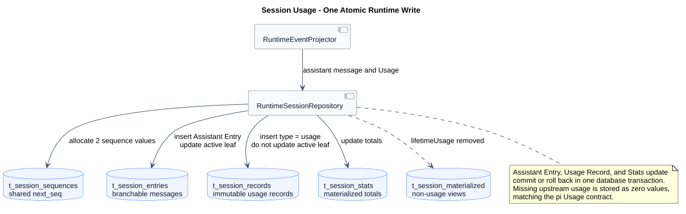

# Session 模型用量：Record 与 Stats

版本：1.0.2 · 2026-09-17。状态：已确认目标，SQL 实现未按最新提交验收。返回[Model 主设计](README.md)。

本专题维护模型用量的存储规则。Provider 解析 Usage，Runtime 将其作为不可变运行事实保存；Usage 不参加消息分支。pi 固定基线为 `5cd93f688aaab89dbb6dfa4aca535f21796ae185`，Java SQL 历史观察基线为 `d649866a6cae967ace18ceaeb9597edd47e5721e`；具体路径、符号及差距见[源码证据](source-evidence.md)。

## 1. 数据结构

目标 openGauss 设计对齐 pi 的 `records` 与 `session_stats`，使用公司表名前缀：

### `t_session_records`

| 字段 | 建议类型 | 语义 |
|---|---|---|
| `session_id` | `VARCHAR(128)` | 所属 Session |
| `record_seq` | `BIGINT` | 与 Entry 共用会话全局序号 |
| `id` | `VARCHAR(128)` | 会话内不可复用的 Record ID |
| `lane` | `VARCHAR(64)` | 当前固定 `main` |
| `run_id` | `VARCHAR(128)` | 一次接受的用户执行 ID |
| `type` | `VARCHAR(64)` | 首版为 `usage` |
| `op_kind` | `VARCHAR(64)` | 可选 operation 分类 |
| `timestamp` | `TIMESTAMPTZ(3)` | Record 产生时间 |
| `payload` | `JSONB` | 类型相关不可变数据 |

主键为 `(session_id, id)`，唯一约束为 `(session_id, record_seq)`；至少建立
`(session_id, type, record_seq)`、`(session_id, lane, record_seq)` 和
`(session_id, run_id, record_seq)` 索引。

### `t_session_stats`

| 字段 | 建议类型 | 初始值 |
|---|---|---:|
| `session_id` | `VARCHAR(128)` 主键 | Session 创建时写入 |
| `message_count` | `BIGINT` | 0 |
| `cached_tokens` | `BIGINT` | 0 |
| `uncached_tokens` | `BIGINT` | 0 |
| `total_tokens` | `BIGINT` | 0 |
| `cost_total` | `NUMERIC(30,12)` | 0 |

Token 字段和费用必须非负。费用单位沿用 `ModelCost/Usage.cost` 的美元语义；使用 NUMERIC 是
openGauss 数据质量加固，不要求复制 SQLite 的 REAL 物理类型。

## 2. Usage Record

```json
{
  "cause": "assistant",
  "entryId": "entry-assistant-01",
  "attempt": 1,
  "stopReason": "stop",
  "usage": {
    "input": 100,
    "output": 24,
    "cacheRead": 20,
    "cacheWrite": 0,
    "totalTokens": 144,
    "cost": {
      "input": 0.001,
      "output": 0.002,
      "cacheRead": 0.0001,
      "cacheWrite": 0,
      "total": 0.0031
    }
  }
}
```

首版至少写 `cause=assistant`；类型同时预留 `compaction/branch_summary/deferred_fetch`。Record
不是公共 Session Entry，不进入历史 SSE 或消息分支。

## 3. 原子写入和汇总

一次 Assistant 结束必须在同一数据库事务中：

1. 锁定 Session 和 `t_session_sequences`；
2. 分配 Assistant Entry 与 Usage Record 的两个连续全局序号；
3. 插入 Assistant Entry，并把 `active_leaf_id` 更新为 Assistant Entry；
4. 插入 Usage Record，但不修改 `active_leaf_id`；
5. 增加 `message_count` 并更新 `t_session_stats` 的 Usage 汇总；
6. 提交，任一步失败则全部回滚。

汇总规则与 pi 一致：

```text
cached_tokens   += usage.cacheRead
uncached_tokens += usage.input + usage.cacheWrite
total_tokens    += usage.totalTokens
cost_total      += usage.cost.total
```

Entry 与 Record 共用 `t_session_sequences.next_seq`，所以公开 Entry 序号允许出现间隔；它仍然
严格递增并可用于 `afterSeq` 查询。唯一 Record ID 先插入、Stats 后更新，重复写入因唯一约束
整笔回滚，不得重复累计。

`message_count` 统计可恢复为 Agent Context 的持久化 User、Assistant 和 Tool Result 消息；
Thinking、Usage、运行状态和流控制事件不计入消息数。

上游 usage 缺失时严格按 pi 保存全零 Usage 和 Usage Record，不增加 `reported`。这意味着
统计可能低估，但不会把估算值冒充上游报告值。

`t_session_materialized.payload` 删除 `lifetimeUsage` 责任，只保留 `activePath` 等其他物化视图；
Session 创建时初始化 Stats，清理时删除 Records 和 Stats。



[PlantUML 源码](diagram.puml#L245) · [原尺寸 SVG](usage-write.svg)

## 4. 验收

- Usage Record 不出现在当前分支，不更新 `active_leaf_id`；
- Assistant Entry、Usage Record、Stats 成功时全部提交，任一失败时全部回滚；
- Entry/Record 共用序号且 Entry 查询可跨过内部序号间隔；
- 重复 Record ID 不重复累计 Stats；
- cached、uncached、total 和 cost 的累计与 pi 公式一致；
- usage 缺失时保存全零记录；
- Session 删除同步清理 Records 和 Stats；
- `t_session_materialized` 不再保存 lifetimeUsage。
- Usage 写入事务失败必须中止会话执行。

## 5. 设计理由与代价

Record 与 Entry 共用顺序，但只有 Entry 更新分支叶子；这样可同时保留执行事实和正确的模型上下文。Stats 在相同事务中增量更新，读取无需扫描完整记录；代价是每条 Assistant 增加一次 Record 写入和一次汇总更新。使用 openGauss `BIGINT/NUMERIC` 属于安全加固，保留 pi 的统计语义并避免浮点汇总误差。
