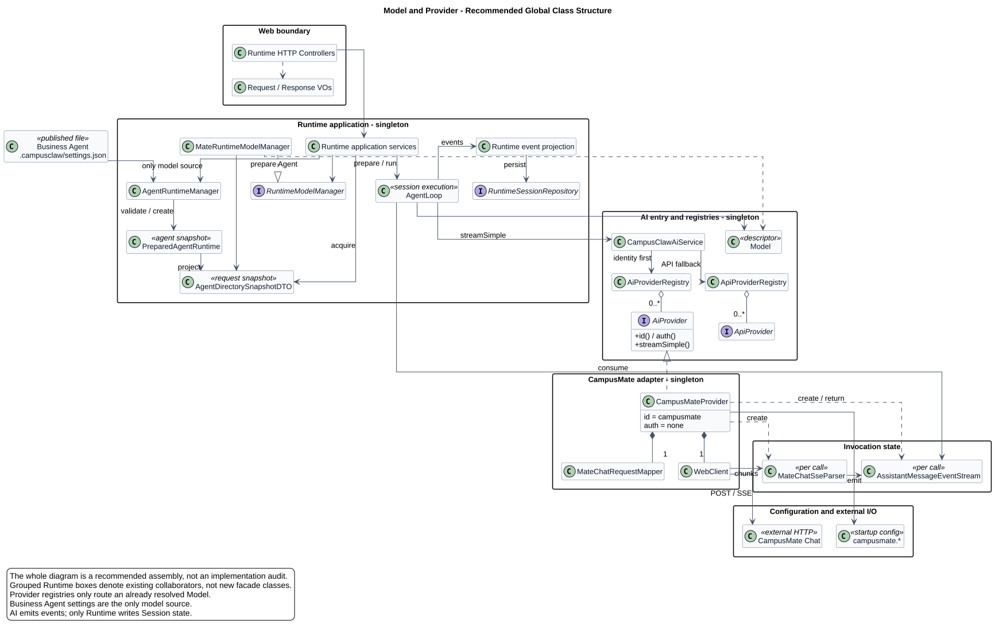
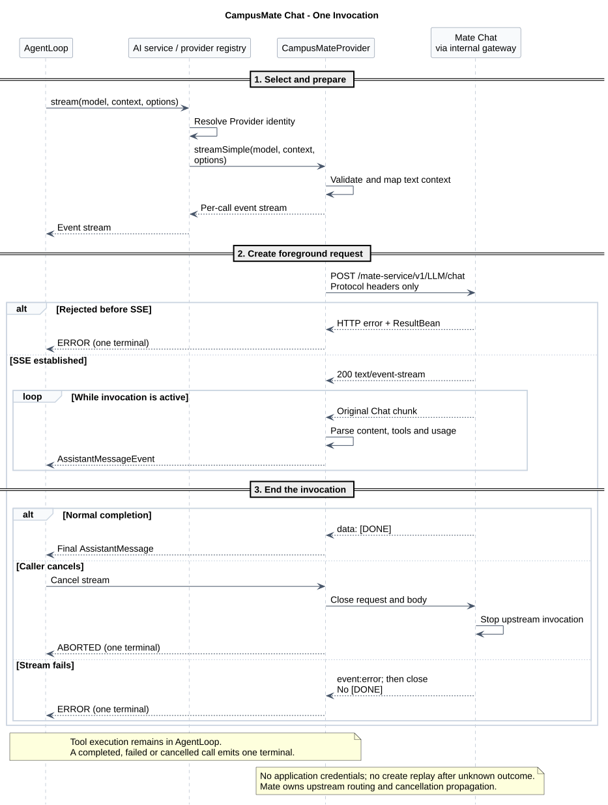

# 模型与 Provider

版本：2.8.1 · 2026-09-17 · M02。当前设计只通过 CampusMate 调用模型；业务 Agent 设置是唯一模型来源，旧全局目录的删除仍待实现。

| 内容 | 维护位置 |
|---|---|
| 模型选择、Provider 分层、调用适配与验收 | 本文 |
| Chat 请求、响应、错误码和示例 | [Chat 接口说明](chat-api.html)，由 [chat-api.json](chat-api.json) 生成；已冻结的接口行为保持不变 |
| 用量表、事务与统计 | [用量持久化](usage.md) |
| 固定源码基线、观察结果和实现差距 | [源码证据](source-evidence.md) |
| 服务地址、路径、超时和配置校验 | [共享客户端配置](../02-CampusMate共享客户端配置/README.md) |

## 1. 职责与全局结构

Runtime 选择模型、执行工具并保存会话；AI 模块把上下文转换为模型请求，把响应流转换为统一消息事件；CampusMate 管理上游路由、协议差异、endpoint 和凭据。

[PlantUML 源码](diagram.puml#L1) · [原尺寸 SVG](provider-classes.svg)

主图是推荐目标结构，分组表示职责边界。已有骨架与待清理实现见源码证据；不再保留另一套现状类图。Provider、请求 Mapper 和 WebClient 是共享对象；Parser、事件流和累积状态每次调用独立创建。AI 返回事件与最终消息，数据库写入留在 Runtime。

## 2. 模型来源

每次业务 Agent 运行时准备或 Session 启动，从该 Agent 已发布目录的 `.campusclaw/settings.json` 读取 `defaultModel` 和 `bindingModels`。默认模型必须属于绑定列表；设置缺失、值为空白、重复或不一致时明确失败。

`AgentRuntimeManager` 加载并校验设置，`PreparedAgentRuntime` 与 `AgentDirectorySnapshotDTO` 固定同一次准备的数据，`MateRuntimeModelManager` 从该快照提供默认模型、列表和解析。模型切换、压缩、Child/Cron 复用这条链；执行或修改 Session 时仍在所属锁或事务内复核可变状态。

模型变更经业务 Agent 配置发布链生效。启动和选择阶段不查询 classpath、用户 Home、环境凭据或其他 Agent 的模型目录，也不新增模型发现 HTTP 接口。模型能力默认值由 `campusmate.model` 提供，不成为另一份允许列表。

这是产品约束与安全加固：同一发布快照固定默认值和允许列表，避免全局配置影响多个 Agent；代价是失去本地模型扩展，变更必须发布后生效。与 pi 的差异及固定证据见[架构对比 A06](../../01-总体架构/07-Agent架构对比/README.md#a06)。

## 3. Provider 调用边界

### 身份与路由

| 对象 | 规则 |
|---|---|
| Provider | 身份键为 `provider.id`，名称、URL、凭据和协议不参与身份；唯一内置实现 `CampusMateProvider`，ID 为 `campusmate`，认证为 `ProviderAuth.none()` |
| 模型身份 | `(provider.id, model.id)`；Mate modelId 为 1–64 字符、大小写敏感的不透明值 |
| 调用入口 | `CampusClawAiService` 先查 `AiProviderRegistry`，未命中再查 `ApiProviderRegistry`；二者都未命中时在发 HTTP 前失败，不替换模型 |
| 调用接口 | 保留 `AiProvider.id/auth/streamSimple` 及 `ApiProvider` 抽象；注册表只路由已解析 Model，不提供模型发现或可用性判断 |
| 连接配置 | 读取统一的 `campusmate.*`；不使用 `Model.baseUrl/apiKey/headers` 覆盖部署地址、协议或请求头 |

Provider 身份与协议路由分开，避免按厂商堆叠中央分支。内部协议默认值、未注册值的启动失败规则，以及 URL/path 校验由[共享配置](../02-CampusMate共享客户端配置/README.md)维护。

### 身份与历史数据

新 Model、注册、Assistant 和持久化 `_provider` 使用 `campusmate`。旧 `mate-model-manager` 不作为别名，不增加 enum 兼容解析、转发类或 SQL/历史文件迁移；已有 `_provider` 原样读取，压缩与 Child/Cron 的身份比较不把新旧值视为相同。

保留 `provider.mate` 包以及 `MateChatRequestMapper/MateChatSseParser/MateReasoningSignature` 名称。`MateInvocationErrorCode`、`MATE_MODEL_MANAGER_ERROR` 和日志 `event/operation/errorCode` 保持原义；稳定错误码不是 Provider ID。Logger 使用 `CampusMateProvider`，字段规则见[调用日志](../../01-总体架构/05-CampusClaw调用日志/README.md)。

## 4. Chat 调用与适配

使用 `POST /mate-service/v1/LLM/chat`。精确 HTTP 字段、报文和错误码集中在 [Chat 接口说明](chat-api.html)；本节维护 Provider 到该接口的转换。

调用经内部网关，不发送 `X-HW-ID/Authorization/X-HW-APPKEY`、`agentId/sessionId` 或上游连接信息；服务准入依赖网关与网络 ACL。Mate 不在调用阶段重新检查 Agent 绑定，也不执行 Tool。

一次 POST 对应一次前台调用，不支持 `Idempotency-Key`，结果未知时不得重放。成功 SSE 原样返回 Chat chunks，以 `[DONE]` 结束；流建立前错误使用真实 HTTP 状态，建立后发送 `event:error` 并关流，不再发送 `[DONE]`。取消关闭请求和 body，沿连接传播到上游；Provider 的正常完成、`ABORTED` 和 `ERROR` 竞争时只能产生一个终态。

[PlantUML 源码](diagram.puml#L134) · [原尺寸 SVG](chat-sequence.svg)

### 请求映射

| AgentLoop / Provider 输入 | Mate Chat 请求 | 规则 |
|---|---|---|
| `Model.id` | `model` | 原样 Mate 模型 ID |
| `Context.systemPrompt` | 首个 `system` message | 空值时省略 |
| `UserMessage` 文本 | `user.content` | 保留顺序，非文本拒绝 |
| `AssistantMessage` 文本 | `assistant.content` | 按顺序拼接文本块 |
| `AssistantMessage.ToolCall` | `assistant.tool_calls[]` | arguments 序列化为 JSON 字符串 |
| `ToolResultMessage` | `tool` message | `tool_call_id` 关联 ToolCall，content 为字符串 |
| `ThinkingContent.thinkingSignature` | Assistant reasoning 白名单字段 | 按原字段种类重放 |
| Agent Tool | `tools[].function` | JSON Schema 原样投影，不发送 `strict` |
| `SimpleStreamOptions.toolChoice` | `tool_choice` | 只允许 `auto/none` |
| 显式 `SimpleStreamOptions.maxTokens` | `max_output_tokens` | 未设置时省略，不用 `Model.maxTokens` 补值 |
| 显式 temperature | `temperature` | 未设置时省略 |
| `ThinkingLevel` | 不发送 | 推理开关和 effort 由 Mate 配置 |
| 固定字段 | `stream/stream_options.include_usage` | 均为 `true` |

reasoning 白名单为 `reasoning_content/reasoning/reasoning_text/reasoning_details`，前三项为字符串，最后一项为不透明 JSON 数组。可读内容展示模型原始推理，signature 用于下次重放；展示规则见 [Thinking 设计](../../01-总体架构/01-CampusClaw多Agent运行时/chat-events-history-design.md#thinking-original-text)。

首版只支持文本、function Tool 和上述 reasoning。图片、音频、文件、content part 数组与 Tool 图片在发 HTTP 前失败，不丢块后继续。未知字段及已定义可选字段的处理遵循接口说明；`max_output_tokens` 与 `event:error` 是 Mate 扩展。

### 响应、用量与运行约束

| SSE 数据 | Provider 输出 |
|---|---|
| `chunk.id` | `AssistantMessage.responseId` |
| 请求 model / `chunk.model` | `AssistantMessage.model` / 可选 `responseModel` |
| content / reasoning / tool_calls 增量 | Text / Thinking 与签名 / ToolCall start、delta、end |
| `finish_reason` | `STOP/LENGTH/TOOL_USE/ERROR` |
| usage | `Usage`；output 已含 reasoning token，可保留上游 breakdown |

Provider 仅解析 Usage，Runtime 保存和汇总；事务、缺失 Usage、分支隔离与失败处置统一见[用量持久化](usage.md)。

调用须配置连接、首字节、流空闲、总执行时间与缓冲上限，数值由部署管理。不记录完整 SSE、prompt、Tool 参数或 thinking；错误不得暴露 endpoint、credential、私有路由、stack trace 或推理正文。

## 5. 实施与验收

已核验的 Java `21c3f59b` 具备业务 Agent 设置主链和 CampusMate 调用链，仍保留全局目录及相关日志。具体源码、历史观察和独立核验范围仅在[源码证据](source-evidence.md)维护；下表描述目标实施顺序，已完成项只做验证。

| 步骤 | 实施内容 | 验收 |
|---|---|---|
| S1 · 模型选择 | 固定 §2 的设置加载与快照链 | 覆盖缺失、空白、重复、默认值不在列表、Agent 隔离，以及默认/切换/压缩/Child/Cron 同源；禁止回退 |
| S2 · 全局目录清理 | 删除 `ModelRegistry`、两处 JSON 探测、`ModelCatalogService`、`CatalogRuntimeModelManager` 及专用环境凭据解析；迁移 SSE 仍使用的成本计算 | Spring 不再装配上述目录 Bean；启动无外部模型文件探测及加载日志；无消费者的能力辅助方法删除 |
| S3 · 调用与依赖清理 | 移除 AI Service 的目录依赖；删除 Anthropic、OpenAI Completions、OpenAI Responses、Mistral 具体适配器及专属测试，按下表清理 SDK 并同步公司镜像 | 只内置 CampusMate，空 API 注册表可启动；新旧身份遵守 §3；公共消息、流、枚举与有消费者的工具不误删 |
| S4 · 回归 | 验证 §4 映射与流生命周期、用量事务及[配置验收](../02-CampusMate共享客户端配置/README.md#10-验收标准) | 覆盖非文本本地拒绝、未知/可选字段、usage 缺失、流前/流后错误、并发隔离、取消与唯一终态；canonical 构建/测试和公司镜像编译通过 |

测试名称和能力注册表 selector 只在对应测试真实存在并执行后更新。受阻项按实际结果记录，不把设计确认记成实现通过。

### 依赖影响

不新增 Maven 依赖。CampusMate 请求与流处理继续使用现有 Jackson、WebClient、Reactor Netty；取消厂商直连可减少 SDK 维护，但没有包体积、性能或可靠性的量化结论。

| 删除的直接依赖 | 范围 | 固定基线中的主要传递依赖 |
|---|---|---|
| `com.anthropic:anthropic-java:2.18.0` | 根版本管理、AI 与公司镜像 POM | client-okhttp/core、Kotlin、OkHttp logging、Jackson 扩展、Swagger、Victools、Apache HttpClient/Core 5 |
| `com.openai:openai-java:4.29.1` | 同上 | client-okhttp/core、Kotlin、OkHttp、Jackson 扩展、Swagger、Victools；与 Anthropic 路径存在仲裁 |

源码消费者和运行依赖树证据见[源码证据](source-evidence.md#dependencies)。删除后重新核对全 Reactor 与公司镜像，确认两个 SDK 不再进入产物；保留仍被使用的 Jackson、Reactor/Netty、日志、`json-schema-validator` 和测试用 MockWebServer，不机械排除共享传递依赖。公司父 POM 的完整依赖树与删减产物尚未验证。

## 6. 版本历史

| 版本 | 日期 | 变更 |
|---|---|---|
| 2.8.1 | 2026-09-17 | 精简目录、文件名和重复说明，集中模型规则、调用适配及实施验收。 |
| 2.8.0 | 2026-09-17 | 模型来源收敛为业务 Agent `.campusclaw/settings.json`，删除全局 JSON 目录及目录适配链。 |
| 2.7.0 | 2026-09-14 | 按模块职责重写正文，集中源码与用量专题，复用接口说明并重排全局类图及调用顺序图。 |
| 2.6.0 | 2026-09-14 | 默认仅内置 CampusMate，统一 Provider 身份与类名，明确第三方适配器、模型预置及 SDK 的削减边界。 |
| 2.5.0 | 2026-09-09 | 明确 Thinking 展示模型返回的原始推理。 |
| 2.4.0 | 2026-08-26 | 模型配置统一使用 `campusmate.model` 与对应环境变量。 |
| 2.3.0 | 2026-08-26 | CampusMate 共用配置树和端点目录，记录已实现的 Mate Chat 边界。 |
| 2.2.0 | 2026-08-26 | Mate Tool 共用 CampusMate origin。 |
| 2.1.0 | 2026-08-26 | Model Manager 与受管 Runtime 共用 `campusmate.base-url`。 |
| 2.0.0 | 2026-08-24 | 冻结前台 Chat、断连取消、API 适配与用量落库规则。 |
| 1.3.0 | 2026-08-23 | 五个 Model Manager 接口采用内部网关免应用层认证；Mate Provider 使用 `ProviderAuth.none()`。 |
| 1.2.0 | 2026-08-22 | Responses create 采用语义透明代理。 |
| 1.1.0 | 2026-08-22 | 冻结 Responses create/cancel 和前台取消扩展。 |
| 1.0.0 | 2026-08-21 | 明确 Provider 身份、Java 对齐、Mate 托管调用和五项运行接口候选。 |
