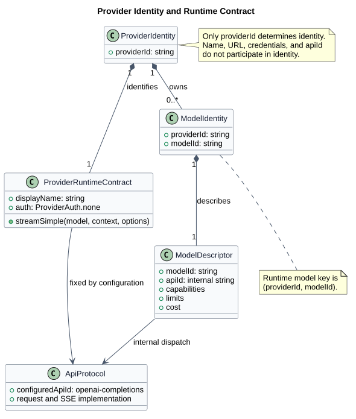
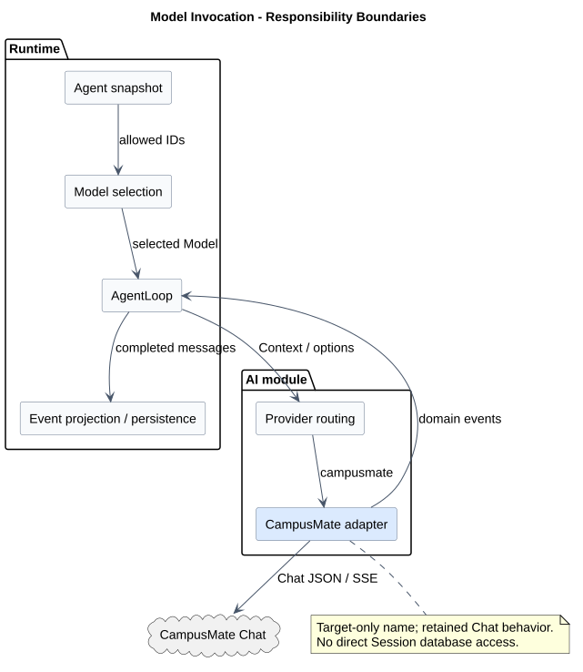
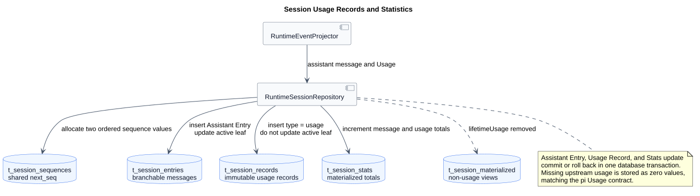

# CampusMate Model Manager 通用 Provider 对接设计

| 属性 | 值 |
|---|---|
| 文档版本 | 2.6.0 |
| 状态 | 已确认目标；AI 削减与 CampusMate 命名为 target-only，Chat 契约保持冻结，接口 1-3 保持候选 |
| 设计日期 | 2026-08-26 |
| pi-mono 源码基线 | `5cd93f688aaab89dbb6dfa4aca535f21796ae185` |
| 初始 pi-mono-java 源码基线 | `d649866a6cae967ace18ceaeb9597edd47e5721e` |
| AI 削减专项源码基线 | `f61906b9136246ca60f333704b6fc92b5420d0ec`；仅覆盖 §3.2 所列范围，不代表最新远端或全模块验收 |
| 前次 pi-mono-java 配置复核基线 | `56be8eee59415a5f86658d6635a7b7e8891263d3` |
| mate-service 源码基线 | `956b547f5ca12ca89e68f73012f92a4406b0c9fa` |
| 初始设计仓分析基线 | `3fde5735cd27433c3e3e5e03a5ce39b297ad3b00` |
| 设计仓分析基线 | `9aac37890edd257354c9dab0819bec0e94e513c8` |
| 适用边界 | pi-mono-java Runtime ↔ mate-service Model Manager |

## 1. 结论

确定 Provider 身份只需要稳定且唯一的 `provider.id`。`name`、`baseUrl`、凭据和 `api`
都不参与身份；运行时模型唯一键为 `(provider.id, model.id)`。

CampusClaw 默认只内置 `CampusMateProvider`，保留通用 Provider 注册与模型注册框架；第三方适配器和内置第三方模型数据不再随产品交付。该削减与改名是 **target-only 已确认目标**，当前实现状态见 §3.2。目标身份为：

```text
providerId = campusmate
apiId      = openai-completions       # CampusClaw 内部配置，不进入 HTTP
model key  = (campusmate, <Mate modelId>)
auth       = ProviderAuth.none()
```

模型调用采用前台请求作用域的 Chat 流：

```http
POST <campusmate-base-url>/mate-service/v1/LLM/chat
Content-Type: application/json
Accept: text/event-stream
```

- CampusClaw 经内部网关调用，不携带应用层身份或凭据；
- Provider 把 `AgentLoop Context` 转为 Mate Chat 请求；Mate 不认识 Java Message 类型；
- 成功响应是原始 OpenAI 风格 Chat SSE，不包装 ResultBean，不改写 chunk；
- 调用取消通过关闭请求/SSE 连接实现，不存在独立 cancel operation；
- Mate 如何映射上游模型、字段、endpoint 和凭据属于 Mate 内部实现，不进入本契约；
- Token 使用量由 CampusClaw 解析，并按 pi 的 Record + Stats 模型持久化。

Provider 身份与 Java 类名按 §4.3 直接切换。HTTP 路径、`campusmate.*` 配置、Chat 请求与 SSE、
`openai-completions` 协议标识和稳定错误码保持现有定义；不引入旧身份别名或数据迁移。

## 2. 设计边界与术语

| 概念 | 身份或取值 | 责任 |
|---|---|---|
| Runtime Provider | `campusmate` | NoAuth、Context 转换、Chat SSE 解析；受管模型目录由 `MateRuntimeModelManager` 提供 |
| Runtime 内部 API | 默认 `openai-completions` | 选择 CampusClaw 内部协议实现；不发送给 Mate |
| Mate 模型 | 大小写敏感的 `modelId` | 调用方选择模型的唯一公开值 |
| Mate 上游路由 | Mate 私有 | 上游 Provider、模型、endpoint、凭据及适配方式 |
| Session Entry | 可分支消息记录 | User、Assistant、Tool 和其他会话内容 |
| Session Record | 不参与分支的运行事实 | Usage、operation 等运行记录 |

身份规则：

1. `providerId` 是 Provider 注册表唯一键；修改 URL、名称或内部 API 不创建新身份。
2. `modelId` 为 1-64 字符、大小写敏感的不透明字符串；CampusClaw 必须原样使用目录值。
3. HTTP 请求不携带 `apiId/providerId/agentId/sessionId/upstreamModelId`。
4. 免认证决定只覆盖本文剩余四个 Model Manager 接口；其他 CampusMate 接口保持未决。
5. 网关准入和网络 ACL 是部署边界，不定义为 CampusMate 业务认证契约。



[PlantUML 源码：`provider_identity_model`](diagram.puml#L1)

## 3. 源码证据

### 3.1 pi-mono 观察行为

| 证据 | 观察行为 |
|---|---|
| `packages/ai/src/models.ts`：`Provider`、`MutableModels`、`ModelsImpl`、`createProvider` | Provider 注册和调用按 `provider.id`；Provider 持有认证、目录和 stream 能力。 |
| `packages/ai/src/types.ts`：`Model`、`SimpleStreamOptions`、`ToolChoice`、`Usage` | Model 同时携带 Provider/API；通用 `toolChoice` 为 `auto/none`；Usage 始终存在。 |
| `packages/agent/src/agent-loop.ts`：`runLoop`、`streamAssistantResponse` | 普通 Loop 不计算 `toolChoice`；收到 Assistant ToolCall 后执行工具并继续下一轮。 |
| `packages/coding-agent/src/core/compaction/compaction.ts`：`completeSummarization` | 摘要调用显式使用 `toolChoice: "none"`，避免调用工具。 |
| `packages/ai/src/api/openai-completions.ts`：`stream`、`convertMessages` | Chat Provider 处理 system/user/assistant/tool、ToolCall、reasoning 扩展和 usage chunk。 |
| `packages/agent/src/harness/session/types.ts`：`UsageRecord`、`SessionStats` | Usage 是独立 Record，可关联 assistant、compaction、branch summary 和 deferred fetch。 |
| `packages/session-backends/sqlite-node/src/sqlite/migrations/001_initial.sql` | SQL 后端把 `entries`、`records` 和 `session_stats` 分表保存。 |
| `packages/session-backends/sqlite-node/src/sqlite/repo.ts`：`appendRecord` | Usage Record 插入后，同一串行写路径增量更新 Stats。 |
| `packages/session-backends/sqlite-node/src/sqlite/storage/session-stats.ts` | 汇总 cached、uncached、total tokens 和总费用。 |

pi 的 `Usage` 在流开始时初始化为全零，收到上游 usage 后覆盖；上游不返回 usage 时无法区分
“未报告”与“真实为零”。本设计严格沿用该语义，不新增 `reported` 字段。

### 3.2 AI 削减专项源码证据与差距

下表实际核对 `pi-mono-java@f61906b9136246ca60f333704b6fc92b5420d0ec`；路径相对实现仓根目录。
与前次 `56be8eee59415a5f86658d6635a7b7e8891263d3` 相比，相关客户端已读取统一 `campusmate`
配置。该局部复核不更新 Usage SQL、公共 API 或其他模块的验收状态。固定提交里的旧类名和
路径保留原样，不能替换成尚不存在的目标类。

| 编号 | 仓库相对路径与符号 | 已观察行为 | 本次目标与差距 |
|---|---|---|---|
| J-AI-01 | `modules/ai/src/main/java/com/campusclaw/ai/CampusClawAiService.java`：`stream/streamSimple/resolveManagedProvider/resolveProvider`；`provider/AiProviderRegistry.java`、`provider/ApiProviderRegistry.java`（均位于同一 `ai/` 包下）：构造器、`getProvider/register/unregister` | 优先按 ProviderId 查通用 Provider，未命中再按 API 查适配器；两个注册表均允许空集合。 | 保留路由及扩展接口，默认仅装配 CampusMate；空 API 注册表不得导致启动失败。 |
| J-AI-02 | `modules/ai/src/main/java/com/campusclaw/ai/provider/mate/MateServiceModelManagerProvider.java`：`PROVIDER_ID/streamSimple/eventFlux/createWebClient` | ID 为 `mate-model-manager`；使用 WebClient/Reactor Netty，无 OpenAI SDK；读取 `campusmate.base-url/endpoints/model`。 | 改名为 `CampusMateProvider`，ID 改为 `campusmate`；独立 HTTP 调用链保留。 |
| J-AI-03 | `modules/ai/src/main/java/com/campusclaw/ai/provider/mate/MateChatRequestMapper.java`：`map/appendOptions`；`MateChatSseParser.java`：`accept/parseReasoning/parseUsage/finish`；`MateReasoningSignature.java`：`encode/decode`（后两者同目录） | 已有独立 Chat JSON 映射、文本/工具/推理 SSE、Usage、签名重放与取消终态。 | 保留这些实现；不再要求从待删除的 OpenAI Provider 提取 Mapper。 |
| J-AI-04 | `modules/ai/src/main/java/com/campusclaw/ai/provider/anthropic/AnthropicProvider.java`、`provider/openai/OpenAICompletionsProvider.java`、`provider/openai/OpenAIResponsesProvider.java`、`provider/mistral/MistralProvider.java`（后三者相对同一 `ai/` 包）：类声明及 `stream/streamSimple` | 四个 Spring API 适配器仍随产品源码交付。 | 删除四个适配器及专属测试；保留 `ApiProvider` 抽象。 |
| J-AI-05 | `modules/ai/src/main/java/com/campusclaw/ai/model/ModelRegistry.java`：`init/builtInModels/register/getAllModels/loadFromJsonFile/calculateCost`；`types/Provider.java`、`types/Api.java`（相对同一 `ai/` 包）：enum | 自动加载第三方模型预置，再加载 classpath 与用户 JSON；Provider/API 仍为 enum。 | 删除预置清单和加载调用，保留注册与外部 JSON 能力；只把 `MATE_MODEL_MANAGER` 改为 `CAMPUSMATE`，不改造 enum 或引入 ApiId。 |
| J-AI-06 | `modules/coding-agent-cli/src/main/java/com/campusclaw/codingagent/runtimeapi/model/MateRuntimeModelManager.java`：`resolveModel/listAvailableModels`；`runtimeapi/RuntimeApiConfiguration.java`：`mateRuntimeModelManager`（同一 `codingagent/` 包） | Runtime 使用 Agent 快照中的模型 ID 构造 Mate Model，未通过第三方预置目录选择模型。 | 沿用模型来源，构造 `Provider.CAMPUSMATE`；不新增目录 HTTP 调用。 |
| J-AI-07 | `modules/coding-agent-cli/src/main/java/com/campusclaw/codingagent/runtimeapi/event/RuntimeEntryCodec.java`：`assistantEntry/assistantMessage`；`session/compaction/SessionCompactor.java`：`sameModel`；`tool/agent/SubagentExecutionService.java`、`tool/cron/ManagedCronSessionRunner.java`：模型匹配（均相对同一 `codingagent/` 包） | 历史 `_provider` 保存字符串；压缩、Child/Cron 有按 Provider 与模型 ID 的匹配。 | 新写入统一使用 `campusmate`；旧历史保留原值，不做同身份归一或匹配兼容。 |
| J-AI-08 | `pom.xml`、`modules/ai/pom.xml`、`campusclaw/pom.xml`：LLM SDK dependencies；`scripts/sync-campusclaw.sh`：镜像同步 | canonical 与公司镜像均声明两个 SDK，镜像 Java 从 modules 生成。 | 同步移除 SDK 声明和版本管理；更改后生成镜像并单独编译验证。 |

本次只完成设计；上述删除、改名与测试更新尚未执行。不能把已有 Mate 调用链的代码存在，
等同于新名称和削减目标已经通过产品验收。

### 3.3 mate-service 观察行为

mate-service 基线 `956b547f` 已实现 Chat 调用：

- `src/main/java/com/huawei/hicampus/mate/agentdefinition/modelmanager/controller/LlmChatController.java:35-55`
  以 `CHAT_PATH` 实现 `POST /mate-service/v1/LLM/chat`；
- `LlmChatController.createChat` 接收 JSON，成功返回 `text/event-stream`，并由
  `LlmChatService` 创建上游调用；
- 模型目录接口 1-3 仍未在该基线发现，对应字段继续是 **target-only design**；
- Mate 内部上游路由、凭据和 Usage 持久化仍不由本文规定。

因此接口 4 是 **已观察的服务端行为与已冻结契约**，不能再描述为尚不存在；接口 1-3
仍是目标候选。

### 3.4 OpenAI 协议证据

OpenAI [Chat Completions](https://developers.openai.com/api/reference/cli/resources/chat/subresources/completions)
使用 `messages` 和 Chat Completion chunks；OpenAI
[Responses](https://developers.openai.com/api/reference/cli/resources/responses/methods/create)
使用 `input` 和 `max_output_tokens`。本接口选择 Chat 消息与 Chat SSE，但保留
`max_output_tokens` 作为明确的 Mate 扩展，因此属于 Mate 统一 Chat 契约，不宣称逐字段等同
OpenAI 官方 Chat Completions。

## 4. Provider 与配置

### 4.1 CampusClaw 配置

```yaml
campusmate:
  base-url: ${CAMPUSMATE_BASE_URL}
  endpoints:
    model-chat-path: ${CAMPUSMATE_MODEL_CHAT_PATH:/mate-service/v1/LLM/chat}
  model:
    api: ${CAMPUSMATE_MODEL_API:openai-completions}
```

- `campusmate.base-url` 是 Model Manager、受管 Runtime 与 Mate Tool 共享的部署 origin；
- 它由 `CAMPUSMATE_BASE_URL` 显式提供，没有产品级默认地址；
- `campusmate.endpoints.model-chat-path` 默认保留大小写 `/mate-service/v1/LLM/chat`；
- `campusmate.model.api` 保存 CampusClaw 的内部模型协议选择；
- `api` 只用于 CampusClaw 内部 `Model.api` 和协议适配器选择；
- 当前唯一注册值为 `openai-completions`，配置为未注册值时启动失败；
- Provider 不读取 `Model.baseUrl/apiKey/headers` 构造 Mate 请求。

旧配置基线中的 `campusmate.model-manager.*` 与 `CAMPUSMATE_MODEL_MANAGER_*` 均不再是目标
配置：地址迁移到 `campusmate.base-url`，Chat path 迁移到 `campusmate.endpoints`，API、能力与
传输参数迁移到 `campusmate.model` 及 `CAMPUSMATE_MODEL_*`。不保留旧键兼容别名；所有
CampusMate path 只在 `campusmate.endpoints` 中声明一次。

Model Manager 是 CampusMate 的模型管理组件；运行时身份统一为 `campusmate`，Java 适配器
统一为 `CampusMateProvider`。具体命名与兼容边界由 §4.3 维护。

### 4.2 保留的 Provider 接口

```java
public interface AiProvider {
    ProviderId id();

    ProviderAuth auth();

    AssistantMessageEventStream streamSimple(Model model, Context context, SimpleStreamOptions options);
}
```

`CampusMateProvider` 固定：

| 属性 | 目标值 |
|---|---|
| `id()` | `ProviderId("campusmate")` |
| `auth()` | `ProviderAuth.none()` |
| `Model.provider` | `campusmate` |
| `Model.api` | 配置项 `campusmate.model.api`，默认 `openai-completions` |
| HTTP 地址 | `campusmate.base-url + campusmate.endpoints.model-chat-path` |
| HTTP 凭据 | 无 |

`apiId` 不出现在目录或调用 HTTP 中。保留内部 API 字段是为了兼容当前 Model 类型并参考 pi
的 Provider/API 分层，不允许调用方通过请求覆盖。上述接口沿用现有方法，不在削减中增加
`getModels/refreshModels`，也不把 `ApiProvider` 改名为 `ProtocolAdapter`。目录接口 1-3
仍为候选，后续目录能力应单独落实接口和实现。



[PlantUML 源码：`generic_provider_boundary`](diagram.puml#L68)

### 4.3 命名与直接切换

| 对象 | 源码基线名称 | 目标名称 |
|---|---|---|
| Provider ID | `mate-model-manager` | `campusmate` |
| Java Provider 类 | `MateServiceModelManagerProvider` | `CampusMateProvider` |
| Provider enum | `MATE_MODEL_MANAGER("mate-model-manager")` | `CAMPUSMATE("campusmate")` |
| Provider 测试类 | `MateServiceModelManagerProviderTest` | `CampusMateProviderTest` |

`CampusMateProvider` 与 `AnthropicProvider/MistralProvider` 一样使用“提供方名称 + Provider”。
`PROVIDER_ID` 常量、新 Model、注册与新消息写入统一使用新身份。保留 `provider.mate` 包及
`MateChatRequestMapper/MateChatSseParser/MateReasoningSignature` 等辅助类名称，避免把本次
Provider 身份调整扩展成整个 CampusMate 客户端改名。

这是 **产品约束下的身份变更**：仅接受新 ID，不保留旧 Provider 注册别名，不给 enum 增加
兼容解析，不增加 SQL/历史文件迁移。外部模型配置需主动改用新值；存量历史 `_provider`
保留原字符串，读取不进行归一，不承诺它与新 ID 在压缩、Child/Cron 模型匹配中视为同一身份。
旧类名仅用于固定提交证据和本节迁移映射，不提供转发类。

HTTP path、`campusmate.*` 配置、`openai-completions`、`MateInvocationErrorCode` 及
`MATE_MODEL_MANAGER_ERROR` 保持原义。后者是稳定错误码，不是 Provider ID；日志字段
`event/operation/errorCode` 不改，Provider 的 logger name 随类名变化，见[调用日志](../../01-总体架构/05-CampusClaw调用日志/README.md)。

### 4.4 产品裁剪与扩展边界

| 范围 | 目标处理与理由 |
|---|---|
| 内置适配器 | 只交付 `CampusMateProvider`；删除 Anthropic、OpenAI Completions、OpenAI Responses、Mistral 四个具体类及专属测试。默认产品模型出口交给 CampusMate，取消本地厂商 SDK 维护责任。 |
| 通用框架 | 保留 `CampusClawAiService`、`AiProvider/AiProviderRegistry`、`ApiProvider/ApiProviderRegistry` 与现有方法；身份路由优先，未命中才查 API。默认 API 注册表为空；显式自定义适配器仍可注册、查询、注销和调用。 |
| 模型注册 | 删除 `builtInModels` 及各厂商数据方法、`init` 中的预置加载；保留两级索引、注册/查询/清理、成本计算、classpath JSON 与用户 JSON 加载顺序。没有外部数据时目录为空，不自动塞入虚构的 CampusMate 模型。 |
| Runtime 模型 | `MateRuntimeModelManager` 从同一 Agent 快照读取允许列表并解析模型；模型列表和调用继续使用 Mate modelId，能力默认值仍由 `campusmate.model` 提供。业务变更仍在所属事务内复核可变 Session 状态。 |
| 通用类型与辅助能力 | 保留 Provider/API 其余 enum 值、公共消息/流类型、配置与环境密钥解析、通用转换和工具方法；保留它们不表示默认存在对应厂商实现。 |
| 调用失败 | 未注册身份且没有对应 API 适配器时沿用明确失败，不发网络请求，不自动替换成 CampusMate，不静默改写模型 ID。 |
| 协议与其他模块 | Chat 请求/SSE、Runtime 事件、持久化和 Mate Tool 协议保持各自契约；不扩大为框架替换、模型能力查询或身份认证改造。 |

收益是减少随产品发布的适配器、预置数据及 SDK 升级范围；代价是厂商直连不再开箱可用，
既有直连调用方必须迁往 CampusMate 或自行提供扩展。当前没有包体积、性能或可靠性实测，
不能从源码删减推导量化收益。

### 4.5 Maven 依赖影响

不新增 Maven 依赖。现有 Jackson、WebClient、Reactor Netty 足以支持保留的 CampusMate
请求/流处理，无需换用 JDK HTTP Client 或另引 SDK。两个待删除 SDK 的源码消费者仅为
待删除适配器及专属测试（公司镜像有对应副本）：

| 直接依赖 | 删除范围 | 基线中的主要传递依赖 |
|---|---|---|
| `com.anthropic:anthropic-java:2.18.0` | 根版本属性/依赖管理、AI POM、公司镜像 POM | `anthropic-java-client-okhttp/core`；Kotlin、OkHttp logging interceptor、Jackson 扩展、Swagger 注解、Victools JSON Schema；另含 Apache HttpClient/Core 5。 |
| `com.openai:openai-java:4.29.1` | 同上 | `openai-java-client-okhttp/core`；Kotlin、OkHttp、Jackson 扩展、Swagger 注解及 Victools JSON Schema（与 Anthropic 路径有依赖仲裁/去重）。 |

基线实际执行并成功解析：

```bash
JAVA_HOME=<JDK-21> ./mvnw -o -pl modules/ai -am dependency:tree -Dscope=runtime
```

运行时仲裁结果含 Kotlin `1.9.25`、Jackson `2.18.3`、OkHttp logging interceptor `4.12.0`、
Victools `4.38.0`、HttpClient `5.4.3` 与 HttpCore `5.3.4`。这些是当前基线依赖树证据，
不是删除后的最终图；公司父 POM 的完整依赖树和削减后的产物尚未验证。

保留被现有能力使用的 Jackson、Reactor/Netty、日志、`json-schema-validator` 及测试用
MockWebServer。删除 SDK 后重新核对全 Reactor 和公司镜像的消费者与依赖树；不对共享库
机械加 exclusion，也不宣称 Kotlin/OkHttp 已从所有运行或测试路径消失。

## 5. Model Manager 接口清单

| # | Method | Path | 状态 | 用途 |
|---:|---|---|---|---|
| 1 | `GET` | `/mate-service/internal/v1/models` | 目标候选 | 全局模型目录和 ETag 刷新 |
| 2 | `GET` | `/mate-service/internal/v1/agents/{agentId}/models` | 目标候选 | Agent 可调用模型列表 |
| 3 | `GET` | `/mate-service/internal/v1/agents/{agentId}/models/{modelId}` | 目标候选 | 原子解析一个可调用模型 |
| 4 | `POST` | `/mate-service/v1/LLM/chat` | 已冻结 | 创建前台流式 Chat 调用 |

1.x 的 `POST /responses` 和 `POST /responses/{responseId}/cancel` 已废止，不构成兼容别名。
剩余四个接口统一依赖内部网关，不携带 `X-HW-ID`、`Authorization`、`X-HW-APPKEY` 或其他
应用身份/凭据。接口 1-3 的字段仍是候选，不因调用接口冻结而自动批准。

模型目录候选详见
[`接口契约/操作/01-list-models.json`](接口契约/操作/01-list-models.json) 和
[`model-manager-provider-v1-review.html`](model-manager-provider-v1-review.html)。

## 6. 接口 4：创建前台流式 Chat

### 6.1 路径和请求头

```http
POST /mate-service/v1/LLM/chat
Content-Type: application/json
Accept: text/event-stream
Accept-Language: zh-CN
```

`Accept-Language` 只影响 SSE 建立前的 JSON 错误；成功 SSE 不做语言转换。请求不支持
`Idempotency-Key`，每个 POST 都创建一次新模型消费；结果未知时不得自动重放。

### 6.2 请求示例

```json
{
  "model": "managed-coding-model",
  "messages": [
    {
      "role": "system",
      "content": "You are a coding assistant."
    },
    {
      "role": "user",
      "content": "读取 README.md 并总结"
    },
    {
      "role": "assistant",
      "content": null,
      "reasoning_content": "I need to read the file first.",
      "tool_calls": [
        {
          "id": "call_01",
          "type": "function",
          "function": {
            "name": "read_file",
            "arguments": "{\"path\":\"README.md\"}"
          }
        }
      ]
    },
    {
      "role": "tool",
      "tool_call_id": "call_01",
      "content": "README file content"
    }
  ],
  "tools": [
    {
      "type": "function",
      "function": {
        "name": "read_file",
        "description": "Read a local file",
        "parameters": {
          "type": "object",
          "properties": {
            "path": {"type": "string"}
          },
          "required": ["path"]
        }
      }
    }
  ],
  "tool_choice": "auto",
  "max_output_tokens": 4096,
  "temperature": 0.2,
  "stream": true,
  "stream_options": {
    "include_usage": true
  }
}
```

### 6.3 顶层字段

| 字段 | 必需性与校验 | Provider/Mate 可观察语义 |
|---|---|---|
| `model` | 必填；1-64 字符；大小写敏感 | Mate 模型 ID；CampusClaw 原样发送 |
| `messages` | 必填非空数组 | 只允许第 6.4 节四种角色并保持顺序 |
| `tools` | 可选数组 | 首版只允许 `type=function` |
| `tool_choice` | 可选；`auto` 或 `none` | 普通 Loop 省略；摘要调用传 `none` |
| `max_output_tokens` | 可选正整数 | Mate 扩展；CampusClaw 不改名、不截断；省略时不以 `Model.maxTokens` 补值 |
| `temperature` | 可选；`0 <= value <= 2` | 省略使用 Mate 配置；显式值是本次调用覆盖 |
| `stream` | 必填且只能为 `true` | 成功响应固定 SSE |
| `stream_options` | 必填对象 | 只允许 `include_usage=true` |

已定义但目标模型不支持的 `temperature/tool_choice/max_output_tokens` 等可选项允许 Mate
静默忽略。接口未定义的顶层或嵌套字段返回 `400 INVALID_LLM_CHAT_REQUEST`，防止双方版本
漂移。请求不接受 `apiId/agentId/sessionId/apiKey/baseUrl/headers/providerId/upstreamModelId`。

### 6.4 messages

| role | content | 附加字段 | 约束 |
|---|---|---|---|
| `system` | 必填字符串 | 无 | Provider 将 `Context.systemPrompt` 作为首个 system message |
| `user` | 必填字符串 | 无 | 首版仅文本，不接受 content part 数组 |
| `assistant` | 字符串或 `null` | `tool_calls`、推理重放字段 | `content=null` 时必须至少有一个 ToolCall |
| `tool` | 必填字符串 | `tool_call_id` | ID 必须匹配此前 Assistant ToolCall |

Assistant ToolCall 采用：

```json
{
  "id": "call_01",
  "type": "function",
  "function": {
    "name": "read_file",
    "arguments": "{\"path\":\"README.md\"}"
  }
}
```

历史 Assistant 允许白名单字段 `reasoning_content`、`reasoning`、`reasoning_text` 和
`reasoning_details`。这些值来自上一次原始模型响应，CampusClaw 保存并按
`ThinkingContent.thinkingSignature` 原样重放；Mate 不要求调用方重新生成推理内容。
`reasoning_details` 为不透明 JSON 数组，其他三个字段为字符串。推理字段不得进入普通日志。

首版不支持图片、音频、文件、content part 数组或 Tool 图片结果。Provider 必须在 HTTP
请求前返回明确的本地不支持错误，不得丢弃非文本块后继续调用。

### 6.5 tools

只接受以下公共子集：

```json
{
  "type": "function",
  "function": {
    "name": "read_file",
    "description": "Read a local file",
    "parameters": {
      "type": "object",
      "properties": {
        "path": {"type": "string"}
      }
    }
  }
}
```

`name` 和 `parameters` 必填，`description` 可选；不支持 `strict`、厂商内置工具或任意扩展
属性。Mate 不执行 Tool；模型返回 `assistant.tool_calls` 后仍由 AgentLoop 执行，并把结果
作为下一轮 `role=tool` 消息。

### 6.6 成功 SSE

成功返回原始 OpenAI 风格 Chat Completion SSE：

```text
data: {"id":"chatcmpl_01","object":"chat.completion.chunk","model":"upstream-model","choices":[{"index":0,"delta":{"role":"assistant","content":"总结结果"},"finish_reason":null}]}

data: {"id":"chatcmpl_01","object":"chat.completion.chunk","model":"upstream-model","choices":[{"index":0,"delta":{},"finish_reason":"stop"}]}

data: {"id":"chatcmpl_01","object":"chat.completion.chunk","model":"upstream-model","choices":[],"usage":{"prompt_tokens":120,"completion_tokens":24,"total_tokens":144}}

data: [DONE]
```

- 不包装 `resCode/resMsg/result`；
- 不解析后重新编码，不重写 `id/model/choices/usage/finish_reason/reasoning`；
- usage chunk 允许缺失，即使请求固定要求 `include_usage=true`；
- 原始 `model` 可能是上游值，仅允许在 CampusClaw 内部保存为 `responseModel`，不得进入公共
  Session API 或普通日志；
- `[DONE]` 原样结束正常流。

精确 operation 及独立评审页见
[`接口契约/操作/04-create-chat.json`](接口契约/操作/04-create-chat.json) 和
[`model-chat-v2-review.html`](model-chat-v2-review.html)。

### 6.7 错误

SSE 建立前使用真实 HTTP 状态和仅含 `resCode/resMsg` 的公司错误体：

| HTTP | resCode | 语义 |
|---:|---|---|
| 400 | `INVALID_LLM_CHAT_REQUEST` | JSON、字段、消息、Tool 或固定 stream 参数非法 |
| 404 | `MODEL_NOT_FOUND` | Mate 模型 ID 不存在 |
| 429 | `MODEL_RATE_LIMITED` | Mate 或上游限流，可带 `Retry-After` |
| 502 | `UPSTREAM_MODEL_ERROR` | 上游在 SSE 建立前返回协议错误 |
| 503 | `MODEL_UNAVAILABLE` | 模型或路由不可用 |
| 503 | `MANAGER_UNAVAILABLE` | Mate Model Manager 暂时不可用 |
| 504 | `MODEL_INVOCATION_TIMEOUT` | SSE 建立前等待模型响应超时 |

SSE 建立后 HTTP 状态不能再改变。Mate 发送：

```text
event: error
data: {"resCode":"UPSTREAM_STREAM_ERROR","resMsg":"The upstream model stream failed."}
```

随后直接关闭连接且不发送 `[DONE]`。调用方主动取消不是流错误，不发送该事件。

### 6.8 取消、重试与竞争

- 调用方取消时 Provider 关闭 HTTP 请求和 SSE body；Mate 收到下游断连后结束上游工作；
- 无论是否已收到 Chat Completion ID，都不发送第二个取消请求；
- Provider 将调用方取消映射为 `StopReason.ABORTED`；
- 非取消的传输、协议或上游失败映射为 `StopReason.ERROR`；
- 取消与正常完成竞争时只向 AgentLoop产生一个终态；
- 结果未知的创建请求不得自动重放，避免重复消费。


[PlantUML 源码：`model_manager_invocation_sequence`](diagram.puml#L133)

## 7. AgentLoop 与 Chat 映射

| AgentLoop/Provider 输入 | Mate Chat 请求 | 规则 |
|---|---|---|
| `Model.id` | `model` | 原样 Mate 模型 ID |
| `Context.systemPrompt` | 首个 `system` message | 空值时不生成 |
| `UserMessage` 文本 | `user.content` | 保留消息顺序；非文本拒绝 |
| `AssistantMessage` 文本 | `assistant.content` | 多个文本块按原顺序拼接 |
| `AssistantMessage.ToolCall` | `assistant.tool_calls[]` | arguments 序列化为 JSON 字符串 |
| `ToolResultMessage` | `tool` message | `tool_call_id` 关联 ToolCall；content 为字符串 |
| `ThinkingContent.thinkingSignature` | Assistant reasoning 白名单字段 | 按保存的字段种类重放 |
| Agent Tool | `tools[].function` | JSON Schema 原样投影；不发送 `strict` |
| `SimpleStreamOptions.toolChoice` | `tool_choice` | 只允许 `auto/none` |
| 显式 `SimpleStreamOptions.maxTokens` | `max_output_tokens` | 未显式设置时省略，不用 `Model.maxTokens` 补值 |
| 显式 temperature | `temperature` | 未设置时省略 |
| `ThinkingLevel` | 不发送 | 推理开关和 effort 完全由 Mate 模型配置决定 |
| 固定传输字段 | `stream/stream_options` | 固定 `true` 和 `include_usage=true` |

Provider 已解析的可读 Thinking 文本直接用于上层 `agent.thinking`，展示模型返回的原始推理；
signature 只用于
模型续传。最新局部源码核对为 `pi-mono-java@4cc8dd86f601417c22cf9306e52152acbb59bb60` 的
`modules/ai/src/main/java/com/campusclaw/ai/provider/mate/MateChatSseParser.java`
`parseReasoning/appendReasoningText/finishThinking`；Runtime 过滤差距、固定 pi 证据和验收见
[Thinking 展示](../../01-总体架构/01-CampusClaw多Agent运行时/chat-events-history-design.md#thinking-original-text)。
Provider 请求参数按上述契约映射，使用现有依赖。

Provider 解析原始 Chat SSE：

- `chunk.id` → `AssistantMessage.responseId`；
- 请求的 Mate 模型 ID → `AssistantMessage.model`；
- `chunk.model` → 可选 `AssistantMessage.responseModel`；
- `delta.content` → Text 事件；
- `delta.reasoning_content/reasoning/reasoning_text/reasoning_details` → Thinking 事件和签名；
- `delta.tool_calls` → ToolCall start/delta/end；
- `finish_reason` → `STOP/LENGTH/TOOL_USE/ERROR`；
- usage → `Usage`，其中 output 已包含 reasoning token；上游给出 breakdown 时可保留 reasoning；
- `[DONE]` → 正常流结束。

`CampusMateProvider` 持有共享 WebClient 与请求 Mapper；每次调用创建独立 Parser 和
`AssistantMessageEventStream`，可变文本、工具参数、Usage 与终态只属于该调用。上层继续
消费领域事件，Provider 不直接写 Session Repository。当前基线中的限流、错误、取消和
流结束语义由现有调用链保留，改名不新增远程 cancel 或重放请求。


[PlantUML 源码：`java_provider_alignment`](diagram.puml#L221) · [原尺寸 SVG](java_provider_alignment.svg)

主图把入口编排、受管模型解析、可扩展 AI 服务和出站适配放在同一职责链中。ModelRegistry
继续承担通用目录能力；Runtime 目录来自 Agent 快照，两者不会各自为同一次 Mate 调用重新
发现模型。持久化由 Runtime 管理，AI 只返回消息与事件，避免依赖反向进入数据库层。
蓝色节点和标注 target-only 的关系表示改名或删除预置后的结构变化，其余是本次保留的骨架。
实施先完成 §11 的身份贯通，再删适配器和预置，最后核对依赖与镜像，避免图中的两种注册路径失配。

## 8. Token 用量持久化

### 8.1 初始基线中的问题

以下问题记录初始 Java 基线 `d649866a6`，不作为 `f61906b9` 的新增缺陷判断；本次不复核
Token SQL 全链路验收。CampusClaw 内存和本地 JSONL 可以保留 `AssistantMessage.usage`，但集中式 Runtime 投影只把
Assistant content 和 finish reason 写入 `t_session_entries`，重建时固定使用
`Usage.empty()`。`t_session_materialized` 虽曾在注释中预留 `lifetimeUsage`，当前没有写入
路径，也不是 pi 当前 SQL 的对应结构。

### 8.2 目标表

目标 openGauss 设计对齐 pi 的 `records` 与 `session_stats`，使用公司表名前缀：

#### `t_session_records`

| 字段 | 建议类型 | 语义 |
|---|---|---|
| `session_id` | `VARCHAR(128)` | 所属 Session |
| `record_seq` | `BIGINT` | 与 Entry 共用会话全局序号 |
| `id` | `VARCHAR(128)` | 会话内不可复用的 Record ID |
| `lane` | `VARCHAR(64)` | 当前固定 `main` |
| `run_id` | `VARCHAR(128)` | 一次接受的用户执行 ID |
| `type` | `VARCHAR(64)` | 首版为 `usage` |
| `op_kind` | `VARCHAR(64)` | 可选 operation 分类 |
| `timestamp` | `TIMESTAMPTZ(3)` | Record 产生时间 |
| `payload` | `JSONB` | 类型相关不可变数据 |

主键为 `(session_id, id)`，唯一约束为 `(session_id, record_seq)`；至少建立
`(session_id, type, record_seq)`、`(session_id, lane, record_seq)` 和
`(session_id, run_id, record_seq)` 索引。

#### `t_session_stats`

| 字段 | 建议类型 | 初始值 |
|---|---|---:|
| `session_id` | `VARCHAR(128)` 主键 | Session 创建时写入 |
| `message_count` | `BIGINT` | 0 |
| `cached_tokens` | `BIGINT` | 0 |
| `uncached_tokens` | `BIGINT` | 0 |
| `total_tokens` | `BIGINT` | 0 |
| `cost_total` | `NUMERIC(30,12)` | 0 |

Token 字段和费用必须非负。费用单位沿用 `ModelCost/Usage.cost` 的美元语义；使用 NUMERIC 是
openGauss 数据质量加固，不要求复制 SQLite 的 REAL 物理类型。

### 8.3 Usage Record

```json
{
  "cause": "assistant",
  "entryId": "entry-assistant-01",
  "attempt": 1,
  "stopReason": "stop",
  "usage": {
    "input": 100,
    "output": 24,
    "cacheRead": 20,
    "cacheWrite": 0,
    "totalTokens": 144,
    "cost": {
      "input": 0.001,
      "output": 0.002,
      "cacheRead": 0.0001,
      "cacheWrite": 0,
      "total": 0.0031
    }
  }
}
```

首版至少写 `cause=assistant`；类型同时预留 `compaction/branch_summary/deferred_fetch`。Record
不是公共 Session Entry，不进入历史 SSE 或消息分支。

### 8.4 原子写入和汇总

一次 Assistant 结束必须在同一数据库事务中：

1. 锁定 Session 和 `t_session_sequences`；
2. 分配 Assistant Entry 与 Usage Record 的两个连续全局序号；
3. 插入 Assistant Entry，并把 `active_leaf_id` 更新为 Assistant Entry；
4. 插入 Usage Record，但不修改 `active_leaf_id`；
5. 增加 `message_count` 并更新 `t_session_stats` 的 Usage 汇总；
6. 提交，任一步失败则全部回滚。

汇总规则与 pi 一致：

```text
cached_tokens   += usage.cacheRead
uncached_tokens += usage.input + usage.cacheWrite
total_tokens    += usage.totalTokens
cost_total      += usage.cost.total
```

Entry 与 Record 共用 `t_session_sequences.next_seq`，所以公开 Entry 序号允许出现间隔；它仍然
严格递增并可用于 `afterSeq` 查询。唯一 Record ID 先插入、Stats 后更新，重复写入因唯一约束
整笔回滚，不得重复累计。

`message_count` 统计可恢复为 Agent Context 的持久化 User、Assistant 和 Tool Result 消息；
Thinking、Usage、运行状态和流控制事件不计入消息数。

上游 usage 缺失时严格按 pi 保存全零 Usage 和 Usage Record，不增加 `reported`。这意味着
统计可能低估，但不会把估算值冒充上游报告值。

`t_session_materialized.payload` 删除 `lifetimeUsage` 责任，只保留 `activePath` 等其他物化视图；
Session 创建时初始化 Stats，清理时删除 Records 和 Stats。



[PlantUML 源码：`token_usage_persistence`](diagram.puml#L338)

## 9. 一致性、安全和日志

- Mate 请求只允许协议头，不允许调用方身份、API Key、任意 endpoint 或 headers；
- Provider 不自动模型 fallback，不静默切换 Mate modelId；
- 原始 SSE 可能携带上游 model/ID/reasoning，不记录完整流、prompt、Tool 参数或 thinking；
- JSON 错误不得暴露 endpoint、credential、私有路由、stack trace 或推理正文；
- Agent 绑定只用于接口 2/3 的模型选择，不进入接口 4 调用鉴权；
- 接口 4 不发送 `agentId`，Mate 不以调用阶段重新校验 Agent 绑定；
- 请求和响应设置连接、首字节、流空闲、总执行时间与缓冲上限，但具体数值由部署配置管理；
- 调用方断开连接后不得让前台模型任务继续无界运行；
- Usage Record 与 Assistant Entry 的事务失败必须中止会话执行，不能只记录日志后继续。

## 10. 差异分类

| 分类 | 当前设计差异 | 原因 |
|---|---|---|
| 架构改造 | Responses create/cancel 改为单个前台 Mate Chat POST。 | 响应天然属于发起请求，断连即可表达取消。 |
| 架构改造 | 成功响应改为原始 Chat SSE，不改写 model 或事件。 | CampusClaw Provider 直接复用 Chat 解析语义。 |
| 架构改造 | Java 优先按 ProviderId 选择通用 Provider，保留按 API 路由的扩展接口。 | 参考 pi 的 Provider 身份分层，避免削减内置实现时破坏通用扩展。 |
| 产品约束 | 仅内置 CampusMate，删除第三方适配器、模型预置和两个 SDK。 | 模型接入交给 CampusMate，减少随产品交付的厂商维护范围，接受失去开箱直连能力的代价。 |
| 产品约束 | 身份统一为 `campusmate`、类名为 `CampusMateProvider`，直接切换。 | 以提供方命名，接受旧配置需更新及旧历史身份不归一的兼容代价。 |
| 架构改造 | Model Manager、受管 Runtime 与 Tool 共用一个 `campusmate` 配置树。 | Mate 与 CampusMate 是同一服务身份。 |
| 架构改造 | 模型参数从 `campusmate.model-manager` 改为 `campusmate.model`。 | 配置分组表达模型能力，不重复组件名称。 |
| 架构改造 | Chat path 移入 `campusmate.endpoints`；全部 7 个路径配置归并为 6 个唯一 operation。 | path 属于服务契约，Skill operation 不应由两个客户端重复配置。 |
| 架构改造 | 新增 `t_session_records/t_session_stats`。 | 对齐 pi SQL，避免 Usage 成为分支 Entry。 |
| 安全加固 | 子模块只配置 `/mate-service/` 路径，不能覆盖 host。 | 防止单个客户端被配置改道到其他 origin。 |
| 产品约束 | `providerId=campusmate`、`ProviderAuth.none()`。 | CampusClaw 与 Mate 经内部网关互信。 |
| 产品约束 | 请求不带 agent/session/API/凭据/上游信息。 | 保持调用与业务授权、连接配置分离。 |
| 产品约束 | `tool_choice` 只支持 `auto/none`。 | 覆盖 pi 普通 Loop 和摘要调用的通用语义。 |
| 产品约束 | 推理 effort 不进入请求。 | 推理开关和强度完全由 Mate 模型配置管理。 |
| 产品约束 | 首版文本-only；图片和 Tool 图片在 Provider 本地失败。 | 冻结最小可靠 Chat 契约，禁止静默数据丢失。 |
| Mate 扩展 | Chat 请求使用 `max_output_tokens`。 | 用户确认的 Mate 接口字段，不宣称官方 Chat 标准。 |
| Mate 扩展 | SSE 建立后使用 `event:error` + ResultBean 错误数据。 | HTTP 状态已固定，仍需稳定机器错误码。 |
| pi 对齐限制 | usage 缺失按全零处理。 | pi Usage 没有 reported/available 标志。 |
| 数据加固 | openGauss Stats 使用 BIGINT/NUMERIC。 | 保留 pi 语义并避免浮点汇总误差。 |

Mate 的上游模型映射、字段改名、endpoint、credential 注入、请求重试和厂商兼容策略不由本文
规定。本文只定义 CampusClaw→Mate 请求和 Mate→CampusClaw 可观察响应。

## 11. AI 削减实施切片

以下均为后续实现工作；本次设计交付不修改实现仓。

| 切片 | 具体改动 | 对应验收 |
|---|---|---|
| S1 · 身份贯通 | 改名 Provider 文件/类/构造器/Logger/测试类，枚举改为 `CAMPUSMATE("campusmate")`；同步常量、Runtime 模型构造、测试 fixture 和新消息身份。保持现有辅助类与包名。 | 注册、新调用、新历史与 JSON enum 使用新值；旧注册别名、转发类和迁移不存在；旧历史原值不变。 |
| S2 · 适配器与预置 | 删除四个适配器及专属测试、全部内置第三方模型清单；保留注册表和外部加载接口，并调整默认目录测试。 | 空 API 注册表可启动；默认无第三方预置；自定义注册/注销与 JSON 加载有效；未注册调用不外联。 |
| S3 · 依赖和镜像 | 删除根/AI/公司镜像 POM 的 SDK 声明与根版本属性；更新实现仓模块说明，运行镜像生成并检查删除同步。 | 依赖树/产物无两个 SDK，公共依赖保留；canonical 和公司镜像编译及相关测试通过。 |
| S4 · 回归与交付 | 执行既有 CampusMate 请求、SSE、错误、取消和 Runtime 模型/压缩/Child/Cron 回归；更新能力注册表中的实际源码与 selector。 | 新命名测试实际存在并执行后才替换旧 selector；不把设计状态写成实现通过。 |

实现仓使用独立 `codex/` 分支和 Draft PR，按其仓库规则交付；设计仓按自身规则直接交付
`origin/main`，两者不是同一发布动作。保留的图中 `AiProvider` 注册、API 扩展、模型索引、
请求 Parser 生命周期分别由 S1/S2/S4 验收覆盖。

## 12. 验收标准

### AI 削减与名称

- 默认 Spring 上下文只有一个内置通用 Provider：`CampusMateProvider`，ID 为 `campusmate`；API 注册表为空时可启动。
- 新 Model、Assistant 与持久化 `_provider` 使用 `campusmate`；旧 Provider ID 不作为注册别名，旧配置不得自动绑定为新身份。
- 旧历史 `_provider=mate-model-manager` 原值保留；不增加重写迁移，也不让模型身份比较自动视两值为相同。
- 第三方具体适配器及专属测试删除；公共框架、enum 其余值、消息、流和配置解析能力保留。
- 没有外部 JSON 时 ModelRegistry 不含内置模型；classpath/用户文件覆盖顺序、注册/查询/注销及独立 fixture 测试有效。
- Runtime 模型列表和解析仍来自 Agent 快照；新 ID 下默认模型、切换、压缩、Child/Cron 路径均可贯通。
- 自定义 API 适配器注册后可调用，注销后失败；未注册的第三方调用明确失败且无 HTTP 请求，不自动替换为 CampusMate。
- 两个 SDK 从 POM 与最终产物中消失；依赖树确认共享依赖未误删，MockWebServer 回归仍能运行。
- canonical 相关模块的构建/测试和生成后的公司镜像编译通过；镜像不可验证时报告具体阻塞。

### HTTP 与 Provider

- 完整 URL 为 `${CAMPUSMATE_BASE_URL}/mate-service/v1/LLM/chat`，其 origin 与受管 Runtime、
  Mate Tool 请求完全一致；
- `campusmate.model-manager.*`、`campusmate.runtime.base-url`、顶层 `mate.*` 及对应旧环境
  变量已删除；模型参数只从 `campusmate.model.*` / `CAMPUSMATE_MODEL_*` 读取；
- Chat 只从 `campusmate.endpoints.model-chat-path` 读取，Skill 查询只存在一个共享 endpoint 键；
- 默认内部 apiId 为 `openai-completions`，未知配置导致启动失败且不发请求；
- 请求不包含身份/凭据、Agent/Session、apiId 或上游连接信息；
- 文本、四种消息、Assistant ToolCall、ToolResult 和四类 reasoning 重放字段转换正确；
- 图片、音频、文件和 Tool 图片在 Provider 本地失败且无 HTTP 请求；
- 普通 Loop 省略 `tool_choice`，摘要使用 `none`；
- 未设置每次调用 maxTokens 时省略 `max_output_tokens`；显式值不改名、不截断；
- `stream=false`、缺少 include_usage、未知字段和未知模型返回冻结错误；
- 已定义但模型不支持的可选参数允许忽略；
- 成功 SSE 的字节内容、字段和值不被 Mate 改写，正常流以 `[DONE]` 结束；
- usage 存在和缺失两种成功流都能完成；
- SSE 前错误使用 HTTP + ResultBean，SSE 后错误使用 `event:error` 后关闭；
- 调用方断连映射 `ABORTED`，普通失败映射 `ERROR`；
- 网络结果未知时不重放创建 POST。

### Token SQL

- Usage Record 不出现在当前分支，不更新 `active_leaf_id`；
- Assistant Entry、Usage Record、Stats 成功时全部提交，任一失败时全部回滚；
- Entry/Record 共用序号且 Entry 查询可跨过内部序号间隔；
- 重复 Record ID 不重复累计 Stats；
- cached、uncached、total 和 cost 的累计与 pi 公式一致；
- usage 缺失时保存全零记录；
- Session 删除同步清理 Records 和 Stats；
- `t_session_materialized` 不再保存 lifetimeUsage。

### 文档制品

- operation JSON 可解析，HTML 中没有认证页签、凭据头或 401/403；
- HTML 在桌面、360px 和禁用 JavaScript 时均可阅读；
- Markdown 不含 Mermaid；PlantUML 全部 ASCII；
- `plantuml -tsvg diagram.puml` 成功，SVG 是合法 XML 且与源码同步；
- Markdown SVG 链接和 PlantUML 行锚有效；
- `git diff --check` 通过。

## 13. 当前评审状态

已冻结：

- 默认唯一内置 `CampusMateProvider`，身份 `campusmate`；通用扩展框架保留；
- 四个第三方适配器、第三方模型预置及两个 SDK 的删除目标；直接切换、不保留旧名称别名；
- 内部网关免应用层认证；
- `POST /mate-service/v1/LLM/chat` 请求、原始 SSE、错误、断连取消和不重试语义；
- CampusClaw 内部 apiId 默认 `openai-completions` 且可配置；
- Model Manager、受管 Runtime 与 Tool 共用唯一 `campusmate` 配置树、base URL 和 endpoint
  目录；模型参数统一放在 `campusmate.model`；
- pi 对齐的 Usage Record + Session Stats 持久化目标。

仍为候选：接口 1-3 的目录字段、Mate 管理面和 Mate 内部上游适配实现。

评审入口：

- [`model-manager-provider-v1-review.html`](model-manager-provider-v1-review.html)：接口 1 候选；
- [`model-chat-v2-review.html`](model-chat-v2-review.html)：已冻结 Chat 调用契约。

## 14. 版本历史

| 版本 | 日期 | 变更 |
|---|---|---|
| 2.6.0 | 2026-09-14 | 默认仅内置 CampusMate，统一 Provider 身份与类名，明确第三方适配器、模型预置及 SDK 的削减边界。 |
| 2.5.0 | 2026-09-09 | 明确 Thinking 展示模型返回的原始推理。 |
| 2.4.0 | 2026-08-26 | 将目标模型配置分组从 `campusmate.model-manager` 简化为 `campusmate.model`，同步环境变量、Java 绑定、迁移与验收约束；Model Manager 组件名和 `mate-model-manager` Provider ID 保持不变。 |
| 2.3.0 | 2026-08-26 | 统一到单一 `campusmate` 配置树；Chat path 移入 `campusmate.endpoints`，同步 7 个 path 配置归并为 6 个唯一 operation，并将 Mate Chat 更新为 mate-service 已实现行为。 |
| 2.2.0 | 2026-08-26 | 将 Mate Tool 纳入共享 CampusMate origin，删除 `mate.innerGWSerive` 独立地址目标配置并同步验收范围。 |
| 2.1.0 | 2026-08-26 | 将 Model Manager 地址收敛到 Model Manager 与受管 Runtime 共用的 `campusmate.base-url`，删除独立 base URL 目标配置，同步当前实现复核基线。 |
| 2.0.0 | 2026-08-24 | 用 `POST /mate-service/v1/LLM/chat` 替换 Responses create/cancel；冻结 OpenAI 风格 messages、原始 Chat SSE、断连取消、配置化 `openai-completions` 内部 apiId、Token Usage Record 与 Stats SQL 对齐。 |
| 1.3.0 | 2026-08-23 | 五个 Model Manager 接口采用内部网关免应用层认证；Mate Provider 使用 `ProviderAuth.none()`。 |
| 1.2.0 | 2026-08-22 | Responses create 采用语义透明代理。 |
| 1.1.0 | 2026-08-22 | 冻结 Responses create/cancel 和前台取消扩展。 |
| 1.0.0 | 2026-08-21 | 明确 Provider 身份、Java 对齐、Mate 托管调用和五项运行接口候选。 |
