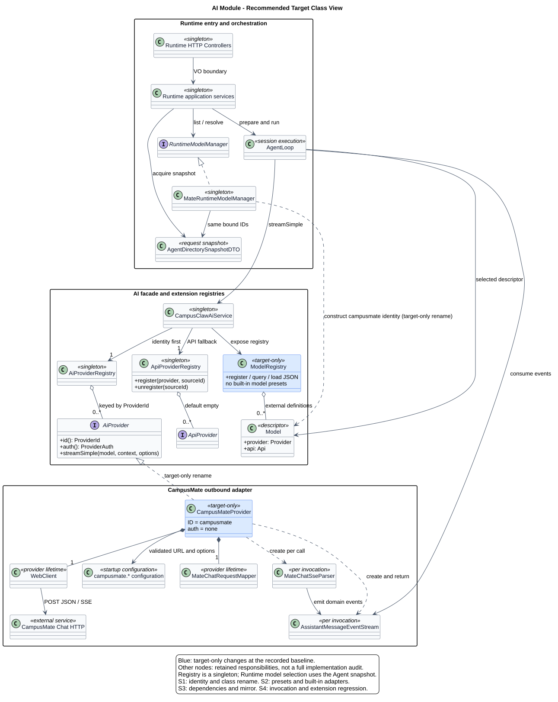
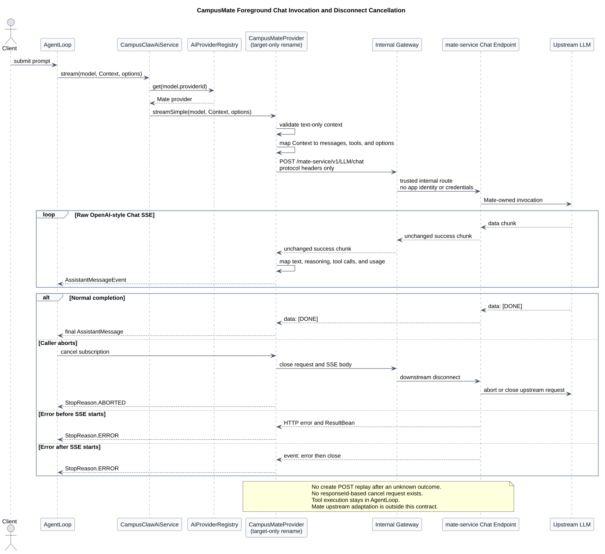

# 模型与 Provider 设计

| 属性 | 值 |
|---|---|
| 文档版本 | 2.7.0 |
| 更新日期 | 2026-09-14 |
| 目标状态 | 已确认仅内置 CampusMate；Provider 改名与第三方实现删除为 target-only |
| HTTP 状态 | Chat 已冻结；模型目录接口 1–3 为候选 |
| 源码范围 | pi `5cd93f68`；Java AI `f61906b9`；Mate Chat `956b547f`；完整提交、路径及独立核验范围见[源码证据](source-evidence.md) |
| 所属模块 | M02 · 模型与 Provider |

## 1. 模块职责

CampusClaw 通过 CampusMate 调用模型。本模块负责选择模型适配器、把 Agent 上下文转成 Chat 请求，并把模型流转换为统一的消息事件。默认产品只内置 `CampusMateProvider`，同时保留通用 Provider、API 适配器和模型注册能力。

Runtime 决定当前 Agent 可以使用哪些模型，执行 Tool，并保存会话记录。CampusMate 管理上游模型路由、字段适配、endpoint 和凭据。Provider 不承担这两侧的业务职责。

| 阅读目的 | 入口 |
|---|---|
| 理解分层、身份与产品范围 | 本文 §2–§4 |
| 实现 Chat 调用 | 本文 §6–§7；[精确契约](model-chat-v2-review.html)与[operation JSON](接口契约/操作/04-create-chat.json) |
| 实现用量记录与统计 | [Usage 持久化](usage-persistence.md) |
| 核对实现进度 | [源码证据与差距](source-evidence.md) |
| 配置服务地址与路径 | [共享客户端配置](../02-CampusMate共享客户端配置/README.md) |

## 2. 全局目标结构



[PlantUML 源码：`java_provider_alignment`](diagram.puml#L161) · [原尺寸 SVG](java_provider_alignment.svg)

模型选择与模型调用分别由 Runtime 和 AI 模块负责。`MateRuntimeModelManager` 从同一份 Agent 配置快照读取允许的模型 ID；列表与解析不另查通用预置目录。进入执行或修改 Session 时，仍由 Runtime 在所属锁或事务内复核可变状态。

`CampusClawAiService` 先按 Provider 身份查找实现，未命中才查询 API 适配器。两条路由共用既有抽象，不增加中央厂商分支。`ModelRegistry` 保留外部模型注册与 JSON 加载，用于通用扩展；它不替代 Agent 的模型绑定。

Provider 持有共享的请求 Mapper 和 WebClient；每次调用创建独立 Parser 与事件流。文本、工具参数、Usage 和终态均限制在该次调用内。AI 只返回事件与最终消息，Runtime 负责持久化，因此数据库依赖不会反向进入 Provider。

图中蓝色节点表示该基线尚未实现的改名或裁剪；其余节点表示保留的职责。分组框是职责边界，不要求重建 Java 包。完整装配属于推荐目标，不等于全模块已经验收。

## 3. 证据与实现状态

| 范围 | 已观察行为 | 尚待验收 |
|---|---|---|
| Java AI · `f61906b9` | 已有 Provider 身份优先路由、Mate 请求映射、SSE 解析和共享配置读取 | `CampusMateProvider`/`campusmate` 改名，四个第三方适配器、预置目录及两个 SDK 的删除 |
| Mate Chat · `956b547f` | 已有 `POST /mate-service/v1/LLM/chat` Controller 与流式 Service | 模型目录接口 1–3 在该提交未发现，仍是候选 |
| Usage SQL · `d649866a6` | 集中式投影不保存 Usage，恢复时使用 `Usage.empty()` | 最新实现未复核；Record + Stats 目标单独验收 |

这些状态分别绑定固定提交，不能相互替代，也不延伸为最新实现缺陷。全部仓库相对路径、符号、pi 行为依据和依赖树范围集中在[源码证据](source-evidence.md)。

## 4. Provider 与配置

### 4.1 身份与连接配置

| 概念 | 规则 |
|---|---|
| Provider 身份 | 唯一键是 `provider.id`；名称、URL、凭据和协议不参与身份 |
| Runtime 模型身份 | `(provider.id, model.id)`；Mate modelId 为 1–64 字符、大小写敏感的不透明值，原样使用 |
| 默认内置实现 | `CampusMateProvider`；ID 为 `campusmate`；认证为 `ProviderAuth.none()` |
| 内部协议 | `campusmate.model.api`，默认 `openai-completions`；未注册值导致启动失败 |
| 连接地址 | `campusmate.base-url` + `campusmate.endpoints.model-chat-path`；默认路径保留大小写 `/mate-service/v1/LLM/chat` |

共享配置的完整键、默认值、URI 校验和旧键处理只在[共享客户端配置](../02-CampusMate共享客户端配置/README.md)维护。Provider 不读取 `Model.baseUrl/apiKey/headers` 构造 Mate 请求；请求不能覆盖内部协议或部署地址。

### 4.2 保留的 Provider 接口

```java
public interface AiProvider {
    ProviderId id();

    ProviderAuth auth();

    AssistantMessageEventStream streamSimple(Model model, Context context, SimpleStreamOptions options);
}
```

接口保持现有三个方法，不增加目录刷新方法，也不将 `ApiProvider` 改名。pi 的 Provider 同时拥有目录与调用能力；CampusClaw 的受管目录由 Runtime 的 Agent 快照提供，目录 HTTP 能力仍需独立设计。

### 4.3 命名与直接切换

| 对象 | 源码基线名称 | 目标名称 |
|---|---|---|
| Provider ID | `mate-model-manager` | `campusmate` |
| Java Provider 类 | `MateServiceModelManagerProvider` | `CampusMateProvider` |
| Provider enum | `MATE_MODEL_MANAGER("mate-model-manager")` | `CAMPUSMATE("campusmate")` |
| Provider 测试类 | `MateServiceModelManagerProviderTest` | `CampusMateProviderTest` |

`CampusMateProvider` 与 `AnthropicProvider/MistralProvider` 一样使用“提供方名称 + Provider”。
`PROVIDER_ID` 常量、新 Model、注册与新消息写入统一使用新身份。保留 `provider.mate` 包及
`MateChatRequestMapper/MateChatSseParser/MateReasoningSignature` 等辅助类名称，这些辅助名称继续描述 Mate Chat 协议。

这是 **产品约束下的身份变更**：仅接受新 ID，不保留旧 Provider 注册别名，不给 enum 增加
兼容解析，不增加 SQL/历史文件迁移。外部模型配置需主动改用新值；存量历史 `_provider`
保留原字符串，读取不进行归一，不承诺它与新 ID 在压缩、Child/Cron 模型匹配中视为同一身份。
旧类名仅用于固定提交证据和本节迁移映射，不提供转发类。

HTTP path、`campusmate.*` 配置、`openai-completions`、`MateInvocationErrorCode` 及
`MATE_MODEL_MANAGER_ERROR` 保持原义。后者是稳定错误码，不是 Provider ID；日志字段
`event/operation/errorCode` 不改，Provider 的 logger name 随类名变化，见[调用日志](../../01-总体架构/05-CampusClaw调用日志/README.md)。

### 4.4 产品裁剪与扩展边界

| 范围 | 目标处理与理由 |
|---|---|
| 内置适配器 | 只交付 `CampusMateProvider`；删除 Anthropic、OpenAI Completions、OpenAI Responses、Mistral 四个具体类及专属测试。默认产品模型出口交给 CampusMate，取消本地厂商 SDK 维护责任。 |
| 通用框架 | 保留 `CampusClawAiService`、`AiProvider/AiProviderRegistry`、`ApiProvider/ApiProviderRegistry` 与现有方法；身份路由优先，未命中才查 API。默认 API 注册表为空；显式自定义适配器仍可注册、查询、注销和调用。 |
| 模型注册 | 删除 `builtInModels` 及各厂商数据方法、`init` 中的预置加载；保留两级索引、注册/查询/清理、成本计算、classpath JSON 与用户 JSON 加载顺序。没有外部数据时目录为空，不自动塞入虚构的 CampusMate 模型。 |
| Runtime 模型 | `MateRuntimeModelManager` 从同一 Agent 快照读取允许列表并解析模型；模型列表和调用继续使用 Mate modelId，能力默认值仍由 `campusmate.model` 提供。业务变更仍在所属事务内复核可变 Session 状态。 |
| 通用类型与辅助能力 | 保留 Provider/API 其余 enum 值、公共消息/流类型、配置与环境密钥解析、通用转换和工具方法；保留它们不表示默认存在对应厂商实现。 |
| 调用失败 | 未注册身份且没有对应 API 适配器时沿用明确失败，不发网络请求，不自动替换成 CampusMate，不静默改写模型 ID。 |
| 协议与其他模块 | Chat 请求/SSE、Runtime 事件、持久化和 Mate Tool 协议保持各自契约；不扩大为框架替换、模型能力查询或身份认证改造。 |

收益是减少随产品发布的适配器、预置数据及 SDK 升级范围；代价是厂商直连不再开箱可用，
既有直连调用方必须迁往 CampusMate 或自行提供扩展。当前没有包体积、性能或可靠性实测，
不能从源码删减推导量化收益。

### 4.5 Maven 依赖影响

不新增 Maven 依赖。现有 Jackson、WebClient、Reactor Netty 足以支持保留的 CampusMate
请求/流处理，无需换用 JDK HTTP Client 或另引 SDK。两个待删除 SDK 的源码消费者仅为
待删除适配器及专属测试（公司镜像有对应副本）：

| 直接依赖 | 删除范围 | 基线中的主要传递依赖 |
|---|---|---|
| `com.anthropic:anthropic-java:2.18.0` | 根版本属性/依赖管理、AI POM、公司镜像 POM | `anthropic-java-client-okhttp/core`；Kotlin、OkHttp logging interceptor、Jackson 扩展、Swagger 注解、Victools JSON Schema；另含 Apache HttpClient/Core 5。 |
| `com.openai:openai-java:4.29.1` | 同上 | `openai-java-client-okhttp/core`；Kotlin、OkHttp、Jackson 扩展、Swagger 注解及 Victools JSON Schema（与 Anthropic 路径有依赖仲裁/去重）。 |

已在 `f61906b9` 运行离线 `dependency:tree -Dscope=runtime` 并成功解析。运行时仲裁结果含 Kotlin `1.9.25`、Jackson `2.18.3`、OkHttp logging interceptor `4.12.0`、
Victools `4.38.0`、HttpClient `5.4.3` 与 HttpCore `5.3.4`。这些是当前基线依赖树证据，
不是删除后的最终图；公司父 POM 的完整依赖树和削减后的产物尚未验证。

保留被现有能力使用的 Jackson、Reactor/Netty、日志、`json-schema-validator` 及测试用
MockWebServer。删除 SDK 后重新核对全 Reactor 和公司镜像的消费者与依赖树；不对共享库
机械加 exclusion，也不宣称 Kotlin/OkHttp 已从所有运行或测试路径消失。

## 5. Model Manager 接口清单

| # | Method | Path | 状态 | 用途 |
|---:|---|---|---|---|
| 1 | `GET` | `/mate-service/internal/v1/models` | 目标候选 | 全局模型目录和 ETag 刷新 |
| 2 | `GET` | `/mate-service/internal/v1/agents/{agentId}/models` | 目标候选 | Agent 可调用模型列表 |
| 3 | `GET` | `/mate-service/internal/v1/agents/{agentId}/models/{modelId}` | 目标候选 | 原子解析一个可调用模型 |
| 4 | `POST` | `/mate-service/v1/LLM/chat` | 已冻结 | 创建前台流式 Chat 调用 |

四个接口依赖内部网关，不携带 `X-HW-ID`、`Authorization`、`X-HW-APPKEY` 或其他
应用身份/凭据。目录字段保持候选状态；HTTP 中不携带 `apiId/providerId/agentId/sessionId/upstreamModelId`，其中目录路径上的 `agentId` 仅用于接口 2/3 的模型选择。

模型目录候选详见
[`接口契约/操作/01-list-models.json`](接口契约/操作/01-list-models.json) 和
[`model-manager-provider-v1-review.html`](model-manager-provider-v1-review.html)。

## 6. 前台 Chat 调用

Chat 的请求、字段校验、错误码和完整报文由[精确契约](model-chat-v2-review.html)及其[operation JSON](接口契约/操作/04-create-chat.json)维护。本文只描述 Runtime 适配时必须保持的语义：

- 每次 `POST /mate-service/v1/LLM/chat` 创建一次前台模型调用；不支持 `Idempotency-Key`，结果未知时不得重放。
- CampusClaw 经内部网关调用，不发送应用身份或凭据。网关与网络 ACL 是部署边界，此免认证约束仅适用于上表四项接口。
- 成功响应为原始 OpenAI 风格 Chat SSE。Mate 不包装 ResultBean，不解析后重编码，不改写 chunk 字段；CampusClaw Provider 负责解析。
- SSE 建立前返回真实 HTTP 状态与仅含 `resCode/resMsg` 的错误体；`Accept-Language` 只影响这类错误。建立后失败发送 `event:error`，然后关流且不发送 `[DONE]`。
- 调用方取消时关闭请求及 SSE body；Mate 随下游断连结束上游调用。Provider 输出 `ABORTED`，其他失败输出 `ERROR`；与正常结束竞争时只产生一个终态。
- 只用当前请求及连接表达生命周期，不增加按 responseId 取消的 operation。Mate 不执行 Tool，也不在 Chat 调用阶段重新检查 Agent 绑定。



[PlantUML 源码：`model_manager_invocation_sequence`](diagram.puml#L79) · [原尺寸 SVG](model_manager_invocation_sequence.svg)

成功流以 `[DONE]` 结束，usage chunk 可以缺失。Mate 扩展字段 `max_output_tokens` 和 `event:error` 遵守本契约，不应被描述为逐字段等同 OpenAI 官方 Chat Completions。

## 7. AgentLoop 与 Chat 映射

| AgentLoop/Provider 输入 | Mate Chat 请求 | 规则 |
|---|---|---|
| `Model.id` | `model` | 原样 Mate 模型 ID |
| `Context.systemPrompt` | 首个 `system` message | 空值时不生成 |
| `UserMessage` 文本 | `user.content` | 保留消息顺序；非文本拒绝 |
| `AssistantMessage` 文本 | `assistant.content` | 多个文本块按原顺序拼接 |
| `AssistantMessage.ToolCall` | `assistant.tool_calls[]` | arguments 序列化为 JSON 字符串 |
| `ToolResultMessage` | `tool` message | `tool_call_id` 关联 ToolCall；content 为字符串 |
| `ThinkingContent.thinkingSignature` | Assistant reasoning 白名单字段 | 按保存的字段种类重放 |
| Agent Tool | `tools[].function` | JSON Schema 原样投影；不发送 `strict` |
| `SimpleStreamOptions.toolChoice` | `tool_choice` | 只允许 `auto/none` |
| 显式 `SimpleStreamOptions.maxTokens` | `max_output_tokens` | 未显式设置时省略，不用 `Model.maxTokens` 补值 |
| 显式 temperature | `temperature` | 未设置时省略 |
| `ThinkingLevel` | 不发送 | 推理开关和 effort 完全由 Mate 模型配置决定 |
| 固定传输字段 | `stream/stream_options` | 固定 `true` 和 `include_usage=true` |

可读 Thinking 文本用于展示模型返回的原始推理；signature 保存原始 reasoning 字段，供下一次调用重放。四项白名单为 `reasoning_content/reasoning/reasoning_text/reasoning_details`，前三项是字符串，最后一项是不透明 JSON 数组。展示规则与 Runtime 差距见[Thinking 设计](../../01-总体架构/01-CampusClaw多Agent运行时/chat-events-history-design.md#thinking-original-text)。

Provider 解析原始 Chat SSE：

- `chunk.id` → `AssistantMessage.responseId`；
- 请求的 Mate 模型 ID → `AssistantMessage.model`；
- `chunk.model` → 可选 `AssistantMessage.responseModel`；
- `delta.content` → Text 事件；
- `delta.reasoning_content/reasoning/reasoning_text/reasoning_details` → Thinking 事件和签名；
- `delta.tool_calls` → ToolCall start/delta/end；
- `finish_reason` → `STOP/LENGTH/TOOL_USE/ERROR`；
- usage → `Usage`，其中 output 已包含 reasoning token；上游给出 breakdown 时可保留 reasoning；
- `[DONE]` → 正常流结束。


首版仅支持文本、function Tool 和上述 reasoning 重放。图片、音频、文件、content part 数组及 Tool 图片必须在发 HTTP 前明确失败，不能丢块后继续。未知顶层或嵌套字段返回冻结错误；已定义但目标模型不支持的可选项允许 Mate 忽略。

## 8. Token 用量持久化

Provider 从 Chat SSE 得到 `Usage`；Runtime 将 Assistant Entry、Usage Record 和 Stats 汇总放在同一事务中写入。Usage 是运行事实，不参与分支，也不进入公共 Session Entry。上游未报告 Usage 时按 pi 保存全零值，不新增 `reported`。

[t_session_records、t_session_stats、原子写入及验收](usage-persistence.md)集中维护于用量专题；其他文档引用该处。该目标仍需独立验证，不能由 Provider 流解析已实现推断 SQL 已实现。

## 9. 一致性、安全和日志

- Mate 请求只允许协议头，不允许调用方身份、API Key、任意 endpoint 或 headers；
- Provider 不自动模型 fallback，不静默切换 Mate modelId；
- 原始 SSE 可能携带上游 model/ID/reasoning，不记录完整流、prompt、Tool 参数或 thinking；
- JSON 错误不得暴露 endpoint、credential、私有路由、stack trace 或推理正文；
- Agent 绑定只用于接口 2/3 的模型选择，不进入接口 4 调用鉴权；
- 接口 4 不发送 `agentId`，Mate 不以调用阶段重新校验 Agent 绑定；
- 请求和响应设置连接、首字节、流空闲、总执行时间与缓冲上限，但具体数值由部署配置管理；
- 调用方断开连接后不得让前台模型任务继续无界运行；
- Usage Record 与 Assistant Entry 的事务失败必须中止会话执行，不能只记录日志后继续。

## 10. 设计理由与代价

| 分类 | 选择 | 理由与代价 |
|---|---|---|
| 产品约束 | 默认只内置 CampusMate，直接切换新身份 | 模型接入集中到企业服务；减少厂商适配器、预置数据及 SDK 维护，但失去开箱直连能力，旧配置需更新，历史身份不归一 |
| 架构变更 | Provider 身份优先，保留 API 扩展 | 保持提供方与协议分离；两个注册表各自负责查找，空扩展注册表必须可启动 |
| 架构变更 | Runtime 选择模型，Provider 适配调用 | Agent 绑定与消息持久化留在 Runtime，AI 不依赖业务数据库；与 pi 的目录归属有明确区别 |
| 产品约束 | 内部网关免认证，不传 Agent/Session/上游信息 | 部署负责服务准入；该模型链路不承担公共用户认证和 Agent 绑定检查 |
| 架构变更 | 单个前台 Chat POST，原始成功 SSE | 请求与结果同生命周期，断连表达取消；Provider 承担流解析与唯一终态，未知结果不能重试 |
| 产品约束 | 仅文本、`auto/none`，Mate 管理推理参数 | 覆盖普通 Loop 和摘要调用的当前范围；多模态在本地明确失败 |
| 安全加固 | 共享 origin 与独立 path 校验 | 防止客户端被单独改道；配置规则与取舍见[共享配置](../02-CampusMate共享客户端配置/README.md) |
| 架构变更 | Usage 独立 Record 与事务内 Stats | 保持消息分支纯粹；额外写入与汇总代价见[用量设计](usage-persistence.md) |

## 11. AI 削减实施切片

实施前复核最新代码，已完成的部分只验证。先保留主图的调用骨架，再沿下列依赖顺序收敛产品；统一验收见 §12。

| 切片 | 实施顺序与依赖 |
|---|---|
| S1 · 身份贯通 | 先按 §4.3 贯通 Provider 类、文件、构造器、Logger、枚举、Runtime 模型和测试 fixture；保持辅助类与包名。 |
| S2 · 适配器与预置 | S1 后删除四个具体适配器及预置数据，保留注册表与外部加载骨架。 |
| S3 · 依赖和镜像 | S2 清理消费者后削减 POM，更新模块说明，再生成公司镜像；依赖核验范围见 §4.5。 |
| S4 · 回归与证据 | S1–S3 完成后执行 §12，并根据真实源码和测试结果更新能力注册表。 |

## 12. 验收标准

### AI 削减与名称

- 默认 Spring 上下文只有一个内置通用 Provider：`CampusMateProvider`，ID 为 `campusmate`；API 注册表为空时可启动。
- 新 Model、Assistant 与持久化 `_provider` 使用 `campusmate`；旧 Provider ID 不作为注册别名，旧配置不得自动绑定为新身份。
- 旧历史 `_provider=mate-model-manager` 原值保留；不增加重写迁移，也不让模型身份比较自动视两值为相同。
- 第三方具体适配器及专属测试删除；公共框架、enum 其余值、消息、流和配置解析能力保留。
- 没有外部 JSON 时 ModelRegistry 不含内置模型；classpath/用户文件覆盖顺序、注册/查询/注销及独立 fixture 测试有效。
- Runtime 模型列表和解析仍来自 Agent 快照；新 ID 下默认模型、切换、压缩、Child/Cron 路径均可贯通。
- 自定义 API 适配器注册后可调用，注销后失败；未注册的第三方调用明确失败且无 HTTP 请求，不自动替换为 CampusMate。
- 两个 SDK 从 POM 与最终产物中消失；依赖树确认共享依赖未误删，MockWebServer 回归仍能运行。
- canonical 相关模块的构建/测试和生成后的公司镜像编译通过；镜像不可验证时报告具体阻塞。
- 新命名测试真实存在并执行后才替换注册表旧 selector，保留固定源码证据，不把目标状态记为实现通过。

### HTTP 与 Provider

- 按冻结 operation 验证请求映射、未知字段、可选字段忽略、成功流、usage 缺失、流前/流后错误。
- 本地拒绝非文本输入；不发送身份凭据、业务标识或上游连接信息。
- 并发调用的 Parser、累积内容与终态互不影响；完成、异常和取消的竞争只输出一个终态。
- 取消关闭请求和 body；未知结果不重放；Tool 执行继续由 AgentLoop 负责。
- 共享 URL、唯一 Skill path 与配置删除按[配置验收](../02-CampusMate共享客户端配置/README.md#10-验收标准)执行。
- Record、Stats 和事务故障按[用量验收](usage-persistence.md#4-验收)执行。

## 13. 契约入口

[Chat 契约](model-chat-v2-review.html)已冻结；[模型目录候选](model-manager-provider-v1-review.html)仍待评审。Mate 管理面及上游适配实现不属于本文已确认范围。

## 14. 版本历史

| 版本 | 日期 | 变更 |
|---|---|---|
| 2.7.0 | 2026-09-14 | 按模块职责重写正文，集中源码与用量专题，复用精确契约并重排全局类图及调用顺序图。 |
| 2.6.0 | 2026-09-14 | 默认仅内置 CampusMate，统一 Provider 身份与类名，明确第三方适配器、模型预置及 SDK 的削减边界。 |
| 2.5.0 | 2026-09-09 | 明确 Thinking 展示模型返回的原始推理。 |
| 2.4.0 | 2026-08-26 | 模型配置统一使用 `campusmate.model` 与对应环境变量。 |
| 2.3.0 | 2026-08-26 | CampusMate 共用配置树和端点目录，记录已实现的 Mate Chat 边界。 |
| 2.2.0 | 2026-08-26 | Mate Tool 共用 CampusMate origin。 |
| 2.1.0 | 2026-08-26 | Model Manager 与受管 Runtime 共用 `campusmate.base-url`。 |
| 2.0.0 | 2026-08-24 | 冻结前台 Chat、断连取消、API 适配与用量落库契约。 |
| 1.3.0 | 2026-08-23 | 五个 Model Manager 接口采用内部网关免应用层认证；Mate Provider 使用 `ProviderAuth.none()`。 |
| 1.2.0 | 2026-08-22 | Responses create 采用语义透明代理。 |
| 1.1.0 | 2026-08-22 | 冻结 Responses create/cancel 和前台取消扩展。 |
| 1.0.0 | 2026-08-21 | 明确 Provider 身份、Java 对齐、Mate 托管调用和五项运行接口候选。 |
