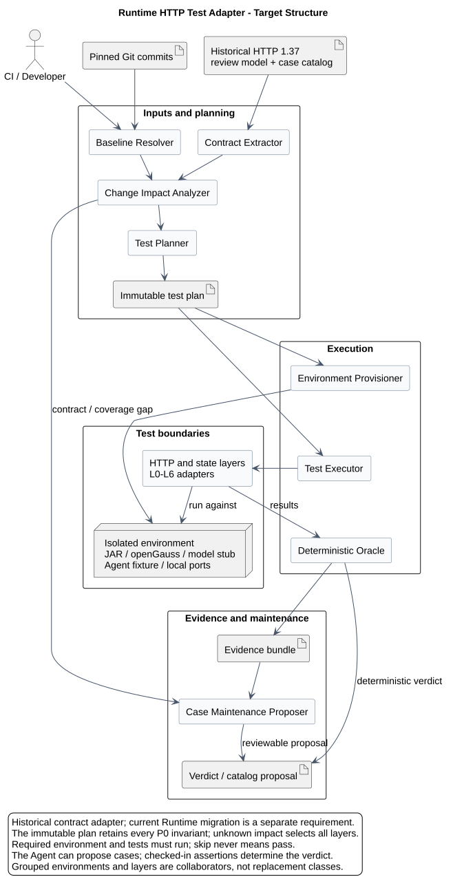
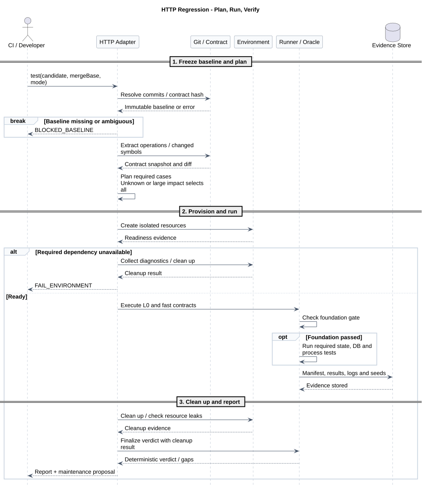
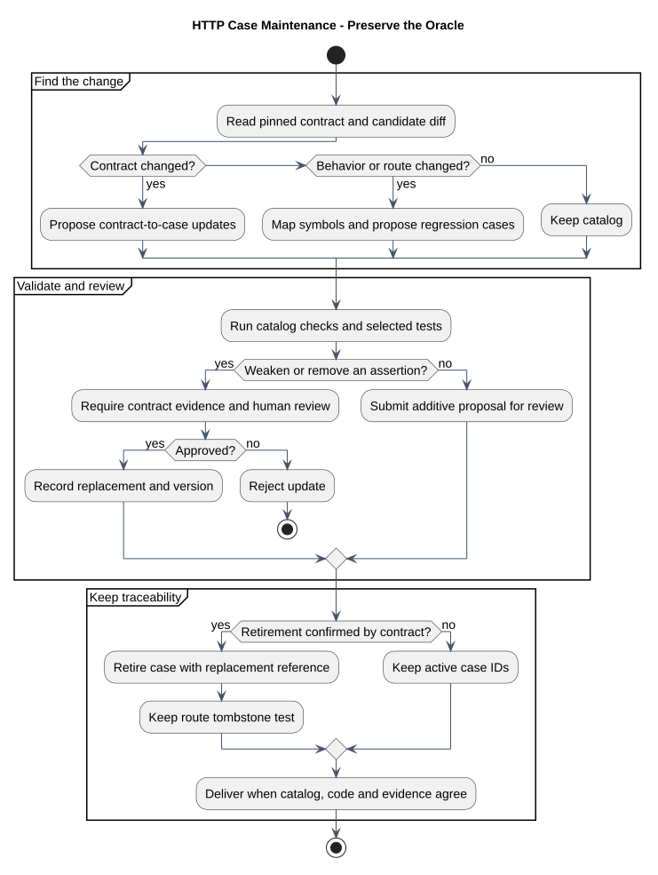

# CampusClaw Runtime HTTP 测试 Agent 设计

| 属性 | 值 |
|---|---|
| 文档版本 | 1.1.4 |
| 状态 | 首版执行器与仓库 Skill 已落地到 `codex/campusclaw-tdd-agent`，当前实现契约漂移预期为红 |
| 设计目标 | 基于已确认 HTTP 契约自动规划、拉起、执行和维护回归测试 |
| HTTP 契约版本 | `1.37.0`，十一项 operation 均已确认 |
| 设计仓分析基线 | `8ab8eef47b2dc0d9e21ae0ca0bd7617f8a158a32`；运行时仍另记工作树状态与 SHA-256 |
| 历史 HTML 契约 SHA-256 | `5c1f235bd04017390bf2a8fd603d176b5f9a3babc019e33cee192ce132672604` |
| pi-mono-java 实现分析基线 | `1f801dbb82bdda30478e3354e685e3153b179a0c`，`origin/main` |
| 初始机器用例目录 | [`test-case-catalog.json`](test-case-catalog.json) |
| 更新日期 | 2026-09-14 |

> 历史实现回归基线，不是当前目标接口清单。本文与用例目录固定于 HTTP 1.37 / 旧实现，
> 其中三个控制接口仅供旧版本回归；当前目标已移除，不得据此新增或恢复路由。
> [当前九项清单](../../01-总体架构/01-CampusClaw多Agent运行时/README.md#4-当前目标-http-接口清单)
> 与 Events v2 为迁移目标；测试执行须固定匹配的历史契约 commit，不能用当前 HTML 冒充 1.37。

## 1. 结论

建议建设一个“确定性测试系统 + Agent 编排与维护层”，而不是让大模型临场判断接口
是否正确：

- HTTP HTML 主契约、已审核用例和 Java 断言共同定义测试预期；
- Agent 负责解析变更、选择用例、拉起隔离环境、执行测试、汇总证据和提出用例补丁；
- 通过或失败由版本化断言、Schema、状态机和数据库不变量决定，不由 Agent 自由判断；
- 变更范围大、依赖图不完整或基线不明确时自动切换为全量回归，不允许仅跑“看起来相关”
  的少量用例；
- 需要 openGauss、打包 JAR 或模型流桩的必跑阶段必须自动提供依赖。环境无法提供时门禁
  失败，不能以 `skipped` 伪装成功；
- Agent 可以自动提出新增用例，但不能自动删除、放宽或改写已有断言来迁就实现。

这套机制能显著降低大规模重构后的回归风险，但不能给出“代码无论怎么改都绝对没有问题”
的数学保证。可验证的目标是：已确认契约、已建模状态与已覆盖故障模式发生退化时，合并门禁
稳定失败，并提供可复现证据；未知风险通过全量、并发、故障注入和变异测试持续缩小。

## 2. 权威输入与基线选择

### 2.1 契约权威

本节仅描述 HTTP 1.37 历史回归，测试 Agent 必须在对应历史 commit 读取以下文件。
当前工作树的旧 HTML 已删除，不保留迁移页，也不得为测试恢复副本。
当前目标契约统一见 [九项接口页](../../01-总体架构/01-CampusClaw多Agent运行时/chat-api-review.html)。
历史源固定为设计提交 `8ab8eef47b2dc0d9e21ae0ca0bd7617f8a158a32`，当时的目录为
`pi-mono-java-manager-driven-multi-agent-runtime/`；以下两个文件名是该提交内的路径，
不是当前工作树链接。历史读取顺序为：

1. `chat-http-v1-review.html`：
   HTTP V1 的人类主维护契约，在 `api-review-models` 中内嵌 11 个 operation model；
2. `chat-http-v1-design.md`：
   状态、并发、SSE、错误和恢复原因；
3. 本目录的 [`test-case-catalog.json`](test-case-catalog.json)：
   契约要求到可执行测试的稳定映射；
4. 候选提交的 Controller、VO、Service、Mapper、SQL 和配置：实现证据，不能反向覆盖已确认
   契约。

本目录校验器按用例目录中的 `sourceKind=git-history`、完整 `sourceCommit`、仓库相对路径
和 SHA-256，通过 `git show` 在内存中读取历史契约。默认运行
`python3 validate-http-test-agent-design.py` 不依赖已删除页面；缺少提交或摘要不符直接失败。
`--contract-ref` 只允许完整提交 ID，仍必须匹配冻结的摘要，不能借此覆盖当前九项接口。

Runtime HTTP 接口当前不维护 OpenAPI。Agent 必须从 HTML 中的结构化 review model 提取
operation，而不是从历史 Git 恢复已经废弃的 OpenAPI。提取结果必须记录契约版本、文件
SHA-256、设计提交、工作树状态和 11 个 operation key，任何无法解析、重复或缺失都直接
阻止测试开始。设计工作树可处于未提交状态，以支持设计阶段 TDD；报告必须显式标记
`sourceDirty=true`，不得把它表述成稳定发布基线。

### 2.2 代码基线差异

当前 HTTP V1 的 11 个 Spring MVC operation 已存在于 `pi-mono-java` 基线
`1f801dbb...`。Agent 每次运行仍必须显式接收不可变 `candidate_commit` 和
`merge_base_commit`：

- 不根据当前目录名猜分支；
- 不在用户脏工作区中切换分支或覆盖文件；
- CI 使用当前 PR 的不可变 SHA；本地使用独立临时 worktree；
- 如果目标提交没有 11 个接口，报告契约漂移或错误基线，而不是悄悄回退到旧 `/api/*`；
- 报告同时记录源码提交、契约版本、目录状态和实际执行命令。

## 3. 已确认接口清单

基础路径为 `/campusclaw-service/v1`。下表是 Agent 启动时必须从 HTML 主契约重新提取并
与用例目录核对的冻结清单。

| # | 接口简称 | Operation key | Method | Path | 主要响应 |
|---:|---|---|---|---|---|
| 1 | 创建会话 | `createSession` | `POST` | `/agents/{agent_id}/sessions` | `201` ResultBean |
| 2 | 查询会话 | `getSession` | `GET` | `/sessions/{session_id}` | `200` ResultBean + ETag |
| 3 | 删除会话 | `deleteSession` | `DELETE` | `/sessions/{session_id}` | `204` |
| 4 | 提交用户消息 | `submitUserMessage` | `POST` | `/sessions/{session_id}/events` | `200 text/event-stream` |
| 5 | 查询会话事件 | `listSessionEvents` | `GET` | `/sessions/{session_id}/events` | `200` ResultBean |
| 6 | 查询可用模型 | `listSessionModels` | `GET` | `/sessions/{session_id}/models` | `200` ResultBean |
| 7 | 切换会话模型 | `changeSessionModel` | `PUT` | `/sessions/{session_id}/model` | `200` ResultBean + ETag |
| 8 | 设置深度思考 | `changeSessionThinking` | `PUT` | `/sessions/{session_id}/thinking` | `200` ResultBean + ETag |
| 9 | 追加引导消息 | `appendSteer` | `POST` | `/sessions/{session_id}/steers` | `202` ResultBean |
| 10 | 追加后续消息 | `appendFollowUp` | `POST` | `/sessions/{session_id}/follow-ups` | `202` ResultBean |
| 11 | 中止会话执行 | `abortSession` | `POST` | `/sessions/{session_id}/abort` | `204` |

WebSocket、公开 Run、旧 `/api/chat` 和旧 `/api/skills` 不属于当前 Runtime HTTP V1。
Agent 应保留路由 tombstone 测试，防止大改动时把这些已废弃接口重新暴露出来。

## 4. 已观察实现与测试现状

以下均是 `pi-mono-java` 提交 `1f801dbb...` 的已观察行为。

| 观察项 | 源码证据 | 结论 |
|---|---|---|
| 11 个 HTTP operation | `RuntimeSessionController` 51-78、`RuntimeEventController` 58-86、`RuntimeSessionConfigurationController` 55-82、`RuntimeSessionControlController` 50-75 | 已使用 Spring MVC Controller 实现 |
| 调用上下文边界 | `RuntimeRequestAuthenticator.authenticate`、`RuntimeWebMvcConfiguration.addInterceptors` 27-30 | 当前 JWT/APPKEY 形状校验覆盖全部 V1 路径；1.37.0 目标全部移除 Runtime 本地认证 |
| 错误与语言 | `RuntimeExceptionHandler` 42-93、`RuntimeRequestContext` 30-37 | 异常无 `result`，支持 `zh-CN/en-US`，部分错误带 `Retry-After` |
| 请求严格性 | `UserEventRequestVO` 23-48、`ChangeModelRequestVO` 25-57、`ChangeThinkingRequestVO` 22-52、`ControlMessageRequestVO` 23-54 | 写请求拒绝未知字段；类型和长度由 Jackson/Bean Validation/Service 共同约束 |
| Event 业务约束 | `RuntimeEventService.validate` 381-392、`parseLimit` 411-427 | message/file_ids 至少一个、文件 ID 唯一、分页范围 1..200 |
| HTTP 契约测试 | `RuntimeSessionRoutesTest`、`RuntimeEventRoutesTest`、`RuntimeSessionConfigurationRoutesTest`、`RuntimeSessionControlRoutesTest` | 已覆盖主要成功形状和少量错误 |
| 真实进程验证 | `RuntimeHttpProcessOpenGaussIT.packagedJarStreamsAndPagesPersistedEvents` 62-91 | 一个长场景覆盖打包 JAR、HTTP/SSE、模型桩和 openGauss |
| 数据库验证 | `RuntimeSessionRepositoryOpenGaussIT` | 覆盖事务、序号、当前分支、tombstone 和并发 CAS |
| 默认 CI | `.github/workflows/ci.yml` 1-26 | 只执行 Spotless 和 `./mvnw -B verify` |
| Maven IT 装配 | 根 POM 只配置 Surefire；没有 Failsafe execution | `*IT` 默认不随 `verify` 执行 |
| IT 前置条件 | `RuntimeHttpProcessOpenGaussIT` 64-66、537-556 | 未提供 JAR/数据库属性时使用 assumption 跳过 |

在 Runtime API 测试目录中共有 78 个 `@Test`，数量说明已有良好基础，但“有测试代码”
不等于“每次改动都执行”。当前最重要的缺口不是重新造一套测试框架，而是把现有测试转换成
不可静默跳过的持续质量门禁，并补齐契约到用例的追踪关系。

### 4.1 当前缺口

1. HTML 主契约没有自动投影为测试清单，新增/删除路由不会直接触发契约漂移失败。
2. `*IT` 没有绑定 Failsafe；默认 `verify` 不运行真实数据库和跨进程用例。
3. 真实进程 IT 依赖外部系统属性并允许 skip，CI 没有自动拉起 openGauss。
4. 11 个 operation 的调用上下文透传、两种语言、错误码和严格字段矩阵没有统一参数化。
5. 跨进程场景集中在一个长测试中；失败时定位成本高，也难按变更影响选择子场景。
6. 没有“测试断言被削弱”“测试数量下降但无契约变更”“已废弃路由复活”的独立门禁。
7. `modules/*` 与 `mate-campusclaw` 是同步镜像，当前缺少一次生成、分层复用和差异检查策略，
   容易重复耗时或漏测镜像装配。
8. 没有对客户端断线后执行继续、流内错误、容量失败、数据库故障和进程重启形成统一的
   可复现证据包。
9. 1.37.0 的类型化 Agent/Session ID、初始 `thinking=true`、无 Runtime 本地认证、受控 thinking
   事件投影和 Submit 请求删除 `type` 尚未实现；首轮 L0 必须报告实现漂移，而不能因旧测试
   全绿而通过。

## 5. 目标架构



[PlantUML 源码：`http_test_agent_architecture`](diagram.puml#L1)

### 5.1 Agent 组件

| 组件 | 职责 | 失败策略 |
|---|---|---|
| Baseline Resolver | 解析候选 SHA、merge base、契约版本和工作区状态 | 任一基线不明确立即 fail closed |
| Contract Extractor | 解析 11 个 HTML review model，生成规范化 operation 快照和摘要 | 缺失、重复、非法 JSON、版本不一致均失败 |
| Change Impact Analyzer | 将 Git diff 映射到 operation、状态机、数据库、启动和镜像边界 | 无法映射的变更视为全局影响 |
| Deterministic Test Planner | 展开公共矩阵和 operation 用例，生成不可变执行计划 | 不得省略 P0 不变量 |
| Environment Provisioner | 创建临时 worktree/home、随机端口、固定 Agent 目录、openGauss 和模型 SSE 桩 | 必需依赖未就绪时失败，不 skip |
| Test Executor | 执行静态、MockMvc、Service、DB、并发、进程和兼容性层 | 每层独立超时，失败后仍收集诊断 |
| Oracle and Evidence Collector | 解析 JUnit XML、HTTP/SSE、数据库断言、退出码和日志 | 只接受确定性断言；不以自然语言判断通过 |
| Case Maintenance Proposer | 比较契约、路由和用例覆盖，生成新增或迁移补丁 | 不自动删除/放宽用例，不自动合并 |

### 5.2 AI 与确定性边界

Agent 可以使用模型能力做以下工作：解释变更、建立初步影响关系、生成候选用例、归纳失败、
提出最小修复。下列事项必须由确定性程序完成：

- operation 数量、Method、Path、响应码和错误码集合比较；
- JSON 字段、Header、HTTP status、SSE frame 顺序和响应体精确断言；
- 数据库事务、约束、排序、tombstone、CAS 和清理结果；
- 测试执行退出码、超时、skip 数量、重试次数和资源泄漏检查；
- 用例 ID 唯一性、契约引用、状态迁移和目录版本校验；
- 最终 required-check 通过或失败。

Agent 的解释与建议进入报告，但不能覆盖失败退出码。

## 6. 用例目录模型

[`test-case-catalog.json`](test-case-catalog.json) 是本设计提供的机器用例目录。
它不是新的 HTTP 契约，而是主契约的测试投影，并持续留在本设计仓维护。代码仓执行器
通过显式 `--design-repo` 只读消费本目录；不得在代码仓复制第二份目录形成双重权威。

### 6.1 单个用例字段

| 字段 | 规则 |
|---|---|
| `id` | 永久稳定，如 `HTA-EVT-SUBMIT-012`；修改语义不能复用旧 ID |
| `operationKey` | 必须引用 11 个已提取 operation，跨接口用例使用 `crossOperation` |
| `priority` | `P0/P1/P2`；P0 是所有 PR 必跑不变量 |
| `layer` | `static/mvc/service/database/process/concurrency/recovery/compatibility` |
| `requirementRefs` | 指向 HTML 契约版本、设计章节或稳定规则 ID |
| `preconditions` | Session 状态、模型能力、数据库、Agent 目录和桩行为 |
| `request` | Method、Path、Header、Query、Body 或断连动作 |
| `oracle` | status、Header、JSON/SSE、状态变化、持久化和负向泄漏断言 |
| `cleanup` | 删除临时 Session、停止进程/容器、清理临时目录；必须幂等 |
| `determinism` | 固定时钟、随机种子、游标密钥和可重放桩脚本 |
| `status` | `active/proposed/retired`；只有 active 参与 required gate |
| `sourceEvidence` | 对应实现提交、仓库相对路径、符号或基线行号 |

### 6.2 公共矩阵

公共模板按 operation 展开，避免在 11 个接口中复制维护。

| 模板 | 展开范围 | 必要断言 |
|---|---|---|
| `AUTH_*`（retired） | 不再展开 | 保留历史用例 ID，防止旧 Runtime 本地 `401` 契约被误认为仍 active |
| `NO_BUSINESS_AUTH` | 全部 11 项 operation | JWT、APPKEY、两者共存、缺失或坏形状均不触发 Runtime 本地认证；Header 不进入响应/日志 |
| `LOCALE_ZH_EN_FALLBACK` | 全部错误码 | `zh-CN`、`en-US` 和未知语言回退；`Content-Language` 与实际文本一致 |
| `ERROR_ENVELOPE` | 全部非 SSE 错误 | 响应只有 `resCode/resMsg`，不得出现 `result` 或敏感信息 |
| `SUCCESS_ENVELOPE` | 普通 JSON 成功 | 精确包含 `resCode="0"/resMsg="success"/result` |
| `NO_BODY_204` | Delete、Abort | 空 Body，不使用 ResultBean |
| `NO_RESULTBEAN_SSE` | POST Events | `text/event-stream`，frame 中不得出现顶层 ResultBean |
| `IDENTIFIER_BOUNDARY` | agent/session/model ID | 类型前缀 + 32 位十六进制、错前缀、内部连字符、长度、旧下划线格式和大小写 |

调用上下文模板只断言 Runtime 不根据 Header 组合、共存、形状或真实性产生本地认证结果；
业务层可由固定桩返回该 operation 的最窄成功或业务错误。真实性与动作授权由上游负责。

## 7. 分层测试策略

| 层级 | 目标 | 主要技术 | PR 门禁 |
|---|---|---|---|
| L0 契约与路由漂移 | HTML、目录、Controller 路由、错误枚举、消息资源一致 | HTML JSON 抽取、Spring `RequestMappingHandlerMapping`、静态校验 | 始终必跑 |
| L1 HTTP 边界 | Method/Path/Header/Body/status/ResultBean/语言 | JUnit 5 + MockMvc 参数化/动态测试 | 始终必跑 |
| L2 Service 不变量 | Session 状态、模型切换、队列、Event 投影、恢复 | 现有 Service 测试 + 固定 Clock/Stub | 影响相关必跑；P0 始终 |
| L3 数据库与并发 | 原子事务、Entry 序号、当前分支、CAS、tombstone、清理 | Failsafe + 隔离 openGauss | 数据/状态变更和全量模式必跑 |
| L4 打包进程 HTTP/SSE | 真实 JAR、Servlet/Netty 装配、序列化、SSE、断线 | Failsafe + 随机端口 + 模型桩 + openGauss | 高风险 PR、全量、发布必跑 |
| L5 镜像与公司适配 | `mate-campusclaw` 同步、包名、ResultBean Bean 替换 | 同步 dry-run、镜像编译、契约复用 | 相关变更和发布必跑 |
| L6 变异与韧性 | 发现“测试通过但断言无效”与故障恢复缺口 | 关键包 mutation、网络/DB 故障注入 | 夜间和发布 |

代码覆盖率只作为缺口线索，不作为唯一质量门禁。关键要求以用例 ID 和不变量是否真实执行
为准；对 auth、ETag、状态机、分页游标和 SSE 终态建议增加夜间变异测试。

## 8. Operation 用例设计

下表列出初始 operation 级核心场景。公共认证、语言、错误包装和 ID 边界由上一节模板
自动展开，完整机器条目见用例目录。

| Operation | P0/P1 核心用例 |
|---|---|
| Create Session | 无 Body 成功、类型化 Agent/Session ID、`thinking=true`、Location/初始字段；Agent 不存在/不可用/默认模型错误；Manager 503 + Retry-After；初始化失败不泄露 `session_id`；每次 POST 创建不同 Session |
| Get Session | idle/running 两态；强 ETag 与 no-store；不存在/已删除 404；查询不调用 Model Manager；不返回 transcript、内部版本或执行详情 |
| Delete Session | idle 原子 tombstone + cleanup task + 204；不存在/已删除重复 204；running 409 且不隐式 Abort；事务失败不部分删除；tombstone 仅两字段 |
| Submit Event | 文本、仅 file_ids、两者兼有；出现冗余 `type`、非法 JSON、空白/超长/重复/33 个 file IDs/未知字段；并发第二请求 409；容量 503；持久化前错误；thinking=true 的三阶段投影与 completed 持久化、thinking=false 完全不产生；无工具/有工具 SSE 精确顺序；流内错误；断连继续、GET 恢复；Abort 终态 |
| List Events | 默认/1/200 limit；0/201/非整数；合法、篡改、过期、跨 Session page；按 `entry_seq` 升序；始终返回三类持久化 Entry，当前 thinking=true 时增加 thinking completed；thinking 状态变化使旧 page 失效；running 时不暴露 preview；`next_page=null` 语义 |
| List Models | allowlist 与可用集合的稳定交集；空列表；当前模型可不在列表；Manager 503；禁止泄露 provider、URL、凭据、价格和 token 配置 |
| Change Model | 正常切换 + 新 ETag；同值不变；缺失/弱/旧 If-Match；busy 409；模型不可用 422；Manager 503；切到不支持 thinking 的模型原子归一；数据库失败回滚 |
| Change Thinking | true/false；同值不变；字符串/数字/null/未知字段；缺失/旧 If-Match；busy 409；不支持时 422；关闭始终允许；数据库失败回滚 |
| Steer | running 202；idle 409；空白/超长/未知字段；队列满 429；FIFO；与自然结束竞态线性化；202 后只入队、投递时才持久化 |
| FollowUp | running 202；idle 409；空白/超长/未知字段；队列满 429；FIFO；优先级低于 Steer；未投递时不产生 Entry |
| Abort | running 级联取消、清队列、等待 idle 后 204；idle 重复 204；不存在 404；原 SSE 以 idle + `stream.end(reason=aborted)` 收尾；不删除已完成 Entry |

### 8.1 跨接口场景

至少维护以下端到端 P0 场景：

1. Create → Get → Submit → SSE 完成 → List Events → Change Thinking → Change Model → Delete。
2. Create → Submit 保持 running → Steer → FollowUp → 原 SSE 顺序输出 → 分页读回。
3. Create → Submit 保持 running → 第二个 Submit 409 → Delete 409 → Abort → Delete 204。
4. SSE 客户端断连 → 执行继续 → GET Events 从第一页恢复并按 `entry_id/entry_seq` 去重。
5. 旧 ETag 并发写：两个配置请求只允许一个成功，另一个 412，数据库无部分状态。
6. 删除事务失败 → Session 仍可读；重试成功 → API 隐藏、tombstone 保留、清理任务最终完成。
7. 主模块测试通过后同步生成 `mate-campusclaw`，镜像路由清单、JSON 和 SSE 契约完全一致。

### 8.2 待契约校准项

以下请求在文档中描述为“不接受”，但已确认错误表没有冻结具体 HTTP status/resCode，且
Spring MVC 默认可能忽略它们。测试目录将其标记为 `proposed`，不应凭空设为 P0：

- 向 Create、Get、Delete、List Models、Abort 发送额外 Body；
- 向不支持过滤的 GET 接口发送未知 Query 参数；
- 向 Abort 发送 `If-Match`、`Idempotency-Key` 或原因字段。

在接口评审冻结拒绝语义前，Agent只报告“契约可测试性缺口”，不能自行选择 400、415 或
忽略行为。该分类属于待确认产品约束，不是已观察实现行为。

## 9. 变更感知与大改动策略

### 9.1 影响映射

| 变更路径或符号 | 强制测试集合 |
|---|---|
| 主 HTML、设计版本、review model | L0 + 11 operation 全矩阵 + 用例维护审计 |
| Controller、VO、auth、exception、messages | L0 + L1 全矩阵 + 受影响业务层 |
| RuntimeEvent/Agent/Tool/queue/SSE | Submit、Steer、FollowUp、Abort + 并发/恢复 + L4 |
| Session Service、model manager adapter | Create/Get/Delete/Models/两个 PUT + L3/L4 |
| Mapper XML、SQL、DTO、repository | 全部状态 operation + L3 + L4 |
| 启动类、application 配置、POM、打包 | L0-L5 全量 |
| sync 脚本或 `mate-campusclaw` | 主模块回归 + 镜像差异/编译/进程 smoke |
| 无法映射、跨两个以上核心边界或大规模重命名 | 全量，不允许 affected-only |

### 9.2 “大改动”判定

满足任一条件即进入 `pr-full`：

- route inventory、基础路径、operation Method/Path 或契约版本变化；
- auth、ResultBean、错误枚举、国际化、Session 状态机、SSE、数据库 Schema 或构建系统变化；
- 变更同时跨越 Controller、Service、Persistence 三层中的两层；
- rename/copy 检测不完整、merge base 不存在、生成源码与源文件不同步；
- 影响分析出现未识别符号或无法证明受影响 operation 集合完备；
- 人工以 PR 标签、提交参数或发布任务请求全量。

可以增加“文件数/变更行数”阈值作为成本保护，但不能把它作为唯一判定；一次只改一行的
调用上下文边界、认证拦截器或 Header 处理变化也必须全量。

### 9.3 affected-only 的最低保留集

即使变更很小，仍始终执行：契约抽取、路由清单、调用上下文无本地认证矩阵、错误/语言资源集合、
ResultBean 形状、所有 P0 用例的编译与目录校验、变更模块单测以及一个打包启动 smoke。

## 10. 自动拉起与执行流程



[PlantUML 源码：`http_test_execution_sequence`](diagram.puml#L103)

### 10.1 隔离环境

每次执行创建独立任务目录，并至少提供：

- 候选提交的 detached worktree；
- JDK 21 与 Maven Wrapper；
- 由候选提交构建的可执行 JAR，不复用未知来源的本地 `target/`；
- 固定版本且最终按 digest 锁定的 openGauss 测试实例；
- 本地 fake Model SSE server，按脚本产生成功、工具调用、慢响应、错误和断连；
- 临时 `CAMPUSCLAW_HOME`、受控 Agent 目录、固定 Clock/seed/cursor secret；
- 由操作系统分配的随机本地端口；
- 所有外部网络默认禁止，避免测试误调真实模型、Manager 或生产数据库。

openGauss 的具体镜像仓库与 digest 需要按实际 CI 网络和公司制品库校准；在校准前只记录为
目标依赖，不能假设某个公网 `latest` 标签永久可用。

### 10.2 Maven 生命周期

目标实现应：

1. Surefire 执行 `*Test`；
2. Failsafe 在 `integration-test/verify` 执行 `*IT`；
3. 将 openGauss/JAR 参数由环境控制器显式注入；
4. required CI 中断言 Failsafe 实际发现并运行预期 IT ID，`Tests skipped > 0` 直接失败；
5. 将数据库 IT 和进程 IT 拆成可单独定位的场景，同时保留一个完整生命周期 smoke；
6. 默认 CI 不重跑失败用例来制造绿色结果；只允许显式诊断重跑，并保留首次失败证据。

### 10.3 执行模式

| 模式 | 触发 | 内容 |
|---|---|---|
| `pr-fast` | 普通低风险 PR | L0/L1、受影响 L2、P0、打包启动 smoke |
| `pr-full` | 大改动或高风险路径 | L0-L5 全量，openGauss 与真实进程必跑 |
| `nightly` | 定时 | 全量 + 并发重复种子 + 故障注入 + 关键包 mutation |
| `release` | 发布候选 | nightly 内容 + 主/镜像 JAR + 公司 Adapter/Profile 兼容矩阵 |
| `local` | 开发者手动 | 与 CI 相同的 plan JSON，可选择单个 case ID，但报告为非合并门禁 |

## 11. 结果判定与证据

一次通过必须同时满足：

1. 候选和 merge base 是不可变提交，契约版本与哈希已记录；
2. 11 个 operation 与用例目录完全对应，无未知路由或复活的废弃路由；
3. 执行计划中的 required case ID 全部实际运行，零意外 skip；
4. HTTP/SSE/JSON/数据库断言全部通过；
5. 进程、端口、容器和临时目录已清理，无残留测试 Session；
6. `modules/*` 与需要验证的 `mate-campusclaw` 镜像同步；
7. 证据包完整并可用相同 seed、fixture 和命令重放。

证据包建议包含：

```text
http-test-agent-results/
├── plan.json
├── baseline.json
├── contract-snapshot.json
├── case-results.json
├── junit/
├── http/
├── sse/
├── database/
├── process-logs/
└── summary.md
```

报告按 `contract failure / implementation failure / environment failure / flaky evidence /
review required` 分类。环境失败不计为产品通过；允许单独重跑以诊断，但 required check
保持失败直到一次全新隔离执行完整通过。

## 12. 用例维护与防弱化



[PlantUML 源码：`http_test_case_maintenance`](diagram.puml#L160)

### 12.1 自动维护规则

- 新 operation：先出现契约变更，再生成新的 operation key、P0 happy path、调用上下文矩阵、错误
  包装和 route inventory 用例；缺任一项不得合并。
- 新字段/状态/错误：生成边界、未知值、兼容性和负向泄漏用例，并保留旧 case ID。
- 实现重构但契约未变：只更新 source evidence 和 fixture，不修改预期。
- 确认删除 operation：旧用例转为 `retired`，同时新增“路由不存在”的 tombstone 用例。
- 测试发现真实遗漏：Agent 可以提交 additive proposal；由维护者审核后变为 active。
- 不稳定用例：先记录 seed/日志并修复隔离或时钟；禁止无到期日 quarantine。

### 12.2 禁止自动执行的维护

Agent 不得自动：

- 把失败 status 改成当前实现返回值；
- 删除响应字段、错误码、顺序或副作用断言；
- 增大超时、增加无限重试或忽略 flaky 失败来追求绿色；
- 更新 golden 数据却不附契约差异和审核人；
- 因 operation 被源码删除就同时删除测试；
- 把 required IT 改成可 skip；
- 读取或写入真实凭据、生产连接串和真实用户数据。

任何弱化、替换或退役都需要显式人审、契约引用和版本历史。Agent只能生成补丁与理由，
不能自动合并。

## 13. 安全、可靠性与成本

### 13.1 安全加固

- 用例只使用 `<JWT>`、`<APPKEY>` 等假凭据；日志扫描确保 Header 未输出。
- 测试容器和 JAR 只监听 loopback；默认禁止对外网络。
- 数据库名称/Schema 每次唯一或在独占实例中运行；清理目标必须经过显式前缀校验。
- 归档 JUnit、HTTP 和 SSE 前进行敏感字段扫描。
- Agent 维护提交只允许修改测试、fixture、目录和报告路径；业务代码修复是另一个显式任务。

### 13.2 稳定性

- 所有等待基于可观测条件和有界超时，不使用长固定 sleep；
- Clock、随机种子、游标密钥和模型输出固定；
- 并发测试保留 barrier/latch，避免依赖线程调度概率；
- 端口由系统分配，不硬编码共享端口；
- 每个故障保存首次失败上下文，重跑不能覆盖原证据。

### 13.3 成本控制

- `pr-fast` 重用构建产物，但不重用数据库状态；
- 同一候选提交只构建一次主 JAR，多个进程场景复用该不可变文件；
- 主模块执行完整业务测试，镜像优先做同步校验、编译和精确进程 smoke，避免机械复制所有
  单测造成两倍成本；发布模式再执行完整镜像矩阵；
- 变异和高次数并发进入 nightly，不阻塞每个低风险 PR。

## 14. 分阶段落地

### 阶段 A：先把现有测试变成门禁

1. 新增 HTML review model 抽取器和 11 operation route inventory 校验。
2. 将本目录 JSON 用例目录迁入代码仓，增加唯一 ID、字段和契约哈希校验。
3. 配置 Failsafe，自动拉起隔离 openGauss；required 模式禁止 `*IT` skip。
4. 将现有 `RuntimeHttpProcessOpenGaussIT` 拆成可定位场景并保留完整 smoke。
5. CI 增加 `pr-fast/pr-full`，先覆盖当前实现，不改业务契约。

### 阶段 B：补全用例矩阵

1. 用动态测试展开 11 operation 的调用上下文、语言、错误 envelope 和 ID 边界。
2. 补齐 SSE 断连、流内错误、工具路径、容量失败和恢复。
3. 补齐 openGauss 故障、删除重试、并发 POST/PUT 和游标隔离。
4. 增加旧 `/api/*`、WebSocket 和公开 Run 的 tombstone 路由测试。

### 阶段 C：Agent 维护闭环

1. 生成 `plan.json` 和变更影响报告；未识别变更自动全量。
2. 生成新增用例 proposal 和 source evidence 更新，禁止自动弱化。
3. 夜间运行 mutation/故障注入，按存活 mutation 生成候选用例。
4. 接入公司 ResultBean/调用上下文 Adapter profile 后执行同一契约矩阵。

## 15. 验收标准

- 主契约增删 operation，而用例目录和 route inventory 未同步时，L0 必须失败。
- 任一 Controller 改变 Method、Path、status、Header、JSON 或 SSE 顺序时，相应用例必须失败。
- required CI 中 openGauss 或打包 JAR IT 未执行时，任务必须失败而非通过。
- 大规模重构、无法映射的 rename 或跨层变更自动选择 `pr-full`。
- 同一失败可用证据包中的提交、seed、fixture 和命令重放。
- Agent 提出的用例维护补丁包含 requirement refs、source evidence 和新增断言；弱化补丁不能
  自动合并。
- 主模块和 `mate-campusclaw` 的公开 HTTP 行为保持一致。
- 所有 11 operation 至少有 P0 happy path、适用的 auth/no-auth、error envelope 和资源不存在/
  状态冲突等负向用例。

## 16. 差异分类

| 分类 | 内容 |
|---|---|
| 已观察行为 | 11 个 Spring MVC HTTP operation、现有 route/service/repository 测试和手动可运行的进程/openGauss IT |
| 产品约束 | HTML 1.37.0 是主契约；普通成功 ResultBean、异常无 result、204/SSE 不包装；无公开 Run/WebSocket；用例目录只在设计仓维护 |
| 安全加固 | 测试不持有真实凭据、默认断网、敏感日志扫描、Agent 不自动弱化断言 |
| 架构改造 | 新增契约抽取、用例目录、影响分析、环境控制器、Failsafe 必跑门禁和证据包 |
| 已落地能力 | 代码仓执行器、仓库 Skill、契约抽取、变更分级、JUnit 证据、固定 digest openGauss 和 Failsafe 入口 |
| 目标-only | CI 资源规格、company profile 制品、精确 case-to-test 绑定和 mutation 工具尚未落地 |
| 待契约校准 | 无 Body operation 收到 Body、GET 未知 Query、Abort 额外 Header 的精确拒绝 status/resCode |

## 17. 版本历史

| 版本 | 日期 | 变更 |
|---|---|---|
| 1.1.4 | 2026-09-14 | 当前目标导航对齐统一 Session POST 的九项清单，冻结回归基线与用例不变。 |
| 1.1.3 | 2026-09-10 | 同步当前目标为十一项接口，历史 HTTP 1.37 回归基线不变。 |
| 1.1.2 | 2026-09-07 | 删除旧页的工作树引用；历史校验固定 Git 提交、当时路径和 SHA-256，仅内存读取，不恢复废弃文档。 |
| 1.1.1 | 2026-09-07 | 标记为旧实现回归资料；三个控制接口不再属于当前目标，保留用例证据与原断言，不据此恢复接口。 |
| 1.1.0 | 2026-08-20 | 对齐 HTTP V1 1.37.0 和实现基线 `1f801dbb`；目录继续留在设计仓；退役本地认证矩阵，新增全接口调用上下文/no-auth、类型化 ID、`thinking=true`、thinking 事件可见性、Submit 删除 `type`、设计基线证据和实现漂移失败门禁；记录首版执行器、Skill、openGauss 与 Failsafe 落地 |
| 1.0.0 | 2026-08-19 | 初版：对齐 HTTP V1 1.30.0 和实现分析提交 `2e3962f4`；建立 11 operation 用例模型、分层测试、自动环境、变更感知、全量回退、证据与防弱化维护流程 |
