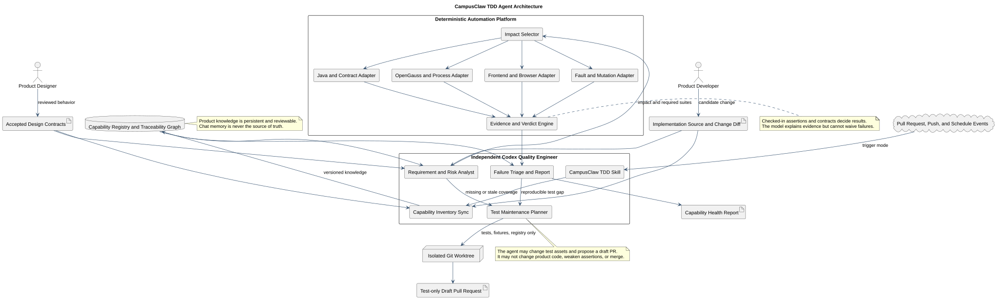
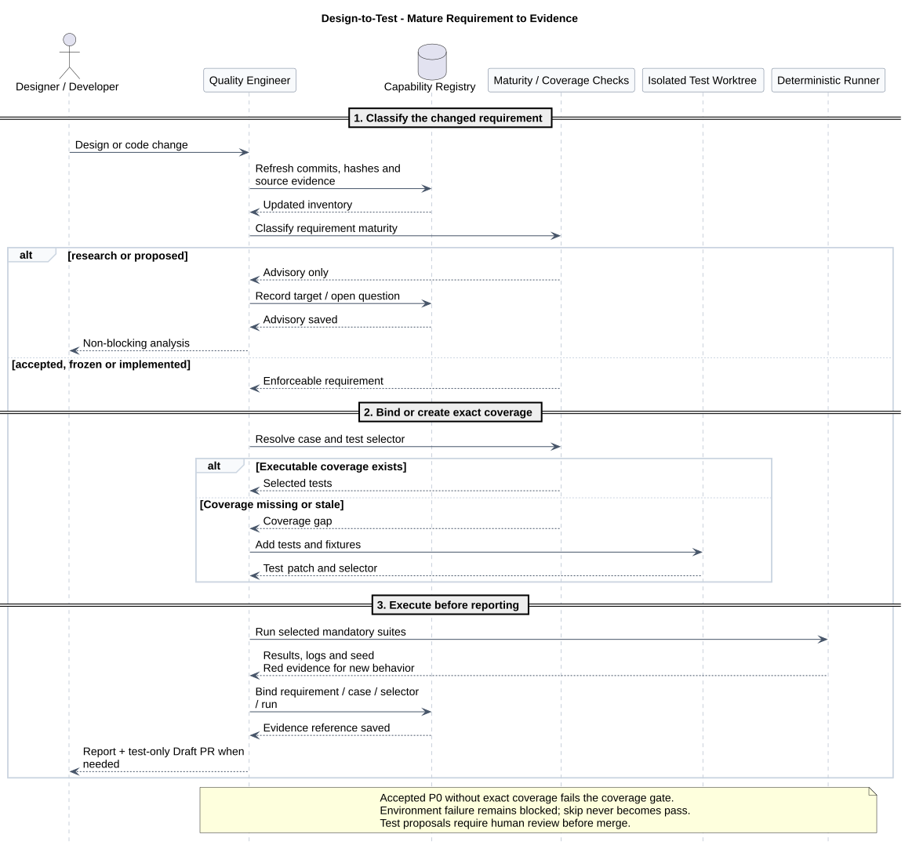
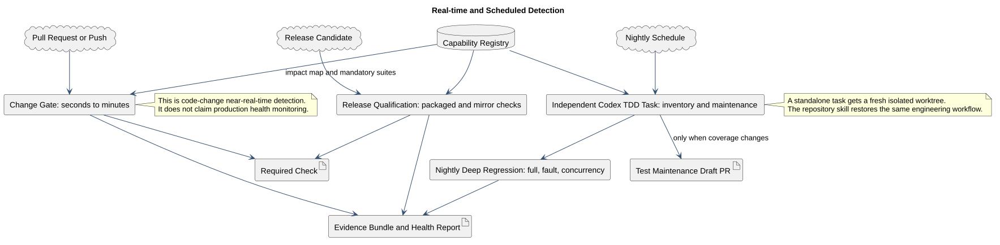

# CampusClaw TDD Agent 总体设计

| 属性 | 值 |
|---|---|
| 文档版本 | 2.2.0 |
| 状态 | target-only 总体架构；知识同步、精确覆盖、测试维护与新门禁待独立验收 |
| 角色 | 由 Codex 组建的独立 CampusClaw 专业测试工程师 Agent |
| 产品知识源 | [`capability-registry.json`](capability-registry.json)；聊天上下文不是知识源 |
| 设计仓分析基线 | `d2b9b4b6f4762e0e9734c144e3eb3273959e7e26`，`pi-mono-java-design/main` |
| 实现仓分析基线 | `ae0ae7c164b031afacd862794e8914243913f113`，`pi-mono-java/main` |
| 注册表盘点范围 | 原始盘点使用 Runtime HTTP `1.41.0`；不是当前接口清单 |
| 固定源码测试资产盘点 | 139 个 Java 测试源文件、3 个前端 Vitest 文件；尚未完成逐需求覆盖审计 |
| 更新日期 | 2026-09-14 |

## 1. 职责与目标

`CampusClaw Quality Engineer` 是独立的 Codex 测试工程师 Agent，维护三类资产：版本化产品知识、可执行测试，以及可审计的运行证据。它读取设计与实现变化，补齐需求到测试的关联，在隔离环境维护测试，并解释失败。

判定由签入仓库的确定性断言、契约和状态不变量完成。Agent 不修改产品实现，不放宽断言，也不能把基础设施阻塞、skip 或模型总结当作通过。

PR/push 触发仓库 CI 的变更门禁，夜间独立任务执行深测与测试维护。“实时”指代码变更检测；生产监控、告警和 SLO 属于可观测性模块。

## 2. 与领域适配器的关系

[Runtime HTTP 适配器](../04-Runtime-HTTP测试Agent/README.md)提供 HTTP、数据库和打包进程测试，机器目录仍固定于历史 HTTP 1.37。产品级 TDD Agent 还覆盖模型、Agent Loop、工具、上下文、Child/Cron、控制面、前端和交付，并维护 `capabilityId → requirementId → caseId → testSelector → runEvidence` 追踪链。

注册表 `2.1.0` 的全局盘点基线不等于当前目标。Runtime 九项接口和 Events v2、CampusMate 名称与 AI 产品范围等后续目标，需要在 requirement 粒度补齐成熟度、精确 selector 和测试证据，不能仅提高目录版本就宣称覆盖完成。

## 3. 源证据与事实边界

### 3.1 已观察实现

固定实现提交为 `ae0ae7c164b031afacd862794e8914243913f113`。当时可观察到模型注册与调用、Agent Loop、Runtime HTTP、持久化和压缩、Agent/Skill、工作区及 Mate Tool、Child/Cron、控制面和前端；测试资产有 139 个 Java 测试源文件、3 个 Vitest 文件，`.github/workflows/ci.yml:4-26` 的 PR/push 门禁仅执行 Spotless 与 Maven verify。

完整仓库相对路径、符号及 selector 由[能力注册表](capability-registry.json)的 `sourceEvidence/requirements` 保存。`docs/designs/ai.md` 和 `docs/designs/agent-core.md` 是旧代码派生快照，只用来寻找源码，不作为当前行为预期。上述数量和差距不延伸到最新实现；Attachment 公共 bridge 仍为 `proposed`，不进入阻断门禁。

注册表仍绑定该历史提交；对其他 checkout 使用 `--code-root` 前应先核对基线。2026-09-14 对 `f61906b9136246ca60f333704b6fc92b5420d0ec` 工作树检查未找到 `CC-CAP-001` 的 `RuntimeHttpProcessOpenGaussIT` 和 `CC-CAP-014` 的 `mate-campusclaw` 路径，因此该附加源码检查未通过，不能据此宣称当前覆盖已迁移；固定用例和 selector 暂不改写。

### 3.2 目标设计决策

本目录描述尚未完整落地的目标架构。特别是能力注册表同步器、精确需求绑定、测试维护 Draft
PR、前端浏览器 E2E、故障/变异测试和新 CI 门禁均属于 target-only，不能描述为当前已经运行。

### 3.3 设计理由

产品知识需要版本、差分、未知项以及设计和实现证据，才能在多次任务之间稳定复用并暴露覆盖缺口。注册表承担这项责任，聊天上下文只辅助当次分析。

## 4. Agent 的专业角色与权限

Agent 的正式名称为 `CampusClaw Quality Engineer`。它是独立 Codex 任务，不嵌入 CampusClaw
生产进程，也不占用产品 Agent 的会话和模型调用链。

### 4.1 必须承担的职责

- 读取设计仓全部纳管主题、实现仓模块、现有测试和最近差异，更新能力清单；
- 把已确认设计拆成独立、可测试的 requirement，并做风险与测试层级设计；
- 建立并维护 requirement、case、selector 和运行证据之间的精确绑定；
- 发现未覆盖的新功能、重命名、删除、跨层契约变化和测试失效；
- 在隔离 worktree 中新增或更新测试、fixture、stub、注册表和平台代码；
- 对已确认的新行为优先构建能够失败的测试，展示 Red，再由产品开发完成 Green；
- 执行变更门禁、夜间深测和发布资格测试，复现失败并输出能力健康报告；
- 区分产品回归、设计漂移、测试缺陷、flaky 和基础设施阻塞。

### 4.2 明确禁止的行为

- 修改 CampusClaw 产品实现来“顺手修复”测试失败；
- 删除、跳过、放宽或改写已有断言来适配候选代码；
- 将环境未就绪、测试未选择或测试被 skip 判定为通过；
- 未经评审把 `proposed`、研究草案或冲突设计变成阻断契约；
- 自动合并 PR、直接写主分支、使用真实生产凭据或对生产系统做破坏性测试；
- 仅凭模型总结覆盖确定性失败。

测试维护结果只能形成 test-only Draft PR。设计仓和实现仓必须分别提交、分别评审，不在一个
PR 中隐式同步另一个仓库。

## 5. CampusClaw 完整功能知识模型

### 5.1 注册表是长期记忆

[`capability-registry.json`](capability-registry.json) 是首版机器可读产品知识，不把“完整”定义为
一份永不变化的静态列表，而定义为以下持续成立的不变量：

- 每个纳管设计主题和实现模块都映射到一个 capability，或显式进入 `unclassified` 队列；
- 每个 capability 有成熟度、风险、设计引用、源码符号、需求、测试选择器和覆盖状态；
- 新增源码入口、公共 API、事件、工具、配置键或 UI 流程未映射时，inventory gate 失败；
- 已生效 P0 requirement 没有 case 或可执行 selector 时，coverage gate 失败；
- `partial` 代表确实有测试但尚未完成逐需求审计，不能写成“全覆盖”；
- 每次运行记录设计提交、实现提交和注册表版本，报告可重放。

固定注册表基线包含 15 个能力域；下表是盘点状态，不代表最新实现验收：

| ID | 能力域 | 风险 | 成熟度 | 固定基线覆盖结论 |
|---|---|---:|---|---|
| CC-CAP-001 | Runtime HTTP Session/SSE | P0 | accepted | partial；旧目录停在 1.37 |
| CC-CAP-002 | 持久化、并发与恢复 | P0 | implemented | partial |
| CC-CAP-003 | 模型 Provider、注册与流 | P0 | implemented | partial |
| CC-CAP-004 | Agent Loop、队列、取消、工具管线 | P0 | implemented | partial |
| CC-CAP-005 | Managed Agent 与 Skill 目录 | P0 | implemented | partial |
| CC-CAP-006 | 上下文压缩与重载一致性 | P0 | accepted | partial |
| CC-CAP-007 | 工作区工具与路径隔离 | P0 | implemented | partial |
| CC-CAP-008 | Mate 工具发现、凭据与调用 | P0 | implemented | partial |
| CC-CAP-009 | Child Agent | P1 | implemented | partial |
| CC-CAP-010 | Cron Agent | P1 | implemented | partial |
| CC-CAP-011 | CampusMate 共享客户端与模型管理 | P0 | accepted | partial |
| CC-CAP-012 | 控制面注册与调度 | P1 | implemented | partial |
| CC-CAP-013 | 前端对话与活动流程 | P0 | accepted | partial；仅 3 个 Vitest 文件 |
| CC-CAP-014 | 构建、配置、打包与镜像兼容 | P0 | implemented | partial；基线 CI 只跑 Maven |
| CC-CAP-015 | Attachment 与公共 bridge | P1 | proposed | unbound；只告警不阻断 |

首版 registry 是完整功能盘点的起点，不是假装已经完成覆盖证明。普通设计校验会把 P0
`partial` 输出为警告；未来 `--strict-coverage` 是合并门禁，必须等精确用例绑定补齐后才允许
通过。

CC-CAP-003/011 的[CampusMate 改名与 AI 产品范围](../03-模型管理Provider契约/README.md#11-ai-削减实施切片)为 target-only。注册表以 `gap` 记录 S1–S4，`sourceEvidence/testSelectors` 继续指向实际基线；只有目标测试真实存在且执行后，才替换旧 selector。能力已有的 `implemented/partial` 不能证明新目标落地。

### 5.2 需求成熟度门

| 成熟度 | 含义 | Agent 行为 | 是否阻断 |
|---|---|---|---|
| research | 研究输入、竞品或待证实方案 | 记录问题与风险，不生成产品断言 | 否 |
| proposed | 目标方案尚未确认 | 可提出测试草案，不作为 oracle | 否 |
| accepted | 已评审确认的目标行为 | 生成/维护失败测试和契约门禁 | 是 |
| frozen | 发布范围内冻结契约 | 全层强制回归，变化必须显式审批 | 是 |
| implemented | 从当前源码观察且仍受支持 | 防回归；与 accepted 冲突时报告设计漂移 | 是 |

同一文档可能同时含现状、target-only 和待确认内容，Agent 必须在 requirement 粒度分类，不能
只看文档标题或版本号。

## 6. 总体架构



[PlantUML 源码：`campusclaw_tdd_agent_architecture`](diagram.puml#L1) · [原尺寸 SVG](campusclaw_tdd_agent_architecture.svg)

架构分为三个清晰边界：

- **测试工程师大脑**：Codex Skill 恢复角色、流程、规则和报告模板；独立任务完成理解、规划、
  测试维护与分析；
- **产品知识层**：能力注册表与追踪图长期保存产品功能和覆盖状态，设计与代码只提供证据；
- **确定性执行平台**：Java、HTTP/OpenGauss、前端/browser、故障与变异适配器执行测试，统一
  证据与判定。

目标用 Skill 保存测试工程师的工作法，以独立定期任务执行夜间维护；代码变更门禁由 CI 事件触发。具体宿主能力在落地时核验，不能把该目标图当作平台已经完成集成的证明。

## 7. 设计到测试的 TDD 闭环



[PlantUML 源码：`design_to_test_maintenance`](diagram.puml#L77) · [原尺寸 SVG](design_to_test_maintenance.svg)

### 7.1 Red

当设计仓新增或修改 `accepted/frozen` requirement 时，Agent：

1. 解析受影响 capability 和上下游消费者；
2. 查找现有 case 与 selector；
3. 没有精确覆盖时，在隔离 worktree 中新增测试或 fixture；
4. 先对目标实现分支执行，确认测试因目标行为缺失而失败，并保存 Red 证据；
5. 创建 test-only Draft PR，标注 requirement、设计提交、预期失败和未来通过条件。

如果设计尚未确认，Agent 只能提交测试建议，不得把猜测写成阻断断言。

### 7.2 Green

产品开发者在产品分支实现功能。每次 push 触发 change-gate，精确选择受影响用例加 P0
不变量；目标测试和既有回归全部通过后才形成 Green 证据。Agent 不修改产品代码。

### 7.3 Refactor

重构阶段保持 requirement 和 case ID 稳定。类名或路径变化时 Agent 可以维护 selector，但必须
证明 oracle 未变化；出现删除断言、降低比较精度、增加 skip 或只保留 happy path 时，测试
防弱化门禁失败并要求人工评审。

## 8. 自动化测试平台

### 8.1 平台组件

| 适配器 | 主要范围 | 必备能力 |
|---|---|---|
| inventory/contract | 设计、API、事件、工具 Schema、配置、UI 流程 | 版本差分、成熟度分类、未映射入口检测 |
| Java | ai、agent-core、cron、Runtime、Mate、控制面 | JUnit/XML、精确 selector、覆盖率、并发 seed |
| HTTP/OpenGauss/process | 历史 11 项适配器迁移、持久化、SSE、恢复 | 固定依赖、随机端口、打包 JAR、失败关闭、容器清理 |
| model/http stub | Provider、CampusMate、Mate Tool | 可编程 SSE、超时、乱序、断流、错误 envelope |
| frontend | Vue adapter、事件投影、产品流程 | typecheck、Vitest、真实浏览器 E2E、可访问性 |
| workspace/security | Read/Find/Grep/Ls、Skill、Agent、凭据 | 临时目录、symlink/traversal、脱敏、默认禁用真实外联 |
| fault/mutation | 状态机、重试、错误映射、关键断言 | 故障注入、变异存活率、可重复 seed |
| mirror/delivery | Maven、前端制品、mate-campusclaw | 打包进程、镜像差异、配置兼容、发布清单 |

### 8.2 目标仓库拓扑

以下均为目标-only，不代表当前已经存在：

```text
pi-mono-java/
  .agents/skills/campusclaw-tdd-engineer/
    SKILL.md
    references/report-schema.md
  .github/workflows/campusclaw-tdd.yml
  tests/tdd-platform/
    campusclaw_tdd.py
    adapters/
    fixtures/
    schemas/
  .tdd/campusclaw-tdd.yaml
```

`.tdd/campusclaw-tdd.yaml` 固定设计仓 URL、审核后的设计提交、能力注册表路径和所需适配器；
CI 按固定 SHA checkout 设计资产，不能使用执行时漂移的任意本地目录。Agent 维护设计仓原始
registry，并在实现仓 PR 中同步可复现的 lock/hash 与测试 selector。

HTTP 执行器接入 `adapters/runtime_http`。只有完成当前契约迁移及 requirement 绑定后，才能作为当前产品回归的一部分。

## 9. 实时与定期检测



[PlantUML 源码：`realtime_and_scheduled_detection`](diagram.puml#L147) · [原尺寸 SVG](realtime_and_scheduled_detection.svg)

| 触发 | 执行者 | 时延目标 | 内容 | 结果用途 |
|---|---|---:|---|---|
| PR opened/synchronize | CI 确定性平台 | 秒到分钟 | 影响集 + 全部 P0 冒烟 + inventory/coverage gate | required check |
| push to main | CI 确定性平台 | 秒到分钟 | 变更门禁、制品证据、主线健康 | 回归报警 |
| nightly | 独立 Codex TDD Task | 每晚 | inventory-sync、全量、并发、故障、flaky 复跑、测试维护 | 健康报告/Draft PR |
| release candidate | CI + Agent 分析 | 按发布触发 | 打包进程、OpenGauss、前端 E2E、镜像、迁移与安全 | 发布资格 |
| design accepted | 独立 Codex TDD Task | 事件后尽快 | requirement 差分、Red 测试和 test-only Draft PR | TDD 输入 |

桌面 Scheduled Task 适合 nightly；若平台没有可靠的设计仓事件触发，则由设计 CI 发出
repository dispatch，或将设计差分作为 nightly 的最高优先级检查。两种触发分别报告，不能将夜间扫描计为实时门禁。

## 10. Agent 运行模式

| 模式 | 输入 | 产出 |
|---|---|---|
| `inventory-sync` | 设计/实现两仓提交和差异 | capability/requirement 增删改、未分类项、registry PR |
| `test-maintenance` | coverage gap、设计变更、失效 selector | Red 测试、fixture、adapter 或 selector 的 Draft PR |
| `change-gate` | merge base 与候选提交 | 受影响用例、P0 保留集、required-check verdict |
| `nightly` | 主线和审核设计 SHA | 全量、并发、故障、flaky、覆盖健康报告 |
| `release` | 发布候选制品 | 打包、数据库、浏览器、镜像与迁移资格报告 |
| `triage` | 失败证据包 | 最小复现、分类、首个坏提交候选和修复建议 |

大规模删除、跨模块重命名、公共 DTO/事件/配置改变、影响图不完整或 registry 过期时，
`change-gate` 自动升级为全量，不能只跑 Agent 猜测的相关测试。

## 11. 判定、报告与故障分类

### 11.1 唯一判定状态

- `PASS`：所有必选 gate 实际执行并通过，无生效 P0 覆盖缺口；
- `FAIL_PRODUCT`：确定性 oracle 证明候选实现回归；
- `FAIL_DESIGN_SYNC`：生效设计、registry、case 或 selector 不一致；
- `FAIL_TEST`：测试自身错误、错误 fixture 或不稳定 oracle；
- `FLAKY`：相同提交、环境和 seed 下结果不稳定；仍不能通过门禁；
- `BLOCKED_INFRA`：依赖、凭据、容器、端口或 runner 不可用；不能降级为 pass；
- `ADVISORY`：只涉及 proposed/research，记录风险但不阻断。

### 11.2 报告必须回答的问题

1. 本次验证的是哪个设计 SHA、实现 SHA、registry 版本和测试 PR；
2. 哪些 capability/requirement 受影响，为什么选择这些用例；
3. 哪些必选测试实际执行，数量、耗时、失败/跳过、seed 和环境是什么；
4. 失败属于产品、设计同步、测试、flaky 还是基础设施；
5. 哪些 P0/P1 功能仍是 partial/unbound，风险随本次变化是否上升；
6. 是否生成测试维护 Draft PR，新增了什么 oracle，是否已验证 Red；
7. 开发者下一步需要修产品、确认设计、修测试还是修环境。

报告同时生成机器 JSON 和中文 Markdown；所有结论链接到证据，不只输出模型摘要。

## 12. 隔离、安全与成本

- 每次 Agent 维护任务使用新 worktree 和专用分支，不复用脏工作区；
- 默认使用 fake model、fake Mate 和临时数据库，不把真实 token 写入日志或证据；
- 破坏性、生产、费用显著或真实外部副作用测试必须另行授权；
- 运行结束清理容器、进程、端口和临时目录，但保留脱敏证据；
- PR 门禁执行风险相关最小集和 P0 保留集，nightly 承担高成本故障/变异测试；
- Agent 生成的测试代码必须接受与产品代码相同的代码审查、静态检查和防弱化检查。

## 13. 落地顺序

### 阶段 A：确定模块范围与知识源

- 将 HTTP 执行器接入领域适配器，并限制其报告范围；
- 审核首版 15 个 capability，把纳管设计和源码入口的未分类数量降为 0；
- 将存量测试资产映射到平台适配器，复核执行器实现基线。

### 阶段 B：建立可执行追踪链

- 为每个 accepted/implemented P0 拆 requirement 和 case ID；
- 绑定真实测试 selector，而不是只绑定 Maven suite；
- 把 Runtime HTTP 目录迁移到当前已确认契约，补前端、AI、Agent Core、工具、压缩和交付适配器；
- 让 `--strict-coverage` 对全部 P0 通过。

### 阶段 C：接入实时门禁与独立 Agent

- 增加 `campusclaw-tdd.yml` 的 PR/push change-gate；
- 建立 `campusclaw-tdd-engineer` Skill 和 nightly 独立任务；
- 实现 test-only Draft PR、Red 证据、防弱化校验和机器报告。

### 阶段 D：深度质量工程

- 增加真实浏览器 E2E、发布制品/OpenGauss、故障注入、变异测试和 flaky 隔离；
- 建立 capability 趋势、逃逸缺陷回灌、历史基线和发布资格面板。

## 14. 验收标准

- 任一新增公共功能、模块入口或 accepted requirement 未进入 registry 时门禁失败；
- 每个生效 P0 requirement 都有稳定 case ID、真实 selector 和最近通过证据；
- accepted 设计变化能自动形成先失败的 test-only Draft PR，且 Agent 不改产品代码；
- PR/push 在分钟级返回 change-gate，nightly 完成全量和测试维护；
- 前端、模型、Agent Core、工具、压缩、Cron/Child、控制面和交付不再被 HTTP 用例代表；
- 环境不可用、必选测试 skip、registry 过期和不确定影响不会误报 PASS；
- 失败报告可在相同提交、fixture、命令和 seed 下复现；
- 防弱化门禁能识别删除断言、扩大容差、增加 skip 和只保留 happy path；
- 旧 HTTP 适配器与主 Agent 的名称、范围、报告均不再混淆。

## 15. 差异分类

| 分类 | 内容 |
|---|---|
| 固定源码观察 | `ae0ae7c1` 的 15 类功能线索、139 个 Java 测试源文件与 3 个前端测试；CI 范围仅 Maven |
| 产品约束 | Agent 独立于产品 Runtime；产品知识必须版本化；确定性 oracle 决定结果；测试维护不得改产品代码 |
| 安全加固 | 隔离 worktree、假外部服务、凭据脱敏、生产副作用另行授权、防弱化门禁 |
| 架构变更 | 独立测试工程师、能力注册表和多领域确定性平台协作，CI 变更门禁与夜间维护分别触发 |
| target-only | 新 Skill、registry sync、精确追踪、test-only PR、前端 E2E、fault/mutation、新 CI 和发布门禁 |
| 有意不阻断 | proposed/research 需求，包括尚未确认的 Attachment public bridge |

## 16. 设计验证

生成图：

```bash
cd '02-服务与接口/05-CampusClaw-TDD测试Agent'
plantuml -tsvg diagram.puml
```

验证注册表、源码证据、SVG、Markdown 链接和 PlantUML 行锚点：

```bash
python3 '02-服务与接口/05-CampusClaw-TDD测试Agent/validate-campusclaw-tdd-agent-design.py' \
  --design-root . \
  --code-root /path/to/pi-mono-java
```

严格覆盖模式当前应失败，因为首版诚实标记了多个 P0 `partial`。只有完成逐需求审计后才把它
接入合并门禁：

```bash
python3 '02-服务与接口/05-CampusClaw-TDD测试Agent/validate-campusclaw-tdd-agent-design.py' \
  --design-root . \
  --code-root /path/to/pi-mono-java \
  --strict-coverage
```

## 17. 版本历史

| 版本 | 日期 | 变更 |
|---|---|---|
| 2.2.0 | 2026-09-14 | 按产品测试职责和领域适配器边界组织正文，明确固定覆盖基线并重排架构及维护流程。 |
| 2.1.0 | 2026-09-14 | 纳入 CampusMate 改名与 AI 削减目标，区分未来测试名称和当前可执行基线。 |
| 2.0.0 | 2026-08-26 | 建立独立测试工程师、能力注册表、多领域执行平台与测试防弱化门禁。 |
