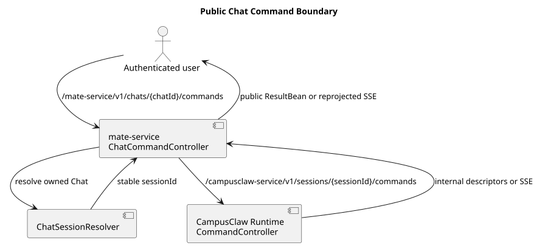
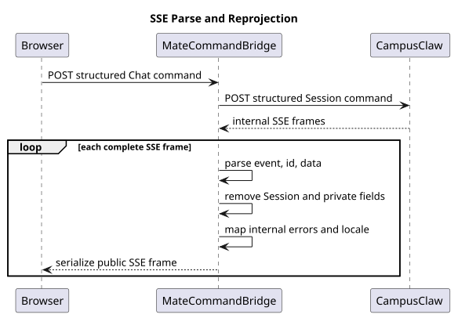

# mate-service 聊天命令 API 设计

| 属性 | 值 |
|---|---|
| 文档版本 | 1.0.2 |
| 状态 | 两个公共 operation 已确认；target-only design |
| 精确契约源 | [`接口契约/common.json`](接口契约/common.json) 与 [`接口契约/操作/`](接口契约/操作) |
| 人类评审契约 | [`chat-command-v1-review.html`](chat-command-v1-review.html)，由精确契约源生成 |
| 设计仓分析基线 | `27484974eb106a7e43910d8e542de52a72c58102` |
| mate-service 源码基线 | `956b547f5ca12ca89e68f73012f92a4406b0c9fa` |
| CampusClaw Slash 行为基线 | `c1311f69f504e7e799fa2467fd6a9d95b3f91b99` |
| CampusClaw 当前核对头 | `94abd2abcb03943daef5118115e4b4a21f1c4d5f` |
| CampusClaw 内部 HTTP 契约 | `1.43.2` |
| 更新日期 | 2026-08-31 |

## 1. 结论与边界

mate-service 向登录用户开放两个接口：

| Method | Path | 响应 | 作用 |
|---|---|---|---|
| `GET` | `/mate-service/v1/chats/{chatId}/commands` | ResultBean | 查看命令清单 |
| `POST` | `/mate-service/v1/chats/{chatId}/command` | 请求范围 SSE | 执行 Builtin 或 Skill 命令 |

当前 mate-service 没有 Chat 资源、Chat→Runtime 映射、Runtime client 或命令 Controller，
所以两个接口都是 target-only design。

现有 `/mate-service/v1/LLM/chat` 只代理 Model Manager 流。它不解析 CampusClaw 事件，
也不处理 Chat 权限和 Session 映射，不能直接复用。

`/name` 修改 CampusClaw Session 的 `displayName`。mate-service 只维护
`chatId -> sessionId` 映射，不保存名称副本。

## 2. 目标组件



[PlantUML 源码：`public_command_boundary`](设计图/diagram.puml#L1)

| 组件 | 职责 |
|---|---|
| `ChatCommandController` | 处理公共 VO、登录上下文和 HTTP/SSE |
| `ChatSessionResolver` | 检查 Chat 权限，再解析唯一 `sessionId` |
| `CampusClawCommandClient` | 使用内部凭据调用 Runtime 1.43.2 |
| `PublicCommandEventProjector` | 解析内部 SSE，删除私有字段，再生成公共事件 |
| `PublicCommandErrorMapper` | 把内部错误转换为稳定公共错误 |

浏览器 `Authorization` 只用于用户认证和 Chat 权限。mate-service 调用 CampusClaw 时
重新构造内部 Header，不透传浏览器凭据。`chatId` 和 `sessionId` 都不是凭据。

## 3. 交互层解析

交互层按以下顺序处理：

1. 仅当第一个字符是 `/` 时尝试解析；
2. 命令名截取到第一个空白字符，并精确匹配小写 `name`；
3. 参数保留原始内容，包括内部换行；
4. 命中后调用 Command API；
5. 清单获取成功但未命中时，按普通消息发送；
6. 清单获取失败时，保留草稿并显示错误。

HTTP `name` 不含 `/`。直接调用 API 时，未知名称返回 `COMMAND_NOT_FOUND`。

命令清单返回七个 Builtin 和当前 Agent 绑定的 `skill:<name>`。暂时不可用的命令仍返回。
`available` 表示不填参数时能否执行；`input.available` 表示填写参数时能否执行。
精确字段和 running 示例见
[`01-list-chat-commands.json`](接口契约/操作/01-list-chat-commands.json)。

## 4. 请求与执行语义

请求体固定为：

```json
{
  "name": "skill:pdf",
  "arguments": "分析附件并总结",
  "fileIds": ["file-550e8400e29b41d4a716446655440010"]
}
```

| 请求规则 | 约束 |
|---|---|
| `name` | 必填；精确匹配命令清单；不含 `/` |
| `arguments` | 省略时由 Service 归一为空字符串；最多 262144 字符 |
| `fileIds` | 省略时由 Service 归一为空列表；最多 32 个 |
| Builtin | 不接受附件 |
| Skill | 接受与普通消息相同的附件 |
| 其他字段 | 拒绝 |

请求 VO 不设置默认值。mate-service 只做公共输入校验；CampusClaw 决定命令是否可用。

CampusClaw 为每次已接受调用生成 `command-<32 位小写十六进制 UUID>`。mate-service
原样保留该 ID。通用结果只有 `text` 和可选 `sourceEventSeq`。

## 5. SSE 投影与错误



[PlantUML 源码：`public_sse_projection`](设计图/diagram.puml#L23)

mate-service 必须解析内部事件，不能透明转发字节流：

| 内部字段或事件 | 公共处理 |
|---|---|
| `sessionId`、`entryId`、Agent/Skill ID 与版本、受管路径 | 删除 |
| `skill.snapshot`、完整 Skill 正文、私有 Record | 永不公开 |
| `entrySeq` | 重命名为公共 `eventSeq`，供流内排序和历史对账；私有 Record 会造成合法缺口，公共层不得重编号 |
| `sourceEventSeq` | 保留，指向同一公共序列空间中的权威结果事件 |
| `command.started/completed/failed`、安全领域事件 | 校验后投影 |
| Assistant、Tool 与 Session 状态事件 | 复用已确认公共字段子集，不透明字段删除 |
| 未知内部事件或字段形状 | 不猜测；终止公共流并映射为安全错误 |

流建立前失败使用真实 HTTP status 和 ResultBean。mate-service 产生公共鉴权错误，并把
内部 Session/Skill 细节映射为 Chat 侧错误。流建立后失败时，先投影
`command.failed`，再发送 `stream.error` 并关闭；不发送 `stream.end`。

Skill 或 Compact 接受后，浏览器断线不取消执行。客户端不能重放 POST；重新加载后从
持久化历史查询结果。只有现有 Stop/Abort 操作可以取消。

精确请求、成功流、流前错误和流内错误见
[`02-execute-chat-command.json`](接口契约/操作/02-execute-chat-command.json)。

## 6. 源码证据与设计理由

| 分类 | 证据或决策 |
|---|---|
| 观察到的 mate-service 行为 | `src/main/java/com/huawei/hicampus/mate/agentdefinition/controller/AgentDefinitionController.java:39-67` 只暴露 Agent 定义与 Runtime 配置查询，没有 Chat 或 Session bridge |
| 观察到的 mate-service 行为 | `.../modelmanager/controller/LlmChatController.java:34-56` 固定路径 `/mate-service/v1/LLM/chat` 并返回 `StreamingResponseBody`；`LlmChatService.java:57-126` 与 `UpstreamChatCall.java:19-31` 直接代理 Model Manager 流，不解析 CampusClaw 事件 |
| 观察到的 CampusClaw 行为 | `c1311f69` 的 `SlashCommandRegistry.java:21-67` 和 `NameCommand.java:10-39` 仍是未接入生产 HTTP 的宿主无关原型；当前 `t_sessions` 没有名称列 |
| 目标设计 | 新增 `ChatCommandController`、`ChatSessionResolver`、`CampusClawCommandClient`、`PublicCommandEventProjector` 与 `PublicCommandErrorMapper`；这些符号在源码基线中不存在 |
| 设计理由 | Chat 权限属于公共产品边界，Session 命令及名称属于 Runtime 领域；稳定映射让两者解耦且避免双写名称 |
| 安全加固 | 公共和内部鉴权独立；公共 SSE 必须解析和重新投影，禁止浏览器凭据、内部资源 ID、Skill 正文或私有路径跨边界 |
| 架构变化 | 现有 `UpstreamChatCall` 的透明流转适合 Model Manager 兼容代理，不适合需要字段过滤、错误映射与持久化序列对账的 CampusClaw 领域事件 |

Slash 模块、Builtin、Skill 和内部 Runtime 契约分别见
[通用模块](../../04-命令与技能/00-Slash-Command通用模块/README.md)、
[内置命令](../../04-命令与技能/01-内置命令/README.md)、
[技能命令](../../04-命令与技能/02-技能命令/README.md) 与
[CampusClaw HTTP 1.43.2](../../01-总体架构/01-CampusClaw多Agent运行时/chat-http-v1-design.md)。

## 7. 验收

- GET 对 running Session 分别标明不填参数和填写参数时能否执行，并保留暂不可用命令；
- 命令清单请求失败时保留 Slash 草稿；请求成功但未命中才按普通消息发送；
- POST 拒绝未知命令、非法参数、Builtin 附件与未知字段；
- Chat 权限拒绝发生在 Session 解析和内部调用之前；
- 公共和内部鉴权 Header 不互相透传；
- 内部 SSE 的 `sessionId`、`entryId`、Skill ID/版本/路径和私有快照不出现在公共流；
- `entrySeq -> eventSeq` 与 `sourceEventSeq` 保持可验证关联；
- 流内失败有 `command.failed` 和 `stream.error`，无 `stream.end`；
- Skill/Compact 断线继续执行，重新加载可用 terminal event 对账且不重放 POST；
- `/name` 更新只改变 CampusClaw Session，mate-service 无名称副本。

## 8. 生成与校验

```bash
python3 render_chat_command_v1.py
python3 validate-chat-command-v1.py --full
```

校验覆盖 source-first 契约、生成 HTML 字节同步、无脚本内容、JavaScript 语法、移动端
样式、lowerCamelCase、内部字段泄露、PlantUML ASCII/SVG/XML/链接/行锚点同步、无
Mermaid 与 `git diff --check`。

## 9. 版本历史

| 版本 | 日期 | 变更 |
|---|---|---|
| 1.0.2 | 2026-08-31 | 使用动作式短句、规则表和组件职责表简化全文；不改变公共 API 行为。 |
| 1.0.1 | 2026-08-31 | 将公共交互文案统一为“命令清单”，明确其是 Chat/Session 上下文中的逻辑 Command Catalog，不是文件系统目录。 |
| 1.0.0 | 2026-08-31 | 首次确认公共命令目录与结构化命令执行、ChatSessionResolver、独立鉴权、SSE 重新投影和 target-only 实现边界。 |
