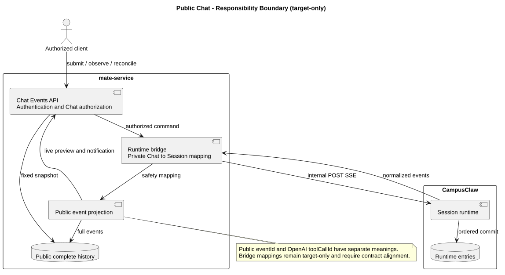
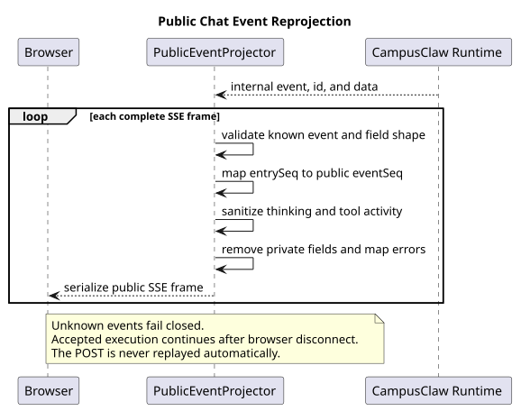

# mate-service 通用对话 Events API

[返回服务与接口导航](../README.md)

| 属性 | 值 |
|---|---|
| 文档版本 | 0.1.0 |
| 状态 | 路径已确认；请求、认证、公共 SSE 投影和错误码评审中 |
| 当前 operation | `POST /mate-service/v1/chats/{chatId}/events` |
| 设计性质 | target-only；当前 mate-service 尚无 Chat→Runtime bridge |
| 设计仓基线 | `154449ea42ccbbe76377e3c830c049480cd771c8` |
| mate-service 源码基线 | `956b547f5ca12ca89e68f73012f92a4406b0c9fa` |
| CampusClaw 源码核对基线 | `98d3999ec6d57e099d7bf02aaa4fcf9607fc61aa` |
| 内部 Runtime 契约基线 | HTTP 1.43.4，`POST /campusclaw-service/v1/sessions/{sessionId}/events` |
| 附件设计基线 | CampusMate 文件服务 3.0.0，`file_[0-9A-Za-z]{26}` 与接受后 resolve 顺序 |
| 更新日期 | 2026-09-01 |

## 1. 本轮评审结论

用户已确认公共 URL：

```http
POST /mate-service/v1/chats/{chatId}/events
```

这个 operation 接受一条普通 Chat 消息，并把该次执行作为请求范围内的 SSE 返回。
它不是新的永久订阅接口，也不创建公开 Run。浏览器只持有公共 `chatId`；mate-service
验证用户和 Chat 权限后，使用私有一对一映射解析内部 `sessionId`，再调用 CampusClaw：

```http
POST /campusclaw-service/v1/sessions/{sessionId}/events
```

当前首选方案沿用已经确认的 Chat Command 公共边界：登录用户只提交
`Authorization: Bearer <USER_ACCESS_TOKEN>`，mate-service 为内部调用构造独立凭据。
请求体复用内部普通消息的最小形状 `message + fileIds`，但公共响应必须重新投影，不能
透明转发内部 SSE。

精确请求、响应示例与四组待决项以交互式评审页为准：

- [当前 operation 评审页](chat-events-v1-review.html)
- [精确 review model](接口契约/操作/01-submit-chat-event.json)

在用户明确接受前，本页所有推荐项仍是评审提案，不得在实现或其他文档中标为已确认。

## 2. 两跳资源与责任边界



[PlantUML 源码：`public_chat_event_boundary`](设计图/diagram.puml#L1)

| 组件 | 责任 | 不负责 |
|---|---|---|
| 浏览器 / Agent UI | 提交公共 `chatId`、用户消息与附件；消费公共 SSE | 保存内部凭据、识别 `sessionId`、解释 Runtime 私有字段 |
| mate-service | 用户认证、Chat 授权、限流配额、`chatId -> sessionId` 私有解析、内部调用、SSE 安全投影和错误映射 | 模型执行、Tool 执行、Runtime Session 权威状态 |
| CampusClaw Runtime | 接受 `user.message`、维持单 active execution、执行 Agent/Tool、持久化 Entry、输出内部 SSE | 读取 `chatId` 或最终用户身份、定义浏览器可见字段 |

Chat 权限拒绝必须发生在解析内部 Session 和调用 CampusClaw 之前。`CHAT_NOT_FOUND`
可以合并 Chat 已删除和私有映射失效两类对外不可区分场景，避免暴露内部资源状态。

## 3. 请求建议

### 3.1 Header 与 Path

首选认证方案是：

```http
Authorization: Bearer <USER_ACCESS_TOKEN>
Accept-Language: zh-CN
Content-Type: application/json
Accept: text/event-stream
```

`chatId` 是 1～128 个字符的公共 Chat 标识。浏览器不得提交 `X-HW-ID`、
`X-HW-APPKEY`、内部 `access-token` 或 `sessionId`。该认证边界已经由生产前端约束和
Chat Command 公共契约确定，本轮不重新开放公司 JWT/APPKEY 直达浏览器方案。

### 3.2 Body

```json
{
  "message": "分析附件中的园区告警并给出处理建议",
  "fileIds": ["file_01JY8X2E3R4T5Y6U7I8O9P0A1S"]
}
```

建议约束：

- `message` 可省略；提供时必须是非空白字符串，最多 262144 个 UTF-16 代码单元；
- `fileIds` 可省略；最多 32 个匹配 `^file_[0-9A-Za-z]{26}$` 的字符串，元素唯一并保留顺序；
- mate-service 校验公共 fileId 形状；文件归属和 `READY` 状态继续由 Runtime 接受
  User Entry 后的附件 resolve 流程原子确认，不能为了提前失败而改变既有接受顺序；
- `message` 与 `fileIds` 至少提供一项；
- 拒绝未知字段，不接受 `chatId`、`sessionId`、`modelId`、`thinking`、`metadata`、
  `type` 或 `Idempotency-Key`；
- 以 `/` 开头的 `message` 仍按普通消息处理。Slash 识别只发生在已确认的交互层，
  命中后调用结构化 Chat Command API。

请求 VO 不提供字段默认值。Controller 使用 Bean Validation 表达字段级约束；Service
统一处理省略值、至少一项、附件去重、Chat 状态和权限等跨字段或业务规则。

## 4. 公共 SSE 建议



[PlantUML 源码：`public_chat_event_projection`](设计图/diagram.puml#L26)

mate-service 必须先完整解析每个内部 SSE frame，再验证事件类型和字段形状、执行安全
投影并重新序列化。未知事件或未知字段不能猜测透传；投影失败时 fail closed，并转换为
公共 `stream.error`。

### 4.1 序列与事件类别

首选方案沿用 Chat Command API 的公共序列：

- 内部持久化 Entry 的 `entrySeq` 重命名为 `eventSeq`，同时写入 SSE `id`；
- 私有 Runtime Record 或被过滤的 Entry 会造成合法序号缺口，mate-service 不重新编号；
- `assistant.message.started/delta`、Thinking started 和 Tool execution 状态是瞬时事件，
  没有 SSE `id`；
- `user.message`、安全的 `assistant.message.completed` 和安全的 `tool.result` 可带
  `eventSeq`，供后续 GET Chat Events 对账和去重；
- 是否再增加稳定不透明 `eventId` 是本轮待决项。当前推荐仅使用 `eventSeq`。

### 4.2 投影规则

| 内部数据 | 公共处理 |
|---|---|
| `sessionId`、`entryId`、`assistantEntryId`、`toolCallId`、Agent/Skill/Tool 内部 ID | 删除；必要的 Tool 生命周期关联改用公共 `activityId` |
| `entrySeq` | 重命名为 `eventSeq`，保留原序列和合法缺口 |
| Assistant 文本 | 保留原始 Markdown 字符串；不在服务端生成 HTML |
| 原始 ThinkingContent 与 thinking delta | 永不公开；建议投影 `displayTitle/displaySummary`，无安全摘要时只发通用状态 |
| Tool 名称、输入和结果 | 服务端白名单、脱敏、截断、资源 ID 映射后输出；失败时降级为名称和状态 |
| Assistant `tool_call` block | 不原样公开；用于服务端建立 Tool 关联和安全输入投影 |
| Usage、cost、runId、Provider/Model 私有配置 | 删除 |
| Session compaction 原始 summary、保留边界和 token 统计 | 删除，不成为普通 Chat 产品事件 |
| `session.model.changed`、`session.thinking.changed` | 只保留产品界面需要且已经公开的字段；内部原因和版本细节删除 |
| 内部错误堆栈、路径和错误消息 | 映射为稳定公共错误码与国际化文案 |

Assistant、Thinking、Tool 和 `session.status.idle` 的事件名称优先与现有前端投影及 Chat
Command API 保持一致；一致的是公共语义名称，不代表内部字段可直接透传。

### 4.3 正常与异常终止

正常流最后依次发送：

```text
session.status.idle
stream.end
```

流建立后失败只发送公共 `stream.error` 并关闭，不发送 `stream.end`。其 payload 带
`accepted=true`，明确表示本次提交可能已经产生持久化结果，客户端应刷新历史确认，
不得自动重放 POST。

浏览器断开只停止公共传输，不取消已经接受的 Runtime execution。mate-service 必须解除
该浏览器订阅并继续让 Runtime 收敛；用户主动停止只能走独立 Abort operation。

## 5. HTTP 错误建议

| HTTP | 公共错误码 | 场景 |
|---:|---|---|
| 400 | `INVALID_CHAT_ID` | Path 标识格式非法 |
| 400 | `INVALID_EVENT_REQUEST` | JSON、消息、附件或未知字段非法 |
| 401 | `UNAUTHENTICATED` | 用户未登录或访问令牌无效 |
| 403 | `CHAT_ACCESS_DENIED` | 用户无权访问该 Chat |
| 404 | `CHAT_NOT_FOUND` | Chat 不存在、已删除或私有映射失效 |
| 409 | `CHAT_BUSY` | 对应 Session 已有 active execution；不隐式改为 Steer/FollowUp |
| 429 | `CHAT_RATE_LIMITED` | 公共用户、租户或 Chat 限流/配额触发 |
| 502 | `RUNTIME_EVENT_FAILED` | 流建立前内部调用失败或响应不能安全映射 |
| 503 | `CHAT_EXECUTION_UNAVAILABLE` | Runtime 容量或执行依赖暂不可用 |
| 200 SSE | `CHAT_EXECUTION_FAILED` | 流已建立且请求已接受后的执行失败 |

内部 `SESSION_NOT_FOUND`、`SESSION_BUSY`、`RUNTIME_CAPACITY_EXCEEDED` 和
`EVENT_ACCEPTANCE_FAILED` 不能原样进入浏览器；mate-service 根据 Chat 语义和失败阶段
映射为上表公共错误。

## 6. 断线恢复边界

本 operation 只定义提交和本次执行流，不承担重连补发：

1. 流建立前非 2xx 表示请求未被接受，可以按错误码决定是否重新提交；
2. 收到任何持久化公共事件，或收到 `accepted=true` 的 `stream.error` 后，不自动重放；
3. 网络中断属于结果不确定，不把草稿直接标为失败或删除；
4. 客户端随后调用待设计的 `GET /mate-service/v1/chats/{chatId}/events`，按公共
   `eventSeq` 对账；
5. 只有历史出现权威 User/Assistant 结果后，客户端才清除本地待确认草稿。

GET Chat Events 的分页形状和返回事件集合不在本轮 operation 中确定，但它必须与本 POST
的公共持久化事件使用同一身份和序列规则。

## 7. 源码证据、目标设计与差异分类

| 分类 | 证据或决策 |
|---|---|
| 观察到的 mate-service 行为 | `mate-service@956b547f` 的 `AgentDefinitionController.java:35-79` 只提供 Agent 定义和 Runtime 配置操作，没有 Chat 或 Session bridge |
| 观察到的 mate-service 行为 | 同一基线的 `LlmChatController.java:33-59` 暴露 `/mate-service/v1/LLM/chat`；`LlmChatService.java:57-81` 调用 Model Manager，`UpstreamChatCall.java:35-73` 按字节转发上游流 |
| 观察到的 CampusClaw 行为 | `pi-mono-java@98d3999e` 的 `RuntimeEventController.java:39-77` 已实现内部 POST Session Events SSE；`UserEventRequestVO.java:26-75` 只声明 `message/fileIds` 并拒绝未知字段 |
| 观察到的 CampusClaw 行为 | `RuntimeEventService.java:76-139,141-162` 校验请求、要求 idle、原子接受 User Entry 并建立执行；`RuntimeEventProjector.java:163-219,272-345,382-385` 投影原始 Thinking、Tool、Compaction 与持久化 Entry 序列 |
| 已有附件目标设计 | `02-服务与接口/01-CampusMate附件服务/README.md:19-21,163-179` 与 `attachment-api.openapi.yaml:578-583,662-672` 固定 fileId 形状、最多 32 项，并由接受后的 Runtime resolve 全成全败确认归属和 READY 状态 |
| 目标设计 | 新增 `ChatEventController`、`ChatEventService`、`ChatSessionResolver`、`CampusClawEventClient`、`PublicChatEventProjector` 和 `PublicChatErrorMapper`；这些符号在 mate-service 源码基线中不存在 |
| 产品约束 | 浏览器只理解 Chat；普通消息 POST 不解析 Slash 文本，不公开 Run，不把 busy 消息隐式改成 Steer 或 FollowUp |
| 安全加固 | 公共和内部鉴权独立；原始 Thinking、内部 ID、凭据、路径、Usage/Cost、未经脱敏的 Tool 数据与错误细节不能跨边界 |
| 架构变化 | 现有 Model Manager 透明流代理不能复用；Chat bridge 必须逐帧解析、验证、映射并重新序列化 SSE |

## 8. 实现职责建议

| 层 | 目标职责 |
|---|---|
| `ChatEventController` | 接收 `chatId`、`Accept-Language` 和 `ChatEventRequestVO`；触发 Bean Validation；返回 SSE |
| `ChatEventService` | 用户/Chat 权限、请求归一化、限流配额、busy 语义、断线后的执行状态协调 |
| `ChatSessionResolver` | 从当前用户可访问的 Chat 解析唯一内部 `sessionId`；不向 Controller 或响应暴露映射记录 |
| `CampusClawEventClient` | 使用服务端配置构造内部 URL、超时和凭据；发送内部 `message/fileIds` |
| `PublicChatEventProjector` | 完整 SSE frame 解析、事件白名单、序列映射、Thinking/Tool 脱敏、未知形状 fail closed |
| `PublicChatErrorMapper` | 按流建立前/后和 Chat 语义映射稳定错误码，不泄露 Runtime 资源状态 |

Java 边界对象使用 `ChatEventRequestVO` 和显式只读的公共事件响应 VO；内部 Runtime 调用与
持久化映射使用 DTO。Service 负责 VO/DTO 转换和请求默认处理，不在请求 VO 中放字段初始化值。

## 9. 验收门禁

- 未登录、无 Chat 权限和 Chat 不存在分别得到稳定的 401/403/404，且拒绝发生在内部调用前；
- message-only、file-only、message+files 都能提交；空白 message、重复 fileId、越界和未知字段被拒绝；
- fileId 形状在公共边界校验；附件 resolve 仍在 User Entry 接受后按稳定顺序全成全败，
  失败经公共 `stream.error` 脱敏且客户端不自动重放；
- 浏览器 Header 不原样变成 CampusClaw Header，内部凭据不进入日志、事件或异常响应；
- 公共流不存在 `sessionId`、`entryId`、`entrySeq`、`toolCallId`、内部 Agent/Skill/Tool ID、
  绝对路径、原始 Thinking、Usage、Cost 或私有错误细节；
- `entrySeq -> eventSeq` 保持稳定且允许缺口，SSE `id` 与持久化事件 `eventSeq` 一致；
- Assistant Markdown 文本保持原文，服务端不生成 HTML；
- Thinking 无安全摘要时降级为通用状态，不从原始 ThinkingContent 截取；
- Tool 投影覆盖敏感键、内部路径、超长对象、深层对象、公共资源映射和投影失败降级；
- 未知内部事件或字段形状导致安全 `stream.error`，不透明透传；
- 正常流有 `session.status.idle + stream.end`；异常流有 `stream.error` 且没有 `stream.end`；
- 浏览器断线后 Runtime execution 继续，前端不自动重放 POST，并能在后续历史接口中对账；
- 需要 discovery-to-invocation 集成测试证明公开 Tool 展示名与内部执行 ID 不被混用。

## 10. 生成与校验

```bash
python3 render_chat_events_v1.py
python3 validate-chat-events-v1.py
```

PlantUML 变更后在专题目录执行：

```bash
plantuml -tsvg 设计图/diagram.puml
```

校验覆盖 review model、生成 HTML 同步、JavaScript 语法、响应式样式、公共字段泄露、
PlantUML ASCII、SVG XML/同步、Markdown 图形路径与行锚点、全仓 Mermaid 禁用和
`git diff --check`。

## 11. 待确认项

当前评审页只保留四组会改变契约的选择：

1. 公共 SSE 沿用现有 `user/assistant/tool/session/stream` 事件名，还是统一改成 Chat 命名；
2. 持久化事件只使用 `eventSeq`，还是增加稳定 `eventId`；
3. Thinking 展示安全标题/摘要，还是完全隐藏；
4. Tool 展示安全输入/结果摘要，还是只展示名称和状态。

路径、两跳 Chat→Session 边界、请求范围 SSE、断线不取消、POST 不自动重放和不公开
`sessionId`/内部凭据属于当前设计基线，不在这四组选择中重复开放。

## 12. 版本历史

| 版本 | 日期 | 变更 |
|---|---|---|
| 0.1.0 | 2026-09-01 | 用户确认 `POST /mate-service/v1/chats/{chatId}/events`；建立 target-only 单 operation 评审稿，提出公共认证、请求、SSE 安全投影、错误与恢复语义，保留四组待确认选择。 |
