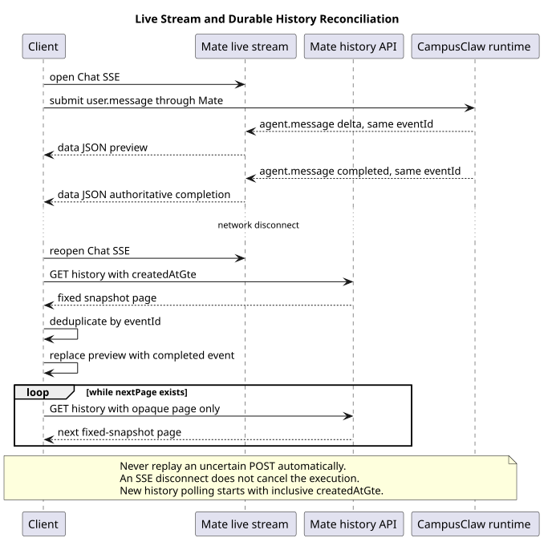

# mate-service 通用对话 Events API

[服务与接口导航](../README.md) · [待决事项](协作/README.md) · [三接口契约页](chat-events-v1-review.html)

| 属性 | 值 |
|---|---|
| 文档版本 | 1.8.1 |
| 状态 | 三接口已形成目标契约，尚待实现；数字分页要求待与快照方案整合 |
| Java 源码基线 | 7e54b47f2539982f8f1855a0b6bb38b6ab8742ae，范围见 §9 |
| pi 固定基线 | 5cd93f688aaab89dbb6dfa4aca535f21796ae185 |
| 公开契约证据日期 | Claude Managed Agents / OpenAI 2026-09-02；只作为该日公开契约记录 |
| 更新日期 | 2026-09-22 |

## 1. 接口与权威来源

Mate 对外使用 Chat/chatId/chat.*，Runtime 内部使用 Session/sessionId/session.*。提交、实时观察和权威历史各有独立操作：

| 操作 | 用途 | 精确模型 |
|---|---|---|
| POST /chats/{chatId}/events | 提交一条用户事件，JSON 返回完整持久化回执 | [提交](接口契约/操作/01-submit-chat-event.json) |
| GET /chats/{chatId}/events/stream | 观察连接建立后的 Chat 事件，SSE 可跨多轮执行 | [实时流](接口契约/操作/02-stream-chat-events.json) |
| GET /chats/{chatId}/events | 查询完整权威事件，按快照分页 | [历史](接口契约/操作/03-list-chat-events.json) |

基础路径为 `/mate-service/v1`。operation JSON 驱动 [HTML](chat-events-v1-review.html)，[OpenAPI 3.1](chat-events-v1.openapi.yaml) 是同步机器投影；字段、示例与错误只在精确契约中维护，修改须同步生成与校验。

[待决事项 C-001](协作/README.md#c-001) 已记录一基数字页码要求，但数字页码与固定快照的完整字段尚未定稿。现有模型仍是 opaque cursor，不能标成已完成数字分页，也不能在整理文案时擅自删除快照保证。

浏览器重开后恢复未完成正文的推荐目标见[Redis 流式恢复](../../01-总体架构/01-CampusClaw多Agent运行时/redis-stream-recovery.md)。Redis 位于 Claw 事件源侧，Mate 通过受保护读取 API 获取快照与后续事件，再安全投影；不直接连接 Redis。新增公共首帧 `chat.preview_snapshot` 为 proposed，尚未并入 operation JSON，接入门禁见 [C-008](协作/README.md#c-008)。以下五类实时事件和 data-only 规则描述现有精确契约，不表示其已具备草稿恢复。

## 2. 资源与责任边界


[原尺寸 SVG](设计图/public_chat_event_boundary.svg) · [PlantUML 源码](设计图/diagram.puml#L1)

| 组件 | 负责内容 |
|---|---|
| 浏览器 / Agent UI | 提交公共事件、展示 preview、查询历史对账；不持有内部 sessionId，不自动重放不确定 POST |
| mate-service | 公司认证与 Chat 授权、私有 Chat→Session 映射、公共事件投影与错误国际化 |
| CampusClaw | Session 执行、取消传播、Tool 生命周期、权威 Entry 与内部事件 |

Runtime 已有 [独立目标契约](../../01-总体架构/01-CampusClaw多Agent运行时/chat-events-design.md)，bridge 须解析后安全投影，不能转发原始 SSE 字节。公共和内部契约在输入关联、工具结果、分页及连接寿命上存在差异；桥接尚未完成对齐，详见待决事项。模型返回的可读 Thinking 可按产品规则展示，私有签名、凭据和内部执行状态不可公开。

## 3. 公共约定

### 3.1 认证、Header 与 Path

Mate 先认证并授权 Chat，再解析内部 Session。Authorization 与 X-HW-APPKEY 至少一个；同时提供时 JWT 优先，JWT 无效不回退。X-HW-ID 和 access-token 是各操作显式请求头，JWT/APPKEY 在 OpenAPI securitySchemes 声明；精确含义与约束以契约模型为准。

本公共 API 不声明 Accept-Language，错误语言从公司公共上下文取得，以 Content-Language 返回实际语言。Runtime 的语言与凭据要求独立定义，不能从公共头字段同名推导相同处理。

### 3.2 JSON 与时间

公共字段采用 lowerCamelCase，已知请求对象忽略未知属性，不支持的事件 type 拒绝；显式 null 不等于省略。此规则与 Runtime 严格拒绝未知字段的边界不同。

普通 JSON 使用 ResultBean：成功包含 result，异常只含 resCode/resMsg；均 no-store。客户端根据稳定 resCode 判断，不解析已国际化文案。createdAt 是接受或持久化时间，精确 UTC 毫秒格式由模型维护。

### 3.3 公共事件身份

每条持久化记录有独立 eventId，正文/思考的 delta 与 completed 复用同一 ID。用户回执 ID 仅标识该 user.*，不是执行、Turn 或后续输出的关联 ID；公共模型不提供 eventSeq、runId 或内部执行身份。

Tool Call、确认、结果通过 toolCallId 关联，同时各保留独立 eventId。本契约有意耦合 OpenAI：Responses 使用 call_id，Chat Completions 使用 tool_calls[].id，不使用 Responses item 的 fc_... ID。toolCallId 大小写敏感且不透明，调用方原样传回；不推导前缀、正则或长度上限。接入其他 Provider 须另行版本决策。

## 4. 提交用户事件

每个 POST 提交一条 user.message、user.interrupt 或 user.tool_confirmation。请求和四种场景示例由 [提交接口](chat-events-v1-review.html#submitChatEvent) 展示，不在正文维护第二套 JSON。

### 4.1 user.message

保留 content 数组顺序，允许纯文本、纯文件或混合输入。文件只存 fileId，二进制与文件元数据由附件服务管理。Chat 必须可接受新消息；执行中或等待确认时拒绝，不隐式转为 Steer、FollowUp 或排队。

### 4.2 user.interrupt

中断当前执行树，包括 Tool 与 Child Agent。回执仅表示接受，真实 terminated 才表示停止完成；idle 时拒绝。不能将中断和新消息合并为批量请求。当前公共输入未携带 Runtime 的 targetEventId，bridge 必须明确如何固定原目标，不能直接转发为内部请求。

### 4.3 user.tool_confirmation

仅对当前待确认 Tool Call 接受 allow/deny；allow 省略 denyMessage，deny 可附替代要求。确认写入完整历史，实时流不重复发送用户事件。归属、状态和一次消费由服务端校验，不能只依赖 UI 按钮状态。

### 4.4 完整用户事件回执

result.event 返回规范化后实际持久化的完整 user.*，与历史共用 Schema，并补充服务端 eventId/createdAt。它不包含 Agent 输出或后续 idle。响应丢失后先查历史；当前无 Idempotency-Key，不能盲目重放 POST。

### 4.5 提交失败

接受前的类型、资源、授权、忙状态与运行时不可用按精确错误目录返回 JSON。接受后不能以网络故障撤销已写入事件；请求结果不确定与业务拒绝须分开处理。

## 5. 实时接收 Chat 事件

Chat SSE 从连接建立后观察新事件，可跨越多次执行。idle 不关闭连接，: ping 可保活；这一生命周期与 Runtime 请求级 SSE 不同。

### 5.1 Frame 规则

业务帧只用一行 data: JSON，无 event:/id:；不接受 Last-Event-ID，不回放旧增量。断线恢复使用重开流、查历史和 eventId 去重。

### 5.2 事件范围

实时流包含 agent.message、agent.thinking、agent.tool_call、agent.tool_result 和 chat.status_idle。user.* 只在提交回执与历史出现，避免同一提交被重复显示。精确阶段和字段由流模型维护。

Runtime 新增显式任务更新的接入要求见 [C-007](协作/README.md#c-007)：公共层也由后端返回 todos，前端不解析通用工具结果。它是已确认 待实现 增量，尚未并入本公共三接口的精确模型；当前五类清单不得当作已包含该能力。

### 5.3 正文与思考

delta 顺序累积为 preview，completed 的完整内容覆盖同 ID 预览。中断后没有 completed 的 preview 可丢弃。Thinking 展示模型返回的可读原文，后续关闭开关不隐藏已有历史；不透明签名不是正文，见 [Thinking 展示](../../01-总体架构/01-CampusClaw多Agent运行时/chat-events-history-design.md#thinking-original-text)。

### 5.4 工具调用

requiresConfirmation=true 时公开安全参数并进入 confirming。确认使用原 toolCallId，不混用 eventId；完整调用保留审计记录。

公共 `agent.tool_call` 增加可选 `displayName`，由 bridge 从 Runtime 已固定的调用名称快照安全投影，授权通过后与公共调用事件一同保存；live 与 history 读取同一保存值。普通工具来源是框架 label，Mate 来源是具体业务工具元数据，精确映射由 [M03](../../01-总体架构/02-CampusClaw工具系统/README.md#tool-display-name)维护。bridge 不额外查目录、不按当前工具名称覆盖历史，也不接受模型提供的展示名。

公共 toolName 继续表示既有公开技术名，arguments 保持公开安全参数；不因新增名称暴露内部 CallMateTool 包装或工具 ID。UI 优先 displayName，缺失回退公共 toolName；确认和结果关联仍用 toolCallId。无效或空白展示名按缺失处理，服务端省略字段。名称作为纯文本显示，不用于授权，也不在 tool_result 或确认请求中重复。此增量已进入公共流/历史精确模型和 OpenAPI，bridge 与后端落地仍为 待实现；服务端、bridge 与消费者同步更新字段定义和解码规则。

### 5.5 工具结果

公开结果为文本，并携带 isError；错误码按模型的条件规则返回。中断不伪造工具结果，由 terminated 收敛 UI；工具名不在结果重复。

### 5.6 idle 与任务状态

| reason | 任务状态 | 新 user.message |
|---|---|---|
| done | 自然完成 | 允许 |
| terminated | 用户中断已完成 | 允许 |
| failed | 执行失败且已恢复 idle | 允许 |
| confirming | 暂停等待工具确认 | 拒绝；仅允许对应确认或中断 |

### 5.7 工具确认交互

工具调用 → confirming → 用户另发确认 POST → 工具结果 → Agent 回复 → done。确认回执属于写请求，live 流持续保持；确认事件由历史恢复，流不重复推送。完整交互报文由 [实时模型](接口契约/操作/02-stream-chat-events.json) 提供。

### 5.8 流错误

Header 前的认证、授权、资源或容量错误使用 JSON；Header 后编码、网络或订阅失败结束传输，不追加 stream.error。连接关闭不能证明执行成败，应重连并查历史。

## 6. 查询 Chat 事件历史

历史只含完整权威事件，不含 delta、ping 或 Claw 私有记录。

### 6.1 查询条件

现有契约提供 createdAtGte、limit、types 和 opaque page；types 为 OR 且重复值归一化。page 携带续读上下文时不能混传其他过滤条件。字段上限、八类事件及错误由 [历史模型](接口契约/操作/03-list-chat-events.json) 定义。

### 6.2 固定快照分页

首请求固定查询上界与过滤条件，后续页不混入新增事件。现有模型按 createdAt 升序，同时间使用服务端私有稳定顺序；游标不公开 sequence。新一轮查询以最后 createdAt 为 inclusive 下界并按 eventId 去重。数字分页的待整合要求见 C-001，不能将内部普通页码设计直接套用到此处。

### 6.3 历史事件形状

用户事件复用完整回执 Schema；正文/思考只保存 completed，其他完整 Agent 事件与实时流同形。Tool 调用、确认、结果用同一 toolCallId 关联，但保持三个独立审计 ID。

### 6.4 分页响应

当前快照无后续页时省略 nextPage，不返回 null 或空字符串；这与 Runtime 的整数页码响应不同。完整示例在契约页展示。

## 7. 断线恢复

目标增强为[先恢复当前完整预览，再接续增量](../../01-总体架构/01-CampusClaw多Agent运行时/redis-stream-recovery.md#4-从关闭浏览器到重新看到输出)；其全局目标类图及两跳时序由 Redis 专题唯一维护。它解决下面现有契约只能对账完整历史、不能补回半截正文的问题。精确模型完成 C-008 前，不得对外宣称已支持新恢复行为。

本图只展示公共 Chat 的提交、独立观察与断线对账，不混入内部请求级 SSE 的关闭规则。公开历史继续按本专题固定快照契约逐页读取，数字分页整合仍待决；浏览器只重开读流和读取历史，不取消原执行或重放 POST，完整记录覆盖同 ID 预览。



[原尺寸 SVG](设计图/public_chat_event_recovery.svg) · [PlantUML 源码](设计图/diagram.puml#L45)

先打开 Chat SSE 再提交，降低漏掉早期 preview 的风险；本地按 eventId/type 管理预览。断线后标记结果不确定，立即重开 SSE 并并行查询历史。完整历史覆盖预览，按 eventId 去重，读完快照后另起查询追新事件。

重连不取消执行，也不重放 POST。该方法参考公开产品的 preview/权威历史分工；公共 Chat 资源、公司认证、reason 和固定快照仍是本产品决策。

## 8. 错误与国际化

业务错误及双语文本由公共契约模型维护，认证、限流和通用 500 复用公司组件。错误响应须同时满足 HTTP status、稳定 resCode、实际 Content-Language 和无 result，不向公共层暴露 Runtime 错误细节。

## 9. 源码证据与差异分类

### 9.1 已观察源码行为

| 基线 | 路径与符号 | 观察结果 |
|---|---|---|
| `pi-mono-java@7e54b47f` | `modules/coding-agent-cli/src/main/java/com/campusclaw/codingagent/runtimeapi/web/RuntimeEventController.java` · `submitEvent` / `listEvents` | 该基线 Claw 是 POST 请求范围 SSE + GET 历史，没有独立 Chat/Session 长连接 stream GET |
| 同上 | `modules/coding-agent-cli/src/main/java/com/campusclaw/codingagent/runtimeapi/event/RuntimeEventType.java` · enum values | 该基线内部类型包括 assistant/thinking/tool execution、session 状态和 stream 终止事件，不等于本公共五类 SSE |
| 同上 | `modules/coding-agent-cli/src/main/java/com/campusclaw/codingagent/runtimeapi/event/RuntimeEventService.java` · `acceptUserMessage` | 该基线只接受 `user.message`，要求 idle 并原子接受；interrupt 与 tool confirmation 尚未成为该 HTTP 请求联合类型 |
| 同上 | `modules/coding-agent-cli/src/main/java/com/campusclaw/codingagent/runtimeapi/event/RuntimeEventProjector.java` · projection methods | 该基线投影 provider/agent/tool 内部事件，完整 Assistant、Thinking 和 Tool Result 可落为持久记录 |
| 同上 | `modules/coding-agent-cli/src/main/java/com/campusclaw/codingagent/runtimeapi/event/RuntimeEntryCodec.java` · encode/decode methods | 该基线持久记录有内部 entry identity、sequence 和 createdAt；本设计不把内部 sequence 暴露为 `eventSeq` |
| 同上 | `modules/coding-agent-cli/src/main/java/com/campusclaw/codingagent/runtimeapi/persistence/MyBatisRuntimeSessionRepository.java` · append/query methods | 该基线历史按内部 entry sequence 和当前分支读取，不是本设计的 createdAt 固定快照公共分页 |
| 同上 | `modules/coding-agent-cli/src/main/java/com/campusclaw/codingagent/runtimeapi/session/RuntimeSessionControlService.java` · abort methods；`modules/coding-agent-cli/src/main/java/com/campusclaw/codingagent/tool/agent/SubagentExecutionService.java` · child cancellation | 该基线取消可以等待主执行收敛，并向 Tool/Child Session 传播；该基线 idle abort是 no-op，公共 idle interrupt 冲突是目标差异 |
| 同上 | `modules/coding-agent-cli/src/main/java/com/campusclaw/codingagent/runtime/PreparedAgentRuntime.java` · permission handling | ASK/确认公共闭环尚未实现；`user.tool_confirmation` 是 待实现 |
| `pi-mono-java@7e54b47f` | `modules/ai/src/main/java/com/campusclaw/ai/provider/openai/OpenAIResponsesProvider.java:415-426,465-473,515-521,534-544` · `handleOutputItemAdded` / `handleOutputItemDone` / `convertAssistantInput` / `convertToolResultInput` | OpenAI Responses function call 的 `call_id` 被写入 `ToolCall.id`，后续 Tool Call 和 Tool Result 输入都把同一值写回 `callId`；该链路未使用 function call item `id` |
| 同上 | `modules/ai/src/main/java/com/campusclaw/ai/types/ToolCall.java:24-28` · `ToolCall.id`；`modules/ai/src/main/java/com/campusclaw/ai/types/ToolResultMessage.java:26-32` · `toolCallId` | Claw 归一化模型使用独立 Tool Call ID 关联调用和结果 |
| 同上 | `modules/ai/src/test/java/com/campusclaw/ai/provider/openai/OpenAIResponsesProviderIntegrationTest.java:217-262` · `streamsToolCallResponse` | 测试明确区分 item `id="fc_1"` 和 `call_id="call_xyz"`，并断言归一化 `ToolCall.id()` 等于 `call_xyz` |
| `pi@5cd93f68` | `packages/ai/src/types.ts` · `AssistantMessageEvent`；`packages/agent/src/types.ts` · `AgentEvent` | Provider 增量与 Agent message/tool 生命周期分层，Tool Call 使用独立 ID |
| 同上 | `packages/agent/src/agent-loop.ts` · `streamAssistantResponse`；`packages/coding-agent/src/core/agent-session.ts` · `_handleAgentEvent` / `abort` | 增量用于 live update，完整 message end 才持久化；abort 等待执行变为 idle |
| 同上 | `packages/protocol/src/schemas.ts` · `TranscriptProgressSchema` / `SessionSnapshotSchema`；`packages/server/src/sessions.ts` · `handleRuntimeEvent` / `broadcastSnapshot` | 临时 transcript progress 与权威 snapshot 是不同投影 |

### 9.2 公开契约证据

- [Claude Managed Agents · Events and streaming](https://platform.claude.com/docs/en/managed-agents/events-and-streaming)：
  提交、事件历史和流式观察分离；`event_start/event_delta` 是 best-effort preview，完整
  `agent.message` 是权威记录；断线后重新开流并查询历史对账。
- [Claude Managed Agents · List Session Events](https://platform.claude.com/docs/en/api/beta/sessions/events/list)：
  公开查询包含 created-at 条件、limit、order、page 和 types。本设计只采纳问题形态，
  将其收敛为升序固定快照、`createdAtGte/limit/types/page`。
- [OpenAI Responses API](https://developers.openai.com/api/reference/typescript/resources/beta/subresources/responses/methods/create)：
  function call output 同时有 item `id` 和用于对应 function call output 的 `call_id`；本契约
  使用后者。
- [OpenAI Chat Completions API](https://developers.openai.com/api/reference/cli/resources/chat/subresources/completions)：
  Assistant 的 `tool_calls[].id` 与 Tool message 的 `tool_call_id` 关联同一次调用。

Claude Managed Agents 在核对日仍是 Beta 公共 API。公开文档不能证明其内部表、sequence、
游标编码或服务端调度实现，本设计没有对此作推断。

### 9.3 CampusClaw 目标决策

| 分类 | 决策与理由 |
|---|---|
| 产品约束 | Mate 对外叫 Chat，Claw 内部叫 Session；公共层只保留三种 user event、五种 SSE event 和四个 idle reason，减少客户端状态机 |
| 产品约束 | `interrupt + message` 不批量提交；终止完成后再提交消息，保证单 active execution |
| 产品约束 | 展示模型返回的原始推理；实时流和历史复用完整原文，便于查看同一次思考内容 |
| 安全加固 | Tool 参数、结果和错误必须经过安全投影；内部 ID、路径、凭据及不透明模型续传签名不作为公共字段 |
| 架构变化 | POST、live SSE、durable history 分离；live 流不重放，历史固定快照；用 `eventId` 对账，不公开内部 sequence |
| 架构变化 | POST 成功时在 `result.event` 返回完整、已持久化的 `user.*` 事件，并与历史接口复用同一 Schema；这使创建响应可直接作为权威记录合并，同时不把 Agent execution 结果混入写入响应 |
| 架构变化 | `eventId` 与 `toolCallId` 分离；`agent.tool_call` 显式公开 OpenAI `call_id` / `tool_calls[].id`，确认和结果原样引用该值。这是有意的 OpenAI 身份耦合，非 OpenAI Provider 不得伪造 `call_` ID；若要纳入本公共契约，必须另行版本决策 |
| 架构变化 | 确认事件持久化，与 Tool Call 和 Tool Result 共享 `toolCallId`，同时各自保留独立 `eventId`，以满足恢复和审计 |
| 待实现 | 新增 `user.interrupt`、`user.tool_confirmation`、独立 stream GET、固定快照历史和新的公共事件投影；这些均未在该基线 Claw HTTP 层实现 |

本设计没有读取或引用本地 mate-service 实现作为设计基线；Mate 三个 operation 全部按
待实现 处理。实现阶段必须补充实际 mate-service commit、路径和符号，再校准 Controller、
VO、Service 与错误组件名称。

## 10. 实现和测试门禁

- Controller 使用独立 `*RequestVO` / `*ResponseVO`；字段级校验放请求 VO，Chat 状态、
  Tool Call 归属、固定快照和跨字段规则放 Service；
- 请求 VO 不放默认值；`limit=100` 在 Service 统一归一化；Mate 这三个
  operation 不接收 `Accept-Language`；
- `event.type` 使用受控联合类型反序列化；已知对象忽略未知字段，但未知 discriminator 拒绝；
- 覆盖 message 的 text-only/file-only/mixed、文本 Unicode code point 边界、文件数量/重复/
  顺序、allow/deny 和 denyMessage 条件字段；
- 覆盖三种 POST 成功响应均只通过 `result.event` 返回完整持久化用户事件，并逐字段断言
  与历史 `UserMessageEvent`、`UserInterruptEvent`、`UserToolConfirmationEvent` Schema 一致；
- 覆盖 idle interrupt 冲突、interrupt 等待整棵执行树终止、confirming 时消息冲突、确认
  Tool Call 归属，以及中断 Tool 不伪造结果；
- 覆盖 Mate/GLM 原文在 SSE completed 与历史一致、缺少摘要标记仍可展示、后续关闭不隐藏旧原文，以及仅 signature 时不伪造文本；
- 覆盖 SSE 只有 `data:`、ping comment、五类事件、同 ID delta/completed、completed 覆盖
  preview、连接断开不取消 execution；
- 覆盖历史八类事件、无 delta、createdAt inclusive、types OR/去重、固定快照不混入新事件、
  同时间稳定排序、无下一页时省略 `nextPage`；
- 做 discovery-to-invocation 契约测试，证明公开 `toolName`、事件 `eventId`、
  OpenAI Responses `call_id` / Chat Completions `tool_calls[].id` 和 Claw 执行所需内部 Tool ID
  不混用；Responses item `id=fc_...` 不得投影为 `toolCallId`；
- 覆盖 `agent.tool_call -> user.tool_confirmation -> agent.tool_result` 的完整往返，断言三者
  原样共享大小写敏感的 OpenAI `toolCallId`、各自使用独立 `eventId`，且实现不对
  `toolCallId` 施加前缀、长度或正则校验；
- 所有错误双语断言同时校验 HTTP、`resCode`、`Content-Language` 和无 `result`。

## 11. 生成与校验

```bash
python3 render_chat_events_v1.py
python3 validate-chat-events-v1.py
npx --yes @redocly/cli lint chat-events-v1.openapi.yaml
plantuml -tsvg 设计图/diagram.puml
```

校验覆盖三份 operation 模型、OpenAPI 3.1 路径/安全方案/`oneOf`/命名示例、生成 HTML
同步、JavaScript 语法、响应式样式、SSE frame、公共事件集合、lowerCamelCase、
PlantUML ASCII、SVG XML 与同步、Markdown 图路径/行锚、全仓 Mermaid 禁用和
`git diff --check`。

## 12. 版本历史

| 版本 | 日期 | 变更 |
|---|---|---|
| 1.8.1 | 2026-09-22 | 接口作用只描述调用功能，具体规则与实现状态由各自栏目维护。 |
| 1.8.0 | 2026-09-22 | 登记 Redis 快照接续目标及公共首帧增量的精确契约门禁。 |
| 1.7.0 | 2026-09-17 | 公共工具调用增加可选 displayName，实时与历史复用授权投影的调用快照。 |
| 1.6.1 | 2026-09-15 | 登记后端显式任务事件的公共桥接与根消息关联增量。 |
| 1.6.0 | 2026-09-14 | 主文聚焦公共边界与恢复，移除重复报文并显式登记未整合设计要求。 |
| 1.5.0 | 2026-09-09 | 明确 Thinking 展示模型返回的原始推理。 |
| 1.4.4 | 2026-09-02 | 增加确认后执行端口隔离的完整工具交互示例。 |
| 1.4.3 | 2026-09-02 | 补充“允许工具调用”的提交成功响应示例，与既有拒绝示例并列展示；明确 `allow` 响应省略 `denyMessage`，字段、Schema 和行为不变。 |
| 1.4.2 | 2026-09-02 | 整体润色三个 Events 接口的说明与示例，统一为真实、连贯的园区巡检场景，并为实时流和历史页增加命名示例；字段、Schema 和行为不变。 |
| 1.4.1 | 2026-09-02 | 优化提交接口的示例摘要：统一采用业务场景在前、协议类型作为辅助标识的表达方式；字段、Schema 和行为不变。 |
| 1.4.0 | 2026-09-02 | POST 回执返回完整持久化用户事件，并复用历史事件 Schema。 |
| 1.3.0 | 2026-09-02 | toolCallId 使用 OpenAI 调用 ID，并与公共 eventId 分离。 |
| 1.2.0 | 2026-09-02 | Swagger 分开表达必需 Header 与 JWT/APPKEY 认证选择。 |
| 1.1.0 | 2026-09-02 | 增加 OpenAPI 3.1、联合事件 Schema 与不透明分页示例。 |
| 1.0.0 | 2026-09-02 | 公共 Chat 分离事件提交、实时观察与固定快照历史。 |
| 0.1.0 | 2026-09-01 | 建立单 POST 请求范围 SSE 初稿；该方案已由 1.0.0 替换。 |
