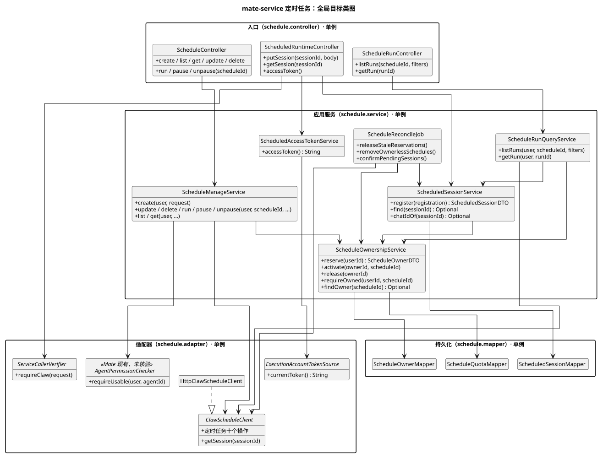
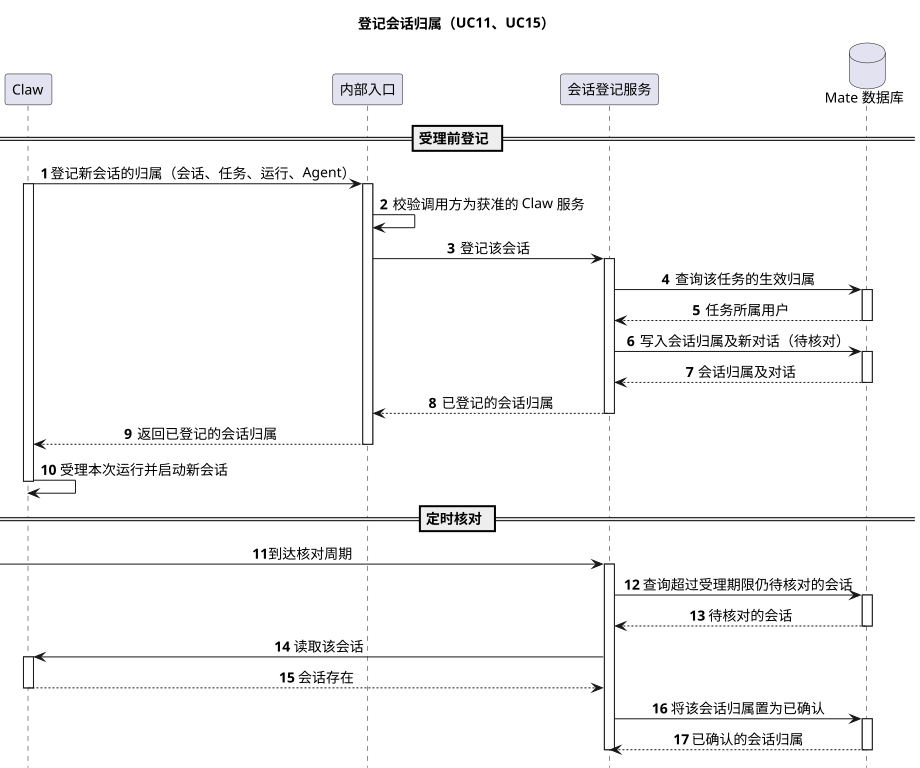

# mate-service 定时任务设计

[服务与接口导航](../README.md) · [Claw 定时任务设计](../../01-总体架构/08-CampusClaw定时任务/README.md) · [前端场景 09](../../07-前端设计/场景/09-配置与管理定时任务/README.md) · [共享连接配置](../02-CampusMate共享客户端配置/README.md)

| 属性 | 值 |
|---|---|
| 文档版本 | 0.9.0 |
| 更新日期 | 2026-10-16 |
| 模块 | mate-service 定时任务：运营人员的管理入口，以及 Claw 定时执行所需的会话归属与统一账号凭据 |
| 设计状态 | 全部待实现。Mate 服务端源码未读取，Mate 侧类名、表与路径均为目标设计；Claw 侧消费者接口已在 PR #332 定义，Mate 适配仍是占位实现 |
| 源码基线 | Claw：superheromeZzh/pi-mono-java PR #332，`codex/scheduled-task-backend` `0e8c75f8`，2026-10-16 核验，范围见 [§8.2](#source-evidence)；Mate：未核验 |
| 主基线 | 沿用 [Claw 定时任务](../../01-总体架构/08-CampusClaw定时任务/README.md#key-decisions)的 Claude Managed Agents Scheduled deployments 公开 Beta 契约；Mate 侧用户归属无可对照实现 |

## 评审记录

### 评审结论

尚未评审。本文承接 Claw 设计中由 Mate 负责的待对齐事项 [T7](../../01-总体架构/08-CampusClaw定时任务/README.md#todo-t7)、[T8](../../01-总体架构/08-CampusClaw定时任务/README.md#todo-t8)，并给出 [T2](../../01-总体架构/08-CampusClaw定时任务/README.md#todo-t2) 的推荐方案。已有评审结论（D9 由 Mate 拉取后过滤、D10 统一账号、D13 Cron 工具只读、Session 归属保留在 Mate）直接沿用。

<a id="review-todo"></a>

### 评审 Todo

| # | 事项 | 本文当前处理 | 负责人 |
|---|---|---|---|
| MT1 | 任务可见范围：仅创建者，还是同组织共享或管理员可见（关联 Claw [T10](../../01-总体架构/08-CampusClaw定时任务/README.md#todo-t10)） | 首版仅创建者可见、可操作，见 [D1](#key-decisions) | Mate 产品 |
| MT2 | 配额单位与初始值 | 每用户最多 100 个任务；Claw 部署表原写“每管理范围 100 个”，本文改按用户计，见 [§5.2.2](#capacity) | Mate 产品 |
| MT3 | Claw 与 Mate 互相调用的服务认证（Claw [T2](../../01-总体架构/08-CampusClaw定时任务/README.md#todo-t2)） | 推荐公司 APPKEY 模式加调用方白名单，见 [D5](#key-decisions) | 安全、Mate 与 Claw |
| MT4 | 统一账号如何配置、access-token 有效期多长（Claw T2） | Mate 按公司密钥规范保管账号凭据，可在 Mate 内缓存 Token；有效期未知，见 [§3.8](#unified-account) | Mate 与认证中心 |
| MT5 | 定时对话与通用 Chat 映射如何合并；定时对话是否进入用户的对话列表 | 首版由 `t_schedule_session` 保存定时对话映射；通用 Chat 映射与对话列表仍在 [Mate 通用对话待决事项](../07-mate-service通用对话API/协作/README.md)中 | Mate |
| MT6 | Mate 现有 Agent 使用权限与功能权限接口 | 未核验，本文只约定调用时机与错误码 | Mate |
| MT7 | 会话内 Cron 工具写操作与按用户隔离（Claw [T13](../../01-总体架构/08-CampusClaw定时任务/README.md#todo-t13)、[T14](../../01-总体架构/08-CampusClaw定时任务/README.md#todo-t14)） | 不在本文范围，首版维持 Cron 工具只读 | Mate 与 Claw |

### 需求信息

需求来源与 Claw 定时任务相同：安全 Agent 场景四“配置空间安全管理规则”，视频巡逻检查需要按设定时刻自动执行。页面行为见 [前端场景 09](../../07-前端设计/场景/09-配置与管理定时任务/README.md)。**【缺口】** 需求编号、优先级和目标版本。

## 1. 概述

### 1.1 术语解释

| 术语 | 含义 |
|---|---|
| Mate | mate-service，运营人员访问定时任务的唯一入口；负责公司认证、用户权限、任务归属、配额和对话映射 |
| Claw | CampusClaw coding-agent 服务，保存任务配置与运行记录，按时受理运行并执行 Agent |
| 任务归属 | Mate 记录的“任务属于哪个用户”，以 `user_id` 标识；Claw 不保存 |
| 预占 | 调用 Claw 创建前，在 Mate 中先写入一条创建中的归属记录，占用该用户的一个配额 |
| 会话归属登记 | Claw 受理一次运行前，请 Mate 按任务归属记录新会话属于哪个用户，并生成对外的对话标识 |
| Chat / chatId | Mate 对浏览器公开的对话及其标识；内部 Session 与 sessionId 不对外暴露 |
| 统一账号 | Mate 配置的一个业务账号，所有定时执行都以它的 access-token 调用业务工具 |
| 对账 | Mate 后台作业，清理过期预占、删除无归属任务、核对待确认的会话归属 |

### 1.2 需求整理

**【缺口】** 没有原始需求文档。下表从 Claw 设计的已确认决策与前端场景反推，供评审确认。

| 编号 | 需求 | 类型 | 来源 |
|---|---|---|---|
| R1 | 运营人员通过 Mate 创建、查看、修改、删除定时任务，立即运行、暂停与恢复 | 功能 | Claw R1、R4；前端场景 09 |
| R2 | 运营人员只能看到和操作自己创建的任务、运行记录与对话 | 安全 | Claw D9、T10（可见范围待 MT1 确认） |
| R3 | 只能为自己有权使用的 Agent 创建或修改任务；权限只在配置时检查 | 安全 | Claw D10 |
| R4 | 每个用户的任务数有上限 | 约束 | Claw T7、部署初始值 |
| R5 | 运行记录链接到对应对话，对外只暴露 chatId | 功能、安全 | Claw R5、§5.1 公共展示边界 |
| R6 | Claw 受理新会话前由 Mate 登记会话归属；Claw 不保存用户 | 安全 | Claw R11、F14 |
| R7 | 定时执行统一使用 Mate 配置的同一账号，Claw 每批工具调用前向 Mate 取一次 access-token | 安全 | Claw D10 |
| R8 | 删除任务后已生成的对话仍归原用户，可继续查看 | 功能 | Claw R6 |

## 2. 整体方案

### 2.1 业务用例

园区的视频巡逻检查等工作要按设定时刻反复执行，运营人员关心的是“我配置的任务有没有按时跑、结果在哪里看”，而不应看到别人的任务或别人的巡逻结论。Mate 作为运营人员的唯一入口，在把操作交给 Claw 之前确认身份、权限和配额，记住每个任务和每次运行产生的对话属于谁，并把 Claw 的内部会话换成运营人员能打开的对话入口。

| 编号 | 参与者 | 业务目标 | 业务结果 |
|---|---|---|---|
| BU1 | 园区运营人员 | 设置一个“每天 22:00 执行一次园区视频巡逻检查”的定时任务 | 任务保存并启用；能看到实际生效的时间规则和时区以及最多五个未来计划时刻 |
| BU2 | 园区运营人员 | 修改任务内容、所用 Agent 或时间规则 | 保存后看到更新后的规则和计划时刻 |
| BU3 | 园区运营人员 | 到点自动执行视频巡逻检查，无需人工值守 | 每次到点生成一个新对话，只有该运营人员能打开 |
| BU4 | 园区运营人员 | 立即试跑一次，验证任务内容 | 立刻得到本次运行记录和对话入口 |
| BU5 | 园区运营人员 | 临时停止、之后恢复自动运行 | 暂停期间不再自动运行，恢复后从下一个计划时刻继续 |
| BU6 | 园区运营人员 | 查看自己的任务、每次运行及其结果 | 只看到自己的任务列表；运行记录链接到对应对话，从对话读取巡逻结论和工具证据 |
| BU7 | 园区运营人员 | 不再需要该任务 | 任务及运行记录删除，配额释放，已生成的对话保留并仍可打开 |

<a id="overview-sequence"></a>

### 2.2 整体时序

场景：运营人员配置“每天 22:00 执行一次园区视频巡逻检查”，经过一次 22:00 自动运行，到打开该次巡逻结果结束。覆盖 BU1、BU3、BU6；状态：待实现。图只画正常流程，失败与恢复见 [§5.2.1](#failure-recovery)。

| 参与者 | 职责 | 映射 |
|---|---|---|
| 运营人员 | 园区运营人员 | 通过浏览器访问 Mate 公共接口 |
| Mate | 认证、授权、配额、任务与对话归属、对话投影；为 Claw 登记会话归属并提供统一账号 access-token | mate-service 单一进程，内部拆分见 [§3.3](#create-sequence)、[§3.4](#session-ownership-sequence) |
| Mate 数据库 | 任务归属、配额锁与定时对话映射的最终决定方 | Mate 自有 GaussDB，表见 [§3.2](#data-model) |
| Claw | 任务配置与运行记录的最终决定方；按时受理运行、创建会话并执行 Agent | coding-agent 服务及其数据库，细节见 [Claw 设计](../../01-总体架构/08-CampusClaw定时任务/README.md#scheduled-run-sequence) |


[原尺寸 SVG](mate_schedule_overview.svg) · [PlantUML 源码](diagram.puml#L1)

| 阶段 | 详细时序 |
|---|---|
| 步骤 1～9：配置定时任务 | [§3.3 配置定时任务的详细时序](#create-sequence) |
| 步骤 10～19：运行定时任务 | 登记部分见 [§3.4 登记会话归属的详细时序](#session-ownership-sequence)；取 Token 与执行见 [§3.8](#unified-account)；受理与执行见 [Claw §3.5](../../01-总体架构/08-CampusClaw定时任务/README.md#scheduled-run-sequence) |
| 步骤 20～33：查看巡逻结果 | 无详细时序：运行记录读取规则见 [§3.5](#run-read)；对话读取沿用 [通用对话 API](../07-mate-service通用对话API/README.md) |

<a id="key-decisions"></a>

### 2.3 关键设计决策

| # | 要解决的问题 | 基线怎么做 | 业务约束 | 我们的选择 | 代价 |
|---|---|---|---|---|---|
| D1 | 任务属于谁，记在哪里？ | Claude 的 Deployment 属于 workspace，按 API 身份隔离，没有用户级归属 | Claw 不保存用户（Claw D9）；用户、组织与权限只在 Mate 维护 | Mate 新建 `t_schedule_owner` 记录任务归属，首版只有创建者可见、可操作（MT1 待确认） | 任务配置在 Claw、归属在 Mate，两边不在一个事务里，需要对账收敛；同组织共享需另行设计 |
| D2 | 对外用哪套标识？ | Claude 的 Run 直接返回 session_id | Mate 公共对话已用 chatId，内部 sessionId 不能外露；每次运行都建映射的成本高 | 任务与运行复用 Claw 生成的 scheduleId、runId；运行记录中的 sessionId 换成 Mate 的 chatId | Claw 的 ID 格式成为 Mate 公共契约的一部分，Claw 改 ID 规则会影响前端 |
| D3 | 创建结果未知时（超时、断连）怎么办？ | Claw 和 Claude 都没有请求幂等键（Claw §4.5） | 不能让一个用户看不到的任务继续按计划执行；不想为创建引入请求键 | 结果未知按失败处理：释放预占并返回 503。Claw 若已保存，该任务没有归属，登记会话时被拒、不会执行，对账在宽限期后从 Claw 删除 | 已成功保存但回执丢失的任务会被删掉，运营人员需要重新创建；宽限期内到点会留下一条不可见的未受理运行 |
| D4 | 定时会话属于谁、何时记录？ | Claude 无对应机制 | Claw 不保存用户（Claw R11）；对话入口必须在运行可见时已经存在 | Claw 受理前调用 Mate 登记，Mate 按任务归属写入会话归属并生成 chatId；同一 sessionId 重复登记相同内容视为成功 | 每次运行多一次 Mate 调用；Mate 已登记而 Claw 未受理时留下待核对记录，需对账清理 |
| D5 | Claw 与 Mate 之间如何认证？（MT3） | 无可对照实现 | 公司认证支持 JWT 与 APPKEY 两种模式；内部接口不能被浏览器或其他服务调用 | 推荐双向都用公司 APPKEY 模式（`X-HW-ID` 加 `X-HW-APPKEY`）标识调用服务，被调方按调用方应用 ID 白名单授权；Mate 内部路径只允许 Claw 的应用 ID | 依赖公司 APPKEY 的签发与轮换流程，未核验；待安全评审确认 |

## 3. 详细设计

<a id="system-use-cases"></a>

### 3.1 系统用例

| 用例 | 对应业务用例 | 触发者 | 前置条件 | 主成功结果 | 关键约束 |
|---|---|---|---|---|---|
| UC1 创建任务 | BU1 | 运营人员 | 已认证；可使用所选 Agent；未达配额 | 201，任务在 Claw 保存，归属生效 | Claw 调用不在 Mate 事务内；结果未知按失败处理（D3） |
| UC2 查看任务列表 | BU6 | 运营人员 | 已认证 | 200，只含本人任务的一页 | 按 D9 从 Claw 拉取后过滤 |
| UC3 查看任务详情 | BU6 | 运营人员 | 任务归属本人 | 200，完整任务 | 不归属时 404 |
| UC4 修改任务 | BU2 | 运营人员 | 任务归属本人；改 Agent 时可使用新 Agent | 200，完整任务 | 只在配置时检查 Agent 权限 |
| UC5 删除任务 | BU7 | 运营人员 | 任务归属本人 | 200，删除回执；归属删除、配额释放 | 定时对话映射保留 |
| UC6 立即运行 | BU4 | 运营人员 | 任务归属本人 | 200，运行记录含 chatId 或受理错误 | 不自动重发 |
| UC7 暂停任务 | BU5 | 运营人员 | 任务归属本人 | 200，完整任务 | — |
| UC8 取消暂停 | BU5 | 运营人员 | 任务归属本人 | 200，完整任务 | — |
| UC9 查看运行列表 | BU6 | 运营人员 | 任务归属本人 | 200，该任务的一页运行记录 | scheduleId 必填 |
| UC10 查看运行详情 | BU6 | 运营人员 | 运行所属任务归属本人 | 200，运行记录 | 不归属时 404 |
| UC11 登记会话归属 | BU3、BU4 | Claw | 获准的 Claw 服务；任务有生效归属 | 201 或 200，登记内容 | 不接收用户字段；不改绑 |
| UC12 核对会话归属 | BU3、BU4 | Claw | 获准的 Claw 服务 | 200 登记内容，或 404 未登记 | 只读 |
| UC13 获取统一账号 access-token | BU3、BU4 | Claw | 获准的 Claw 服务；统一账号已配置 | 200，access-token | 无入参；no-store |
| UC14 清理过期预占 | — | Mate 定时作业 | 创建中记录超过 10 分钟 | 删除记录，释放配额 | — |
| UC15 核对待确认会话 | BU3、BU4 | Mate 定时作业 | 待核对记录超过 5 分钟 | 会话存在则确认，确认不存在则删除 | 结果未知保留 |
| UC16 清理无归属任务 | — | Mate 定时作业 | Claw 中任务创建超过 10 分钟且无归属，或归属指向的任务已不存在 | Claw 删除无归属任务；Mate 删除失效归属 | 删除前逐条复核 |

<a id="data-model"></a>

### 3.2 数据模型

三张表都在 Mate 自有 GaussDB 中，与 Claw 数据库没有物理或逻辑外键。Claw 的 `t_schedule`、`t_schedule_run` 仍是任务配置和运行记录的最终决定方，Mate 不复制任务名称、规则或运行结果。DDL 待实施时冻结。

| 表 | 关键字段 | 约束与生命周期 |
|---|---|---|
| `t_schedule_owner` 任务归属 | `id`、`schedule_id`、`user_id`、`state` | 创建前写入 `creating`（`schedule_id` 为空）占配额；Claw 创建成功后填入 `schedule_id` 并置为 `active`；删除成功、创建失败或对账时删除。`schedule_id` 唯一 |
| `t_schedule_quota` 配额锁 | `user_id` | 每个创建过任务的用户一行，只用于串行化同一用户的创建；配额在锁内按归属记录实时统计，不另存计数，因此不会漂移 |
| `t_schedule_session` 定时对话 | `session_id`、`chat_id`、`schedule_id`、`run_id`、`agent_id`、`user_id`、`state` | 登记时写入 `pending`；Mate 看到 Claw 中的会话后置为 `confirmed`；任务或运行删除时保留；会话删除确认后删除。`chat_id`、`run_id` 各自唯一 |

第一次创建时用户还没有归属记录，READ COMMITTED 下无行可锁，所以单独用 `t_schedule_quota` 的一行作为锁：插入（已存在则忽略）后 `SELECT ... FOR UPDATE`，再统计该用户 `creating` 与 `active` 的归属数。

```sql
-- 执行前将 {dbUser} 替换为目标数据库用户或 Schema；不创建物理外键。
CREATE TABLE "{dbUser}"."t_schedule_owner" (
    id           VARCHAR(64)  NOT NULL,
    schedule_id  VARCHAR(64),
    user_id      VARCHAR(64)  NOT NULL,
    state        VARCHAR(16)  NOT NULL,
    created_at   TIMESTAMPTZ  NOT NULL DEFAULT CURRENT_TIMESTAMP,
    updated_at   TIMESTAMPTZ  NOT NULL DEFAULT CURRENT_TIMESTAMP,
    CONSTRAINT pk_t_schedule_owner PRIMARY KEY (id),
    CONSTRAINT uk_t_schedule_owner_schedule UNIQUE (schedule_id),
    CONSTRAINT ck_t_schedule_owner_state CHECK (
        (state = 'creating' AND schedule_id IS NULL)
        OR (state = 'active' AND schedule_id IS NOT NULL)
    )
);
CREATE INDEX idx_t_schedule_owner_user ON "{dbUser}"."t_schedule_owner" (user_id, state);
CREATE INDEX idx_t_schedule_owner_state ON "{dbUser}"."t_schedule_owner" (state, created_at);

COMMENT ON TABLE "{dbUser}"."t_schedule_owner" IS '定时任务归属';
COMMENT ON COLUMN "{dbUser}"."t_schedule_owner"."id" IS '归属记录标识，由 Mate 生成';
COMMENT ON COLUMN "{dbUser}"."t_schedule_owner"."schedule_id" IS 'Claw 任务标识；创建中为空';
COMMENT ON COLUMN "{dbUser}"."t_schedule_owner"."user_id" IS '任务所属用户';
COMMENT ON COLUMN "{dbUser}"."t_schedule_owner"."state" IS '归属状态：creating 创建中，active 生效';
COMMENT ON COLUMN "{dbUser}"."t_schedule_owner"."created_at" IS '创建时间';
COMMENT ON COLUMN "{dbUser}"."t_schedule_owner"."updated_at" IS '更新时间';

CREATE TABLE "{dbUser}"."t_schedule_quota" (
    user_id     VARCHAR(64)  NOT NULL,
    created_at  TIMESTAMPTZ  NOT NULL DEFAULT CURRENT_TIMESTAMP,
    CONSTRAINT pk_t_schedule_quota PRIMARY KEY (user_id)
);

COMMENT ON TABLE "{dbUser}"."t_schedule_quota" IS '定时任务配额锁，同一用户的创建在此行串行';
COMMENT ON COLUMN "{dbUser}"."t_schedule_quota"."user_id" IS '用户标识';
COMMENT ON COLUMN "{dbUser}"."t_schedule_quota"."created_at" IS '创建时间';

CREATE TABLE "{dbUser}"."t_schedule_session" (
    session_id    VARCHAR(64)  NOT NULL,
    chat_id       VARCHAR(64)  NOT NULL,
    schedule_id   VARCHAR(64)  NOT NULL,
    run_id        VARCHAR(64)  NOT NULL,
    agent_id      VARCHAR(64)  NOT NULL,
    user_id       VARCHAR(64)  NOT NULL,
    state         VARCHAR(16)  NOT NULL DEFAULT 'pending',
    created_at    TIMESTAMPTZ  NOT NULL DEFAULT CURRENT_TIMESTAMP,
    confirmed_at  TIMESTAMPTZ,
    CONSTRAINT pk_t_schedule_session PRIMARY KEY (session_id),
    CONSTRAINT uk_t_schedule_session_chat UNIQUE (chat_id),
    CONSTRAINT uk_t_schedule_session_run UNIQUE (run_id),
    CONSTRAINT ck_t_schedule_session_state CHECK (
        (state = 'pending' AND confirmed_at IS NULL)
        OR (state = 'confirmed' AND confirmed_at IS NOT NULL)
    )
);
CREATE INDEX idx_t_schedule_session_user ON "{dbUser}"."t_schedule_session" (user_id, created_at);
CREATE INDEX idx_t_schedule_session_state ON "{dbUser}"."t_schedule_session" (state, created_at);

COMMENT ON TABLE "{dbUser}"."t_schedule_session" IS '定时运行产生的会话归属及对外对话';
COMMENT ON COLUMN "{dbUser}"."t_schedule_session"."session_id" IS 'Claw 会话标识';
COMMENT ON COLUMN "{dbUser}"."t_schedule_session"."chat_id" IS '对外公开的对话标识';
COMMENT ON COLUMN "{dbUser}"."t_schedule_session"."schedule_id" IS '产生该会话的 Claw 任务标识';
COMMENT ON COLUMN "{dbUser}"."t_schedule_session"."run_id" IS '产生该会话的 Claw 运行标识';
COMMENT ON COLUMN "{dbUser}"."t_schedule_session"."agent_id" IS '本次运行所用 Agent';
COMMENT ON COLUMN "{dbUser}"."t_schedule_session"."user_id" IS '会话所属用户，登记时取自任务归属';
COMMENT ON COLUMN "{dbUser}"."t_schedule_session"."state" IS '登记状态：pending 待核对，confirmed 已确认';
COMMENT ON COLUMN "{dbUser}"."t_schedule_session"."created_at" IS '登记时间';
COMMENT ON COLUMN "{dbUser}"."t_schedule_session"."confirmed_at" IS '确认 Claw 中存在该会话的时间';
```

ID 列长度按 Claw 的 `前缀-32 位十六进制` 形状取 64；`user_id` 与 `chat_id` 的 Mate 现有格式未核验，实施时按实际长度调整。分布式 GaussDB 的分布键与唯一约束的组合沿用 [Agent 元数据 DDL](../../03-数据与存储/02-Agent元数据GaussDB/schema.sql) 的做法，实际部署形态未核验。

<a id="class-diagram"></a>

**全局目标类图。** 包根沿用 Mate 历史证据中的 `com.huawei.hicampus.mate`，类与包均待实现。Controller 只收发 VO 并包装 ResultBean，Service 协调授权、配额、归属与 Claw 调用，Mapper 只收发 DTO；`ClawScheduleClient` 集中 Claw 的服务认证、语言透传与错误映射。



[原尺寸 SVG](mate_schedule_classes.svg) · [PlantUML 源码](diagram.puml#L144)

| 类 | 职责 | 状态 |
|---|---|---|
| `ScheduleController`、`ScheduleRunController` | 公共接口；认证用户、校验格式、设置 `Location` | 待实现 |
| `ScheduledRuntimeController` | Claw 调用的三个内部接口；先经 `ServiceCallerVerifier` 确认调用方 | 待实现 |
| `ScheduleManageService` | UC1～UC8：功能权限、Agent 权限、归属检查后调用 Claw | 待实现 |
| `ScheduleRunQueryService` | UC9、UC10：确认归属，查询运行并把 sessionId 换成 chatId | 待实现 |
| `ScheduleOwnershipService` | 预占、生效、释放与查询任务归属；配额锁 | 待实现 |
| `ScheduledSessionService` | UC11、UC12 的登记与核对；查询 chatId | 待实现 |
| `ScheduledAccessTokenService` | UC13；向 `ExecutionAccountTokenSource` 取统一账号 Token | 待实现 |
| `ScheduleReconcileJob` | UC14～UC16 | 待实现 |
| `AgentPermissionChecker`、`ExecutionAccountTokenSource` | 沿用 Mate 现有 Agent 授权与公司认证中心 | 未核验 |

<a id="create-sequence"></a>

### 3.3 配置定时任务的详细时序（UC1）

展开总览步骤 1～9。Mate 内部拆为管理入口、任务服务与 Agent 授权；预占和生效各是一个 Mate 短事务，调用 Claw 时不持有数据库锁。状态：待实现。


[原尺寸 SVG](mate_schedule_create.svg) · [PlantUML 源码](diagram.puml#L66)

1. 管理入口认证用户，按公司 JSON 规则解析请求，**拒绝重复键**，取出 `agentId`；其余字段不在 Mate 重复校验，以 Claw 为准。Mate 把解析后的对象重新序列化转发，确保 Claw 看到的 `agentId` 就是 Mate 授权过的值。
2. 任务服务检查定时任务功能权限与 Agent 使用权限（Mate 现有能力，未核验）。
3. 预占事务：插入或忽略 `t_schedule_quota` 行并 `FOR UPDATE`，统计该用户 `creating` 与 `active` 归属数，达到上限返回 422；否则插入 `creating` 归属并提交。
4. 以服务认证调用 Claw 创建，透传当前语言。
5. 生效事务：按归属 `id` 填入 `schedule_id` 并置为 `active`。
6. 把 Claw 返回的 `Location` 改为 `/mate-service/v1/schedules/{scheduleId}`，原样返回任务资源。

Claw 返回 4xx 时删除该 `creating` 归属并透传错误；Claw 返回 5xx、超时、断连或生效事务失败时按结果未知处理，同样删除预占并返回 503，见 [F3～F5](#failure-recovery)。修改任务（UC4）复用步骤 1、2：正文含 `agentId` 时检查新 Agent 的使用权限，归属不变；暂停、取消暂停与立即运行只检查归属。

<a id="session-ownership-sequence"></a>

### 3.4 登记会话归属的详细时序（UC11、UC15）

展开总览步骤 11～14，并画出之后的定时核对。状态：待实现。



[原尺寸 SVG](mate_schedule_session_registration.svg) · [PlantUML 源码](diagram.puml#L103)

<a id="session-ownership"></a>

Claw 的交接顺序（Claw §3.6、F14）：

1. Claw 为同次运行固定拟建的 sessionId，后续准备与事务受理复用，不在受理时再生成另一个 ID。
2. Claw 在自身数据库事务外调用 Mate 登记，只带 sessionId、scheduleId、runId、agentId；Mate 不接收 Claw 自报的用户、租户或 owner。
3. Mate 在一个事务内查询 `schedule_id` 对应的 `active` 归属，取出 `user_id`，写入 `t_schedule_session`（`pending`）并生成新的 chatId。任务没有生效归属时返回 404，Claw 不受理本次运行。
4. Claw 确认登记成功且准备未过期后，在同库事务中受理运行。Mate 记录不加入该事务，没有跨库事务。
5. 登记响应未知时，Claw 按 sessionId 只读核对（UC12）；仍未知则本次不受理，不换 ID、不重发登记。

**登记的幂等与冲突。** 同一 sessionId 再次登记且 scheduleId、runId、agentId 完全相同时返回原登记，不改绑用户，也不生成新 chatId；任一字段不同，或 runId 已登记到另一会话时返回 409。

**待核对状态。** `pending` 只表示 Mate 已登记、尚未看到 Claw 中的会话。chatId 只通过运行记录对外出现，而运行记录只在 Claw 受理成功后才带 sessionId，所以运营人员拿到的 chatId 都对应已受理的会话。Mate 在两处把记录置为 `confirmed`：投影运行记录时看到该 sessionId；UC15 对超过 5 分钟（远大于 Claw 10 秒的受理准备期限）仍为 `pending` 的记录读取 Claw 会话，存在则确认，Claw 明确返回 404 则说明受理期限已过且从未受理，删除该记录；读取失败保持原状。

**之后的访问。** 运营人员打开、继续或删除定时对话时，Mate 按 chatId 查到 `user_id` 与当前用户比较，再以服务身份调用 Claw 的会话接口。继续对话属于普通请求，使用该请求自带的用户凭据（Claw [§3.11](../../01-总体架构/08-CampusClaw定时任务/README.md#session-credentials)）。删除任务或运行不删除定时对话映射；会话删除由通用对话入口发起，Claw 确认删除后 Mate 删除映射。scheduleId 或 runId 不能单独作为访问依据。

<a id="run-read"></a>

### 3.5 查看任务与运行记录（BU6、UC2、UC3、UC9、UC10）

本节独立对应 BU6 的读取部分，均为单次或分批查询，没有详细时序图。

**任务列表（UC2）。** 按 Claw D9，Mate 以 `limit=200` 从第 1 页起依次拉取 Claw 列表，透传 name、agentId、status 筛选；每页只保留 `schedule_id` 属于当前用户 `active` 归属的任务，按 id 去重。Claw 已按 `updatedAt DESC, id ASC` 排序，过滤后的子序列保持该顺序，因此凑满 `page × limit + 1` 条即可停止，不必读完全部页；最后取第 page 页，多出的一条只用于判断 nextPage。任一页失败返回 503，不返回部分列表。Claw 翻页之间任务可能被修改或新增，结果可能重复或遗漏，这与 Claw 列表自身的页码限制相同。

**任务详情（UC3）。** 先确认 `active` 归属属于当前用户，再调用 Claw 详情。

**运行列表（UC9）。** Mate 公共接口要求 scheduleId：先确认归属，再把 page、limit 与其他筛选原样传给 Claw 的 `GET /schedule-runs?scheduleId=...`。不提供跨任务的运行列表：前端只在任务详情中显示近期运行，跨任务列表按 D9 要拉取全部用户的运行，代价随运行量增长且无页面需求。scheduleId 不归属当前用户时返回空页，与 Claw 的不可见语义一致。

**运行详情（UC10）。** 先调用 Claw 详情取得 scheduleId，再确认归属；不归属返回 404 `SCHEDULE_RUN_NOT_FOUND`，不泄露存在性。

**运行记录投影。** 对每条运行，sessionId 非空时按 `t_schedule_session` 换成 chatId 并顺带确认登记；sessionId 为空时 chatId 也为空，error 原样返回。查不到映射属于数据不一致，chatId 返回 null、记录告警，前端显示“结果入口准备中”（Claw §5.1），不重新触发运行。

<a id="delete-flow"></a>

### 3.6 删除任务（BU7、UC5）

本节独立对应 BU7，没有详细时序图。

1. 确认 `active` 归属属于当前用户。
2. 调用 Claw 删除。Claw 同时删除任务和全部运行记录，保留会话，不取消已受理的执行。
3. Claw 返回 200 或 404 时，在一个 Mate 事务内删除该归属，配额随之释放；200 时原样返回删除回执，404 时返回 404。
4. `t_schedule_session` 不变，已生成的对话仍归原用户。

删除与自动运行并发时：Claw 先提交删除，则登记已写入的 `pending` 记录因 Claw 未受理，由 UC15 清理；Claw 先受理，会话保留、对话映射有效，与 Claw F11 一致。先删 Claw 再删归属，是为了让运营人员看到的结果与 Claw 一致；顺序反过来时 Claw 删除失败会留下一个仍在 Claw 中、却已无人可见的任务。

<a id="reconciliation"></a>

### 3.7 对账作业（UC14～UC16）

对账作业在 Mate 各副本上定时触发，靠数据库条件更新与逐条复核保证并发安全，不依赖单实例。宽限期都远大于 Mate 调用 Claw 的超时（30 秒），并由部署配置调整。

| 作业 | 周期 | 处理 |
|---|---|---|
| UC14 清理过期预占 | 每 5 分钟 | 删除 `created_at` 早于 10 分钟的 `creating` 归属；删除即释放配额 |
| UC15 核对待确认会话 | 每 5 分钟 | 见 [§3.4](#session-ownership-sequence) |
| UC16 清理无归属任务 | 每 10 分钟 | 拉取 Claw 全部任务（每页 200）。① Claw 任务 `createdAt` 早于 10 分钟且 Mate 没有对应 `active` 归属：删除前再查一次归属，仍无则调用 Claw 删除。② `active` 归属的 `updated_at` 早于 10 分钟但拉取结果中没有该任务：调用 Claw 详情，明确 404 才删除归属 |

UC16 的两次复核用于抵消 Claw 页码分页在并发修改时的遗漏，不能只凭一次全量拉取的缺失就删除数据。

<a id="unified-account"></a>

### 3.8 统一账号凭据

普通对话中，浏览器请求自带 `access-token` 等凭据 Header，Claw 存成本次执行快照，调用 Mate 工具时原样透传（[M06 §7.1](../../01-总体架构/01-CampusClaw多Agent运行时/chat-http-v1-design.md#credential-forwarding)）。定时任务到点运行时没有用户请求，由 Mate 提供统一账号的凭据（Claw D10，2026-10-13 评审确定）：

| 决策 | 内容 |
|---|---|
| 权限检查时机 | 只在配置任务时由 Mate 检查用户权限；运行时不按用户重新检查 |
| 执行账号 | 所有定时任务统一使用 Mate 配置的同一个账号，不代表任务创建者 |
| 凭据范围 | 首版只提供 `access-token`，不提供 X-HW-ID、Authorization、X-HW-APPKEY |
| 获取接口 | Claw 无入参调用 Mate 取得该账号的 `access-token`，见 [§4.4](#scheduled-access-token) |
| 获取频率 | 模型一次返回中包含需要凭据的工具调用时取一次，这一批共用；Claw 不跨批次、不跨运行缓存 |

代价：用户创建任务后失去权限或离职，任务仍以统一账号的权限照常运行；统一账号能做什么，所有定时任务就能做什么。Claw 不保存凭据、授权引用或用户身份。

Mate 侧：统一账号及其凭据按公司密钥管理规范保管（未核验），由 `ExecutionAccountTokenSource` 向公司认证中心换取 Token。Mate 可以在进程内缓存该 Token 直到临近过期，以减少认证中心调用；这不改变 Claw 每批取一次、不缓存的约定。Token 有效期未知（MT4）。

执行流程：到期后准备 Agent → 登记会话归属并受理 → 模型返回一批工具调用 → 逐个完成可信目标解析、参数校验和权限判断 → 本批有需要凭据的工具通过判断时，向 Mate 取一次 `access-token` → 通过既有 Mate execute 执行，Header 只带 `access-token` → 保存安全结果。取 Token 失败时本批需要凭据的工具都不发业务请求，按工具失败返回模型；execute 结果未知时不自动再次发送。

<a id="reused-interfaces"></a>

### 3.9 复用的 Mate 现有接口

| 操作 | 用途 | 证据与限制 |
|---|---|---|
| GET /mate-service/v1/agents/{agentId}/runtime | Agent 配置、工具/Skill 绑定和运行定义 | Mate 示例已有 Controller；当前缓存 prepare 不保证每次从远端刷新，沿现有发布快照语义 |
| GET /mate-service/v1/agents/{agentId} | 取得 Agent 直接绑定的工具标识 | 已有 Controller 与 Claw 消费者；仍须补可信范围授权，不因 Agent 存在就认为可执行 |
| GET /mate-service/v1/skill/query/{skillId} | 取得可信 Skill 工具绑定 | Claw 已有客户端路径；历史 Mate 示例范围未发现对应 Controller |
| POST /mate-service/v1/runtime/tools/query | 按已绑定 toolIds 取得完整定义及 inputSchema | Claw 客户端已有；历史 Mate 示例未发现 Controller |
| POST /mate-service/v1/runtime/tools/{toolId}/execute | 执行业务工具 | 只在目标、参数、权限均通过后调用；endpoint 来自共享目录，不能用模型提供的 URL 替代 |

定时任务首版不校验 Agent 是否存在和启停用（Claw D12、T11），本文不新增 Agent 状态接口。工具发现结果只供解析与模型理解，凭据只由可信执行适配器使用；新增接口使用 lowerCamelCase，不改写工具元数据的历史 snake_case 输入。

<a id="cron-tool"></a>

### 3.10 会话内 Cron 工具

Claw 的 Cron 工具首版只读（Claw D13），只读取当前会话所用 Agent 的任务与运行，不向 Mate 请求授权。会话内创建、删除、暂停等写操作，以及按用户隔离的只读结果（Claw T13、T14）不在本文范围（MT7）；实现时应复用本文的公共接口语义，由 Mate 完成用户授权与归属记录后再调用 Claw。

<a id="interface"></a>

## 4. 接口协议

### 4.1 公共接口

基础路径 `/mate-service/v1`。任务与运行的请求、响应字段、校验规则、分页与 Claw 错误码以 [Claw 接口协议](../../01-总体架构/08-CampusClaw定时任务/README.md#interface)为准，Mate 不复制字段定义；本节只写 Mate 的差异。

| 操作 | 方法与路径 | Mate 处理 | 成功结果 |
|---|---|---|---|
| 创建 | POST `/schedules` | 功能与 Agent 权限、配额预占，见 §3.3 | 201，完整任务；`Location: /mate-service/v1/schedules/{scheduleId}` |
| 列表 | GET `/schedules` | 拉取 Claw 后按归属过滤，见 §3.5 | 200，`schedules`/`nextPage`，只含本人任务 |
| 详情 | GET `/schedules/{scheduleId}` | 确认归属 | 200，完整任务 |
| 修改 | POST `/schedules/{scheduleId}` | 确认归属；含 `agentId` 时检查新 Agent | 200，完整任务 |
| 删除 | DELETE `/schedules/{scheduleId}` | 确认归属；Claw 成功后删除归属，见 §3.6 | 200，删除回执 |
| 立即运行 | POST `/schedules/{scheduleId}/run` | 确认归属；投影运行记录 | 200，运行记录（chatId 或 error） |
| 暂停 | POST `/schedules/{scheduleId}/pause` | 确认归属 | 200，完整任务 |
| 取消暂停 | POST `/schedules/{scheduleId}/unpause` | 确认归属 | 200，完整任务 |
| 运行列表 | GET `/schedule-runs?scheduleId=...` | scheduleId 必填；确认归属后透传分页 | 200，`runs`/`nextPage` |
| 运行详情 | GET `/schedule-runs/{runId}` | 按运行所属任务确认归属 | 200，运行记录 |

**认证与语言。** 沿用 [Mate 公共对话 API §3.1](../07-mate-service通用对话API/README.md)：`Authorization`（JWT）与 `X-HW-APPKEY` 至少一个，同时提供时 JWT 优先且失败不回退，另带 `X-HW-ID`；当前用户的 `user_id` 取自认证结果。错误语言从公司公共上下文取得，Mate 把实际语言作为 `Accept-Language` 传给 Claw，并以 `Content-Language` 返回。

**报文。** 成功为 ResultBean，失败只有 `resCode`/`resMsg`，全部 `Cache-Control: no-store`。不采用 If-Match、Idempotency-Key 或 ETag，与 Claw 一致。任务资源原样返回，时间为 Claw 的 UTC 秒级格式。

**运行记录。** 字段与 Claw 八字段相同，只把 `sessionId` 换成 `chatId`：

```json
{
  "resCode": "0",
  "resMsg": "success",
  "result": {
    "type": "schedule_run",
    "id": "run-734915adff6345c9bb67e3746c64dc25",
    "scheduleId": "schedule-927e03d2a4784f90a6238e790539c6e4",
    "agentId": "agent-550e8400e29b41d4a716446655440000",
    "triggerContext": { "type": "manual" },
    "chatId": "<Mate 生成的对话标识>",
    "error": null,
    "createdAt": "2026-10-05T02:00:00Z"
  }
}
```

受理成功时 chatId 非空、error 为 null；已记录的受理失败时 chatId 为 null、error 为 `{type, message}`。映射缺失时两者可能同时为 null，见 §3.5。

<a id="public-errors"></a>

### 4.2 公共接口错误

Claw 返回的 400、404、409、422、500 与 503 原样透传 HTTP 状态、`resCode` 与 `resMsg`；创建的 5xx 例外，按 D3 返回 503。Mate 自己的错误如下：

| HTTP / resCode | 含义 |
|---|---|
| 400 `SCHEDULE_REQUEST_INVALID` | Mate 无法解析 JSON、存在重复键，或运行列表缺少 scheduleId |
| 401 | 沿用公司认证组件的错误 |
| 403 `SCHEDULE_MANAGE_FORBIDDEN` / `SCHEDULE_READ_FORBIDDEN` / `SCHEDULE_RUN_FORBIDDEN` | 用户没有对应的定时任务功能权限；与 Claw 同名 |
| 403 `SCHEDULE_AGENT_FORBIDDEN` | 用户不能使用所选 Agent（新增） |
| 404 `SCHEDULE_NOT_FOUND` / `SCHEDULE_RUN_NOT_FOUND` | 不存在，或不归属当前用户 |
| 422 `SCHEDULE_QUOTA_EXCEEDED` | 用户任务数已达上限（新增） |
| 503 `SCHEDULE_SERVICE_UNAVAILABLE` | Mate 数据库或 Claw 不可用；Claw 拒绝 Mate 的服务认证；创建结果未知（D3） |
| 504 `SCHEDULE_RESULT_UNKNOWN` | 修改、删除、立即运行、暂停或取消暂停调用 Claw 超时或断连，结果未知；应先读取核对，不要直接重试（新增） |

| 新增 resCode | zh-CN / en-US |
|---|---|
| `SCHEDULE_AGENT_FORBIDDEN` | 无权使用所选智能体。 / You are not allowed to use the selected agent. |
| `SCHEDULE_QUOTA_EXCEEDED` | 定时任务数量已达上限。 / The scheduled task limit has been reached. |
| `SCHEDULE_RESULT_UNKNOWN` | 操作结果未知，请刷新后核对。 / The result is unknown. Refresh and check before retrying. |

Claw 的 401 与 403 表示 Mate 的服务身份未获准，属于部署问题，对运营人员返回 503 并告警，不把 Claw 的认证错误直接透给浏览器。

<a id="internal-conventions"></a>

### 4.3 内部接口公共约定

以下三个接口只允许获准的 Claw 服务调用（D5），浏览器不可访问。成功为 HTTP 200 或 201 的 ResultBean，失败只有 `resCode`/`resMsg`；`Accept-Language` 支持 zh-CN、en-US，缺省 en-US；全部 `Cache-Control: no-store`，网关与客户端禁用正文记录。不添加 If-Match、Idempotency-Key、ETag 或同义字段。错误不回显 Token、内部地址或原始异常。

<a id="scheduled-access-token"></a>

### 4.4 获取定时执行 access-token（UC13）

`POST /mate-service/v1/runtime/scheduled-access-token`，无正文，也无 query 参数。HTTP 200：

```json
{
  "resCode": "0",
  "resMsg": "success",
  "result": {
    "accessToken": "<value supplied by Mate>"
  }
}
```

| 规则 | 内容 |
|---|---|
| 调用时机 | 模型一次返回中，至少一个需要凭据的工具通过参数校验和权限判断后、发起 execute 前调用一次；只含无凭据工具、参数错误或权限 ASK 时不调用 |
| 使用范围 | 同一批工具调用共用这次取得的值；Subagent 的工具批次各自获取；Claw 不跨批次、不跨运行、不跨实例缓存 |
| 透传方式 | 作为 `access-token` Header 传给 `tools/{toolId}/execute`，不改名、不补其他 Header |
| 保密 | 只存在本批次的内存快照；不进日志、异常、模型提示、工具结果、Session 事件、缓存文件和数据库；对象 toString 必须脱敏 |
| 失败 | 401/403/5xx 或返回空值时，本批需要凭据的工具都不执行，按工具失败返回模型，不换用其他账号或旧值；已发送 execute 后不因刷新 Token 重放 |

| HTTP / resCode | 含义 | zh-CN / en-US |
|---|---|---|
| 401 / SCHEDULED_TOKEN_AUTH_REQUIRED | 调用方不是获准的 Claw 服务 | 定时执行凭据认证失败。 / Scheduled execution token authentication is required. |
| 403 / SCHEDULED_TOKEN_FORBIDDEN | 统一账号未配置或已停用 | 定时执行账号不可用。 / Scheduled execution account is not available. |
| 500 / SCHEDULED_TOKEN_FAILED | 内部处理失败 | 获取定时执行凭据失败。 / Failed to obtain scheduled execution token. |
| 503 / SCHEDULED_TOKEN_UNAVAILABLE | 认证中心等依赖不可用 | 定时执行凭据服务暂不可用。 / Scheduled execution token service is temporarily unavailable. |

受理后发生的取 Token 失败属于原会话内该批工具的真实结果，不改写已成功的运行记录。

<a id="session-registration-api"></a>

### 4.5 登记与核对会话归属（UC11、UC12）

`PUT /mate-service/v1/runtime/scheduled-sessions/{sessionId}` 登记，`GET` 同一路径核对。sessionId 由 Claw 生成，所以用 PUT 按调用方给定的标识创建。请求正文：

```json
{
  "scheduleId": "schedule-927e03d2a4784f90a6238e790539c6e4",
  "runId": "run-734915adff6345c9bb67e3746c64dc25",
  "agentId": "agent-550e8400e29b41d4a716446655440000"
}
```

首次登记返回 201，相同内容的重复登记返回 200；GET 已登记时返回 200。三者的 `result` 相同，对应 Claw 的 `ScheduleSessionRegistrationDTO`：

```json
{
  "resCode": "0",
  "resMsg": "success",
  "result": {
    "sessionId": "session-790b245b4ec34335b557c573fca7c4f6",
    "scheduleId": "schedule-927e03d2a4784f90a6238e790539c6e4",
    "runId": "run-734915adff6345c9bb67e3746c64dc25",
    "agentId": "agent-550e8400e29b41d4a716446655440000"
  }
}
```

响应不含 chatId 与 user_id，Claw 不需要也不应得到用户信息。四个 ID 都必填，格式沿 Claw 统一 ID 规则校验；正文拒绝未知字段与重复键，拒绝 userId、owner、scope 等自报身份字段。

| HTTP / resCode | 含义 | Claw 的处理 |
|---|---|---|
| 400 / SCHEDULED_SESSION_REQUEST_INVALID | ID 格式、正文或未知字段不合法 | 明确拒绝，不受理 |
| 401 / SCHEDULED_SESSION_AUTH_REQUIRED | 调用方不是获准的 Claw 服务 | 明确拒绝，不受理 |
| 404 / SCHEDULED_SESSION_OWNER_NOT_FOUND | PUT：任务没有生效归属（不存在、创建未完成或已删除） | 明确拒绝，不受理 |
| 404 / SCHEDULED_SESSION_NOT_FOUND | GET：该 sessionId 未登记 | 视为未登记，不受理 |
| 409 / SCHEDULED_SESSION_CONFLICT | 该 sessionId 已按不同内容登记，或该 runId 已登记另一会话 | 明确拒绝，不受理 |
| 500 / SCHEDULED_SESSION_FAILED | 内部处理失败 | 结果未知，按 GET 核对 |
| 503 / SCHEDULED_SESSION_UNAVAILABLE | Mate 数据库等依赖不可用 | 结果未知，按 GET 核对 |

这与 PR #332 中 `ScheduleSessionRegistry` 的约定一致：Mate 明确拒绝（4xx）时 Claw 不受理；其他失败视为结果未知，只读核对，不重发登记。

## 5. 架构指标

<a id="security"></a>

### 5.1 安全性

- 用户只通过公共接口访问，身份取自公司认证结果；请求中的 scheduleId、runId、chatId 都不是授权依据，每次按 Mate 记录的归属判断。
- 不归属当前用户的任务与运行一律 404，运行列表返回空页，不泄露存在性。
- Agent 使用权限只在创建和修改 Agent 时检查（Claw D10）。Mate 拒绝重复键并转发自己解析过的正文，防止 Mate 授权的 agentId 与 Claw 实际保存的不同。
- 内部接口只允许 Claw 的服务身份（D5）；登记只接收技术 ID，用户取自 Mate 自己的任务归属，不接收自报身份。
- 对外不暴露 sessionId、executionId；运行记录只带 chatId。
- 统一账号 Token 只经内部接口返回给 Claw，不进日志、数据库或任何公共响应。

<a id="stability"></a>

### 5.2 稳定性

<a id="failure-recovery"></a>

#### 5.2.1 失败处理与恢复

**不变量**（任何失败都不能破坏）：

1. 用户只能看到和操作归属自己的任务、运行与对话。
2. 没有生效归属的任务不会被受理运行：登记会话归属时被拒。
3. 每个生效任务恰有一条归属；归属记录的增删与配额统计在同一个 Mate 事务内。
4. 会话归属一经登记不改绑；同一运行只对应一个会话与一个对话。
5. Mate 不在数据库事务内调用 Claw，不自动重发对 Claw 的写请求。
6. 对账只删除经复核确认不存在、或确认无归属且超过宽限期的数据。
7. 统一账号 Token 不进入日志、数据库或公共响应。

| # | 失败 | 发生阶段 | 副作用状态 | 处理方 | 系统处置 | 用户可见结果与下一步 | 不保证项 |
|---|---|---|---|---|---|---|---|
| F1 | 无功能权限或不能使用所选 Agent | 创建、修改 | 未发生 | Mate | 403，不调用 Claw | 按错误改选 Agent 或申请权限 | — |
| F2 | 配额已满 | 创建 | 未发生 | Mate | 422，不写归属 | 删除不用的任务后再创建 | — |
| F3 | Claw 明确拒绝创建（字段错误、策略拒绝等） | 创建 | 未发生 | Mate | 删除预占，透传 Claw 错误 | 按错误改正后重新提交 | — |
| F4 | Claw 创建返回 5xx、超时或断连 | 创建 | 未知 | Mate、对账 | 删除预占，返回 503；Claw 若已保存，该任务无归属、不能运行，UC16 在 10 分钟后删除 | 列表中看不到该任务，可直接重新创建 | 回执丢失的成功创建会被删掉；宽限期内到点会在 Claw 留下一条不可见的未受理运行 |
| F5 | Claw 创建成功，但生效事务失败或 Mate 失联 | 创建 | 已提交（Claw） | 对账 | 返回 503；`creating` 归属由 UC14 删除，Claw 任务由 UC16 删除 | 同 F4 | 同 F4 |
| F6 | Mate 数据库不可用 | 任意 | 未发生 | Mate | 503 | 稍后重试 | — |
| F7 | 修改、暂停、取消暂停或立即运行时 Claw 超时或断连 | 对应操作 | 未知 | 运营人员 | 504 `SCHEDULE_RESULT_UNKNOWN`，不自动重发 | 刷新任务详情或运行列表核对后再决定 | 立即运行可能已受理一次 |
| F8 | 删除时 Claw 超时或断连 | 删除 | 未知 | 运营人员、对账 | 504，保留归属 | 再次删除：Claw 返回 404 时 Mate 删除归属 | 运营人员不再删除时，失效归属占用配额直到 UC16 复核 |
| F9 | Claw 删除成功，Mate 删除归属失败 | 删除 | 已提交（Claw） | 对账 | 返回 503；UC16 复核 Claw 404 后删除归属 | 列表已看不到该任务；配额在对账后释放 | — |
| F10 | 登记时任务没有生效归属 | 登记 | 未发生 | Claw | 404，Claw 记录未受理的运行 | 运行记录对外不可见（任务无归属） | — |
| F11 | 登记已写入，响应丢失 | 登记 | 已提交（Mate） | Claw、对账 | Claw 按 GET 核对；仍未知则不受理，留下的 `pending` 由 UC15 在 Claw 返回 404 后删除 | 该次运行显示未受理原因 | — |
| F12 | 取 Token 失败 | 执行中 | 本批未发生 | Claw | 本批需要凭据的工具不执行，按工具失败返回模型 | 在对话中看到工具失败 | 不换账号、不重放 |
| F13 | 运行记录有 sessionId 但查不到对话映射 | 读取 | 不涉及 | Mate | chatId 为 null，告警 | 显示“结果入口准备中” | 数据异常需人工排查 |
| F14 | 列表拉取 Claw 某一页失败 | 读取 | 不涉及 | Mate | 503，不返回部分列表 | 稍后重试 | — |

<a id="capacity"></a>

#### 5.2.2 容量与限流

| 配置 | 初始值 | 说明 |
|---|---:|---|
| 每用户任务数上限 | 100 | 含创建中的预占；MT2 待确认 |
| 拉取 Claw 列表的页大小 | 200 | Claw 允许的最大值 |
| 调用 Claw 超时 | 连接 10 秒、请求 30 秒 | 沿 `campusmate.runtime` 的同类取值 |
| 预占与无归属任务宽限期 | 10 分钟 | 必须远大于调用 Claw 的超时 |
| 待核对会话的核对时机 | 登记后 5 分钟 | 必须远大于 Claw 10 秒的受理准备期限 |

- 瓶颈：任务列表最坏要读完 Claw 全部任务页，读取量随全体任务数增长（D9 已接受的代价，T10）；按过滤后凑满一页即停止，常见的第一页读取量取决于本人任务在全体中的位置。
- 立即运行时，Mate 调用 Claw 的请求尚未返回，Claw 就会回调 Mate 登记会话。处理内部接口的线程不能与公共接口共用可能被占满的线程池，否则会互相等待到超时。
- **【缺口】** 容量目标与压测计划：全体任务规模、列表请求频率、整点集中触发时的登记与取 Token 并发。

<a id="monitoring"></a>

#### 5.2.3 监控告警

| 指标 | 为什么需要 | 建议告警 |
|---|---|---|
| UC16 删除的无归属任务数 | D3 的代价：回执丢失的成功创建被删除 | 持续非零 |
| UC14 删除的过期预占数 | 反映创建链路的失联与 Mate 故障 | 持续非零 |
| `pending` 会话中超过 30 分钟的数量 | 核对无法收敛 | 大于 0 |
| 登记返回 404、409 的次数 | 无归属任务仍在运行，或 ID 冲突 | 409 大于 0 |
| 运行记录缺少对话映射的次数（F13） | 数据不一致 | 大于 0 |
| Claw 401/403、取 Token 失败次数 | 服务认证或统一账号配置错误 | 大于 0 |
| 列表请求拉取的 Claw 页数 | D9 的读取量 | 按容量目标设定，**【缺口】** |

#### 5.2.4 应急预案

**【缺口】** 统一账号失效、认证中心不可用时的处置与通知方式待定。

<a id="compatibility"></a>

### 5.3 兼容性

全部为新增接口与新表，不改变现有公共对话 API。Claw 侧需要把 PR #332 的占位实现 `MateScheduleSessionRegistry` 改为调用 §4.5 的 PUT/GET，共享连接目录新增 `scheduled-session-path-template`，见 [共享连接配置](../02-CampusMate共享客户端配置/README.md)。

## 6. 质量保证

### 6.1 灰度能力

**【缺口】** 未定义。

### 6.2 回滚能力

**【缺口】** 未定义。Mate 定时接口下线后，Claw 登记会话会失败，自动运行全部记为未受理，不会以无归属的方式执行。

<a id="tests"></a>

### 6.3 自动化测试

验收至少覆盖：

- 创建：无功能权限、无 Agent 权限、配额边界（第 100 个成功、第 101 个 422）、同一用户并发创建不超额；Claw 4xx 删除预占；Claw 超时与生效事务失败后预占删除且 UC16 删除无归属任务；重复键 JSON 被拒且 Claw 收到的 agentId 与授权值一致；Location 为 Mate 路径。
- 读取：他人任务详情、运行详情 404，他人 scheduleId 的运行列表为空页；列表过滤后分页、nextPage、提前停止与按 id 去重；Claw 任一页失败返回 503。
- 修改：改 Agent 时检查新 Agent 权限；不改 Agent 不检查。
- 删除：Claw 200 与 404 都删除归属；Claw 超时返回 504 且保留归属；定时对话映射保留并仍可打开。
- 写操作结果未知返回 504，不自动重发。
- 登记：首次 201、相同内容 200、内容不同 409、runId 冲突 409、无生效归属 404；拒绝自报用户字段；响应不含 chatId 与 user_id；GET 核对 200 与 404。
- 投影：运行记录不含 sessionId；chatId 与登记一致；映射缺失时 chatId 为 null 并告警。
- 对账：UC14～UC16 的宽限期、复核与并发执行；`pending` 在 Claw 404 时删除、在会话存在时确认、读取失败时保留。
- Token：沿用原草案验收：一批多个需要凭据的工具只取一次；只含无凭据工具、参数错误或 ASK 时不取；两批之间重新取；Subagent 各自获取；失败时本批工具不执行；Header 只含 `access-token`；Token 不进日志、事件和数据库。
- 需要真实 Mate、Claw 联调与公司认证中心验证，上述均为目标，未执行。

### 6.4 QA 流程

**【缺口】** 未定义。

## 7. 基建规范

- 不新增外部依赖：Mate 侧复用现有 Spring、Jackson、MyBatis 与 HTTP 客户端，具体版本未核验。
- Mate 侧 Controller 收发 `*RequestVO`/`*ResponseVO`，Mapper 只收发 DTO，Mapper XML 使用 `resultType`；遵守全局 Java 与 XML 约定。
- Claw 共享连接目录新增 `scheduled-session-path-template: /mate-service/v1/runtime/scheduled-sessions/%s`，与既有 `scheduled-access-token-path` 共用 `campusmate.base-url`。
- Mate 新增配置：每用户任务数上限、宽限期、对账周期、调用 Claw 的超时与服务认证；具体键名实施时确定。

## 8. 其他补充

### 8.1 与 Claw 设计的分工

| 问题 | 最终决定方 |
|---|---|
| 任务配置、计划时间、运行记录、会话与执行 | Claw，见 [Claw 设计](../../01-总体架构/08-CampusClaw定时任务/README.md) |
| 用户身份、功能与 Agent 权限、任务与会话归属、配额、chatId | Mate，本文 |
| Claw 调用 Mate 的范围 | 只有会话归属登记与核对、统一账号 access-token（Claw [§5.1](../../01-总体架构/08-CampusClaw定时任务/README.md#security)） |

<a id="source-evidence"></a>

### 8.2 源码证据

| 范围 | 证据 | 结论 |
|---|---|---|
| Claw PR #332 `0e8c75f8`，2026-10-16 | `modules/coding-agent-cli/src/main/java/com/campusclaw/codingagent/schedule/authorization/ScheduleSessionRegistry.java` `registerSession`、`findSessionRegistration` | 登记以四个技术 ID 为输入并返回同形对象；明确拒绝与结果未知分开处理，§4.5 与之对齐 |
| 同上 | `schedule/authorization/ScheduleSessionRegistrationDTO.java` | 字段为 sessionId、scheduleId、runId、agentId |
| 同上 | `schedule/mate/MateScheduleSessionRegistry.java` | 占位实现，固定返回服务不可用；对接 Mate 待实现 |
| 同上 | `schedule/mate/MateAccessTokenClient.java` `accessToken`、`parseToken`；`schedule/config/ScheduleProperties.java` `accessTokenPath` | 以 POST 无正文调用 `/mate-service/v1/runtime/scheduled-access-token`，读取 `result.accessToken`，非 200 不重试 |
| 同上 | `schedule/mate/MateServiceCredentialProvider.java`、`MateServiceAuthenticator.java` | 服务认证为扩展点，默认实现拒绝全部请求，具体机制待 T2 |
| Mate 服务端 | 未读取 | 本文 Mate 侧全部为目标设计；Agent 授权、功能权限、chatId 规则与认证中心接口未核验 |

### 8.3 版本历史

| 版本 | 日期 | 变更 |
|---|---|---|
| 0.9.0 | 2026-10-16 | 新增 Mate 定时任务专题：公共管理接口、任务归属与配额表、会话归属登记与核对接口、对话投影和对账，并入原定时执行凭据草案。 |
| 0.8.0 | 2026-10-15 | 列表改为按 D9 由 Mate 拉取全部后过滤，Cron 工具首版只读且不向 Mate 请求授权，会话归属用 user_id 标识。 |
| 0.7.0 | 2026-10-15 | 撤销按 agentId 的 Agent 存在且启用校验，定时任务不再校验 Agent 启停用。 |
| 0.6.0 | 2026-10-15 | 定时准备按 agentId 校验 Agent 存在且启用，作为 D12 自动暂停的唯一判定依据；接口待 Mate 确认。 |
| 0.5.0 | 2026-10-13 | 确认 Session 归属登记保留在 Mate，去掉“待对齐”；登记接口路径与 VO 仍待定。 |
| 0.4.0 | 2026-10-13 | 定时执行改为统一账号：Claw 无入参向 Mate 获取 access-token，模型每批工具调用取一次；撤销执行上下文查询、按目标解析凭据和 authorizationRef。 |
| 0.3.0 | 2026-10-13 | M10 定时任务移除 credentialIds，凭据改由 Mate 按 Agent 绑定在运行时决定。 |
| 0.2.0 | 2026-10-10 | 身份、资源归属和权限统一由 Mate 维护，明确会话登记与受理失败的交接边界。 |
| 0.1.0 | 2026-10-05 | 定义 Mate 上下文查询与按目标解析凭据草案，复用现有工具定义入口并区分服务认证与业务凭据。 |
