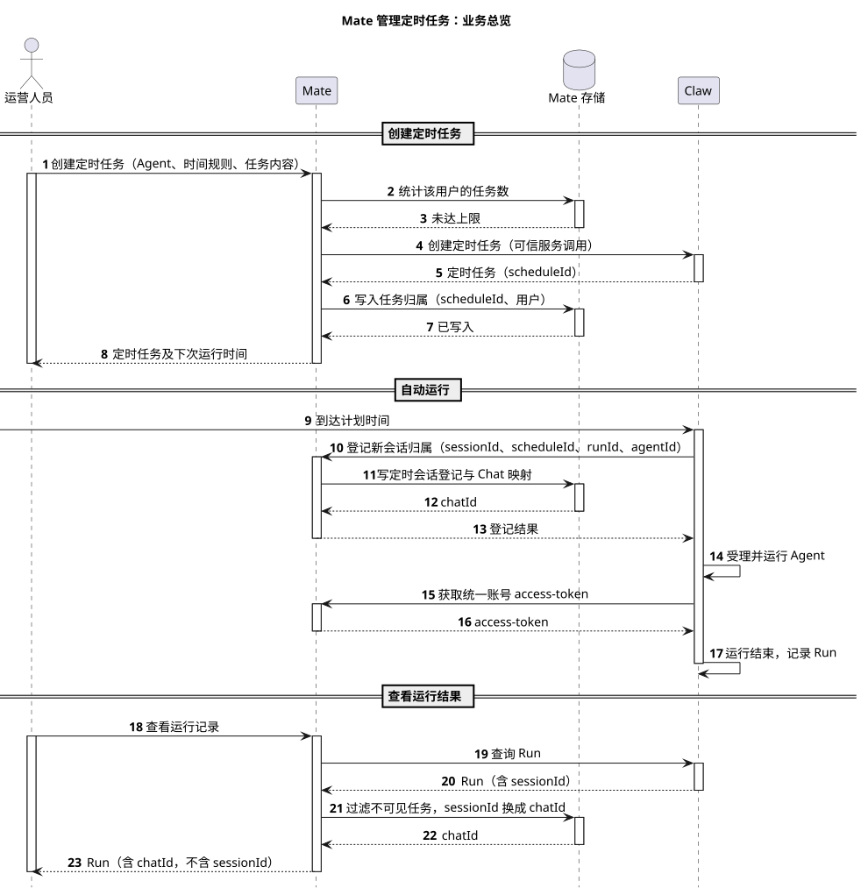
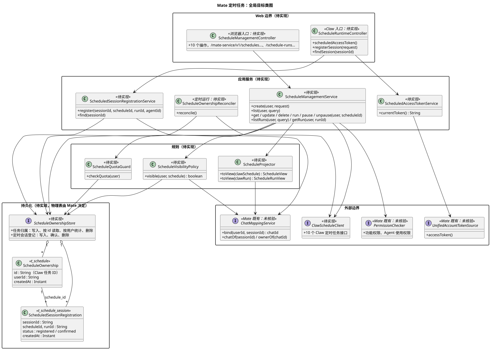
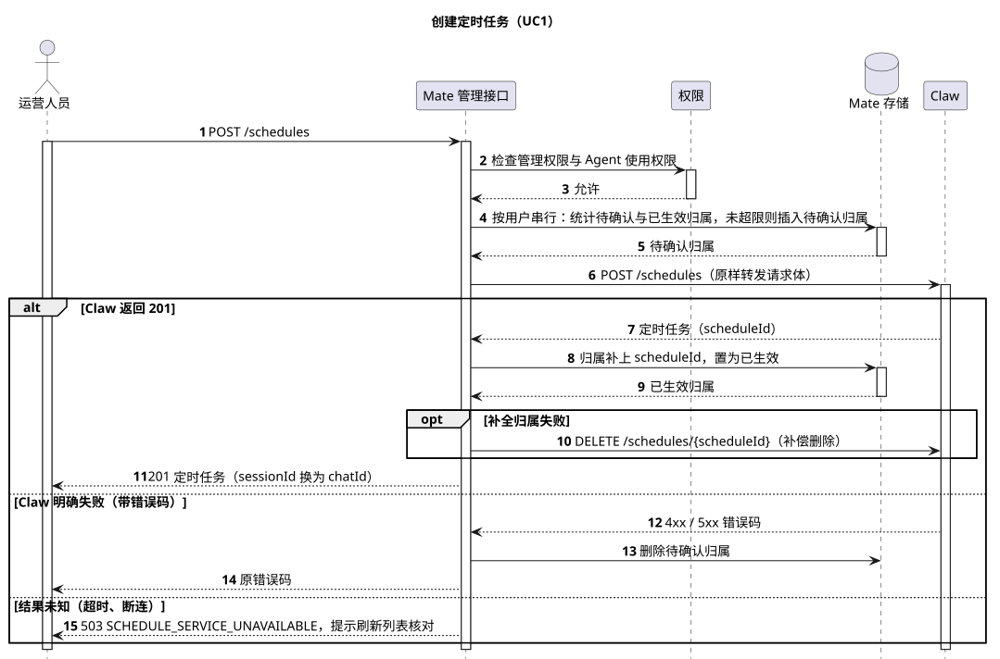
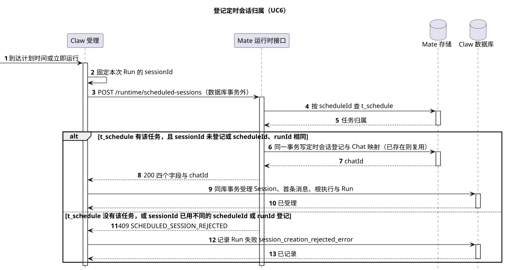

# mate-service 定时任务设计

[服务与接口导航](../README.md) · [Claw 定时任务主设计](../../01-总体架构/08-CampusClaw定时任务/README.md) · [Claw 接口协议](../../01-总体架构/08-CampusClaw定时任务/README.md#interface) · [页面设计 M07 场景09](../../07-前端设计/场景/09-配置与管理定时任务/README.md) · [共享连接目录](../02-CampusMate共享客户端配置/README.md) · [架构对比 A14](../../01-总体架构/07-Agent架构对比/README.md#a14) · [PlantUML 源码](diagram.puml)

本文是 Mate 侧定时任务唯一的设计文档，按“评审记录 / 概述 / 整体方案 / 详细设计 / 接口协议 / 架构指标 / 质量保证 / 基建规范 / 其他补充”组织，集中维护 Mate 在定时任务中的全部职责：对浏览器提供的管理接口、调用 Claw 前后的处理、为 Claw 提供的两个接口以及归属对账。Claw 侧的调度、受理、表结构和 HTTP 契约只在 [Claw 主设计](../../01-总体架构/08-CampusClaw定时任务/README.md)维护，本文引用不复制。标注 **【缺口】** 的位置表示现有材料不足，需要补充。

| 属性 | 值 |
|---|---|
| 文档版本 | 1.0.0 |
| 更新日期 | 2026-10-19 |
| 模块 | M10 · 调度与并发治理（Mate 侧） |
| 设计状态 | 目标设计，Mate 侧全部待实现；Claw 调用 access-token 的一方已实现，Session 归属登记的 Claw 端口已接入受理流程，HTTP 适配待实现 |
| 源码基线 | Claw：pi-mono-java main `ead67eba`（见 [§8.1](#source-evidence)）；mate-service 源码未核验，本文不指定物理表名和既有组件的真实类名 |
| 主基线 | [Claw 定时任务主设计](../../01-总体架构/08-CampusClaw定时任务/README.md) 0.66.0；Claude Managed Agents 的做法引用 Claw 主设计已登记的核对结果（2026-10-08，公开 Beta），本文未重新核对 |

## 评审记录

### 评审结论

【缺口】尚未评审。

<a id="review-todo"></a>

### 评审 Todo

以下各项本文先按“建议”一列设计，评审确认或改动后同步正文。

| # | 问题 | 建议 | 影响 | 负责人 |
|---|---|---|---|---|
| <a id="m1"></a>M1 | 接口配置的任务谁能看到和管理 | 首版只有创建者可见、可管理；不做同组织共享，也不提供管理员视图 | [§4.2.4](#visibility) 的可见范围；Claw [T10](../../01-总体架构/08-CampusClaw定时任务/README.md#todo-t10)（Claw 是否加 userId） | 产品与 Mate |
| <a id="m2"></a>M2 | 每个用户最多能有多少个接口配置的任务 | 每用户 20 个，部署可配置；对话中创建的任务不计入，Claw 已限制每个会话一个启用中的任务 | [§3.3](#create-sequence) 配额检查 | 产品 |
| <a id="m3"></a>M3 | Session 归属登记接口的路径与报文 | 采用 [§4.4.2](#session-ownership) 的两个 runtime 路径 | 关闭 Claw [T7](../../01-总体架构/08-CampusClaw定时任务/README.md#todo-t7) 中登记接口部分；确定后 Claw 实现 HTTP 适配 | Mate 与 Claw |
| <a id="m4"></a>M4 | Mate 写归属失败时留下的无主任务如何处理 | 无主任务登记一律拒绝，因此不会运行业务；对账任务 10 分钟后经 Claw 删除 | [§3.7](#reconciliation) | Mate |
| <a id="m5"></a>M5 | Claw 与 Mate 互相调用的服务认证 | 仍待定，沿用 Claw [T2](../../01-总体架构/08-CampusClaw定时任务/README.md#todo-t2) | [§4.3](#mate-to-claw)、[§4.4](#mate-for-claw) 全部接口 | Mate 与 Claw |
| <a id="m6"></a>M6 | 定时运行产生的对话如何进入 Mate 自己的历史库 | 待后续对齐，本文暂不设计 | 平时 Mate 在转发 events 时写历史，定时运行不经过转发，Mate 历史库没有这些对话 | Mate |
| <a id="m7"></a>M7 | Mate 既有 Chat 映射表的真实结构 | 实现前按 mate-service 源码核对用户 ID、chatId 长度与 Chat 映射表结构 | [§3.2](#data-model) 的字段类型 | Mate |

### 需求信息

需求来源：2026-10-19 讨论串中用户要求设计 Mate 管理入口为定时任务暴露的接口，并把分散的 Mate 侧设计集中到一处。上游业务需求与 Claw 主设计相同（安全 Agent 场景四“配置空间安全管理规则”），页面交互见 [M07 场景09](../../07-前端设计/场景/09-配置与管理定时任务/README.md)。**【缺口】** 需求编号、优先级和目标版本。

## 1. 概述

### 1.1 术语解释

| 术语 | 含义 |
|---|---|
| 接口配置的任务 | 运营人员在管理页通过 Mate 创建的定时任务（Claw `create_source = api`），每次运行新建一个 Session |
| 对话中创建的任务 | 用户在对话中由 Cron 工具创建的任务（Claw `create_source = chat`），关联当前会话，不经 Mate 创建 |
| 管理接口 | Mate 对浏览器提供的 10 个定时任务接口，与 Claw 的 10 个接口一一对应 |
| 任务归属 | Mate `t_schedule` 中的一行，记录接口配置的任务属于哪个用户 |
| 定时会话登记 | Mate 保存的“某次运行新建的 Session 属于哪个用户”记录，同时建立 Chat 映射 |
| 资源投影 | Mate 把 Claw 返回的 sessionId 换成 chatId 后再返回浏览器，其余字段原样返回 |
| 可见范围 | 当前用户能看到和管理的任务集合，规则见 [M1](#m1) |
| 无主任务 | Claw 中存在、但 Mate `t_schedule` 中没有记录的接口配置的任务，通常由创建结果未知或写入 `t_schedule` 失败造成 |
| 统一账号 | Mate 配置的一个业务账号，所有定时运行都用它的 access-token 调用业务工具（Claw [D10](../../01-总体架构/08-CampusClaw定时任务/README.md#key-decisions)） |

### 1.2 需求整理

运营人员在浏览器里通过 Mate 管理定时任务；任务的保存、调度和运行都在 Claw。Mate 在其中承担三件事：

1. **管理入口**：对浏览器提供定时任务的管理接口，负责用户认证、功能权限、可见范围、Agent 使用权限、配额以及任务与用户的关联。
2. **Claw 的调用方**：完成上述检查后，以可信服务身份调用 Claw 的 10 个定时任务接口，不把用户身份传给 Claw。
3. **Claw 的被调用方**：为定时运行提供统一账号 access-token 和 Session 归属登记两个接口。

| 能力 | Mate | Claw |
|---|---|---|
| 用户认证、功能权限、可见范围 | 负责 | 不保存用户，只校验服务来源与 Mate 给出的操作范围 |
| 任务与用户的关联 | 负责，保存任务归属 | 不保存 |
| 配额 | 每用户任务数 | 频率策略（`SCHEDULE_POLICY_REJECTED`）；对话中创建的任务每个会话一个启用中 |
| 字段校验、Cron、计划时间 | 不重复校验，原样转发 | 唯一权威 |
| 调度、受理、运行、Run 记录 | 不参与 | 负责 |
| 定时运行的业务凭据 | 提供统一账号 access-token | 每批工具调用取一次 |
| 新 Session 的归属与访问入口 | 登记并建立 Chat 映射 | 受理前请求登记 |
| 对话中创建的任务 | 只读归属：按关联会话的 Chat 判断 | Cron 工具直接创建，不经 Mate |

非职责：Mate 不保存任务配置副本，不计算计划时间，不参与调度和受理，不直接访问 Claw 数据库；定时运行中 Agent 调用的 Mate 业务工具沿用普通对话的工具通道，不属于本文。

## 2. 整体方案

### 2.1 业务用例

运营人员需要在管理页上维护自己的定时任务，并从每次运行进入对应的会话查看结果；同时不能看到或改动别人的任务，任务数量也要受控。Claw 不知道用户是谁，这些判断都由 Mate 在调用 Claw 前后完成。

| 编号 | 参与者 | 业务目标 | 业务结果 |
|---|---|---|---|
| BU1 | 园区运营人员 | 在管理页创建、修改、暂停、恢复或删除自己的定时任务 | 操作生效，页面显示 Claw 返回的配置和下一次计划时间 |
| BU2 | 园区运营人员 | 查看任务列表和每次运行记录 | 只看到自己的任务及其运行，不看到别人的 |
| BU3 | 园区运营人员 | 从一次运行记录打开对应会话，查看结果并继续追问 | 通过 chatId 进入该会话，与普通对话的入口相同 |
| BU4 | 园区运营人员 | 立即试跑一次任务 | 得到本次运行记录和会话入口 |
| BU5 | 部署管理员 | 限制每个用户可创建的任务数 | 超过上限时创建被拒绝，提示原因 |
| BU6 | 运维人员 | 不因创建失败或网络故障留下没人管的任务 | 无主任务不会运行业务，并被定期清理 |

### 2.2 整体时序

场景：运营人员创建一个接口配置的任务，从创建开始，经过一次自动运行，到查看该次运行结果结束。覆盖 BU1、BU2、BU3；状态：目标设计，待实现。图只画正常流程，失败处理见 [§5.2.1](#failure-recovery)。

| 参与者 | 职责 | 映射 |
|---|---|---|
| 运营人员 | 园区运营人员 | 通过浏览器管理页操作 |
| Mate | 管理入口、Claw 的调用方与被调用方 | mate-service，内部组件见 [§3.2](#data-model) |
| Mate 存储 | 任务归属、定时会话登记与 Chat 映射 | Mate 自己的数据库，物理表未定 |
| Claw | 定时任务的保存、调度、受理与运行 | coding-agent 服务，见 Claw 主设计 |



[原尺寸 SVG](mate_schedule_overview.svg) · [PlantUML 源码](diagram.puml#L1)

| 阶段 | 详细时序 |
|---|---|
| 步骤 1～8：创建定时任务 | [§3.3 创建定时任务的详细时序](#create-sequence) |
| 步骤 9～17：自动运行 | 登记见 [§3.6 登记定时会话归属的详细时序](#registration-sequence)；access-token 见 [§4.4.1](#scheduled-access-token)；受理与运行见 Claw 主设计 §3.5、§3.6 |
| 步骤 18～23：查看运行结果 | [§3.4 列表与可见性](#list-visibility)；打开会话沿用 [通用对话 API](../07-mate-service通用对话API/README.md) |

<a id="key-decisions"></a>

### 2.3 关键设计决策

Claude Managed Agents 是 Claw 定时任务的主基线；它的 Deployment 属于 workspace，由 API key 访问，没有“某个用户的任务”这一层（Claw [D9](../../01-总体架构/08-CampusClaw定时任务/README.md#key-decisions)、[§2.4](../../01-总体架构/08-CampusClaw定时任务/README.md#claude-tradeoffs)）。下面的问题都来自“用户归属在 Mate、执行在 Claw”这一企业约束，其余基线没有可对照的同类实现，因此多数决策按业务约束和一致性要求选择。

| # | 要解决的问题 | 基线怎么做 | 业务约束 | 我们的选择 | 代价 |
|---|---|---|---|---|---|
| D1 | 管理接口自己定义资源，还是与 Claw 一一对应？ | Claude 控制台与 API 直接操作同一个 Deployment 资源 | 页面已按 Claw 契约设计（M07 场景09）；两套字段会产生转换和不一致 | 10 个管理接口与 Claw 路径、字段一一对应，请求原样转发；Mate 只做权限检查、归属记录和资源投影 | Claw 契约变化时 Mate 要同步；页面直接受 Claw 字段约束 |
| D2 | “任务属于谁”存在哪里？ | Claude 以 workspace 为边界，无用户归属 | Claw 不保存用户（Claw D9）；用户、组织与权限都在 Mate | Mate 保存任务归属；列表从 Claw 拉取全部页后按归属过滤 | 读取量随任务总数增长；任务量大后改为 Claw 按用户查询（Claw T10） |
| D3 | Mate 先记录归属还是先调用 Claw 创建？ | 无可对照实现 | Mate 与 Claw 之间没有分布式事务；Claw 创建接口没有幂等键 | 先调用 Claw，拿到任务 ID 后再写 Mate `t_schedule`；配额在调用前按行数统计，不加锁；写入失败补偿删除，补偿失败留给对账 | 并发创建可能比上限多出几个；Mate 写入失败或结果未知时，Claw 会短时留下无主任务，靠登记拒绝与对账兜底 |
| D4 | 浏览器看到的会话标识用什么？ | Claude 直接返回 session_id | Mate 对外只暴露 Chat/chatId，不暴露 Runtime 的 sessionId（[通用对话 API §1](../07-mate-service通用对话API/README.md#1-接口与权威来源)） | Mate 把 Schedule 与 Run 中的 sessionId 投影为 chatId；接口配置的任务在登记时建立 Chat 映射 | 映射暂时查不到时 chatId 为 null，页面显示“结果入口准备中” |
| D5 | 无主任务怎样避免以统一账号运行业务？ | 无可对照实现 | 统一账号权限大；无主任务没有人能看到或管理 | 登记接口对 `t_schedule` 中没有记录的任务一律拒绝，Claw 因此不受理；对账任务 10 分钟后经 Claw 删除 | 无主任务在被删除前到点会产生一条失败 Run（`session_creation_rejected_error`），删除任务时随之删除 |
| D6 | 任务对谁可见？ | Claude 按 workspace 范围列出 | 首版没有共享和管理员视图的需求 | 只有创建者可见、可管理（[M1](#m1)）；对话中创建的任务按关联 Chat 的所属用户判断 | 不能团队共享；创建者离职后任务仍以统一账号运行，首版没有管理员入口处理，见 [§5.2.4](#emergency-plan) |

## 3. 详细设计

### 3.1 系统用例

| 用例 | 对应业务用例 | 触发者 | 前置条件 | 主成功结果 | 关键约束 |
|---|---|---|---|---|---|
| UC1 | BU1、BU5 | 运营人员 | 有管理权限，能使用所选 Agent，未超配额 | 任务在 Claw 创建，Mate `t_schedule` 已写入 | 配额按行数检查，并发时可能略超；结果未知不自动重试 |
| UC2 | BU2 | 运营人员 | 有读取权限 | 返回当前用户可见的任务列表或详情 | 不可见任务一律按不存在处理 |
| UC3 | BU1 | 运营人员 | 有管理权限，任务可见 | 修改、暂停、恢复或删除生效 | 删除只删任务归属，已生成会话保留 |
| UC4 | BU4 | 运营人员 | 有运行权限，任务可见 | 返回本次 Run 及会话入口 | Mate 不得持有会阻塞登记的锁 |
| UC5 | BU2、BU3 | 运营人员 | 有读取权限 | 返回可见任务的 Run，会话标识为 chatId | 响应不含 sessionId |
| UC6 | BU3 | Claw | 接口配置的任务到点或立即运行 | 定时会话登记与 Chat 映射已建立 | 同一 sessionId 幂等；`t_schedule` 中没有该任务则拒绝 |
| UC7 | — | Claw | 定时运行中有需要凭据的工具调用 | 返回统一账号 access-token | Token 不落库、不进日志 |
| UC8 | BU6 | Mate 定时任务 | 无 | 无主任务与未提交登记被清理 | 只读 Claw 公开接口；结果未知不删 |

<a id="data-model"></a>

### 3.2 数据模型

目标新增两张表：`t_schedule`、`t_schedule_session`，放在 Mate 自己的数据库，Claw 不读取。命名、类型与约束写法沿用 [Claw 数据库设计](../../03-数据与存储/Claw数据库设计.md)的通用约定；引用 Claw 资源的列与 Claw `t_schedule`、`t_schedule_run` 的同名列类型一致；mate-service 源码与既有表未核验，用户 ID 与 chatId 的长度先按 64 设计，实现前按 Mate 实际定义核对（[M7](#m7)）。

<a id="mate-tables"></a>

#### 3.2.1 表职责与关联

| 表 | 权威职责 | 关联及生命周期 |
|---|---|---|
| `t_schedule` | 接口配置的任务属于哪个用户 | `id` 即 Claw `t_schedule.id`，不设外键；Claw 创建成功后写入，删除任务时删除；对话中创建的任务不建记录 |
| `t_schedule_session` | 每次运行新建的 Session 属于哪个用户，以及对应的 chatId | `session_id` 逻辑引用 Claw 的 `t_sessions.id`；删除任务不删除；Session 删除时与 Chat 映射一起删除 |
| Mate 既有 Chat 映射表 | Chat → Session 映射与所属用户 | 结构不变，未核验；登记时在同一事务内写入一行（[§3.2.4](#mate-transactions)） |

不新增任务配置副本、Run 副本、配额计数或请求去重表。任务配置、计划时间和 Run 只在 Claw 保存，Mate 每次读取 Claw；配额按 `t_schedule` 的行数计算。

<a id="t_schedule_owner"></a>
<a id="t_schedule"></a>

#### 3.2.2 t_schedule：任务归属

只保存判断归属所需的列。各列没有数据库 DEFAULT，由应用赋值。

| 字段 | SQL 类型 | 可空 | 数据库默认值 | 含义 |
|---|---|---|---|---|
| id | VARCHAR(41) | 否 | — | Claw 返回的任务 ID，与 Claw `t_schedule.id` 相同 |
| user_id | VARCHAR(64) | 否 | — | 创建者的用户 ID，创建后不修改 |
| created_at | TIMESTAMPTZ(0) | 否 | — | 写入时刻 |

主键：`id`。

| 索引 | 规则 | 支持的访问 |
|---|---|---|
| idx_schedule_user | `(user_id)` | 列表过滤时取当前用户全部任务 ID；创建前统计该用户任务数 |

可见性检查、登记和删除都按主键访问。行存在即表示任务已生效，没有中间状态，不需要状态列和 CHECK。

<a id="t_schedule_session"></a>

#### 3.2.3 t_schedule_session：定时会话登记

| 字段 | SQL 类型 | 可空 | 数据库默认值 | 含义 |
|---|---|---|---|---|
| session_id | VARCHAR(40) | 否 | — | Claw 为本次运行固定的 Session ID |
| schedule_id | VARCHAR(41) | 否 | — | 所属任务，登记时 Mate `t_schedule` 中必须有该任务；之后任务删除不影响本行 |
| run_id | VARCHAR(36) | 否 | — | 本次 Run |
| agent_id | VARCHAR(38) | 否 | — | 本次运行使用的 Agent |
| user_id | VARCHAR(64) | 否 | — | 登记时从 `t_schedule` 复制的所属用户；之后访问授权以 Chat 映射为准 |
| chat_id | VARCHAR(64) | 否 | — | 登记时为该用户建立的 Chat |
| status | VARCHAR(16) | 否 | — | `registered` 已登记、Claw 是否提交未知；`confirmed` 已确认 Claw 中存在该 Session |
| created_at | TIMESTAMPTZ(0) | 否 | — | 登记时刻 |
| confirmed_at | TIMESTAMPTZ(0) | 是 | — | 确认时刻 |

主键：`session_id`。

| 索引 | 规则 | 支持的访问 |
|---|---|---|
| uk_schedule_session_run | 唯一 `(run_id)` | 一次 Run 只登记一个 Session |
| uk_schedule_session_chat | 唯一 `(chat_id)` | 一个 Chat 只对应一次定时运行 |
| idx_schedule_session_unconfirmed | `(created_at) WHERE status = 'registered'` | 对账查找超过准备期限仍未确认的登记 |

数据库约束：

- status 只能是 `registered` / `confirmed`。
- status 为 `registered` 时 confirmed_at 为空，为 `confirmed` 时非空。

流转：登记时插入 `registered`；对账读到 Claw 中该 Session 存在时改为 `confirmed`；对账读到 Claw 明确不存在时与 Chat 映射一起删除。`confirmed` 之后只随 Session 删除。

<a id="mate-transactions"></a>

#### 3.2.4 事务、删除与保留

| 操作 | 同一事务内维持的不变量 |
|---|---|
| 创建 | Claw 返回 201 后插入 `t_schedule`；插入失败时调用 Claw 删除刚创建的任务作补偿。配额统计在调用 Claw 之前，不加锁 |
| 删除任务 | Claw 删除成功或返回 404 后，按 id 删除 `t_schedule` 行；不动定时会话登记与 Chat 映射 |
| 登记 | 以共享锁读取该 schedule_id 的 `t_schedule` 行，没有则拒绝；按 session_id 查已有登记，四个字段相同则返回原记录，不同则拒绝；否则插入 `registered` 登记与 Chat 映射。删除任务的事务持排他锁，两者先后提交，不会登记到已删除的任务 |
| 确认登记 | 对账读到 Session 存在时，把 `registered` 改为 `confirmed` |
| 删除未提交登记 | 对账确认 Claw 中不存在该 Session 后，删除登记与 Chat 映射 |
| 删除 Session | 沿用 Mate 删除 Chat 的流程；同事务删除定时会话登记 |

保留：任务归属随任务；定时会话登记随 Session；本设计不新增保留期清理。所有调用 Claw 的步骤都在数据库事务外，事务内不等待远端。

<a id="target-class-diagram"></a>

#### 3.2.5 全局目标类图



[原尺寸 SVG](mate_schedule_architecture.svg) · [PlantUML 源码](diagram.puml#L127)

分层理由：浏览器入口和 Claw 入口分成两个 Controller，因为它们的认证方式不同（用户认证与服务认证，[§5.1](#security)），不能共用一个过滤链。可见范围、配额和投影抽成三个规则类，由管理服务统一调用，保证 10 个操作用同一套判断，避免各接口各写一份“这个任务是不是你的”。公司权限、Chat 映射和统一账号认证是 Mate 既有能力，图中只画成接口，接入方式待实现时按 mate-service 源码核对。实现时先落两张表与可见范围规则，再接管理接口，然后是登记接口，最后是对账。

<a id="create-sequence"></a>

### 3.3 创建定时任务的详细时序（UC1）



[原尺寸 SVG](mate_schedule_create.svg) · [PlantUML 源码](diagram.puml#L50)

| 步骤 | 规则 |
|---|---|
| 2～3 | 校验管理权限与 Agent 使用权限，不通过返回 403，不调用 Claw |
| 4～5 | 统计当前用户在 `t_schedule` 中的任务数，达到上限（[M2](#m2)）返回 422 `SCHEDULE_QUOTA_EXCEEDED`。不加锁：同一用户同时提交多个创建时，可能比上限多出几个 |
| 6 | 请求体原样转发给 Claw，Mate 不增删字段 |
| 7～11 | Claw 返回 201：插入 `t_schedule`，返回投影后的资源；插入失败则调用 Claw 删除刚创建的任务作补偿，补偿也失败时留给 [§3.7](#reconciliation) 对账 |
| 12～13 | Claw 明确失败（4xx/5xx 带错误码）：Mate 没有写入任何记录，按 [§4.2.5](#management-errors) 返回 |
| 14 | 结果未知（超时、断连）：返回 503 `SCHEDULE_SERVICE_UNAVAILABLE`，提示用户刷新列表核对；Mate 不自动重试，Claw 也没有幂等键 |

步骤 10 的补偿失败和步骤 14 都可能在 Claw 留下无主任务。这类任务对用户不可见，到点运行时登记会被拒绝（[§3.6](#registration-sequence)），因此不会执行业务，最终由对账清理。

<a id="list-visibility"></a>

### 3.4 列表与可见性（UC2、UC5）

Claw 首版不按用户过滤（Claw [D9](../../01-总体架构/08-CampusClaw定时任务/README.md#key-decisions)），Mate 自行过滤和分页：

1. 把 name、agentId、status 筛选原样转给 Claw，以 `limit=200` 从 page 1 拉到 `nextPage` 为 null。
2. 按 id 去重，按 [§4.2.4](#visibility) 保留当前用户可见的任务。Claw 的顺序（updatedAt DESC、id ASC）在过滤后保持不变，不重新排序。
3. 按请求的 page/limit（与 Claw 相同：page 默认 1，limit 默认 50、范围 1～200）切页，返回 `{schedules, nextPage}`。

Run 查询：

| 请求 | 处理 |
|---|---|
| 带 scheduleId 的列表 | 先检查该任务可见，不可见返回空页；可见则把全部 query 原样转给 Claw 单次查询并投影 |
| 不带 scheduleId 的列表 | 拉取 Claw 全部页（其余筛选原样转发），只保留可见任务的 Run，再按 page/limit 切页；顺序保持 Claw 的 createdAt DESC、id DESC |
| 详情 | 读取 Claw Run，再检查其 scheduleId 对应任务可见；不可见返回 404 `SCHEDULE_RUN_NOT_FOUND` |

跨页拉取期间有并发修改时可能重复或遗漏，与 Claw 普通翻页的限制相同。

<a id="detail-write"></a>

### 3.5 详情与写操作（UC3、UC4）

详情、更新、删除、立即运行、暂停、取消暂停都先做可见性检查，不可见直接返回 404，不调用 Claw。

- **可见性判断**：先查 `t_schedule`，有记录且 user_id 为当前用户即可见；没有记录时读取 Claw 详情，sessionId 非空（对话中创建的任务）且该会话对应的 Chat 属于当前用户才可见。
- **修改 agentId**：再检查当前用户能否使用新 Agent。对话中创建的任务不能改 agentId（Claw 拒绝）。
- **删除**：Claw 返回成功后删除 `t_schedule` 中的记录；Claw 返回 404 时同样删除记录并返回 404。已生成的 Session、定时会话登记与 Chat 映射保留。
- **立即运行**：接口配置的任务会在这次请求中触发 Claw 回调登记，Mate 的管理请求不得持有会阻塞登记的锁。对话中创建的任务立即运行时，Claw 在关联会话追加一轮，会话正忙则 Run 记为 `session_busy_error`。
- **结果未知**：写操作超时后返回 503，不自动重试；页面先读取详情核对，规则同 Claw [§4.5](../../01-总体架构/08-CampusClaw定时任务/README.md#reliable-write-flow)。

<a id="registration-sequence"></a>

### 3.6 登记定时会话归属的详细时序（UC6）

接口配置的任务每次运行都新建 Session。Mate 需要知道这个 Session 属于哪个用户，之后用户读取、继续、停止或删除它时，Mate 才能据此授权再调用 Claw。2026-10-13 评审确定归属登记保留在 Mate，Claw 不保存用户或归属。对话中创建的任务在用户自己的会话里运行，归属随会话，不登记。



[原尺寸 SVG](mate_session_registration.svg) · [PlantUML 源码](diagram.puml#L92)

| 步骤 | 规则 |
|---|---|
| 2 | Claw 为同一次 Run 先固定 sessionId，之后准备和受理都复用这个 ID |
| 3 | 在 Claw 数据库事务外请求登记 |
| 4～5 | 按 scheduleId 查 `t_schedule`；没有该任务（已删除、无主或是对话中创建的任务）时拒绝 |
| 6～7 | sessionId 已登记：四个字段完全相同则直接返回原登记（幂等）；任一字段不同则拒绝。未登记时在同一事务中写 `registered` 登记、为 `t_schedule` 中该任务的 user_id 建立 Chat 映射（[§3.2.5](#mate-transactions)） |
| 8～10 | 登记成功后，Claw 在同库事务中创建 Session、首消息、根执行和 Run 关联；Mate 记录不加入这个事务 |
| 11～13 | Mate 明确拒绝时 Claw 本次不受理，Run 记为 `session_creation_rejected_error` |

登记结果未知（超时、500、503）时，Claw 只调用只读核对接口，不重发登记，也不换新 ID；准备期限内仍未知则本次不受理，Run 记为 `unknown_error`（Claw [§4.8.2](../../01-总体架构/08-CampusClaw定时任务/README.md#mate-calls)）。删除 Schedule/Run 不删除已建立的 Session 归属；Session 删除后由 Mate 关闭对应访问映射。

<a id="reconciliation"></a>

### 3.7 对账与清理（UC8）

Mate 定期（建议每 10 分钟）运行一次对账，只处理 Mate 自己的记录和 Claw 中的无主任务：

| 对象 | 判断 | 处理 |
|---|---|---|
| 无主任务 | Claw 列表中 `sessionId` 为 null、创建超过 10 分钟、Mate `t_schedule` 中没有记录 | 经 Claw DELETE 删除；它运行时登记会被拒绝，不会执行业务（[M4](#m4)） |
| 未确认的定时会话登记 | `registered` 且超过准备期限，读取 Claw 该 Session | 存在则改为 `confirmed`；明确不存在则删除登记与 Chat 映射；读取结果未知时保留，下轮再查 |

对账只读取 Claw 公开接口，不直接访问 Claw 数据库。无主任务的删除与普通删除一样保留已生成的 Session。

<a id="interface"></a>

## 4. 接口协议

本章是 Mate 侧定时任务接口的唯一维护处。

### 4.1 接口总览

定时任务涉及的全部接口集中列在这里；Mate 后续新增或修改接口须同步本表。

| 方向 | 接口 | 定义位置 | 状态 |
|---|---|---|---|
| 浏览器 → Mate | 10 个管理接口 `/mate-service/v1/schedules…`、`/mate-service/v1/schedule-runs…` | [§4.2](#management-api) | 待实现 |
| Mate → Claw | 10 个定时任务接口 `/campusclaw-service/v1/schedules…`、`/schedule-runs…` | [Claw §4.2](../../01-总体架构/08-CampusClaw定时任务/README.md#interface-list)；Mate 侧约定见 [§4.3](#mate-to-claw) | 待实现 |
| Claw → Mate | 获取统一账号 access-token | [§4.4.1](#scheduled-access-token) | Claw 已实现调用方，Mate 待实现 |
| Claw → Mate | Session 归属登记与核对 | [§4.4.2](#session-ownership) | Claw 端口已接入受理，HTTP 适配与 Mate 待实现 |
| Claw → Mate | Agent runtime、Skill、工具查询、工具执行、模型调用 | [共享连接目录](../02-CampusMate共享客户端配置/README.md) | 普通对话已在用，定时任务不新增 |

<a id="management-api"></a>

### 4.2 管理接口（浏览器 → Mate）

#### 4.2.1 公共约定

| 项 | 规定 |
|---|---|
| 基础路径 | `/mate-service/v1` |
| 认证与 Header | 与 [通用对话 API §3.1](../07-mate-service通用对话API/README.md#31-认证header-与-path) 相同：Authorization 与 X-HW-APPKEY 至少一个，JWT 优先；X-HW-ID 为显式请求头；不接收 access-token，定时运行不使用调用者的凭据 |
| 报文 | ResultBean，lowerCamelCase；成功 `resCode/resMsg/result`，失败只有 `resCode/resMsg`，保留真实 HTTP 状态；`Cache-Control: no-store` |
| 时间 | 沿用 Claw：UTC 秒级、以 Z 结尾；页面按任务时区或浏览器时区显示 |
| 语言 | 错误文案按公司公共上下文的语言返回，`Content-Language` 标明实际语言 |
| 请求字段 | 与 Claw 契约相同，Mate 不增删业务字段，未知字段由 Claw 拒绝 |

#### 4.2.2 接口清单

每个管理接口对应一个 Claw 接口，请求字段和 query 原样转发；Mate 只在转发前做权限检查、转发后做归属记录和资源投影。

| 操作 | Mate 方法与路径 | 需要的功能权限 | 对应 Claw 接口 | Mate 额外处理 |
|---|---|---|---|---|
| 创建 | POST `/schedules` | 管理 | POST `/schedules` | Agent 使用权限、配额；Claw 创建成功后写 `t_schedule`（[§3.3](#create-sequence)） |
| 列表 | GET `/schedules` | 读取 | GET `/schedules`（拉取全部页） | 按可见范围过滤后自行分页（[§3.4](#list-visibility)） |
| 详情 | GET `/schedules/{scheduleId}` | 读取 | GET `/schedules/{scheduleId}` | 可见性检查 |
| 部分更新 | POST `/schedules/{scheduleId}` | 管理 | POST `/schedules/{scheduleId}` | 可见性检查；改 agentId 时检查 Agent 使用权限 |
| 删除 | DELETE `/schedules/{scheduleId}` | 管理 | DELETE `/schedules/{scheduleId}` | 可见性检查；成功后删除 `t_schedule` 中的记录 |
| 立即运行 | POST `/schedules/{scheduleId}/run` | 运行 | POST `/schedules/{scheduleId}/run` | 可见性检查；Run 投影 |
| 暂停 | POST `/schedules/{scheduleId}/pause` | 管理 | POST `/schedules/{scheduleId}/pause` | 可见性检查 |
| 取消暂停 | POST `/schedules/{scheduleId}/unpause` | 管理 | POST `/schedules/{scheduleId}/unpause` | 可见性检查 |
| Run 列表 | GET `/schedule-runs` | 读取 | GET `/schedule-runs`（指定任务时单次，否则拉取全部页） | 可见性过滤 |
| Run 详情 | GET `/schedule-runs/{runId}` | 读取 | GET `/schedule-runs/{runId}` | 按所属任务检查可见性 |

路径和资源名与 Claw 一致，请求与响应报文以 Claw [§4.4](../../01-总体架构/08-CampusClaw定时任务/README.md#interface) 为准，[M07 场景09](../../07-前端设计/场景/09-配置与管理定时任务/README.md) 描述的报文语义（如 `schedule:null` 表示仅手动运行）直接适用于本接口。

#### 4.2.3 资源投影

Mate 原样返回 Claw 的 Schedule 与 Run，只替换会话标识：

| Claw 字段 | Mate 字段 | 规则 |
|---|---|---|
| Schedule.sessionId | Schedule.chatId | 接口配置的任务为 null；对话中创建的任务为关联会话的 chatId |
| Run.sessionId | Run.chatId | 受理成功时为登记时建立的 chatId（对话中创建的任务为原 Chat）；受理失败为 null；映射暂时查不到时为 null，页面显示“结果入口准备中”，不能因此再次运行 |

其余字段（id、scheduleId、agentId、triggerContext、error、status、pausedReason、schedule、metadata、时间）原样返回。scheduleId 与 runId 是 Claw 生成的不透明 ID，Mate 不另造公共 ID。

<a id="visibility"></a>

#### 4.2.4 权限与可见范围

| 检查 | 规则 |
|---|---|
| 功能权限 | 读取、管理、运行三项，来自公司权限体系；缺少时返回 403，不调用 Claw |
| 可见范围 | 接口配置的任务：`t_schedule` 中该任务的 user_id 为当前用户；对话中创建的任务：关联 Chat 属于当前用户（[M1](#m1)） |
| 不可见 | 一律按不存在处理：详情与写操作返回 404 `SCHEDULE_NOT_FOUND`，Run 详情返回 404 `SCHEDULE_RUN_NOT_FOUND`，列表中不出现 |
| Agent 使用权限 | 创建和修改 agentId 时，按 Mate 现有 Agent 权限检查当前用户能否使用该 Agent；不能用返回 403 `SCHEDULE_AGENT_FORBIDDEN` |
| 用户权限变化 | 只在管理操作时检查；用户失去权限或离职后，已保存的任务仍按统一账号运行（Claw [D10](../../01-总体架构/08-CampusClaw定时任务/README.md#key-decisions)） |

<a id="management-errors"></a>

#### 4.2.5 错误

| HTTP / resCode | 来源与含义 |
|---|---|
| 401 公司认证组件错误码 | 用户认证失败，复用公司组件 |
| 403 `SCHEDULE_READ_FORBIDDEN` / `SCHEDULE_MANAGE_FORBIDDEN` / `SCHEDULE_RUN_FORBIDDEN` | 用户缺少对应功能权限，Mate 判断 |
| 403 `SCHEDULE_AGENT_FORBIDDEN` | 用户不能使用请求的 Agent，Mate 判断 |
| 422 `SCHEDULE_QUOTA_EXCEEDED` | 当前用户任务数已达上限，Mate 判断 |
| 404 `SCHEDULE_NOT_FOUND` / `SCHEDULE_RUN_NOT_FOUND` | 不存在、已删除或不可见 |
| 400、404、409、422 的 Claw 业务错误码 | 字段校验、激活冲突、频率策略等，resCode 原样返回，文案由 Mate 按语言重新给出 |
| 503 `SCHEDULE_SERVICE_UNAVAILABLE` | Claw 不可达或结果未知；Claw 返回 401/403（服务认证或 Mate 传入的操作范围有误，属部署问题）也映射为 503，并记录告警 |
| 500 `SCHEDULE_*_FAILED` | Claw 内部失败，原样返回 |

错误不回显 Claw 内部地址、原始异常或 sessionId。

<a id="mate-to-claw"></a>

### 4.3 Mate 调用 Claw

| 项 | 规定 |
|---|---|
| 服务认证 | 每个请求附 Mate 的服务凭据，机制待定（[M5](#m5)、Claw T2） |
| 操作范围 | 随请求告诉 Claw 本次允许的操作（读取 / 管理 / 运行）和可选的 Agent 限制，Claw 映射为 `ScheduleAccessDTO`；携带方式随 T2 确定 |
| 不传内容 | 用户 ID、组织、访问令牌、可见集合；Claw 不需要也不保存 |
| 超时 | 读取可有界重试；写入不自动重试，按 [§3.3](#create-sequence)、[§3.5](#detail-write) 处理结果未知 |

<a id="mate-for-claw"></a>

### 4.4 Mate 为 Claw 提供的接口

两个接口都只允许已认证的 Claw 服务调用（[M5](#m5)），不接收用户凭据；成功与错误都用 ResultBean，`Cache-Control: no-store`，支持 `Accept-Language` zh-CN / en-US，缺省 en-US，只影响错误文案。Claw 何时调用、失败后怎么处理只在 Claw [§4.8](../../01-总体架构/08-CampusClaw定时任务/README.md#mate-calls) 维护。

<a id="scheduled-access-token"></a>

#### 4.4.1 获取统一账号 access-token

普通对话中，用户请求带着 `access-token` Header，Claw 调用 Mate 业务工具时原样透传（[M06 §7.1](../../01-总体架构/01-CampusClaw多Agent运行时/chat-http-v1-design.md#credential-forwarding)）。定时任务到点运行时没有用户请求，也就没有用户的 access-token。2026-10-13 评审确定：所有定时任务统一使用 Mate 配置的同一个账号，Claw 运行时向 Mate 取这个账号的 access-token。

**请求**

```http
POST /mate-service/v1/runtime/scheduled-access-token
Accept-Language: zh-CN
```

| 项 | 规定 |
|---|---|
| 路径 | 草案路径；Claw 用 `campusclaw.schedule.access-token-path` 配置，服务地址沿用[共享连接目录](../02-CampusMate共享客户端配置/README.md)的 `campusmate.base-url` |
| 请求体与参数 | 无请求体，无 query 参数；不传用户、任务、Session 或 Agent 标识 |

**成功响应**：HTTP 200。

```json
{
  "resCode": "0",
  "resMsg": "success",
  "result": {
    "accessToken": "<value supplied by Mate>"
  }
}
```

| 字段 | 规定 |
|---|---|
| result.accessToken | 统一账号当前有效的 access-token，非空字符串；Claw 收到空值按失败处理 |
| 响应头 | `Cache-Control: no-store`；网关与客户端不记录响应正文 |

首版不返回有效期，Claw 也不缓存。以后若需要减少调用，可增加过期时间字段，由 Claw 在进程内缓存、临近过期再取。

**错误**：只返回 resCode 与 resMsg，不回显 Token、内部地址或原始异常。

| HTTP / resCode | 含义 | zh-CN / en-US |
|---|---|---|
| 401 / SCHEDULED_TOKEN_AUTH_REQUIRED | 调用方不是获准的 Claw 服务 | 定时执行凭据认证失败。 / Scheduled execution token authentication is required. |
| 403 / SCHEDULED_TOKEN_FORBIDDEN | 统一账号未配置或已停用 | 定时执行账号不可用。 / Scheduled execution account is not available. |
| 500 / SCHEDULED_TOKEN_FAILED | 内部处理失败 | 获取定时执行凭据失败。 / Failed to obtain scheduled execution token. |
| 503 / SCHEDULED_TOKEN_UNAVAILABLE | 认证中心等依赖不可用 | 定时执行凭据服务暂不可用。 / Scheduled execution token service is temporarily unavailable. |

<a id="session-ownership"></a>

#### 4.4.2 Session 归属登记与核对

路径与报文为本文提出的草案（[M3](#m3)），处理规则见 [§3.6](#registration-sequence)。Claw 侧端口为 `ScheduleSessionRegistry` 的 `registerSession` 与 `findSessionRegistration`，HTTP 适配在本接口确定后实现。

**登记**

```http
POST /mate-service/v1/runtime/scheduled-sessions
Content-Type: application/json

{
  "sessionId": "session-3f0c9a1e5b7d4c2a8e6f1b0d9c8a7e65",
  "scheduleId": "schedule-927e03d2a4784f90a6238e790539c6e4",
  "runId": "run-4b1d2c3e5f60718293a4b5c6d7e8f901",
  "agentId": "agent-550e8400e29b41d4a716446655440000"
}
```

| 字段 | 规定 |
|---|---|
| sessionId、scheduleId、runId、agentId | 必填，Claw 生成的 ID，格式为前缀加 32 位十六进制；不传用户、消息正文或凭据 |

成功 HTTP 200，result 返回与请求相同的四个字段，另附 chatId；Claw 只比较四个字段，忽略 chatId：

```json
{
  "resCode": "0",
  "resMsg": "success",
  "result": {
    "sessionId": "session-3f0c9a1e5b7d4c2a8e6f1b0d9c8a7e65",
    "scheduleId": "schedule-927e03d2a4784f90a6238e790539c6e4",
    "runId": "run-4b1d2c3e5f60718293a4b5c6d7e8f901",
    "agentId": "agent-550e8400e29b41d4a716446655440000",
    "chatId": "<chatId generated by Mate>"
  }
}
```

**只读核对**

```http
GET /mate-service/v1/runtime/scheduled-sessions/{sessionId}
```

已登记时 HTTP 200，result 与登记响应同形；未登记返回 404 `SCHEDULED_SESSION_NOT_FOUND`，Claw 视为空。只读，不创建记录。

**错误**

| HTTP / resCode | 含义 | Claw 处理 |
|---|---|---|
| 400 / SCHEDULED_SESSION_REQUEST_INVALID | 字段缺失或格式非法 | 明确拒绝，本次不受理 |
| 401 / SCHEDULED_SESSION_AUTH_REQUIRED | 调用方不是获准的 Claw 服务 | 明确拒绝，本次不受理 |
| 404 / SCHEDULED_SESSION_NOT_FOUND | 仅核对：未登记 | 继续核对直到准备期限 |
| 409 / SCHEDULED_SESSION_REJECTED | `t_schedule` 中没有该任务，或 sessionId 已用不同字段登记 | 明确拒绝，Run 记为 `session_creation_rejected_error` |
| 500 / SCHEDULED_SESSION_FAILED | 内部处理失败 | 结果未知，转只读核对 |
| 503 / SCHEDULED_SESSION_UNAVAILABLE | 存储等依赖不可用 | 结果未知，转只读核对 |

## 5. 架构指标

<a id="security"></a>

### 5.1 安全性

- 浏览器入口只接受公司用户认证；Claw 入口只接受 Claw 的服务认证（[M5](#m5)），两类入口不共用认证链。
- 不可见的任务和 Run 一律按不存在返回 404，不泄露其存在。
- Mate 调用 Claw 时不传用户身份和访问令牌；Claw 只凭服务认证和 Mate 给出的操作范围执行。
- 对外响应不含 sessionId、Claw 内部地址或原始异常。
- 统一账号 access-token 只在响应正文中出现一次，不落库、不写日志；网关与客户端不记录该响应正文。
- 统一账号权限是所有定时任务的权限上限；用户权限只在管理操作时检查，这是 Claw D10 已接受的代价。

<a id="stability"></a>

### 5.2 稳定性

<a id="failure-recovery"></a>

#### 5.2.1 失败处理与恢复

| # | 失败 | 处理 | 结果 |
|---|---|---|---|
| F1 | 创建时 Claw 明确失败 | Mate 未写入任何记录，返回原错误码 | 无残留 |
| F2 | 创建时结果未知 | 不写 `t_schedule`，返回 503，不自动重试 | Claw 可能有无主任务，由对账删除；运行前登记会被拒绝 |
| F3 | Claw 创建成功但写入 `t_schedule` 失败 | 调用 Claw 删除作补偿 | 补偿失败时同 F2 |
| F4 | 写操作结果未知 | 返回 503，不重试 | 页面读取详情核对 |
| F5 | 登记时 Mate 存储不可用 | 返回 503 | Claw 转只读核对，期限内仍未知则本次 Run 记为 `unknown_error`，不运行 |
| F6 | Mate 已登记、Claw 受理回滚 | 对账确认 Session 不存在后删除登记 | Claw 读取结果未知时保留，不凭超时删除 |
| F7 | 统一账号或认证中心不可用 | access-token 接口返回 403 或 503 | Claw 本批需要凭据的工具不执行，模型可在下一批重试 |
| F8 | Claw 返回 401/403 | 映射为 503 并告警 | 属部署或服务认证配置问题 |

#### 5.2.2 容量与限流

列表与不带 scheduleId 的 Run 列表每次拉取 Claw 全部页，读取量随任务总数和 Run 总数增长；每页 200 条。**【缺口】** 容量目标、单用户与全局请求限流、全量拉取的上限与压测计划。任务量增长后改由 Claw 按用户查询（Claw T10）。

#### 5.2.3 监控告警

建议记录：对账删除的无主任务数、登记被拒绝数、登记与核对的失败率、access-token 接口失败率、Claw 返回 401/403 的次数。**【缺口】** 指标名称、阈值与告警接收人。

<a id="emergency-plan"></a>

#### 5.2.4 应急预案

**【缺口】** 首版只有创建者可见（M1），创建者离职或失去权限后任务仍以统一账号运行，没有管理员入口暂停或删除；需要确定由谁、通过什么入口处置，以及紧急停用全部定时运行的方式。统一账号被停用时，所有定时运行的业务工具调用都会失败（F7），恢复账号后无需其他处理。

<a id="compatibility"></a>

### 5.3 兼容性

全部为新增接口，不改变 Claw 已有契约和通用对话 API。access-token 接口的路径与报文沿用原草案（原 `02-CampusMate共享客户端配置/scheduled-execution.md`），Claw 已实现的调用方无需改动；登记接口在 M3 确认前路径仍可调整。

## 6. 质量保证

### 6.1 灰度能力

**【缺口】** Mate 管理接口的灰度方式。登记接口上线前，Claw 默认实现一律返回服务不可用，接口配置的任务到点不会运行（Claw §4.8.2），因此可以先上线管理接口与登记接口，再开放页面入口。

### 6.2 回滚能力

回滚 Mate 后，Claw 调用登记接口失败，接口配置的任务不会运行，也不会以错误归属运行；已保存的任务归属与登记记录不受回滚影响，重新发布后继续使用。**【缺口】** 存储结构变更的回滚脚本。

### 6.3 自动化测试

| 范围 | 验收 |
|---|---|
| 管理接口 | 10 个操作与 Claw 一一对应；不可见任务一律 404；列表与 Run 列表只含可见记录；sessionId 不出现在任何响应中 |
| 创建 | 达到配额返回 422；Claw 失败时不写入；结果未知不自动重试；写入 `t_schedule` 失败触发补偿删除 |
| 删除 | 删除后 `t_schedule` 记录清除，已生成会话仍可从 Chat 打开 |
| 对话中创建的任务 | 关联 Chat 的所属用户可见、可管理，不能改 agentId |
| access-token | 只认 Claw 服务认证；统一账号停用返回 403；Token 不进日志 |
| 登记 | 相同四字段重复登记返回同一 chatId，不新建 Chat；无主、已删除或对话中创建的任务被拒绝；登记后只有归属用户能从 Chat 打开该会话；核对接口不创建记录 |
| 对账 | 无主任务不会运行，并在对账后被删除；读取结果未知时不删除登记 |
| 表约束 | `t_schedule_session` 的 CHECK 与两张表的唯一索引拒绝不一致数据 |

### 6.4 QA 流程

**【缺口】** 需要真实 Mate 与 Claw 联调和公司认证中心验证；依赖服务认证（M5）确定。

## 7. 基建规范

- mate-service 源码未核验：物理表、模块位置、既有权限与 Chat 映射组件的真实接口在实现时核对，再更新 [§3.2](#data-model) 的类图映射。
- Claw 侧 access-token 路径用 `campusclaw.schedule.access-token-path`（环境变量 `CAMPUSCLAW_SCHEDULE_ACCESS_TOKEN_PATH`）配置，服务地址沿用 `campusmate.base-url`。
- Claw 侧登记的 HTTP 适配在 M3 确认后实现，替换默认的 `MateScheduleSessionRegistry`。
- 对账周期与每用户配额作为部署配置，默认值分别为 10 分钟与 20。
- 两张表的 DDL 随 mate-service 的数据库变更流程发布；物理表名前缀按 Mate 既有约定调整时，同步更新 [§3.2](#data-model)。

## 8. 其他补充

<a id="source-evidence"></a>

### 8.1 源码证据

| 仓库与提交 | 路径与符号 | 说明 |
|---|---|---|
| pi-mono-java main `ead67eba` | `schedule/mate/MateAccessTokenClient`（实现 `ScheduleAccessTokenProvider`） | 已实现：只认 resCode 0 与非空 accessToken，构造只含 `access-token` 的 `MateCredentials` 快照 |
| pi-mono-java main `ead67eba` | `schedule/session/ScheduledSessionStarter.prepare`、`confirmRegistration` | 已按 [§3.6](#registration-sequence) 的固定 ID、事务外登记与只读核对接线 |
| pi-mono-java main `ead67eba` | `schedule/mate/MateScheduleSessionRegistry` | 默认实现一律返回服务不可用，接口配置的任务到点不会运行 |
| mate-service | — | 未核验 |

### 8.2 版本历史

| 版本 | 日期 | 变更 |
|---|---|---|
| 1.0.0 | 2026-10-19 | 新建 Mate 侧定时任务唯一设计，按设计模板组织管理接口、两张表的结构与事务、调用 Claw 的处理、Session 归属登记接口草案与对账，并入原共享连接目录下的定时执行凭据草案。 |
