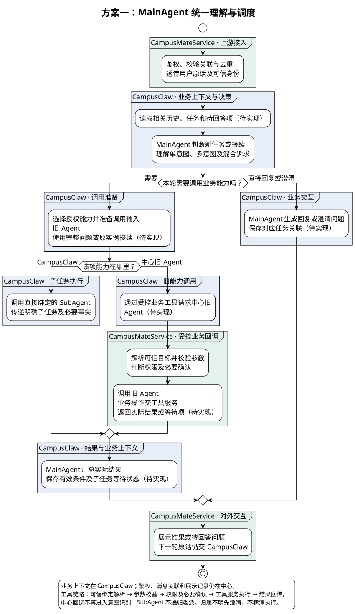
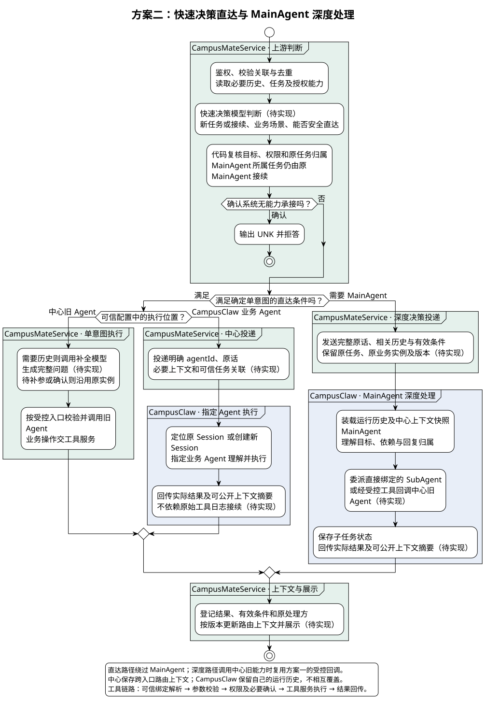
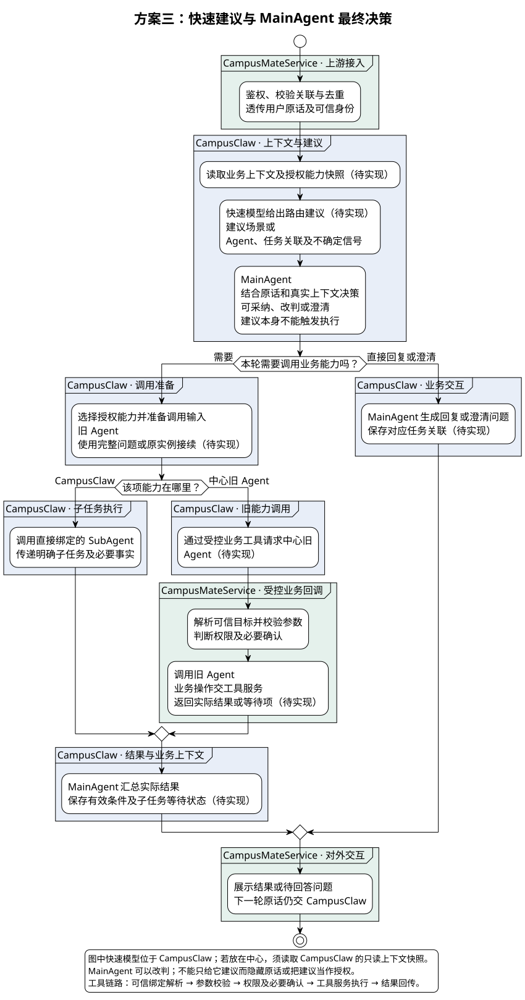
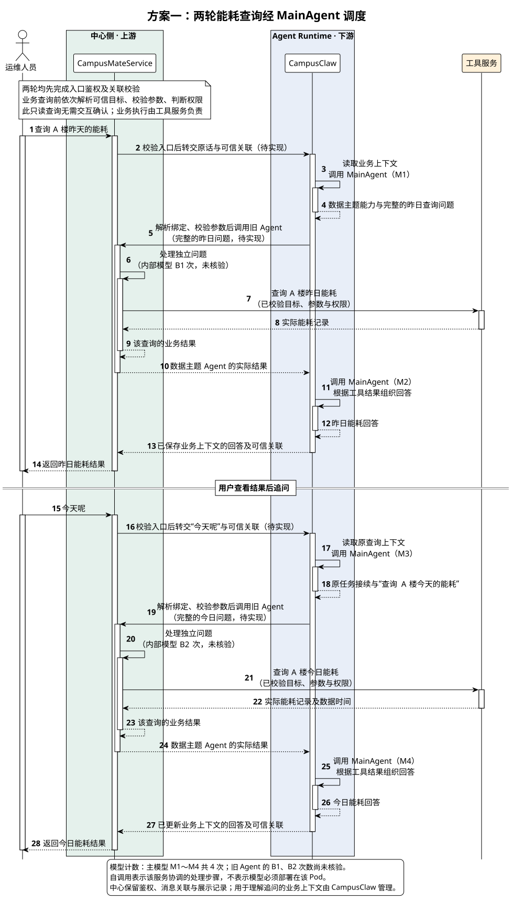
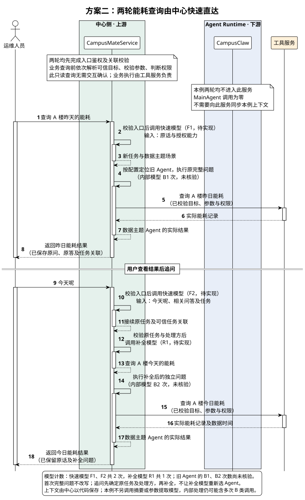

# 意图识别三种方案对比

[返回场景汇总](意图识别场景汇总.md) · [当前主设计](意图识别重构设计.md)

| 属性 | 值 |
|---|---|
| 版本 / 日期 | 0.5.0 / 2026-10-22 |
| 状态 | 已记录先方案一、后续增加方案二的演进方向；功能待实现，整体设计及精确协议待评审，未完成验收 |
| 讨论范围 | 决策权限、上下文归属、中心旧 Agent 接入及多轮接续；不冻结 HTTP 字段、DDL 或 Java 类型 |
| 需求依据 | 用户提出的三种方案；中心旧 Agent 只能接收自然语言问题，部分不能利用历史上下文 |
| 比较内容的源码边界 | 比较初稿未新分析源码，历史依据为 `main@7edbcf42d52f6ef412fad74897cc0c7b39d61659`、2026-10-13；[主设计最新限定核验](source-evidence.md#phase-source-20261022)单独维护，不批量升级本文历史结论 |
| 模型资料 | 2026-10-22 核对 TypeSafe 官方 State、Intent routing、Confidence；仅支持模型选型讨论，不是本项目准确率或性能证据 |

**先实现方案一，形成 MainAgent 深度处理、旧能力桥接和多轮接续的完整通道；后续按评测结果增加方案二的单意图快速直达，保留并复用方案一的深度处理能力。方案三不作为默认串行前置步骤。**

当前实施以[重构主设计](意图识别重构设计.md#solution)的两阶段方案及[场景对照表](意图识别场景汇总.md)为准。本文保留三方案的选型依据与能耗案例；涉及上下文传输、接管和精确协议的建议均未冻结，不表示已选择推送、拉取或模型查询工具。

该演进方向来自用户提出的先后安排，优先解决多意图、多轮补充及旧 Agent 缺少上下文能力。当前没有流量结构、端到端时延、预算及中文业务评测数据，不据此声称方案一更快。本稿记录选型方向，不替代既有主设计的完整评审，也不同时启用三种方案。阶段边界和上下文交接建议见[演进安排](#evolution)。

若优先优化中心侧简单查询，方案二有明确的直达优势来源；两轮“昨日能耗→今天呢”的完整调用、模型计数与时延拆解见[具体案例](#energy-query-example)。工程收敛优先的建议不能替代响应时间评测。

方案二重点解决[三个关键难点](#phase-two-challenges)：最近五轮相关问答及业务状态的交接、MainAgent 原任务接续不被快路径截走，以及快速判断区分新任务和原任务回复。

## 评审记录

| 日期 | 评审人 | 结论 | 适用版本 |
|---|---|---|---|
| 待安排 | 待指定 | 已记录先方案一、后续增加方案二的方向及三个关键难点；整体设计、接口和验收仍待评审 | 0.5.0 |

待确认：优先满足的响应时间及成本目标；真实单意图占比与追问占比；旧 Agent 的独立业务实例接续协议；任务归属和上下文保留期；模型部署及数据合规要求。负责人和验收门槛均为【缺口】。

## 1. 概述

### 1.1 业务问题

运维人员查询“查询 A 楼昨天的能耗”，随后追问“今天呢”；也可能在报修等待位置时说“位置在502，另外查今天告警”。系统既要理解省略、确认和混合目标，又要复用只接受自然语言的旧 Agent，且不能重复执行已完成业务。本稿比较由谁作最终路由决定、由谁保存用于理解用户的上下文，以及旧能力怎样接续。

### 1.2 需求整理

| 编号 | 需求 | 类型 | 来源 |
|---|---|---|---|
| R1 | CampusMateService 在上游负责对外交互、鉴权和可信消息关联，CampusClaw 在下游运行 Agent | 架构约束 | 用户确认 |
| R2 | 保留知识问答、设备控制、服务调用、数据主题、安防监控和设备巡检等中心旧能力 | 功能 | 用户说明 |
| R3 | 旧 Agent 需要独立自然语言问题；省略追问按需补全，确认和补参接续原实例 | 功能、安全 | 用户说明及由防重复执行推导的约束 |
| R4 | 多意图、依赖、混合输入及归属不明由 MainAgent 理解与协调 | 功能 | 用户提出的分工 |
| R5 | MainAgent 委派直接绑定的 SubAgent；中心旧能力通过受控工具桥接，不任意 A2A 调用 | 架构、安全约束 | 已确认的 MainAgent 设计边界 |
| R6 | 同一任务只有一个推进方；路由升级不重放原操作，不能通过改换入口绕过权限 | 稳定性、安全 | 从多路径协作推导，需纳入验收 |
| R7 | 先实现方案一，再增加方案二的快速直达；保留 MainAgent 深度通道，重点解决上下文与任务状态交接 | 演进方向 | 用户提出的实施顺序；细节待评审 |
| R8 | 第二阶段交接最近五轮相关历史和当前原话，并保留执行事实、原任务、等待项及版本；快速判断区分新任务和接续，原 MainAgent 任务仍交原 MainAgent | 功能、稳定性 | 用户明确列出的三个难点；精确协议待设计 |

### 1.3 先区分三种“上下文”

| 内容 | 含义 | 归属原则 |
|---|---|---|
| 用户交互与可信关联 | 用户、租户、聊天、消息去重、回复对象、展示记录 | 三种方案都需要中心维护；不等于中心理解业务 |
| 跨轮业务语义 | 当前目标、有效对象与条件、相关问答、等待问题、原处理方 | 方案一和三以 CampusClaw 为准；方案二由中心管理跨入口路由上下文 |
| 实际执行状态 | 旧状态机节点、已收集参数、Agent 运行历史、工具结果及已提交业务 | 实际处理方保存并决定；不能被另一侧摘要或模型建议覆盖 |

“上下文在 CampusClaw”不等于中心没有 Session 或数据库；“上下文在中心”也不等于把 CampusClaw 的工具日志和私有推理全部复制回来。两侧通过可信标识关联，不强行统一 Session ID。

## 2. 整体方案

### 2.1 用同一组业务场景比较

| 编号 | 业务目标 | 预期结果 |
|---|---|---|
| BU1 | 查询 A 楼昨日能耗 | 得到实际查询结果 |
| BU2 | 追问 A 楼今日能耗 | 正确继承对象与指标，只改变日期 |
| BU3 | 同时查询告警并创建设施报修 | 结果分项展示，缺信息的项等待，完成项不重跑 |
| BU4 | 补充原报修位置 | 仅推进原实例，不重复创建工单 |

三张图均从合法用户消息开始，到展示结果或待回答问题结束。绿色为上游 CampusMateService，蓝色为下游 CampusClaw；图中返回中心的绿色区域是受控业务回调，不是第二次意图识别。新增编排、业务等待、旧能力桥接和上下文协作属于待实现候选流程，具体元素已标识。

图中的业务分支代表一个处理项；复合目标按依赖对可推进的项重复应用，不表示只允许一次调用，也不表示已实现并行。实际业务结果返回后再记录状态，不能把“已投递”当作“已完成”。

### 2.2 方案一：MainAgent 统一理解与调度

[原尺寸 SVG](intent_option_main_owned.svg) · [PlantUML 源码](diagram.puml#L776)

**正常调用：** 中心保留原话并传递可信身份与关联；CampusClaw 装载业务上下文，由 MainAgent 判断新旧任务和处理方式。简单问题可以只调用一个能力，不要求生成复杂计划或 DAG。CampusClaw 业务能力通过直接绑定 SubAgent 调用；中心旧 Agent 通过受控工具调用，MainAgent 在工具输入中提供完整自然语言问题。结果返回 MainAgent 后保存有效条件，再交中心展示。

**“今天呢”如何完成：** MainAgent 从原查询继承“A 楼、能耗”，生成“查询 A 楼今天的能耗”，通过受控工具调用数据主题 Agent。无需独立补全模型，但 MainAgent 自己仍需执行模型推理，旧 Agent 内部也可能使用模型，不能说整个请求只调用一次模型。

**合理性与优点：** 单一业务理解入口，单意图向多意图升级时无需迁移决策归属；改写、拆分和调度可以使用同一份语义上下文；中心不再新增一套业务语义判断和补全链路。

**代价与风险：** 简单请求也经过 MainAgent，可能增加模型轮次、服务往返、汇总成本及排队压力。MainAgent 必须能发现已授权的中心旧能力，具备上下文预算和工具治理；旧能力封装与独立实例支持并不会自动消失。统一入口有助于集中治理，但不保证判断一定正确。

### 2.3 方案二：快速决策直达与 MainAgent 深度处理

[原尺寸 SVG](intent_option_fast_direct.svg) · [PlantUML 源码](diagram.puml#L831)

**正常调用：** 中心为快速模型准备相关历史、任务、等待状态和授权能力。模型给出新任务及场景或明确 Agent、原任务接续，或者升级 MainAgent。代码复核后，满足直达条件的中心旧 Agent 在中心执行，CampusClaw 业务 Agent 按 `agentId` 直接调用，其余进入 MainAgent。确认系统无法承接才输出 UNK 并拒答，识别不确定不是 UNK。

**“今天呢”如何完成：** 快速模型输出原任务关联；中心读取原处理方，调用补全模型生成“查询 A 楼今天的能耗”，再投递旧 Agent。完整的新问题可以不补全；原实例待确认或待补参时不得改写成新的业务命令。这里至少有快速判断与按需补全两类前置推理，不能只看分类模型时延。

**合理性与优点：** 明确、低风险、可独立承接的请求可以绕过 MainAgent，保留旧链路的执行入口；CampusClaw 单意图也能直接进入指定 Agent。可针对少量高频场景逐步开放，风险规则由代码控制。

**代价与风险：** 中心需要维护路由上下文、有效条件、补全和升级策略，复杂度不只是多接一个分类模型。深度请求还要支付快速判断开销；旧 Agent 追问可能再多一次补全推理。两侧需同步可公开的任务结果及有效条件，并处理版本、处理中状态、升级接管及旧实例关联。快模型若把多意图误判成单意图，MainAgent 根本没有机会修正，需以业务数据控制误直达率。

**不可少的接续规则：** MainAgent 创建或接管的任务，后续“502”“确认”等回复仍回原 MainAgent，即使这一句很短或只有一个动作，也不能重新作为单意图绕过父任务。中心旧任务转给 MainAgent 时，要传递原实例、已完成结果、有效条件与等待项，并明确交接点；不能创建另一份状态机重跑。跨服务精确交接协议待设计。

### 2.4 方案三：快速建议与 MainAgent 最终决策

[原尺寸 SVG](intent_option_fast_advisory.svg) · [PlantUML 源码](diagram.puml#L889)

**正常调用：** 中心透传原话与可信关联，CampusClaw 从业务上下文准备判断材料。快速模型只给出建议场景或 Agent、任务关联及不确定信号；MainAgent 看原话和真实上下文后可以采纳、改判或澄清。所有业务执行都以 MainAgent 的最终决定及代码校验为准，旧能力调用方式与方案一相同。

图中把快速模型放在 CampusClaw，以就近读取上下文；这是部署建议，不是三号方案必须新增的前提。若快速模型仍在中心，需从 CampusClaw 读取带版本的只读上下文快照，或者只对上下文无关的新请求给建议。“今天呢”不能只看当前句子可靠判断；中心不能为此再维护一份独立业务上下文，否则失去集中管理的主要收益。

**合理性与优点：** 保留统一业务理解和执行归属，快速建议不直接触发错误业务；可以辅助能力检索、预加载相关说明或观察模型表现，MainAgent 可以纠正。适合先观察建议质量，再决定是否开放真正直达。

**代价与风险：** 作为串行前置步骤时，每条请求都多一次快速判断，却仍要经过 MainAgent，不能天然减少其推理轮次；MainAgent 还可能被错误建议锚定。若为了遵循建议而隐藏其他合法能力，会把建议变成事实上的强制路由。必须保留改判和重新检索能力。

影子评测可以不阻塞主链路；但一旦为了让 MainAgent 使用本轮建议而等待结果，等待时间仍在端到端链路中。只有实测证明建议减少了能力搜索、上下文长度或错误成本，常开才有依据。

### 2.5 横向比较

| 维度 | 方案一：统一 MainAgent | 方案二：快速直达 | 方案三：建议后决策 |
|---|---|---|---|
| 最终语义路由决定 | MainAgent；代码执行安全校验 | 直达由快速判断加代码策略决定，复杂由 MainAgent 决定 | MainAgent；建议可被拒绝 |
| 业务语义上下文 | CampusClaw 集中管理 | 中心管跨入口路由上下文，Claw 管运行历史，需协作 | CampusClaw 集中管理 |
| 中心侧职责 | 网关、可信关联、展示和旧能力入口 | 另增上下文准备、快速判断、按需补全、路由同步 | 与方案一接近；快模型在中心时需只读快照 |
| 中心旧 Agent 追问 | MainAgent 形成完整问题 | 快速判断后按需调用补全模型 | MainAgent 形成完整问题 |
| 简单请求 | 必经 MainAgent | 可绕过 MainAgent，有优化潜力 | 必经快速模型与 MainAgent |
| 多意图与混合输入 | 直接由 MainAgent 处理 | 快速升级，需避免误直达和错误接管 | MainAgent 处理，可改判建议 |
| 多轮一致性难点 | 父任务内状态及中心旧实例关联 | 另有两条执行路径的上下文和归属一致性 | 类似方案一，另需建议新鲜度与防锚定 |
| 旧能力工具桥接 | 需要 | 深度路径仍需要 | 需要 |
| 主要适用条件 | 优先统一多轮、多意图和治理；可接受 MainAgent 基础开销 | 高频单意图占比较高，有明确时延或成本压力且能承担协作复杂度 | 快速建议确能减少后续工作，或作为观察阶段 |

### 2.6 关键取舍与演进方向

| 要解决的问题 | 可对照方案 | 业务约束 | 本稿建议 | 代价 |
|---|---|---|---|---|
| 旧 Agent 不理解追问，多意图存在局部等待 | 三种候选均无当次最新实现核验 | 必须先形成完整、可追踪且不重复的执行链 | 先采用方案一统一语义理解与接续 | 简单请求承担 MainAgent 开销 |
| 优化高频简单请求 | 方案二 | 不能以更低的分类时延牺牲错归属、误直达或重复执行 | 完成评测后，只为白名单业务引入直达 | 需要上下文协作、归属交接和回滚设计 |
| 利用快速模型又不授予执行权 | 方案三 | MainAgent 必须能独立改判 | 优先离线或影子评测，不默认同步常开 | 不能立即获得主链路降时延收益 |

实施方向为先形成方案一的完整执行通道，再对评测通过的高频单意图增加方案二的直达出口，而不是推倒 MainAgent 重建一套系统。这里的“依赖”是复用深度处理和受控执行能力，并非要求快路径每次先经过 MainAgent。具体发布计划、快路径门槛及上下文交接协议仍待评审，不能只实现“按标签分流”。

## 3. 详细设计边界

### 3.1 路由输出与执行归属

新任务输出场景标签或明确 `agentId`，由可信配置解析；接续输出可信任务及必要的问题关联，从任务记录读取原处理方，而不是因再次命中同一个 `agentId` 就认定接续。方案三的建议允许包含一个建议处理方及不确定结果，不是开放任意 Agent 调用列表。模型输出不授予权限。

对于任一任务，先区分“当前由谁负责推进”与“这一轮实际调用谁”。MainAgent 可通过工具调用旧 Agent，但这不让旧 Agent 成为接收用户后续消息的父入口。方案二不能在运行中仅因分类结果变化就切换推进方。

### 3.2 旧能力桥接与上下文补全

所有旧 Agent 都接受自然语言，桥接至少要提供完整问题或原实例接续入口，并返回实际结果或可校验的等待信息。工具名、精确参数及 HTTP 路径尚未冻结；中心旧 Agent 不伪装为同运行时的 Child Session。回调进入授权业务入口，不重入用户消息分类链路，避免 MainAgent 与中心相互路由形成循环。

工具执行严格区分五个阶段：可信目标绑定解析 → 参数校验 → 权限判断及必要交互确认 → 工具服务执行业务 → 返回真实结果。目标与参数明显无效时不打扰用户。参数错误保持 `isError=true`，字段错误与同次可信定义只向模型反馈；不自动猜参或重放，公开结果隐藏内部 Schema 与敏感值。

补全只继承可追溯的对象、指标和有效条件，当前明确修改优先；原话单独保留。不能因为旧 Agent 只收自然语言就把“确认”“502”改写成重新创建工单。缺少历史或无法确定对象时应澄清，不编造完整问题。

### 3.3 数据与生命周期

本稿不新增表或统一 Session ID，具体逻辑存储复用[主设计的数据模型](意图识别重构设计.md#data-model)，其表和协议仍待冻结。方案一和三把业务语义上下文放在 CampusClaw，中心保存可信关联与展示投影；方案二还需中心跨入口上下文快照，Claw 只回传必要公开摘要、来源和版本，不能同步私有推理作为中心事实。

业务待补充需要保存任务目标、待答问题和原实例映射，而不只是一段聊天文本。用户回答后只推进对应业务项，不恢复已经结束的 Child Session 或原工具调用栈，也不承诺 Pod 重启后恢复等待中的调用。具体恢复与失效策略仍需评审，不能靠统一上下文一项解决。

### 3.4 两轮能耗查询：调用流程、模型次数与上下文

本例回答“方案一是否会因每轮经过 MainAgent 而更慢”。起点为“查询 A 楼昨天的能耗”，终点为追问“今天呢”后得到今日实际结果。两次输入发生在同一业务日，旧数据主题 Agent 位于 CampusMateService，只接受独立自然语言问题；同一个查询目标每轮只调用一次旧 Agent，身份、权限和能力均有效，无纠错、重试、多意图或额外上下文压缩。

**计数单位是一轮模型推理请求，不是 token、工具调用或图上的消息数。** 方案一按常规工具回合计数：MainAgent 先调用模型选择能力并生成完整问题，工具结果返回后再调用模型组织用户回答。方案二假设归属、场景及直达判断能在一轮快速模型请求中完成，只有第二轮调用一次补全模型。上述为候选设计的案例假设，不是对当前源码或部署实测的结论。

旧 Agent 自己可能先生成查询、再整理结果，内部次数未核验。分别记为第一轮 `B1`、第二轮 `B2`，两方案使用相同旧 Agent 和相同查询口径；图中把它们包含在“处理独立问题”阶段，不虚构其内部方法顺序。鉴权、配置读取、确定性校验、历史保存和关联登记由代码处理，不额外调用摘要或事实提取模型。若真实链路引入其他模型，应另计。

#### 方案一：两轮都经过 MainAgent

服务级正常流程，图中同一服务内部步骤用自调用表达；框内模型标识表示由该服务发起请求，不表示模型必须部署在同一 Pod。中心旧能力回调是受控业务入口，不重新进入用户意图识别。

[原尺寸 SVG](intent_energy_main_sequence.svg) · [PlantUML 源码](diagram.puml#L945)

第一轮 MainAgent 以原完整问题调用旧数据主题 Agent；旧 Agent 经工具服务查询，结果返回 MainAgent 后由其组织回答。CampusClaw 保存本轮原话、工具输入、实际结果及最终回答，用这些材料识别下一轮的“今天呢”。

第二轮中心不需要自己改写或识别能耗意图，透传原话和可信关联；MainAgent 从原记录继承“A 楼、能耗”，生成“查询 A 楼今天的能耗”，通过同一受控业务入口执行新的查询，再根据新结果组织回答。昨日结果只是历史，不能代替今日数据。

这里的“接续”表示继承逻辑任务的上下文，今日仍是一次新的查询执行。它不修改昨日结果，不恢复旧线程或原 `toolCallId`，也不复用已经结束的待回答项；两轮结果分别保存。

#### 方案二：两轮都留在中心快路径

服务级正常流程，保留 CampusClaw 的空生命线以明确边界：本例没有调用该服务，也没有为本例向它同步上下文。模型服务和工具服务仍可能产生各自的网络开销，不能把“不进 CampusClaw”理解为没有远程调用。

[原尺寸 SVG](intent_energy_fast_sequence.svg) · [PlantUML 源码](diagram.puml#L1016)

第一轮快速模型判断为新的单意图数据主题查询，代码定位原 Agent，直接投递完整原问，不调用补全模型。代码保存原问、原答、任务关联及处理方；不要求额外调用模型抽取“A 楼”和“能耗”后才能保存上下文。

第二轮快速模型读取相关问答和任务，输出原任务接续；代码从可信任务记录取得原数据主题 Agent，确认其需要独立问题，再把相关历史和“今天呢”交给补全模型。补全模型只生成“查询 A 楼今天的能耗”，不重新路由；执行后原话与补全问题分别保留。

#### 模型调用次数

| 范围 | 方案一 | 方案二 |
|---|---|---|
| 第一轮：完整问题 | MainAgent 2 次＋`B1` | 快速模型 1 次＋`B1` |
| 第二轮：省略追问 | MainAgent 2 次＋`B2` | 快速模型 1 次＋补全模型 1 次＋`B2` |
| 两轮主模型调用 | 4 次 | 0 次 |
| 两轮快速模型调用 | 0 次 | 2 次 |
| 两轮独立补全模型调用 | 0 次，语义补全由主模型完成 | 1 次 |
| 两轮总计 | `4 + B1 + B2` | `3 + B1 + B2` |

若仅作算术示例，假定旧 Agent 每轮都调用一次模型，即 `B1=B2=1`，则两轮合计为6次和5次。这个假设未经源码核验，不能当作实际系统计数。第二轮两方案都可能是2次前置模型请求，但“2次 MainAgent”和“1次决策＋1次补全”的模型大小、上下文量、输出量及队列不同，不能因次数相同就认定耗时相同。

#### 上下文如何处理

| 内容 | 方案一 | 方案二 |
|---|---|---|
| 第一轮用于追问的记录 | CampusClaw 保存用户原问、工具调用、实际结果及最终回答 | 中心保存原问、原答、可信任务关联及原处理方 |
| “今天呢”交给谁理解 | MainAgent 读取原查询上下文 | 快速模型先判断归属，补全模型再生成独立问题 |
| 数据主题 Agent 收到什么 | “查询 A 楼今天的能耗” | 相同的完整问题 |
| 中心保留什么 | 鉴权、消息、Session 映射、结果展示和业务入口记录，不负责本例语义补全 | 除上述记录外，还准备快速判断与补全所需的相关历史 |
| 本例是否跨服务同步业务上下文 | 两轮原话进入 Claw，实际业务结果经回调返回 Claw | 不需要；两轮均未进入 Claw |
| 何时需要中心传上下文给 Claw | 本来就由 Claw 管理业务上下文，无需中心另造语义摘要 | 后续升级 MainAgent 或调用 Claw 业务 Agent 时，才传必要上下文及原任务状态 |

有效条件应区分原始来源和本轮修改：“A 楼、能耗”来自前一轮明确目标，“今天”来自本轮用户输入；不能靠模型凭空补齐。业务时区和每轮消息接收时间参与日期解释，若两轮跨越午夜，以各轮实际时间解释，不固定沿用第一轮的“今天”。今日结果应带数据时间或截至时间，不能伪装成尚未结束的一整天的最终能耗。本文不编造能耗数值。

#### 响应时间为什么可能不同

将旧数据主题 Agent 及其工具查询的完整耗时记为 `E`；主模型选择和组织调用耗时为 `P`，收到结果后的回答生成耗时为 `S`，快速判断为 `F`，补全为 `R`。`H1/H2` 分别表示各方案的其他上下文读写、网络及排队开销；它们不是常数，也不假设相等。

| 一轮完整结果的近似耗时 | 方案一 | 方案二 |
|---|---|---|
| 完整新问题 | `P + E + S + H1` | `F + E + H2` |
| 依赖历史的追问 | `P + E + S + H1` | `F + R + E + H2` |

各符号在不同轮次取各自的实际值；这只是成功串行路径的分解，不是性能测量。方案一除主模型推理外，还涉及“中心到 Claw 接入”和“Claw 到中心旧能力回调”两条服务调用链。方案二本例没有这部分 Claw 往返，但仍有模型和工具服务调用。

**对这个简单只读例子，担心方案一更慢是合理的，方案二有明确的低时延优势来源；尚不能承诺具体快多少。** 第一轮完整问题的优势来源尤其清楚：快模型判断替代一次主模型选工具和一次主模型结果整理。第二轮补全会消耗一部分收益，需实际比较 `P+S` 与 `F+R`，并计入不同上下文和网络开销。分别测首个有用结果和完整结果；“正在查询”之类进度文字不能当作已返回能耗。

#### 可评审的结果直返优化

方案一不必永久固定为每轮两次主模型。对经过校验、只读、无需分析且已有合格公开回答的旧 Agent 结果，可另行评审“由运行时保存工具结果并直接返回公开回答”，省去结果整理调用。若该优化成立且每轮只需一次主模型，方案一可降为 `1+B1`、`1+B2`，两轮共 `2+B1+B2`；它未包含在上面的默认比较中。

该优化待实现、待评审，不能仅靠 Prompt 声称“直接返回”就算省掉模型调用。需要保证父上下文完整、公开结果校验和脱敏、失败不冒充成功，并明确不再由主模型复核或补充分析的代价；需要聚合、解释或进一步查询时仍应回到模型。即便次数更少，也不能据此断定它一定比快速判断加补全更快。

**因此，先建设方案一不表示它更快，而是先把复杂处理和多轮接续做好；本例暴露的主模型与跨服务开销，应作为后续开放方案二快路径的测量依据。** 优化优先从这类中心侧低风险查询开始，多意图、复杂分析和混合输入仍保留 MainAgent 深度处理。开放范围取决于真实流量结构、错误成本和实际 SLO。

### 3.5 从方案一演进到方案二

方案二新增的是请求入口的快速决策和直达分支，复用的是方案一的 MainAgent、多意图协调、受控旧能力工具与业务接续。初期不引入快速分类模型或单独补全模型，也不提前实现双向实时上下文复制；先稳定第一阶段通道，再设计和验证第二阶段的交接能力。

| 阶段 | CampusMateService | CampusClaw | 结果 |
|---|---|---|---|
| 第一阶段：方案一 | 对外交互、鉴权、可信消息及任务关联、结果展示、受控旧能力入口 | MainAgent 统一理解、按需补全、委派直接绑定 SubAgent、保存业务上下文及等待状态 | 建立可处理复杂输入和多轮接续的完整深度通道 |
| 第二阶段：方案二 | 增加快速判断、相关上下文准备、旧 Agent 按需补全和白名单直达；进入 Claw 前准备上下文交接材料 | 保留深度通道，接收必要上下文及原任务状态；指定业务 Agent 仍由边侧路由调用 | 只让评测通过的简单请求绕过 MainAgent，复杂和不确定输入继续走深度通道 |

#### 方案二的三个关键难点

| 编号 | 难点 | 必须解决的问题 |
|---|---|---|
| 1 | 业务上下文交接 | 中心向 MainAgent 提供最近五轮相关历史问答与本轮原话，以及已执行查询的条件、实际结果和数据时间、原任务与业务实例、等待项、原处理方、上下文版本或消息位置；缺失、重复、旧版本及接管顺序均需设计 |
| 2 | MainAgent 原任务保持接续归属 | 已由 MainAgent 管理的任务，其补充、确认、追问和修改仍返回原任务对应的 MainAgent；按任务保持归属，不把整个聊天永久绑定到 MainAgent |
| 3 | 快速判断任务关系和可直达性 | 不只分类业务场景，还要区分独立新任务与原任务回复；新单意图才按规则直接路由，接续按可信任务记录找原处理方，复杂、混合及归属不明交 MainAgent |

“最近五轮”是相关历史问答的常规窗口，本轮原话单独保留；不是任务状态的保存上限。关联任务的有效事实、等待项和处理方记录在任务有效期与保留策略内独立保存，即使原任务早于五轮也不能因窗口滚动丢失。跨窗口所需的任务材料仍按权限、相关性和上下文预算读取，不因此无界拼接全部历史。窗口计数及截断的精确口径在协议冻结时统一。

快速判断与代码路由应区分以下情况，避免把所有补充、确认都送给 MainAgent，也避免因存在一个 MainAgent 任务就吞掉新的独立问题：

| 输入与任务关系 | 意图识别至少表达的业务语义 | 后续路由 |
|---|---|---|
| 明确的独立新单意图 | 新任务＋场景标签或明确 agentId | 按可信配置进入中心旧 Agent 或 Claw 指定业务 Agent |
| 接续 MainAgent 原任务 | 接续＋原任务及必要的问题关联 | 代码定位原父 Session，返回原 MainAgent，不重新按标签直达旧 Agent |
| 接续中心旧任务 | 接续＋原任务及必要的问题关联 | 返回原中心 Agent 或状态机，按需补全问题，不默认交 MainAgent |
| 接续 Claw 指定业务 Agent 的任务 | 接续＋原任务及必要的问题关联 | 返回原业务 Agent 的处理入口，不无条件改为 MainAgent |
| 补充夹带独立新目标，或确认时改变执行条件 | MainAgent 路由＋整句及原关联 | 交 MainAgent 协调，不在快路径提前应用答案或沿用旧确认 |
| 没有足够证据确定回复对象 | MainAgent 路由＋可见任务上下文 | 进一步理解或澄清，不强选原任务 |

这些是业务语义，不是已冻结的字段或分类枚举。补充、确认是否分别输出细分类型留待协议设计；至少要保证新任务或接续的判断、可信任务关联，以及原处理方的确定。关联有效性由代码复核；归属正确不等于已获执行授权，确认仍绑定原动作及版本，失效或越权关联不通过换路由绕过。

#### 交接不只是历史聊天

历史问答能解释“今天呢”中的省略，但单凭聊天文本不能可靠证明哪个工单已提交、哪个子任务仍在等待，也不能授予操作权限。方案二的关键是让 Claw 在升级或接续时拿到足以理解并继续业务的材料，同时避免重复推进。

| 内容 | 作用 | 边界 |
|---|---|---|
| 最近五轮相关原问、原答和当前原话 | 解释省略、指代与用户明确修改 | 五轮只限制常规聊天历史，不截断独立任务状态；不复制全量无关聊天 |
| 当前有效条件与实际结果 | 识别查询对象、时间范围和已经发生的业务 | 保留来源和数据时间；用户意图、模型推断与执行事实分别记录 |
| 可信任务、业务实例和原处理方关联 | 找到原目标，避免升级时新建重复业务 | 由代码从可信记录解析，不能接受模型编造关联 |
| 任务状态与待回答项 | 知道哪些已完成、哪些缺参数或等待确认 | 已完成项不重跑；确认仍绑定具体动作与版本 |
| 上下文范围和版本 | 明确已接收哪些消息，识别缺失、重复和旧快照 | 先读到约定版本再接续，具体游标、版本字段和回执协议待设计 |

建议第二阶段先采用按需交接：中心侧直达任务留在中心，只有升级 MainAgent 或进入 Claw 业务 Agent 时，才提交必要上下文及原状态；Claw 已有相关历史时，只补充缺失且相关的部分，避免重复追加。本例两轮能耗查询都在中心完成时，不要求每轮同步到 Claw。快模型若需要 Claw 原任务的信息，优先使用最小可见投影，不复制内部工具日志或私有推理。

若任务已由 MainAgent 管理，用户后续“502”“确认”等回复仍交原 MainAgent；不能因本轮输入短就切回中心直达。中心任务升级时，需要明确交接点、接收状态和唯一推进方，不能在中心继续运行的同时让 Claw 重新执行。该机制待评审，不将“传入历史消息”直接等同于“已完成任务接管”。

#### 第一阶段保留的演进条件

第一阶段就保留稳定消息与任务关联，分别保存原话、完整调用输入、实际结果及待回答项，并把中心旧能力封装为独立受控业务入口。不要把中心聊天与单个状态机或 Claw Session 硬编码成一对一。这些记录既支持当前排错和多轮处理，也为后续按需交接提供来源。

第一阶段不因此提前实现快速分类、双写历史库或完整同步框架。第二阶段先为低风险、结果可直接展示的查询开放白名单，测量误直达、上下文缺失、重复副作用和端到端时延，再评审范围扩展。模型阈值、接管协议、保留期和配额尚未冻结。

## 4. 接口协议

三种方案都只比较职责，不新增可直接调用的路径、字段或模型输出 Schema。业务关联及展示语义参考[契约草案](contracts.md)，正式接口需在选型后冻结。现有严格 Session Events 不得直接塞入本稿新语义；原调用等待与业务新调用接续仍须区分。

## 5. 架构指标与失败处理

### 5.1 不变量

同一任务一个推进方，模型判断不等于授权；归属失效不退回猜测；确认绑定具体动作及版本；超时不等于未执行；结果未知不自动重跑；UNK 只表示确认系统无能力，不表示低置信度或权限拒绝。

| 失败 | 发生阶段 | 副作用状态 | 处理方 | 系统处置 | 用户可见结果与下一步 | 不保证项 |
|---|---|---|---|---|---|---|
| 缺少上下文或回复对象不明 | 业务理解、快速判断或补全 | 未发生 | 决策方、MainAgent | 不执行猜测结果，读取可见记录或澄清 | 明确要继续哪项任务 | 不保证无标识自动接续 |
| 任务已取消、关联过期或越权 | 关联校验 | 未发生 | 中心及原处理方 | 拒绝该关联，不换路由绕过 | 显示失效或安全结果 | 不自动新建同名业务 |
| 快模型不确定或不可用 | 快速判断 | 未发生 | 中心或 Claw | 方案二安全检查后限额交 MainAgent；方案三可无建议继续 | 处理中或繁忙说明 | 不承诺降级仍满足时延 |
| 补全引入无依据条件 | 输入准备 | 未发生 | 中心或 MainAgent | 不执行不可信补全，必要时澄清 | 请求明确对象或条件 | 不保证模型自动识别全部错误 |
| 参数错误或权限拒绝 | 业务调用准备 | 未发生 | 受控入口 | 按 §3.2 返回真实错误，不确认、不执行业务 | 安全错误说明 | 不以 MainAgent 绕过拒绝 |
| 中心业务调用超时 | 业务执行或结果返回 | 未知或部分发生 | 原业务入口、工具服务 | 按业务幂等键查询结果，必要时人工核实 | 展示未知及查询入口 | 不自动重放提交工单或设备操作 |
| 上下文旧版本或双方同时接续 | 上下文投递、任务交接 | 未发生或未知 | 中心与原处理方 | 版本检查、串行推进或拒绝冲突，核实实际业务状态 | 已处理或需重取状态 | 不承诺双边并发自动合并 |

### 5.2 性能、容量与监控

本稿没有实测容量结论。比较端到端响应时，必须计入相关历史读取、能力检索、快速判断、补全、MainAgent 推理与汇总、实际 Agent 执行、跨 Pod 往返和排队。不能把只测快模型的耗时当作用户响应时间。

方案二是否值得引入，应比较“绕过 MainAgent 节省的总开销”与“所有请求新增的快速判断、按需补全和上下文协作开销”。方案三同步常开则需证明建议减少的后续搜索、上下文或错误成本大于前置判断成本。需按业务、追问与风险分层测量，不用单一平均值掩盖长尾。

应监测：端到端首个有用结果及完整结果的 P50/P95、单位成功任务成本、正确直达覆盖率、多意图误直达率、错归属率、补全条件错误率、澄清率、重复副作用、MainAgent 升级率和双边上下文版本冲突。目标数值、峰值并发、限流配额及值守预案均为【缺口】。

## 6. 质量保证

先用同一组脱敏会话离线比较三种决策；按会话分离校准集与测试集，避免“今天呢”的前文泄漏。覆盖 BU1～BU4、两个同类任务的指代、多意图部分等待、确认伴随变参、明确关联失效、权限拒绝、回调不重入分类，以及简单任务升级 MainAgent 时不重建原实例。

若评测方案二或三，阈值必须按中文园区样本和错误后果校准；模型置信度不直接等于任务正确率。官方 State 文档提示 Jev 以英语为主要训练语言、中文等 CJK 当前准确率较低，因此不能直接套用其英文示例效果或默认阈值，亦不能据此断言其他类决策模型都相同。

灰度与回滚应按任务固定路径，而非每条消息随机切换；不在真实业务上双跑不同方案比较输出。可影子记录建议，但不得重复执行业务。精确放量门槛、在途任务排空、QA 负责人和上线计划均待评审；业务测试与性能评测本次未执行。

## 7. 基建规范

本稿只新增设计分析与 PlantUML 图，不新增 Maven、模型 SDK、数据库或中间件依赖。图源与 SVG 同步保存，旧十九张图及现有公共契约不因本稿自动切换为某一候选方案。

## 8. 来源与验证

### 8.1 来源及证据边界

- 用户在本对话提出的三种方案与旧 Agent 输入限制，是本稿的业务事实来源；具体模块当前实现仍未核验。
- [主设计](意图识别重构设计.md)、[十九个场景](意图识别场景汇总.md)、[历史源码证据](source-evidence.md)用于保持术语与安全约束，不构成最新代码可行性认证。本稿没有比较其他 Agent 内核，不升级 pi 等基线。
- TypeSafe [State](https://docs.typesafe.ai/concepts/state)：调用时由应用提供判断所需的上下文状态；中文准确率限制需业务评测。核对日期：2026-10-22。
- TypeSafe [Intent routing](https://docs.typesafe.ai/patterns/intent-routing)：分类和复杂度判断可用于代码分流，不证明本项目哪种架构更优。核对日期：2026-10-22。
- TypeSafe [Confidence](https://docs.typesafe.ai/confidence)：概率分布集中度及阈值随风险校准，不直接套用示例阈值。核对日期：2026-10-22。

先方案一、后续增加方案二是用户提出的演进方向；快模型部署位置、按需增量交接、快路径白名单及精确接管机制仍为待评审建议。本文按选型评估裁剪模块模板：复用已有数据模型、接口和全局类图，不为三种候选复制三套类图、DDL 或正常调用时序；采用用户要求的流程图比较职责。

### 8.2 文档验证

下表保留两轮能耗案例更新时的图形验证；演进方向更新只修改本文，不改变 PlantUML、SVG 或既有主设计，其独立检查记录在表后。

| 检查 | 结果与边界 |
|---|---|
| 图源与生成 | PlantUML 1.2025.2 / JDK 21 执行 `plantuml -tsvg diagram.puml` 成功；专题24个稳定命名块与24张SVG一致，本次新增2张能耗两轮调用图 |
| 结构与链接 | 专题检查0错误、0复杂度提示；125个本地链接及锚点通过；PlantUML为UTF-8，24张SVG为有效XML，专题Markdown无Mermaid |
| 保留范围 | 原22张SVG及其PlantUML源块逐字节不变；主设计、业务契约及历史源码证据不变，仅展开对比稿案例并增加图源和索引 |
| 图面 | 逐图检查2张新图的原尺寸和900px文档宽度，中文可读、调用与返回路径清晰、文字未越界；服务分区与内部步骤不混用，方案二没有进入Claw的消息 |
| 计数假设 | 检查图源中主模型M1～M4各出现一次、快速模型F1/F2各一次及补全R1一次；此检查只验证候选图与计数表一致，不证明实际模型请求次数 |
| 导航与空白 | 既有导航可到达本稿，设计图索引共163张图；`git diff --check`及专题尾随空白检查通过 |
| 全仓边界 | 全仓检查39个专题、163个命名块、65张时序图，仍报告其他专题139项SVG重生成差异及2个既有范围提示；本专题无错误，未改写其他专题 |
| 未执行 | 最新代码核验、业务执行、中文准确率与阈值校准、两侧联调、故障及性能测试；仅本地保存，未提交、推送或操作PR |

机械检查与图面检查不替代产品实现或业务验收。

演进方向与关键难点更新验证：专题结构检查0错误、0范围提示，127个本地链接及锚点与空白检查通过；全部24张SVG及PlantUML源文件逐字节不变，主设计、契约和历史证据未修改。此处仅验证文案和保留范围，没有重新分析源码、生成图形或执行模型及业务性能测试。

### 8.3 版本历史

| 版本 | 日期 | 变更 |
|---|---|---|
| 0.1.0 | 2026-10-22 | 比较统一 MainAgent、快速直达及快速建议三种架构，明确上下文归属、旧 Agent 补全及有条件的选型建议。 |
| 0.2.0 | 2026-10-22 | 展开两轮能耗查询，区分主模型、快速判断、补全和旧 Agent 内部次数，补充响应时间分解与结果直返的待评审边界。 |
| 0.3.0 | 2026-10-22 | 明确先方案一再增加方案二快路径，区分历史问答同步与任务状态交接，并保留单一推进方。 |
| 0.4.0 | 2026-10-22 | 汇总方案二三个难点，区分五轮历史窗口与任务状态，明确新任务、原任务接续及原处理方路由。 |
| 0.5.0 | 2026-10-22 | 以两阶段主设计为实施入口，保留三方案比较并将上下文传输方式留待专项设计。 |
