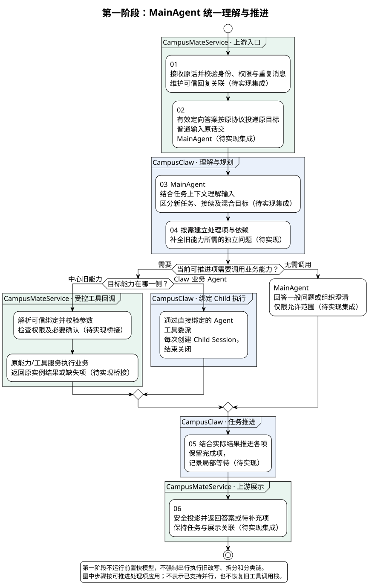
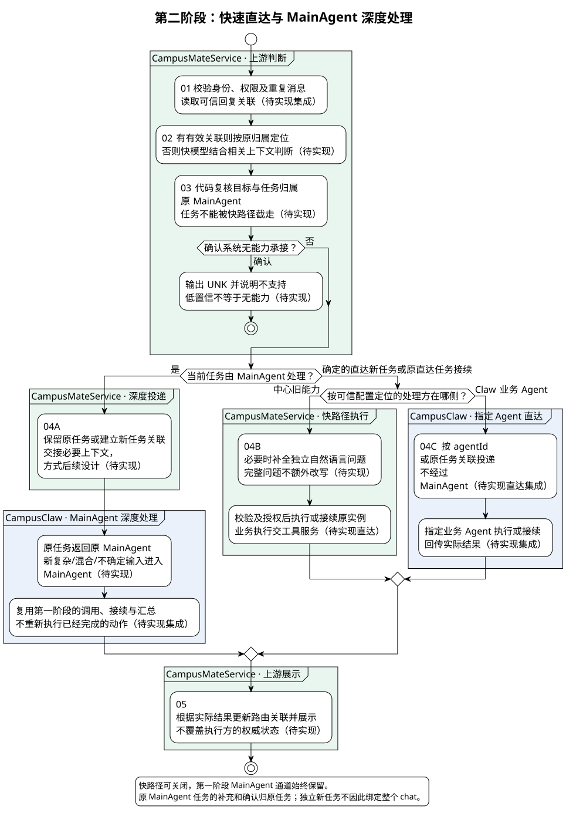
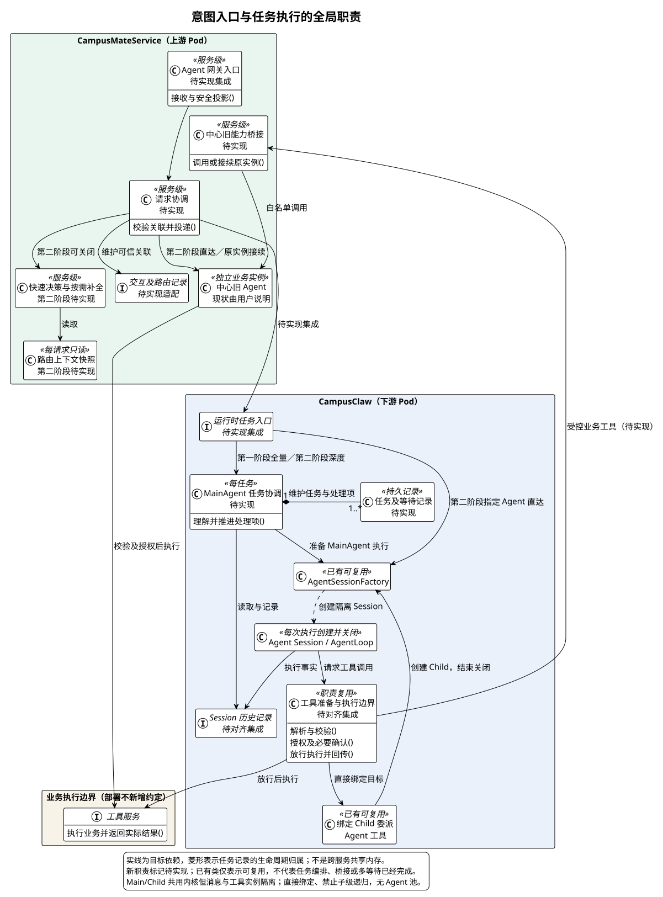
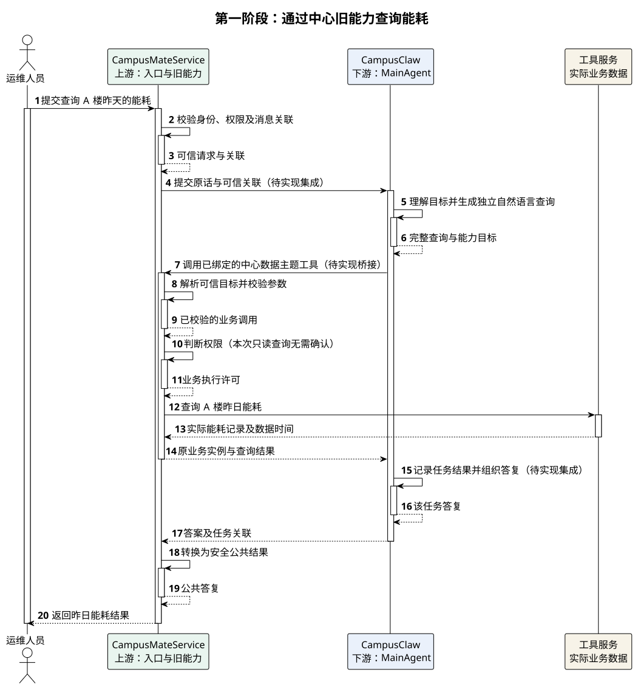

# 意图识别重构设计

[返回服务与接口导航](../README.md) · [19 个场景](意图识别场景汇总.md) · [方案比较与调用次数](意图识别三种方案对比.md)

| 属性 | 值 |
|---|---|
| 文档版本 / 日期 | 0.5.0 / 2026-10-22 |
| 模块 | CampusMateService 意图入口与 CampusClaw MainAgent 协作 |
| 有效方案 | 第一阶段实施方案一：统一 MainAgent；第二阶段实施方案二：增加快速直达，保留 MainAgent 深度通道 |
| 状态 | 两阶段集成、任务归属、多意图局部等待及旧能力桥接待实现；已有 Child 调用与结构化提问可复用，但不代表集成完成；正式评审及业务验收未完成 |
| 源码基线 | 2026-10-22 隔离 fetch 的 `superheromeZzh/pi-mono-java` 默认分支 `main@3ade086fcbbe1f88b6729ef5f85d0e595d5b9421`，仅核验本题涉及的 Session、Child、提问和工具入口 |
| 证据边界 | CampusMateService 现状来自用户说明，源码未核验；不以 pi、Codex 等外部框架为本设计实现基线；Jev 类模型只是第二阶段待评测候选 |

**先打通 MainAgent 统一理解、调用旧能力及多轮接续的完整通道，再让确定的单意图走快路径。第一阶段解决能力与正确性，第二阶段在不破坏任务归属的前提下优化时延和成本。**

上下文主动推送、传引用后拉取、是否提供上下文查询工具，以及精确字段和存储结构，本版均不选型、不冻结，留待第二阶段专项设计。

## 评审记录

### 评审结论

| 日期 | 评审人 | 结论 | 版本 |
|---|---|---|---|
| 待安排 | 待指定 | 已记录用户确定的实施方向；整体设计未形成正式评审结论 | 0.5.0 |

### 评审 Todo

| 待评审事项 | 所属阶段 | 当前边界与来源 | 负责人 |
|---|---|---|---|
| 旧能力桥接的安全范围、任务关联及业务补充语义 | 第一阶段 | [旧能力接入](#tool-execution)，精确协议另行评审 | 【缺口】 |
| 多意图局部等待、调用预算、超时及失效策略 | 第一阶段 | [业务接续](#partial-wait)，不能借现有提问等待宣称完成 | 【缺口】 |
| 快模型选型、准入阈值、标签与 Agent 映射 | 第二阶段 | [准入依据](#calibration)，不预设 Jev 必选 | 【缺口】 |
| 两侧上下文交接、任务归属、版本与并发规则 | 第二阶段 | [上下文责任](#attribution)，推送/拉取待选 | 【缺口】 |
| 发布、回滚及性能门槛 | 分阶段 | [实施验收](#implementation)和[容量](#capacity)，数值待确认 | 【缺口】 |

### 需求信息

来源为用户对旧系统的说明、本专题历史材料与本次两阶段要求。正式需求编号、优先级和目标发布版本为【缺口】；R/BU/UC 是本文内部追踪编号，不代替需求单。

## 1. 概述

### 1.1 为什么重构

旧系统把用户输入依次送入改写、多意图拆分、单意图标签识别和具体状态机路由，多意图再循环执行。它面临四个业务问题：

1. 新增的 CampusClaw 业务 Agent 无法自然接入原中心状态机路由。
2. 多个模型步骤串行，响应慢；每一步对语义的转换又会影响下一步判断。
3. 中心旧 Agent 部分只能接收独立自然语言问题，无法直接理解“今天呢”等省略追问。
4. 一个 `userId + chatId` 只保存一个状态机，已有任务容易吞掉新问题，多意图中的局部补充与确认没有稳定归属。

以上为用户提供的系统现状，不是本次对 CampusMateService 的源码结论。重构不是简单换分类模型，而是重新明确：**谁理解用户、谁推进任务、旧能力怎样接入、下一轮回复回到谁。**

### 1.2 术语与边界

| 术语 | 含义 |
|---|---|
| Session / chat | 两侧各自管理的会话和用户交互容器，通过关联映射协作，不要求同一个 ID 或共用数据库 |
| 任务 / 子任务 | 用户的一项目标 / 复合目标中的处理项，不等于 Session、线程或某次工具调用 |
| 任务归属 | 该任务由谁推进；一次新问题可以建立新任务，不因同一个 chat 就继承旧任务处理方 |
| MainAgent | CampusClaw 中面向用户任务的主要执行角色，负责理解、规划、补全、委派及汇总 |
| SubAgent | MainAgent 直接绑定的 Child Agent；每次调用创建隔离执行 Session，结束关闭，不设置子 Agent 池 |
| 快速决策 | 第二阶段在相关上下文下判断新任务、原任务接续及确定路由，不承担复杂任务编排 |
| 业务等待项 | 记录哪个任务还缺什么；不等于持久化暂停旧 `invoke_agent/toolCallId` 调用栈 |

### 1.3 需求与非目标

| 编号 | 需求 | 类型 / 来源 | 实施阶段 |
|---|---|---|---|
| R1 | CampusMateService 在上游负责对外交互、鉴权和安全入口，CampusClaw 在下游执行 Agent | 约束；用户确认 | 两阶段共同 |
| R2 | MainAgent 统一承接单意图、多意图、追问、补参和混合输入 | 功能；用户确认 | 第一阶段 |
| R3 | MainAgent 通过受控工具复用中心旧 Agent，通过直接绑定 Child 调用 Claw 业务 Agent | 功能/约束；用户确认，Child 有源码依据 | 第一阶段 |
| R4 | 同一聊天可有多个任务，按任务/子任务展示结果，局部等待不重跑完成项 | 功能；用户需求 | 第一阶段 |
| R5 | 可信回复关联优先；归属不明由 MainAgent 组织澄清，不猜测确认对象 | 安全；既有设计及本次方案推导，细节待评审 | 两阶段共同 |
| R6 | 确定单意图可直达中心旧 Agent 或 Claw 业务 Agent；其余复用 MainAgent | 功能；用户确认 | 第二阶段 |
| R7 | 快路径旧 Agent 的省略追问按需补全为独立自然语言问题 | 功能；用户说明旧能力限制 | 第二阶段 |
| R8 | MainAgent 原任务的补充和确认仍回原 MainAgent，不被快速分类重新分流 | 稳定性；用户确认 | 第二阶段 |
| R9 | `knowledge` 专用于知识问答；`UNK` 只用于确认无能力后的拒答，不用于复杂或低置信请求 | 功能；用户确认 | 第二阶段标签迁移；两阶段语义一致 |
| R10 | 工具执行受校验、权限、必要确认和幂等约束，换路由不能绕过安全控制 | 安全/稳定性；项目规范及本方案推导 | 两阶段共同 |

非目标：管理业务 Agent 资产生命周期；构建通用 DAG Workflow 引擎；保证子任务并行；恢复 Pod 重启前等待中的执行；在本版冻结 HTTP、数据库 DDL 和上下文传输方式。

## 2. 整体方案

### 2.1 业务用例

园区运维人员需要在同一聊天里查询业务数据、追问条件并办理设施业务，多个目标中有一项缺信息时，其他独立结果仍应可用。本模块解决这些输入的正确处理、任务接续和结果对应。

| 编号 | 参与者 | 业务目标 | 业务结果 |
|---|---|---|---|
| BU1 | 运维人员 | 查询 A 楼昨天的能耗 | 得到昨日能耗，可核对数据时间 |
| BU2 | 运维人员 | 追问 A 楼今天的能耗 | 得到今日结果，不必重述楼宇和指标 |
| BU3 | 运维人员 | 同时查询告警并报修漏水设施 | 分别获得告警结果、报修结果或明确缺失项 |
| BU4 | 运维人员 | 为原报修补充位置 | 原报修继续处理，可查看该项状态 |
| BU5 | 运维人员 | 报修等待时查询 B 楼今日能耗 | 得到能耗结果，原报修待补充项保留 |

### 2.2 两阶段的关系

| 对比项 | 第一阶段：方案一 | 第二阶段：方案二 |
|---|---|---|
| 请求入口 | 合法普通输入统一进入 MainAgent；带可信标识的控制/答案按原协议定向投递 | 可信定向接续优先，其余增加带上下文的快速决策 |
| 意图、改写与规划 | MainAgent 在执行过程中完成，不再强制串行跑旧改写/拆分/分类链 | 简单确定任务快速判断；仅旧 Agent 必要时改写；复杂处理仍由 MainAgent 完成 |
| 中心旧 Agent | MainAgent 通过受控业务工具调用 | 确定单意图可由中心直接执行；深度任务仍经工具桥接 |
| Claw 业务 Agent | MainAgent 委派直接绑定的 SubAgent | 确定单意图可直接进入指定业务 Agent；复杂任务仍由 MainAgent 委派 |
| 用于业务理解的上下文 | Claw 管理 MainAgent 任务上下文；中心保留交互、安全和可信关联 | 中心增加跨入口路由上下文；Claw 保留自身执行上下文，升级时交接必要事实 |
| 主要代价 | 简单请求也有 MainAgent 的推理开销 | 两种路径的归属、一致性与上下文交接复杂度增加 |
| 验收重点 | 先保证旧能力接入和多轮、多意图处理正确 | 先保证不误分流，再证明时延或成本收益 |

第二阶段不是替换第一阶段，而是在其前面增加可关闭的优化入口。**方案三“先快模型建议、再让所有请求经 MainAgent”不作为实施阶段**，避免未经收益证明就给所有请求增加一次串行模型调用。比较依据见[方案对比](意图识别三种方案对比.md#comparison)。

### 2.3 第一阶段：统一由 MainAgent 理解与推进

场景：用户查询能耗、追问或提出多项目标；从合法消息进入到结果/待补充项返回。前提：完成入口鉴权，按能力配置绑定允许调用的工具与 Child。本图为待实现的产品集成流程，不代表已有源码完成全部链路。

[PlantUML 源码](diagram.puml#L1082) · [原尺寸](intent_phase_one_flow.svg)

1. 中心接收原话、校验用户权限与可信回复关联；不运行旧语义处理链，也不先分类。
2. Claw MainAgent 根据原任务上下文理解输入：新任务、追问、补充、确认或混合请求。
3. MainAgent 对复杂目标拆分子任务并确定依赖；简单任务无需强制生成复杂计划。
4. 中心旧能力通过受控工具调用，输入为 MainAgent 补全后的独立自然语言问题；Claw 能力通过绑定 Child 调用。MainAgent 也可直接回答允许回答的一般问题。
5. MainAgent 结合实际结果推进任务，输出分项答案或明确的待补充问题；中心负责安全投影和前端展示，不再次作意图识别。

“中心透传”指不再承担业务语义决策，**不表示省略鉴权、消息去重、权限校验、关联维护或确认答案的可信校验**。带目标标识的已知确认/答案由代码投递到原目标，不必再让模型判断一次属于谁。

### 2.4 第二阶段：快速决策与深度决策协同

场景：在第一阶段已可用的基础上，让确定的单意图绕开 MainAgent。起止仍为合法消息进入到结果/待补充项返回。新增快速决策、直达和跨入口上下文协作待实现，具体模型和阈值待评测。

[PlantUML 源码](diagram.puml#L1132) · [原尺寸](intent_phase_two_flow.svg)

1. 有效显式关联先按代码定向接续；未知自由文本才由快速决策结合必要历史与任务状态判断。
2. 确定的新单意图输出场景标签或明确业务 `agentId`，代码按可信配置定位处理方，不输出“处理方候选列表”。
3. 中心旧 Agent 只能接收独立自然语言时，必要才调用补全模型；完整问题不额外改写。Claw 直达 Agent 按其能力接收原话及关联上下文。
4. 原任务接续交原处理方；尤其是 MainAgent 管理的补参、确认仍回原 MainAgent，不能因本轮像简单问句就截走。
5. 多意图、依赖、复杂分析、混合输入、语义归属不明或低置信判断进入 MainAgent。确认超出系统能力才拒答；权限失败由安全策略处理，不能当作低置信兜底改投。

快路径已开始业务后，不得因为错误或响应不理想再把原操作盲目交给 MainAgent 重做。先核对实际状态，再决定是否以“已有结果和状态”为上下文升级。

### 2.5 全局职责与生命周期

下图是推荐结构骨架，不是当前实现类图；新角色及集成关系标注待实现。第二阶段组件可以关闭，关闭后仍保留完整的第一阶段链路。具体 Java 类型和存储结构尚未冻结。

[PlantUML 源码](diagram.puml#L1186) · [原尺寸](intent_phase_architecture.svg)

| 边界 | 职责与生命周期 | 不承担的职责 |
|---|---|---|
| 中心 Agent 网关 | 对外交互、会话映射、安全入口、可信回复关联、公共结果；协调器为服务级对象 | 不直接持有 Claw 活动执行对象，不跳过执行授权 |
| 快速路由与补全 | 第二阶段服务；使用每请求只读上下文快照作判断 | 不更改原任务归属，不把模型置信值当权限 |
| MainAgent 任务协调 | Claw 中每任务维护目标、子任务、等待及完成状态 | 不直接执行业务副作用，不任意 A2A 调用 |
| Main/Child 执行 | 复用 Session 工厂与 Agent 内核；执行对象按调用创建/关闭 | 不以线程存活代替持久化业务任务，不引入进程池 |
| 中心旧能力桥接 | 白名单目标和原业务实例关联，复用原状态机 | 不回到中心意图入口再次分类，不用“重新提问”冒充原实例补参 |
| 任务记录与两侧 Session | 保存各自权威状态并维护关联；不是共享一份可变上下文 | 摘要不能覆盖另一侧已提交的执行事实 |

### 2.6 第一阶段整体时序（BU1）

场景：查询 A 楼昨日能耗，采用中心旧数据主题 Agent。图从用户提交到得到最终答复；前提为只读查询、授权有效、不需要交互确认。服务级参与者只画正常流程，新桥接与任务集成待实现。

| 参与者 | 职责 | 映射 |
|---|---|---|
| 运维人员 | 发起查询并查看答复 | 用户与前端 |
| CampusMateService | 安全接入、中心旧能力调用和结果展示 | 上游 Pod，不拆出同进程类 |
| CampusClaw | MainAgent 理解、调用与汇总 | 下游 Pod，不将模型另画成内部参与者 |
| 工具服务 | 查询实际业务记录 | 业务执行职责；若同部署仍保持执行边界，不新增部署要求 |

[PlantUML 源码](diagram.puml#L1274) · [原尺寸](intent_phase_one_sequence.svg)

| 阶段 | 详细设计 |
|---|---|
| 步骤 1～6：接收并理解查询 | [任务归属与上下文](#attribution) |
| 步骤 7～14：调用中心旧能力 | [旧能力接入](#tool-execution) |
| 步骤 15～20：记录并返回结果 | [多项接续](#partial-wait)与[展示](#presentation) |

MainAgent 在 Claw 内生成请求，中心收到受控业务工具调用后定位旧能力。该回调不是把原用户消息重新送进意图入口；实际数据由业务能力返回，MainAgent 再组织答案。

### 2.7 关键设计决策

| 要解决的问题 | 基线怎么做 | 业务约束 | 我们的选择 | 代价 |
|---|---|---|---|---|
| 旧识别链与新 Runtime 不兼容 | 无可直接对照实现；Claw 已有 Session/Child 和工具入口 | 旧能力需继续可用 | 先 MainAgent 统一语义，再增加快路径 | 第一阶段简单请求也有 MainAgent 开销 |
| 中心旧 Agent 缺上下文 | 中心源码未核验，输入限制来自用户 | 只能接收完整自然语言 | 第一阶段 MainAgent 补全；第二阶段先归属再按需补全 | 需要上下文记录与补全正确性验收 |
| 多意图局部等待 | 已有原执行提问，不等同业务多等待 | 不恢复旧工具栈、不引入池 | 业务任务记录与临时执行分离，原实例接续 | 新增任务/等待关联和结果映射 |
| 快/深两路容易截走原任务 | 无可直接对照实现 | MainAgent 管理的任务由其继续推进 | 按任务归属优先，独立新目标可直达 | 第二阶段需上下文与归属交接，方式待设计 |

## 3. 详细设计

### 3.1 系统用例

| 用例 | 对应业务用例 | 触发入口 | 成功结果与关键约束 |
|---|---|---|---|
| UC1 接收普通输入 | BU1～BU5 | 中心用户消息入口 | 第一阶段投递 MainAgent；第二阶段按准入条件分流 |
| UC2 接续问题或控制 | BU2、BU4 | 可信答案/控制入口或自由文本消息入口 | 原任务推进，显式协议不重新分类 |
| UC3 调用中心旧能力 | BU1～BU5 | Claw 受控业务工具入口 | 完整请求执行或原实例接续，不重入意图入口 |
| UC4 委派绑定 Child | BU3、BU4 | MainAgent 的 Agent 工具 | 隔离调用与结果关联，不能递归委派 |
| UC5 投递指定业务 Agent | BU1、BU2、BU5 | 第二阶段 Claw 直达入口 | 明确目标及原任务关联，不经 MainAgent |

本版不新增后台作业；精确接口见 §4 的待设计范围。逻辑状态及生命周期见[§3.6](#data-model)，全局目标类图复用[§2.5](#phase-architecture)，DDL 未冻结。

### 3.2 用同一组场景理解两个方案

| 场景 | 第一阶段 | 第二阶段 | 业务不变量 |
|---|---|---|---|
| “查询 A 楼昨天的能耗” | MainAgent 选择中心数据主题能力，发出完整查询，整合结果 | 快速判断确定单意图，中心直接调用旧 Agent | 返回实际数据和数据时间，不凭模型生成业务事实 |
| 随后“今天呢” | MainAgent 继承 A 楼、能耗，仅更改日期，生成完整问题 | 若原任务属中心快路径，快速判断接续后按需改写；若属 MainAgent，仍回原 MainAgent | 不能只把“今天呢”交给无上下文旧 Agent |
| “查询告警，另外给漏水设施报修” | MainAgent 建立两个处理项；报修缺位置时等待，告警项照常完成 | 整体进入 MainAgent，不让快模型逐项拆分循环执行 | 独立项完成后不因补充报修信息而重跑 |
| “502 设备间”，回复报修项 | 按可信关联回 MainAgent，仅推进原报修子任务与业务实例 | 同样回原 MainAgent，不因出现地点而走新的标签分类 | 补充不是再次创建工单，确认不是绕过权限 |
| “先巡检冷机，有异常再建工单” | MainAgent 按依赖执行；确有异常且满足授权才推进工单 | 快速决策识别为依赖任务后进入 MainAgent | 下游步骤不能提前执行，不承诺已实现并行 |
| 报修等待时新问“查询 B 楼今日能耗” | MainAgent 区分独立新目标，报修等待保持 | 能可靠判断为独立新单意图时可快路径；旧任务仍归原 MainAgent | 任务归属不能升级成整个 chat 永久锁定 |

完整场景清单见[19 个场景对照表](意图识别场景汇总.md)。

### 3.3 模型调用与时延

在“先选工具、取得结果、再总结”且不额外检索/澄清的示例中，每轮通常至少需要 MainAgent 两次模型响应。两轮能耗查询的示意计数：方案一 MainAgent 4 次；方案二若两轮都由中心快路径处理，则快速判断 2 次、第二轮补全 1 次。旧 Agent 内部调用两方案均需另计，实际工具发现、重试、澄清会增加次数；这些是流程计数，**不是性能测量或固定上限**。详见[完整能耗案例](意图识别三种方案对比.md#energy-query-example)。

### 3.4 旧能力如何接入 MainAgent（UC3）

保留旧知识问答、设备控制、服务调用、数据主题、安防监控、设备巡检，以及系统纳管的其他能力。对 MainAgent 暴露的是配置允许的业务工具，不是任意 Agent 地址、任意 A2A 或中心路由入口。

| 阶段 | 责任与约束 |
|---|---|
| 可信目标解析 | 根据当前 Agent 的可信绑定解析具体业务工具及允许目标，不采用用户/模型给出的任意 URL |
| 参数校验 | 校验完整自然语言请求及桥接参数；旧 Agent 解析出的实际动作也须在其执行边界校验，不能把文本校验等同于实际业务参数已合法 |
| 权限与必要确认 | 继承用户、租户和父任务禁止项，叠加业务工具自身权限；必要时确认具体动作，模型建议不构成授权 |
| 业务执行 | 放行后由工具服务/原业务能力执行，复用原业务实例和状态机；禁止回调到意图入口形成循环 |
| 结果回传 | 返回实际结果及状态，MainAgent 更新相应任务；公共展示隐藏内部定义、敏感参数和凭据 |

这是 CampusClaw 的目标安全顺序，不把它宣称为所有 Agent 框架统一规范。参数失败保持真实 `isError=true`，错误和同次可信定义只回模型修正；不确认、不执行业务、不自动猜参或重放。

**仅增加调用工具不够。** 若旧能力还缺位置或用户确认，桥接必须把“原业务实例、缺失项、任务归属”关联回来，否则 MainAgent 下一轮只会再次调用一个新操作。第一阶段交付必须包含旧能力结果状态映射与原实例接续，不能仅以“工具调用成功”验收。

### 3.5 多意图等待与接续（UC2、UC4）

MainAgent 管理复合任务的目标、子任务和依赖。某项缺少信息时，只等待该项及其依赖项；已完成项保留结果，其他可独立推进的项继续。分项标题可由 MainAgent 概括，但前后关联使用稳定任务标识，不能依靠标题、文本顺序或 Agent 名称匹配。

业务补充使用已保存的目标、结果与等待信息发起后续执行，不要求恢复旧 `invoke_agent` 调用栈；Child 每次调用创建隔离 Session，结束关闭。若信息只在已经关闭的 Child 内，必须先形成父侧可接续记录，不能依赖旧线程记忆。

当前 `AskUserQuestion` 等工具已有原执行等待及定向答案协议。这是可复用的交互能力，**不是本版新增业务等待项的等价实现**；两者须由可信绑定区分。针对当前原调用等待的答案沿现有协议返回原目标；针对已结束子调用的业务补充由 MainAgent 基于业务状态另起后续调用，不向失效执行发送控制事件，也不新增 Pod 重启后恢复要求。

MainAgent 自身处于原调用等待时，不能假设同一活动执行能同时接纳任意新任务。独立新问题须保持旧等待并使用可独立推进的任务执行上下文；跨父任务协调与准入方式为第一阶段实施前的待评审项，不以当前单等待槽宣称支持多任务并发。

### 3.6 任务归属与上下文

| 信息 | 第一阶段归属 | 第二阶段增加的要求 |
|---|---|---|
| 用户身份、聊天、原消息、可信回复和展示 | CampusMateService | 保持中心权威 |
| MainAgent 的任务目标、子任务、等待及执行事实 | CampusClaw | 主任务接续仍以 Claw 为准，不被中心摘要覆盖 |
| 中心旧状态机节点、参数、业务提交状态 | 中心原业务能力 | 保持原实例，不因快/深路径切换新建重复操作 |
| Claw 业务 Agent 的执行状态 | CampusClaw | 直达与 MainAgent 委派均保持自身记录 |
| 跨入口路由所需上下文 | 中心只保留交互及可信关联，业务理解在 Claw | 中心需要管理路由上下文，必要时向 MainAgent 交接 |

第二阶段要交接的内容范围是：最近五轮中的相关原问原答、本轮原话；已执行条件、实际结果与数据时间；原任务、业务实例、等待项与处理方关联；上下文版本或消息位置。五轮只是对话窗口，不是有效任务和等待项的保留上限。

此处只约定信息责任，**不选择主动推送、传 Session 引用后读取，或让模型调用上下文工具**。会话映射、任务关联、等待与投递记录也仅是逻辑需求；精确 ID、表结构、版本策略和清理窗口后续冻结。未来新表遵循 `t_` 小写命名。

### 3.7 第二阶段快速决策输出

| 逻辑输出 | 何时产生 | 代码如何处理 |
|---|---|---|
| 新任务 + 场景标签或明确业务 agentId | 具有足够依据的确定单意图 | 按配置定位中心旧能力或 Claw 业务 Agent；不是让模型选择传输后端 |
| 原任务接续 + 任务关联 | 能确定是在回复或追问某原任务 | 交原处理方，尤其保留 MainAgent 任务归属；无需强制细分“追问类型” |
| MainAgent 路由 | 多意图、依赖、复杂、混合或不确定输入 | 携带必要关联与上下文进入深度通道 |
| UNK | 有可靠依据确认系统能力不支持 | 走不支持说明/拒答，不把能力目录缺失或低置信当作确认无能力 |

标签沿用 `external_agent/device/function/agent`，知识问答使用独立 `knowledge`；`UNK` 不再兼任知识问答。MainAgent 是独立深度入口，不由 UNK 暗指。旧数据主题等能力按实际注册关系映射，不在本版臆造统一标签与 Agent 的一一关系；一个标签不足以唯一定位时由可信配置继续解析，不能随意选取。

快速判断不是重新跑“改写→拆分→两层分类”全链。对于中心快路径的省略追问，先确定原任务和目标，再由补全模型生成独立问题；没有把握时交 MainAgent，不先猜对象再路由。新的独立控制动作即使沿用旧设备对象，也必须重新判断能力和授权，不能盲用旧查询路由。

### 3.8 第二阶段准入依据

准备覆盖新任务、接续、多意图、混合输入、越权和不支持场景的脱敏样本，按会话/用户或时间划分训练校准与保留测试集，避免同一对话泄漏。重点度量快路径精确率、接续误分流、错误拒答、MainAgent 升级比例及端到端时延/成本；阈值在校准集选择，再在保留集和灰度流量验证。

新任务与接续判断、具体标签路由不必共用一个阈值；确认、设备控制等高风险路径更保守。没有可靠性能和安全收益时保留第一阶段，不为提高直达率牺牲任务归属。具体校准方法和 Jev 接口在第二阶段再设计。

### 3.9 结果展示

一个用户输入可呈现多个处理项，每项有标题、状态和答案/等待问题。前端根据可信任务关联更新对应项目，不解析正文标题推断归属。普通问题仍展示普通回答，不强制每轮出现计划卡片。业务补充、确认按钮携带回复关联，公共内容经过安全投影；具体事件名与前端 Schema 见[契约草案](contracts.md#display)，不是已冻结接口。

## 4. 接口协议

本版只确定调用关系，不冻结新 HTTP 字段或公共事件。

| 调用关系 | 本阶段要表达的信息 | 协议状态 |
|---|---|---|
| 中心→Claw MainAgent | 当前原话、身份/授权上下文、可信任务或回复关联 | 第一阶段对齐现有 Session Events，新增封装待设计 |
| MainAgent→中心旧能力 | 白名单能力目标、独立自然语言问题、原业务实例关联；结果或等待状态返回 | 第一阶段桥接待设计，不能复用意图入口 |
| MainAgent→Child | 当前源码为直接绑定的 `Agent(agentName, task)` | 已观察入口；结构化业务等待及父侧关联待增强 |
| 中心→Claw 指定业务 Agent | 明确业务 agentId、当前请求与必要关联 | 第二阶段直达集成待设计 |
| 两侧上下文协作 | §3.6 的信息范围 | 第二阶段待选型，不冻结推送/拉取 |

[输入示意](contracts.md#input)与[内部对象草案](contracts.md#internal)仅用于识别信息需求，不是可以直接加进严格现有 VO 的字段清单。现有事件分派和未知字段限制各有协议边界，变更须单独评审。

## 5. 架构指标

### 5.1 失败处理与恢复

共同不变量：同一业务动作只有一个推进方；不以切换路径重试未知副作用；答案不自动等同于权限确认；失效或越权关联不被模型修正；只更新对应任务，不重跑已完成项。

| 发生阶段 | 副作用状态 | 处理方与系统处置 | 用户可见结果与下一步 / 不保证项 |
|---|---|---|---|
| 入口鉴权、关联校验 | 未发生 | 中心拒绝越权/失效控制；保留原等待，不猜另一个目标 | 提示无权限或回复对象已失效，可重新选择；不暴露其他任务 |
| 理解、规划或改写 | 未发生 | MainAgent/快速入口对不确定目标澄清或进入深度处理 | 请求明确对象；不生成貌似完整的猜测问题执行 |
| 工具参数校验 | 未发生 | Pipeline 返回 `isError=true` 和可信定义给模型 | 公共提示安全概括；不自动猜参、确认或重放 |
| 权限/必要确认 | 未发生 | 权限方拒绝或保持等待，参数变化时旧确认不可沿用 | 明确拒绝或待确认；不改入口绕过 |
| 业务调用超时或丢失响应 | 未发生/部分发生/已提交/未知，须核对 | 实际执行方查询原业务实例；MainAgent/中心保留真实状态 | 展示失败或结果待核对；未知时不承诺未执行，不自动重放写操作 |
| 单个子任务失败或待补充 | 对该项按实际状态记录 | MainAgent 保留完成项，阻断其依赖项，推进独立项 | 分项展示，可只补充或处理该项；不保证并行 |
| MainAgent 或模型不可用 | 通常未发生；在途调用须核对 | 返回可重试状态，已执行事实保留；不自动绕过安全改走另一处理方 | 明确暂不可用/部分结果；不得把失败当作无能力 UNK |
| Pod 重启、活动执行丢失 | 可能未知 | 不要求恢复旧等待调用；按业务记录核对并标明需重新发起/确认 | 不承诺原调用栈恢复，也不把旧确认自动用于新执行 |

### 5.2 容量、性能与一致性

按任务设置子任务数、调用次数、模型与工具超时、上下文预算及保留期，数值待压测与评审。Main/Child 不无限创建，关闭执行不等于删除必要业务关联。并发答案、重复消息和工具提交需由权威状态及业务幂等控制，模型只能建议。

第一阶段记录模型等待、工具执行、首个有效结果与整轮完成的时延；第二阶段在相同场景、权限、数据规模和完整业务调用计数下比较。不能用“少一次 MainAgent”直接宣称总响应一定更快。SLO、峰值吞吐、成功率及成本目标均待确认。

### 5.3 监控与应急

监测任务错归属、补全条件错误、多意图误直达、MainAgent 升级、重复副作用和未核对结果；第一阶段重点观察新增主模型开销，第二阶段重点观察接续误分流。告警阈值、值守人、隔离和排空操作为【缺口】，不能把路由降级当作安全控制失效时的执行通道。

## 6. 质量保证与实施阶段

### 6.1 第一阶段：方案一的实施与验收

| 切片 | 交付内容 | 验收场景 |
|---|---|---|
| P1.1 统一入口 | 中心鉴权及关联，合法普通输入进入 MainAgent，停用此路径上的旧串行识别链 | 完整查询、问候、新旧任务区分；不运行重复分类 |
| P1.2 旧能力桥接 | 白名单调用、独立问题、原实例接续、安全与结果映射 | 昨日能耗→今天呢；参数失败不执行；写操作需授权/确认 |
| P1.3 Child 与任务关联 | 复用隔离 Child Session、绑定及深度限制，增强必要业务结果关联 | 指定子 Agent 完成子任务；不任意 A2A、不递归委派、不依赖池 |
| P1.4 多轮和分项处理 | 原任务归属、业务等待项、部分结果和依赖推进 | 查询+报修局部等待；补充后只推进报修；归属不明澄清；等待期间独立新任务不被吞掉 |
| P1.5 发布准备 | 权限/幂等/故障回归及性能基线，未完成任务的迁移与排空方案 | 重复消息不重复提交，未知副作用不重放，限额有效 |

这些切片是同一阶段内部依赖顺序，不是第三、第四实施阶段。第一阶段不依赖快速模型、两侧路由上下文同步或推送/拉取选型；但不能省去安全边界、原实例接续和必要任务记录。

### 6.2 第二阶段：方案二的实施与验收

| 切片 | 交付内容 | 启用门槛 |
|---|---|---|
| P2.1 上下文与任务归属协作 | 冻结中心路由上下文、必要交接和原任务优先规则 | 相关五轮及业务事实完整；归属不因路径改变而丢失；具体协议另行评审 |
| P2.2 快速决策评测 | 新/旧判断、标签或 agentId、MainAgent 和 UNK 的边界与阈值 | 多意图、补充、确认、混合输入及拒答均有保留测试集 |
| P2.3 只读单意图直达 | 优先开放低风险、确定的新查询；旧 Agent 必要时改写 | 比第一阶段有实测收益；“今天呢”完整补全且不带错对象 |
| P2.4 接续和更多直达能力 | 按独立评测逐项扩大，保留随时关闭快路径能力 | MainAgent 补充/确认不被截走；中心原任务仍接续中心；独立新任务可直达 |

三个难点作为第二阶段专项：**上下文交接、原 MainAgent 任务不被截走、快速判断新任务与接续**。未通过时保持方案一，不为了启用快模型让所有请求额外串行跑快模型再跑 MainAgent。

### 6.3 灰度、回滚与测试边界

两阶段分别评审灰度和停止门槛。第一阶段不得将一个任务同时送新旧两条执行链；第二阶段可先离线/只记录决策评估，再开放白名单快路径，不双跑有副作用的动作。回滚快路径只影响后续准入，已有任务仍由其原处理方收束，不把任务记录压回旧的唯一状态槽。

第一阶段的统一入口面向新切入任务；存量中心状态机按原处理方排空或显式迁移，不能只切换路由就假定 MainAgent 已知道旧历史。存量没有可靠关联时先澄清，不凭原话重建并执行旧操作。具体切换方案仍待发布评审。

上述验收均待实施执行。QA 负责人、真实双 Pod 环境、权限矩阵、容量与故障注入方案尚未安排；本版图形与文档校验不等于 Java 测试或端到端验收。

## 7. 基建规范

本次只调整设计，不新增产品 Maven、数据库、模型 SDK 或中间件依赖；工具服务是职责边界，不据此增设新服务。后续新依赖须先说明直接和主要传递依赖、用途、替代方案与维护成本；实施遵循 VO/DTO、校验、中文说明及外部 `modules` 到企业镜像的同步要求。

图形为 UTF-8 PlantUML 单文件多命名块生成 SVG；不使用 Mermaid，不在 Markdown 复制图源，不手工修改 SVG。

## 8. 其他补充

### 8.1 源码对应与实现差距

| 范围 | 本次已观察 | 与本设计的差距 |
|---|---|---|
| Session 工厂 | `AgentSessionFactory.create` 为 Runtime/Child 等创建隔离 Session | 不代表已有跨服务任务管理 |
| Child 调用 | `BoundAgentTool` 的 `Agent(agentName, task)`，直接绑定、串行；`SubagentExecutionService` 每次创建并关闭 Child，深度受限，返回末条 Assistant 文本 | 业务等待结构、父侧任务接续及分项展示集成待实现；不把串行工具说成并行编排 |
| 用户提问 | `AskUserQuestionTool` 准备结构化问题并等待答案；`RuntimeEventService` 分派五种用户事件并定向答案 | 不能据此证明多任务/多意图局部等待已实现，不引入旧栈持久化恢复 |
| 业务工具 | `CallTool.prepare` 委托 `MateToolExecutor.prepareSkill`，范围为直接绑定 Skill 的业务工具 | 旧 Agent 桥接待实现；本次未审计完整 Pipeline、权限及持久化，安全顺序是产品目标 |
| CampusMateService | 源码未核验 | 旧状态机适配、直接路由和上下文协作需在其仓库补充证据 |

完整提交、仓库路径、符号及未核验项见[本次源码证据](source-evidence.md#phase-source-20261022)。更早图源保留为历史研究，不能作为第一阶段必经快模型的依据。当前主图以 §2 和 §3 的新图为准，方案比较保留选型依据而不替代本主设计。

### 8.2 文档验证

验证范围及实际结果见[两阶段设计验证](source-evidence.md#phase-redesign-validation)。业务验收、模型准确率、性能和两侧联调均未执行；不将历史测试或图形校验当作新功能已实现。

### 8.3 版本历史

| 版本 | 日期 | 变更 |
|---|---|---|
| 0.1.0 | 2026-10-12 | 建立消息归属、快速路由和按任务补充的首版草案。 |
| 0.2.0 | 2026-10-13 | 按评审模板重组文档并改用 PlantUML，明确当前原调用等待与待实现业务接续的边界。 |
| 0.3.0 | 2026-10-19 | 补充分步骤路由流程，明确按需使用历史、接续绕过分类及独立新动作重新匹配能力。 |
| 0.4.0 | 2026-10-22 | 统一快速判断入口，按八类补充两侧流程，明确 MainAgent 独立路由、UNK 拒答及原处理方理解回复。 |
| 0.5.0 | 2026-10-22 | 按统一 MainAgent、再增加快速直达的两个阶段重构方案、场景、职责与验收。 |
